# 3D

<nav class="toc view-toc"><h2>In This Section</h2><ul><li class="l2"><a href="#bench-1">1 Lab Reports</a></li></ul></nav>

## 1 Lab Reports

<table class="frontier"><thead><tr><th>Benchmark</th><th>模型</th><th>分数</th><th>口径</th><th>来源</th></tr></thead><tbody><tr><td rowspan="4" class="bench"><a href="https://benchcad.com/leaderboard">BenchCAD</a></td><td> GPT-6 Astra</td><td>95.9%</td><td>带工具，geometric overlap</td><td><a href="https://openai.com/index/gpt-6-astra/">Blog</a></td></tr><tr><td> GPT-5.6 Sol</td><td>70.6% / 83.4%</td><td>不带工具 / 带 Python 工具</td><td><a href="https://openai.com/index/gpt-5-6/">Blog</a></td></tr><tr><td> Claude Opus 5</td><td>0.366 / 0.821</td><td>Vision2Code 子任务，voxel IoU，1000 个文件的子集，不带工具 / 带工具</td><td><a href="https://www.anthropic.com/claude-opus-5-system-card">Blog</a></td></tr><tr><td> Claude Mythos 5</td><td>0.384</td><td>Vision2Code 子任务，voxel IoU，全集 17,874 个文件，不带工具</td><td><a href="https://anthropic.com/claude-fable-5-mythos-5-system-card">Blog</a></td></tr><tr><td rowspan="1" class="bench">Kimi Webdev Bench · 3D / WebGL / Shader自建</td><td> Kimi K3</td><td>胜 72.7 / 平 13.7 / 负 13.6</td><td>对 Claude Opus 4.8，专家盲评</td><td><a href="https://github.com/MoonshotAI/Kimi-K3/blob/main/k3_tech_report.pdf">Blog</a></td></tr><tr><td rowspan="1" class="bench">QwenBlenderBench自建</td><td> Qwen3.8-Max</td><td>69.9</td><td>原文标注为内部 benchmark</td><td><a href="https://qwen.ai/blog?id=qwen3.8">Blog</a></td></tr><tr><td rowspan="1" class="bench">Parametric CAD Bench来源不明</td><td> Qwen3.8-Max</td><td>91.5</td><td>原文未说明口径与来源</td><td><a href="https://qwen.ai/blog?id=qwen3.8">Blog</a></td></tr><tr><td rowspan="6" class="bench">未报告相关分数</td><td> GPT-6 Astra</td><td>未报告</td><td>Blender 建模并导入 UE5（发布页视频与开发者博客）</td><td><a href="https://developers.openai.com/blog/architectural-visualization-with-astra">Blog</a></td></tr><tr><td> Claude Opus 5</td><td>未报告</td><td>FreeCAD 按图纸重建零件（Frontier-Bench 中的一题，无单独分数）</td><td><a href="https://www.anthropic.com/news/claude-opus-5">Blog</a></td></tr><tr><td> Gemini 3.8 Flash</td><td>未报告</td><td>Three.js 爆炸视图、3D 城堡</td><td><a href="https://blog.google/innovation-and-ai/models-and-research/gemini-models/3-8-flash-and-3-8-flash-cyber/">Blog</a></td></tr><tr><td> GLM-5.3-Flash</td><td>未报告</td><td>Blender 场景、build123d CAD</td><td><a href="https://docs.z.ai/guides/vlm/glm-5.3-flash">Blog</a></td></tr><tr><td> Seed2.1 Pro</td><td>未报告</td><td>设计图生成 3D 庭院</td><td>—（媒体转述，未找到官方页）</td></tr><tr><td>   DeepSeek-V4-Pro-0813 / Hy4 preview / MiniMax-M3</td><td>未报告</td><td>—</td><td>Blog：<a href="https://huggingface.co/deepseek-ai/DeepSeek-V4-Pro-0813">DeepSeek</a> · <a href="https://huggingface.co/tencent/Hy4-preview">Hy4</a> · <a href="https://www.minimax.io/blog/minimax-m3">MiniMax-M3</a></td></tr></tbody></table>

<nav class="toc view-toc"><h2>In This Section</h2><ul><li class="l2"><a href="#opendata-1">1 Inventory</a></li><li class="l2"><a href="#opendata-2">2 Timeline</a></li><li class="l2"><a href="#opendata-3">3 Gaps</a></li><li class="l2"><a href="#opendata-4">4 How To Choose</a></li></ul></nav>

## 1 Inventory

3D 的公开数据按真值来源分三类，不按难度分：blender 与 3js 是主力，cad 够用即可。公开的数据管线与 benchmark 常出自同一篇论文，因此并进一张表：3js 有 benchmark 没有管线，blender 有管线但没有一项 benchmark 进过厂商发布页，只有 cad 两头都有规模。

| 技术栈 | 产物 | 验收能做到哪一步 | 数据管线 | Benchmark | 这意味着什么 |
|---|---|---|---|---|---|
| blender（主力） | Blender Python 脚本 | 场景图可直接读：几何、材质、修改器、求解器状态 | 12 | 8 | 两条程序化生成器加十条「文本、点云、布局或教程转脚本」 |
| 3js（主力） | three.js 场景代码 | 无头浏览器里渲染加几何断言，还能读隐藏运行时状态 | 0 | 3 | 只有基准与像素基线仓库，没有任何管线 |
| cad（辅助） | CadQuery 等参数化 CAD 代码 | 尺寸、约束、B-Rep 有效性、可制造性，全部确定 | 8 | 8 | 从构造序列到参数化代码，规模最大、判据最确定 |

写 Blender Python 建模与编辑场景，产物是场景图，可直接读几何与材质状态。 本组 8 条 benchmark、12 条数据管线，按发布日期混排。

| 发布日期 | 名称 | 类型 | Download | 形态 | 规模 / 题量 | 影响力 | 说明 | Example |
|---|---|---|---|---|---|---|---|---|
| 2023/6/15 |  [Infinigen](https://arxiv.org/abs/2306.09310) Princeton | 数据集 | [GitHub](https://github.com/princeton-vl/infinigen) | 程序化生成器→自然场景 | 无上限 | <a class="hf" href="https://github.com/princeton-vl/infinigen"><svg class="hf-i" viewBox="0 0 24 24" fill="currentColor"><path d="M12 2.5l2.9 6 6.6.6-5 4.3 1.5 6.5L12 16.9 6 20.9l1.5-6.5-5-4.3 6.6-.6z"/></svg>7.3k</a> | **无限程序化 3D**：随机数学规则生成形状纹理，可当代码→3D 源 | — |
| 2024/2/14 |  [UFO（L3GO）](https://arxiv.org/abs/2402.09052) Yale | Benchmark | — | 文本→Blender（Blender Python） | 50 | — | **非常规物体构造**：分步调 API 搭出「五条腿的椅子」类反常识物体 | — |
| 2024/3/2 |   [SceneCraft](https://arxiv.org/abs/2403.01248) Google DeepMind · Caltech | 数据集 | — | 文本→Blender 场景脚本 | — | — | **渲染反馈迭代**：场景图约束写脚本，GPT-V 看图改，常用函数沉淀成库 | — |
| 2024/6/17 |  [Infinigen Indoors](https://arxiv.org/abs/2406.11824) Princeton | 数据集 | [GitHub](https://github.com/princeton-vl/infinigen) | 程序化室内资产+约束 DSL | 无上限 | <a class="hf" href="https://github.com/princeton-vl/infinigen"><svg class="hf-i" viewBox="0 0 24 24" fill="currentColor"><path d="M12 2.5l2.9 6 6.6.6-5 4.3 1.5 6.5L12 16.9 6 20.9l1.5-6.5-5-4.3 6.6-.6z"/></svg>7.3k</a> | **可控室内场景**：程序化家具建筑，约束求解器排布，可批量造场景 | — |
| 2024/12/16 |   [BlenderLLM / BlendNet](https://arxiv.org/abs/2412.14203) China Tower · CUHK-Shenzhen | 数据集 | [HF](https://huggingface.co/datasets/FreedomIntelligence/BlendNet) | 指令→Blender 脚本 | 12,059 | <a class="hf" href="https://huggingface.co/datasets/FreedomIntelligence/BlendNet"><svg class="hf-i" viewBox="0 0 24 24" fill="none" stroke="currentColor" stroke-width="2.2" stroke-linecap="round" stroke-linejoin="round"><path d="M12 3v11"/><path d="M8 11l4 4 4-4"/><path d="M4 20h16"/></svg>221</a> | **指令-bpy 对**：2K 人工+10K GPT-4o 标注，再自我改进迭代扩充 | — |
| 2025/4/2 |  [BlenderGym](https://arxiv.org/abs/2504.01786) Stanford | Benchmark | [GitHub](https://github.com/richard-guyunqi/BlenderGym-Open) | 场景编辑→bpy（Blender Python） | 245 | <a class="hf" href="https://github.com/richard-guyunqi/BlenderGym-Open"><svg class="hf-i" viewBox="0 0 24 24" fill="currentColor"><path d="M12 2.5l2.9 6 6.6.6-5 4.3 1.5 6.5L12 16.9 6 20.9l1.5-6.5-5-4.3 6.6-.6z"/></svg>45</a> | **图形编辑闭环**：改 bpy 脚本把起始场景对齐到目标图 | — |
| 2025/4/2 |  [BlenderGym](https://arxiv.org/abs/2504.01786) Stanford | 数据集 | [GitHub](https://github.com/richard-guyunqi/BlenderGym-Open) | 场景+目标图→bpy 编辑 | — | <a class="hf" href="https://github.com/richard-guyunqi/BlenderGym-Open"><svg class="hf-i" viewBox="0 0 24 24" fill="currentColor"><path d="M12 2.5l2.9 6 6.6.6-5 4.3 1.5 6.5L12 16.9 6 20.9l1.5-6.5-5-4.3 6.6-.6z"/></svg>45</a> | **图形编辑闭环**：VLM 改 Blender 代码逼近目标渲染，可作验证环境 | — |
| 2025/8/11 |  [LL3M](https://arxiv.org/abs/2508.08228) UChicago | 数据集 | — | 文本→Blender 代码 | — | <a class="hf" href="https://github.com/threedle/ll3m"><svg class="hf-i" viewBox="0 0 24 24" fill="currentColor"><path d="M12 2.5l2.9 6 6.6.6-5 4.3 1.5 6.5L12 16.9 6 20.9l1.5-6.5-5-4.3 6.6-.6z"/></svg>554</a> | **多 agent 建模**：规划/检索/写码/调试/看图自评，检索库来自 API 文档 | — |
| 2025/8/20 |  [MeshCoder](https://arxiv.org/abs/2508.14879) Tsinghua | 数据集 | [HF](https://huggingface.co/datasets/InternRobotics/MeshCoderDataset) | 点云→分部件 bpy 代码 | 1M | <a class="hf" href="https://huggingface.co/datasets/InternRobotics/MeshCoderDataset"><svg class="hf-i" viewBox="0 0 24 24" fill="none" stroke="currentColor" stroke-width="2.2" stroke-linecap="round" stroke-linejoin="round"><path d="M12 3v11"/><path d="M8 11l4 4 4-4"/><path d="M4 20h16"/></svg>283</a> | **部件级代码对**：Infinigen 对象逐部件转代码拼装，CD 超阈值丢弃 | M MeshCoder Tsinghua<svg class="hf-i" viewBox="0 0 24 24" fill="none" stroke="currentColor" stroke-width="2.2" stroke-linecap="round" stroke-linejoin="round"><path d="M12 3v11"/><path d="M8 11l4 4 4-4"/><path d="M4 20h16"/></svg>283 |
| 2026/1/16 |   [BlenderBench（VIGA）](https://arxiv.org/abs/2601.11109) Impossible, Inc. · UC Berkeley | Benchmark | [HF](https://huggingface.co/datasets/DietCoke4671/BlenderBench) | 图像→bpy（Blender Python） | — | <a class="hf" href="https://github.com/Fugtemypt123/VIGA"><svg class="hf-i" viewBox="0 0 24 24" fill="currentColor"><path d="M12 2.5l2.9 6 6.6.6-5 4.3 1.5 6.5L12 16.9 6 20.9l1.5-6.5-5-4.3 6.6-.6z"/></svg>1.3k</a> | **逆向图形推理**：看图迭代写 Blender 代码重建场景 | — |
| 2026/5/1 | 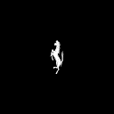  [BlenderRAG](https://arxiv.org/abs/2605.00632) Ferrari · University of Bologna | 数据集 | [GitHub](https://github.com/MaxRondelli/BlenderRAG) | 文本+bpy 代码+渲染图 | 500 | <a class="hf" href="https://github.com/MaxRondelli/BlenderRAG"><svg class="hf-i" viewBox="0 0 24 24" fill="currentColor"><path d="M12 2.5l2.9 6 6.6.6-5 4.3 1.5 6.5L12 16.9 6 20.9l1.5-6.5-5-4.3 6.6-.6z"/></svg>19</a> | **专家校验检索库**：Claude 写初稿专家修正，供 RAG 检索示例 | — |
| 2026/5/31 |   [3DCodeBench](https://arxiv.org/abs/2606.01057) Google DeepMind · USC | Benchmark | [GitHub](https://github.com/gaoypeng/3dcodebench) | 文本/图像→bpy（Blender Python） | 212 | <a class="hf" href="https://github.com/gaoypeng/3dcodebench"><svg class="hf-i" viewBox="0 0 24 24" fill="currentColor"><path d="M12 2.5l2.9 6 6.6.6-5 4.3 1.5 6.5L12 16.9 6 20.9l1.5-6.5-5-4.3 6.6-.6z"/></svg>99</a> | **程序化建模**：Blender 5.0 API 正确性与部件连接合理性 | — |
| 2026/5/31 | 3 3DCode 3DCodeBench | 数据集 | [HF](https://huggingface.co/datasets/YipengGao/3DCode) | 文本→bpy（Infinigen 转写） | 12,720 | <a class="hf" href="https://huggingface.co/datasets/YipengGao/3DCode"><svg class="hf-i" viewBox="0 0 24 24" fill="none" stroke="currentColor" stroke-width="2.2" stroke-linecap="round" stroke-linejoin="round"><path d="M12 3v11"/><path d="M8 11l4 4 4-4"/><path d="M4 20h16"/></svg>79.6k<svg class="hf-i" viewBox="0 0 24 24" fill="currentColor"><path d="M12 21C7 17.5 3 14 3 9.5 3 7 5 5 7.5 5 9.2 5 10.7 6 12 7.6 13.3 6 14.8 5 16.5 5 19 5 21 7 21 9.5 21 14 17 17.5 12 21z"/></svg>32</a> | **独立可运行的 bpy**：Infinigen 生成器转写，脚本 + 描述 + 4 视角渲染 + GLB，MIT | 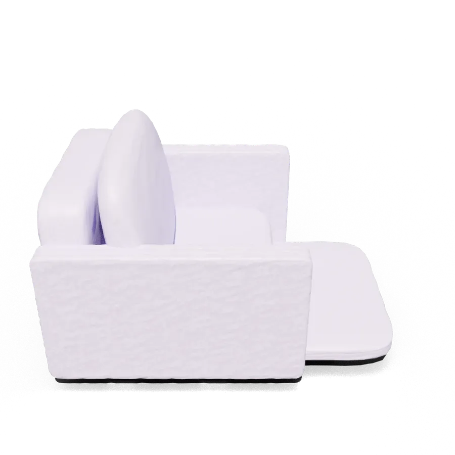3 3DCode<svg class="hf-i" viewBox="0 0 24 24" fill="none" stroke="currentColor" stroke-width="2.2" stroke-linecap="round" stroke-linejoin="round"><path d="M12 3v11"/><path d="M8 11l4 4 4-4"/><path d="M4 20h16"/></svg>79.6k<svg class="hf-i" viewBox="0 0 24 24" fill="currentColor"><path d="M12 21C7 17.5 3 14 3 9.5 3 7 5 5 7.5 5 9.2 5 10.7 6 12 7.6 13.3 6 14.8 5 16.5 5 19 5 21 7 21 9.5 21 14 17 17.5 12 21z"/></svg>326 条样例 |
| 2026/7/2 |  [4DBuildBench（SimWorlds）](https://arxiv.org/abs/2607.01766) Harvard | Benchmark | — | 文本→动态 bpy（Blender Python） | 50 | — | **动态物理场景**：生成可编辑 4D 场景并正确配置物理求解器 | — |
| 2026/7/22 |   [Nova3D-Bench](https://arxiv.org/abs/2607.22738) Rare Sense · University of Edinburgh | Benchmark | [GitHub](https://github.com/RareSense/Nova3D) | 文本/图像→bpy（Blender Python） | 54 | <a class="hf" href="https://github.com/RareSense/Nova3D"><svg class="hf-i" viewBox="0 0 24 24" fill="currentColor"><path d="M12 2.5l2.9 6 6.6.6-5 4.3 1.5 6.5L12 16.9 6 20.9l1.5-6.5-5-4.3 6.6-.6z"/></svg>718</a> | **可编程资产**：带命名部件、层级与约束的可执行 3D 程序 | — |
| 2026/9/5 | K 3D-Front-Code KevinFan111 | 数据集 | [HF](https://huggingface.co/datasets/KevinFan111/3d-front-code) | 布局→bpy 代码 | 物体 13,917 · 房间 21,202 | <a class="hf" href="https://huggingface.co/datasets/KevinFan111/3d-front-code"><svg class="hf-i" viewBox="0 0 24 24" fill="none" stroke="currentColor" stroke-width="2.2" stroke-linecap="round" stroke-linejoin="round"><path d="M12 3v11"/><path d="M8 11l4 4 4-4"/><path d="M4 20h16"/></svg>1.5k<svg class="hf-i" viewBox="0 0 24 24" fill="currentColor"><path d="M12 21C7 17.5 3 14 3 9.5 3 7 5 5 7.5 5 9.2 5 10.7 6 12 7.6 13.3 6 14.8 5 16.5 5 19 5 21 7 21 9.5 21 14 17 17.5 12 21z"/></svg>0</a> | **整屋布局代码**：物体 bpy 程序 + 房间布局代码；上游 3D-FRONT 另有条款 | — |
| 2026/9/5 | F BlenderLore FreedomIntelligence | 数据集 | [HF](https://huggingface.co/datasets/FreedomIntelligence/BlenderLore) | 教程→.blend 工程 | 21,449 | <a class="hf" href="https://huggingface.co/datasets/FreedomIntelligence/BlenderLore"><svg class="hf-i" viewBox="0 0 24 24" fill="none" stroke="currentColor" stroke-width="2.2" stroke-linecap="round" stroke-linejoin="round"><path d="M12 3v11"/><path d="M8 11l4 4 4-4"/><path d="M4 20h16"/></svg>16.4k<svg class="hf-i" viewBox="0 0 24 24" fill="currentColor"><path d="M12 21C7 17.5 3 14 3 9.5 3 7 5 5 7.5 5 9.2 5 10.7 6 12 7.6 13.3 6 14.8 5 16.5 5 19 5 21 7 21 9.5 21 14 17 17.5 12 21z"/></svg>7</a> | **教程配套工程**：.blend + 预览图 + 教程文本；标 Apache-2.0，来源权属存疑 | — |
| 2026/9/6 |  [3DHarnessBench](https://arxiv.org/abs/2609.06535) École Polytechnique | Benchmark | [HF](https://huggingface.co/datasets/lingada/3DHarnessBench) | 3D→bpy（Blender Python） | 4 级 | <a class="hf" href="https://github.com/llada60/3DHarnessBench"><svg class="hf-i" viewBox="0 0 24 24" fill="currentColor"><path d="M12 2.5l2.9 6 6.6.6-5 4.3 1.5 6.5L12 16.9 6 20.9l1.5-6.5-5-4.3 6.6-.6z"/></svg>14</a> | **3D→代码**：工具权限逐级放开下还原几何为 Blender 代码 | — |
| 2026/10/14 | A Z BlenderWorld Alibaba Token Hub · Zhejiang University | Benchmark | [HF](https://huggingface.co/datasets/Qwen/BlenderWorld) | 文/图/视频参考→bpy（Blender / bpy） | 223 | <a class="hf" href="https://github.com/QwenLM/BlenderWorld"><svg class="hf-i" viewBox="0 0 24 24" fill="none" stroke="currentColor" stroke-width="2.2" stroke-linecap="round" stroke-linejoin="round"><path d="M12 3v11"/><path d="M8 11l4 4 4-4"/><path d="M4 20h16"/></svg>2.4k<svg class="hf-i" viewBox="0 0 24 24" fill="currentColor"><path d="M12 2.5l2.9 6 6.6.6-5 4.3 1.5 6.5L12 16.9 6 20.9l1.5-6.5-5-4.3 6.6-.6z"/></svg>136</a> | **真实参考驱动的 3D 创作**：2,651 条二值 rubric，结构判据读场景图且设硬门控 | — |
| 2026/10/15 | I 3DCodeVerse ilabai | 数据集 | [HF](https://huggingface.co/datasets/ilabai/3dcodeverse) | 文本→多栈 3D 代码 | 约 203 万行 | <a class="hf" href="https://huggingface.co/datasets/ilabai/3dcodeverse"><svg class="hf-i" viewBox="0 0 24 24" fill="none" stroke="currentColor" stroke-width="2.2" stroke-linecap="round" stroke-linejoin="round"><path d="M12 3v11"/><path d="M8 11l4 4 4-4"/><path d="M4 20h16"/></svg>257.7k<svg class="hf-i" viewBox="0 0 24 24" fill="currentColor"><path d="M12 21C7 17.5 3 14 3 9.5 3 7 5 5 7.5 5 9.2 5 10.7 6 12 7.6 13.3 6 14.8 5 16.5 5 19 5 21 7 21 9.5 21 14 17 17.5 12 21z"/></svg>37</a> | **多栈 3D 代码**：Blender / three.js / Shadertoy / CadQuery / OpenSCAD；CC-BY-NC-SA；three.js 子集由编码 agent 生成 | — |

浏览器端 3D 代码：three.js 场景、参数化 3D，渲染与几何检查都在无头浏览器里完成。 本组 3 条 benchmark、0 条数据管线，按发布日期混排。

| 发布日期 | 名称 | 类型 | Download | 形态 | 规模 / 题量 | 影响力 | 说明 | Example |
|---|---|---|---|---|---|---|---|---|
| 2026/6/1 |   [WorldCoder-Bench](https://arxiv.org/abs/2606.01869) Huawei Noah's Ark Lab · CASIA | Benchmark | [HF](https://huggingface.co/datasets/shuolucs/WorldCoder-Bench) | 文本→Three.js（JS (Three.js)） | 2,026 | <a class="hf" href="https://huggingface.co/datasets/shuolucs/WorldCoder-Bench"><svg class="hf-i" viewBox="0 0 24 24" fill="none" stroke="currentColor" stroke-width="2.2" stroke-linecap="round" stroke-linejoin="round"><path d="M12 3v11"/><path d="M8 11l4 4 4-4"/><path d="M4 20h16"/></svg>261</a> | **可交互 3D 世界**：隐藏运行时状态须与物理/控件约束一致 | — |
| 2026/6/9 |   [P3D-Bench](https://arxiv.org/abs/2606.11152) Envision · Nanjing University | Benchmark | [HF](https://huggingface.co/datasets/SpatiaOS/P3D-Bench) | 文本/图像→参数化 3D（OpenSCAD 等 4 种格式） | 1,003 | <a class="hf" href="https://github.com/SpatiaOS/P3D-Bench"><svg class="hf-i" viewBox="0 0 24 24" fill="currentColor"><path d="M12 2.5l2.9 6 6.6.6-5 4.3 1.5 6.5L12 16.9 6 20.9l1.5-6.5-5-4.3 6.6-.6z"/></svg>53</a> | **参数化结构推理**：精确尺寸、拓扑与多部件装配 | — |
| 2026/9 | G 3JSBench General Context Labs | Benchmark | [GitHub](https://github.com/GeneralContext/3jsbench) | 文本→three.js（three.js） | 100 | <a class="hf" href="https://github.com/GeneralContext/3jsbench"><svg class="hf-i" viewBox="0 0 24 24" fill="currentColor"><path d="M12 2.5l2.9 6 6.6.6-5 4.3 1.5 6.5L12 16.9 6 20.9l1.5-6.5-5-4.3 6.6-.6z"/></svg>9</a> | **几何与结构精度**：744 条检查里 696 条必查，全过才算通过，当前量程最好 | — |

写 CadQuery 等参数化 CAD 代码，按尺寸、约束、可制造性验收，确定性最高。 本组 8 条 benchmark、8 条数据管线，按发布日期混排。

| 发布日期 | 名称 | 类型 | Download | 形态 | 规模 / 题量 | 影响力 | 说明 | Example |
|---|---|---|---|---|---|---|---|---|
| 2021/5/20 |  [DeepCAD](https://arxiv.org/abs/2105.09492) Columbia | 数据集 | [GitHub](https://github.com/ChrisWu1997/DeepCAD) | Onshape→CAD 构造序列 | 178,238 | <a class="hf" href="https://github.com/rundiwu/DeepCAD"><svg class="hf-i" viewBox="0 0 24 24" fill="currentColor"><path d="M12 2.5l2.9 6 6.6.6-5 4.3 1.5 6.5L12 16.9 6 20.9l1.5-6.5-5-4.3 6.6-.6z"/></svg>827</a> | **CAD 序列基座**：解析 Onshape 公开模型得建模序列，下游广泛沿用 | — |
| 2024/9/25 |  [Text2CAD](https://arxiv.org/abs/2409.17106) DFKI | Benchmark | [HF](https://huggingface.co/datasets/SadilKhan/Text2CAD) | 文本→CAD 序列（CAD 命令序列） | 170K | <a class="hf" href="https://github.com/SadilKhan/Text2CAD"><svg class="hf-i" viewBox="0 0 24 24" fill="currentColor"><path d="M12 2.5l2.9 6 6.6.6-5 4.3 1.5 6.5L12 16.9 6 20.9l1.5-6.5-5-4.3 6.6-.6z"/></svg>477</a> | **多粒度文本→CAD**：从新手到专家描述生成参数化建模序列 | — |
| 2024/9/25 |  [Text2CAD](https://arxiv.org/abs/2409.17106) DFKI | 数据集 | [HF](https://huggingface.co/datasets/SadilKhan/Text2CAD) | 多级文本→CAD 序列 | 170K | <a class="hf" href="https://huggingface.co/datasets/SadilKhan/Text2CAD"><svg class="hf-i" viewBox="0 0 24 24" fill="none" stroke="currentColor" stroke-width="2.2" stroke-linecap="round" stroke-linejoin="round"><path d="M12 3v11"/><path d="M8 11l4 4 4-4"/><path d="M4 20h16"/></svg>522</a> | **多粒度文本标注**：VLM/LLM 给 DeepCAD 配新手到专家四级描述 | — |
| 2024/10/7 |  [CADPrompt](https://arxiv.org/abs/2410.05340) Georgia Tech | Benchmark | [GitHub](https://github.com/Kamel773/CAD_Code_Generation) | 文本→CAD 代码（CadQuery (Python)） | 200 | <a class="hf" href="https://github.com/Kamel773/CAD_Code_Generation"><svg class="hf-i" viewBox="0 0 24 24" fill="currentColor"><path d="M12 2.5l2.9 6 6.6.6-5 4.3 1.5 6.5L12 16.9 6 20.9l1.5-6.5-5-4.3 6.6-.6z"/></svg>65</a> | **CAD 脚本自验证**：生成 CadQuery 并按点云距离迭代修正 | — |
| 2024/11/7 |   [CAD-MLLM / Omni-CAD](https://arxiv.org/abs/2411.04954) DeepSeek · HKU | 数据集 | [HF](https://huggingface.co/datasets/jingwei-xu-00/Omni-CAD) | 文本/多视图/点云→CAD | 450K | <a class="hf" href="https://huggingface.co/datasets/jingwei-xu-00/Omni-CAD"><svg class="hf-i" viewBox="0 0 24 24" fill="none" stroke="currentColor" stroke-width="2.2" stroke-linecap="round" stroke-linejoin="round"><path d="M12 3v11"/><path d="M8 11l4 4 4-4"/><path d="M4 20h16"/></svg>266</a> | **多模态条件齐全**：每个 CAD 配文本、多视图、点云和命令序列 | — |
| 2024/12/18 |   [CAD-Recode](https://arxiv.org/abs/2412.14042) Artec3D · University of Luxembourg | 数据集 | [HF](https://huggingface.co/datasets/filapro/cad-recode) | 点云→CadQuery | 1M | <a class="hf" href="https://huggingface.co/datasets/filapro/cad-recode"><svg class="hf-i" viewBox="0 0 24 24" fill="none" stroke="currentColor" stroke-width="2.2" stroke-linecap="round" stroke-linejoin="round"><path d="M12 3v11"/><path d="M8 11l4 4 4-4"/><path d="M4 20h16"/></svg>4.1k</a> | **程序化合成代码**：图元布尔+拉伸合成，BRep 校验去重，可直接 SFT | <pre class="sg-code">import cadquery as cq&#10;w0=cq.Workplane('YZ',origin=(-1,0,0))&#10;r=w0.workplane(offset=-13/2).moveTo(24,3).cylinder(13,12).union(w0.sketch().segment((-50,-8),(-26,-19)).segment((-26,-26)).segment((30,-26)).segment((30,2)).segment((50,2)).segment((50,4)).segment((30,4)).segment((30,26)).segment((-26,26)).segment((-26,21)).segment((-35,25)).close().assemble().finalize().extrude(15))</pre>  CAD-Recode Artec3D · University of Luxembourg<svg class="hf-i" viewBox="0 0 24 24" fill="none" stroke="currentColor" stroke-width="2.2" stroke-linecap="round" stroke-linejoin="round"><path d="M12 3v11"/><path d="M8 11l4 4 4-4"/><path d="M4 20h16"/></svg>4.1k3 条样例 |
| 2025/1/31 |   [CADFusion](https://arxiv.org/abs/2501.19054) Microsoft Research · University of Toronto | 数据集 | [GitHub](https://github.com/microsoft/CADFusion) | 文本→CAD 序列+渲染偏好 | — | <a class="hf" href="https://github.com/microsoft/CADFusion"><svg class="hf-i" viewBox="0 0 24 24" fill="currentColor"><path d="M12 2.5l2.9 6 6.6.6-5 4.3 1.5 6.5L12 16.9 6 20.9l1.5-6.5-5-4.3 6.6-.6z"/></svg>91</a> | **视觉反馈偏好**：渲染图被偏好的序列得奖励，与序列学习交替训练 | — |
| 2025/5/20 |  [CAD-Coder（VLM 版）/ GenCAD-Code](https://arxiv.org/abs/2505.14646) MIT | 数据集 | [HF](https://huggingface.co/datasets/CADCODER/GenCAD-Code) | CAD 图像→CadQuery | 163K+ | <a class="hf" href="https://huggingface.co/datasets/CADCODER/GenCAD-Code"><svg class="hf-i" viewBox="0 0 24 24" fill="none" stroke="currentColor" stroke-width="2.2" stroke-linecap="round" stroke-linejoin="round"><path d="M12 3v11"/><path d="M8 11l4 4 4-4"/><path d="M4 20h16"/></svg>545</a> | **图像-代码对**：GenCAD 模型转 CadQuery 并渲染，直接 SFT | — |
| 2025/5/26 |  [CAD-Coder（文本版）](https://arxiv.org/abs/2505.19713) HKU | 数据集 | [HF](https://huggingface.co/datasets/gudo7208/CAD-Coder) | 文本→CadQuery→3D | 110K | <a class="hf" href="https://huggingface.co/datasets/gudo7208/CAD-Coder"><svg class="hf-i" viewBox="0 0 24 24" fill="none" stroke="currentColor" stroke-width="2.2" stroke-linecap="round" stroke-linejoin="round"><path d="M12 3v11"/><path d="M8 11l4 4 4-4"/><path d="M4 20h16"/></svg>541</a> | **CD 择优+CoT**：V3 多候选执行取 CD 最小者，另配 1.5K CoT | — |
| 2025/5/28 |  [cadrille](https://arxiv.org/abs/2505.22914) ETH Zurich | 数据集 | [GitHub](https://github.com/col14m/cadrille) | 点云/图像/文本→CAD 代码 | — | <a class="hf" href="https://github.com/col14m/cadrille"><svg class="hf-i" viewBox="0 0 24 24" fill="currentColor"><path d="M12 2.5l2.9 6 6.6.6-5 4.3 1.5 6.5L12 16.9 6 20.9l1.5-6.5-5-4.3 6.6-.6z"/></svg>185</a> | **在线几何 RL**：程序化数据 SFT 后以几何反馈做在线 GRPO | — |
| 2026/5/8 |  [CADTests（CADTestBench）](https://arxiv.org/abs/2605.07807) University of Luxembourg | Benchmark | [HF](https://huggingface.co/datasets/dimitrismallis/CADTestBench) | 文本→CAD 代码（CadQuery (Python)） | — | <a class="hf" href="https://github.com/dimitrismallis/CADTestBench"><svg class="hf-i" viewBox="0 0 24 24" fill="currentColor"><path d="M12 2.5l2.9 6 6.6.6-5 4.3 1.5 6.5L12 16.9 6 20.9l1.5-6.5-5-4.3 6.6-.6z"/></svg>12</a> | **测试驱动 CAD**：用可执行测试验证几何/拓扑需求是否满足 | — |
| 2026/5/11 |  [BenchCAD](https://arxiv.org/abs/2605.10865) UC San Diego | Benchmark | [HF](https://huggingface.co/datasets/BenchCAD/BenchCAD) | 图像→CAD 代码（CadQuery (Python)） | 17.9K | <a class="hf" href="https://github.com/BenchCAD/BenchCAD-main"><svg class="hf-i" viewBox="0 0 24 24" fill="currentColor"><path d="M12 2.5l2.9 6 6.6.6-5 4.3 1.5 6.5L12 16.9 6 20.9l1.5-6.5-5-4.3 6.6-.6z"/></svg>71</a> | **工业级 CAD 操作**：sweep/loft 等高级特征而非一律拉伸 | — |
| 2026/5/11 |  [CADBench](https://arxiv.org/abs/2605.10873) MIT | Benchmark | [HF](https://huggingface.co/datasets/DeCoDELab/CADBench) | 多模态→CAD 代码（CadQuery (Python)） | 18K | <a class="hf" href="https://github.com/anniedoris/CADBench"><svg class="hf-i" viewBox="0 0 24 24" fill="currentColor"><path d="M12 2.5l2.9 6 6.6.6-5 4.3 1.5 6.5L12 16.9 6 20.9l1.5-6.5-5-4.3 6.6-.6z"/></svg>22</a> | **可编辑 CAD 逆向**：从 mesh/点云/图像恢复紧凑 CAD 程序 | — |
| 2026/5/18 | B  [Text2CAD-Bench](https://arxiv.org/abs/2605.18430) BitInf · CASIA | Benchmark | [HF](https://huggingface.co/datasets/AICAD/Text2CAD-Bench) | 文本→CAD 代码（CadQuery (Python)） | 600 | <a class="hf" href="https://huggingface.co/datasets/AICAD/Text2CAD-Bench"><svg class="hf-i" viewBox="0 0 24 24" fill="none" stroke="currentColor" stroke-width="2.2" stroke-linecap="round" stroke-linejoin="round"><path d="M12 3v11"/><path d="M8 11l4 4 4-4"/><path d="M4 20h16"/></svg>122</a> | **复杂特征与跨领域**：分级考察高级建模特征与双风格描述 | — |
| 2026/5/27 | C  [MUSE](https://arxiv.org/abs/2605.28579) Curvature Flow · PolyU | Benchmark | [HF](https://huggingface.co/datasets/dongxiaoyu/MUSE) | 文本→CAD 装配（CadQuery (Python)） | — | <a class="hf" href="https://github.com/dong7313/muse"><svg class="hf-i" viewBox="0 0 24 24" fill="currentColor"><path d="M12 2.5l2.9 6 6.6.6-5 4.3 1.5 6.5L12 16.9 6 20.9l1.5-6.5-5-4.3 6.6-.6z"/></svg>7</a> | **工程设计意图**：可制造、可装配、功能满足的 B-Rep 装配体 | — |
| 2026/8/10 |  [CADEngBench](https://arxiv.org/abs/2608.09296) MBZUAI | Benchmark | — | 文本→CAD 代码（CadQuery (Python)） | 600 | — | **工程级可用性**：参数扰动、有限元与装配运动学全验证 | — |

1. cad 不是 blender 的简化版。
   - CAD 用精确的 B-Rep 曲面，面向加工；Blender 用多边形网格，面向渲染
   - 列在这里，是因为它的确定性验收与程序化合成可以直接搬到 blender 与 3js
2. cad 是唯一两头都有规模的技术栈。
   - 公开数据集量级约 17 万、17 万、100 万，产物都能按执行结果判分
   - BenchCAD 近 2 万个参数化程序全部按执行结果判分，不用模型打分
3. blender 的管线分生成器与真数据集两类：要产能用生成器，要贴近人写代码的分布用数据集。
   - 两条程序化生成器产能无上限；十条真数据集里最大的约 203 万行（3DCodeVerse，非商用），输入从纯指令、点云到整屋布局
   - 2026 年 9–10 月新增四条：3DCode（MIT）、3D-Front-Code、3DCodeVerse、BlenderLore，许可只有 3DCode 干净
4. 3js 倒挂：benchmark 3 条，数据管线 0 条。
   - 公开的只有 benchmark（确定性检查、隐藏运行时状态）与像素基线仓库（three.js examples 613 组图与页）
5. 3js 的分数还没饱和，模型差距拉得最开。
   - [3JSBench](https://3jsbench.com/)：744 条检查判 100 道题，必查项全过才算通过；GPT-6 Astra 80.0%、Claude Opus 5.5 49.0%、Kimi K3 23.0%
   - 一半以上检查在数部件、查结构：部件计数 223、结构 160、空间关系 157、任务专属几何 45、文字 12、渲染质量 98
   - 同批尝试的 SigLIP2 相似度均值都在 0.0774–0.1081，跨运行环境噪声 0.005 大于模型间差异 0.004
6. Verifier 确定只是必要条件，量程落在中段才能把模型分开。
   - [WorldCoder-Bench](https://arxiv.org/abs/2606.01869) 同样查运行时状态，最好系统不到 30%，前四名挤在 23.0%–27.8%
7. blender 方向的失败集中在 API 层。
   - 3DCodeBench（212 个类别）：首要失败原因是 API 不匹配，不是空间推理错
   - BlenderGym（245 个编辑任务）：最强 VLM 在人类认为简单的任务上仍然失败
8. cad 是唯一进了厂商发布页的 3D 指标，但两家数字不能直接比。
   - BenchCAD：OpenAI 报 GPT-6 Astra 95.9%（带工具，geometric overlap）；Anthropic 报 Claude Opus 5 的 Vision2Code 子任务 0.366 / 0.821（voxel IoU，不带工具 / 带工具，1,000 个文件的子集）
   - 官方榜把两家分数都标为厂商自报、未重新评测
9. 公开供给与主力技术栈错位，因此 3D 的自建比例必须比 Web 高。

## 2 Timeline

评测对象：渲染看起来像不像<i></i>场景状态对不对

2024

文本转 CAD

几何与执行检查人工评审

<a href="https://arxiv.org/abs/2402.09052">UFO（L3GO）</a>2024-02

50 条非常规物体描述；Blender 里调 API 搭积木，人评

<a href="https://arxiv.org/abs/2409.17106">Text2CAD</a>2024-09

约 170K 个模型、约 660K 条文本标注

<a href="https://arxiv.org/abs/2410.05340">CADPrompt</a>2024-10

200 条 prompt；按点云距离与成功率判分

2025

Blender 编辑

视觉相似度

<a href="https://arxiv.org/abs/2504.01786">BlenderGym</a>2025-04

245 个手工场景、5 类任务；改脚本把起始场景对齐到目标场景

2026-01 – 2026-05

程序化建模与 CAD

几何与执行检查视觉相似度

<a href="https://arxiv.org/abs/2601.11109">BlenderBench（VIGA）</a>2026-01

看图迭代写 Blender 代码重建场景

<a href="https://arxiv.org/abs/2605.10865">BenchCAD</a>2026-05

17,900 个 CadQuery 程序；全部按执行结果判分

<i style="width:95.9%"></i><b>95.9%</b><em>厂商自报（GPT-6 Astra，带工具）</em>

<a href="https://arxiv.org/abs/2606.01057">3DCodeBench</a>2026-05

212 个类别；失败多来自 API 不匹配

2026-06 – 2026-08

运行时状态与工程验证

运行时状态几何与执行检查

<a href="https://arxiv.org/abs/2606.01869">WorldCoder-Bench</a>2026-06

2,026 个任务；查 three.js 隐藏运行时状态

<i style="width:27.8%"></i><b>27.8%</b><em>发布时最好（Core）</em>

<a href="https://arxiv.org/abs/2606.11152">P3D-Bench</a>2026-06

1,003 题；整体形状对，精确参数做不出

<a href="https://arxiv.org/abs/2607.01766">4DBuildBench</a>2026-07

50 个场景；审计物理求解器状态

<a href="https://arxiv.org/abs/2608.09296">CADEngBench</a>2026-08

600 个任务；有限元与装配运动学

2026-09 – 2026-10

确定性门控与 agent

几何与执行检查agent 实测

<a href="https://3jsbench.com/">3JSBench</a>2026-09

744 条检查，必查项全过才算通过

<i style="width:80.0%"></i><b>80.0%</b><em>榜单（GPT-6 Astra）</em>

<i style="width:49.0%"></i><b>49.0%</b><em>榜单（Claude Opus 5.5）</em>

<a href="https://arxiv.org/abs/2609.06535">3DHarnessBench</a>2026-09

4 级工具权限；把 3D 几何还原为 Blender 代码

<a href="https://arxiv.org/abs/2610.10622">WorldBench</a>2026-10

three.js 体素世界；看图与读代码在 32% 的必查项上判断不一致

<a href="https://huggingface.co/datasets/Qwen/BlenderWorld">BlenderWorld</a>2026-10

223 个任务、2,651 条二值 rubric

<i style="background:var(--brand)"></i>发布时最好成绩<i style="background:#b8bfc9"></i>后续成绩（厂商自报或榜单）

## 3 Gaps

公开 3D 数据给的是资产，不是代码：能导入渲染的资产只占索引的约 15%，three.js 没有一条公开训练配对，因此 3D 的 Query 与 Verifier 比 Web 更依赖自建。

- 补齐方式：Query 见 Sources 页，Verifier 见 Verifier 页，Harness 见 Train 页

可验证任务需要的 Query（题干）、Verifier（判据）、Harness（运行环境）与难度标注，公开 3D 数据都不稳定提供；许可、可运行、版本三项都要在训练前核对。

1. 资产库只有网格与元数据，没有生成它的代码。
   - [Objaverse-XL](https://arxiv.org/abs/2307.05663)：代码托管侧索引 3,700 万个文件，能被 Blender 导入并渲染的 550 万（14.9%），可商用约 190 万
2. 代码来源规模小，three.js 没有一条公开训练配对。
   - Blender bpy 仓库 6,307 → 56 个可用；three.js 仓库星数 > 10 的 2,401 个；两者都只筛标签与星数，没做可运行性检查
3. 公开基准多用视觉相似度，不提供读场景状态的 Verifier。
   - 本项目 three.js 原型：雪人任务的 6 个候选页面，单张截图相似度全落在 0.973–1.0，分不开好坏
4. 公开基准常不记录 Blender 版本，因此结果不可复现。
   - BlenderGym 未写明所用 Blender 版本
5. 训练前还要核对许可。
   - Blender 官方扩展目录 1,533 个，传染性许可 1,341 个，MIT 4 个
   - Sketchfab 须剔除 NC 许可；问答站条款要求数据不用于模型训练
6. Blender 按版本分叉，每道题须钉死运行时版本。
   - 做法见 Train 页 4.1

## 4 How To Choose

按目标能力选，不按名气选：确定性检查类可以当主指标，VLM judge 只作参考。

| 目标能力 | 用哪些 | 能不能当主指标 |
|---|---|---|
| 程序化建模 | 3DCodeBench、BlenderGym | 能 |
| 几何精度与量程 | 3JSBench | 能，当前量程最好 |
| 动态场景与物理 | 4DBuildBench、WorldCoder-Bench | 能，但量程压在 30% 以下 |
| 精确参数与约束 | BenchCAD、CADTests、Text2CAD-Bench | 能，确定性最高 |
| 装配与部件连接 | P3D-Bench、CADEngBench | 能 |

3 <a href="https://huggingface.co/datasets/YipengGao/3DCode">3DCode</a> <button type="button" class="sg-prev" title="上一个（←）">‹</button><button type="button" class="sg-next" title="下一个（→）">›</button><button type="button" class="sg-x" title="关闭（Esc）">✕</button>

<b>数据样例</b> · <a href="https://huggingface.co/datasets/YipengGao/3DCode">YipengGao/3DCode</a>

<b>3DCodeData/ArmChair_000/renders/Image_005.webp</b>

ArmChair_000.py（共 1818 行，展示前 60 行）
<pre># ArmChairFactory — standalone Blender script (GeoNodes geometry + fabric material).&#10;# Material: weighted_sample(fabrics) under raw SEED; no wear_tear (SofaFactory has none).&#10;# SEED-deterministic: seed_all(SEED) at module level for material; geometry uses re-seeded RNG&#10;import os, bpy, random, colorsys&#10;import numpy as np&#10;&#10;for _o in list(bpy.data.objects):&#10;    bpy.data.objects.remove(_o, do_unlink=True)&#10;for _m in list(bpy.data.meshes):&#10;    bpy.data.meshes.remove(_m)&#10;for _c in list(bpy.data.collections):&#10;    if _c != bpy.context.scene.collection:&#10;        bpy.data.collections.remove(_c)&#10;bpy.context.scene.cursor.location = (0, 0, 0)&#10;&#10;def seed_all(seed):&#10;    np.random.seed(seed); random.seed(seed)&#10;&#10;def log_uniform(lo, hi):&#10;    return float(np.exp(np.random.uniform(np.log(lo), np.log(hi))))&#10;&#10;def weighted_sample(reg):&#10;    classes, weights = zip(*reg)&#10;    w = np.array(weights, dtype=float)&#10;    return classes[int(np.random.choice(len(classes), p=w / w.sum()))]&#10;&#10;def hsv2rgba(h, s, v):&#10;    r, g, b = colorsys.hsv_to_rgb(float(h) % 1.0, float(s), float(v))&#10;    return (r, g, b, 1.0)&#10;&#10;def mixture_of_gaussian(means, stds, weights, clamp_min=None, clamp_max=None):&#10;    p = np.array(weights) / np.sum(weights)&#10;    idx = int(np.random.choice(len(p), p=p))&#10;    res = np.random.normal(means[idx], stds[idx])&#10;    if clamp_min is not None: res = np.maximum(res, clamp_min)&#10;    if clamp_max is not None: res = np.minimum(res, clamp_max)&#10;    return res&#10;&#10;def leather_hsv():&#10;    return mixture_of_gaussian(&#10;        means=np.array([[0.07, 0.45, 0.40], [0.6, 0.3, 0.40]]),&#10;        stds=0.7 * np.array([[0.0035, 0.0063, 0.2], [0.0105, 0.028, 0.2]]),&#10;        clamp_min=[0, 0, 0.06], clamp_max=[1, 1, 0.93], weights=[0.7, 0.3])&#10;&#10;def fabric_hsv():&#10;    return (0.9805983957,&#10;            0.4599842591,&#10;            0.7939269718)&#10;&#10;# ═══════════════════════════════════════════════════════════════════════════&#10;#  Material helpers&#10;# ═══════════════════════════════════════════════════════════════════════════&#10;&#10;def _new_mat(name):&#10;    mat = bpy.data.materials.new(name)&#10;    mat.use_nodes = True&#10;    mat.node_tree.nodes.clear()&#10;    return mat&#10;&#10;def _fac(node):&#10;…（截断，原文共 1818 行）</pre>

captions/caption_object.txt（共 2 行）
<pre>This is a modern, low-profile armchair with an integrated extending footrest, designed as a comfortable lounge chair. It features thick, blocky rectangular armrests framing a plush seat cushion and a gently reclined backrest cushion. A wide, flat, rounded-corner footrest panel extends horizontally from the front base of the chair. The entire piece is upholstered in a uniform, soft-textured fabric …（本行共 444 字符）&#10;</pre>

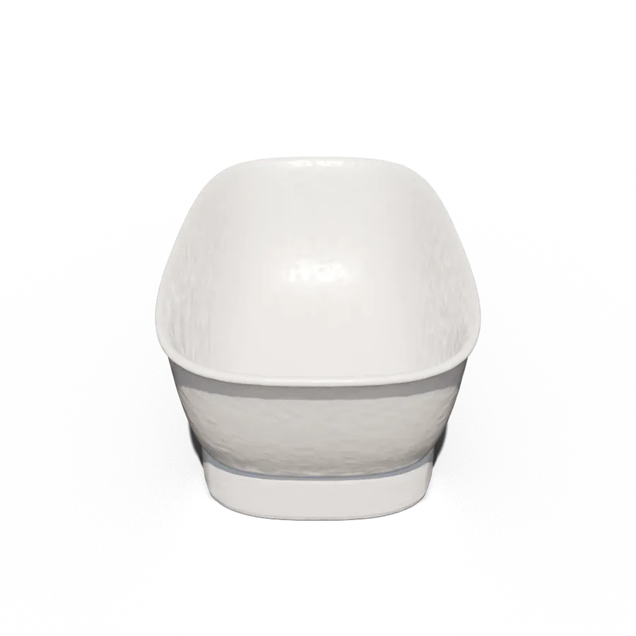
<b>3DCodeData/Bathtub_000/renders/Image_005.webp</b>

Bathtub_000.py（共 940 行，展示前 60 行）
<pre>import hashlib&#10;import os&#10;&#10;import bpy, bmesh&#10;import numpy as np&#10;import math, random, colorsys&#10;&#10;def int_hash(x):&#10;    m = hashlib.md5()&#10;    for s in x:&#10;        m.update(str(s).encode("utf-8"))&#10;    return abs(int(m.hexdigest(), 16)) % (2**32 - 1)&#10;&#10;# ============================================================================&#10;# Inlined material library — BathtubFactory uses:&#10;#   make_metal_basic (metal_neutral: legs + hole)&#10;#   make_ceramic (ceramics: bathtub surface)&#10;#   wear_tear (scratches + edge_wear)&#10;# ============================================================================&#10;&#10;def hsv2rgba(hsv):&#10;    h, s, v = hsv&#10;    h = h - math.floor(h)&#10;    s = max(0.0, min(1.0, s))&#10;    v = max(0.0, min(1.0, v))&#10;    r, g, b = colorsys.hsv_to_rgb(h, s, v)&#10;    return (r, g, b, 1.0)&#10;&#10;&#10;def log_uniform(lo, hi):&#10;    return float(np.exp(np.random.uniform(np.log(lo), np.log(hi))))&#10;&#10;&#10;# hex -&gt; hex2rgba (srgb_to_linear) -&gt; rgb2hsv&#10;_NATURAL_BASE_HSV = [&#10;    (0.0,    0.0,    0.5271),  # 0xC0C0C0 silver&#10;    (0.0961, 0.6702, 0.2623),  # 0x8C7853 khaki&#10;    (0.1319, 0.1682, 0.5089),  # 0xBDBAAE light gray&#10;    (0.6296, 0.1518, 0.4678),  # 0xA9ACB6 gray-blue&#10;    (0.0749, 0.1518, 0.4678),  # 0xB6AFA9 gray-beige&#10;]&#10;&#10;&#10;def metal_natural_hsv():&#10;    idx = np.random.randint(0, len(_NATURAL_BASE_HSV))&#10;    h, s, v = _NATURAL_BASE_HSV[idx]&#10;    return (&#10;        h + float(np.random.uniform(-0.1, 0.1)),&#10;        s + float(np.random.uniform(-0.1, 0.1)),&#10;        v * float(log_uniform(0.2, 0.5)),&#10;    )&#10;&#10;&#10;def metal_hsv():&#10;    if np.random.uniform() &lt; 0.2:&#10;        return metal_natural_hsv()&#10;    return (np.random.uniform(0, 1),&#10;            np.random.uniform(0.3, 0.6),&#10;            log_uniform(0.02, 0.5))&#10;&#10;…（截断，原文共 940 行）</pre>

captions/caption_object.txt（共 2 行）
<pre>This modern, minimalist freestanding bathtub features an elongated, oval-shaped basin with a clean, semi-glossy white ceramic finish. The tub's walls gently taper downward from a rounded, smooth rim to a narrower base. It sits upon a matching, low-profile solid base platform that mirrors the oval contour of the main body, raising the tub roughly 0.18 units off the floor. Inside, the spacious basin…（本行共 663 字符）&#10;</pre>

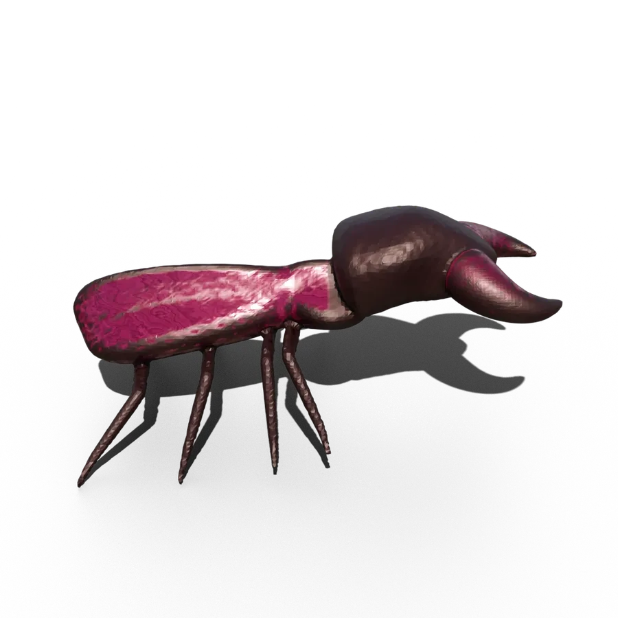
<b>3DCodeData/Beetle_000/renders/Image_005.webp</b>

Beetle_000.py（共 1410 行，展示前 60 行）
<pre>import os&#10;import hashlib&#10;import math&#10;&#10;import bpy&#10;import mathutils&#10;import numpy as np&#10;from mathutils.bvhtree import BVHTree&#10;&#10;&#10;SEED = int(os.environ.get("SEED", "543568399"))&#10;&#10;import random as _random, colorsys as _colorsys&#10;&#10;def _hsv2rgba(h, s, v):&#10;    r, g, b = _colorsys.hsv_to_rgb(float(h) % 1.0, max(0, min(1, float(s))), max(0, min(1, float(v))))&#10;    return (r, g, b, 1.0)&#10;&#10;def _log_uniform(lo, hi):&#10;    return float(np.exp(np.random.uniform(np.log(lo), np.log(hi))))&#10;&#10;def _new_mat(name):&#10;    mat = bpy.data.materials.new(name)&#10;    mat.use_nodes = True&#10;    mat.node_tree.nodes.clear()&#10;    return mat&#10;&#10;def _fac(n):&#10;    return n.outputs.get("Fac") or n.outputs.get("Factor") or n.outputs[0]&#10;&#10;def make_creature_material(seed, name="ChitinMaterial"):&#10;    """Chitin exoskeleton: metallic with pointiness-driven edge highlights.&#10;    Seeded via np.random.seed(seed) to match FixedSeed(factory_seed)."""&#10;&#10;    np.random.seed(seed); _random.seed(seed)&#10;    noise_w = 1.9223935827&#10;    chitin_color = _hsv2rgba(float(np.mod(0.6422578823, 1)),&#10;                              0.2393570223,&#10;                              0.2804019222)&#10;&#10;    mat = _new_mat(name); nt = mat.node_tree; ln = nt.links.new&#10;&#10;    geo = nt.nodes.new("ShaderNodeNewGeometry")&#10;&#10;    # Pointiness → edge highlight (3-stop ramp)&#10;    cr1 = nt.nodes.new("ShaderNodeValToRGB")&#10;    ln(geo.outputs["Pointiness"], cr1.inputs["Fac"])&#10;    cr1.color_ramp.elements.new(0)&#10;    cr1.color_ramp.elements[0].position = 0.4091; cr1.color_ramp.elements[0].color = (0, 0, 0, 1)&#10;    cr1.color_ramp.elements[1].position = 0.4455; cr1.color_ramp.elements[1].color = (1, 1, 1, 1)&#10;    cr1.color_ramp.elements[2].position = 0.5127; cr1.color_ramp.elements[2].color = (0, 0, 0, 1)&#10;&#10;    cr10 = nt.nodes.new("ShaderNodeValToRGB")&#10;    ln(cr1.outputs["Color"], cr10.inputs["Fac"])&#10;    cr10.color_ramp.elements[0].position = 0.0; cr10.color_ramp.elements[0].color = (0, 0, 0, 1)&#10;    cr10.color_ramp.elements[1].position = 0.2273; cr10.color_ramp.elements[1].color = (1, 1, 1, 1)&#10;&#10;    cr4 = nt.nodes.new("ShaderNodeValToRGB")&#10;    ln(geo.outputs["Pointiness"], cr4.inputs["Fac"])&#10;    cr4.color_ramp.elements[0].position = 0.4909; cr4.color_ramp.elements[0].color = (0, 0, 0, 1)&#10;…（截断，原文共 1410 行）</pre>

captions/caption_object.txt（共 2 行）
<pre>This 3D model depicts a stylized insect creature resembling a beetle, characterized by its distinct segmented body parts and striking color contrast. It features a glossy, dark brown head with two large, inward-curving mandibles that are textured in a shimmering magenta and black pattern. The elongated abdomen is covered in a matching vibrant magenta marbled design with a central dark stripe, givi…（本行共 557 字符）&#10;</pre>

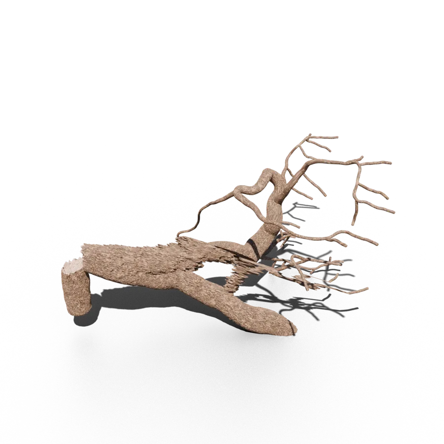
<b>3DCodeData/FallenTree_000/renders/Image_005.webp</b>

FallenTree_000.py（共 1356 行，展示前 60 行）
<pre>"""&#10;FallenTreeFactory -- standalone Blender script.&#10;&#10;Space-colonization tree cut at random height; upper half rotated to simulate&#10;a fallen trunk joined with the stump. Bark + ring-cross-section materials.&#10;&#10;Usage:&#10;    blender --background --python FallenTreeFactory.py&#10;"""&#10;&#10;&#10;import colorsys&#10;import math&#10;import os&#10;import random&#10;import sys&#10;import warnings&#10;&#10;import bmesh&#10;import bpy&#10;import numpy as np&#10;from mathutils import Vector&#10;from mathutils import noise as mnoise&#10;&#10;SEED = int(os.environ.get("SEED", 543568399))&#10;&#10;# ---------------------------------------------------------------------------&#10;# Helpers&#10;# ---------------------------------------------------------------------------&#10;&#10;def sel_none():&#10;    for obj in list(bpy.context.selected_objects):&#10;        obj.select_set(False)&#10;&#10;&#10;def set_active(obj):&#10;    bpy.context.view_layer.objects.active = obj&#10;    obj.select_set(True)&#10;&#10;&#10;def apply_modifier(obj, mod):&#10;    sel_none()&#10;    set_active(obj)&#10;    bpy.ops.object.modifier_apply(modifier=mod.name)&#10;    sel_none()&#10;&#10;&#10;def apply_transform(obj, location=False):&#10;    sel_none()&#10;    set_active(obj)&#10;    bpy.ops.object.transform_apply(location=location, rotation=True, scale=True)&#10;    sel_none()&#10;&#10;&#10;def read_co(obj):&#10;    arr = np.zeros(len(obj.data.vertices) * 3, dtype=np.float32)&#10;    obj.data.vertices.foreach_get("co", arr)&#10;    return arr.reshape(-1, 3)&#10;&#10;&#10;…（截断，原文共 1356 行）</pre>

captions/caption_object.txt（共 2 行）
<pre>This 3D object represents a detailed fallen tree, consisting of a short, upright stump and a sprawling, highly branched fallen trunk segment. The stump is a low cylinder, roughly 0.7 units high, with a diagonal cut at the top revealing a rough, light-colored inner wood surface. The fallen trunk segment rests on the ground, starting with a matching jagged, broken end that aligns with the stump's cu…（本行共 802 字符）&#10;</pre>

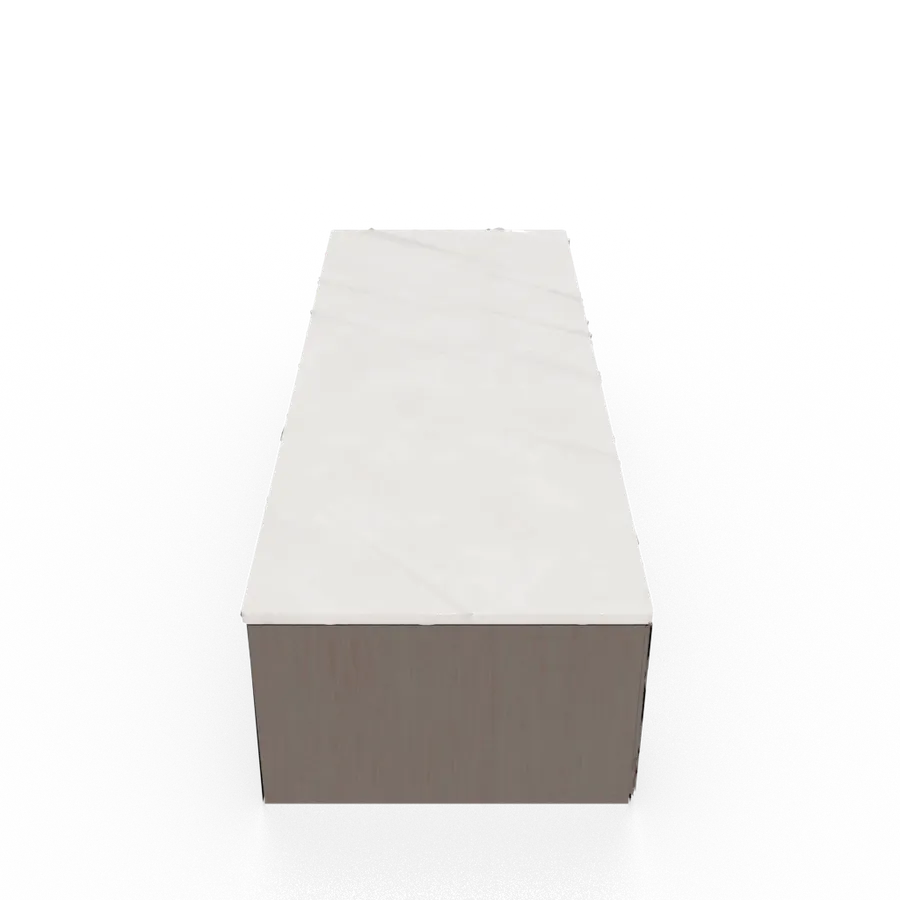
<b>3DCodeData/KitchenIsland_000/renders/Image_005.webp</b>

KitchenIsland_000.py（共 1463 行，展示前 60 行）
<pre>"""KitchenIslandFactory (textured)."""&#10;&#10;&#10;import os&#10;import bpy&#10;import bmesh&#10;import math&#10;import random&#10;import hashlib&#10;import colorsys&#10;import numpy as np&#10;from numpy.random import uniform&#10;from contextlib import contextmanager&#10;&#10;&#10;# ============================================================================&#10;# === Inlined material library (raw-bpy ports) ===============================&#10;#                                                     black_wood(_z) / wood(_z)&#10;# ============================================================================&#10;&#10;&#10;def seed_all(seed: int):&#10;    np.random.seed(int(seed))&#10;    random.seed(int(seed))&#10;&#10;&#10;def hsv2rgba(hsv):&#10;    h, s, v = hsv&#10;    h = h - math.floor(h)&#10;    s = max(0.0, min(1.0, s))&#10;    v = max(0.0, min(1.0, v))&#10;    r, g, b = colorsys.hsv_to_rgb(h, s, v)&#10;    return (r, g, b, 1.0)&#10;&#10;&#10;def _new_material(name: str) -&gt; bpy.types.Material:&#10;    mat = bpy.data.materials.new(name)&#10;    mat.use_nodes = True&#10;    nt = mat.node_tree&#10;    nt.nodes.clear()&#10;    return mat&#10;&#10;&#10;def _set_principled(bsdf, **kw):&#10;    aliases = {&#10;        "Specular IOR Level": ("Specular IOR Level", "Specular"),&#10;        "Specular": ("Specular IOR Level", "Specular"),&#10;        "Coat Weight": ("Coat Weight", "Clearcoat"),&#10;        "Sheen Weight": ("Sheen Weight", "Sheen"),&#10;    }&#10;    for k, v in kw.items():&#10;        names = aliases.get(k, (k,))&#10;        for name in names:&#10;            if name in bsdf.inputs:&#10;                bsdf.inputs[name].default_value = v&#10;                break&#10;&#10;&#10;def _noise_fac_output(noise_node):&#10;    if "Fac" in noise_node.outputs:&#10;…（截断，原文共 1463 行）</pre>

captions/caption_object.txt（共 2 行）
<pre>This sleek, rectangular kitchen island features a thick, polished white marble countertop characterized by soft, diagonal grey veining. The countertop overhangs a multi-compartment cabinet base that sits flush to the floor on a low plinth. The front and side panels of the base are wrapped in a uniform, matte, warm-grey wood veneer with a subtle vertical grain. On the opposite functional side, the …（本行共 672 字符）&#10;</pre>

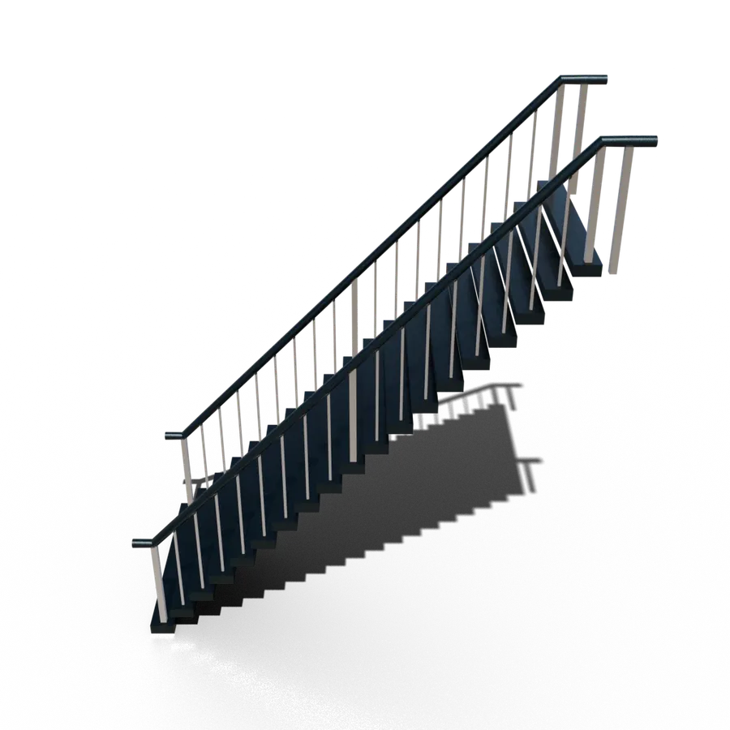
<b>3DCodeData/CantileverStaircase_000/renders/Image_005.webp</b>

CantileverStaircase_000.py（共 428 行，展示前 60 行）
<pre>import os&#10;import math&#10;import random&#10;import colorsys&#10;&#10;import bmesh&#10;import bpy&#10;import numpy as np&#10;&#10;SEED = int(os.environ.get("SEED", "543568399"))&#10;np.random.seed(SEED)&#10;&#10;def _hsv2rgba(h, s, v):&#10;    r, g, b = colorsys.hsv_to_rgb(float(h)%1, max(0,min(1,float(s))), max(0,min(1,float(v))))&#10;    return (r, g, b, 1.0)&#10;&#10;def _log_uniform(lo, hi):&#10;    return float(np.exp(np.random.uniform(np.log(lo), np.log(hi))))&#10;&#10;def _new_mat(name):&#10;    m = bpy.data.materials.new(name); m.use_nodes = True; m.node_tree.nodes.clear()&#10;    return m&#10;&#10;def _fac(n):&#10;    return n.outputs.get("Fac") or n.outputs.get("Factor") or n.outputs[0]&#10;&#10;def make_mat(seed, name="WoodMaterial"):&#10;    """Wood: warm brown with noise grain pattern."""&#10;&#10;    base_hue = 0.0988359037&#10;    c1 = _hsv2rgba(base_hue, 0.5279874073, 0.3762481338)&#10;    c2 = _hsv2rgba(base_hue + -0.0104257191, 0.4536012815, 0.4525538035)&#10;    mat = _new_mat(name); nt = mat.node_tree; ln = nt.links.new&#10;    tc = nt.nodes.new("ShaderNodeTexCoord")&#10;    noise = nt.nodes.new("ShaderNodeTexNoise"); ln(tc.outputs["Object"], noise.inputs["Vector"])&#10;    noise.inputs["Scale"].default_value = 19.2918892678&#10;    noise.inputs["Detail"].default_value = 5.0&#10;    cr = nt.nodes.new("ShaderNodeValToRGB"); ln(_fac(noise), cr.inputs["Fac"])&#10;    cr.color_ramp.elements[0].position = 0.3; cr.color_ramp.elements[0].color = c1&#10;    cr.color_ramp.elements[1].position = 0.7; cr.color_ramp.elements[1].color = c2&#10;    bsdf = nt.nodes.new("ShaderNodeBsdfPrincipled")&#10;    ln(cr.outputs["Color"], bsdf.inputs["Base Color"])&#10;    bsdf.inputs["Roughness"].default_value = 0.4183535033&#10;    out = nt.nodes.new("ShaderNodeOutputMaterial")&#10;    ln(bsdf.outputs["BSDF"], out.inputs["Surface"])&#10;    return mat&#10;&#10;ELEM_MAT = make_mat(SEED, "CantileverStaircaseFactory_Material")&#10;np.random.seed(SEED)&#10;&#10;&#10;def log_uniform(lo, hi):&#10;    return float(np.exp(np.random.uniform(np.log(lo), np.log(hi))))&#10;&#10;def weighted_choice(items):&#10;    """items: list of (weight, value)"""&#10;&#10;    weights = [w for w, v in items]&#10;    values = [v for w, v in items]&#10;    total = sum(weights)&#10;…（截断，原文共 428 行）</pre>

captions/caption_object.txt（共 2 行）
<pre>A straight, modern staircase featuring thirteen thick, rectangular treads with a dark charcoal-grey finish. The steps rise at a consistent, uniform angle, supported symmetrically on both sides by a dual-handrail system. Each handrail is crafted from a dark, rectangular-profile bar running parallel to the incline of the steps, with short, flat horizontal extensions at both the top and bottom landin…（本行共 706 字符）&#10;</pre>

  <a href="https://arxiv.org/abs/2412.14042">CAD-Recode</a> Artec3D · University of Luxembourg <a class="hf" href="https://huggingface.co/datasets/filapro/cad-recode"><svg class="hf-i" viewBox="0 0 24 24" fill="none" stroke="currentColor" stroke-width="2.2" stroke-linecap="round" stroke-linejoin="round"><path d="M12 3v11"/><path d="M8 11l4 4 4-4"/><path d="M4 20h16"/></svg>4.1k</a><button type="button" class="sg-prev" title="上一个（←）">‹</button><button type="button" class="sg-next" title="下一个（→）">›</button><button type="button" class="sg-x" title="关闭（Esc）">✕</button>

<b>数据样例</b> · <a href="https://huggingface.co/datasets/filapro/cad-recode">filapro/cad-recode</a>

<b>train/batch_00/1.py</b>

code（共 3 行）
<pre>import cadquery as cq&#10;w0=cq.Workplane('YZ',origin=(-1,0,0))&#10;r=w0.workplane(offset=-13/2).moveTo(24,3).cylinder(13,12).union(w0.sketch().segment((-50,-8),(-26,-19)).segment((-26,-26)).segment((30,-26)).segment((30,2)).segment((50,2)).segment((50,4)).segment((30,4)).segment((30,26)).segment((-26,26)).segment((-26,21)).segment((-35,25)).close().assemble().finalize().extrude(15))</pre>

<b>train/batch_00/2.py</b>

code（共 3 行）
<pre>import cadquery as cq&#10;w0=cq.Workplane('ZX',origin=(0,-16,0))&#10;r=w0.sketch().arc((-37,-15),(-31,-26),(-21,-34)).segment((-21,-50)).segment((21,-50)).segment((21,-34)).arc((30,-26),(37,-15)).segment((30,-15)).arc((33,0),(30,15)).segment((37,15)).arc((30,26),(21,34)).segment((21,50)).segment((-21,50)).segment((-21,34)).arc((-31,26),(-37,15)).segment((-31,15)).arc((-34,0),(-31,-15)).close().assemble().circle(6,mode='s').finalize().extrude(32)</pre>

<b>train/batch_00/5.py</b>

code（共 4 行）
<pre>import cadquery as cq&#10;w0=cq.Workplane('YZ',origin=(26,0,0))&#10;w1=cq.Workplane('XY',origin=(0,0,-24))&#10;r=w0.sketch().push([(14,-16.5)]).rect(32,33).push([(22,30)]).rect(18,40).finalize().extrude(-52).union(w0.sketch().push([(14,-16)]).circle(24).push([(-4,-24.5)]).rect(2,9,mode='s').finalize().extrude(-24)).union(w0.sketch().segment((-38,-50),(2,-50)).segment((2,-44)).arc((12,-26),(2,-8)).segment((2,6)).segment((-38,6)).close().assemble().finalize().extrude(-2)).union(w1.sketch().segment((-4,-8),(7,-8)).arc((1,-4),(-4,2)).close().assemble().finalize().extrude(-12))</pre>

 <a href="https://arxiv.org/abs/2508.14879">MeshCoder</a> Tsinghua <a class="hf" href="https://huggingface.co/datasets/InternRobotics/MeshCoderDataset"><svg class="hf-i" viewBox="0 0 24 24" fill="none" stroke="currentColor" stroke-width="2.2" stroke-linecap="round" stroke-linejoin="round"><path d="M12 3v11"/><path d="M8 11l4 4 4-4"/><path d="M4 20h16"/></svg>283</a><button type="button" class="sg-prev" title="上一个（←）">‹</button><button type="button" class="sg-next" title="下一个（→）">›</button><button type="button" class="sg-x" title="关闭（Esc）">✕</button>

<b>数据样例</b> · 未能取到样本：<a href="https://huggingface.co/datasets/InternRobotics/MeshCoderDataset">InternRobotics/MeshCoderDataset</a> 为需申请访问的 gated 数据集，未登录时 rows 接口与文件下载均被拒绝

<nav class="toc view-toc"><h2>In This Section</h2><ul><li class="l2"><a href="#data-1">1 Three Parts</a></li><li class="l2"><a href="#data-2">2 Material</a></li><li class="l3"><a href="#data-2-1">2.1 Overview</a></li><li class="l3"><a href="#data-2-2">2.2 GitHub</a></li><li class="l4"><a href="#data-2-2-1">2.2.1 Golden Images</a></li><li class="l4"><a href="#data-2-2-2">2.2.2 Scripts</a></li><li class="l3"><a href="#data-2-3">2.3 Datasets</a></li><li class="l3"><a href="#data-2-4">2.4 Website</a></li><li class="l2"><a href="#data-3">3 Funnel</a></li><li class="l2"><a href="#data-4">4 Curation Pipeline</a></li></ul></nav>

Task = Query + Verifier + Harness，三件都从同一批素材里切出来；本页只讲素材。

- 素材：可公开获取的原始物件，如场景文件、脚本、网格、渲染图；同一份素材可拆成 Query、Verifier 的参考答案或 Hint（训练时给模型的部分答案信息，评测时不给）
- 其余两页：Verifier 给轨迹打 reward；Train 讲 Harness 与三件的组合用法

## 1 Three Parts

缺任何一件，素材只是数据，不是可验证任务。和 Web 比，3D 的题目更难凑，Verifier 更好做，Harness 最贵。

| 件 | 3D 上的形态 | 缺了会怎样 |
|---|---|---|
| Query（全称 Omni Reference Query） | 需求描述，加上参考：参考图或多视角图、起始场景与脚本、点云、参考视频 | 资产库再大也只有模型文件，凑不成「指令 → 代码」的配对 |
| Verifier | 读场景图与几何的程序检查（L0–L3），全过之后才让模型比好不好看（L4） | 没有 reward，只能人看渲染图 |
| Harness | Blender 按版本分叉的无头运行时；three.js 无头浏览器加取证事件靶；显式采样种子、容器内重渲 | 产物跑不起来，场景图读不出来 |

| | Web (2D) | 3D |
|---|---|---|
| Query 来源 | 有真实线上 Query 分布 | 几乎没有真实 Query 分布，主要靠参考素材反推与槽位合成 |
| 真值形态 | DOM 与计算样式 | 场景图：几何、材质、修饰器、求解器、动画曲线 |
| 噪声地板 | 231 个可观测字段里 4 个会变 | 参考解跑两遍，图像、点云距离、体素占据全部逐位相同 |
| 运行环境 | 一个浏览器镜像挂几百道题 | Blender 要按版本分叉，three.js 不必 |
| 单题成本 | 4.9 秒 | Blender 2.3 秒，three.js 383 毫秒 |

## 2 Material

供给上限由来源决定：3D 素材资产多、代码少，高质量作品集中在官方与头部维护者手里，题目主力因此靠合成。

### 2.1 Overview

可挖来源分 GitHub、HuggingFace、Website 三类，资产多、代码少：只有 CAD 有成规模的公开配对数据，Blender 的代码来源收缩到两位数，three.js 没有公开的训练配对集。

- 图码配对：一张截图与生成它的源码
- Golden Images：渲染引擎的仓库为每份测试代码存的标准答案截图；每次改代码后重新渲染、与它逐像素比对，这种测试叫视觉回归测试（Visual Regression Testing，VRT），因此代码与截图天然成对

**Artifacts 词表**：全书来源表共用六类标签，颜色即类别。

| 类别 | 含义 | 标签（共 100 个） |
|---|---|---|
| **图像** | 已经渲染出来的画面 | 截图图表图多视角图bug 截图设计稿手绘草图截图（交互前后）截图（多状态）科研图信息图全长截图缩略图图片 |
| **文本** | 人写或模型写的自然语言 | 描述标题指令问题描述标签问答评分轨迹（agent）轨迹（修复）指令（多轮）轨迹（多轮修复）推理过程描述（9%）教程文章评语描述（多级）指令（固定）指令（编辑） |
| **代码** | 要再经一道工具才出画面的源码与中间表示 | 源码.jsNext.js 工程代码片段bpy .py.tsx.tsCadQuery .py绘图代码.json补丁源码（交互）TikZ.pyhtml / css / js 三段.css工程作者仓库整站源码CAD 序列（命令）DSLSwiftUID3绘图代码（12 语言）源码（多域）.e2e.ts.js（p5 草图）GLSL笔记本多文件工程R3F 工程React 组件断言.py（插件）bpy .py（分部件）.py（起始）bpy .py（编辑后）CAD 序列（构造） |
| **可运行件** | 跑一次就出画面的整件 | .html.blend.svg多页单文件 .html多文件工程demo 页整站Blender 场景index.htmldemo 站单页.blend（少量）作品链接在线预览实验页 |
| **资产** | 几何与贴图，不含代码 | 网格点云HDRI贴图glTF网格（GLB）网格（OBJ / USD）音频 |
| **结构化字段** | 机器可读、能逐项比对的字段 | 元数据布局框评分项数据表要改的文件 / 函数点赞 / 克隆数JSON 元数据 |

1. 一个标签只写一个物件。
2. 同义词归一：渲染结果、GUI 截图都写「截图」。
3. 限定语写进括号，如 `bpy .py（分部件）`；文件类型直接写扩展名。

| Source | Type | Datasize | Example | Artifacts |
| --- | --- | --: | --- | --- |
| **GitHub** | Golden Images | 2,564 图 · 916 图 · 613 图 | [Blender render tests](https://github.com/blender/blender/tree/main/tests/files/render) · [Babylon.js](https://github.com/BabylonJS/Babylon.js) · [three.js examples](https://github.com/mrdoob/three.js) | 截图.blend.ts.html |
|  | 带星脚本 / 页面仓库 | 56 仓 · 2,401 仓 | Blender bpy 仓库 · three.js 仓库 | .py.html |
|  | 程序化生成器 | 无上限 | [Infinigen](https://github.com/princeton-vl/infinigen) | Blender 场景网格（OBJ / USD） |
| **HuggingFace** | 文本 / 点云 / 图 → 代码配对集 | 205 – 970,937 | [BlendNet](https://huggingface.co/datasets/FreedomIntelligence/BlendNet) · [CAD-Recode](https://huggingface.co/datasets/filapro/cad-recode) · [BenchCAD](https://huggingface.co/datasets/BenchCAD/BenchCAD) | 描述点云截图bpy .pyCadQuery .py |
|  | 资产库（无代码） | 10.85M 行元数据 | [Objaverse-XL](https://huggingface.co/datasets/allenai/objaverse-xl) | 网格元数据 |
| **Website** | 问答站 / 论坛 | 20.9k – 602k | [Blender StackExchange](https://blender.stackexchange.com/) · [BlenderArtists](https://blenderartists.org/) · [three.js 论坛](https://discourse.threejs.org/) | 标题描述代码片段 |
|  | 资产站 | 2,387 – 500k | [Sketchfab](https://sketchfab.com/) · [Poly Haven](https://polyhaven.com/) | 截图标题网格HDRI |

- Artifacts 列：该渠道直接拿到的物件

1. 资产不是题目：资产库给的是模型文件不是脚本，只能当素材池与渲染基线。
2. 公开供给与主力技术栈错位：Blender 与 three.js 是主力，公开配对数据却集中在 CAD，因此 3D 的自建比例必须比 Web 高。
3. 没有找到批量挖掘 Blender 脚本的公开工作，这是缺口，不是可抄的路。

### 2.2 GitHub

GitHub 上有三类来源，成熟度各不相同：

- **Golden Images**（测试用的标准答案截图）：截图和代码天然配对，但只能检查「像不像」，且一部分拿不到
- **脚本仓库**：数量大，但只筛过标签与星数，可运行比例没有核验
- **程序化生成器**：Infinigen 这类，产能没有上限，给的是场景，不是题

#### 2.2.1 Golden Images

Golden Images 是测试里存的「标准答案截图」。渲染引擎的测试仓库为每个测试场景或每份代码存一张截图，持续集成每次渲染后逐像素比对，所以这类仓库里代码和截图天然配对。

3 个仓库共 4,093 张截图，一图一码的只有 three.js 与 Babylon.js。

| Repo | Datasize | Artifacts | Permitted |
| --- | --: | --- | --- |
| [Blender render tests](https://github.com/blender/blender/tree/main/tests/files/render) | 2,564 图 / 839 场景（3.1 : 1），46 类 | 截图.blend | △ GPL | — |
| [Babylon.js](https://github.com/BabylonJS/Babylon.js) | 916 图 / 906 份代码（1 : 1） | 截图标题.ts | △ Apache-2.0，代码在 Playground | — |
| [three.js examples](https://github.com/mrdoob/three.js) | 613 图 / 613 页（1 : 1） | 截图标题.html | ✓ MIT | — |

- 口径：图数与码数为 2026-10-20 各仓库 HEAD 实数（three.js 示例 10-28 已增至 616 页）；Babylon.js 906 份代码里 888 份存在外部 Playground，仓库只存 id

1. 配对的另一端是截图，因此只能支撑视觉相似度，不能支撑运行时契约。
2. 有基线却不能用的仓库必须排除，否则高估供给。
   - react-three-fiber 主仓：0 张图；示例已迁到 pmndrs/examples，211 个示例一例一图（见 2.4）
   - PlayCanvas：296 个示例、592 张缩略图，但没有比对
   - Godot：238 个文件，只有 1 张图
3. three.js 示例库小到能整个放进上下文，因此模型不用先检索再写。
   - 全树 6,413 个文件；示例页单页中位 6,137 字节、95 分位 13,651、最大 66,143，总体积 4.4 MB；可用接口 1,251 个
   - 示例页按渲染后端分：WebGL 298 / WebGPU 234 / WebXR 27 / 其他 23（共 610，早于 613 的实数，口径待统一）

#### 2.2.2 Scripts

脚本仓库数量大，但筛到能用的只剩两到四位数，且可运行比例没有核验。

| Repo | Datasize | Artifacts | Permitted |
| --- | --: | --- | --- |
| Blender bpy 仓库 | 6,307 → 56 可用 | bpy .py | 逐仓许可 |
| three.js 仓库 | 89,622 → 23,983（主题标签）→ 2,401（星 > 10） | .html.js | 逐仓许可 |
| Blender 官方扩展目录 | 1,533（1,256 插件 + 276 主题） | .py（插件） | ✗ 传染性许可 1,341，MIT 只有 4 |
| [Infinigen](https://github.com/princeton-vl/infinigen) | 无上限（生成器） | Blender 场景网格（OBJ / USD） | ✓ BSD-3 | — |

1. bpy 仓库大多依赖工程文件、资产路径与插件，开箱即跑的比例口径待补。
   - 口径：GitHub 搜「blender addon」→ Python + 星 > 10，6,307 → 56
2. three.js 仓库只按主题标签与星数筛过，可运行比例口径待补。
   - 89,622 → 23,983（主题标签）→ 2,401（星 > 10）
3. 官方扩展目录以传染性许可为主，不能直接用。
   - 1,533 个里传染性许可 1,341 个，MIT 4 个
4. Infinigen 是生成器而不是数据集，产能没有上限。

### 2.3 Datasets

公开 3D 配对数据集中在 CAD：十万量级的有五个；Blender 有 BlendNet（1.2 万）、3DCode（1.27 万，MIT）与 MeshCoder（10 万）；three.js 只有 WorldCoder-Bench 公开的 205 题。

| Dataset | Datasize | Artifacts | Permitted | Example |
| --- | --: | --- | --- | --- |
| [BlendNet](https://huggingface.co/datasets/FreedomIntelligence/BlendNet) | 12,059 | 描述bpy .py | ✓ Apache-2.0 | — |
| [MeshCoder](https://huggingface.co/datasets/InternRobotics/MeshCoderDataset) | 100K（论文约 1M） | 点云bpy .py（分部件） | △ CC-BY-SA-4.0，需申请 | — |
| [BlenderGym](https://github.com/richard-guyunqi/BlenderGym-Open) | 280（论文 245） | 多视角图.py（起始）bpy .py（编辑后） | ？未声明许可 | — |
| [WorldCoder-Bench](https://huggingface.co/datasets/shuolucs/WorldCoder-Bench) | 205（论文 2,026） | 描述网格（GLB）.html | ✓ CC-BY-4.0 | — |
| [CAD-Recode](https://huggingface.co/datasets/filapro/cad-recode) | 970,937 + 968 | 点云CadQuery .py | △ CC-BY-NC-4.0 | <pre class="sg-code">import cadquery as cq&#10;w0=cq.Workplane('YZ',origin=(-1,0,0))&#10;r=w0.workplane(offset=-13/2).moveTo(24,3).cylinder(13,12).union(w0.sketch().segment((-50,-8),(-26,-19)).segment((-26,-26)).segment((30,-26)).segment((30,2)).segment((50,2)).segment((50,4)).segment((30,4)).segment((30,26)).segment((-26,26)).segment((-26,21)).segment((-35,25)).close().assemble().finalize().extrude(15))</pre>  CAD-Recode Artec3D · University of Luxembourg<svg class="hf-i" viewBox="0 0 24 24" fill="none" stroke="currentColor" stroke-width="2.2" stroke-linecap="round" stroke-linejoin="round"><path d="M12 3v11"/><path d="M8 11l4 4 4-4"/><path d="M4 20h16"/></svg>4.1k3 条样例 |
| [Omni-CAD](https://huggingface.co/datasets/jingwei-xu-00/Omni-CAD) | 313,096（论文约 450K） | 描述多视角图点云CAD 序列（命令） | ✓ MIT | — |
| [DeepCAD](https://github.com/ChrisWu1997/DeepCAD) | 论文 17.8 万（未核实际条数） | CAD 序列（构造） | ？代码 MIT，数据未声明 | — |
| [Text2CAD](https://huggingface.co/datasets/SadilKhan/Text2CAD) | 论文约 170K 模型 / 660K 文本 | 描述（多级）CAD 序列（命令） | △ CC-BY-NC-SA-4.0，需申请 | — |
| [GenCAD-Code](https://huggingface.co/datasets/CADCODER/GenCAD-Code) | 162,848 | 截图指令（固定）CadQuery .py | ？未声明许可 | — |
| [BenchCAD](https://huggingface.co/datasets/BenchCAD/BenchCAD) | 21,048 | 多视角图源码指令（编辑）CadQuery .py | ✓ CC-BY-4.0 | — |
| [Objaverse-XL](https://huggingface.co/datasets/allenai/objaverse-xl) | 10,850,997 行元数据 | 网格元数据 | △ ODC-By，单个对象各有许可 | 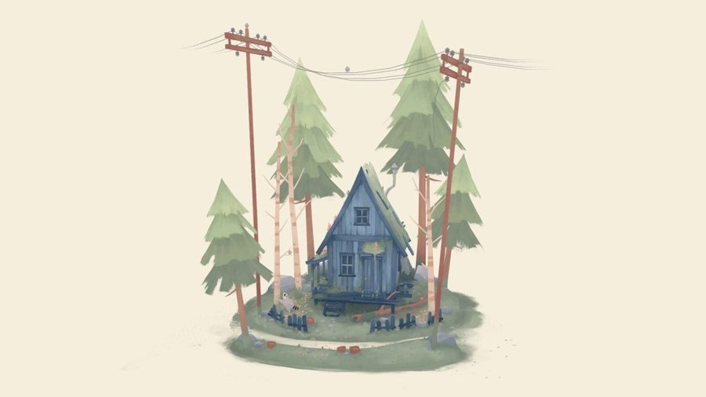  Objaverse-XL Stability AI · AllenAI<svg class="hf-i" viewBox="0 0 24 24" fill="none" stroke="currentColor" stroke-width="2.2" stroke-linecap="round" stroke-linejoin="round"><path d="M12 3v11"/><path d="M8 11l4 4 4-4"/><path d="M4 20h16"/></svg>2.5k3 条样例 |

- 标记：✓ 宽松许可，△ 有条件，？未声明
- 口径：2026-10-20 读自各数据卡、文件列表与 LICENSE

1. 非商用许可的数据集不能进商用训练。
   - CAD-Recode（CC-BY-NC-4.0）、Text2CAD（CC-BY-NC-SA-4.0）、3DCodeVerse（CC-BY-NC-SA）；Objaverse-XL 的 Polycam 部分仅非商用
2. BenchCAD 带代码生成、编辑、问答三类任务，但数据卡没写判分方式。
   - 17,900 条代码生成、748 条编辑、2,400 条问答

### 2.4 Website

高质量 3D 作品按能拿到什么分档：three.js 看 pmndrs/examples 与官方示例，都是一个示例配一份可运行代码；Blender 现成的代码配对只有 3DCode，其余多是只有 .blend 的场景与资产；问答站与论坛只给片段。

| 类型 | 站点 | 获取方式 | Artifacts | Datasize | 特性 | Permitted | Example |
|---|---|---|---|--:|---|---|---|
| **资产站与问答站** | B [BlenderArtists](https://blenderartists.org/) | — | 截图标题描述.blend（少量） | 602,128 帖 | 抓取代理被全量封禁，可用量为零 | ✗ robots 全禁 | — |
|  | S [Sketchfab](https://sketchfab.com/) | [API](https://api.sketchfab.com/v3/search) | 截图标题网格 | 500k 可下载 | Staff Pick 可下载 2,514 个，其中 CC-BY / CC0 1,926 个；下载需 OAuth 登录 | △ 逐模型许可；带 NoAI 标签的禁用于生成式 AI（Staff Pick 里 323 个） | 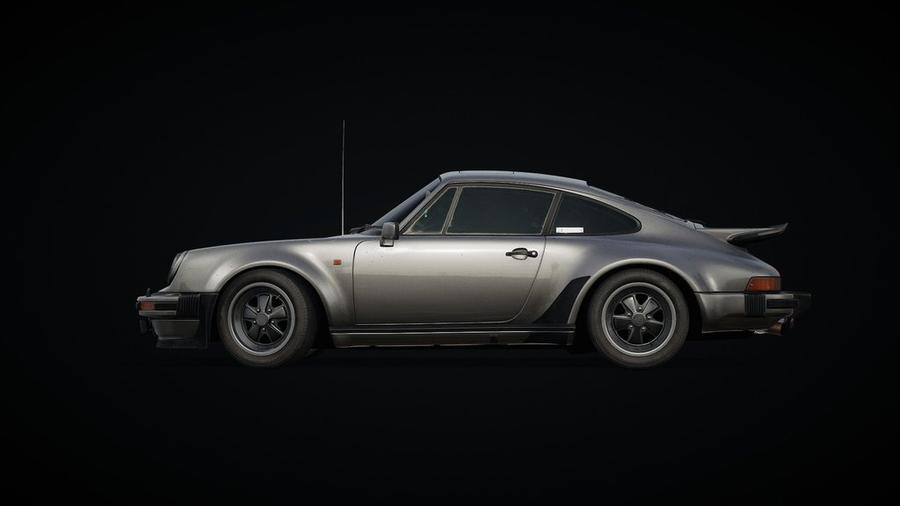S Sketchfab6 条样例 |
|  | S [Blender StackExchange](https://blender.stackexchange.com/) | — | 标题描述代码片段 | 123,167 问 | 脚本相关 13,632 问 + 6,738 答，几何节点 5,967；只给片段，跑不起来 | ✗ 2024 年起转储禁训 | — |
|  | T [three.js 论坛](https://discourse.threejs.org/) | — | 标题描述代码片段 | 26,457 帖 | showcase 分类 2,948 帖；本机 403 | △ 用户内容 CC BY-NC-SA 3.0：科研可用、不可商用 | — |
|  | S [Stack Overflow（three.js）](https://stackoverflow.com/questions/tagged/three.js) | — | 标题描述代码片段 | 20.9k 问 | 只给片段，跑不起来 | ✗ 转储禁训 | — |
|  | P [Poly Haven](https://polyhaven.com/) | [API](https://api.polyhaven.com/assets) | 截图网格HDRI贴图.blend | 2,387 个 | **CC0 资产库**：模型 521、HDRI 997、贴图 869；抽 25 个模型全部同时有 .blend 与 glTF | ✓ CC0 | 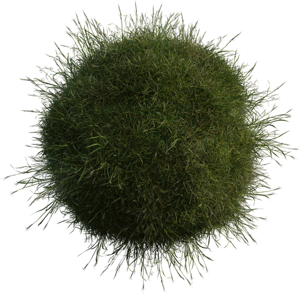P Poly Haven6 条样例 |
| **three.js 作品** | T [three.js 官方 examples](https://threejs.org/examples/) | [GitHub](https://github.com/mrdoob/three.js/tree/dev/examples) | 单文件 .html截图 | 616 页 | **着色器题首选**：自写着色器 32%、程序化几何 17%、GPU 计算 5%；51% 不加载外部资产 | ✓ MIT | T three.js 官方 examples three.js6 条样例 |
|  | T [threejs.org 首页精选](https://threejs.org/) | — | 作品链接作者仓库 | 421 个 | three.js 作者亲选；WebGPU 流体、软体、程序化树（holtsetio、dgreenheck） | △ 逐仓核：holtsetio 4/4 MIT，dgreenheck 26/45 MIT | — |
|  | P [pmndrs/examples](https://github.com/pmndrs/examples) | — | R3F 工程缩略图元数据 | 211 个 | **一例一图一工程**：后处理 36%、实例化 14%、物理 11%、自写着色器 9%；源码中位 173 行 | ✓ MIT；外部资产逐条记许可 | P pmndrs/examples Poimandres6 条样例 |
|  | K [Khronos glTF-Sample-Assets](https://github.com/KhronosGroup/glTF-Sample-Assets) | — | glTF截图 | 150 个 | glTF 资产，不是代码；PBR 扩展、动画 | △ 逐资产：CC0 系 81、CC-BY 系 61、限制性 7 | 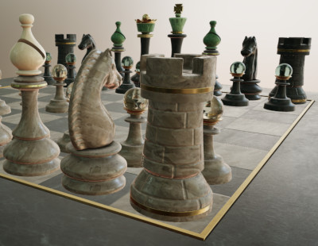K Khronos glTF-Sample-Assets Khronos6 条样例 |
|  | D [ThreeUI Community](https://github.com/MengTo/threeui) | — | React 组件在线预览 | 50 个组件 | 着色器、粒子、滚动联动的 3D 视觉组件 | ✓ MIT | — |
|  | C [Codrops（three.js）](https://github.com/codrops) | — | 源码demo 页 | 10 个仓库 | MIT 仓库里只有 8% 用 three.js，主力是 GSAP 动效（见 Web 页 2.4） | ✓ demo 默认 MIT，另有说明的除外 | — |
|  | B [Bruno Simon folio](https://bruno-simon.com/) | [GitHub](https://github.com/brunosimon/folio-2025) | 整站源码整站 | 2 个仓库 | 车辆物理、整站交互、多物体组合 | ✓ MIT | — |
| **WebGL 实验** |  [Experiments with Google](https://experiments.withgoogle.com/) | — | 实验页作者仓库 | 1,654 个 | WebGL 标签 664 个；带 GitHub 源码 85 个仓库；多为 2011–2015 年的 WebGL1 作品 | △ 逐仓核：宽松许可 30 个 |  Experiments with Google Google5 条样例 |
|  | K [WebGL / WebGPU Samples · ogl](https://github.com/WebGLSamples/WebGLSamples.github.io) | [GitHub](https://github.com/webgpu/webgpu-samples) | 单文件 .html.js | 197 个 | WebGL 96 个 html、WebGPU 52 个示例、ogl 49 个 html；计算着色器、粒子、阴影 | ✓ BSD-3、BSD-3、Unlicense | — |
|  |  [Santa Tracker](https://santatracker.google.com/) | [GitHub](https://github.com/google/santa-tracker-web) | 整站源码图片音频 | 56 个场景 | 生产级、多场景、强美术 | ✓ 代码 Apache-2.0，图片与音频 CC-BY | — |
| **Blender 作品与资产** | B [BlendSwap](https://www.blendswap.com/) | — | .blend截图 | 25,869 个 | Staff Pick；写实室内、FLIP 流体；免费账号每日限 5–7 个 | △ 上传者自选，含 NC / ND（NC 科研可用） | — |
|  | 3 [3DCode](https://huggingface.co/datasets/YipengGao/3DCode) | — | bpy .py描述多视角图网格（GLB） | 12,720 个 | **唯一现成的代码配对**：Infinigen 转写，Blender 5.0 可跑；几何节点 48%、修改器 88%，脚本中位 919 行 | ✓ MIT | 3 3DCode6 条样例 |
|  | B [Blendkit](https://www.blendkit.com/) | — | .blendglTF | 4,067 个（CC0 模型） | 带质量评分与作者自报工时 | △ CC0 资产也禁止脱离项目单独再分发，只能内部用 | — |
|  | B [Big Buck Bunny 生产文件](https://archive.org/details/bigbuckbunny_production) | — | .blend贴图 | 794 个 | 官方 zip 591 个场景 .blend，archive.org 镜像另有 203 个（含角色、道具、布景）；Blender 2.4x 时代文件 | △ 影片 CC-BY 3.0；包内无许可文件 | — |
|  | B [Blender 内置资产](https://projects.blender.org/blender/blender-assets) | — | .blend | 177 个 | 几何节点 essentials、程序化毛发节点、材质 | ✓ CC0 | — |
|  | B [Blender 官方 demo 文件](https://www.blender.org/download/demo-files/) | — | .blend | 87 个 | 官方挑选，多出自 Blender Studio；几何节点 22、仿真 6 | △ CC-BY 30、CC0 20、CC-BY-SA 10、未标 27 | — |
|  | C [CGArtPython](https://github.com/CGArtPython/blender_plus_python) | — | bpy .py | 76 个 .py | 人写教程；30 组起始 / 完成成对，适合补全题 | ✓ MIT | <pre class="sg-code">"""&#10;See YouTube tutorial here:&#10;"""&#10;import functools&#10;import logging&#10;import math&#10;import pprint&#10;import random&#10;import time&#10;&#10;import bpy&#10;&#10;import addon_utils&#10;&#10;################################################################&#10;# helper functions BEGIN&#10;################################################################&#10;</pre>C CGArtPython6 条样例 |
|  | G [几何节点作品：IRCSS · node_assets](https://github.com/IRCSS/Blender-Geometry-Node-French-Houses) | [GitHub](https://github.com/johnnygizmo/node_assets) | .blend | 26 个 .blend | 程序化建筑、树、山水画风格 | ✓ MIT；✓ CC0 | — |
|  | B [Blender Open Data 场景](https://download.blender.org/release/BlenderBenchmark2.0/scenes/) | — | .blend | 9 个 | 生产级场景，开放电影镜头级复杂度 | △ 4 个标 CC0 / CC-BY；其余 5 个未标许可 | — |

- 标记：✓ 可用，△ 有条件，✗ 不可用；NC 类许可科研可用、不可商用
- 口径：2026-10-28 本机实测（GitHub API、raw 文件、HF API、站点 API 与页面）

**一、慎用**

慎用来源的问题都出在许可与获取上：条款禁训、只许非商用、权属不清、要付费，或内容本身是别家模型的输出。

1. 条款禁止训练，或抓取被封。
   - Blender StackExchange 与 Stack Overflow 的转储禁止用于训练；BlenderArtists 的抓取代理被全量封禁
   - Sketchfab 带 NoAI 标签的模型禁用于生成式 AI（Staff Pick 可下载 2,514 个里 323 个）
2. 只许非商用：科研可用，不可商用。
   - Shadertoy 与 three.js 论坛的用户内容默认 CC BY-NC-SA 3.0；[3DCodeVerse](https://huggingface.co/datasets/ilabai/3dcodeverse) 约 203 万行，整体 CC-BY-NC-SA
3. 许可声明与来源权属不符。
   - [BlenderLore](https://huggingface.co/datasets/FreedomIntelligence/BlenderLore)：21,449 个 .blend 标 Apache-2.0，但来自 B 站教程配套工程
   - img2threejs 展示库：没有 LICENSE，题材含游戏 IP
   - Blender 官方扩展目录 1,533 个里传染性许可 1,341 个、MIT 4 个
4. 拿不到或要付费。
   - Blender Studio：可下载文件里带 .blend 的 164 个，免费的只有 15 个；Three.js Journey 付费
5. 内容是别家模型的输出，不能当答案。
   - 3DCodeVerse 的 three.js 子集全由编码 agent 生成

**二、按题型选**

three.js 两个来源分别适合着色器题与工程题，Blender 的代码题靠 3DCode，编辑题与节点题靠官方 .blend。

| 题型 | 首选来源 | 依据 |
|---|---|---|
| 写着色器 | three.js 官方 examples | 32% 自写着色器，51% 是不加载外部资产的纯代码页 |
| 工程补全、后处理 | pmndrs/examples | 后处理 36%，一个示例一个可运行工程 |
| 长上下文程序化建模 | 3DCode | 脚本中位 919 行，48% 用几何节点 |
| 编辑题的起始场景 | 官方 demo 文件、Open Data 场景、Big Buck Bunny | 生产级 .blend，扰动后让模型改回 |
| 节点树重建 | 官方 demo 的几何节点区、内置资产 | 几何节点文件 22 个；内置资产 CC0 |

## 3 Funnel

3D 素材从仓库或资产索引走到可训任务，同样要过标签、星数、可运行几道关。真实挖矿只筛标签与星数就剩 0.9%–2.7%，可运行性还没核验，因此真实素材只定分布，题目主力靠合成。

- 口径：留存率 = 终点 ÷ 起点；GitHub 各行只筛标签、星数或许可，没有可运行性检查；Website 三行止于许可干净的可用素材，不产出任务

| Source | Name | Unit | Filter | Funnel | Retention |
|---|---|:-:|---|--:|--:|
| **GitHub** | three.js | 仓 | GitHub 搜「three.js」→ 主题标签 → 星 > 10 | 89k → **2.4k** | 2.7% |
| | Blender bpy | 仓 | GitHub 搜「blender addon」→ Python + 星 > 10 | 6.3k → **56** | 0.9% |
| | 本项目 three.js（估） | 页 | 上面 three.js 的 2.4k 仓 × 3 页 → 可用 | 7.2k → **≈230** | 3.2% |
| | three.js 高星仓库 | 仓 | topic:threejs 且星 > 1000 → MIT | 106 → **65** | 61% |
| **HuggingFace** | [WorldCoder-Bench](https://arxiv.org/abs/2606.01869) | 题 | 候选题 → 筛选 | > 10k → **2,026** | ≲ 20% |
| | [Objaverse-XL](https://arxiv.org/abs/2307.05663) | 文件 | GitHub 侧 3D 文件索引 → Blender 导入并渲染 | 37M → **5.5M** | 14.9% |
| **Website** | [Experiments with Google](https://experiments.withgoogle.com/) | 实验 | 全部实验 → WebGL 标签 → 带 GitHub 源码 → 宽松许可 | 1,654 → 664 → 85 → **30** | 1.8% |
| | [Blender 官方 demo 文件](https://www.blender.org/download/demo-files/) | 文件 | 页面直链 → 标 CC0 / CC-BY | 87 → **50** | 57% |
| | [Sketchfab](https://sketchfab.com/) | 模型 | Staff Pick 且可下载 → CC-BY / CC0（NoAI 标签未剔除） | 2,514 → **1,926** | 77% |
| **合成** | 槽位合成（本项目） | 题 | 参考场景 → 准入检查 | — | 88% – 96% |

**一、真实挖矿**

真实挖矿的产能是三位数，只够定分布，撑不起题库。

1. 只筛标签与星数就剩 0.9%–2.7%。
   - three.js：89,622 → 23,983（主题标签，关键词噪音 3.7 倍）→ 2,401（星 > 10，再收 10 倍）
   - 端到端可执行率另有估算：three.js 1%–8%、Blender 0.3%–2%；估算口径待补
2. 唯一的可运行实测锚点是 Objaverse-XL 的 14.9%。
   - 3,700 万个文件里，550 万个能被 Blender 导入并渲染
3. 本项目 three.js 路线估算约 230 个任务。
   - 2.4k 个仓库 × 每仓 3 页 → 可用（估）

**二、合成扩产**

槽位合成把参考场景里可调的参数做成槽位表，准入留存 88%–96%，产能可控。

| 槽位 | 类别 | 容差 | 句式 |
|---|---|--:|---|
| 桌面尺寸 | 变换 | 0.5% | 「一张 {长}×{宽} 的木桌」 |
| 桌面倒角 | 修改器 | 2% | 「桌面边缘倒角 {值}」 |
| 灯泡功率 | 灯光 | 2% | 「点光源 {值} W」 |
| 灯臂旋转 | 动画 | 1% | 「灯臂第 1–40 帧从 {a}° 转到 {b}°」 |
| 杯身细分 | 修改器 | 0 | 「杯身加 {n} 级细分」 |

1. 每个槽位标注类别、容差与对应句式，题面由句式填值生成。
2. 难度由两个旋钮决定：钉死多少个槽位，以及槽位之间的依赖深度。
   - 两者直接决定 Verifier 要查几个字段，因此比改写措辞更可靠

## 4 Curation Pipeline

3D 素材有三个问题：资产大多导入不了，Objaverse-XL 只有 14.9% 能被 Blender 导入并渲染；官方扩展目录 1,533 个里传染性许可 1,341 个；bpy 脚本常依赖工程文件、资产路径与插件。所以原始素材要过八道闸才能进训练集，按运行前、导入渲染、运行后、入库前四段排开。顺序比闸本身更要紧：最大的一刀在导入渲染，许可、版本、依赖这类便宜的闸必须排在它前面。

运行前 · 文件与脚本

导入渲染

运行后 · 渲染图

入库前 · 全库比对

原始 素材

01<b>许可过滤</b>

Blender 官方扩展目录 1,533 个里传染性许可 1,341 个；Sketchfab 须剔除 NC 许可

<a href="https://extensions.blender.org/">Blender Extensions</a> · <a href="https://sketchfab.com/">Sketchfab</a>

02<b>版本钉死</b>

Blender 按版本分叉，一个版本对应一个 Python 运行时

Train 4.1

03<b>依赖与路径</b>无出处

bpy 脚本常依赖工程文件、资产路径与插件，缺一样就跑不起来

04 · 最大的一刀

导入并渲染

14.9%<small>能被 Blender 导入并渲染</small>

成功率<b>14.9%</b><i style="width:14.9%;background:#e8913a"></i>

<a href="https://arxiv.org/abs/2307.05663">Objaverse-XL</a>：3,700 万个文件 → 550 万；单题成本 Blender 2.3 秒、three.js 383 毫秒（本项目实测）

05<b>坏渲染过滤</b>

用 1,200 条人工标注训练坏渲染分类器；Polycam 来源的渲染图 38.20% 被判坏

<a href="https://arxiv.org/abs/2307.05663">Objaverse-XL</a>

06<b>美学分档</b>

按 LAION 美学分把资产分三档，只用于过滤，不进 reward

<a href="https://arxiv.org/abs/2307.05663">Objaverse-XL</a>

07<b>去重</b>

代码托管侧 3,700 万个文件，去重后元数据 1,085 万行

<a href="https://arxiv.org/abs/2307.05663">Objaverse-XL</a>

08<b>去污染</b>无出处

3D 方向未见去污染实践；评测集与训练集同源时风险同 Web

可用 素材

顺序锁定：许可、版本、依赖闸排在导入渲染之前

**数据清洗心得**

1. 挖 GitHub 必须按创建日期截断：2026 年新建的 three.js 仓库大量混入模型产物。
   - topic:threejs 且星数 > 100：2026 年新建的 122 个里 53 个（43%）在描述或主题里提到 Claude、Codex、GPT 或 agent；2023–2024 年新建的 82 个里 0 个
   - 口径：只匹配描述与主题字段，提到不等于全由模型生成
   - Blender 侧同样出现：topic:blender 加 procedural-generation 的结果里已有 2026 年新建的 agent 工具仓库
2. 公开数量常与实数不符，引用前须核验。
   - 旧材料里 three.js 610、Babylon.js 975、Blender 2,596，实测分别为 613、916、2,564
   - WorldCoder-Bench：HF 只放 205 题，论文 2,026 题（Core / Robust 未全部公开）
   - MeshCoder：README 称已发布 100K 条，论文约 100 万物体 / 41 类
   - BlenderGym：压缩包实数 280，论文 245
   - Omni-CAD：数据卡与论文约 450K，切分文件实数 313,096；图与点云要按脚本自行生成
   - Objaverse-XL：论文 1,020 万，元数据实数 10,850,997 行
3. 美学分只用于过滤，不进 reward。
   - [Objaverse-XL](https://arxiv.org/abs/2307.05663) 按 LAION 美学分把资产分三档，本项目素材里未见用作 reward（Verifier 3.3.2）

3 <a href="https://huggingface.co/datasets/YipengGao/3DCode">3DCode</a> <button type="button" class="sg-prev" title="上一个（←）">‹</button><button type="button" class="sg-next" title="下一个（→）">›</button><button type="button" class="sg-x" title="关闭（Esc）">✕</button>

<b>数据样例</b> · <a href="https://huggingface.co/datasets/YipengGao/3DCode">YipengGao/3DCode</a>

<b>3DCodeData/ArmChair_000/renders/Image_005.webp</b>

ArmChair_000.py（共 1818 行，展示前 60 行）
<pre># ArmChairFactory — standalone Blender script (GeoNodes geometry + fabric material).&#10;# Material: weighted_sample(fabrics) under raw SEED; no wear_tear (SofaFactory has none).&#10;# SEED-deterministic: seed_all(SEED) at module level for material; geometry uses re-seeded RNG&#10;import os, bpy, random, colorsys&#10;import numpy as np&#10;&#10;for _o in list(bpy.data.objects):&#10;    bpy.data.objects.remove(_o, do_unlink=True)&#10;for _m in list(bpy.data.meshes):&#10;    bpy.data.meshes.remove(_m)&#10;for _c in list(bpy.data.collections):&#10;    if _c != bpy.context.scene.collection:&#10;        bpy.data.collections.remove(_c)&#10;bpy.context.scene.cursor.location = (0, 0, 0)&#10;&#10;def seed_all(seed):&#10;    np.random.seed(seed); random.seed(seed)&#10;&#10;def log_uniform(lo, hi):&#10;    return float(np.exp(np.random.uniform(np.log(lo), np.log(hi))))&#10;&#10;def weighted_sample(reg):&#10;    classes, weights = zip(*reg)&#10;    w = np.array(weights, dtype=float)&#10;    return classes[int(np.random.choice(len(classes), p=w / w.sum()))]&#10;&#10;def hsv2rgba(h, s, v):&#10;    r, g, b = colorsys.hsv_to_rgb(float(h) % 1.0, float(s), float(v))&#10;    return (r, g, b, 1.0)&#10;&#10;def mixture_of_gaussian(means, stds, weights, clamp_min=None, clamp_max=None):&#10;    p = np.array(weights) / np.sum(weights)&#10;    idx = int(np.random.choice(len(p), p=p))&#10;    res = np.random.normal(means[idx], stds[idx])&#10;    if clamp_min is not None: res = np.maximum(res, clamp_min)&#10;    if clamp_max is not None: res = np.minimum(res, clamp_max)&#10;    return res&#10;&#10;def leather_hsv():&#10;    return mixture_of_gaussian(&#10;        means=np.array([[0.07, 0.45, 0.40], [0.6, 0.3, 0.40]]),&#10;        stds=0.7 * np.array([[0.0035, 0.0063, 0.2], [0.0105, 0.028, 0.2]]),&#10;        clamp_min=[0, 0, 0.06], clamp_max=[1, 1, 0.93], weights=[0.7, 0.3])&#10;&#10;def fabric_hsv():&#10;    return (0.9805983957,&#10;            0.4599842591,&#10;            0.7939269718)&#10;&#10;# ═══════════════════════════════════════════════════════════════════════════&#10;#  Material helpers&#10;# ═══════════════════════════════════════════════════════════════════════════&#10;&#10;def _new_mat(name):&#10;    mat = bpy.data.materials.new(name)&#10;    mat.use_nodes = True&#10;    mat.node_tree.nodes.clear()&#10;    return mat&#10;&#10;def _fac(node):&#10;…（截断，原文共 1818 行）</pre>

captions/caption_object.txt（共 2 行）
<pre>This is a modern, low-profile armchair with an integrated extending footrest, designed as a comfortable lounge chair. It features thick, blocky rectangular armrests framing a plush seat cushion and a gently reclined backrest cushion. A wide, flat, rounded-corner footrest panel extends horizontally from the front base of the chair. The entire piece is upholstered in a uniform, soft-textured fabric …（本行共 444 字符）&#10;</pre>

<b>3DCodeData/Bathtub_000/renders/Image_005.webp</b>

Bathtub_000.py（共 940 行，展示前 60 行）
<pre>import hashlib&#10;import os&#10;&#10;import bpy, bmesh&#10;import numpy as np&#10;import math, random, colorsys&#10;&#10;def int_hash(x):&#10;    m = hashlib.md5()&#10;    for s in x:&#10;        m.update(str(s).encode("utf-8"))&#10;    return abs(int(m.hexdigest(), 16)) % (2**32 - 1)&#10;&#10;# ============================================================================&#10;# Inlined material library — BathtubFactory uses:&#10;#   make_metal_basic (metal_neutral: legs + hole)&#10;#   make_ceramic (ceramics: bathtub surface)&#10;#   wear_tear (scratches + edge_wear)&#10;# ============================================================================&#10;&#10;def hsv2rgba(hsv):&#10;    h, s, v = hsv&#10;    h = h - math.floor(h)&#10;    s = max(0.0, min(1.0, s))&#10;    v = max(0.0, min(1.0, v))&#10;    r, g, b = colorsys.hsv_to_rgb(h, s, v)&#10;    return (r, g, b, 1.0)&#10;&#10;&#10;def log_uniform(lo, hi):&#10;    return float(np.exp(np.random.uniform(np.log(lo), np.log(hi))))&#10;&#10;&#10;# hex -&gt; hex2rgba (srgb_to_linear) -&gt; rgb2hsv&#10;_NATURAL_BASE_HSV = [&#10;    (0.0,    0.0,    0.5271),  # 0xC0C0C0 silver&#10;    (0.0961, 0.6702, 0.2623),  # 0x8C7853 khaki&#10;    (0.1319, 0.1682, 0.5089),  # 0xBDBAAE light gray&#10;    (0.6296, 0.1518, 0.4678),  # 0xA9ACB6 gray-blue&#10;    (0.0749, 0.1518, 0.4678),  # 0xB6AFA9 gray-beige&#10;]&#10;&#10;&#10;def metal_natural_hsv():&#10;    idx = np.random.randint(0, len(_NATURAL_BASE_HSV))&#10;    h, s, v = _NATURAL_BASE_HSV[idx]&#10;    return (&#10;        h + float(np.random.uniform(-0.1, 0.1)),&#10;        s + float(np.random.uniform(-0.1, 0.1)),&#10;        v * float(log_uniform(0.2, 0.5)),&#10;    )&#10;&#10;&#10;def metal_hsv():&#10;    if np.random.uniform() &lt; 0.2:&#10;        return metal_natural_hsv()&#10;    return (np.random.uniform(0, 1),&#10;            np.random.uniform(0.3, 0.6),&#10;            log_uniform(0.02, 0.5))&#10;&#10;…（截断，原文共 940 行）</pre>

captions/caption_object.txt（共 2 行）
<pre>This modern, minimalist freestanding bathtub features an elongated, oval-shaped basin with a clean, semi-glossy white ceramic finish. The tub's walls gently taper downward from a rounded, smooth rim to a narrower base. It sits upon a matching, low-profile solid base platform that mirrors the oval contour of the main body, raising the tub roughly 0.18 units off the floor. Inside, the spacious basin…（本行共 663 字符）&#10;</pre>

<b>3DCodeData/Beetle_000/renders/Image_005.webp</b>

Beetle_000.py（共 1410 行，展示前 60 行）
<pre>import os&#10;import hashlib&#10;import math&#10;&#10;import bpy&#10;import mathutils&#10;import numpy as np&#10;from mathutils.bvhtree import BVHTree&#10;&#10;&#10;SEED = int(os.environ.get("SEED", "543568399"))&#10;&#10;import random as _random, colorsys as _colorsys&#10;&#10;def _hsv2rgba(h, s, v):&#10;    r, g, b = _colorsys.hsv_to_rgb(float(h) % 1.0, max(0, min(1, float(s))), max(0, min(1, float(v))))&#10;    return (r, g, b, 1.0)&#10;&#10;def _log_uniform(lo, hi):&#10;    return float(np.exp(np.random.uniform(np.log(lo), np.log(hi))))&#10;&#10;def _new_mat(name):&#10;    mat = bpy.data.materials.new(name)&#10;    mat.use_nodes = True&#10;    mat.node_tree.nodes.clear()&#10;    return mat&#10;&#10;def _fac(n):&#10;    return n.outputs.get("Fac") or n.outputs.get("Factor") or n.outputs[0]&#10;&#10;def make_creature_material(seed, name="ChitinMaterial"):&#10;    """Chitin exoskeleton: metallic with pointiness-driven edge highlights.&#10;    Seeded via np.random.seed(seed) to match FixedSeed(factory_seed)."""&#10;&#10;    np.random.seed(seed); _random.seed(seed)&#10;    noise_w = 1.9223935827&#10;    chitin_color = _hsv2rgba(float(np.mod(0.6422578823, 1)),&#10;                              0.2393570223,&#10;                              0.2804019222)&#10;&#10;    mat = _new_mat(name); nt = mat.node_tree; ln = nt.links.new&#10;&#10;    geo = nt.nodes.new("ShaderNodeNewGeometry")&#10;&#10;    # Pointiness → edge highlight (3-stop ramp)&#10;    cr1 = nt.nodes.new("ShaderNodeValToRGB")&#10;    ln(geo.outputs["Pointiness"], cr1.inputs["Fac"])&#10;    cr1.color_ramp.elements.new(0)&#10;    cr1.color_ramp.elements[0].position = 0.4091; cr1.color_ramp.elements[0].color = (0, 0, 0, 1)&#10;    cr1.color_ramp.elements[1].position = 0.4455; cr1.color_ramp.elements[1].color = (1, 1, 1, 1)&#10;    cr1.color_ramp.elements[2].position = 0.5127; cr1.color_ramp.elements[2].color = (0, 0, 0, 1)&#10;&#10;    cr10 = nt.nodes.new("ShaderNodeValToRGB")&#10;    ln(cr1.outputs["Color"], cr10.inputs["Fac"])&#10;    cr10.color_ramp.elements[0].position = 0.0; cr10.color_ramp.elements[0].color = (0, 0, 0, 1)&#10;    cr10.color_ramp.elements[1].position = 0.2273; cr10.color_ramp.elements[1].color = (1, 1, 1, 1)&#10;&#10;    cr4 = nt.nodes.new("ShaderNodeValToRGB")&#10;    ln(geo.outputs["Pointiness"], cr4.inputs["Fac"])&#10;    cr4.color_ramp.elements[0].position = 0.4909; cr4.color_ramp.elements[0].color = (0, 0, 0, 1)&#10;…（截断，原文共 1410 行）</pre>

captions/caption_object.txt（共 2 行）
<pre>This 3D model depicts a stylized insect creature resembling a beetle, characterized by its distinct segmented body parts and striking color contrast. It features a glossy, dark brown head with two large, inward-curving mandibles that are textured in a shimmering magenta and black pattern. The elongated abdomen is covered in a matching vibrant magenta marbled design with a central dark stripe, givi…（本行共 557 字符）&#10;</pre>

<b>3DCodeData/FallenTree_000/renders/Image_005.webp</b>

FallenTree_000.py（共 1356 行，展示前 60 行）
<pre>"""&#10;FallenTreeFactory -- standalone Blender script.&#10;&#10;Space-colonization tree cut at random height; upper half rotated to simulate&#10;a fallen trunk joined with the stump. Bark + ring-cross-section materials.&#10;&#10;Usage:&#10;    blender --background --python FallenTreeFactory.py&#10;"""&#10;&#10;&#10;import colorsys&#10;import math&#10;import os&#10;import random&#10;import sys&#10;import warnings&#10;&#10;import bmesh&#10;import bpy&#10;import numpy as np&#10;from mathutils import Vector&#10;from mathutils import noise as mnoise&#10;&#10;SEED = int(os.environ.get("SEED", 543568399))&#10;&#10;# ---------------------------------------------------------------------------&#10;# Helpers&#10;# ---------------------------------------------------------------------------&#10;&#10;def sel_none():&#10;    for obj in list(bpy.context.selected_objects):&#10;        obj.select_set(False)&#10;&#10;&#10;def set_active(obj):&#10;    bpy.context.view_layer.objects.active = obj&#10;    obj.select_set(True)&#10;&#10;&#10;def apply_modifier(obj, mod):&#10;    sel_none()&#10;    set_active(obj)&#10;    bpy.ops.object.modifier_apply(modifier=mod.name)&#10;    sel_none()&#10;&#10;&#10;def apply_transform(obj, location=False):&#10;    sel_none()&#10;    set_active(obj)&#10;    bpy.ops.object.transform_apply(location=location, rotation=True, scale=True)&#10;    sel_none()&#10;&#10;&#10;def read_co(obj):&#10;    arr = np.zeros(len(obj.data.vertices) * 3, dtype=np.float32)&#10;    obj.data.vertices.foreach_get("co", arr)&#10;    return arr.reshape(-1, 3)&#10;&#10;&#10;…（截断，原文共 1356 行）</pre>

captions/caption_object.txt（共 2 行）
<pre>This 3D object represents a detailed fallen tree, consisting of a short, upright stump and a sprawling, highly branched fallen trunk segment. The stump is a low cylinder, roughly 0.7 units high, with a diagonal cut at the top revealing a rough, light-colored inner wood surface. The fallen trunk segment rests on the ground, starting with a matching jagged, broken end that aligns with the stump's cu…（本行共 802 字符）&#10;</pre>

<b>3DCodeData/KitchenIsland_000/renders/Image_005.webp</b>

KitchenIsland_000.py（共 1463 行，展示前 60 行）
<pre>"""KitchenIslandFactory (textured)."""&#10;&#10;&#10;import os&#10;import bpy&#10;import bmesh&#10;import math&#10;import random&#10;import hashlib&#10;import colorsys&#10;import numpy as np&#10;from numpy.random import uniform&#10;from contextlib import contextmanager&#10;&#10;&#10;# ============================================================================&#10;# === Inlined material library (raw-bpy ports) ===============================&#10;#                                                     black_wood(_z) / wood(_z)&#10;# ============================================================================&#10;&#10;&#10;def seed_all(seed: int):&#10;    np.random.seed(int(seed))&#10;    random.seed(int(seed))&#10;&#10;&#10;def hsv2rgba(hsv):&#10;    h, s, v = hsv&#10;    h = h - math.floor(h)&#10;    s = max(0.0, min(1.0, s))&#10;    v = max(0.0, min(1.0, v))&#10;    r, g, b = colorsys.hsv_to_rgb(h, s, v)&#10;    return (r, g, b, 1.0)&#10;&#10;&#10;def _new_material(name: str) -&gt; bpy.types.Material:&#10;    mat = bpy.data.materials.new(name)&#10;    mat.use_nodes = True&#10;    nt = mat.node_tree&#10;    nt.nodes.clear()&#10;    return mat&#10;&#10;&#10;def _set_principled(bsdf, **kw):&#10;    aliases = {&#10;        "Specular IOR Level": ("Specular IOR Level", "Specular"),&#10;        "Specular": ("Specular IOR Level", "Specular"),&#10;        "Coat Weight": ("Coat Weight", "Clearcoat"),&#10;        "Sheen Weight": ("Sheen Weight", "Sheen"),&#10;    }&#10;    for k, v in kw.items():&#10;        names = aliases.get(k, (k,))&#10;        for name in names:&#10;            if name in bsdf.inputs:&#10;                bsdf.inputs[name].default_value = v&#10;                break&#10;&#10;&#10;def _noise_fac_output(noise_node):&#10;    if "Fac" in noise_node.outputs:&#10;…（截断，原文共 1463 行）</pre>

captions/caption_object.txt（共 2 行）
<pre>This sleek, rectangular kitchen island features a thick, polished white marble countertop characterized by soft, diagonal grey veining. The countertop overhangs a multi-compartment cabinet base that sits flush to the floor on a low plinth. The front and side panels of the base are wrapped in a uniform, matte, warm-grey wood veneer with a subtle vertical grain. On the opposite functional side, the …（本行共 672 字符）&#10;</pre>

<b>3DCodeData/CantileverStaircase_000/renders/Image_005.webp</b>

CantileverStaircase_000.py（共 428 行，展示前 60 行）
<pre>import os&#10;import math&#10;import random&#10;import colorsys&#10;&#10;import bmesh&#10;import bpy&#10;import numpy as np&#10;&#10;SEED = int(os.environ.get("SEED", "543568399"))&#10;np.random.seed(SEED)&#10;&#10;def _hsv2rgba(h, s, v):&#10;    r, g, b = colorsys.hsv_to_rgb(float(h)%1, max(0,min(1,float(s))), max(0,min(1,float(v))))&#10;    return (r, g, b, 1.0)&#10;&#10;def _log_uniform(lo, hi):&#10;    return float(np.exp(np.random.uniform(np.log(lo), np.log(hi))))&#10;&#10;def _new_mat(name):&#10;    m = bpy.data.materials.new(name); m.use_nodes = True; m.node_tree.nodes.clear()&#10;    return m&#10;&#10;def _fac(n):&#10;    return n.outputs.get("Fac") or n.outputs.get("Factor") or n.outputs[0]&#10;&#10;def make_mat(seed, name="WoodMaterial"):&#10;    """Wood: warm brown with noise grain pattern."""&#10;&#10;    base_hue = 0.0988359037&#10;    c1 = _hsv2rgba(base_hue, 0.5279874073, 0.3762481338)&#10;    c2 = _hsv2rgba(base_hue + -0.0104257191, 0.4536012815, 0.4525538035)&#10;    mat = _new_mat(name); nt = mat.node_tree; ln = nt.links.new&#10;    tc = nt.nodes.new("ShaderNodeTexCoord")&#10;    noise = nt.nodes.new("ShaderNodeTexNoise"); ln(tc.outputs["Object"], noise.inputs["Vector"])&#10;    noise.inputs["Scale"].default_value = 19.2918892678&#10;    noise.inputs["Detail"].default_value = 5.0&#10;    cr = nt.nodes.new("ShaderNodeValToRGB"); ln(_fac(noise), cr.inputs["Fac"])&#10;    cr.color_ramp.elements[0].position = 0.3; cr.color_ramp.elements[0].color = c1&#10;    cr.color_ramp.elements[1].position = 0.7; cr.color_ramp.elements[1].color = c2&#10;    bsdf = nt.nodes.new("ShaderNodeBsdfPrincipled")&#10;    ln(cr.outputs["Color"], bsdf.inputs["Base Color"])&#10;    bsdf.inputs["Roughness"].default_value = 0.4183535033&#10;    out = nt.nodes.new("ShaderNodeOutputMaterial")&#10;    ln(bsdf.outputs["BSDF"], out.inputs["Surface"])&#10;    return mat&#10;&#10;ELEM_MAT = make_mat(SEED, "CantileverStaircaseFactory_Material")&#10;np.random.seed(SEED)&#10;&#10;&#10;def log_uniform(lo, hi):&#10;    return float(np.exp(np.random.uniform(np.log(lo), np.log(hi))))&#10;&#10;def weighted_choice(items):&#10;    """items: list of (weight, value)"""&#10;&#10;    weights = [w for w, v in items]&#10;    values = [v for w, v in items]&#10;    total = sum(weights)&#10;…（截断，原文共 428 行）</pre>

captions/caption_object.txt（共 2 行）
<pre>A straight, modern staircase featuring thirteen thick, rectangular treads with a dark charcoal-grey finish. The steps rise at a consistent, uniform angle, supported symmetrically on both sides by a dual-handrail system. Each handrail is crafted from a dark, rectangular-profile bar running parallel to the incline of the steps, with short, flat horizontal extensions at both the top and bottom landin…（本行共 706 字符）&#10;</pre>

  <a href="https://arxiv.org/abs/2412.14042">CAD-Recode</a> Artec3D · University of Luxembourg <a class="hf" href="https://huggingface.co/datasets/filapro/cad-recode"><svg class="hf-i" viewBox="0 0 24 24" fill="none" stroke="currentColor" stroke-width="2.2" stroke-linecap="round" stroke-linejoin="round"><path d="M12 3v11"/><path d="M8 11l4 4 4-4"/><path d="M4 20h16"/></svg>4.1k</a><button type="button" class="sg-prev" title="上一个（←）">‹</button><button type="button" class="sg-next" title="下一个（→）">›</button><button type="button" class="sg-x" title="关闭（Esc）">✕</button>

<b>数据样例</b> · <a href="https://huggingface.co/datasets/filapro/cad-recode">filapro/cad-recode</a>

<b>train/batch_00/1.py</b>

code（共 3 行）
<pre>import cadquery as cq&#10;w0=cq.Workplane('YZ',origin=(-1,0,0))&#10;r=w0.workplane(offset=-13/2).moveTo(24,3).cylinder(13,12).union(w0.sketch().segment((-50,-8),(-26,-19)).segment((-26,-26)).segment((30,-26)).segment((30,2)).segment((50,2)).segment((50,4)).segment((30,4)).segment((30,26)).segment((-26,26)).segment((-26,21)).segment((-35,25)).close().assemble().finalize().extrude(15))</pre>

<b>train/batch_00/2.py</b>

code（共 3 行）
<pre>import cadquery as cq&#10;w0=cq.Workplane('ZX',origin=(0,-16,0))&#10;r=w0.sketch().arc((-37,-15),(-31,-26),(-21,-34)).segment((-21,-50)).segment((21,-50)).segment((21,-34)).arc((30,-26),(37,-15)).segment((30,-15)).arc((33,0),(30,15)).segment((37,15)).arc((30,26),(21,34)).segment((21,50)).segment((-21,50)).segment((-21,34)).arc((-31,26),(-37,15)).segment((-31,15)).arc((-34,0),(-31,-15)).close().assemble().circle(6,mode='s').finalize().extrude(32)</pre>

<b>train/batch_00/5.py</b>

code（共 4 行）
<pre>import cadquery as cq&#10;w0=cq.Workplane('YZ',origin=(26,0,0))&#10;w1=cq.Workplane('XY',origin=(0,0,-24))&#10;r=w0.sketch().push([(14,-16.5)]).rect(32,33).push([(22,30)]).rect(18,40).finalize().extrude(-52).union(w0.sketch().push([(14,-16)]).circle(24).push([(-4,-24.5)]).rect(2,9,mode='s').finalize().extrude(-24)).union(w0.sketch().segment((-38,-50),(2,-50)).segment((2,-44)).arc((12,-26),(2,-8)).segment((2,6)).segment((-38,6)).close().assemble().finalize().extrude(-2)).union(w1.sketch().segment((-4,-8),(7,-8)).arc((1,-4),(-4,2)).close().assemble().finalize().extrude(-12))</pre>

C <a href="https://github.com/CGArtPython/blender_plus_python">CGArtPython</a> <button type="button" class="sg-prev" title="上一个（←）">‹</button><button type="button" class="sg-next" title="下一个（→）">›</button><button type="button" class="sg-x" title="关闭（Esc）">✕</button>

<b>数据样例</b> · <a href="https://github.com/CGArtPython/blender_plus_python">CGArtPython/blender_plus_python</a>

<b>art_projects/truchet_tiles/</b>

truchet_tiles_start.py（共 581 行，展示前 60 行）
<pre>"""&#10;See YouTube tutorial here:&#10;"""&#10;import functools&#10;import logging&#10;import math&#10;import pprint&#10;import random&#10;import time&#10;&#10;import bpy&#10;&#10;import addon_utils&#10;&#10;################################################################&#10;# helper functions BEGIN&#10;################################################################&#10;&#10;&#10;def purge_orphans():&#10;    """&#10;    Remove all orphan data blocks&#10;&#10;    see this from more info:&#10;    https://youtu.be/3rNqVPtbhzc?t=149&#10;    """&#10;    if bpy.app.version &gt;= (3, 0, 0):&#10;        # run this only for Blender versions 3.0 and higher&#10;        bpy.ops.outliner.orphans_purge(do_local_ids=True, do_linked_ids=True, do_recursive=True)&#10;    else:&#10;        # run this only for Blender versions lower than 3.0&#10;        # call purge_orphans() recursively until there are no more orphan data blocks to purge&#10;        result = bpy.ops.outliner.orphans_purge()&#10;        if result.pop() != "CANCELLED":&#10;            purge_orphans()&#10;&#10;&#10;def clean_scene():&#10;    """&#10;    Removing all of the objects, collection, materials, particles,&#10;    textures, images, curves, meshes, actions, nodes, and worlds from the scene&#10;&#10;    Checkout this video explanation with example&#10;&#10;    "How to clean the scene with Python in Blender (with examples)"&#10;    https://youtu.be/3rNqVPtbhzc&#10;    """&#10;    # make sure the active object is not in Edit Mode&#10;    if bpy.context.active_object and bpy.context.active_object.mode == "EDIT":&#10;        bpy.ops.object.editmode_toggle()&#10;&#10;    # make sure non of the objects are hidden from the viewport, selection, or disabled&#10;    for obj in bpy.data.objects:&#10;        obj.hide_set(False)&#10;        obj.hide_select = False&#10;        obj.hide_viewport = False&#10;&#10;    # select all the object and delete them (just like pressing A + X + D in the viewport)&#10;    bpy.ops.object.select_all(action="SELECT")&#10;    bpy.ops.object.delete()&#10;…（截断，原文共 581 行）</pre>

truchet_tiles_done.py（共 733 行，展示前 60 行）
<pre>"""&#10;See YouTube tutorial here:&#10;"""&#10;import functools&#10;import logging&#10;import math&#10;import pprint&#10;import random&#10;import time&#10;&#10;import bpy&#10;&#10;import addon_utils&#10;&#10;################################################################&#10;# helper functions BEGIN&#10;################################################################&#10;&#10;&#10;def purge_orphans():&#10;    """&#10;    Remove all orphan data blocks&#10;&#10;    see this from more info:&#10;    https://youtu.be/3rNqVPtbhzc?t=149&#10;    """&#10;    if bpy.app.version &gt;= (3, 0, 0):&#10;        # run this only for Blender versions 3.0 and higher&#10;        bpy.ops.outliner.orphans_purge(do_local_ids=True, do_linked_ids=True, do_recursive=True)&#10;    else:&#10;        # run this only for Blender versions lower than 3.0&#10;        # call purge_orphans() recursively until there are no more orphan data blocks to purge&#10;        result = bpy.ops.outliner.orphans_purge()&#10;        if result.pop() != "CANCELLED":&#10;            purge_orphans()&#10;&#10;&#10;def clean_scene():&#10;    """&#10;    Removing all of the objects, collection, materials, particles,&#10;    textures, images, curves, meshes, actions, nodes, and worlds from the scene&#10;&#10;    Checkout this video explanation with example&#10;&#10;    "How to clean the scene with Python in Blender (with examples)"&#10;    https://youtu.be/3rNqVPtbhzc&#10;    """&#10;    # make sure the active object is not in Edit Mode&#10;    if bpy.context.active_object and bpy.context.active_object.mode == "EDIT":&#10;        bpy.ops.object.editmode_toggle()&#10;&#10;    # make sure non of the objects are hidden from the viewport, selection, or disabled&#10;    for obj in bpy.data.objects:&#10;        obj.hide_set(False)&#10;        obj.hide_select = False&#10;        obj.hide_viewport = False&#10;&#10;    # select all the object and delete them (just like pressing A + X + D in the viewport)&#10;    bpy.ops.object.select_all(action="SELECT")&#10;    bpy.ops.object.delete()&#10;…（截断，原文共 733 行）</pre>

<b>loop_of_rings/</b>

loop_of_rings_start.py（共 369 行，展示前 60 行）
<pre>import random&#10;import time&#10;import math&#10;&#10;import bpy&#10;&#10;################################################################&#10;# helper functions BEGIN&#10;################################################################&#10;&#10;&#10;def purge_orphans():&#10;    """&#10;    Remove all orphan data blocks&#10;&#10;    see this from more info:&#10;    https://youtu.be/3rNqVPtbhzc?t=149&#10;    """&#10;    if bpy.app.version &gt;= (3, 0, 0):&#10;        # run this only for Blender versions 3.0 and higher&#10;        bpy.ops.outliner.orphans_purge(do_local_ids=True, do_linked_ids=True, do_recursive=True)&#10;    else:&#10;        # run this only for Blender versions lower than 3.0&#10;        # call purge_orphans() recursively until there are no more orphan data blocks to purge&#10;        result = bpy.ops.outliner.orphans_purge()&#10;        if result.pop() != "CANCELLED":&#10;            purge_orphans()&#10;&#10;&#10;def clean_scene():&#10;    """&#10;    Removing all of the objects, collection, materials, particles,&#10;    textures, images, curves, meshes, actions, nodes, and worlds from the scene&#10;&#10;    Checkout this video explanation with example&#10;&#10;    "How to clean the scene with Python in Blender (with examples)"&#10;    https://youtu.be/3rNqVPtbhzc&#10;    """&#10;    # make sure the active object is not in Edit Mode&#10;    if bpy.context.active_object and bpy.context.active_object.mode == "EDIT":&#10;        bpy.ops.object.editmode_toggle()&#10;&#10;    # make sure non of the objects are hidden from the viewport, selection, or disabled&#10;    for obj in bpy.data.objects:&#10;        obj.hide_set(False)&#10;        obj.hide_select = False&#10;        obj.hide_viewport = False&#10;&#10;    # select all the object and delete them (just like pressing A + X + D in the viewport)&#10;    bpy.ops.object.select_all(action="SELECT")&#10;    bpy.ops.object.delete()&#10;&#10;    # find all the collections and remove them&#10;    collection_names = [col.name for col in bpy.data.collections]&#10;    for name in collection_names:&#10;        bpy.data.collections.remove(bpy.data.collections[name])&#10;&#10;    # in the case when you modify the world shader&#10;    # delete and recreate the world object&#10;…（截断，原文共 369 行）</pre>

loop_of_rings_done.py（共 449 行，展示前 60 行）
<pre>import random&#10;import time&#10;import math&#10;&#10;import bpy&#10;&#10;################################################################&#10;# helper functions BEGIN&#10;################################################################&#10;&#10;&#10;def purge_orphans():&#10;    """&#10;    Remove all orphan data blocks&#10;&#10;    see this from more info:&#10;    https://youtu.be/3rNqVPtbhzc?t=149&#10;    """&#10;    if bpy.app.version &gt;= (3, 0, 0):&#10;        # run this only for Blender versions 3.0 and higher&#10;        bpy.ops.outliner.orphans_purge(do_local_ids=True, do_linked_ids=True, do_recursive=True)&#10;    else:&#10;        # run this only for Blender versions lower than 3.0&#10;        # call purge_orphans() recursively until there are no more orphan data blocks to purge&#10;        result = bpy.ops.outliner.orphans_purge()&#10;        if result.pop() != "CANCELLED":&#10;            purge_orphans()&#10;&#10;&#10;def clean_scene():&#10;    """&#10;    Removing all of the objects, collection, materials, particles,&#10;    textures, images, curves, meshes, actions, nodes, and worlds from the scene&#10;&#10;    Checkout this video explanation with example&#10;&#10;    "How to clean the scene with Python in Blender (with examples)"&#10;    https://youtu.be/3rNqVPtbhzc&#10;    """&#10;    # make sure the active object is not in Edit Mode&#10;    if bpy.context.active_object and bpy.context.active_object.mode == "EDIT":&#10;        bpy.ops.object.editmode_toggle()&#10;&#10;    # make sure non of the objects are hidden from the viewport, selection, or disabled&#10;    for obj in bpy.data.objects:&#10;        obj.hide_set(False)&#10;        obj.hide_select = False&#10;        obj.hide_viewport = False&#10;&#10;    # select all the object and delete them (just like pressing A + X + D in the viewport)&#10;    bpy.ops.object.select_all(action="SELECT")&#10;    bpy.ops.object.delete()&#10;&#10;    # find all the collections and remove them&#10;    collection_names = [col.name for col in bpy.data.collections]&#10;    for name in collection_names:&#10;        bpy.data.collections.remove(bpy.data.collections[name])&#10;&#10;    # in the case when you modify the world shader&#10;    # delete and recreate the world object&#10;…（截断，原文共 449 行）</pre>

<b>geo_nodes/subdivided_triangulated_cube/</b>

subdivided_triangulated_cube_part_1_start.py（共 183 行，展示前 60 行）
<pre>"""&#10;See YouTube tutorial here: https://youtu.be/Is8Qu7onvzM&#10;"""&#10;import random&#10;import time&#10;&#10;import bpy&#10;&#10;&#10;################################################################&#10;# helper functions BEGIN&#10;################################################################&#10;&#10;&#10;def purge_orphans():&#10;    """&#10;    Remove all orphan data blocks&#10;&#10;    see this from more info:&#10;    https://youtu.be/3rNqVPtbhzc?t=149&#10;    """&#10;    if bpy.app.version &gt;= (3, 0, 0):&#10;        # run this only for Blender versions 3.0 and higher&#10;        bpy.ops.outliner.orphans_purge(do_local_ids=True, do_linked_ids=True, do_recursive=True)&#10;    else:&#10;        # run this only for Blender versions lower than 3.0&#10;        # call purge_orphans() recursively until there are no more orphan data blocks to purge&#10;        result = bpy.ops.outliner.orphans_purge()&#10;        if result.pop() != "CANCELLED":&#10;            purge_orphans()&#10;&#10;&#10;def clean_scene():&#10;    """&#10;    Removing all of the objects, collection, materials, particles,&#10;    textures, images, curves, meshes, actions, nodes, and worlds from the scene&#10;&#10;    Checkout this video explanation with example&#10;&#10;    "How to clean the scene with Python in Blender (with examples)"&#10;    https://youtu.be/3rNqVPtbhzc&#10;    """&#10;    # make sure the active object is not in Edit Mode&#10;    if bpy.context.active_object and bpy.context.active_object.mode == "EDIT":&#10;        bpy.ops.object.editmode_toggle()&#10;&#10;    # make sure non of the objects are hidden from the viewport, selection, or disabled&#10;    for obj in bpy.data.objects:&#10;        obj.hide_set(False)&#10;        obj.hide_select = False&#10;        obj.hide_viewport = False&#10;&#10;    # select all the object and delete them (just like pressing A + X + D in the viewport)&#10;    bpy.ops.object.select_all(action="SELECT")&#10;    bpy.ops.object.delete()&#10;&#10;    # find all the collections and remove them&#10;    collection_names = [col.name for col in bpy.data.collections]&#10;    for name in collection_names:&#10;        bpy.data.collections.remove(bpy.data.collections[name])&#10;…（截断，原文共 183 行）</pre>

subdivided_triangulated_cube_part_1_done.py（共 246 行，展示前 60 行）
<pre>"""&#10;See YouTube tutorial here: https://youtu.be/Is8Qu7onvzM&#10;"""&#10;&#10;import random&#10;import time&#10;&#10;import bpy&#10;&#10;&#10;################################################################&#10;# helper functions BEGIN&#10;################################################################&#10;&#10;&#10;def purge_orphans():&#10;    """&#10;    Remove all orphan data blocks&#10;&#10;    see this from more info:&#10;    https://youtu.be/3rNqVPtbhzc?t=149&#10;    """&#10;    if bpy.app.version &gt;= (3, 0, 0):&#10;        # run this only for Blender versions 3.0 and higher&#10;        bpy.ops.outliner.orphans_purge(do_local_ids=True, do_linked_ids=True, do_recursive=True)&#10;    else:&#10;        # run this only for Blender versions lower than 3.0&#10;        # call purge_orphans() recursively until there are no more orphan data blocks to purge&#10;        result = bpy.ops.outliner.orphans_purge()&#10;        if result.pop() != "CANCELLED":&#10;            purge_orphans()&#10;&#10;&#10;def clean_scene():&#10;    """&#10;    Removing all of the objects, collection, materials, particles,&#10;    textures, images, curves, meshes, actions, nodes, and worlds from the scene&#10;&#10;    Checkout this video explanation with example&#10;&#10;    "How to clean the scene with Python in Blender (with examples)"&#10;    https://youtu.be/3rNqVPtbhzc&#10;    """&#10;    # make sure the active object is not in Edit Mode&#10;    if bpy.context.active_object and bpy.context.active_object.mode == "EDIT":&#10;        bpy.ops.object.editmode_toggle()&#10;&#10;    # make sure non of the objects are hidden from the viewport, selection, or disabled&#10;    for obj in bpy.data.objects:&#10;        obj.hide_set(False)&#10;        obj.hide_select = False&#10;        obj.hide_viewport = False&#10;&#10;    # select all the object and delete them (just like pressing A + X + D in the viewport)&#10;    bpy.ops.object.select_all(action="SELECT")&#10;    bpy.ops.object.delete()&#10;&#10;    # find all the collections and remove them&#10;    collection_names = [col.name for col in bpy.data.collections]&#10;    for name in collection_names:&#10;…（截断，原文共 246 行）</pre>

<b>hex_delay/</b>

hex_delay_start.py（共 410 行，展示前 60 行）
<pre>import random&#10;import time&#10;import math&#10;&#10;import bpy&#10;&#10;################################################################&#10;# helper functions BEGIN&#10;################################################################&#10;&#10;&#10;def purge_orphans():&#10;    """&#10;    Remove all orphan data blocks&#10;&#10;    see this from more info:&#10;    https://youtu.be/3rNqVPtbhzc?t=149&#10;    """&#10;    if bpy.app.version &gt;= (3, 0, 0):&#10;        # run this only for Blender versions 3.0 and higher&#10;        bpy.ops.outliner.orphans_purge(do_local_ids=True, do_linked_ids=True, do_recursive=True)&#10;    else:&#10;        # run this only for Blender versions lower than 3.0&#10;        # call purge_orphans() recursively until there are no more orphan data blocks to purge&#10;        result = bpy.ops.outliner.orphans_purge()&#10;        if result.pop() != "CANCELLED":&#10;            purge_orphans()&#10;&#10;&#10;def clean_scene():&#10;    """&#10;    Removing all of the objects, collection, materials, particles,&#10;    textures, images, curves, meshes, actions, nodes, and worlds from the scene&#10;&#10;    Checkout this video explanation with example&#10;&#10;    "How to clean the scene with Python in Blender (with examples)"&#10;    https://youtu.be/3rNqVPtbhzc&#10;    """&#10;    # make sure the active object is not in Edit Mode&#10;    if bpy.context.active_object and bpy.context.active_object.mode == "EDIT":&#10;        bpy.ops.object.editmode_toggle()&#10;&#10;    # make sure non of the objects are hidden from the viewport, selection, or disabled&#10;    for obj in bpy.data.objects:&#10;        obj.hide_set(False)&#10;        obj.hide_select = False&#10;        obj.hide_viewport = False&#10;&#10;    # select all the object and delete them (just like pressing A + X + D in the viewport)&#10;    bpy.ops.object.select_all(action="SELECT")&#10;    bpy.ops.object.delete()&#10;&#10;    # find all the collections and remove them&#10;    collection_names = [col.name for col in bpy.data.collections]&#10;    for name in collection_names:&#10;        bpy.data.collections.remove(bpy.data.collections[name])&#10;&#10;    # in the case when you modify the world shader&#10;    # delete and recreate the world object&#10;…（截断，原文共 410 行）</pre>

hex_delay_done.py（共 467 行，展示前 60 行）
<pre>import random&#10;import time&#10;import math&#10;&#10;import bpy&#10;&#10;################################################################&#10;# helper functions BEGIN&#10;################################################################&#10;&#10;&#10;def purge_orphans():&#10;    """&#10;    Remove all orphan data blocks&#10;&#10;    see this from more info:&#10;    https://youtu.be/3rNqVPtbhzc?t=149&#10;    """&#10;    if bpy.app.version &gt;= (3, 0, 0):&#10;        # run this only for Blender versions 3.0 and higher&#10;        bpy.ops.outliner.orphans_purge(do_local_ids=True, do_linked_ids=True, do_recursive=True)&#10;    else:&#10;        # run this only for Blender versions lower than 3.0&#10;        # call purge_orphans() recursively until there are no more orphan data blocks to purge&#10;        result = bpy.ops.outliner.orphans_purge()&#10;        if result.pop() != "CANCELLED":&#10;            purge_orphans()&#10;&#10;&#10;def clean_scene():&#10;    """&#10;    Removing all of the objects, collection, materials, particles,&#10;    textures, images, curves, meshes, actions, nodes, and worlds from the scene&#10;&#10;    Checkout this video explanation with example&#10;&#10;    "How to clean the scene with Python in Blender (with examples)"&#10;    https://youtu.be/3rNqVPtbhzc&#10;    """&#10;    # make sure the active object is not in Edit Mode&#10;    if bpy.context.active_object and bpy.context.active_object.mode == "EDIT":&#10;        bpy.ops.object.editmode_toggle()&#10;&#10;    # make sure non of the objects are hidden from the viewport, selection, or disabled&#10;    for obj in bpy.data.objects:&#10;        obj.hide_set(False)&#10;        obj.hide_select = False&#10;        obj.hide_viewport = False&#10;&#10;    # select all the object and delete them (just like pressing A + X + D in the viewport)&#10;    bpy.ops.object.select_all(action="SELECT")&#10;    bpy.ops.object.delete()&#10;&#10;    # find all the collections and remove them&#10;    collection_names = [col.name for col in bpy.data.collections]&#10;    for name in collection_names:&#10;        bpy.data.collections.remove(bpy.data.collections[name])&#10;&#10;    # in the case when you modify the world shader&#10;    # delete and recreate the world object&#10;…（截断，原文共 467 行）</pre>

<b>stack_spin/</b>

stack_spin_start.py（共 325 行，展示前 60 行）
<pre>import random&#10;import time&#10;import math&#10;&#10;import bpy&#10;import mathutils&#10;&#10;################################################################&#10;# helper functions BEGIN&#10;################################################################&#10;&#10;&#10;def purge_orphans():&#10;    """&#10;    Remove all orphan data blocks&#10;&#10;    see this from more info:&#10;    https://youtu.be/3rNqVPtbhzc?t=149&#10;    """&#10;    if bpy.app.version &gt;= (3, 0, 0):&#10;        # run this only for Blender versions 3.0 and higher&#10;        bpy.ops.outliner.orphans_purge(do_local_ids=True, do_linked_ids=True, do_recursive=True)&#10;    else:&#10;        # run this only for Blender versions lower than 3.0&#10;        # call purge_orphans() recursively until there are no more orphan data blocks to purge&#10;        result = bpy.ops.outliner.orphans_purge()&#10;        if result.pop() != "CANCELLED":&#10;            purge_orphans()&#10;&#10;&#10;def clean_scene():&#10;    """&#10;    Removing all of the objects, collection, materials, particles,&#10;    textures, images, curves, meshes, actions, nodes, and worlds from the scene&#10;&#10;    Checkout this video explanation with example&#10;&#10;    "How to clean the scene with Python in Blender (with examples)"&#10;    https://youtu.be/3rNqVPtbhzc&#10;    """&#10;    # make sure the active object is not in Edit Mode&#10;    if bpy.context.active_object and bpy.context.active_object.mode == "EDIT":&#10;        bpy.ops.object.editmode_toggle()&#10;&#10;    # make sure non of the objects are hidden from the viewport, selection, or disabled&#10;    for obj in bpy.data.objects:&#10;        obj.hide_set(False)&#10;        obj.hide_select = False&#10;        obj.hide_viewport = False&#10;&#10;    # select all the object and delete them (just like pressing A + X + D in the viewport)&#10;    bpy.ops.object.select_all(action="SELECT")&#10;    bpy.ops.object.delete()&#10;&#10;    # find all the collections and remove them&#10;    collection_names = [col.name for col in bpy.data.collections]&#10;    for name in collection_names:&#10;        bpy.data.collections.remove(bpy.data.collections[name])&#10;&#10;    # in the case when you modify the world shader&#10;…（截断，原文共 325 行）</pre>

stack_spin_done.py（共 380 行，展示前 60 行）
<pre>import random&#10;import time&#10;import math&#10;&#10;import bpy&#10;import mathutils&#10;&#10;################################################################&#10;# helper functions BEGIN&#10;################################################################&#10;&#10;&#10;def purge_orphans():&#10;    """&#10;    Remove all orphan data blocks&#10;&#10;    see this from more info:&#10;    https://youtu.be/3rNqVPtbhzc?t=149&#10;    """&#10;    if bpy.app.version &gt;= (3, 0, 0):&#10;        # run this only for Blender versions 3.0 and higher&#10;        bpy.ops.outliner.orphans_purge(do_local_ids=True, do_linked_ids=True, do_recursive=True)&#10;    else:&#10;        # run this only for Blender versions lower than 3.0&#10;        # call purge_orphans() recursively until there are no more orphan data blocks to purge&#10;        result = bpy.ops.outliner.orphans_purge()&#10;        if result.pop() != "CANCELLED":&#10;            purge_orphans()&#10;&#10;&#10;def clean_scene():&#10;    """&#10;    Removing all of the objects, collection, materials, particles,&#10;    textures, images, curves, meshes, actions, nodes, and worlds from the scene&#10;&#10;    Checkout this video explanation with example&#10;&#10;    "How to clean the scene with Python in Blender (with examples)"&#10;    https://youtu.be/3rNqVPtbhzc&#10;    """&#10;    # make sure the active object is not in Edit Mode&#10;    if bpy.context.active_object and bpy.context.active_object.mode == "EDIT":&#10;        bpy.ops.object.editmode_toggle()&#10;&#10;    # make sure non of the objects are hidden from the viewport, selection, or disabled&#10;    for obj in bpy.data.objects:&#10;        obj.hide_set(False)&#10;        obj.hide_select = False&#10;        obj.hide_viewport = False&#10;&#10;    # select all the object and delete them (just like pressing A + X + D in the viewport)&#10;    bpy.ops.object.select_all(action="SELECT")&#10;    bpy.ops.object.delete()&#10;&#10;    # find all the collections and remove them&#10;    collection_names = [col.name for col in bpy.data.collections]&#10;    for name in collection_names:&#10;        bpy.data.collections.remove(bpy.data.collections[name])&#10;&#10;    # in the case when you modify the world shader&#10;…（截断，原文共 380 行）</pre>

<b>weave/</b>

weave_start.py（共 348 行，展示前 60 行）
<pre>import random&#10;import time&#10;import math&#10;&#10;import bpy&#10;import mathutils&#10;import addon_utils&#10;&#10;################################################################&#10;# helper functions BEGIN&#10;################################################################&#10;&#10;&#10;def purge_orphans():&#10;    """&#10;    Remove all orphan data blocks&#10;&#10;    see this from more info:&#10;    https://youtu.be/3rNqVPtbhzc?t=149&#10;    """&#10;    if bpy.app.version &gt;= (3, 0, 0):&#10;        # run this only for Blender versions 3.0 and higher&#10;        bpy.ops.outliner.orphans_purge(do_local_ids=True, do_linked_ids=True, do_recursive=True)&#10;    else:&#10;        # run this only for Blender versions lower than 3.0&#10;        # call purge_orphans() recursively until there are no more orphan data blocks to purge&#10;        result = bpy.ops.outliner.orphans_purge()&#10;        if result.pop() != "CANCELLED":&#10;            purge_orphans()&#10;&#10;&#10;def clean_scene():&#10;    """&#10;    Removing all of the objects, collection, materials, particles,&#10;    textures, images, curves, meshes, actions, nodes, and worlds from the scene&#10;&#10;    Checkout this video explanation with example&#10;&#10;    "How to clean the scene with Python in Blender (with examples)"&#10;    https://youtu.be/3rNqVPtbhzc&#10;    """&#10;    # make sure the active object is not in Edit Mode&#10;    if bpy.context.active_object and bpy.context.active_object.mode == "EDIT":&#10;        bpy.ops.object.editmode_toggle()&#10;&#10;    # make sure non of the objects are hidden from the viewport, selection, or disabled&#10;    for obj in bpy.data.objects:&#10;        obj.hide_set(False)&#10;        obj.hide_select = False&#10;        obj.hide_viewport = False&#10;&#10;    # select all the object and delete them (just like pressing A + X + D in the viewport)&#10;    bpy.ops.object.select_all(action="SELECT")&#10;    bpy.ops.object.delete()&#10;&#10;    # find all the collections and remove them&#10;    collection_names = [col.name for col in bpy.data.collections]&#10;    for name in collection_names:&#10;        bpy.data.collections.remove(bpy.data.collections[name])&#10;&#10;…（截断，原文共 348 行）</pre>

weave_done.py（共 410 行，展示前 60 行）
<pre>import random&#10;import time&#10;import math&#10;&#10;import bpy&#10;import mathutils&#10;import addon_utils&#10;&#10;################################################################&#10;# helper functions BEGIN&#10;################################################################&#10;&#10;&#10;def purge_orphans():&#10;    """&#10;    Remove all orphan data blocks&#10;&#10;    see this from more info:&#10;    https://youtu.be/3rNqVPtbhzc?t=149&#10;    """&#10;    if bpy.app.version &gt;= (3, 0, 0):&#10;        # run this only for Blender versions 3.0 and higher&#10;        bpy.ops.outliner.orphans_purge(do_local_ids=True, do_linked_ids=True, do_recursive=True)&#10;    else:&#10;        # run this only for Blender versions lower than 3.0&#10;        # call purge_orphans() recursively until there are no more orphan data blocks to purge&#10;        result = bpy.ops.outliner.orphans_purge()&#10;        if result.pop() != "CANCELLED":&#10;            purge_orphans()&#10;&#10;&#10;def clean_scene():&#10;    """&#10;    Removing all of the objects, collection, materials, particles,&#10;    textures, images, curves, meshes, actions, nodes, and worlds from the scene&#10;&#10;    Checkout this video explanation with example&#10;&#10;    "How to clean the scene with Python in Blender (with examples)"&#10;    https://youtu.be/3rNqVPtbhzc&#10;    """&#10;    # make sure the active object is not in Edit Mode&#10;    if bpy.context.active_object and bpy.context.active_object.mode == "EDIT":&#10;        bpy.ops.object.editmode_toggle()&#10;&#10;    # make sure non of the objects are hidden from the viewport, selection, or disabled&#10;    for obj in bpy.data.objects:&#10;        obj.hide_set(False)&#10;        obj.hide_select = False&#10;        obj.hide_viewport = False&#10;&#10;    # select all the object and delete them (just like pressing A + X + D in the viewport)&#10;    bpy.ops.object.select_all(action="SELECT")&#10;    bpy.ops.object.delete()&#10;&#10;    # find all the collections and remove them&#10;    collection_names = [col.name for col in bpy.data.collections]&#10;    for name in collection_names:&#10;        bpy.data.collections.remove(bpy.data.collections[name])&#10;&#10;…（截断，原文共 410 行）</pre>

K <a href="https://github.com/KhronosGroup/glTF-Sample-Assets">Khronos glTF-Sample-Assets</a> Khronos <button type="button" class="sg-prev" title="上一个（←）">‹</button><button type="button" class="sg-next" title="下一个（→）">›</button><button type="button" class="sg-x" title="关闭（Esc）">✕</button>

<b>数据样例</b> · <a href="https://github.com/KhronosGroup/glTF-Sample-Assets">KhronosGroup/glTF-Sample-Assets</a>

<b>Models/ABeautifulGame/screenshot/screenshot.jpg</b>

glTF/ABeautifulGame.gltf（共 1835 行，展示前 60 行）
<pre>{&#10;    "asset" : {&#10;        "copyright" : "Original assets by Moeen Sayed and Mujtaba Sayed for SideFX.",&#10;        "generator" : "Khronos glTF Blender I/O v3.3.17",&#10;        "version" : "2.0"&#10;    },&#10;    "extensionsUsed" : [&#10;        "KHR_materials_transmission",&#10;        "KHR_materials_volume"&#10;    ],&#10;    "scene" : 0,&#10;    "scenes" : [&#10;        {&#10;            "name" : "Scene",&#10;            "nodes" : [&#10;                0,&#10;                1,&#10;                2,&#10;                3,&#10;                4,&#10;                6,&#10;                8,&#10;                10,&#10;                12,&#10;                14,&#10;                16,&#10;                18,&#10;                20,&#10;                22,&#10;                24,&#10;                26,&#10;                28,&#10;                30,&#10;                32,&#10;                34,&#10;                36,&#10;                37,&#10;                38,&#10;                39,&#10;                40,&#10;                41,&#10;                42,&#10;                43,&#10;                44,&#10;                45,&#10;                46,&#10;                47,&#10;                48&#10;            ]&#10;        }&#10;    ],&#10;    "nodes" : [&#10;        {&#10;            "mesh" : 0,&#10;            "name" : "King_B",&#10;            "translation" : [&#10;                -0.03142297640442848,&#10;                0.0174538753926754,&#10;                0.22009074687957764&#10;            ]&#10;…（截断，原文共 1835 行）</pre>

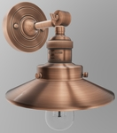
<b>Models/AnisotropyBarnLamp/screenshot/screenshot.jpg</b>

glTF/AnisotropyBarnLamp.gltf（共 350 行，展示前 60 行）
<pre>{&#10;  "asset": {&#10;    "version": "2.0",&#10;    "generator": "3ds Max, Max2Babylon, Visual Studio Code, glTF Tools",&#10;    "copyright": "(c) 2023 Wayfair, model and textures by Eric Chadwick, CC BY 4.0."&#10;  },&#10;  "extensionsUsed": [&#10;    "KHR_materials_anisotropy",&#10;    "KHR_materials_clearcoat",&#10;    "KHR_materials_emissive_strength",&#10;    "KHR_materials_transmission",&#10;    "KHR_materials_volume"&#10;  ],&#10;  "scene": 0,&#10;  "scenes": [&#10;    {&#10;      "nodes": [&#10;        0,&#10;        1,&#10;        2&#10;      ]&#10;    }&#10;  ],&#10;  "nodes": [&#10;    {&#10;      "mesh": 0,&#10;      "name": "Lamp Metal"&#10;    },&#10;    {&#10;      "mesh": 1,&#10;      "name": "Lamp Filament"&#10;    },&#10;    {&#10;      "mesh": 2,&#10;      "name": "Lamp Glass"&#10;    }&#10;  ],&#10;  "meshes": [&#10;    {&#10;      "primitives": [&#10;        {&#10;          "attributes": {&#10;            "POSITION": 1,&#10;            "TANGENT": 2,&#10;            "NORMAL": 3,&#10;            "TEXCOORD_0": 4&#10;          },&#10;          "indices": 0,&#10;          "material": 0&#10;        }&#10;      ],&#10;      "name": "Lamp Metal"&#10;    },&#10;    {&#10;      "primitives": [&#10;        {&#10;          "attributes": {&#10;            "POSITION": 6,&#10;            "NORMAL": 7&#10;          },&#10;…（截断，原文共 350 行）</pre>

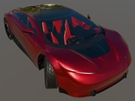
<b>Models/CarConcept/screenshot/screenshot.jpg</b>

glTF/CarConcept.gltf（共 17508 行，展示前 60 行）
<pre>{&#10;  "accessors": [&#10;    {&#10;      "bufferView": 0,&#10;      "componentType": 5123,&#10;      "count": 2820,&#10;      "max": [&#10;        790&#10;      ],&#10;      "min": [&#10;        0&#10;      ],&#10;      "type": "SCALAR"&#10;    },&#10;    {&#10;      "bufferView": 1,&#10;      "componentType": 5126,&#10;      "count": 791,&#10;      "max": [&#10;        1.0939888954162598,&#10;        1.8939281702041626,&#10;        0.83282351493835449&#10;      ],&#10;      "min": [&#10;        -1.0939888954162598,&#10;        -2.3895330429077148,&#10;        0.088528253138065338&#10;      ],&#10;      "type": "VEC3"&#10;    },&#10;    {&#10;      "bufferView": 2,&#10;      "componentType": 5126,&#10;      "count": 791,&#10;      "max": [&#10;        1.3087955713272095,&#10;        1.0395560264587402&#10;      ],&#10;      "min": [&#10;        -0.27452325820922852,&#10;        -0.021978974342346191&#10;      ],&#10;      "type": "VEC2"&#10;    },&#10;    {&#10;      "bufferView": 3,&#10;      "componentType": 5126,&#10;      "count": 791,&#10;      "max": [&#10;        0.99594104290008545,&#10;        0.99899733066558838&#10;      ],&#10;      "min": [&#10;        0.13679200410842896,&#10;        0.19021515548229218&#10;      ],&#10;      "type": "VEC2"&#10;    },&#10;    {&#10;      "bufferView": 4,&#10;…（截断，原文共 17508 行）</pre>

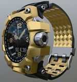
<b>Models/ChronographWatch/screenshot/screenshot.jpg</b>

glTF/ChronographWatch.gltf（共 2588 行，展示前 60 行）
<pre>{&#10;  "accessors": [&#10;    {&#10;      "bufferView": 0,&#10;      "componentType": 5123,&#10;      "count": 8448,&#10;      "max": [&#10;        1440&#10;      ],&#10;      "min": [&#10;        0&#10;      ],&#10;      "type": "SCALAR"&#10;    },&#10;    {&#10;      "bufferView": 1,&#10;      "componentType": 5126,&#10;      "count": 1441,&#10;      "max": [&#10;        1.9142159223556519,&#10;        -0.006587684154510498,&#10;        1.9834370613098145&#10;      ],&#10;      "min": [&#10;        -1.9834374189376831,&#10;        -0.071031078696250916,&#10;        -1.902249813079834&#10;      ],&#10;      "type": "VEC3"&#10;    },&#10;    {&#10;      "bufferView": 2,&#10;      "componentType": 5126,&#10;      "count": 1441,&#10;      "max": [&#10;        0.9996991753578186,&#10;        0.99816501140594482&#10;      ],&#10;      "min": [&#10;        0.00030085444450378418,&#10;        0.0018349885940551758&#10;      ],&#10;      "type": "VEC2"&#10;    },&#10;    {&#10;      "bufferView": 3,&#10;      "componentType": 5126,&#10;      "count": 1441,&#10;      "max": [&#10;        0.22633920609951019,&#10;        1,&#10;        0.21527314186096191&#10;      ],&#10;      "min": [&#10;        -0.22251689434051514,&#10;        0.9706534743309021,&#10;        -0.22507238388061523&#10;      ],&#10;      "type": "VEC3"&#10;    },&#10;…（截断，原文共 2588 行）</pre>

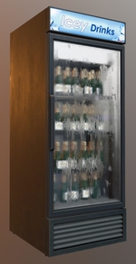
<b>Models/CommercialRefrigerator/screenshot/screenshot.jpg</b>

glTF/CommercialRefrigerator.gltf（共 1193 行，展示前 60 行）
<pre>{&#10;  "accessors": [&#10;    {&#10;      "bufferView": 0,&#10;      "componentType": 5123,&#10;      "count": 1488,&#10;      "max": [&#10;        719&#10;      ],&#10;      "min": [&#10;        0&#10;      ],&#10;      "type": "SCALAR"&#10;    },&#10;    {&#10;      "bufferView": 1,&#10;      "componentType": 5126,&#10;      "count": 720,&#10;      "max": [&#10;        0.39430069923400879,&#10;        0.46032229065895081,&#10;        2.1840403079986572&#10;      ],&#10;      "min": [&#10;        -0.46007776260375977,&#10;        -0.46025785803794861,&#10;        -5.9604644775390625e-08&#10;      ],&#10;      "type": "VEC3"&#10;    },&#10;    {&#10;      "bufferView": 2,&#10;      "componentType": 5126,&#10;      "count": 720,&#10;      "max": [&#10;        0.98504412174224854,&#10;        0.98972928524017334&#10;      ],&#10;      "min": [&#10;        0.010251730680465698,&#10;        0.010259151458740234&#10;      ],&#10;      "type": "VEC2"&#10;    },&#10;    {&#10;      "bufferView": 3,&#10;      "componentType": 5126,&#10;      "count": 720,&#10;      "max": [&#10;        1,&#10;        1,&#10;        1&#10;      ],&#10;      "min": [&#10;        -1,&#10;        -1,&#10;        -1&#10;      ],&#10;      "type": "VEC3"&#10;    },&#10;…（截断，原文共 1193 行）</pre>

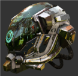
<b>Models/DamagedHelmet/screenshot/screenshot.png</b>

glTF/DamagedHelmet.gltf（共 205 行，展示前 60 行）
<pre>{&#10;    "accessors" : [&#10;        {&#10;            "bufferView" : 0,&#10;            "componentType" : 5123,&#10;            "count" : 46356,&#10;            "max" : [&#10;                14555&#10;            ],&#10;            "min" : [&#10;                0&#10;            ],&#10;            "type" : "SCALAR"&#10;        },&#10;        {&#10;            "bufferView" : 1,&#10;            "componentType" : 5126,&#10;            "count" : 14556,&#10;            "max" : [&#10;                0.9424954056739807,&#10;                0.8128451108932495,&#10;                0.900973916053772&#10;            ],&#10;            "min" : [&#10;                -0.9474585652351379,&#10;                -1.18715500831604,&#10;                -0.9009949564933777&#10;            ],&#10;            "type" : "VEC3"&#10;        },&#10;        {&#10;            "bufferView" : 2,&#10;            "componentType" : 5126,&#10;            "count" : 14556,&#10;            "max" : [&#10;                1.0,&#10;                1.0,&#10;                1.0&#10;            ],&#10;            "min" : [&#10;                -1.0,&#10;                -1.0,&#10;                -1.0&#10;            ],&#10;            "type" : "VEC3"&#10;        },&#10;        {&#10;            "bufferView" : 3,&#10;            "componentType" : 5126,&#10;            "count" : 14556,&#10;            "max" : [&#10;                0.9999759793281555,&#10;                1.998665988445282&#10;            ],&#10;            "min" : [&#10;                0.002448640065267682,&#10;                1.0005531199858524&#10;            ],&#10;            "type" : "VEC2"&#10;        }&#10;…（截断，原文共 205 行）</pre>

  <a href="https://arxiv.org/abs/2307.05663">Objaverse-XL</a> Stability AI · AllenAI <a class="hf" href="https://huggingface.co/datasets/allenai/objaverse-xl"><svg class="hf-i" viewBox="0 0 24 24" fill="none" stroke="currentColor" stroke-width="2.2" stroke-linecap="round" stroke-linejoin="round"><path d="M12 3v11"/><path d="M8 11l4 4 4-4"/><path d="M4 20h16"/></svg>2.5k</a><button type="button" class="sg-prev" title="上一个（←）">‹</button><button type="button" class="sg-next" title="下一个（→）">›</button><button type="button" class="sg-x" title="关闭（Esc）">✕</button>

<b>数据样例</b> · <a href="https://huggingface.co/datasets/allenai/objaverse">allenai/objaverse</a>

metadata（共 26 行）
<pre>{&#10;  "uid": "52429e4ef7bf4deda1309364a2cda86f",&#10;  "name": "Forest House",&#10;  "categories": [&#10;    "nature-plants",&#10;    "places-travel"&#10;  ],&#10;  "tags": [&#10;    "forest",&#10;    "bird",&#10;    "b3d",&#10;    "racoon",&#10;    "blender",&#10;    "house"&#10;  ],&#10;  "license": "by-nc",&#10;  "description": "Little forest scene for my racoon to play in. Music by https://soundcloud.com/glogsound",&#10;  "viewCount": 39512,&#10;  "likeCount": 2187,&#10;  "faceCount": 21518,&#10;  "vertexCount": 14324,&#10;  "publishedAt": "2019-12-12T17:31:03.331377",&#10;  "viewerUrl": "https://sketchfab.com/3d-models/52429e4ef7bf4deda1309364a2cda86f",&#10;  "user": "peachyroyalty",&#10;  "thumbnails": "5 张（最大 1920×1080）"&#10;}</pre>

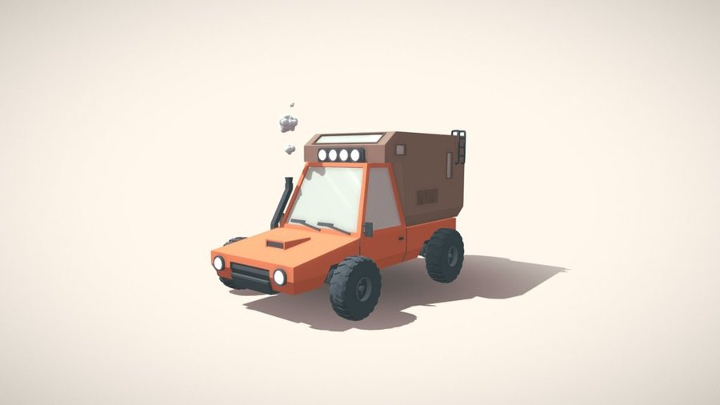

metadata（共 57 行）
<pre>{&#10;  "uid": "f3750246b6564607afbefc61cb1683b1",&#10;  "name": "Low-poly truck (car \"Drifter\")",&#10;  "categories": [&#10;    "art-abstract",&#10;    "cars-vehicles"&#10;  ],&#10;  "tags": [&#10;    "wheel",&#10;    "truck",&#10;    "frame",&#10;    "orange",&#10;    "white",&#10;    "wheels",&#10;    "j",&#10;    "van",&#10;    "mirror",&#10;    "brown",&#10;    "gray",&#10;    "fbx",&#10;    "colors",&#10;    "reynolds",&#10;    "drifter",&#10;    "notexture",&#10;    "low-poly-model",&#10;    "lowpolymodel",&#10;    "low-poly-blender",&#10;    "low-poly",&#10;    "glass",&#10;    "game",&#10;    "blender",&#10;    "vehicle",&#10;    "lowpoly",&#10;    "blender3d",&#10;    "gameart",&#10;    "low",&#10;    "poly",&#10;    "gameasset",&#10;    "car",&#10;    "animation",&#10;    "black",&#10;    "light",&#10;    "fbxmodel",&#10;    "fbx-object-model",&#10;    "timothy"&#10;  ],&#10;  "license": "by-nc",&#10;  "description": "Low poly car \"Drifter\" from Timothy J.Reynolds with simple animation, thank you)\nI used the reference at this link https://dribbble.com/shots/4069087-Drifter-update",&#10;  "viewCount": 31410,&#10;  "likeCount": 759,&#10;  "faceCount": 15892,&#10;  "vertexCount": 9036,&#10;  "publishedAt": "2019-12-03T18:55:20.591596",&#10;  "viewerUrl": "https://sketchfab.com/3d-models/f3750246b6564607afbefc61cb1683b1",&#10;  "user": "vanidza",&#10;  "thumbnails": "5 张（最大 1920×1080）"&#10;}</pre>

metadata（共 31 行）
<pre>{&#10;  "uid": "ca3695b7ecaf4e35a8b3f2e1ffb84c2c",&#10;  "name": "Flare Gun",&#10;  "categories": [&#10;    "weapons-military"&#10;  ],&#10;  "tags": [&#10;    "red",&#10;    "flare",&#10;    "signal",&#10;    "orion",&#10;    "flare-gun",&#10;    "substance",&#10;    "blender",&#10;    "pbr",&#10;    "lowpoly",&#10;    "substance-painter",&#10;    "gun",&#10;    "gameready"&#10;  ],&#10;  "license": "by",&#10;  "description": "Just a quick flare gun model based of off various flare gun models, modeled in Blender, textured in Substance Painter.",&#10;  "viewCount": 18608,&#10;  "likeCount": 478,&#10;  "faceCount": 12604,&#10;  "vertexCount": 6576,&#10;  "publishedAt": "2018-07-04T14:58:23.958577",&#10;  "viewerUrl": "https://sketchfab.com/3d-models/ca3695b7ecaf4e35a8b3f2e1ffb84c2c",&#10;  "user": "soidev",&#10;  "thumbnails": "5 张（最大 1920×1080）"&#10;}</pre>

P <a href="https://github.com/pmndrs/examples">pmndrs/examples</a> Poimandres <button type="button" class="sg-prev" title="上一个（←）">‹</button><button type="button" class="sg-next" title="下一个（→）">›</button><button type="button" class="sg-x" title="关闭（Esc）">✕</button>

<b>数据样例</b> · <a href="https://github.com/pmndrs/examples">pmndrs/examples</a>

<b>examples/caustics/thumbnail.webp</b>

examples/caustics/src/App.tsx（共 305 行，展示前 60 行）
<pre>import * as THREE from "three";&#10;import { useRef, useState } from "react";&#10;import { easing } from "maath";&#10;import { Canvas, useFrame, type ThreeElements } from "@react-three/fiber";&#10;import {&#10;  useGLTF,&#10;  Center,&#10;  Caustics,&#10;  Environment,&#10;  Lightformer,&#10;  RandomizedLight,&#10;  PerformanceMonitor,&#10;  AccumulativeShadows,&#10;  MeshTransmissionMaterial,&#10;} from "@react-three/drei";&#10;import { type GLTF } from "three-stdlib";&#10;&#10;import glassModel from "./glass-transformed.glb?url";&#10;&#10;type GLTFResult = GLTF &amp; {&#10;  nodes: {&#10;    cake: THREE.Mesh;&#10;    straw_1: THREE.Mesh;&#10;    straw_2: THREE.Mesh;&#10;    straw001_1: THREE.Mesh;&#10;    straw001_2: THREE.Mesh;&#10;    flowers: THREE.Mesh;&#10;    fork: THREE.Mesh;&#10;    glass: THREE.Mesh;&#10;    glass_back: THREE.Mesh;&#10;    glass_inner: THREE.Mesh;&#10;  };&#10;  materials: {&#10;    FruitCakeSlice_u1_v1: THREE.MeshStandardMaterial;&#10;    straw_2: THREE.MeshStandardMaterial;&#10;    straw_1: THREE.MeshStandardMaterial;&#10;    "draifrawer_u1_v1.001": THREE.MeshStandardMaterial;&#10;    ForkAndKnivesSet001_1K: THREE.MeshStandardMaterial;&#10;  };&#10;};&#10;&#10;const innerMaterial = new THREE.MeshStandardMaterial({&#10;  transparent: true,&#10;  opacity: 1,&#10;  color: "black",&#10;  roughness: 0,&#10;  side: THREE.FrontSide,&#10;  blending: THREE.AdditiveBlending,&#10;  polygonOffset: true,&#10;  polygonOffsetFactor: 1,&#10;  envMapIntensity: 2,&#10;});&#10;&#10;export default function App() {&#10;  const [perfSucks, degrade] = useState(false);&#10;  return (&#10;    &lt;Canvas&#10;      shadows&#10;      dpr={[1, perfSucks ? 1.5 : 2]}&#10;      eventSource={document.getElementById("root")!}&#10;…（截断，原文共 305 行）</pre>

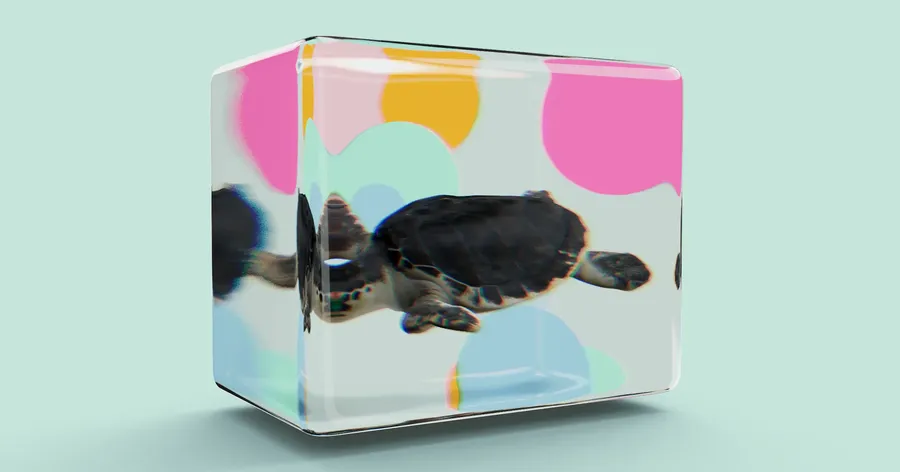
<b>examples/aquarium/thumbnail.webp</b>

examples/aquarium/src/App.tsx（共 201 行，展示前 60 行）
<pre>import { useLayoutEffect, useEffect, useRef } from "react";&#10;import * as THREE from "three";&#10;import { type GLTF } from "three-stdlib";&#10;import { Canvas, useFrame, type ThreeElements } from "@react-three/fiber";&#10;import {&#10;  useMask,&#10;  useGLTF,&#10;  useAnimations,&#10;  Float,&#10;  Instance,&#10;  Instances,&#10;  CameraControls,&#10;} from "@react-three/drei";&#10;import {&#10;  Lightformer,&#10;  Environment,&#10;  RandomizedLight,&#10;  AccumulativeShadows,&#10;  MeshTransmissionMaterial,&#10;} from "@react-three/drei";&#10;&#10;import shapesModel from "./shapes-transformed.glb?url";&#10;import turtleModel from "./model_52a_-_kemps_ridley_sea_turtle_no_id-transformed.glb?url";&#10;&#10;type GLTFResult = GLTF &amp; {&#10;  nodes: { Cube: THREE.Mesh };&#10;};&#10;&#10;type AppProps = {&#10;  spheres: [number, string, number, [number, number, number]][];&#10;};&#10;&#10;export default function App({ spheres }: AppProps) {&#10;  return (&#10;    &lt;Canvas&#10;      shadows&#10;      camera={{ position: [30, 0, -3], fov: 35, near: 1, far: 50 }}&#10;      gl={{ stencil: true }}&#10;    &gt;&#10;      &lt;color attach="background" args={["#c6e5db"]} /&gt;&#10;      {/** Glass aquarium */}&#10;      &lt;Aquarium position={[0, 0.25, 0]}&gt;&#10;        &lt;Float rotationIntensity={2} floatIntensity={10} speed={2}&gt;&#10;          &lt;Turtle&#10;            position={[0, -0.5, -1]}&#10;            rotation={[0, Math.PI, 0]}&#10;            scale={23}&#10;          /&gt;&#10;        &lt;/Float&gt;&#10;        &lt;Instances renderOrder={-1000}&gt;&#10;          &lt;sphereGeometry args={[1, 64, 64]} /&gt;&#10;          &lt;meshBasicMaterial depthTest={false} /&gt;&#10;          {spheres.map(([scale, color, speed, position], index) =&gt; (&#10;            &lt;Sphere&#10;              key={index}&#10;              scale={scale}&#10;              color={color}&#10;              speed={speed}&#10;              position={position}&#10;            /&gt;&#10;…（截断，原文共 201 行）</pre>

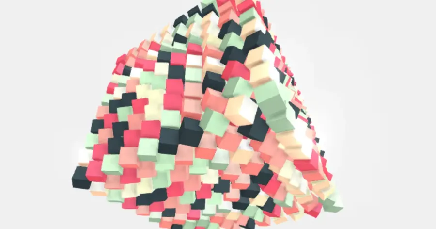
<b>examples/instanced-vertex-colors/thumbnail.webp</b>

examples/instanced-vertex-colors/src/App.tsx（共 93 行，展示前 60 行）
<pre>import * as THREE from "three";&#10;import React, { useRef, useMemo, useState, useEffect } from "react";&#10;import { Canvas, useFrame, type ThreeEvent } from "@react-three/fiber";&#10;import { EffectComposer, N8AO, Bloom } from "@react-three/postprocessing";&#10;import niceColors from "nice-color-palettes";&#10;&#10;const tempObject = new THREE.Object3D();&#10;const tempColor = new THREE.Color();&#10;const data = Array.from({ length: 1000 }, () =&gt; ({&#10;  color: niceColors[17][Math.floor(Math.random() * 5)],&#10;  scale: 1,&#10;}));&#10;&#10;export function App() {&#10;  return (&#10;    &lt;Canvas&#10;      gl={{ antialias: false }}&#10;      camera={{ position: [0, 0, 15], near: 5, far: 20 }}&#10;    &gt;&#10;      &lt;color attach="background" args={["#f0f0f0"]} /&gt;&#10;      &lt;Boxes /&gt;&#10;      {/* `disableNormalPass` no longer exists in this postprocessing version; the normal pass is already disabled by default */}&#10;      &lt;EffectComposer&gt;&#10;        &lt;N8AO aoRadius={0.5} intensity={1} /&gt;&#10;        &lt;Bloom luminanceThreshold={1} intensity={0.5} levels={9} mipmapBlur /&gt;&#10;      &lt;/EffectComposer&gt;&#10;    &lt;/Canvas&gt;&#10;  );&#10;}&#10;&#10;function Boxes() {&#10;  const [hovered, set] = useState&lt;number &#124; undefined&gt;();&#10;  const colorArray = useMemo(&#10;    () =&gt;&#10;      Float32Array.from(&#10;        new Array(1000)&#10;          .fill(0)&#10;          .flatMap((_, i) =&gt; tempColor.set(data[i].color).toArray()),&#10;      ),&#10;    [],&#10;  );&#10;  const meshRef = useRef&lt;THREE.InstancedMesh&gt;(null!);&#10;  const prevRef = useRef&lt;number &#124; undefined&gt;(undefined);&#10;  useEffect(() =&gt; void (prevRef.current = hovered), [hovered]);&#10;&#10;  useFrame((state) =&gt; {&#10;    const time = state.clock.getElapsedTime();&#10;    meshRef.current.rotation.x = Math.sin(time / 4);&#10;    meshRef.current.rotation.y = Math.sin(time / 2);&#10;    let i = 0;&#10;    for (let x = 0; x &lt; 10; x++)&#10;      for (let y = 0; y &lt; 10; y++)&#10;        for (let z = 0; z &lt; 10; z++) {&#10;          const id = i++;&#10;          tempObject.position.set(5 - x, 5 - y, 5 - z);&#10;          tempObject.rotation.y =&#10;            Math.sin(x / 4 + time) +&#10;            Math.sin(y / 4 + time) +&#10;            Math.sin(z / 4 + time);&#10;          tempObject.rotation.z = tempObject.rotation.y * 2;&#10;…（截断，原文共 93 行）</pre>

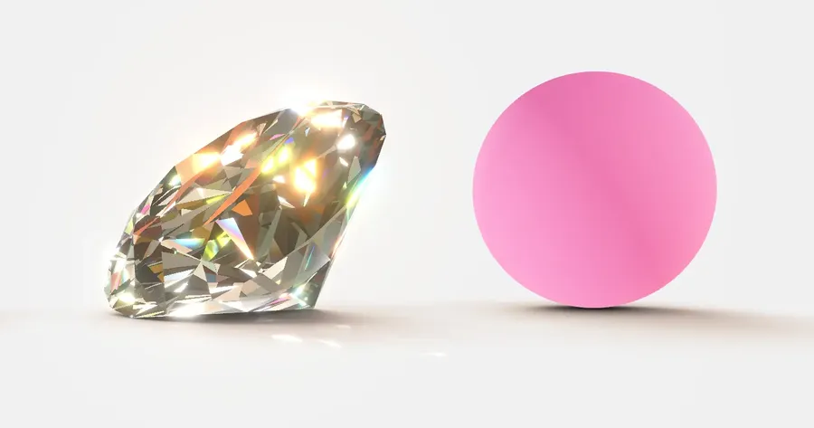
<b>examples/diamond-refraction/thumbnail.webp</b>

examples/diamond-refraction/src/App.tsx（共 144 行，展示前 60 行）
<pre>import { useRef } from "react";&#10;import * as THREE from "three";&#10;import { Canvas, useLoader, type ThreeElements } from "@react-three/fiber";&#10;import {&#10;  useGLTF,&#10;  Caustics,&#10;  CubeCamera,&#10;  Environment,&#10;  OrbitControls,&#10;  RandomizedLight,&#10;  AccumulativeShadows,&#10;  MeshRefractionMaterial,&#10;  MeshTransmissionMaterial,&#10;} from "@react-three/drei";&#10;import { EffectComposer, Bloom } from "@react-three/postprocessing";&#10;import { useControls } from "leva";&#10;import { RGBELoader, type GLTF } from "three-stdlib";&#10;&#10;import dflatModel from "./dflat.glb?url";&#10;import aeroHdr from "./aerodynamics_workshop_1k.hdr?url";&#10;&#10;type GLTFResult = GLTF &amp; {&#10;  nodes: { Diamond_1_0: THREE.Mesh };&#10;};&#10;&#10;// `backfaces`/`backfaceIor` aren't part of drei's current CausticsProps type&#10;// (renamed to `backside`/`backsideIOR`), so keep them in a separately-typed&#10;// object and spread it — this preserves the exact runtime props/values the&#10;// original code passed without an `any` escape hatch.&#10;const diamondCausticsExtraProps = { backfaces: true, backfaceIor: 1.1 };&#10;&#10;function Diamond(props: ThreeElements["mesh"]) {&#10;  const ref = useRef&lt;THREE.Mesh&gt;(null!);&#10;  const { nodes } = useGLTF(dflatModel) as unknown as GLTFResult;&#10;  // Use a custom envmap/scene-backdrop for the diamond material&#10;  // This way we can have a clear BG while cube-cam can still film other objects&#10;  const texture = useLoader(RGBELoader, aeroHdr);&#10;  // Optional config&#10;  const config = useControls({&#10;    bounces: { value: 3, min: 0, max: 8, step: 1 },&#10;    aberrationStrength: { value: 0.01, min: 0, max: 0.1, step: 0.01 },&#10;    ior: { value: 2.75, min: 0, max: 10 },&#10;    fresnel: { value: 1, min: 0, max: 1 },&#10;    color: "white",&#10;  });&#10;  return (&#10;    &lt;CubeCamera resolution={256} frames={1} envMap={texture}&gt;&#10;      {(texture) =&gt; (&#10;        &lt;Caustics&#10;          causticsOnly={false}&#10;          backside={false}&#10;          {...diamondCausticsExtraProps}&#10;          color={config.color}&#10;          position={[0, -0.5, 0]}&#10;          lightSource={[5, 5, -10]}&#10;          worldRadius={0.1}&#10;          ior={1.8}&#10;          intensity={0.1}&#10;        &gt;&#10;          &lt;mesh&#10;…（截断，原文共 144 行）</pre>

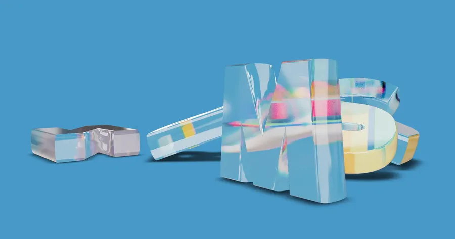
<b>examples/portal-shapes/thumbnail.webp</b>

examples/portal-shapes/src/App.tsx（共 206 行，展示前 60 行）
<pre>import * as THREE from "three";&#10;import { useRef, type ComponentRef, type ReactNode } from "react";&#10;import { Canvas, useFrame, useThree } from "@react-three/fiber";&#10;import {&#10;  Text3D,&#10;  Center,&#10;  Preload,&#10;  Lightformer,&#10;  Environment,&#10;  CameraControls,&#10;  RenderTexture,&#10;  ContactShadows,&#10;  MeshTransmissionMaterial,&#10;  type RenderTextureProps,&#10;} from "@react-three/drei";&#10;import {&#10;  Physics,&#10;  RigidBody,&#10;  CuboidCollider,&#10;  type RigidBodyProps,&#10;} from "@react-three/rapier";&#10;import Turtle from "./sandboxes/Turtle";&#10;import Basic from "./sandboxes/Basic";&#10;import PingPong from "./sandboxes/PingPong";&#10;import Shoe from "./sandboxes/Shoe";&#10;import Stencil from "./sandboxes/Stencil";&#10;import Rocket from "./sandboxes/Rocket";&#10;&#10;import boldFont from "./bold.blob?url";&#10;&#10;export default function App() {&#10;  return (&#10;    &lt;Canvas&#10;      dpr={[1.5, 2]}&#10;      camera={{ position: [-20, 40, 30], fov: 45, near: 1, far: 300 }}&#10;    &gt;&#10;      {/** The physics world */}&#10;      &lt;Physics gravity={[0, -60, 0]}&gt;&#10;        &lt;Letter char="P" position={[1, 50, -1]} rotation={[0, 0, 0]}&gt;&#10;          {/** The sandboxes dropped into here have no idea what's going to happen.&#10;               For all intents and purposes they're just self-contained components.  */}&#10;          &lt;Turtle /&gt;&#10;        &lt;/Letter&gt;&#10;        &lt;Letter char="M" position={[2, 60, -2]} rotation={[4, 5, 6]}&gt;&#10;          &lt;Shoe scale={5} /&gt;&#10;        &lt;/Letter&gt;&#10;        &lt;Letter char="N" position={[3, 70, 2]} rotation={[7, 8, 9]}&gt;&#10;          &lt;Rocket position={[-1, -1, 0]} scale={0.6} /&gt;&#10;        &lt;/Letter&gt;&#10;        &lt;Letter char="D" position={[-1, 80, 3]} rotation={[10, 11, 12]}&gt;&#10;          &lt;Basic scale={3} /&gt;&#10;        &lt;/Letter&gt;&#10;        &lt;Letter char="R" position={[-2, 90, 2]} rotation={[13, 14, 15]}&gt;&#10;          &lt;PingPong /&gt;&#10;        &lt;/Letter&gt;&#10;        &lt;Letter&#10;          char="S"&#10;          position={[-3, 100, -3]}&#10;          rotation={[16, 17, 18]}&#10;          stencilBuffer&#10;…（截断，原文共 206 行）</pre>

<b>examples/the-three-graces/thumbnail.webp</b>

examples/the-three-graces/src/App.tsx（共 140 行，展示前 60 行）
<pre>// Original concept by Tom Bogner @dastom on Dribble: https://dribbble.com/shots/6767548-The-Three-Graces-Concept&#10;&#10;import { useRef, type ComponentProps } from "react";&#10;import * as THREE from "three";&#10;import { type GLTF } from "three-stdlib";&#10;import {&#10;  Canvas,&#10;  extend,&#10;  useFrame,&#10;  type Catalogue,&#10;  type ThreeElements,&#10;} from "@react-three/fiber";&#10;import { useGLTF, SoftShadows, Html, CameraControls } from "@react-three/drei";&#10;import { easing, geometry } from "maath";&#10;&#10;import gracesModel from "./graces-draco.glb?url";&#10;&#10;// `geometry` also exports UV helper functions that aren't constructors;&#10;// extend()'s Catalogue type only wants constructors, but the extras are&#10;// harmless additions to the JSX intrinsics catalogue at runtime.&#10;extend(geometry as unknown as Catalogue);&#10;&#10;export default function App() {&#10;  return (&#10;    &lt;Canvas&#10;      shadows="basic"&#10;      eventSource={document.getElementById("root")!}&#10;      eventPrefix="client"&#10;      camera={{ position: [0, 1.5, 14], fov: 45 }}&#10;    &gt;&#10;      &lt;fog attach="fog" args={["black", 0, 20]} /&gt;&#10;      &lt;pointLight position={[10, -10, -20]} intensity={10} decay={0} /&gt;&#10;      &lt;pointLight position={[-10, -10, -20]} intensity={10} decay={0} /&gt;&#10;      &lt;Model position={[0, -5.5, 3]} rotation={[0, -0.2, 0]} /&gt;&#10;      &lt;SoftShadows samples={3} /&gt;&#10;      &lt;CameraControls&#10;        minPolarAngle={0}&#10;        maxPolarAngle={Math.PI / 2}&#10;        minAzimuthAngle={-Math.PI / 2}&#10;        maxAzimuthAngle={Math.PI / 2}&#10;      /&gt;&#10;    &lt;/Canvas&gt;&#10;  );&#10;}&#10;&#10;type GLTFResult = GLTF &amp; {&#10;  nodes: { Node_3: THREE.Mesh };&#10;};&#10;&#10;/*&#10;Auto-generated by: https://github.com/react-spring/gltfjsx&#10;Author: 3DLadnik (https://sketchfab.com/3DLadnik)&#10;License: CC-BY-4.0 (http://creativecommons.org/licenses/by/4.0/)&#10;Source: https://sketchfab.com/3d-models/3d-printable-the-three-graces-58e0ae19e2984b86883edc41bf43415a&#10;Title: 3D Printable The Three Graces&#10;*/&#10;function Model(props: ThreeElements["group"]) {&#10;  const group = useRef&lt;THREE.Group&gt;(null!);&#10;  const light = useRef&lt;THREE.SpotLight&gt;(null!);&#10;  const { nodes } = useGLTF(gracesModel) as unknown as GLTFResult;&#10;…（截断，原文共 140 行）</pre>

P <a href="https://api.polyhaven.com/assets">Poly Haven</a> <button type="button" class="sg-prev" title="上一个（←）">‹</button><button type="button" class="sg-next" title="下一个（→）">›</button><button type="button" class="sg-x" title="关闭（Esc）">✕</button>

<b>数据样例</b> · <a href="https://polyhaven.com/models">Poly Haven</a>

<b>asset_img/thumbs/grass_medium_01.png</b>

api.polyhaven.com/files/grass_medium_01（共 69 行，展示前 60 行）
<pre>{&#10; "blend": {&#10;  "1k": {&#10;   "blend": {&#10;    "url": "https://dl.polyhaven.org/file/ph-assets/Models/blend/1k/grass_medium_01/grass_medium_01_1k.blend",&#10;    "md5": "e37f4fa4c90ddeb807ce6b4c09e3033d",&#10;    "size": 1832028,&#10;    "include": {&#10;     "textures/grass_medium_01_alpha_1k.png": {&#10;      "url": "https://dl.polyhaven.org/file/ph-assets/Models/png/1k/grass_medium_01/grass_medium_01_alpha_1k.png",&#10;      "md5": "6b5b251ef1ca9a69ab9f49def66d758a",&#10;      "size": 648718&#10;     },&#10;     "textures/grass_medium_01_diff_1k.jpg": {&#10;      "url": "https://dl.polyhaven.org/file/ph-assets/Models/jpg/1k/grass_medium_01/grass_medium_01_diff_1k.jpg",&#10;      "md5": "6b18ed50d776fd20c1304d9994bd764e",&#10;      "size": 395673&#10;     },&#10;     "textures/grass_medium_01_dry_diff_1k.png": {&#10;      "url": "https://dl.polyhaven.org/file/ph-assets/Models/png/1k/grass_medium_01/grass_medium_01_dry_diff_1k.png",&#10;      "md5": "6f5ae8d4f152542de30aad6b6a3ea327",&#10;      "size": 2167830&#10;     },&#10;     "textures/grass_medium_01_nor_gl_1k.exr": {&#10;      "url": "https://dl.polyhaven.org/file/ph-assets/Models/exr/1k/grass_medium_01/grass_medium_01_nor_gl_1k.exr",&#10;      "md5": "70fb385251e22ca7cf23ed4adf835ab2",&#10;      "size": 2021011&#10;     },&#10;     "textures/grass_medium_01_rough_1k.exr": {&#10;      "url": "https://dl.polyhaven.org/file/ph-assets/Models/exr/1k/grass_medium_01/grass_medium_01_rough_1k.exr",&#10;      "md5": "8c72f456c9f2fae200be9d308fe91051",&#10;      "size": 900132&#10;     }&#10;    }&#10;   }&#10;  }&#10; },&#10; "gltf": {&#10;  "1k": {&#10;   "gltf": {&#10;    "url": "https://dl.polyhaven.org/file/ph-assets/Models/gltf/1k/grass_medium_01/grass_medium_01_1k.gltf",&#10;    "md5": "28dd8247f3faa749bf87a0b84be01e7e",&#10;    "size": 27110,&#10;    "include": {&#10;     "textures/grass_medium_01_nor_gl_1k.jpg": {&#10;      "url": "https://dl.polyhaven.org/file/ph-assets/Models/jpg/1k/grass_medium_01/grass_medium_01_nor_gl_1k.jpg",&#10;      "md5": "fcf43dd1253f56e4c361079f34155c37",&#10;      "size": 956166&#10;     },&#10;     "textures/grass_medium_01_diff_1k.jpg": {&#10;      "url": "https://dl.polyhaven.org/file/ph-assets/Models/jpg/1k/grass_medium_01/grass_medium_01_diff_1k.jpg",&#10;      "md5": "6b18ed50d776fd20c1304d9994bd764e",&#10;      "size": 395673&#10;     },&#10;     "textures/grass_medium_01_arm_1k.jpg": {&#10;      "url": "https://dl.polyhaven.org/file/ph-assets/Models/jpg/1k/grass_medium_01/grass_medium_01_arm_1k.jpg",&#10;      "md5": "37ed2730a507b681af2e9f9f7ef3ae5e",&#10;      "size": 679518&#10;     },&#10;     "grass_medium_01.bin": {&#10;…（截断，原文共 69 行）</pre>

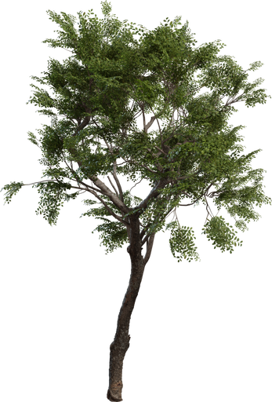
<b>asset_img/thumbs/tree_small_02.png</b>

api.polyhaven.com/files/tree_small_02（共 124 行，展示前 60 行）
<pre>{&#10; "blend": {&#10;  "1k": {&#10;   "blend": {&#10;    "url": "https://dl.polyhaven.org/file/ph-assets/Models/blend/1k/tree_small_02/tree_small_02_1k.blend",&#10;    "md5": "d602d9e4df77457454ac427fd37d0b53",&#10;    "size": 63805841,&#10;    "include": {&#10;     "textures/tree_small_02_branch_diff_1k.png": {&#10;      "url": "https://dl.polyhaven.org/file/ph-assets/Models/png/1k/tree_small_02/tree_small_02_branch_diff_1k.png",&#10;      "md5": "2da9ea379228636c4fda2fde9a11d760",&#10;      "size": 1277270&#10;     },&#10;     "textures/tree_small_02_branch_nor_gl_1k.png": {&#10;      "url": "https://dl.polyhaven.org/file/ph-assets/Models/png/1k/tree_small_02/tree_small_02_branch_nor_gl_1k.png",&#10;      "md5": "4b6ae81428061986d42f205d03ec1989",&#10;      "size": 5754879&#10;     },&#10;     "textures/tree_small_02_branch_rough_1k.png": {&#10;      "url": "https://dl.polyhaven.org/file/ph-assets/Models/png/1k/tree_small_02/tree_small_02_branch_rough_1k.png",&#10;      "md5": "6189ac57979c248f9eb362ca04c5619e",&#10;      "size": 421614&#10;     },&#10;     "textures/tree_small_02_diff_1k.jpg": {&#10;      "url": "https://dl.polyhaven.org/file/ph-assets/Models/jpg/1k/tree_small_02/tree_small_02_diff_1k.jpg",&#10;      "md5": "a7287a3f4e7f0d4577cb949b245f5b14",&#10;      "size": 863246&#10;     },&#10;     "textures/tree_small_02_leaves_alpha_1k.png": {&#10;      "url": "https://dl.polyhaven.org/file/ph-assets/Models/png/1k/tree_small_02/tree_small_02_leaves_alpha_1k.png",&#10;      "md5": "63199ba87a9e8928424bd8c3b8017bd0",&#10;      "size": 264711&#10;     },&#10;     "textures/tree_small_02_leaves_diff_1k.png": {&#10;      "url": "https://dl.polyhaven.org/file/ph-assets/Models/png/1k/tree_small_02/tree_small_02_leaves_diff_1k.png",&#10;      "md5": "2c667193084725e8553062ddbdc73c7d",&#10;      "size": 2338424&#10;     },&#10;     "textures/tree_small_02_leaves_nor_gl_1k.png": {&#10;      "url": "https://dl.polyhaven.org/file/ph-assets/Models/png/1k/tree_small_02/tree_small_02_leaves_nor_gl_1k.png",&#10;      "md5": "e81c5d7e7fc09af321e8c5ac5b4948f2",&#10;      "size": 4903387&#10;     },&#10;     "textures/tree_small_02_leaves_rough_1k.png": {&#10;      "url": "https://dl.polyhaven.org/file/ph-assets/Models/png/1k/tree_small_02/tree_small_02_leaves_rough_1k.png",&#10;      "md5": "49c08fb74ed781e9632b543b8e19c8cb",&#10;      "size": 1043665&#10;     },&#10;     "textures/tree_small_02_nor_gl_1k.exr": {&#10;      "url": "https://dl.polyhaven.org/file/ph-assets/Models/exr/1k/tree_small_02/tree_small_02_nor_gl_1k.exr",&#10;      "md5": "eccf7df1617a8d6d841dff98bf58dc3a",&#10;      "size": 2462999&#10;     },&#10;     "textures/tree_small_02_rough_1k.exr": {&#10;      "url": "https://dl.polyhaven.org/file/ph-assets/Models/exr/1k/tree_small_02/tree_small_02_rough_1k.exr",&#10;      "md5": "af3b33e4b262b8ac40a94ee5d93ce13e",&#10;      "size": 978557&#10;     }&#10;    }&#10;   }&#10;…（截断，原文共 124 行）</pre>

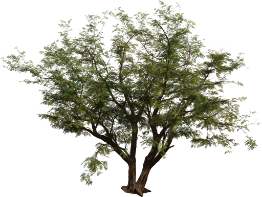
<b>asset_img/thumbs/jacaranda_tree.png</b>

api.polyhaven.com/files/jacaranda_tree（共 124 行，展示前 60 行）
<pre>{&#10; "blend": {&#10;  "1k": {&#10;   "blend": {&#10;    "url": "https://dl.polyhaven.org/file/ph-assets/Models/blend/1k/jacaranda_tree/jacaranda_tree_1k.blend",&#10;    "md5": "1b827c7c364c6ebb2cbbff0f02b52a15",&#10;    "size": 180228496,&#10;    "include": {&#10;     "textures/jacaranda_tree_branches_diff_1k.png": {&#10;      "url": "https://dl.polyhaven.org/file/ph-assets/Models/png/1k/jacaranda_tree/jacaranda_tree_branches_diff_1k.png",&#10;      "md5": "ad4488598993a114236807d60136fc7b",&#10;      "size": 5223386&#10;     },&#10;     "textures/jacaranda_tree_branches_nor_gl_1k.png": {&#10;      "url": "https://dl.polyhaven.org/file/ph-assets/Models/png/1k/jacaranda_tree/jacaranda_tree_branches_nor_gl_1k.png",&#10;      "md5": "df3d91a9c29266f44b0b17da135a2899",&#10;      "size": 5400459&#10;     },&#10;     "textures/jacaranda_tree_branches_rough_1k.png": {&#10;      "url": "https://dl.polyhaven.org/file/ph-assets/Models/png/1k/jacaranda_tree/jacaranda_tree_branches_rough_1k.png",&#10;      "md5": "8bd9e066f93c242ef468c7c6ea6dc382",&#10;      "size": 1625206&#10;     },&#10;     "textures/jacaranda_tree_leaves_alpha_1k.png": {&#10;      "url": "https://dl.polyhaven.org/file/ph-assets/Models/png/1k/jacaranda_tree/jacaranda_tree_leaves_alpha_1k.png",&#10;      "md5": "740214de7b900e30737009ff4ee2c01a",&#10;      "size": 506043&#10;     },&#10;     "textures/jacaranda_tree_leaves_diff_1k.png": {&#10;      "url": "https://dl.polyhaven.org/file/ph-assets/Models/png/1k/jacaranda_tree/jacaranda_tree_leaves_diff_1k.png",&#10;      "md5": "879ef43acb3443e247a2d32713fec86c",&#10;      "size": 2364526&#10;     },&#10;     "textures/jacaranda_tree_leaves_nor_gl_1k.png": {&#10;      "url": "https://dl.polyhaven.org/file/ph-assets/Models/png/1k/jacaranda_tree/jacaranda_tree_leaves_nor_gl_1k.png",&#10;      "md5": "c968c79960303470e124875a111bd5a4",&#10;      "size": 4154090&#10;     },&#10;     "textures/jacaranda_tree_leaves_rough_1k.png": {&#10;      "url": "https://dl.polyhaven.org/file/ph-assets/Models/png/1k/jacaranda_tree/jacaranda_tree_leaves_rough_1k.png",&#10;      "md5": "4cbffd1596f7ad63de8e170ac54fb907",&#10;      "size": 992522&#10;     },&#10;     "textures/jacaranda_tree_trunk_diff_1k.png": {&#10;      "url": "https://dl.polyhaven.org/file/ph-assets/Models/png/1k/jacaranda_tree/jacaranda_tree_trunk_diff_1k.png",&#10;      "md5": "eb97b09e36a6683ab5c15496d08a65b2",&#10;      "size": 5450061&#10;     },&#10;     "textures/jacaranda_tree_trunk_nor_gl_1k.png": {&#10;      "url": "https://dl.polyhaven.org/file/ph-assets/Models/png/1k/jacaranda_tree/jacaranda_tree_trunk_nor_gl_1k.png",&#10;      "md5": "98bae75f6c5805b4fd22907d74c7d2c0",&#10;      "size": 5486270&#10;     },&#10;     "textures/jacaranda_tree_trunk_rough_1k.png": {&#10;      "url": "https://dl.polyhaven.org/file/ph-assets/Models/png/1k/jacaranda_tree/jacaranda_tree_trunk_rough_1k.png",&#10;      "md5": "d3682e710029d485344b9c2c5f819e37",&#10;      "size": 1747236&#10;     }&#10;    }&#10;   }&#10;…（截断，原文共 124 行）</pre>

<b>asset_img/thumbs/Camera_01.png</b>

api.polyhaven.com/files/Camera_01（共 134 行，展示前 60 行）
<pre>{&#10; "blend": {&#10;  "1k": {&#10;   "blend": {&#10;    "include": {&#10;     "textures/Camera_01_body_nor_gl_1k.png": {&#10;      "size": 1523231,&#10;      "url": "https://dl.polyhaven.org/file/ph-assets/Models/png/1k/Camera_01/Camera_01_body_nor_gl_1k.png",&#10;      "md5": "ca3053325dbbb4b75fd891fb86096b06"&#10;     },&#10;     "textures/Camera_01_body_metallic_1k.png": {&#10;      "size": 169863,&#10;      "url": "https://dl.polyhaven.org/file/ph-assets/Models/png/1k/Camera_01/Camera_01_body_metallic_1k.png",&#10;      "md5": "d4e8ecf322227fc836ff571a720077d6"&#10;     },&#10;     "textures/Camera_01_body_roughness_1k.png": {&#10;      "size": 599889,&#10;      "url": "https://dl.polyhaven.org/file/ph-assets/Models/png/1k/Camera_01/Camera_01_body_roughness_1k.png",&#10;      "md5": "ff3acedbdac6f7af68846c1c829365bf"&#10;     },&#10;     "textures/Camera_01_strap_diff_1k.png": {&#10;      "size": 961334,&#10;      "url": "https://dl.polyhaven.org/file/ph-assets/Models/png/1k/Camera_01/Camera_01_strap_diff_1k.png",&#10;      "md5": "0f5eecbef30a82b5dc95e05e3745e7b7"&#10;     },&#10;     "textures/Camera_01_strap_roughness_1k.png": {&#10;      "size": 560269,&#10;      "url": "https://dl.polyhaven.org/file/ph-assets/Models/png/1k/Camera_01/Camera_01_strap_roughness_1k.png",&#10;      "md5": "a02e7cbcf34cd111809b8a2065a9b94d"&#10;     },&#10;     "textures/Camera_01_strap_nor_gl_1k.png": {&#10;      "size": 1496358,&#10;      "url": "https://dl.polyhaven.org/file/ph-assets/Models/png/1k/Camera_01/Camera_01_strap_nor_gl_1k.png",&#10;      "md5": "9587580484a221d20017830efae9a099"&#10;     },&#10;     "textures/Camera_01_lens_body_metallic_1k.png": {&#10;      "size": 51703,&#10;      "url": "https://dl.polyhaven.org/file/ph-assets/Models/png/1k/Camera_01/Camera_01_lens_body_metallic_1k.png",&#10;      "md5": "70da55f978a04d8976666f307b647053"&#10;     },&#10;     "textures/Camera_01_lens_body_roughness_1k.png": {&#10;      "size": 453181,&#10;      "url": "https://dl.polyhaven.org/file/ph-assets/Models/png/1k/Camera_01/Camera_01_lens_body_roughness_1k.png",&#10;      "md5": "a768ec226fcd22053858653237b2a3cf"&#10;     },&#10;     "textures/Camera_01_lens_body_nor_gl_1k.png": {&#10;      "size": 932666,&#10;      "url": "https://dl.polyhaven.org/file/ph-assets/Models/png/1k/Camera_01/Camera_01_lens_body_nor_gl_1k.png",&#10;      "md5": "86156f97f4d3f2e6bfa38e703e27746b"&#10;     },&#10;     "textures/Camera_01_body_diff_1k.png": {&#10;      "size": 962295,&#10;      "url": "https://dl.polyhaven.org/file/ph-assets/Models/png/1k/Camera_01/Camera_01_body_diff_1k.png",&#10;      "md5": "a127468f944552cab3aef47376047c4d"&#10;     },&#10;     "textures/Camera_01_strap_metallic_1k.png": {&#10;      "size": 15942,&#10;      "url": "https://dl.polyhaven.org/file/ph-assets/Models/png/1k/Camera_01/Camera_01_strap_metallic_1k.png",&#10;      "md5": "e06f233b925ce9ff7bfb7dc830da6478"&#10;     },&#10;…（截断，原文共 134 行）</pre>

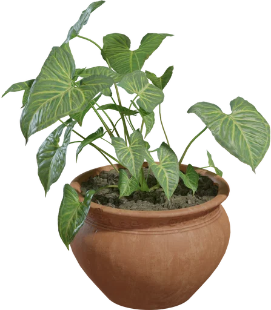
<b>asset_img/thumbs/potted_plant_02.png</b>

api.polyhaven.com/files/potted_plant_02（共 94 行，展示前 60 行）
<pre>{&#10; "blend": {&#10;  "1k": {&#10;   "blend": {&#10;    "include": {&#10;     "textures/potted_plant_02_pot_rough_1k.png": {&#10;      "size": 1220537,&#10;      "url": "https://dl.polyhaven.org/file/ph-assets/Models/png/1k/potted_plant_02/potted_plant_02_pot_rough_1k.png",&#10;      "md5": "2713c7b90a4f901d887482a708167858"&#10;     },&#10;     "textures/potted_plant_02_pot_diff_1k.png": {&#10;      "size": 4980098,&#10;      "url": "https://dl.polyhaven.org/file/ph-assets/Models/png/1k/potted_plant_02/potted_plant_02_pot_diff_1k.png",&#10;      "md5": "550416d1c00b0ce2c8eba7de8aa5975d"&#10;     },&#10;     "textures/potted_plant_02_leaves_rough_1k.png": {&#10;      "size": 1348122,&#10;      "url": "https://dl.polyhaven.org/file/ph-assets/Models/png/1k/potted_plant_02/potted_plant_02_leaves_rough_1k.png",&#10;      "md5": "e88115c549f8d1ed38448311c5564d6f"&#10;     },&#10;     "textures/potted_plant_02_leaves_nor_gl_1k.png": {&#10;      "size": 4442426,&#10;      "url": "https://dl.polyhaven.org/file/ph-assets/Models/png/1k/potted_plant_02/potted_plant_02_leaves_nor_gl_1k.png",&#10;      "md5": "5cb84d09b303078b74e161db2fa4009b"&#10;     },&#10;     "textures/potted_plant_02_leaves_alpha_1k.png": {&#10;      "size": 100823,&#10;      "url": "https://dl.polyhaven.org/file/ph-assets/Models/png/1k/potted_plant_02/potted_plant_02_leaves_alpha_1k.png",&#10;      "md5": "257cbcf74e428dc583a1d66511f2b3c0"&#10;     },&#10;     "textures/potted_plant_02_pot_nor_gl_1k.png": {&#10;      "size": 3580734,&#10;      "url": "https://dl.polyhaven.org/file/ph-assets/Models/png/1k/potted_plant_02/potted_plant_02_pot_nor_gl_1k.png",&#10;      "md5": "8dfc5af0b07401346b2a02c705c14558"&#10;     },&#10;     "textures/potted_plant_02_leaves_diff_1k.png": {&#10;      "size": 4282900,&#10;      "url": "https://dl.polyhaven.org/file/ph-assets/Models/png/1k/potted_plant_02/potted_plant_02_leaves_diff_1k.png",&#10;      "md5": "e40343a5d93db54caba5469b59cff76a"&#10;     }&#10;    },&#10;    "size": 8110012,&#10;    "url": "https://dl.polyhaven.org/file/ph-assets/Models/blend/1k/potted_plant_02/potted_plant_02_1k.blend",&#10;    "md5": "163df1645574fbc0f35e72ee6d212552"&#10;   }&#10;  }&#10; },&#10; "gltf": {&#10;  "1k": {&#10;   "gltf": {&#10;    "include": {&#10;     "textures/potted_plant_02_leaves_diff_1k.jpg": {&#10;      "size": 167700,&#10;      "url": "https://dl.polyhaven.org/file/ph-assets/Models/jpg/1k/potted_plant_02/potted_plant_02_leaves_diff_1k.jpg",&#10;      "md5": "e8a026bd7bfa6497729d855c59da03ce"&#10;     },&#10;     "potted_plant_02.bin": {&#10;      "size": 1852244,&#10;      "url": "https://dl.polyhaven.org/file/ph-assets/Models/gltf/8k/potted_plant_02/potted_plant_02.bin",&#10;      "md5": "cdbd4619b2596c9c469ad34676085fa8"&#10;…（截断，原文共 94 行）</pre>

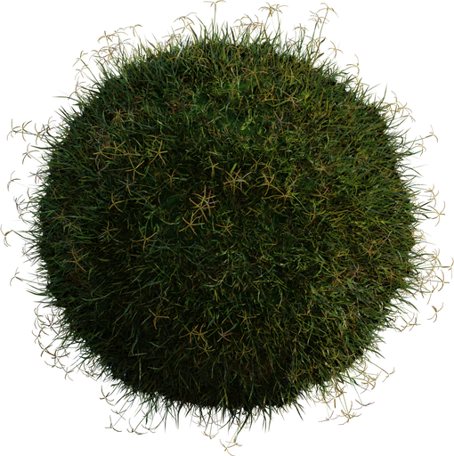
<b>asset_img/thumbs/grass_bermuda_01.png</b>

api.polyhaven.com/files/grass_bermuda_01（共 64 行，展示前 60 行）
<pre>{&#10; "blend": {&#10;  "1k": {&#10;   "blend": {&#10;    "url": "https://dl.polyhaven.org/file/ph-assets/Models/blend/1k/grass_bermuda_01/grass_bermuda_01_1k.blend",&#10;    "md5": "61d700a2259ec67ba8ed6846ebc680cc",&#10;    "size": 185844,&#10;    "include": {&#10;     "textures/grass_bermuda_01_alpha_1k.png": {&#10;      "url": "https://dl.polyhaven.org/file/ph-assets/Models/png/1k/grass_bermuda_01/grass_bermuda_01_alpha_1k.png",&#10;      "md5": "274285abb11b3b7a0fd277b9923d1074",&#10;      "size": 59564&#10;     },&#10;     "textures/grass_bermuda_01_diff_1k.jpg": {&#10;      "url": "https://dl.polyhaven.org/file/ph-assets/Models/jpg/1k/grass_bermuda_01/grass_bermuda_01_diff_1k.jpg",&#10;      "md5": "234be9f52cfcd3380c7f782baaa841c3",&#10;      "size": 175425&#10;     },&#10;     "textures/grass_bermuda_01_nor_gl_1k.exr": {&#10;      "url": "https://dl.polyhaven.org/file/ph-assets/Models/exr/1k/grass_bermuda_01/grass_bermuda_01_nor_gl_1k.exr",&#10;      "md5": "4b81e770a8d6a27af63f28bc27c58b68",&#10;      "size": 1558026&#10;     },&#10;     "textures/grass_bermuda_01_rough_1k.exr": {&#10;      "url": "https://dl.polyhaven.org/file/ph-assets/Models/exr/1k/grass_bermuda_01/grass_bermuda_01_rough_1k.exr",&#10;      "md5": "52c9560c10329520735fa6ed242d4ed3",&#10;      "size": 704249&#10;     }&#10;    }&#10;   }&#10;  }&#10; },&#10; "gltf": {&#10;  "1k": {&#10;   "gltf": {&#10;    "url": "https://dl.polyhaven.org/file/ph-assets/Models/gltf/1k/grass_bermuda_01/grass_bermuda_01_1k.gltf",&#10;    "md5": "a1bdd74118d2387a42dba4f605226f87",&#10;    "size": 32912,&#10;    "include": {&#10;     "textures/grass_bermuda_01_nor_gl_1k.jpg": {&#10;      "url": "https://dl.polyhaven.org/file/ph-assets/Models/jpg/1k/grass_bermuda_01/grass_bermuda_01_nor_gl_1k.jpg",&#10;      "md5": "73a585e0963ff6bf3cefa845cbee0645",&#10;      "size": 709845&#10;     },&#10;     "textures/grass_bermuda_01_diff_1k.jpg": {&#10;      "url": "https://dl.polyhaven.org/file/ph-assets/Models/jpg/1k/grass_bermuda_01/grass_bermuda_01_diff_1k.jpg",&#10;      "md5": "234be9f52cfcd3380c7f782baaa841c3",&#10;      "size": 175425&#10;     },&#10;     "textures/grass_bermuda_01_arm_1k.jpg": {&#10;      "url": "https://dl.polyhaven.org/file/ph-assets/Models/jpg/1k/grass_bermuda_01/grass_bermuda_01_arm_1k.jpg",&#10;      "md5": "87c58d5d3345d579eab570f7eb446313",&#10;      "size": 500088&#10;     },&#10;     "grass_bermuda_01.bin": {&#10;      "url": "https://dl.polyhaven.org/file/ph-assets/Models/gltf/8k/grass_bermuda_01/grass_bermuda_01.bin",&#10;      "md5": "2940aa3405004b62983fd70bede8e47f",&#10;      "size": 32260&#10;     }&#10;    }&#10;…（截断，原文共 64 行）</pre>

S <a href="https://api.sketchfab.com/v3/search">Sketchfab</a> <button type="button" class="sg-prev" title="上一个（←）">‹</button><button type="button" class="sg-next" title="下一个（→）">›</button><button type="button" class="sg-x" title="关闭（Esc）">✕</button>

<b>数据样例</b> · <a href="https://sketchfab.com/3d-models/popular">Sketchfab Staff Picks</a>

<b>FREE 1975 Porsche 911 (930) Turbo</b>

api.sketchfab.com/v3/search（共 84 行，展示前 60 行）
<pre>{&#10; "name": "FREE 1975 Porsche 911 (930) Turbo",&#10; "uid": "8568d9d14a994b9cae59499f0dbed21e",&#10; "viewerUrl": "https://sketchfab.com/3d-models/none-8568d9d14a994b9cae59499f0dbed21e",&#10; "license": {&#10;  "uid": "322a749bcfa841b29dff1e8a1bb74b0b",&#10;  "label": "CC Attribution"&#10; },&#10; "faceCount": 241265,&#10; "vertexCount": 133458,&#10; "animationCount": 0,&#10; "likeCount": 7263,&#10; "viewCount": 863007,&#10; "publishedAt": "2017-12-05T17:23:18.788514",&#10; "staffpickedAt": "2020-12-06T20:12:37.194792",&#10; "archives": {&#10;  "glb": {&#10;   "textureCount": 27,&#10;   "size": 74151648,&#10;   "type": "glb",&#10;   "textureMaxResolution": 4096,&#10;   "faceCount": 241260,&#10;   "vertexCount": 156299&#10;  },&#10;  "gltf": {&#10;   "textureCount": 27,&#10;   "size": 70243066,&#10;   "type": "gltf",&#10;   "textureMaxResolution": 4096,&#10;   "faceCount": 241260,&#10;   "vertexCount": 156299&#10;  },&#10;  "gltf-ar": {&#10;   "textureCount": null,&#10;   "size": 152000,&#10;   "type": "gltf-ar",&#10;   "textureMaxResolution": null,&#10;   "faceCount": null,&#10;   "vertexCount": null&#10;  },&#10;  "source": {&#10;   "textureCount": null,&#10;   "size": 116726357,&#10;   "type": "source",&#10;   "textureMaxResolution": null,&#10;   "faceCount": null,&#10;   "vertexCount": null&#10;  },&#10;  "usdz": {&#10;   "textureCount": null,&#10;   "size": 12351092,&#10;   "type": "usdz",&#10;   "textureMaxResolution": null,&#10;   "faceCount": null,&#10;   "vertexCount": null&#10;  }&#10; },&#10; "user": "lionsharp",&#10; "tags": [&#10;  "porsche",&#10;…（截断，原文共 84 行）</pre>

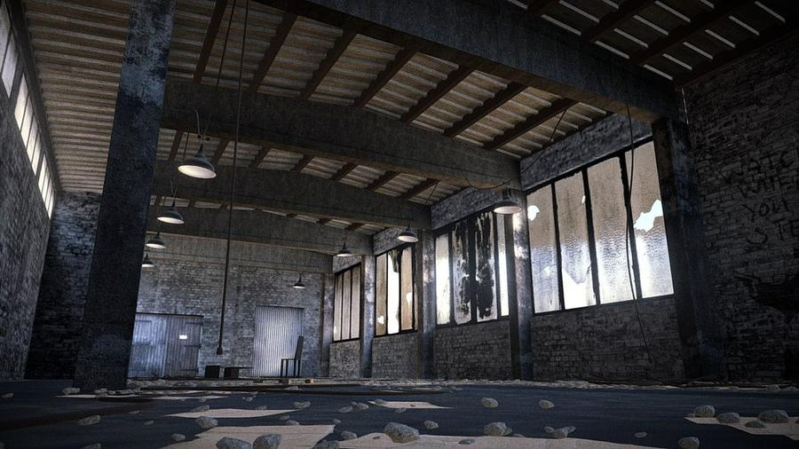
<b>Abandoned Warehouse - Interior Scene</b>

api.sketchfab.com/v3/search（共 70 行，展示前 60 行）
<pre>{&#10; "name": "Abandoned Warehouse - Interior Scene",&#10; "uid": "1d5285f2e0fd4211a27c8042496d5959",&#10; "viewerUrl": "https://sketchfab.com/3d-models/none-1d5285f2e0fd4211a27c8042496d5959",&#10; "license": {&#10;  "uid": "322a749bcfa841b29dff1e8a1bb74b0b",&#10;  "label": "CC Attribution"&#10; },&#10; "faceCount": 617814,&#10; "vertexCount": 243631,&#10; "animationCount": 0,&#10; "likeCount": 6613,&#10; "viewCount": 400091,&#10; "publishedAt": "2016-07-21T12:49:21.833998",&#10; "staffpickedAt": "2016-07-23T12:52:04.235181",&#10; "archives": {&#10;  "glb": {&#10;   "textureCount": 31,&#10;   "size": 114801500,&#10;   "type": "glb",&#10;   "textureMaxResolution": 4096,&#10;   "faceCount": 993366,&#10;   "vertexCount": 1111494&#10;  },&#10;  "gltf": {&#10;   "textureCount": 31,&#10;   "size": 81771023,&#10;   "type": "gltf",&#10;   "textureMaxResolution": 4096,&#10;   "faceCount": 993366,&#10;   "vertexCount": 1111494&#10;  },&#10;  "source": {&#10;   "textureCount": null,&#10;   "size": 113200044,&#10;   "type": "source",&#10;   "textureMaxResolution": null,&#10;   "faceCount": null,&#10;   "vertexCount": null&#10;  },&#10;  "usdz": {&#10;   "textureCount": null,&#10;   "size": 28163813,&#10;   "type": "usdz",&#10;   "textureMaxResolution": null,&#10;   "faceCount": null,&#10;   "vertexCount": null&#10;  }&#10; },&#10; "user": "aurelien_martel",&#10; "tags": [&#10;  "steampunk",&#10;  "post-apocalyptic",&#10;  "indoor",&#10;  "baked",&#10;  "gameenvironment",&#10;  "interior-design",&#10;  "particlesystem",&#10;  "painted-texture",&#10;  "oldplace",&#10;…（截断，原文共 70 行）</pre>

<b>Just a girl</b>

api.sketchfab.com/v3/search（共 63 行，展示前 60 行）
<pre>{&#10; "name": "Just a girl",&#10; "uid": "b2359160a4f54e76b5ae427a55d9594d",&#10; "viewerUrl": "https://sketchfab.com/3d-models/none-b2359160a4f54e76b5ae427a55d9594d",&#10; "license": {&#10;  "uid": "322a749bcfa841b29dff1e8a1bb74b0b",&#10;  "label": "CC Attribution"&#10; },&#10; "faceCount": 77725,&#10; "vertexCount": 41336,&#10; "animationCount": 0,&#10; "likeCount": 6464,&#10; "viewCount": 386429,&#10; "publishedAt": "2020-08-22T21:14:33.552234",&#10; "staffpickedAt": "2020-08-25T13:55:52.224937",&#10; "archives": {&#10;  "glb": {&#10;   "textureCount": 3,&#10;   "size": 6057616,&#10;   "type": "glb",&#10;   "textureMaxResolution": 2048,&#10;   "faceCount": 77725,&#10;   "vertexCount": 52437&#10;  },&#10;  "gltf": {&#10;   "textureCount": 3,&#10;   "size": 5023941,&#10;   "type": "gltf",&#10;   "textureMaxResolution": 2048,&#10;   "faceCount": 77725,&#10;   "vertexCount": 52437&#10;  },&#10;  "source": {&#10;   "textureCount": null,&#10;   "size": 9468061,&#10;   "type": "source",&#10;   "textureMaxResolution": null,&#10;   "faceCount": null,&#10;   "vertexCount": null&#10;  },&#10;  "usdz": {&#10;   "textureCount": null,&#10;   "size": 2771742,&#10;   "type": "usdz",&#10;   "textureMaxResolution": null,&#10;   "faceCount": null,&#10;   "vertexCount": null&#10;  }&#10; },&#10; "user": "Kensyouen",&#10; "tags": [&#10;  "cute",&#10;  "freedownload",&#10;  "maya",&#10;  "girl",&#10;  "free",&#10;  "anime"&#10; ],&#10; "categories": [&#10;  "art-abstract",&#10;…（截断，原文共 63 行）</pre>

<b>Ship in Clouds</b>

api.sketchfab.com/v3/search（共 72 行，展示前 60 行）
<pre>{&#10; "name": "Ship in Clouds",&#10; "uid": "c475323dc7f24e26ba2009c08c8e1941",&#10; "viewerUrl": "https://sketchfab.com/3d-models/none-c475323dc7f24e26ba2009c08c8e1941",&#10; "license": {&#10;  "uid": "322a749bcfa841b29dff1e8a1bb74b0b",&#10;  "label": "CC Attribution"&#10; },&#10; "faceCount": 41045,&#10; "vertexCount": 81055,&#10; "animationCount": 0,&#10; "likeCount": 5221,&#10; "viewCount": 184871,&#10; "publishedAt": "2017-04-26T11:14:33.986020",&#10; "staffpickedAt": "2017-04-27T13:41:11.674948",&#10; "archives": {&#10;  "glb": {&#10;   "textureCount": 8,&#10;   "size": 23582484,&#10;   "type": "glb",&#10;   "textureMaxResolution": 4096,&#10;   "faceCount": 64822,&#10;   "vertexCount": 94218&#10;  },&#10;  "gltf": {&#10;   "textureCount": 8,&#10;   "size": 21204691,&#10;   "type": "gltf",&#10;   "textureMaxResolution": 4096,&#10;   "faceCount": 64822,&#10;   "vertexCount": 94218&#10;  },&#10;  "source": {&#10;   "textureCount": null,&#10;   "size": 54192716,&#10;   "type": "source",&#10;   "textureMaxResolution": null,&#10;   "faceCount": null,&#10;   "vertexCount": null&#10;  },&#10;  "usdz": {&#10;   "textureCount": null,&#10;   "size": 6727605,&#10;   "type": "usdz",&#10;   "textureMaxResolution": null,&#10;   "faceCount": null,&#10;   "vertexCount": null&#10;  }&#10; },&#10; "user": "bastienBGR",&#10; "tags": [&#10;  "sky",&#10;  "flying",&#10;  "gravity",&#10;  "sail",&#10;  "painted",&#10;  "clouds",&#10;  "cloud",&#10;  "sunset",&#10;  "fbx",&#10;…（截断，原文共 72 行）</pre>

<b>phoenix bird</b>

api.sketchfab.com/v3/search（共 61 行，展示前 60 行）
<pre>{&#10; "name": "phoenix bird",&#10; "uid": "844ba0cf144a413ea92c779f18912042",&#10; "viewerUrl": "https://sketchfab.com/3d-models/none-844ba0cf144a413ea92c779f18912042",&#10; "license": {&#10;  "uid": "322a749bcfa841b29dff1e8a1bb74b0b",&#10;  "label": "CC Attribution"&#10; },&#10; "faceCount": 4064,&#10; "vertexCount": 2203,&#10; "animationCount": 1,&#10; "likeCount": 5101,&#10; "viewCount": 306697,&#10; "publishedAt": "2018-01-14T03:55:44.716224",&#10; "staffpickedAt": "2018-06-04T08:22:14.718170",&#10; "archives": {&#10;  "glb": {&#10;   "textureCount": 4,&#10;   "size": 1630364,&#10;   "type": "glb",&#10;   "textureMaxResolution": 512,&#10;   "faceCount": 4064,&#10;   "vertexCount": 3485&#10;  },&#10;  "gltf": {&#10;   "textureCount": 4,&#10;   "size": 1026840,&#10;   "type": "gltf",&#10;   "textureMaxResolution": 512,&#10;   "faceCount": 4064,&#10;   "vertexCount": 3485&#10;  },&#10;  "source": {&#10;   "textureCount": null,&#10;   "size": 2829646,&#10;   "type": "source",&#10;   "textureMaxResolution": null,&#10;   "faceCount": null,&#10;   "vertexCount": null&#10;  },&#10;  "usdz": {&#10;   "textureCount": null,&#10;   "size": 1162886,&#10;   "type": "usdz",&#10;   "textureMaxResolution": null,&#10;   "faceCount": null,&#10;   "vertexCount": null&#10;  }&#10; },&#10; "user": "norberto3d",&#10; "tags": [&#10;  "flying",&#10;  "bird",&#10;  "phoenix",&#10;  "dragon"&#10; ],&#10; "categories": [&#10;  "art-abstract",&#10;  "characters-creatures"&#10; ]&#10;…（截断，原文共 61 行）</pre>

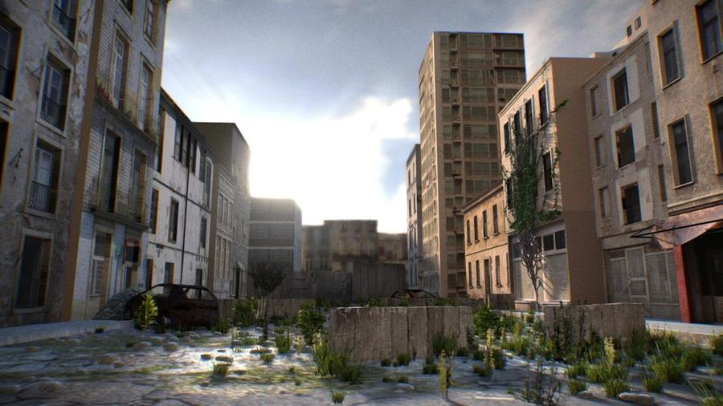
<b>Postwar City - Exterior Scene</b>

api.sketchfab.com/v3/search（共 71 行，展示前 60 行）
<pre>{&#10; "name": "Postwar City - Exterior Scene",&#10; "uid": "30b694d1a4074855a1116a15a0f75731",&#10; "viewerUrl": "https://sketchfab.com/3d-models/none-30b694d1a4074855a1116a15a0f75731",&#10; "license": {&#10;  "uid": "322a749bcfa841b29dff1e8a1bb74b0b",&#10;  "label": "CC Attribution"&#10; },&#10; "faceCount": 114469,&#10; "vertexCount": 116818,&#10; "animationCount": 0,&#10; "likeCount": 5068,&#10; "viewCount": 388728,&#10; "publishedAt": "2016-08-05T16:01:45.872727",&#10; "staffpickedAt": "2016-08-05T19:52:11.808044",&#10; "archives": {&#10;  "glb": {&#10;   "textureCount": 22,&#10;   "size": 116133560,&#10;   "type": "glb",&#10;   "textureMaxResolution": 4096,&#10;   "faceCount": 166600,&#10;   "vertexCount": 202496&#10;  },&#10;  "gltf": {&#10;   "textureCount": 22,&#10;   "size": 109044964,&#10;   "type": "gltf",&#10;   "textureMaxResolution": 4096,&#10;   "faceCount": 166600,&#10;   "vertexCount": 202496&#10;  },&#10;  "source": {&#10;   "textureCount": null,&#10;   "size": 121203432,&#10;   "type": "source",&#10;   "textureMaxResolution": null,&#10;   "faceCount": null,&#10;   "vertexCount": null&#10;  },&#10;  "usdz": {&#10;   "textureCount": null,&#10;   "size": 10491744,&#10;   "type": "usdz",&#10;   "textureMaxResolution": null,&#10;   "faceCount": null,&#10;   "vertexCount": null&#10;  }&#10; },&#10; "user": "aurelien_martel",&#10; "tags": [&#10;  "scene",&#10;  "exterior",&#10;  "post-apocalyptic",&#10;  "gamedesign",&#10;  "painting",&#10;  "baked",&#10;  "cityscene",&#10;  "destruction",&#10;  "uvmap",&#10;…（截断，原文共 71 行）</pre>

T <a href="https://github.com/mrdoob/three.js/tree/dev/examples">three.js 官方 examples</a> three.js <button type="button" class="sg-prev" title="上一个（←）">‹</button><button type="button" class="sg-next" title="下一个（→）">›</button><button type="button" class="sg-x" title="关闭（Esc）">✕</button>

<b>数据样例</b> · <a href="https://github.com/mrdoob/three.js/tree/dev/examples">mrdoob/three.js</a>

<b>examples/screenshots/webgpu_compute_cloth.jpg</b>

examples/webgpu_compute_cloth.html（共 582 行，展示前 60 行）
<pre>&lt;!DOCTYPE html&gt;&#10;&lt;html lang="en"&gt;&#10;	&lt;head&gt;&#10;		&lt;title&gt;three.js webgpu - compute cloth&lt;/title&gt;&#10;		&lt;meta charset="utf-8"&gt;&#10;		&lt;meta name="viewport" content="width=device-width, user-scalable=no, minimum-scale=1.0, maximum-scale=1.0"&gt;&#10;		&lt;meta property="og:title" content="three.js webgpu - compute cloth"&gt;&#10;		&lt;meta property="og:type" content="website"&gt;&#10;		&lt;meta property="og:url" content="https://threejs.org/examples/webgpu_compute_cloth.html"&gt;&#10;		&lt;meta property="og:image" content="https://threejs.org/examples/screenshots/webgpu_compute_cloth.jpg"&gt;&#10;		&lt;link type="text/css" rel="stylesheet" href="example.css"&gt;&#10;	&lt;/head&gt;&#10;	&lt;body&gt;&#10;&#10;		&lt;div id="info"&gt;&#10;			&lt;a href="https://threejs.org/" target="_blank" rel="noopener" class="logo-link"&gt;&lt;/a&gt;&#10;&#10;			&lt;div class="title-wrapper"&gt;&#10;				&lt;a href="https://threejs.org/" target="_blank" rel="noopener"&gt;three.js&lt;/a&gt;&lt;span&gt;Compute Cloth&lt;/span&gt;&#10;			&lt;/div&gt;&#10;&#10;			&lt;small&gt;Simple cloth simulation with a verlet system running in compute shaders.&lt;/small&gt;&#10;		&lt;/div&gt;&#10;&#10;		&lt;script type="importmap"&gt;&#10;			{&#10;				"imports": {&#10;					"three": "../build/three.webgpu.js",&#10;					"three/webgpu": "../build/three.webgpu.js",&#10;					"three/tsl": "../build/three.tsl.js",&#10;					"three/addons/": "./jsm/"&#10;				}&#10;			}&#10;		&lt;/script&gt;&#10;&#10;		&lt;script type="module"&gt;&#10;&#10;			import * as THREE from 'three/webgpu';&#10;&#10;			import { Fn, If, Return, instancedArray, instanceIndex, uniform, select, attribute, Loop, float, transformNormalToView, cross, triNoise3D, time, EPSILON } from 'three/tsl';&#10;&#10;			import { Inspector } from 'three/addons/inspector/Inspector.js';&#10;&#10;			import { OrbitControls } from 'three/addons/controls/OrbitControls.js';&#10;			import { UltraHDRLoader } from 'three/addons/loaders/UltraHDRLoader.js';&#10;			import WebGPU from 'three/addons/capabilities/WebGPU.js';&#10;&#10;			let renderer, scene, camera, controls;&#10;&#10;			const clothWidth = 1;&#10;			const clothHeight = 1;&#10;			const clothNumSegmentsX = 30;&#10;			const clothNumSegmentsY = 30;&#10;			const sphereRadius = 0.15;&#10;&#10;			let vertexPositionBuffer, vertexForceBuffer, vertexParamsBuffer;&#10;			let springVertexIdBuffer, springRestLengthBuffer, springForceBuffer;&#10;			let springListBuffer;&#10;			let computeSpringForces, computeVertexForces;&#10;			let dampeningUniform, spherePositionUniform, stiffnessUniform, sphereUniform, windUniform;&#10;…（截断，原文共 582 行）</pre>

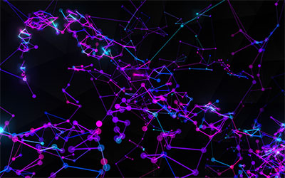
<b>examples/screenshots/webgpu_tsl_vfx_linkedparticles.jpg</b>

examples/webgpu_tsl_vfx_linkedparticles.html（共 476 行，展示前 60 行）
<pre>&lt;!DOCTYPE html&gt;&#10;&lt;html lang="en"&gt;&#10;	&lt;head&gt;&#10;		&lt;title&gt;three.js webgpu - vfx linked particles&lt;/title&gt;&#10;		&lt;meta charset="utf-8"&gt;&#10;		&lt;meta name="viewport" content="width=device-width, user-scalable=no, minimum-scale=1.0, maximum-scale=1.0"&gt;&#10;		&lt;meta property="og:title" content="three.js webgpu - vfx linked particles"&gt;&#10;		&lt;meta property="og:type" content="website"&gt;&#10;		&lt;meta property="og:url" content="https://threejs.org/examples/webgpu_tsl_vfx_linkedparticles.html"&gt;&#10;		&lt;meta property="og:image" content="https://threejs.org/examples/screenshots/webgpu_tsl_vfx_linkedparticles.jpg"&gt;&#10;		&lt;link type="text/css" rel="stylesheet" href="example.css"&gt;&#10;	&lt;/head&gt;&#10;	&lt;body&gt;&#10;&#10;		&lt;div id="info"&gt;&#10;			&lt;a href="https://threejs.org/" target="_blank" rel="noopener" class="logo-link"&gt;&lt;/a&gt;&#10;&#10;			&lt;div class="title-wrapper"&gt;&#10;				&lt;a href="https://threejs.org/" target="_blank" rel="noopener"&gt;three.js&lt;/a&gt;&lt;span&gt;VFX Linked Particles&lt;/span&gt;&#10;			&lt;/div&gt;&#10;&#10;			&lt;small&gt;&#10;				Based on &lt;a href="https://github.com/ULuIQ12/webgpu-tsl-linkedparticles" target="_blank" rel="noopener"&gt;this experiment&lt;/a&gt; by Christophe Choffel.&#10;			&lt;/small&gt;&#10;		&lt;/div&gt;&#10;&#10;		&lt;script type="importmap"&gt;&#10;			{&#10;				"imports": {&#10;					"three": "../build/three.webgpu.js",&#10;					"three/webgpu": "../build/three.webgpu.js",&#10;					"three/tsl": "../build/three.tsl.js",&#10;					"three/addons/": "./jsm/"&#10;				}&#10;			}&#10;		&lt;/script&gt;&#10;&#10;		&lt;script type="module"&gt;&#10;&#10;			import * as THREE from 'three/webgpu';&#10;			import { atan, cos, float, max, min, mix, PI, TWO_PI, sin, vec2, vec3, color, Fn, hash, hue, If, instanceIndex, Loop, mx_fractal_noise_float, mx_fractal_noise_vec3, pass, pcurve, storage, deltaTime, time, uv, uniform, step } from 'three/tsl';&#10;			import { bloom } from 'three/addons/tsl/display/BloomNode.js';&#10;&#10;			import { OrbitControls } from 'three/addons/controls/OrbitControls.js';&#10;&#10;			import { Inspector } from 'three/addons/inspector/Inspector.js';&#10;&#10;			import WebGPU from 'three/addons/capabilities/WebGPU.js';&#10;&#10;			let camera, scene, renderer, renderPipeline, controls, timer, light;&#10;&#10;			let updateParticles, spawnParticles; // TSL compute nodes&#10;			let getInstanceColor; // TSL function&#10;&#10;			const screenPointer = new THREE.Vector2();&#10;			const scenePointer = new THREE.Vector3();&#10;			const raycastPlane = new THREE.Plane( new THREE.Vector3( 0, 0, 1 ), 0 );&#10;			const raycaster = new THREE.Raycaster();&#10;&#10;			const nbParticles = Math.pow( 2, 13 );&#10;…（截断，原文共 476 行）</pre>

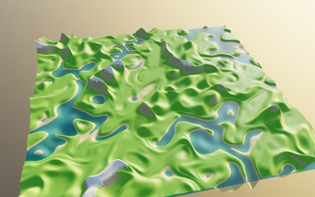
<b>examples/screenshots/webgpu_tsl_procedural_terrain.jpg</b>

examples/webgpu_tsl_procedural_terrain.html（共 378 行，展示前 60 行）
<pre>&lt;!DOCTYPE html&gt;&#10;&lt;html lang="en"&gt;&#10;	&lt;head&gt;&#10;		&lt;title&gt;three.js webgpu - procedural terrain&lt;/title&gt;&#10;		&lt;meta charset="utf-8"&gt;&#10;		&lt;meta name="viewport" content="width=device-width, user-scalable=no, minimum-scale=1.0, maximum-scale=1.0"&gt;&#10;		&lt;meta property="og:title" content="three.js webgpu - procedural terrain"&gt;&#10;		&lt;meta property="og:type" content="website"&gt;&#10;		&lt;meta property="og:url" content="https://threejs.org/examples/webgpu_tsl_procedural_terrain.html"&gt;&#10;		&lt;meta property="og:image" content="https://threejs.org/examples/screenshots/webgpu_tsl_procedural_terrain.jpg"&gt;&#10;		&lt;link type="text/css" rel="stylesheet" href="example.css"&gt;&#10;	&lt;/head&gt;&#10;	&lt;body&gt;&#10;&#10;		&lt;div id="info"&gt;&#10;			&lt;a href="https://threejs.org/" target="_blank" rel="noopener" class="logo-link"&gt;&lt;/a&gt;&#10;&#10;			&lt;div class="title-wrapper"&gt;&#10;				&lt;a href="https://threejs.org/" target="_blank" rel="noopener"&gt;three.js&lt;/a&gt;&lt;span&gt;Procedural Terrain&lt;/span&gt;&#10;			&lt;/div&gt;&#10;&#10;			&lt;small&gt;&#10;				Based on &lt;a href="https://threejs-journey.com/lessons/procedural-terrain-shader" target="_blank" rel="noopener"&gt;Three.js Journey&lt;/a&gt; lessons.&#10;			&lt;/small&gt;&#10;		&lt;/div&gt;&#10;&#10;		&lt;script type="importmap"&gt;&#10;			{&#10;				"imports": {&#10;					"three": "../build/three.webgpu.js",&#10;					"three/webgpu": "../build/three.webgpu.js",&#10;					"three/tsl": "../build/three.tsl.js",&#10;					"three/addons/": "./jsm/"&#10;				}&#10;			}&#10;		&lt;/script&gt;&#10;&#10;		&lt;script type="module"&gt;&#10;&#10;			import * as THREE from 'three/webgpu';&#10;			import { mx_noise_float, color, cross, dot, float, transformNormalToView, positionLocal, sign, step, Fn, uniform, varying, vec2, vec3, Loop } from 'three/tsl';&#10;&#10;			import { Inspector } from 'three/addons/inspector/Inspector.js';&#10;&#10;			import { OrbitControls } from 'three/addons/controls/OrbitControls.js';&#10;			import { HDRLoader } from 'three/addons/loaders/HDRLoader.js';&#10;&#10;			let camera, scene, renderer, controls, drag;&#10;&#10;			init();&#10;&#10;			function init() {&#10;&#10;				camera = new THREE.PerspectiveCamera( 35, window.innerWidth / window.innerHeight, 0.1, 100 );&#10;				camera.position.set( - 10, 8, - 2.2 );&#10;&#10;				scene = new THREE.Scene();&#10;				scene.background = new THREE.Color( 0x201919 );&#10;&#10;				// environment&#10;…（截断，原文共 378 行）</pre>

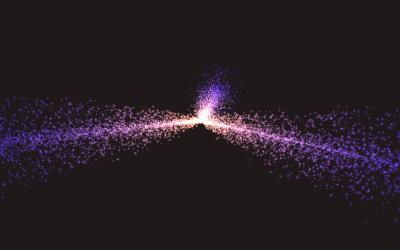
<b>examples/screenshots/webgpu_tsl_galaxy.jpg</b>

examples/webgpu_tsl_galaxy.html（共 157 行，展示前 60 行）
<pre>&lt;!DOCTYPE html&gt;&#10;&lt;html lang="en"&gt;&#10;	&lt;head&gt;&#10;		&lt;title&gt;three.js webgpu - galaxy&lt;/title&gt;&#10;		&lt;meta charset="utf-8"&gt;&#10;		&lt;meta name="viewport" content="width=device-width, user-scalable=no, minimum-scale=1.0, maximum-scale=1.0"&gt;&#10;		&lt;meta property="og:title" content="three.js webgpu - galaxy"&gt;&#10;		&lt;meta property="og:type" content="website"&gt;&#10;		&lt;meta property="og:url" content="https://threejs.org/examples/webgpu_tsl_galaxy.html"&gt;&#10;		&lt;meta property="og:image" content="https://threejs.org/examples/screenshots/webgpu_tsl_galaxy.jpg"&gt;&#10;		&lt;link type="text/css" rel="stylesheet" href="example.css"&gt;&#10;	&lt;/head&gt;&#10;	&lt;body&gt;&#10;&#10;		&lt;div id="info"&gt;&#10;			&lt;a href="https://threejs.org/" target="_blank" rel="noopener" class="logo-link"&gt;&lt;/a&gt;&#10;&#10;			&lt;div class="title-wrapper"&gt;&#10;				&lt;a href="https://threejs.org/" target="_blank" rel="noopener"&gt;three.js&lt;/a&gt;&lt;span&gt;Galaxy&lt;/span&gt;&#10;			&lt;/div&gt;&#10;&#10;			&lt;small&gt;&#10;				Based on &lt;a href="https://threejs-journey.com/lessons/animated-galaxy" target="_blank" rel="noopener"&gt;Three.js Journey&lt;/a&gt; lessons.&#10;			&lt;/small&gt;&#10;		&lt;/div&gt;&#10;&#10;		&lt;script type="importmap"&gt;&#10;			{&#10;				"imports": {&#10;					"three": "../build/three.webgpu.js",&#10;					"three/webgpu": "../build/three.webgpu.js",&#10;					"three/tsl": "../build/three.tsl.js",&#10;					"three/addons/": "./jsm/"&#10;				}&#10;			}&#10;		&lt;/script&gt;&#10;&#10;		&lt;script type="module"&gt;&#10;&#10;			import * as THREE from 'three/webgpu';&#10;			import { color, cos, float, mix, range, sin, time, uniform, uv, vec3, vec4, TWO_PI } from 'three/tsl';&#10;&#10;			import { Inspector } from 'three/addons/inspector/Inspector.js';&#10;&#10;			import { OrbitControls } from 'three/addons/controls/OrbitControls.js';&#10;&#10;			let camera, scene, renderer, controls;&#10;&#10;			init();&#10;&#10;			function init() {&#10;&#10;				camera = new THREE.PerspectiveCamera( 50, window.innerWidth / window.innerHeight, 0.1, 100 );&#10;				camera.position.set( 4, 2, 5 );&#10;&#10;				scene = new THREE.Scene();&#10;				scene.background = new THREE.Color( 0x201919 );&#10;&#10;				// galaxy&#10;&#10;…（截断，原文共 157 行）</pre>

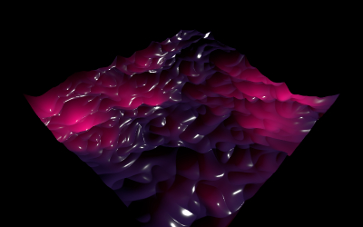
<b>examples/screenshots/webgpu_tsl_raging_sea.jpg</b>

examples/webgpu_tsl_raging_sea.html（共 216 行，展示前 60 行）
<pre>&lt;!DOCTYPE html&gt;&#10;&lt;html lang="en"&gt;&#10;	&lt;head&gt;&#10;		&lt;title&gt;three.js webgpu - raging sea&lt;/title&gt;&#10;		&lt;meta charset="utf-8"&gt;&#10;		&lt;meta name="viewport" content="width=device-width, user-scalable=no, minimum-scale=1.0, maximum-scale=1.0"&gt;&#10;		&lt;meta property="og:title" content="three.js webgpu - raging sea"&gt;&#10;		&lt;meta property="og:type" content="website"&gt;&#10;		&lt;meta property="og:url" content="https://threejs.org/examples/webgpu_tsl_raging_sea.html"&gt;&#10;		&lt;meta property="og:image" content="https://threejs.org/examples/screenshots/webgpu_tsl_raging_sea.jpg"&gt;&#10;		&lt;link type="text/css" rel="stylesheet" href="example.css"&gt;&#10;	&lt;/head&gt;&#10;	&lt;body&gt;&#10;&#10;		&lt;div id="info"&gt;&#10;			&lt;a href="https://threejs.org/" target="_blank" rel="noopener" class="logo-link"&gt;&lt;/a&gt;&#10;&#10;			&lt;div class="title-wrapper"&gt;&#10;				&lt;a href="https://threejs.org/" target="_blank" rel="noopener"&gt;three.js&lt;/a&gt;&lt;span&gt;Raging Sea&lt;/span&gt;&#10;			&lt;/div&gt;&#10;&#10;			&lt;small&gt;&#10;				Based on &lt;a href="https://threejs-journey.com/lessons/raging-sea" target="_blank" rel="noopener"&gt;Three.js Journey&lt;/a&gt; lesson.&#10;			&lt;/small&gt;&#10;		&lt;/div&gt;&#10;&#10;		&lt;script type="importmap"&gt;&#10;			{&#10;				"imports": {&#10;					"three": "../build/three.webgpu.js",&#10;					"three/webgpu": "../build/three.webgpu.js",&#10;					"three/tsl": "../build/three.tsl.js",&#10;					"three/addons/": "./jsm/"&#10;				}&#10;			}&#10;		&lt;/script&gt;&#10;&#10;		&lt;script type="module"&gt;&#10;&#10;			import * as THREE from 'three/webgpu';&#10;			import { float, mx_noise_float, Loop, color, positionLocal, sin, vec2, vec3, mul, time, uniform, Fn, transformNormalToView } from 'three/tsl';&#10;&#10;			import { OrbitControls } from 'three/addons/controls/OrbitControls.js';&#10;&#10;			import { Inspector } from 'three/addons/inspector/Inspector.js';&#10;&#10;			let camera, scene, renderer, controls;&#10;&#10;			init();&#10;&#10;			function init() {&#10;&#10;				camera = new THREE.PerspectiveCamera( 50, window.innerWidth / window.innerHeight, 0.1, 10 );&#10;				camera.position.set( 1.25, 1.25, 1.25 );&#10;&#10;				scene = new THREE.Scene();&#10;&#10;				// lights&#10;			&#10;				const directionalLight = new THREE.DirectionalLight( '#ffffff', 3 );&#10;…（截断，原文共 216 行）</pre>

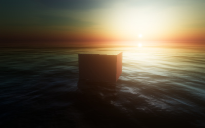
<b>examples/screenshots/webgl_shaders_ocean.jpg</b>

examples/webgl_shaders_ocean.html（共 252 行，展示前 60 行）
<pre>&lt;!DOCTYPE html&gt;&#10;&lt;html lang="en"&gt;&#10;	&lt;head&gt;&#10;		&lt;title&gt;three.js webgl - shaders - ocean&lt;/title&gt;&#10;		&lt;meta charset="utf-8"&gt;&#10;		&lt;meta name="viewport" content="width=device-width, user-scalable=no, minimum-scale=1.0, maximum-scale=1.0"&gt;&#10;		&lt;meta property="og:title" content="three.js webgl - shaders - ocean"&gt;&#10;		&lt;meta property="og:type" content="website"&gt;&#10;		&lt;meta property="og:url" content="https://threejs.org/examples/webgl_shaders_ocean.html"&gt;&#10;		&lt;meta property="og:image" content="https://threejs.org/examples/screenshots/webgl_shaders_ocean.jpg"&gt;&#10;		&lt;link type="text/css" rel="stylesheet" href="main.css"&gt;&#10;	&lt;/head&gt;&#10;	&lt;body&gt;&#10;&#10;		&lt;div id="container"&gt;&lt;/div&gt;&#10;		&lt;div id="info"&gt;&#10;			&lt;a href="https://threejs.org" target="_blank" rel="noopener"&gt;three.js&lt;/a&gt; - webgl ocean&#10;		&lt;/div&gt;&#10;&#10;		&lt;script type="importmap"&gt;&#10;			{&#10;				"imports": {&#10;					"three": "../build/three.module.js",&#10;					"three/addons/": "./jsm/"&#10;				}&#10;			}&#10;		&lt;/script&gt;&#10;&#10;		&lt;script type="module"&gt;&#10;&#10;			import * as THREE from 'three';&#10;&#10;			import Stats from 'three/addons/libs/stats.module.js';&#10;&#10;			import { GUI } from 'three/addons/libs/lil-gui.module.min.js';&#10;			import { OrbitControls } from 'three/addons/controls/OrbitControls.js';&#10;			import { Water } from 'three/addons/objects/Water.js';&#10;			import { Sky } from 'three/addons/objects/Sky.js';&#10;			import { UnrealBloomPass } from 'three/addons/postprocessing/UnrealBloomPass.js';&#10;&#10;			let container, stats, timer;&#10;			let camera, scene, renderer;&#10;			let controls, water, sun, sky, mesh, bloomPass;&#10;&#10;			init();&#10;&#10;			function init() {&#10;&#10;				container = document.getElementById( 'container' );&#10;&#10;				//&#10;&#10;				renderer = new THREE.WebGLRenderer( { outputBufferType: THREE.HalfFloatType } );&#10;				renderer.setPixelRatio( window.devicePixelRatio );&#10;				renderer.setSize( window.innerWidth, window.innerHeight );&#10;				renderer.setAnimationLoop( animate );&#10;				renderer.toneMapping = THREE.ACESFilmicToneMapping;&#10;				renderer.toneMappingExposure = 0.1;&#10;				container.appendChild( renderer.domElement );&#10;&#10;…（截断，原文共 252 行）</pre>

 Experiments with Google Google <button type="button" class="sg-prev" title="上一个（←）">‹</button><button type="button" class="sg-next" title="下一个（→）">›</button><button type="button" class="sg-x" title="关闭（Esc）">✕</button>

<b>数据样例</b> · <a href="https://github.com/PavelDoGreat/WebGL-Fluid-Simulation">PavelDoGreat/WebGL-Fluid-Simulation</a> · <a href="https://github.com/amandaghassaei/OrigamiSimulator">amandaghassaei/OrigamiSimulator</a> · <a href="https://github.com/edankwan/The-Spirit">edankwan/The-Spirit</a> · <a href="https://github.com/edankwan/hyper-mix">edankwan/hyper-mix</a> · <a href="https://github.com/amandaghassaei/VortexShedding">amandaghassaei/VortexShedding</a>

<b>PavelDoGreat/WebGL-Fluid-Simulation · screenshot.jpg</b>

script.js（共 1646 行，展示前 60 行）
<pre>/*&#10;MIT License&#10;&#10;Copyright (c) 2017 Pavel Dobryakov&#10;&#10;Permission is hereby granted, free of charge, to any person obtaining a copy&#10;of this software and associated documentation files (the "Software"), to deal&#10;in the Software without restriction, including without limitation the rights&#10;to use, copy, modify, merge, publish, distribute, sublicense, and/or sell&#10;copies of the Software, and to permit persons to whom the Software is&#10;furnished to do so, subject to the following conditions:&#10;&#10;The above copyright notice and this permission notice shall be included in all&#10;copies or substantial portions of the Software.&#10;&#10;THE SOFTWARE IS PROVIDED "AS IS", WITHOUT WARRANTY OF ANY KIND, EXPRESS OR&#10;IMPLIED, INCLUDING BUT NOT LIMITED TO THE WARRANTIES OF MERCHANTABILITY,&#10;FITNESS FOR A PARTICULAR PURPOSE AND NONINFRINGEMENT. IN NO EVENT SHALL THE&#10;AUTHORS OR COPYRIGHT HOLDERS BE LIABLE FOR ANY CLAIM, DAMAGES OR OTHER&#10;LIABILITY, WHETHER IN AN ACTION OF CONTRACT, TORT OR OTHERWISE, ARISING FROM,&#10;OUT OF OR IN CONNECTION WITH THE SOFTWARE OR THE USE OR OTHER DEALINGS IN THE&#10;SOFTWARE.&#10;*/&#10;&#10;'use strict';&#10;&#10;// Mobile promo section&#10;&#10;const promoPopup = document.getElementsByClassName('promo')[0];&#10;const promoPopupClose = document.getElementsByClassName('promo-close')[0];&#10;&#10;if (isMobile()) {&#10;    setTimeout(() =&gt; {&#10;        promoPopup.style.display = 'table';&#10;    }, 20000);&#10;}&#10;&#10;promoPopupClose.addEventListener('click', e =&gt; {&#10;    promoPopup.style.display = 'none';&#10;});&#10;&#10;const appleLink = document.getElementById('apple_link');&#10;appleLink.addEventListener('click', e =&gt; {&#10;    ga('send', 'event', 'link promo', 'app');&#10;    window.open('https://apps.apple.com/us/app/fluid-simulation/id1443124993');&#10;});&#10;&#10;const googleLink = document.getElementById('google_link');&#10;googleLink.addEventListener('click', e =&gt; {&#10;    ga('send', 'event', 'link promo', 'app');&#10;    window.open('https://play.google.com/store/apps/details?id=games.paveldogreat.fluidsimfree');&#10;});&#10;&#10;// Simulation section&#10;&#10;const canvas = document.getElementsByTagName('canvas')[0];&#10;resizeCanvas();&#10;&#10;let config = {&#10;    SIM_RESOLUTION: 128,&#10;…（截断，原文共 1646 行）</pre>

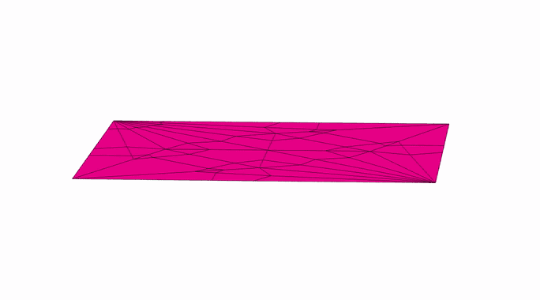
<b>amandaghassaei/OrigamiSimulator · crane.gif</b>

js/dynamic/dynamicSolver.js（共 667 行，展示前 60 行）
<pre>/**&#10; * Created by ghassaei on 10/7/16.&#10; */&#10;&#10;function initDynamicSolver(globals){&#10;&#10;    globals.gpuMath = initGPUMath();&#10;&#10;    var nodes;&#10;    var edges;&#10;    var faces;&#10;    var creases;&#10;    var positions;&#10;    var colors;&#10;&#10;    var originalPosition;&#10;    var position;&#10;    var lastPosition;&#10;    var lastLastPosition;//for verlet integration&#10;    var velocity;&#10;    var lastVelocity;&#10;    var externalForces;&#10;    var mass;&#10;    var meta;//[beamMetaIndex, numBeams, nodeCreaseMetaIndex, numCreases]&#10;    var meta2;//[nodeFaceMetaIndex, numFaces]&#10;    var beamMeta;//[K, D, length, otherNodeIndex]&#10;&#10;    var normals;&#10;    var faceVertexIndices;//[a,b,c] textureDimFaces&#10;    var nominalTriangles;//[angleA, angleB, angleC]&#10;    var nodeFaceMeta;//[faceIndex, a, b, c] textureNodeFaces&#10;    var creaseMeta;//[k, d, targetTheta, -] textureDimCreases&#10;    var creaseMeta2;//[node1Index, node2Index, node3index, node4index]//nodes 1 and 2 are opposite crease, 3 and 4 are on crease, textureDimCreases&#10;    var nodeCreaseMeta;//[creaseIndex (thetaIndex), nodeIndex (1/2/3/4), -, -] textureDimNodeCreases&#10;    var creaseGeo;//[h1, h2, coef1, coef2]&#10;    var creaseVectors;//indices of crease nodes&#10;    var theta;//[theta, w, normalIndex1, normalIndex2]&#10;    var lastTheta;//[theta, w, normalIndex1, normalIndex2]&#10;&#10;    function syncNodesAndEdges(){&#10;        nodes = globals.model.getNodes();&#10;        edges = globals.model.getEdges();&#10;        faces = globals.model.getFaces();&#10;        creases = globals.model.getCreases();&#10;&#10;        positions = globals.model.getPositionsArray();&#10;        colors = globals.model.getColorsArray();&#10;&#10;        initTypedArrays();&#10;        initTexturesAndPrograms(globals.gpuMath);&#10;        setSolveParams();&#10;    }&#10;&#10;    var programsInited = false;//flag for initial setup&#10;&#10;    var textureDim = 0;&#10;    var textureDimEdges = 0;&#10;    var textureDimFaces = 0;&#10;    var textureDimCreases = 0;&#10;    var textureDimNodeCreases = 0;&#10;…（截断，原文共 667 行）</pre>

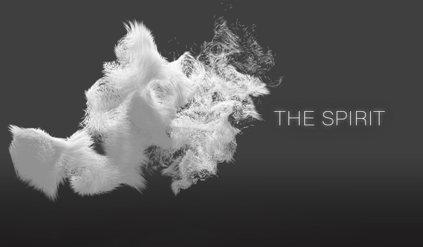
<b>edankwan/The-Spirit · screenshot.jpg</b>

src/3d/particles.js（共 253 行，展示前 60 行）
<pre>var settings = require('../core/settings');&#10;var THREE = require('three');&#10;var shaderParse = require('../helpers/shaderParse');&#10;var glslify = require('glslify');&#10;var simulator = require('./simulator');&#10;var MeshMotionMaterial = require('./postprocessing/motionBlur/MeshMotionMaterial');&#10;&#10;var undef;&#10;&#10;var container = exports.container = undef;&#10;exports.init = init;&#10;exports.update = update;&#10;&#10;var _renderer;&#10;var _particleMesh;&#10;var _triangleMesh;&#10;var _meshes;&#10;&#10;var _color1;&#10;var _color2;&#10;var _tmpColor;&#10;&#10;var TEXTURE_WIDTH = settings.simulatorTextureWidth;&#10;var TEXTURE_HEIGHT = settings.simulatorTextureHeight;&#10;var AMOUNT = TEXTURE_WIDTH * TEXTURE_HEIGHT;&#10;&#10;function init(renderer) {&#10;&#10;    container = exports.container = new THREE.Object3D();&#10;&#10;    _tmpColor = new THREE.Color();&#10;    _color1 = new THREE.Color(settings.color1);&#10;    _color2 = new THREE.Color(settings.color2);&#10;&#10;    _meshes = [&#10;        _triangleMesh = _createTriangleMesh(),&#10;        _particleMesh = _createParticleMesh()&#10;    ];&#10;    _triangleMesh.visible = false;&#10;    _particleMesh.visible = false;&#10;&#10;    _renderer = renderer;&#10;&#10;}&#10;&#10;function _createParticleMesh() {&#10;&#10;    var position = new Float32Array(AMOUNT * 3);&#10;    var i3;&#10;    for(var i = 0; i &lt; AMOUNT; i++ ) {&#10;        i3 = i * 3;&#10;        position[i3 + 0] = (i % TEXTURE_WIDTH) / TEXTURE_WIDTH;&#10;        position[i3 + 1] = &#126;&#126;(i / TEXTURE_WIDTH) / TEXTURE_HEIGHT;&#10;    }&#10;    var geometry = new THREE.BufferGeometry();&#10;    geometry.addAttribute( 'position', new THREE.BufferAttribute( position, 3 ));&#10;&#10;    var material = new THREE.ShaderMaterial({&#10;        uniforms: THREE.UniformsUtils.merge([&#10;            THREE.UniformsLib.shadowmap,&#10;…（截断，原文共 253 行）</pre>

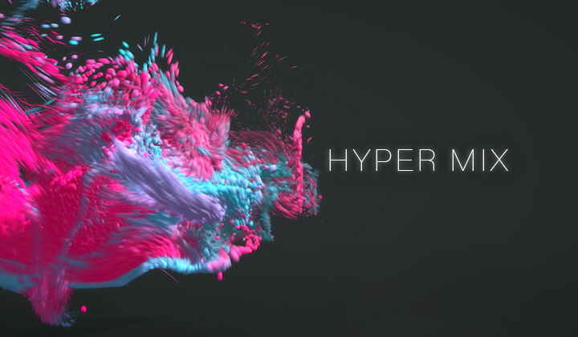
<b>edankwan/hyper-mix · screenshot.jpg</b>

src/3d/particles.js（共 298 行，展示前 60 行）
<pre>var settings = require('../core/settings');&#10;var THREE = require('three');&#10;var shaderParse = require('../helpers/shaderParse');&#10;var motionBlur = require('./postprocessing/motionBlur/motionBlur');&#10;var glslify = require('glslify');&#10;var simulator = require('./simulator');&#10;var lights = require('./lights');&#10;&#10;var undef;&#10;&#10;var mesh = exports.mesh = undef;&#10;exports.init = init;&#10;exports.resize = resize;&#10;exports.preRender = preRender;&#10;exports.update = update;&#10;&#10;var _renderer;&#10;var _camera;&#10;var _scene;&#10;var _particleGeometry;&#10;&#10;var _quadScene;&#10;var _quadCamera;&#10;var _shadowMatrial;&#10;&#10;var _particles;&#10;var _particlesMaterial;&#10;var _particlesScene;&#10;var _depthRenderTarget;&#10;var _additiveRenderTarget;&#10;&#10;var _blurHMaterial;&#10;var _blurVMaterial;&#10;var _blurRenderTarget;&#10;&#10;var _resolution;&#10;var _width;&#10;var _height;&#10;&#10;var TEXTURE_WIDTH = settings.simulatorTextureWidth;&#10;var TEXTURE_HEIGHT = settings.simulatorTextureHeight;&#10;var AMOUNT = TEXTURE_WIDTH * TEXTURE_HEIGHT;&#10;&#10;function init(renderer, camera, scene) {&#10;&#10;    _quadCamera = new THREE.Camera();&#10;    _quadCamera.position.z = 1;&#10;    _particlesScene = new THREE.Scene();&#10;    _quadScene = new THREE.Scene();&#10;    _camera = camera;&#10;    _scene = scene;&#10;    _renderer = renderer;&#10;    _resolution = new THREE.Vector2();&#10;&#10;    _initGeometry();&#10;    _initDepthRenderTarget();&#10;    _initAdditiveRenderTarget();&#10;    _initBlurRenderTarget();&#10;&#10;    _particles = new THREE.Points(_particleGeometry, _additiveRenderTarget.material);&#10;…（截断，原文共 298 行）</pre>

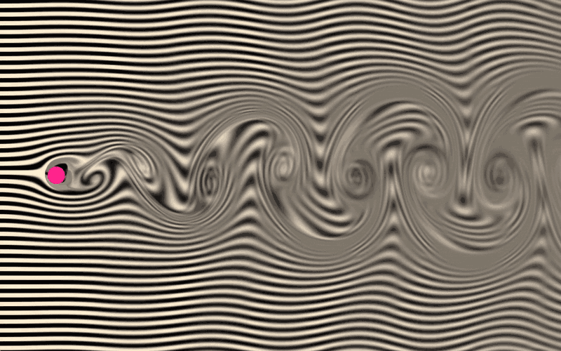
<b>amandaghassaei/VortexShedding · vortexshedding.gif</b>

main.js（共 332 行，展示前 60 行）
<pre>//used a lot of ideas from https://bl.ocks.org/robinhouston/ed597847175cf692ecce to clean this code up&#10;&#10;var width, height;&#10;var actualWidth, actualHeight;&#10;var body;&#10;var scale = 3.5;&#10;&#10;var obstaclePosition = [0,0];&#10;var obstacleRad = 20;&#10;var movingObstacle = false;&#10;&#10;var lastMouseCoordinates =  [0,0];&#10;var mouseCoordinates =  [0,0];&#10;var mouseEnable = false;&#10;&#10;var paused = false;//while window is resizing&#10;&#10;var dt = 1;&#10;var dx = 1;&#10;var nu = 1;//viscosity&#10;var rho = 1;//density&#10;&#10;var GPU;&#10;&#10;var toHalf = (function() {&#10;&#10;  var floatView = new Float32Array(1);&#10;  var int32View = new Int32Array(floatView.buffer);&#10;&#10;  /* This method is faster than the OpenEXR implementation (very often&#10;   * used, eg. in Ogre), with the additional benefit of rounding, inspired&#10;   * by James Tursa?s half-precision code. */&#10;  return function toHalf(val) {&#10;&#10;        floatView[0] = val;&#10;        var x = int32View[0];&#10;&#10;        var bits = (x &gt;&gt; 16) &amp; 0x8000; /* Get the sign */&#10;        var m = (x &gt;&gt; 12) &amp; 0x07ff; /* Keep one extra bit for rounding */&#10;        var e = (x &gt;&gt; 23) &amp; 0xff; /* Using int is faster here */&#10;&#10;        /* If zero, or denormal, or exponent underflows too much for a denormal&#10;         * half, return signed zero. */&#10;        if (e &lt; 103) {&#10;          return bits;&#10;        }&#10;&#10;        /* If NaN, return NaN. If Inf or exponent overflow, return Inf. */&#10;        if (e &gt; 142) {&#10;          bits &#124;= 0x7c00;&#10;          /* If exponent was 0xff and one mantissa bit was set, it means NaN,&#10;               * not Inf, so make sure we set one mantissa bit too. */&#10;          bits &#124;= ((e == 255) ? 0 : 1) &amp;&amp; (x &amp; 0x007fffff);&#10;          return bits;&#10;        }&#10;&#10;        /* If exponent underflows but not too much, return a denormal */&#10;        if (e &lt; 113) {&#10;          m &#124;= 0x0800;&#10;          /* Extra rounding may overflow and set mantissa to 0 and exponent&#10;…（截断，原文共 332 行）</pre>

<nav class="toc view-toc"><h2>In This Section</h2><ul><li class="l2"><a href="#verifier-3">3 Verifier</a></li><li class="l3"><a href="#verifier-3-1">3.1 Overview</a></li><li class="l4"><a href="#verifier-3-1-1">3.1.1 Glossary</a></li><li class="l4"><a href="#verifier-3-1-2">3.1.2 Reward Function</a></li><li class="l3"><a href="#verifier-3-2">3.2 Functionality</a></li><li class="l4"><a href="#verifier-3-2-1">3.2.1 Judges & Rules</a></li><li class="l4"><a href="#verifier-3-2-2">3.2.2 Experiments</a></li><li class="l4"><a href="#verifier-3-2-3">3.2.3 Insight：Zero Noise Is Conditional</a></li><li class="l4"><a href="#verifier-3-2-4">3.2.4 Insight：Tolerance Can Invert</a></li><li class="l4"><a href="#verifier-3-2-5">3.2.5 Insight：Single Metric Collapses</a></li><li class="l4"><a href="#verifier-3-2-6">3.2.6 Insight：Evidence Has A Boundary</a></li><li class="l3"><a href="#verifier-3-3">3.3 Aesthetics</a></li><li class="l4"><a href="#verifier-3-3-1">3.3.1 Aesthetic Evaluation</a></li><li class="l4"><a href="#verifier-3-3-2">3.3.2 Insight：Filter, Not Reward</a></li><li class="l3"><a href="#verifier-3-4">3.4 Frontier Lab</a></li></ul></nav>

## 3 Verifier

Verifier 评估 Agent 在 Harness 里完成用户的多模态参考请求（Omni Reference Query）后交付的脚本或页面质量。

- 用于蒸馏轨迹质量评估，或 RL 训练过程的 reward function。
- 和 Web 最大的不同在真值：**3D 的真值是场景图，可直接读出；固定随机源、同一容器重渲时噪声为零。**

### 3.1 Overview

Verifier 围绕两个核心维度评判 Agent 交出的产物：

- **功能性（Functionality）**：东西、参数、动画、摆放、交互对不对；题目没钉死的部分不检查
- **审美性（Aesthetics）**：好不好看

两者的关系是：**功能性作为硬约束，审美性仅用于可行解之间的偏好排序。**

图 3.1 是评测流程：先用程序检查 L0–L3，层层截断；全过了，才让模型在 L4 比好不好看。

<figure class="paper-fig">
<svg viewBox="0 0 1000 320" xmlns="http://www.w3.org/2000/svg" font-family="system-ui, -apple-system, 'PingFang SC', sans-serif" font-size="14">
<defs>
<marker id="g31" viewBox="0 0 10 10" refX="9" refY="5" markerWidth="7" markerHeight="7" orient="auto"><path d="M0,0 L10,5 L0,10 z" fill="#94a3b8"/></marker>
<marker id="r31" viewBox="0 0 10 10" refX="9" refY="5" markerWidth="7" markerHeight="7" orient="auto"><path d="M0,0 L10,5 L0,10 z" fill="#dc2626"/></marker>
</defs>
<rect x="20" y="14" width="760" height="30" rx="15" fill="#eff6ff" stroke="#2563eb"/>
<text x="400" y="34" text-anchor="middle" fill="#2563eb" font-weight="600">Functionality · L0–L3 · 程序检查</text>
<rect x="820" y="14" width="160" height="30" rx="15" fill="#faf5ff" stroke="#9333ea"/>
<text x="900" y="34" text-anchor="middle" fill="#9333ea" font-weight="600">Aesthetics · L4</text>
<g fill="#eff6ff" stroke="#2563eb" stroke-width="1.5">
<rect x="20" y="64" width="160" height="120" rx="12"/>
<rect x="220" y="64" width="160" height="120" rx="12"/>
<rect x="420" y="64" width="160" height="120" rx="12"/>
<rect x="620" y="64" width="160" height="120" rx="12"/>
</g>
<rect x="820" y="64" width="160" height="120" rx="12" fill="#faf5ff" stroke="#9333ea" stroke-width="1.5"/>
<g stroke="#94a3b8">
<line x1="36" y1="132" x2="164" y2="132"/>
<line x1="236" y1="132" x2="364" y2="132"/>
<line x1="436" y1="132" x2="564" y2="132"/>
<line x1="636" y1="132" x2="764" y2="132"/>
<line x1="836" y1="132" x2="964" y2="132"/>
</g>
<g text-anchor="middle" fill="#0f172a">
<text x="100" y="94" font-size="16" font-weight="700">L0 执行</text>
<text x="100" y="118">能跑吗</text>
<text x="300" y="94" font-size="16" font-weight="700">L1 结构</text>
<text x="300" y="118">东西对吗</text>
<text x="500" y="94" font-size="16" font-weight="700">L2 几何</text>
<text x="500" y="118">摆得对吗</text>
<text x="700" y="94" font-size="16" font-weight="700">L3 行为</text>
<text x="700" y="118">用起来对吗</text>
<text x="900" y="94" font-size="16" font-weight="700">L4 美学</text>
<text x="900" y="118">好看吗</text>
</g>
<g text-anchor="middle" fill="#0f172a" font-size="12">
<text x="100" y="153">脚本退出状态</text>
<text x="100" y="171">非空白帧</text>
<text x="300" y="153">场景图 · 动画曲线</text>
<text x="300" y="171">渲染设置</text>
<text x="500" y="153">逐部件几何 · 体素</text>
<text x="500" y="171">拓扑</text>
<text x="700" y="153">输入重放 +</text>
<text x="700" y="171">状态差分</text>
<text x="900" y="162">模型两两比较</text>
</g>
<g stroke="#94a3b8" stroke-width="1.5" marker-end="url(#g31)">
<line x1="182" y1="124" x2="217" y2="124"/>
<line x1="382" y1="124" x2="417" y2="124"/>
<line x1="582" y1="124" x2="617" y2="124"/>
<line x1="782" y1="124" x2="817" y2="124"/>
</g>
<g stroke="#dc2626" stroke-width="1.5" stroke-dasharray="5 4" marker-end="url(#r31)">
<line x1="100" y1="186" x2="100" y2="258"/>
<line x1="300" y1="186" x2="300" y2="258"/>
<line x1="500" y1="186" x2="500" y2="258"/>
<line x1="700" y1="186" x2="700" y2="258"/>
<line x1="900" y1="186" x2="900" y2="258"/>
</g>
<rect x="20" y="262" width="960" height="40" rx="10" fill="#fef2f2" stroke="#dc2626"/>
<text x="500" y="288" text-anchor="middle" fill="#dc2626" font-weight="600">不通过 → 0 分，后面不跑</text>
</svg>
<figcaption>图 3.1　3D 分层关卡：L0–L3 由程序读场景状态，L4 才交给模型比较；任一层不过即 0 分，后层不跑</figcaption>
</figure>

适用边界：本章的判别力数字只覆盖「修复单处破坏」类任务，从零生成见 3.2.6。

例题：Blender 脚本搭场景，木桌上放蓝色杯子，台灯灯臂第 1–40 帧从 0° 转到 40°。本例无交互，跳过 L3（L3 用于 three.js 游戏）。

图 3.2 是对照：[BlenderWorld](https://github.com/QwenLM/BlenderWorld) 的评测流水线，照其 `docs/assets/evaluation-pipeline.png` 重画成 draw.io，可直接编辑。

- 缺 `.blend` 直接记 0
- Rubric 打分模型逐条判 0/1、按权重算通过率：Agent-as-Judge 读 scene_summary 与 `.blend`，VLM-as-Judge 看渲染图
- Dimension 打分模型（VLM）给 8 个维度各打 1–10 分，两者 1:1 融合成任务分
- 和本文的区别：审美分直接进总分，而不是只在全过的作品之间排名次

<iframe src="../assets/figures/evaluation-pipeline.html" style="width:100%;height:460px;border:0" title="BlenderWorld 评测流水线"></iframe>

图 3.2　BlenderWorld 的评测流水线；图小，细看点「全屏编辑」。改动自动存在本浏览器；要留档点「下载 .drawio」，放回 <code>assets/figures/</code> 后重建即可更新正文

#### 3.1.1 Glossary

前五条与 Web 页通用，后四条是 3D 的几何信号。

| 术语 | 含义 |
|---|---|
| 改坏的样本 | 故意改出真错误，应判挂 |
| 换写法的样本 | 写法变了、结果一样，应判过 |
| 抓错率 | 改坏的样本被判挂的比例 |
| 放对率 | 换写法的样本被判过的比例 |
| Critic | 模型评审：看渲染结果、自己操作页面、输出问题清单的 VLM Agent（打分场景叫「打分模型」） |
| 剪影交并比 | IoU：两张剪影的重叠 ÷ 合并 |
| 点云距离 | Chamfer 距离：两组点云间平均最近距离 |
| 逐部件 F 分数 | 按材质色分组，两组表面采样点在容差内能对上的比例，取最差组 |
| 逐颜色体素占据 | 把场景切成体素，比较各颜色占的位置；只比不分颜色的占位时叫体素交并比 |

#### 3.1.2 Reward Function

$$r = g\cdot(1+\lambda\,w),\qquad 0<\lambda\le 1$$

- $g=\prod_{k=0}^{3}\mathbf{1}[\,L_k\ \text{pass}\,]\in\{0,1\}$：功能闸，L0–L3 全部通过为 1，任一层不过为 0
- $w\in[0,1]$：审美胜率，只在组内通过者之间两两比较得出
- 公式与 Web 页相同，为本文建议，未实测

1. 功能全过才算，不加权、不给部分分。
   - 本项目 Blender verifier 每条检查都是「且」；题目钉死的项不过直接 0 分
2. 前层不过，后层不跑。
   - 脚本报错，后面的几何和渲染不算
   - 截断也会放大取证链路自己的漏洞：Train 页 4.2 的三个取证缺口都让正确页面在 L0 被整条判 0，看上去像模型连页面都写不对
3. 审美只在通过者之间排名次。
4. 阈值在跑改坏的样本前冻结，后定的要标出。
5. 代价是奖励稀疏：$r$ 近似二值；同一题的一组采样全部通过或全部失败时，组内相对优势为零，不产生梯度。
   - 实测：〔three.js〕16 道修复题 × 8 次，13 题全对或全错，只有 3 题有梯度；0.3–0.7 难度带内 0/16
   - 缓解：以被训模型自身的 pass@k 做难度过滤，配合动态采样

3D 阈值（本项目设定）：

| 阈值 | 值 | 怎么定 | 看样本前/后 | 单用判对 |
|---|--:|---|:-:|--:|
| 图像相似度 | ≥ 0.995 | 按等价定 | 前 | 12/22 |
| 剪影交并比 | ≥ 0.97 | 按等价定 | 前 | 14/22 |
| 点云距离 | ≤ 0.4% 对角线 | 按等价定 | 前 | 13/22 |
| 体素交并比 | ≥ 0.80 | 按等价定 | 前 | 15/22 |
| 逐部件 F 分数 | ≥ 0.99 | 换写法最低值 0.9989 反推 | 后 | 无独立验证 |

- 口径：〔Blender〕台灯桌面场景，n = 22 样本 × 1 次；单用判对 = 抓错 + 放对，满分 22
- 按等价定：按「什么算同一个场景」定，不从噪声推（见 3.2.3），具体依据原始记录未展开
- 点云距离 0.4% 是距离上限，不是 3.2.4 的 F 分数匹配容差 0.5%

### 3.2 Functionality

功能性回答「题目钉死的东西都对吗」：按 L0–L3 四层逐条判 0 或 1，判据是运行后的场景状态，不读代码，也不看渲染图。能写成断言的交给程序，VLM 只补程序读不出的外观。

#### 3.2.1 Judges & Rules

**1. Agentic Critic: Checklist Decomposition**

Critic 的做法同 Web 页 3.2.1：按 L0–L3 拆检查清单，每条对应题目里钉死的一个字段；同一道题只拆一次并冻结。3D 的差别在分派：

1. 能读场景图的，一律写成程序：场景图、动画曲线、逐部件几何、拓扑量
2. 只有看画面才能判的外观，才交给 VLM
3. **凡是能被透视或取景解释掉的检查，一律不交给模型**

**2. Layers**

| Layer | Checks | Method (Program / Agent / VLM) | Used by | Evidence |
|---|---|---|---|---|
| **L0 执行** | 能跑完、出帧吗 | Program执行检查：脚本退出状态、非空白帧 | [CAD-Coder](https://arxiv.org/abs/2505.19713) · [cadrille](https://arxiv.org/abs/2505.22914) | - |
| **L1 结构** | 物体参数、关键帧、渲染参数对不对 | Program场景图检查：如杯子材质是蓝色吗；动画曲线检查：如灯臂第 40 帧 40°；渲染设置检查：引擎、分辨率、帧范围，如帧范围恰为 1–40 Agent[BlenderWorld](https://github.com/QwenLM/BlenderWorld) 的做法：读 scene_summary 与 `.blend` 逐条判 | [3JSBench](https://3jsbench.com/) · [WorldCoder-Bench][wcb] · [Code4Scene](https://arxiv.org/abs/2609.36777) · [MoVer](https://arxiv.org/abs/2502.13372) | 场景图在渲染图里看不见：删掉两条动画曲线，视觉指标全是 1.0000，只有逐关键帧检查抓到（[本项目 Blender 实测 · 3.2.2](#verifier-experiments)） |
| **L2 几何** | 形状、位置、占位、破洞对不对 | Program逐部件几何：如抓到杯子放错桌角；逐颜色体素占据：如蓝块在杯子处；拓扑量：如封口杯破洞边数为 0 VLM多视角渲染看程序漏掉的外观，如雪人头顶破洞 | [MeshCoder](https://arxiv.org/abs/2508.14879) · [Hi3DEval](https://arxiv.org/abs/2508.05609) · [CAD-Coder](https://arxiv.org/abs/2505.19713) · [BlenderGym](https://arxiv.org/abs/2504.01786) · [cadrille](https://arxiv.org/abs/2505.22914) · [BenchCAD](https://arxiv.org/abs/2605.10865) · [CAD-RL](https://arxiv.org/abs/2508.10118) · [CADTests](https://arxiv.org/abs/2605.07807) · [CADEngBench](https://arxiv.org/abs/2608.09296) | 拓扑量抓到像素和剪影都漏掉的破洞：〔three.js〕参考 0、候选 64（n = 1 样本）；体素交并比已有在线强化学习先例（3.4） |
| **L3 行为** | 按键反应对不对 | Program输入重放 + 状态差分：如按「开灯」后灯亮 | [PlayCoder](https://arxiv.org/abs/2604.19742) · [A2Z GameSpec-Bench](https://arxiv.org/abs/2609.39564) | 为什么要发输入，见 Web 页 3.2.1 |
| **L4 美学** | 好不好看 | VLM模型两两比较，只给过关场景排名次 | [UI2Code^N](https://arxiv.org/abs/2511.08195) · [Anthropic](https://www.anthropic.com/engineering/harness-design-long-running-apps) | 比较比打分准，见 Web 页 3.2.1 |

- 一句话：程序读场景状态，VLM 只管只有看画面才知道的
- 产物：`.py` = Blender 脚本（L0 另含 CadQuery `.py`），`.html` = three.js 页面；L3 只用于 three.js 游戏；动画曲线检查是时间轴上的静态检查
- Used by 的口径
  - L1 场景状态检查只用于评测，尚无当 RL reward 的先例（未核实）
  - CAD-Coder、BlenderGym 是全局几何，cadrille、BenchCAD、CAD-RL 的体素不分颜色，都是简化版
  - MoVer（2D 动画）、CADTests 与 CADEngBench（CAD）是同类检查的旁证

**3. Rubric Rules**

Critic 做功能性校验时依据的 rubric，共八条，每条附佐证。其中第 1、2、3 条是硬约束：任一条不满足，这道题就不能进 RL。

| Rules | Source | Details |
|---|---|---|
| 1. 读运行后的场景状态 | | 按场景图和几何判分，不看代码文本；等价写法极多，按代码比对会误杀正确解 |
| | 本项目实测（n = 1） | 代码比对会误杀正确解：〔Blender〕一个世界几何逐点等同的替代实现通过了全部几何信号（逐部件 F 分数 0.9993），只被代码比对类判据误杀 |
| | [3JSBench](https://3jsbench.com/) | 确定性检查能区分模型，相似度不能：Astra / Opus 5.5 / GPT-6 Sol 通过率 80.0% / 49.0% / 27.0%，SigLIP2 相似度 Astra 0.1081 对 Opus 5.5 0.1067，只差约 0.001 |
| 2. 只查题目钉死的字段 | | 判据能查的信息量不超过题目给出的信息量：题目写明的才检查，不把九类场景状态全拿来和参考比 |
| | 反例 | 题目只说加一盏日光、没钉死功率，判据照查功率，「日光功率 3.0 调成 3.5」被判挂 |
| | 本项目实测（3.2.2 第 3–5 项） | 全查会把对的判错：〔Blender〕九类全查放对 0/11，只查钉死字段的白名单组合放对 10/11 |
| 3. 渲染图只给模型看，不判分 | | 像素看不出场景状态，也比读几何贵 |
| | 本项目实测（3.2.2 第 1、6 项） | 〔Blender〕删掉两条动画曲线，视觉指标全是 1.0000；读几何每样本约 0.4 秒、十视角渲染 1.1–1.2 秒，改坏的 11 个里逐部件 F 分数抓 7 个，多视角剪影只抓 3 个 |
| 4. 多种检查组合使用 | | L0–L3 各层的检查同时上，不靠任何一种单独判 |
| | 本项目实测（3.2.2 第 7–8 项） | 单一信号必有漏网：〔three.js〕最好的单项 25/29，四层组合 29/29 |
| | [CAD-Coder 附录 B](https://arxiv.org/abs/2505.19713) | 单个几何指标会被钻空子：只用点云距离当 reward，约 200 步后模型开始产出跑不起来的代码，训练中止（3.2.5） |
| 5. 阈值按等价定，看样本前冻结 | | 按「什么算同一个场景」定，不从噪声推；后定的要标出 |
| | 本项目实测（3.2.3） | 条件满足时噪声逐位为零，推不出阈值；条件不满足时噪声会抵消分辨力 |
| | [Blender 官方渲染测试](https://github.com/blender/blender/tree/main/tests/files/render) | 阈值固定，某设备复现不了的测试进该设备黑名单，不放宽阈值（推断） |
| 6. 模型评审只做两两比较 | | VLM 不判题目钉死的属性对不对，这类判断的失败是系统性的；只在全部通过的作品之间相对排序，问题清单用来补程序检查 |
| | 本项目实测（3.2.2 第 9–12 项） | 〔three.js〕几何错误会被「透视」解释掉，判对不等于说对原因；价值在于发现遗漏的检查项 |
| 7. 先复核标签，再下「判据不准」的结论 | | 换写法的样本有 3 个以上模型一致判挂时，先复核标签再谈放对率；打标签前先看多视角渲染 |
| | 本项目实测（3.2.2 第 13 项） | 一个错标签就能让结论反过来：〔three.js〕雪人破洞样本 |
| 8. 初始状态必须判挂 | | 什么都不改的起始场景要判挂，否则原样交回也能拿分 |
| | 本文建议（未实测） | 只适用于修复类题目 |

#### 3.2.2 Experiments

实测结论：程序检查只有多种组合使用、只查题目钉死的字段，才能既抓到错误、又不误判正确作品；模型评审会被透视解释带偏、判定不稳定，价值在于发现程序检查遗漏的问题。

| 规则 | 发现 | 关键数据 |
|---|---|---|
| 3 渲染图只给模型看 | 1. 场景状态在渲染图里看不见 | 〔Blender〕删掉两条动画曲线，视觉指标全是 1.0000，只有逐关键帧检查抓到（n = 1 样本，取自下表 22 个） |
| | 2. 截图分不开好坏 | 〔three.js〕雪人任务 6 个候选页面，单张截图相似度全落在 0.973–1.0 |
| 2 只查题目钉死的字段 | 3. 全查会把对的判错 | 〔Blender〕九类全查抓错 11/11、放对 0/11；白名单组合抓错 11/11、放对 10/11 |
| | 4. 全查败在等价写法多 | 〔Blender〕按名字比败给自动改名（同名材质节点自动加后缀），按局部变换比败给等价父子层级，按顶点数比败给等价细分 |
| | 5. 修法是移出白名单，不是放宽容差 | 〔Blender〕白名单组合唯一放错的是留出集「日光功率 3.0 调成 3.5」：题目没钉死功率，却照查了 |
| 3 渲染图只给模型看 | 6. 读几何又便宜又准 | 〔Blender〕每样本几何全套约 0.4 秒、十视角渲染 1.1–1.2 秒；11 个改坏的里逐部件 F 分数抓 7/11、多视角剪影 3/11 |
| 4 多种检查组合使用 | 7. 单一信号必有漏网 | 〔three.js〕单张像素比对 12/29、几何类别多重集 14/29、多视角剪影交并比 19/29、逐颜色体素占据 25/29，四层组合 29/29；换场景（小车）留出 18/18，累计 47/47 |
| | 8. 几何看不见的，由场景状态补上 | 〔Blender〕逐部件几何单独漏的 4 个几何上看不见（灯泡调暗、动画删光、相机焦距改短、倒角删掉），由灯光与相机、动画曲线、修改器栈抓到 |
| 6 模型评审只做两两比较 | 9. 几何错误会被「透视」解释掉 | 〔three.js〕漏放（应挂判过）的判定里，理由拿取景、相机、透视或朝向说事的，单视角 4/8（50%）、多视角 4/6（67%）；原话「透视带来的视觉大小差异属于相机取景角度范畴，不算错误」 |
| | 10. 判对不等于说对原因 | 〔three.js〕「鼻子长在后脑勺」（1 样本 × 4 模型 × 2 次 = 8 次判定）单视角全判挂，0/8 的理由提到朝向或背面，都说「缺少鼻子」（页面相机看不到后脑勺）；训练数据要按原因对不对打标 |
| | 11. 程序稳定判挂，模型不稳定 | 〔three.js〕底球放大 20%、中球缩小 20%：逐颜色体素交并比 0.679、0.897，都在阈值外，都判挂（确定性，每例 1 次）；模型单视角每例 8 次判定，底球判对 4/7（1 次未解析），中球 8/8 |
| | 12. VLM 的价值在于发现遗漏的检查项 | 〔three.js〕雪人头顶未封口，人工标成「通过」：单视角像素分 1.000、多视角剪影交并比 0.998，程序检查全漏；模型多视角 8 次判定 7 次判挂，单视角 8 次全放过；据此新增「只被一个三角形用到的边数」，封口参考 0、该候选 64 |
| 7 先复核标签 | 13. 一个错标签就能让结论反过来 | 〔three.js〕同一样本：多视角应放行的有效判定 64 次，放对 57 次（0.891），漏的 7 次全是它；复核确认标签标错，剔掉它的 8 次后 56/56（1.000） |

- 第 7 项口径：雪人 13 + 桌子 16 共 29 个带标签样本，含两类，n = 29 × 1 次；组合阈值在这些样本上看过，不算独立验证。留出集 n = 18 样本 × 1 次，两类都有，标签先贴、阈值未动；累计 47/47（29 + 18），18 个是真留出
- 第 9–13 项口径：〔three.js〕雪人场景，温度 0；n = 18 样本 × 4 模型 × 2 视角 × 2 次 = 288 次判定，281 次有效；单视角 = 页面相机一张图，多视角 = 4 视角拼图，均与参考图上下并排

**Blender：九类场景状态逐类单开**

台灯桌面场景，n = 22 样本 × 1 次，确定性：开发集 15 个（8 改坏 + 7 换写法）+ 留出集 7 个（3 + 4），合计改坏 11、换写法 11。

| 类别 | 查什么 | 关卡 | 抓错 /11 | 放对 /11 | 判对 /22 |
|---|---|:-:|--:|--:|--:|
| 层级与命名 | 名字集合、物体类型、父子关系、集合归属 | 条件进：只查点名物体 | 2 | 10 | 12 |
| 变换 | 世界包围盒八个角点 | 不进：不查局部位置与缩放，改用包围盒或几何指标 | 3 | 7 | 10 |
| 网格统计 | 非流形边、体积符号、面数预算 | 不进：只留不变量与不等式 | 2 | 6 | 8 |
| 修改器栈 | 修改器类型与关键参数 | 进 | 2 | 11 | 13 |
| 材质节点树 | 节点类型与连边 | 条件进：按类型与连边、不按节点名比，只查钉死的接口 | 1 | 10 | 11 |
| 灯光与相机 | 功率、色温、焦距、当前相机 | 进：只查白名单字段 | 2 | 10 | 12 |
| 动画曲线 | 逐关键帧的时间、取值、插值，按帧求值 | 进 | 1 | 11 | 12 |
| 物理与约束 | 约束类型、目标、影响系数、刚体字段 | 进 | 0 | 11 | 11 |
| 渲染设置 | 引擎、分辨率、帧率、帧范围、采样、色彩管理 | 进：精确相等，无容差 | 0 | 11 | 11 |
| 逐部件几何（单独） | 按材质色分组的 F 分数 | — | 7 | 11 | 18 |
| 白名单组合 | 逐部件几何 + 修改器栈 + 灯光与相机 + 动画曲线 + 渲染设置 | 进 | **11** | **10** | **21** |
| 九类全查 | 全部字段 | 反面教材 | 11 | 0 | 11 |

- 关卡 = 进不进推荐的最终判定：进 = 按字段比；条件进 = 只查一部分；不进 = 不按字段比，改用别的信号
- 逐部件几何读表面采样点，不在九类内，白名单组合的 11/11 不能直接比各类的 0–3/11；未测四类单独组合（不含逐部件几何）
- 物理与约束「进」但不在实测组合：本批无针对它的改坏样本（抓错 0/11），收它是因为静帧看不见约束

**CAD：真值最确定**

尺寸、约束、实体有效性、可制造性全部确定；[BenchCAD](https://huggingface.co/datasets/BenchCAD/BenchCAD) 约 1.8 万个参数化程序都经执行校验，「全部按执行结果判分，不用模型打分」（未核实）。

#### 3.2.3 Insight：Zero Noise Is Conditional

**阈值不能从噪声推：噪声在条件满足时是零，所以阈值只能按「什么算等价」来定；条件不满足时，噪声会抵消分辨力。**

| Insight | Source | Details |
|---|---|---|
| 两个条件都满足时，噪声逐位为零 | 本项目实测 | 〔Blender〕参考解跑两遍（n = 1 样本 × 2 次）：图像 1.0000、点云距离 0.0000、体素交并比 1.0000 |
| 条件 1：显式传采样种子 | 本项目实测 | 〔Blender〕表面采样用采样库自己的随机源，全局种子管不到；不传时参考解自比点云距离 0.00167，与样本分布 0.0016–0.0065 同量级，而两类样本本就在此区间重叠 |
| 条件 2：在任务容器里重渲 | 本项目实测 | 〔Blender〕换 CPU 或图形栈版本像素会漂，参考图须在容器内用同一引擎重渲，不能用仓库存图 |
| 官方同样不靠放宽阈值 | [Blender 官方渲染测试](https://github.com/blender/blender/tree/main/tests/files/render) | 阈值固定：单像素误差 > 0.016 的像素不超过 1%；某设备复现不了的测试进该设备黑名单（推断） |

#### 3.2.4 Insight：Tolerance Can Invert

**点云 F 分数的容差选错，结论会反过来：取对角线 0.5%，逐部件算；下限不低于平均最近邻距离的 3 倍，该距离用参考解自采样两次估出，每个场景单算。**

<figure class="paper-fig">
<svg viewBox="0 0 1000 340" xmlns="http://www.w3.org/2000/svg" font-family="system-ui, -apple-system, 'PingFang SC', sans-serif" font-size="14">
  <g stroke="#94a3b8" stroke-width="1">
    <line x1="100" y1="40" x2="100" y2="280"/><line x1="100" y1="280" x2="720" y2="280"/>
    <line x1="95" y1="40" x2="100" y2="40"/><line x1="95" y1="120" x2="100" y2="120"/>
    <line x1="95" y1="200" x2="100" y2="200"/><line x1="95" y1="280" x2="100" y2="280"/>
  </g>
  <g fill="#0f172a" font-size="12" text-anchor="end">
    <text x="90" y="44">1.0</text><text x="90" y="124">0.8</text><text x="90" y="204">0.6</text><text x="90" y="284">0.4</text>
  </g>
  <text x="40" y="160" text-anchor="middle" fill="#0f172a" transform="rotate(-90 40 160)">F 分数</text>
  <g fill="#0f172a" text-anchor="middle">
    <text x="220" y="302">0.1%</text><text x="420" y="302">0.5%（本文取值）</text><text x="620" y="302">1%</text>
    <text x="410" y="330">F 分数容差（场景对角线的 %）</text>
  </g>
  <line x1="420" y1="40" x2="420" y2="280" stroke="#2563eb" stroke-width="1" stroke-dasharray="4 4"/>
  <circle cx="220" cy="241" r="7" fill="#2563eb"/><text x="234" y="246" fill="#0f172a">0.4977</text>
  <circle cx="220" cy="54" r="7" fill="#dc2626"/><text x="234" y="59" fill="#0f172a">0.9639</text>
  <rect x="140" y="120" width="180" height="54" rx="6" fill="#fef2f2" stroke="#dc2626"/>
  <text x="230" y="142" text-anchor="middle" fill="#dc2626">反转：应该过 &lt; 应该挂</text>
  <text x="230" y="162" text-anchor="middle" fill="#0f172a" font-size="12">容差 &lt; 点距 3–5 毫米</text>
  <circle cx="408" cy="41" r="6" fill="#dc2626"/><circle cx="420" cy="41" r="6" fill="#dc2626"/>
  <circle cx="432" cy="40" r="6" fill="#2563eb"/>
  <rect x="345" y="66" width="150" height="54" rx="6" fill="#ffffff" stroke="#94a3b8"/>
  <text x="420" y="88" text-anchor="middle" fill="#0f172a">全局算：三点重叠</text>
  <text x="420" y="108" text-anchor="middle" fill="#0f172a" font-size="12">0.9985–0.9993</text>
  <circle cx="612" cy="46" r="6" fill="#dc2626"/><circle cx="628" cy="52" r="6" fill="#dc2626"/>
  <rect x="540" y="78" width="160" height="72" rx="6" fill="#ffffff" stroke="#94a3b8"/>
  <text x="620" y="100" text-anchor="middle" fill="#0f172a">记录里 7 个应该挂的</text>
  <text x="620" y="120" text-anchor="middle" fill="#0f172a" font-size="12">只有 2 个低于 0.99</text>
  <text x="620" y="138" text-anchor="middle" fill="#0f172a" font-size="12">0.9847 · 0.9704</text>
  <circle cx="770" cy="110" r="7" fill="#2563eb"/><text x="786" y="115" fill="#0f172a">换写法的样本（应该过）</text>
  <circle cx="770" cy="140" r="7" fill="#dc2626"/><text x="786" y="145" fill="#0f172a">改坏的样本（应该挂）</text>
</svg>
<figcaption>图 3.3　点云 F 分数的容差（本项目实测）：0.1% 时结论反转；0.5% 全局算仍重叠，须逐部件算；1% 时 7 个应该挂的（含留出集）只有 2 个低于 0.99。横轴三档不按比例</figcaption>
</figure>

| 容差 | 现象 | 关键数据 |
|---|---|---|
| 0.1%（2.2 毫米） | 小于采样间距，测的是采样密度而非几何 | 换写法的细分样本 0.4977，反而低于改坏的灯罩转反 0.9639；六万个点铺在 2.18 米场景上，平均点距就有 3–5 毫米 |
| 0.5% 全局算 | 没有全局容差能分开两类 | 改坏的 0.9993、0.9985 与换写法的 0.9993 重叠 |
| 0.5% 逐部件算（本文取值） | 每种材质色一组，取最差组 | 换写法最低 0.9989，阈值取 0.99：抓错 7/11、放对 11/11 |
| 1% | 太大，多数改坏的分不出 | 7 个只有 2 个低于 0.99（灯罩转反 0.9847、桌腿少一条 0.9704），其余 5 个都在 0.99 以上 |

- 口径：〔Blender〕n = 12 样本 × 4 档容差（0.1%、0.2%、0.5%、1%），各算 1 次；12 个取自 3.2.2 的 22 个，原始记录只列了 7 个改坏的（含留出集 2 个）和 5 个换写法的，未列另 4 个改坏的（换色、灯泡调暗、动画删光、相机焦距改短）
- 两条取值规则可能冲突（推断）：本场景 0.5% 对角线 ≈ 10.9 毫米（对角线 2.18 米），而「不低于 3 倍平均点距」在点距 3–5 毫米时是 9–15 毫米，所以取二者较大者
- 外推边界：按材质色分组会把同色部件合成一块，少一个同色部件就看不出；three.js 相对关系原型因此改为按颜色取连通块当部件（桌面与四条腿同色会合成一块，是原型设计时的描述，未单独测量）；逐部件 F 分数照此拆分的效果、部件多的复杂场景均未测

#### 3.2.5 Insight：Single Metric Collapses

**单个几何指标不能单独当 reward：它会被钻空子，必须和执行检查、难度过滤一起用。**

| Insight | Source | Details |
|---|---|---|
| 只用点云距离当 reward 会崩 | [CAD-Coder 附录 B](https://arxiv.org/abs/2505.19713) | 〔CAD〕约 200 步后模型开始产出跑不起来的代码，训练中止 |
| 配套做法是难度过滤 | [cadrille](https://arxiv.org/abs/2505.22914) | 〔CAD〕只留 3 次采样平均 reward 低于 7.5 的题（reward = 10×交并比，满分 10） |
| 跑不起来的代码记 0 还是记负分，未对比 | CAD-Coder · cadrille | CAD-Coder 记 0、cadrille 记 −10；本文默认记 0，记负分能否更快压掉不可执行输出未测 |

#### 3.2.6 Insight：Evidence Has A Boundary

**本页判别力数字（29/29、47/47、18/18、Blender 21/22）都来自「修复单处破坏」类任务；只有阈值冻结后才见到的样本算独立证据。**

验收指标用抓错率、放对率、Youden 指数，各配置信区间：一般用 Wilson 95% 区间；一次都没出错时，出错率的 95% 上界 ≈ 3 ÷ n。

| 证据 | 算不算独立 | 关键数据 |
|---|---|---|
| 〔three.js〕组合判定，换场景留出 | 算，但跨场景独立样本数为 1 | 18/18（n = 18 样本 × 1 次，都是小车这一个场景的改动）：Wilson 95% 下界 0.824，即准确率 ≥ 82.4%；出错率 95% 上界 ≈ 3 ÷ 18 ≈ 16.7%；抓错 11/11（下界 74.1%）、放对 7/7（下界 64.6%）；换到别的场景没有统计保证 |
| 〔Blender〕白名单组合 | 不算 | 成员看过开发集 15 个样本才选定，逐部件 F 的 0.99 后定 |
| 〔Blender〕先冻结的四个阈值 | 算 | 22 个样本都在冻结后才见到，但单用只判对 12–15/22 |

从零生成不在这些数字的覆盖范围内：

- 〔three.js〕现有判据 0/26，其中 23 组挂在剪影层；抽看的 4 个产物人看都对，挂的原因是比例与参考不重合
- 〔three.js〕只看相对关系的原型救回 13/80，代价是三场景带标签样本 47/47 → 35/47
- 分母：32 组（场景 × 模型 × 有无参考图）中有效 26 组，0/26 按组计（每组最多 3 轮）；13/80 按同一批实验的每次尝试计，80 的精确构成原始记录未交代（未核实）

### 3.3 Aesthetics

**本项目素材没覆盖 3D 审美：能程序查的只是「物理上自不自洽」，公开 3D 评测器与人的两两一致率，已发表最高是 GPTEval3D 自报的 78.9%，换到别家数据只有 65%–69%。**

#### 3.3.1 Aesthetic Evaluation

| Insight | Source |
|---|---|
| 公开 3D 评测器测资产质量，不测交互与功能 | [GPTEval3D](https://arxiv.org/abs/2401.04092)：自家数据两两一致 78.9%、Kendall τ（排序一致性系数）0.710；别家数据复测 3DGen-Bench 67.7%、Hi3DEval 65%–69% |
| | [3DGen-Bench](https://arxiv.org/abs/2503.21745)：自家评分器 72.5%；1,020 条提示、11,220 个资产、68,000+ 偏好投票 |
| | [Hi3DEval](https://arxiv.org/abs/2508.05609)：自家数据物体级 70%–77%；[MATE-3D](https://arxiv.org/abs/2412.11170)：1,280 个网格、107,520 条多维度标注 |
| 「3D 低一截」只是推断 | 网页侧模型评审两两一致 91%–94%（[ArtifactsBench](https://arxiv.org/abs/2507.04952) / [UI2Code^N](https://arxiv.org/abs/2511.08195)）；数据集不同，这是实测一致率，不是门槛，测的是网页评审，与 3D 偏好数据口径不同 |
| 能程序查的是「物理自洽」，不是审美 | [3JSBench](https://3jsbench.com/) 有 98 条渲染质量检查（网格预算、可见背面、绘制顺序） |
| | 五大失败：穿插 20%、可见背面 19%、闪烁 17%、朝向 16%、断开 16%；前三类属渲染层面的物理不自洽（本项目归类，非站方原话） |
| | 网格预算：Muse Spark 1.3 中位 995 个网格、177,000 个三角面，Astra 45 个，Fable 5.1 24 个；Muse 有 33% 的尝试出现闪烁 |
| 嵌入相似度当 3D 质量关卡没用 | 3JSBench 上 11 个模型的 SigLIP2 均值全在 0.0774–0.1081；Astra / Opus 5.5 / GPT-6 Sol 减去每题平均后三者只高 +0.011 / +0.009 / +0.007 |

#### 3.3.2 Insight：Filter, Not Reward

**本项目素材里，3D 美学分只见于数据过滤，未见用作 reward。**

- [Objaverse-XL](https://arxiv.org/abs/2307.05663) 用 LAION 美学分分三档，外加坏渲染分类器（1,200 条人工标注训练，阈值 0.5）；Polycam 来源的渲染图 38.20% 被判坏
- 3D 的 L4 目前只做模型两两比较；网页侧的排版类程序检查在 3D 场景里没有对应物，未实测

### 3.4 Frontier Lab

**所查来源都没披露 3D 训练方法，只有演示和基准分数；国内没有一家披露 Blender 训练数据（推断）。**

每条 Insight 落在哪一环见 Taxonomy 列：数据 Verifier Harness

| Lab | Blog | Taxonomy | Insight |
|---|---|---|---|
|  OpenAI | [Building games with Astra](https://developers.openai.com/blog/how-to-build-games-with-astra) | Verifier | three.js 渲染计数器（绘制调用、三角面、几何体、纹理）、90 个帧间隔采样、特效开关像素差分；无阈值。未披露 Blender 与游戏训练数据、视觉 reward 模型 |
|  | [Architectural visualization with Astra](https://developers.openai.com/blog/architectural-visualization-with-astra) | Harness | bpy 建场景，computer use 打开 Blender 检查；原文：几何检查「不替代看渲染图」。未披露项同上 |
|  Anthropic | [Claude Design](https://www.anthropic.com/news/claude-design-anthropic-labs) | 数据 | 提到 shaders、3D 原型能力；检索 Claude 4 到 Opus 5.5 共 9 份 system card，无一讲 3D 训练（本项目检索） |
|  | [Claude Opus 5 System Card](https://www.anthropic.com/claude-opus-5-system-card) | Verifier | 唯一的 3D 量化：BenchCAD Vision2Code 工具消融，体素交并比 0.366 → 0.821；1,000 个文件的子集，5 次平均（8.12 节） |
|  Moonshot AI | [Kimi K3: Open Frontier Intelligence](https://arxiv.org/abs/2607.24653) | 数据 | 唯一把 3D 资产、游戏、CAD 的「代码 ↔ 渲染」配对写进预训练（3.1 节）；3D 侧的 reward 设计未披露 |
| X Xiaomi | [MiMo-V2-Flash Technical Report](https://arxiv.org/abs/2601.02780) | Verifier | 录屏判别，可解 three.js 动态场景单帧看不全（本项目推断）；3D 专项数据未披露 |
|  Alibaba Qwen | Qwen3.8-Max | Verifier | QwenBlenderBench 69.9（未核实）：内部基准，未找到公开出处，打分方法未披露 |

1. BenchCAD 是两家都报过分的唯一 3D 基准，口径不同、不能直接比。
   - OpenAI 发布页（[GPT-6 Astra](https://openai.com/index/gpt-6-astra/)）：Astra 95.9%、GPT-5.6 Sol 83.3%，转引 Fable 5.1 84.3%（几何重叠分）
   - Anthropic：体素交并比 0.366 → 0.821
2. 3JSBench 用同一套确定性检查：Astra 80.0%、Fable 5.1 69.3%、Opus 5.5 49.0%、GPT-6 Sol 27.0%、Kimi K3 23.0%。
3. 学术侧 CAD 已有「能执行才给分 × 交并比」的在线强化学习，three.js 和 shader 只有基准。
   - CAD：[cadrille](https://arxiv.org/abs/2505.22914)、[CAD-RL](https://arxiv.org/abs/2508.10118)；three.js 和 shader 没有强化学习论文（本项目检索，截至 2026-10）
4. 可照抄的仍是网页侧做法（见 Web 页 3.4）：出题与收题、判据写法、打分系统本身；「用什么模型、配比多少」所查来源都没公开。

[wcb]: https://arxiv.org/abs/2606.01869

<nav class="toc view-toc"><h2>In This Section</h2><ul><li class="l2"><a href="#train-4">4 Harness</a></li><li class="l3"><a href="#train-4-1">4.1 Versions</a></li><li class="l3"><a href="#train-4-2">4.2 Capture</a></li><li class="l3"><a href="#train-4-3">4.3 Determinism</a></li><li class="l3"><a href="#train-4-4">4.4 Rendering</a></li><li class="l2"><a href="#train-5">5 Training</a></li><li class="l3"><a href="#train-5-1">5.1 Pair Usage</a></li><li class="l3"><a href="#train-5-2">5.2 Recovery</a></li><li class="l3"><a href="#train-5-3">5.3 Low Reward</a></li><li class="l3"><a href="#train-5-4">5.4 Teacher</a></li></ul></nav>

## 4 Harness

- Web 的 harness：一个浏览器镜像挂几百道题。
- 3D 的 harness：**支持 N 个 Blender 版本，等于要维护 N 个 Python 运行时**；three.js 的版本适配成本可以压到接近零。
- 这个差别直接决定 rollout 单价，下面量化。

**Offline 3D Image**

在断网的 Docker 里跑 3D 题，镜像要在断网前把下面这些装全；运行时任何一次联网下载都会失败。

| Layer | Install | Complete Before Offline | Source |
|---|---|---|---|
| Blender 运行时 | 每个要支持的版本一份发行包，各绑一个 Python 小版本：4.0 绑 3.10，4.1 到 5.0 绑 3.11，5.1 与 5.2 绑 3.13 | 版本可得性本身就是供给风险：4.0 和 4.1 已从公共包索引下架，要去官方站点取；内网镜像列着 4.2 到 4.4 但下载全部失败，只能走海外代理：一次装机 121 秒、包体 784 兆 | 4.1 Versions |
| 渲染引擎 | 旧引擎与新引擎都要能在无头环境跑 | 无头回退路径靠实测，两个版本的日志走的是两条不同的回退链 | 4.1 Versions |
| 图形栈 | 软件光栅后端 | 无 GPU 环境只能走软件光栅；新引擎官方要求的图形接口版本与扩展，旧引擎不要求 | 4.4 Rendering |
| three.js 库 | 主流引入方式都要服务：公共 CDN、模块映射、内联 | 同时服务另一种构建；库自带的几何工具模块本地有就直接服务，否则断网时加载失败 | 4.2 Capture |
| 取证通道 | 事件靶：运行环境预先放好，库的场景与渲染器构造函数会主动向它派发事件 | 页面脚本执行前装好，不依赖模型配合 | 4.2 Capture |
| 判分 | 显式传采样种子的几何脚本；参考图在容器内用同一引擎重渲 | 不能用仓库存图：换 CPU 或图形栈版本像素会漂 | Verifier 3.2.3 |

- 验收：运行环境的覆盖面要单独验收，至少覆盖库的各种引入方式、常见的渲染循环写法、模型可能用的各种版本；拿真实策略的产出去跑，不拿自己写的参考解去跑

### 4.1 Versions

Blender 要按版本分叉，这是镜像分层的硬约束，不是可以调的参数：发行包的每个版本只绑一个 Python 小版本。

起因是被迫的，不是为了做实验：系统包管理器给的是旧版的旧渲染引擎，另装的长期支持版带新渲染引擎，本机只能两个版本并存。不适配的后果（均为本项目实测）：

| 不兼容 | 症状 |
|---|---|
| 渲染引擎标识符跨版本改名 | 同一份脚本在两个版本上必须传不同的引擎名，而分支判断不匹配时是**静默失败**，不报错 |
| 新渲染引擎的图形能力要求更高 | 无 GPU 环境只能走软件光栅，而官方没说这条路支不支持 |
| 新引擎在软件光栅上慢 4 到 5 倍 | 八视角 512 分辨率：旧引擎 7.3 秒，新引擎 33.1 秒；首帧着色器编译 3.2 秒对 13.3 秒；之后每视角 0.6 秒对 2.8 秒 |
| 运行时是全局单例 | 一个脚本把全局设置调歪了会污染后面所有任务，所以每个候选必须起独立进程；2.3 秒里约 0.5 秒就是进程启动与运行时导入 |
| 指定渲染引擎只改当前场景 | 工程文件里其他场景照旧要求显示，无头环境下直接失败 |
| 视口着色取的是视口颜色，不是材质基色 | 不同步过去渲出来全是默认灰 |

### 4.2 Capture

three.js 的免适配不是天生的，是选对取证通道换来的：走原型补丁的路线需要版本适配，走库自己派发的取证事件就不需要。

- 本项目的做法：事件靶不依赖库的版本细节，也不依赖模型配合
  - 三种引入方式结果一致：公共 CDN、模块映射、把库整个内联进页面不发任何网络请求，三者读出的网格数与体素完全相同
  - 这一步的保留率约 95%
- 反面教材：早期把钩子打在原型方法上，在某个版本上捕获不到场景，因为那个版本把渲染方法挂在了实例上，要在构造后再包一层；换成库自己派发的事件之后，问题消失
- 公开对照：有一个基准走「锁死本地库版本 + 页面加载前打补丁原型方法」这条路，所以它必须锁版本
- 口径：Blender 侧的多版本适配有多条本机实测；three.js 侧的「免适配」只有一条半实测加一条推断

三个取证缺口都在取证链路而不是判据里，表现出来是「模型连页面都写不对」，很容易被当成模型能力问题记下来。

| 缺口 | 模型写的是什么 | 症状 | 修法 |
|---|---|---|---|
| 只拦模块那条引入路径 | 用经典脚本标签引入 | 库未定义、超时无渲染，执行门判不通过 | 同时服务另一种构建 |
| 拦截规则写死了路径结构 | 从另一个 CDN 引入，路径结构不同 | 同上 | 只按文件名判、不按路径判 |
| 断网把附加模块一起拦了 | 用了库自带的几何工具模块 | 模块加载失败，执行门判不通过 | 本地有的模块直接服务 |

- 改完三个变异集回归仍是 13/13、16/16、18/18

### 4.3 Determinism

判据可复现的前提是产物可复现。Blender 侧的两个条件见 Verifier 3.2.3：显式传采样种子，在任务容器里重渲。

跨版本是硬顶：

- **跨 three.js 版本的确定性从没测过。** 本项目也只测过一个浏览器版本，所以版本要钉死，不要假设能跨。
- 公开证据是反向的：超越函数的精度不被语言规范要求，跨引擎版本会分叉；某物理库在两个相隔较远的引擎版本之间结果不同，简单场景一致、复杂场景分叉。
- **「两条线的产出率差 3 到 5 倍」只是估计。** 可执行率那一列整列都是估，唯一的实测锚点是公开资产集的 15%；引用时必须带上这个标注。

### 4.4 Rendering

**39 倍的差距来自技术栈，不来自算法。**

| | three.js | Blender |
|---|---|---|
| 单题耗时 | 383 毫秒 | 2.3 秒 |
| 折成单位成本 | 3.35 核秒 | 24.7 核秒 |
| 一轮 1024 条 rollout | 多轮形态 43 核 | 单轮形态 1670 核 |
| 多视角 | 八视角一次求值内渲完再导出 192 到 202 毫秒 | 十视角 1.2 秒，每视角 0.1 秒 |
| 读场景图 | 1.8 毫秒 | 0.1 到 1 毫秒 |

- 这个差距直接决定难度估计的预算：Blender 线单视角单题 24.7 核秒，照 256 次采样乘 3 个种子算是每题 5.3 核时，三千道题就是一万六千核时，和跑一轮 RL 同量级。
- 所以 3D 侧只能用训练中的在线正确率估难度，离线跑高预算通过率这条路不可行。

GPU：

- Blender 的多个版本都能在无 GPU、无显示的机器上跑三种渲染引擎；three.js 走软件光栅后端。
- 公开沙箱平台没有一家写明支持 GPU 加图形栈：**想要真 GPU 光栅得自己做镜像，CPU 方案能省掉这一整套。**

## 5 Training

三件凑齐之后，问题是怎么用：3D 的配对数据最适合扰动出题，训练要带多轮修正，低 reward 先按 Web 页 5.3 的五类归型。

### 5.1 Pair Usage

一份「场景 + 脚本」最有用的用法是扰动出题：改坏场景、让模型改回去，准入可以全自动。

| 构造 | 做法 | 依据 |
|---|---|---|
| 扰动即监督 | 取已有场景扰动它，题面给起始场景加目标渲染图，要求改回去；图在题面侧，reward 在状态侧 | [BlenderGym](https://arxiv.org/abs/2504.01786) 的 245 个编辑任务就是这一形态：改脚本，把起始场景对齐到目标场景 |
| 自动准入 | 只有被破坏的渲染在官方 Verifier 下判失败，才接受这个扰动 | — |
| 槽位合成 | 同一思路的参数版：改槽位值而不改几何 | 见 Sources 页 3 Funnel |

### 5.2 Recovery

3D 公开基准一致显示，迭代修正和推理时验证能提分，因此训练数据要带修正轨迹；这些都是推理时的增益，3D 上的训练对照口径待补。

| 证据 | 数字 |
|---|---|
| [VIGA（BlenderBench）](https://arxiv.org/abs/2601.11109)：交错多模态推理加迭代写 Blender 代码 | 比 one-shot 基线高 124.70% |
| [3DCodeBench](https://arxiv.org/abs/2606.01057)：更多思考预算与多轮修正 | 有帮助，口径待补 |
| BlenderGym：推理时在生成与验证之间分配算力 | 有收益，口径待补 |
| [3DHarnessBench](https://arxiv.org/abs/2609.06535)：放开更多函数权限 | 所有前沿模型都提升，幅度因模型而异 |

### 5.3 Low Reward

五类成因与处理同 Web 页 5.3。3D 的差别有两处：重跑抖动可以压到零，模型自身的失败集中在物理不自洽与 API 层。

| 类型 | 3D 的差别 | 证据 |
|---|---|---|
| 重跑抖动 | 可以消除 | 固定随机源、同一容器重渲时，参考解跑两遍，图像、点云距离、体素占据逐位相同（Verifier 3.2.3） |
| 模型自身的失败 | 物理不自洽 | [3JSBench](https://3jsbench.com/) 五大失败：穿插 20%、可见背面 19%、闪烁 17%、朝向 16%、断开 16%；占比口径待补 |
| | API 层 | 3DCodeBench：首要失败原因是 API 不匹配；能渲染出来的也常有悬浮或断开的部件 |
| | 高级建模操作 | [BenchCAD](https://arxiv.org/abs/2605.10865)：sweep / loft / twist-extrude 常被简化成拉伸 |
| | 精确参数 | [P3D-Bench](https://arxiv.org/abs/2606.11152)：整体形状对，精确参数几何做不出 |

### 5.4 Teacher

判据同 Web 页 5.4：教师解得出、学生解不出，才叫教师；3D 上的蒸馏对照口径待补。

落到 3D 的优先级也同 Web 页 5.4：three.js 与 Blender 复刻类任务 RL 信号噪声最低，先做；开放式 3D 设计（教师和判据都弱）放最后。

