# Video

<nav class="toc view-toc"><h2>In This Section</h2><ul><li class="l2"><a href="#vibe-1">1 Overview</a></li><li class="l2"><a href="#vibe-2">2 Scenes</a></li><li class="l2"><a href="#vibe-3">3 Shared Practices</a></li><li class="l2"><a href="#vibe-4">4 Projects</a></li></ul></nav>

## 1 Overview

**社区的 Vibe Video 主力是写代码出片，不是视频模型：画面由 HTML、Canvas、three.js 按帧算出来，再用 ffmpeg 合成。** 小红书上精读的 235 篇高赞笔记里，166 篇是纯代码出片，38 篇把代码和视频模型混着用。

| Scope | Detail |
|---|---|
| 搜索 | 25 个关键词各翻 2 页，去重后 602 篇（2026-11-03，带登录态抓取） |
| 精读 | 点赞 ≥ 100 的 203 篇，加上点赞 30 到 99、同时命中 ≥ 2 个关键词的 32 篇；每篇读正文、全部图片、视频抽 5 帧、评论首屏 |
| 结论 | 写代码出片 166 篇，混用视频模型 38 篇，无关 31 篇；有效的 204 篇里 159 篇分进 9 类场景，39 篇是工具合集或通用教程，6 篇是研究 |
| 项目 | GitHub 核对 39 个仓库，表里收 24 个，star 数为 2026-11-04 实查 |

口径上的三个局限：

- 只看了小红书，点赞偏向教程和合集，海外原帖多是经搬运进来的
- 视频笔记只读了正文、5 帧和评论，没听口播；做法以笔记里写出来的为准
- 不少高赞「AI 宣传片」评论里被指出其实是 AE 或视频模型做的，这类都标成了混用或无关，没进场景统计

## 2 Scenes

**9 类场景分三组：讲清楚、卖出去、做作品。** 笔记最多的是 3D 场景（29 篇）、叙事短片（27 篇）、知识科普（26 篇）；点赞集中在知识科普，占 9 类合计的 43%，其中一篇熵增科普就有 4.1 万。点卡片看全部做法和成片，每条做法后面是出处笔记。

<iframe src="../assets/figures/vibe-video/scenes.html" style="width:100%;height:1900px;border:0" title="Vibe Video 场景画廊"></iframe>

## 3 Shared Practices

**跨场景最值钱的不是提示词，是 harness：逐帧确定性、先关键帧后全片、独立评审。** 下面 10 条来自不同场景的笔记。

<!--VIBE-SHARED-->
| Practice | Detail | Source |
|---|---|---|
| 逐帧确定性 | 画面写成 render(t) 或 window.seek(t)；代码不读当前时间、随机数固定种子、渲染时不联网；不录屏，跳到第 N 帧、冻结、截图，再用 ffmpeg 合成 | <a href="https://www.xiaohongshu.com/explore/6abf31bc000000001303e00d?xsec_token=ABkErRgXsGlWkArzUeQ5bcW5D1KlCuHJ5E4cvAixop_4c=&amp;xsec_source=pc_search">@卡帕东</a>、<a href="https://www.xiaohongshu.com/explore/6ae88f6d000000002c01958c?xsec_token=ABxkjCkNxbDVck4bpTHc_VJIRIXzeYuXpVKs4tTmFTY9Q=&amp;xsec_source=pc_search">@code秘密花园</a>、<a href="https://www.xiaohongshu.com/explore/6ad4b5b3000000000c00a3fd?xsec_token=ABvwejsjldc9bIaf2J9wNRhuaMxywcFxceXebeRD3J9q8=&amp;xsec_source=pc_search">@John Wayne</a> |
| 先关键帧，后全片 | 静帧拼 contact sheet，再出 960×540 占位音频的 animatic，最后全量渲染；Remotion 先跑 type-check、只渲一帧查溢出 | <a href="https://www.xiaohongshu.com/explore/6ac5504e0000000014000f9e?xsec_token=ABHQ1YUAvfry1LnqjvD77tFzlADFSoSmug1j5AOhRMyNA=&amp;xsec_source=pc_search">@TestDryer试本</a>、<a href="https://www.xiaohongshu.com/explore/6a27ff8b000000000702fc2a?xsec_token=ABvkXzu0jLq5C6TPzasrYyQ9UZAB-bRUfphb-QsfNzA74=&amp;xsec_source=pc_search">@红发魔女Amber</a>、<a href="https://www.xiaohongshu.com/explore/6a7487da0000000022030bab?xsec_token=ABDm_Vk1EuW5xP0Bb8IrWFh8MUgNY2_Uux0-fAuZ6BzhU=&amp;xsec_source=pc_search">@嘿啊柴.ChayAI</a> |
| 独立评审 | 生成和评审交给不同 Agent，评审按设计质量、原创性、技术完成度、功能性打分，通常 5 到 15 轮；模型自评偏松，自查会漏人一眼能看出的问题 | <a href="https://www.xiaohongshu.com/explore/6ab7b692000000000201288e?xsec_token=ABsmtsTZAWHqY1rqthbDSxrkx4nzhDnMOyBcxg3N4nYr4=&amp;xsec_source=pc_search">@技术尺度_小明</a>、<a href="https://www.xiaohongshu.com/explore/6aa66348000000000b035453?xsec_token=ABf0NpDf4M1mXNOpdPx7b2wOzmoETfyGqoHrFu1BtAjHI=&amp;xsec_source=pc_search">@Skillabs</a> |
| 声音定时间轴 | 先定口播或音乐，拿到逐字时间戳和节拍网格（Whisper、Demucs、librosa），画面跟着声音走 | <a href="https://www.xiaohongshu.com/explore/6a49fe6d00000000170092db?xsec_token=ABnxM0IrSzTUW-GE9ds4OlnZ-6pyXO6E3f4rnscLx6ibs=&amp;xsec_source=pc_search">@清华姗姗不迟</a>、<a href="https://www.xiaohongshu.com/explore/6acf3a77000000001803b8af?xsec_token=ABb7nMgHbRReQMf0cXrTtf5zJsXX1-MSpDTe23nKxu6tQ=&amp;xsec_source=pc_search">@造梦师手册</a>、<a href="https://www.xiaohongshu.com/explore/6acf7bf00000000018004f47?xsec_token=ABb7nMgHbRReQMf0cXrTtf54IlvjrctRnXqv-LYOwsGlU=&amp;xsec_source=pc_search">@卡尔的AI沃茨</a> |
| 规则写进文件 | AGENTS.md、DESIGN.md、style.md 里写字体、色值、节奏和禁用项；每次纠正都沉淀成一条规则，下次一句「照这个文件来」 | <a href="https://www.xiaohongshu.com/explore/6a681fca000000001302fa79?xsec_token=AB7vlyDwyYvwEUCY-O_LauCvweIeAc5ViQdCLVsMGVokM=&amp;xsec_source=pc_search">@一枚卓子</a>、<a href="https://www.xiaohongshu.com/explore/6abb0418000000001a022853?xsec_token=ABV14hYFiIAGypBC1an5YMe8SI6pzp_4k35NmS1zO8iSk=&amp;xsec_source=pc_search">@零号码农</a>、<a href="https://www.xiaohongshu.com/explore/6a621ecf000000001002a05e?xsec_token=ABkwKrWh0Lh_J7Dwm_VSG9KZEy0xYKIATdzVUOPYgr5AY=&amp;xsec_source=pc_search">@Lulu的AI野路子</a> |
| 风格库补审美 | 把好成片蒸馏成风格 skill（一种风格一份 STYLE.md 加一支样片），让模型照着挑；同题下 Codex 的画面明显弱于 Opus 5.5 | <a href="https://www.xiaohongshu.com/explore/6ad15c0c0000000015011d07?xsec_token=ABxQV50uIXOoQGyY63JTcmnNY3AWRk9xuXecL-HNiLtEQ=&amp;xsec_source=pc_search">@阿朱星际漫步</a>、<a href="https://www.xiaohongshu.com/explore/6abb7af20000000015002680?xsec_token=ABV14hYFiIAGypBC1an5YMe1FoIpL3BlJjwYZvKJI4FcQ=&amp;xsec_source=pc_search">@AI伐木工</a> |
| 并行子 Agent | 按章节或镜头拆成独立文件，主 Agent 写简报和主合成；渲染时把时间轴切成 6 段并行 | <a href="https://www.xiaohongshu.com/explore/6ab556b800000000010094bf?xsec_token=ABmQZOaWZqQvNffAKLQtpjokXCZOsyyPiA2pHEhU1-2UI=&amp;xsec_source=pc_search">@C C</a>、<a href="https://www.xiaohongshu.com/explore/6ad893c3000000003301326c?xsec_token=ABBpZEnzBaI6sS_Swpe8pNaXWVpwWDe8d9QwFF6qW8O-Q=&amp;xsec_source=pc_search">@一句话的旅程</a>、<a href="https://www.xiaohongshu.com/explore/6aba40920000000018007b4c?xsec_token=AB3XFnG7S_FsCY9rceTsgz_I92LFw6pTypKj-XhKk8BCI=&amp;xsec_source=pc_search">@Higgs AI研究所</a> |
| 思考档位 | 同题四档盲测，卡点误差从 medium 的 4.7 ms 到 max 的 1 ms，都不到一帧的 1/7；max 比 xhigh 多花 71%，作者最喜欢的那条也不是最贵的 | <a href="https://www.xiaohongshu.com/explore/6ac8e0dd0000000018006539?xsec_token=AB3vw--7Qx53yyzGnC3BavFUYmBpvMKnU27t5RkNI4d_w=&amp;xsec_source=pc_search">@老萨</a> |
| 代码当预演 | 写实镜头先用代码搭骨架（Blender 灰模、three.js 预演）定机位和走位，外观再交给视频模型；VideoCoCo 只加一份代码草稿，PhyGenBench 就从 0.48 升到 0.51 | <a href="https://www.xiaohongshu.com/explore/6ad9b245000000003103756d?xsec_token=ABRXR_NYOa-6BpvTR6R8HJptSOoBe8WJmwJ8goEiZ3gOY=&amp;xsec_source=pc_search">@陆三金</a>、<a href="https://www.xiaohongshu.com/explore/6acc77b6000000001a021e28?xsec_token=ABd7OrLMChB_2SVkYk_R2K50yfnq_7kNvwZLeMPckLRIM=&amp;xsec_source=pc_search">@Gordon湾区大模型研究员</a>、<a href="https://www.xiaohongshu.com/explore/6a6c22270000000026036079?xsec_token=ABs1L1dAbddN8-xmwO7DT7k3h2SgDDS9qMoWYBHb41T5w=&amp;xsec_source=pc_search">@momo</a> |
| 不一定要装 skill | 16 个视频 skill 同题实测全部过检；不装 skill 的 Claude Code 4.4 分钟也过检。skill 的价值在风格、流程或要剪的素材 | <a href="https://agentskillshub.top/best/claude-video-skills/#test-results">zhuyansen 实测</a> |
<!--/VIBE-SHARED-->

## 4 Projects

**开源项目分六类；Used 只记真用它做过东西的人或机构，推荐和收录不算。** 点 Example 列的图看大图和原帖。

<!--VIBE-PROJECTS-->
| Type | Project | Field | Used | Example |
|---|---|---|---|---|
| 渲染框架 Framework | <a href="https://github.com/3b1b/manim">manim</a>★ 9.6 万 | 知识科普 | <a href="https://github.com/3b1b/videos">3Blue1Brown 全部视频的引擎</a> <a href="https://www.xiaohongshu.com/explore/69119bc90000000007016600?xsec_token=ABtAVpdWV6SSsQKC2UDzxobUZEyD0uXQwwSaUaNRC4_zk=&amp;xsec_source=pc_search">@Next蔡蔡 让模型写 Manim 数学动画</a> | 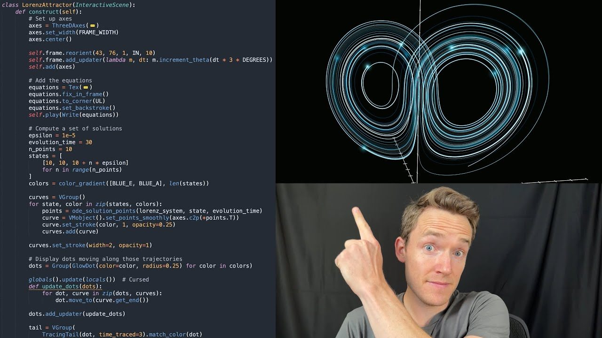 |
|  | <a href="https://github.com/heygen-com/hyperframes">hyperframes</a>★ 7.8 万 | 口播包装 产品发布片 知识科普 | <a href="https://github.com/heygen-com/hyperframes/blob/main/ADOPTERS.md">HeyGen、OpenAI、tldraw、清华 OpenMAIC 生产在用</a> <a href="https://www.xiaohongshu.com/explore/6a621ecf000000001002a05e?xsec_token=ABkwKrWh0Lh_J7Dwm_VSG9KZEy0xYKIATdzVUOPYgr5AY=&amp;xsec_source=pc_search">@Lulu的AI野路子 口播包装全流程</a> <a href="https://www.xiaohongshu.com/explore/6ad4b5b3000000000c00a3fd?xsec_token=ABvwejsjldc9bIaf2J9wNRhuaMxywcFxceXebeRD3J9q8=&amp;xsec_source=pc_search">@John Wayne 自家 App 短视频产线</a> | 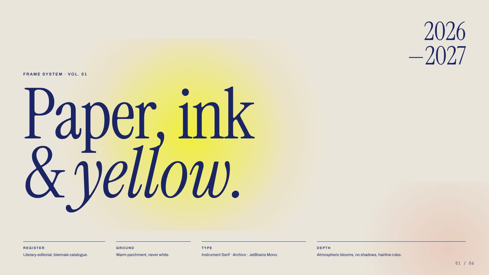 |
|  | <a href="https://github.com/remotion-dev/remotion">remotion</a>★ 7.0 万 | 动效设计 口播包装 产品发布片 | <a href="https://www.xiaohongshu.com/explore/6a673ecf0000000009034aa0?xsec_token=ABIi79alD0g3dxyIjEUCPSqTf_mwOKvhcM0TlAzSIFtT0=&amp;xsec_source=pc_search">@Nenly同学 测评片约 80% 包装</a> <a href="https://www.xiaohongshu.com/explore/6a8fee04000000002903ee1d?xsec_token=AB5yE1q7D9BLH98diPW2g3l92cG0L4gGKcSszcQAwPt-Y=&amp;xsec_source=pc_search">@timkochjar 零 AE 基础做 B2B 获客片</a> <a href="https://www.xiaohongshu.com/explore/6aa66348000000000b035453?xsec_token=ABf0NpDf4M1mXNOpdPx7b2wOzmoETfyGqoHrFu1BtAjHI=&amp;xsec_source=pc_search">@Skillabs 照参考片复刻宣传片</a> | 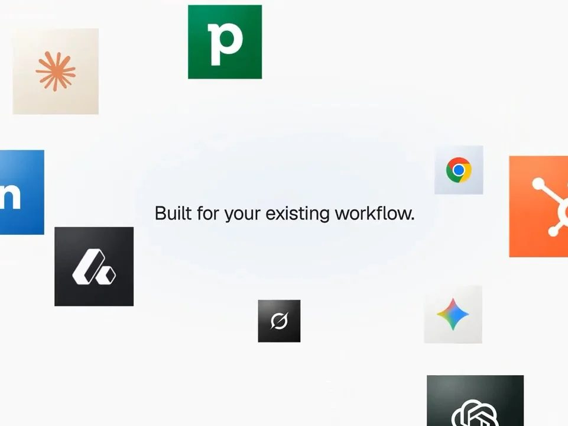 |
|  | <a href="https://github.com/ahujasid/mcp-for-blender">mcp-for-blender</a>★ 3.3 万 | 3D 场景 叙事短片 | <a href="https://www.xiaohongshu.com/explore/6ac4f89b000000001303e359?xsec_token=ABi2ZFMsFL6arlz_20OCLAz-MKwGuxXb8LB6k2X5JvPSg=&amp;xsec_source=pc_search">@泡椒肥汤圆 一万台 iPhone 卡点多米诺</a> <a href="https://www.xiaohongshu.com/explore/6ad9b245000000003103756d?xsec_token=ABRXR_NYOa-6BpvTR6R8HJptSOoBe8WJmwJ8goEiZ3gOY=&amp;xsec_source=pc_search">@PJaccetturo 用 Blender 预演做分镜</a> | 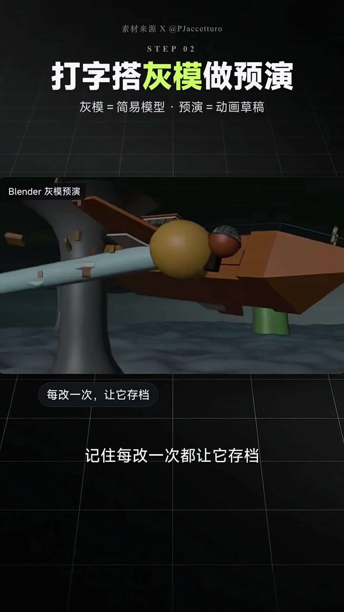 |
| 制作系统 Toolkit | <a href="https://github.com/calesthio/OpenMontage">OpenMontage</a>★ 7.6 万 | 知识科普 口播包装 叙事短片 | <a href="https://www.youtube.com/@OpenMontage">官方频道：每支片附完整提示词、流水线和成本</a> |  |
|  | <a href="https://github.com/hypit-ai/hypit">hypit</a>★ 2.8 万 | 品牌广告 | <a href="https://www.xiaohongshu.com/explore/6abb179f000000000b006dd5?xsec_token=ABV14hYFiIAGypBC1an5YMeyeKCOH5_klzDhsOURB7sLk=&amp;xsec_source=pc_search">@王温特 复刻实测：拆镜头逐镜重生成，一条广告改出多版</a> | 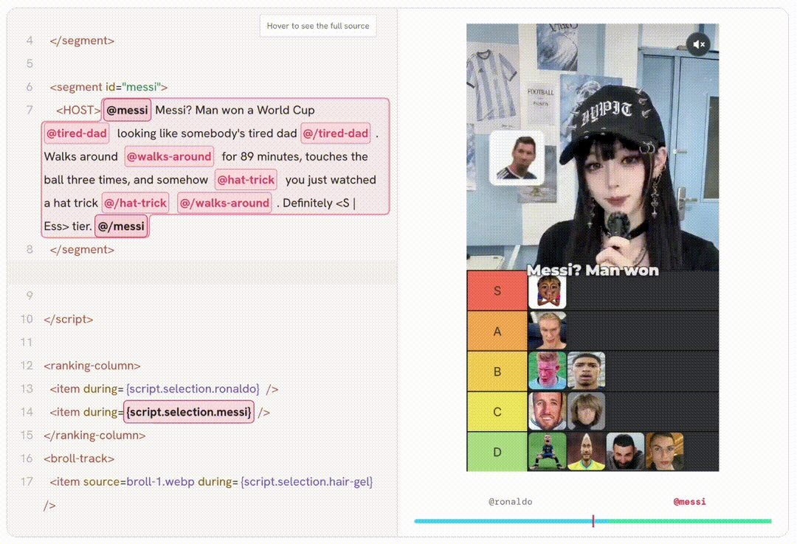 |
|  | <a href="https://github.com/digitalsamba/claude-code-video-toolkit">claude-code-video-toolkit</a>★ 2,426 | 产品发布片 知识科普 | <a href="https://demos.digitalsamba.com/video/ds-release-650.mp4">Digital Samba 公司做 sprint review、版本发布视频</a> | 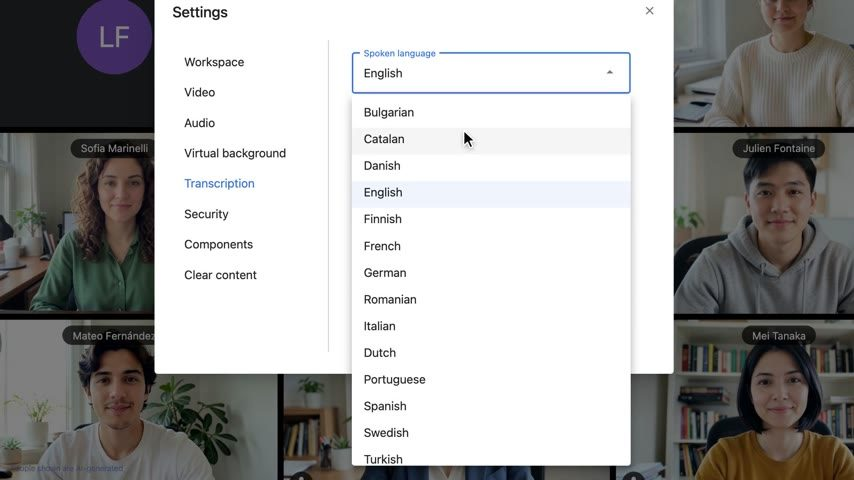 |
| 场景 Skill Skill | <a href="https://github.com/wheresryan22/anatomy">anatomy</a>★ 2.4 万 | 知识科普 | <a href="https://www.xiaohongshu.com/explore/6acc87c0000000001b023304?xsec_token=ABd7OrLMChB_2SVkYk_R2K57SNI95xQ1vS6KvPY1UwLMM=&amp;xsec_source=pc_search">@小师妹 Kiki 演示：机械表一例 Claude 独立做了近两小时</a> | 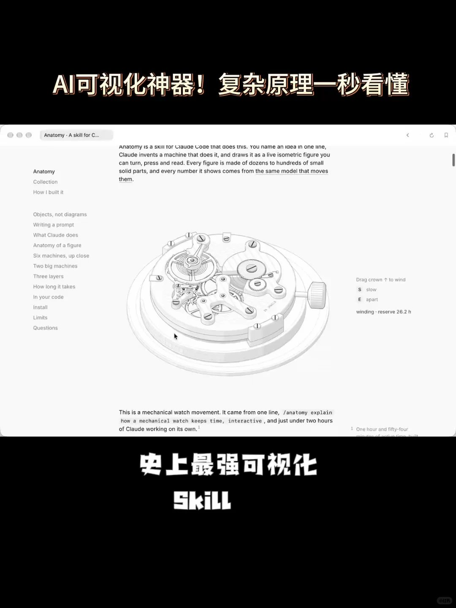 |
|  | <a href="https://github.com/Vincentwei1021/video-shotcraft">video-shotcraft</a>★ 1.6 万 | 产品发布片 | <a href="https://www.xiaohongshu.com/explore/6a6727c0000000000e0349a4?xsec_token=ABIi79alD0g3dxyIjEUCPSqWQc1H9w25vAkYPn1uIrCE0=&amp;xsec_source=pc_search">@KK研究员 用 Ink Press 模板给自家产品做宣传片</a> | 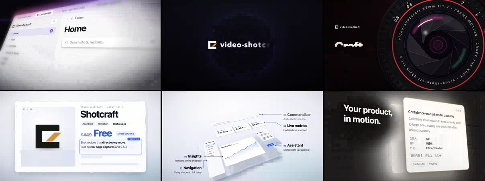 |
|  | <a href="https://github.com/lemomo-ai/lemo-opuscar">lemo-opuscar</a>★ 1.2 万 | 艺术风格 叙事短片 | <a href="https://lemomo-ai.github.io/lemo-opuscar/">作者的 OPUSCAR 98：98 部奥斯卡最佳影片各一种风格</a> <a href="https://www.xiaohongshu.com/explore/6ad6234e000000002900bcee?xsec_token=ABMdcVeXBGNL2R_8HNS5ABLnUcLfSlcAyk2yuQwjoNHRk=&amp;xsec_source=pc_search">小红书 7 篇笔记推荐，如 @赛博盆栽</a> | 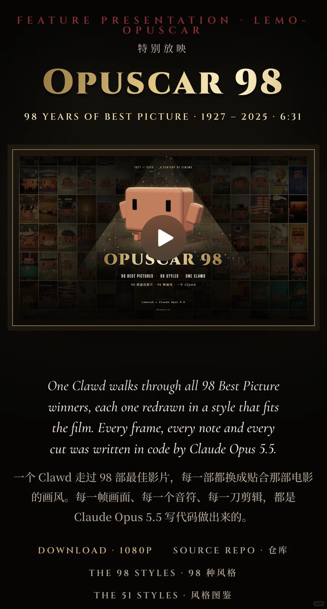 |
|  | <a href="https://github.com/remotion-dev/skills">skills</a>★ 6,237 | 品牌广告 动效设计 | <a href="https://www.xiaohongshu.com/explore/6977840a000000000903b31b?xsec_token=ABfsLRzxFha-8BNR_ONORN6nFTGNyeNonEh_T9LZZfEKE=&amp;xsec_source=pc_search">@秦楚zoro 一句话做汽车宣传片</a> <a href="https://agentskillshub.top/best/claude-video-skills/#test-results">同题实测 4.5 分钟出片</a> | 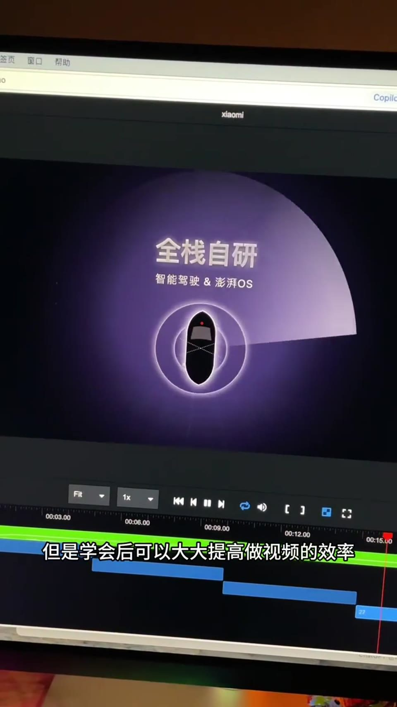 |
|  | <a href="https://github.com/alchaincyf/huashu-art-motion">huashu-art-motion</a>★ 6,099 | 艺术风格 叙事短片 知识科普 | <a href="https://github.com/nexu-io/open-design/tree/main/skills/huashu-art-motion">Open Design 的 motion-design skill 收录了适配版</a> <a href="https://www.xiaohongshu.com/explore/6ac31f610000000018007f57?xsec_token=ABbERw26uZlZ6JTW1qceYy8UjQ5EuKz09rjgDxRUVVt3o=&amp;xsec_source=pc_search">@花叔 名画穿越，23 种画风一镜到底</a> <a href="https://www.xiaohongshu.com/explore/6aca1618000000000a026371?xsec_token=ABIjxpLJeqS3QjjOpGf_WvMjxcrY3l2crejTSleXKCkUs=&amp;xsec_source=pc_search">@花叔 Clawd 的博物馆奇妙夜</a> | 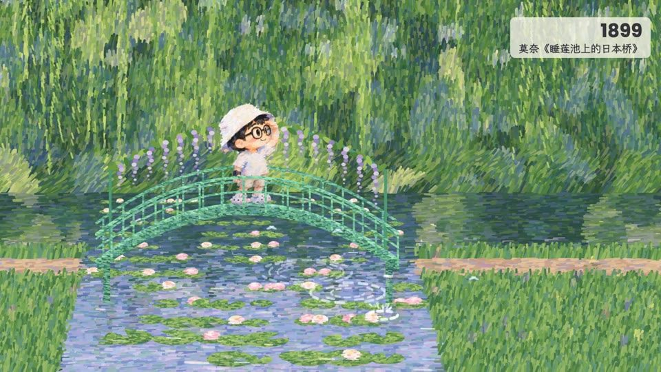 |
|  | <a href="https://github.com/feitangyuan/onetake">onetake</a>★ 3,679 | 产品发布片 动效设计 | <a href="https://www.xiaohongshu.com/explore/6ad89c2f0000000033008836?xsec_token=ABBpZEnzBaI6sS_Swpe8pNaantdB7V9tFz4QYx-jzjH7Y=&amp;xsec_source=pc_search">@泡椒肥汤圆 Clawd 当鼠标指针跳过 Dock</a> | 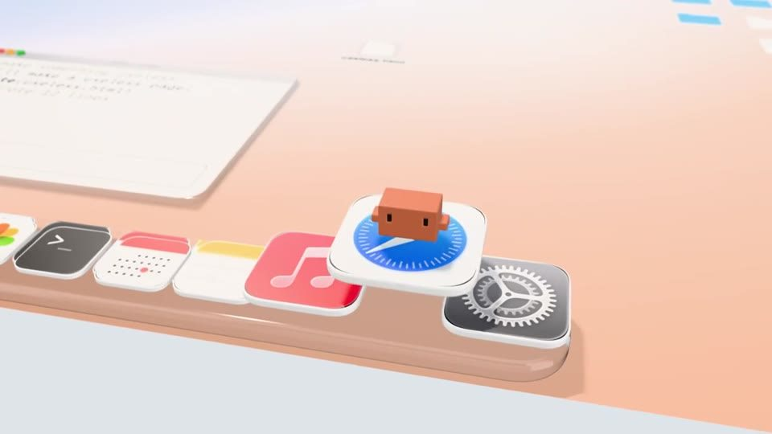 |
|  | <a href="https://github.com/nexu-io/motion-anything">motion-anything</a>★ 1,032 | 动效设计 | <a href="https://www.xiaohongshu.com/explore/6a5f7dc3000000000401cfa9?xsec_token=ABnDiLQny6YZYwquOoTpVgByw2DBlKsEe-q9ZBI_i-JSU=&amp;xsec_source=pc_search">@硅基视域 实测：描述感觉直出 HTML 动效</a> |  |
|  | <a href="https://github.com/HeyChengC/vibe-knowledge-film">vibe-knowledge-film</a>★ 985 | 知识科普 | <a href="https://www.xiaohongshu.com/explore/6ace3e590000000014001645?xsec_token=ABt_ez20GNFbMXYFSzlfaEe_pzWzoH_SXyxFcgsMl9Q5Y=&amp;xsec_source=pc_search">@六叔ultra 用 Codex 跑出知识大赏片</a> | 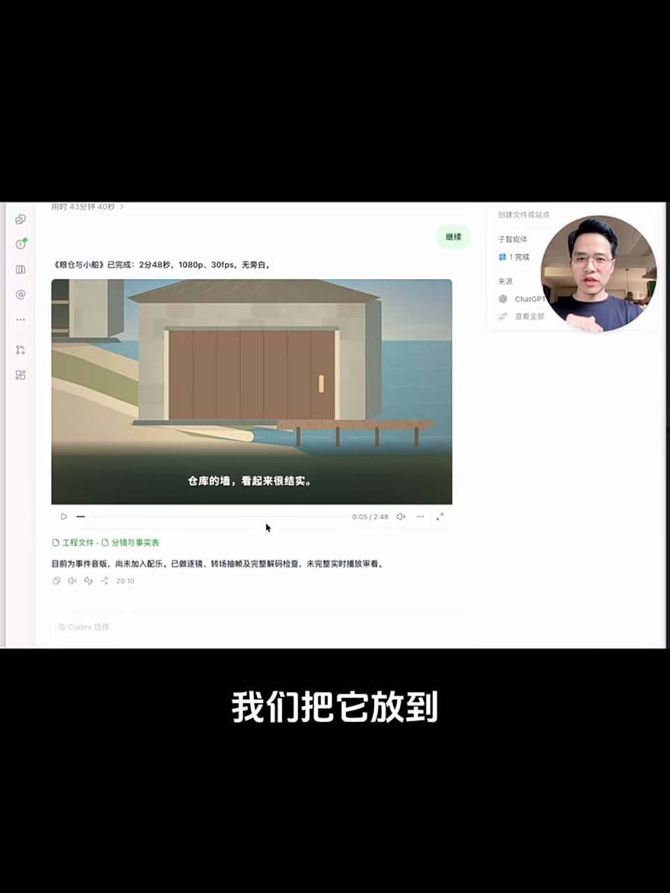 |
|  | <a href="https://github.com/op7418/guizang-product-video-skill">guizang-product-video-skill</a>★ 898 | 产品发布片 | <a href="https://github.com/op7418/guizang-product-video-skill">归藏给 CodePilot 做更新宣传片</a> |  |
|  | <a href="https://github.com/liyupi/ai-promo-video-maker">ai-promo-video-maker</a>★ 433 | 产品发布片 | <a href="https://github.com/liyupi/ai-promo-video-maker">程序员鱼皮给编程导航、面试鸭做宣传片</a> |  |
| 研究与模型 Research | 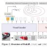<a href="https://github.com/HarleyCoops/Math-To-Manim">Math-To-Manim</a>★ 2,829 | 知识科普 | <a href="https://www.xiaohongshu.com/explore/6a0ebb5100000000070125ce?xsec_token=ABz4PA5yexiAvldmFUZ1AurqBIf4Bkhpw8iaVfzt95hew=&amp;xsec_source=pc_search">@机器之心 介绍：从概念倒推前置知识再排分镜</a> | 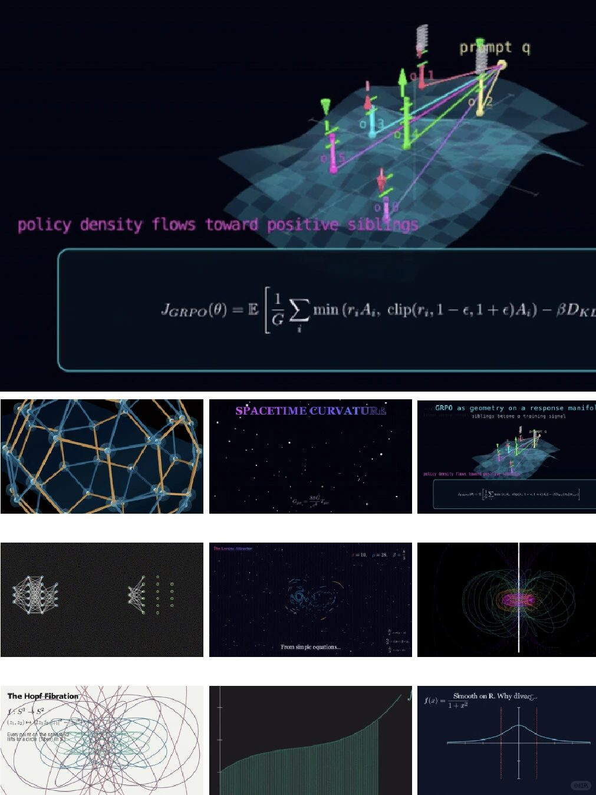 |
|  | <a href="https://github.com/showlab/Code2Video">Code2Video</a>★ 2,234 | 知识科普 | <a href="https://arxiv.org/abs/2510.01174">NUS Show Lab，ICML 2026</a> | 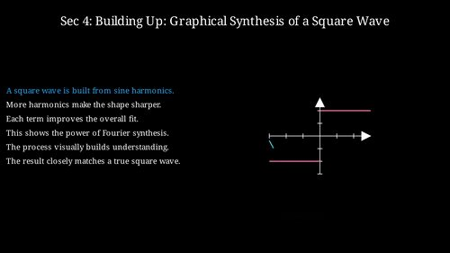 |
|  | <a href="https://github.com/OpenSenseNova/SenseNova-6.8-Code2Video">SenseNova-6.8-Code2Video</a>★ 365 | 动效设计 | <a href="https://www.xiaohongshu.com/explore/6ae1f01b0000000027021321?xsec_token=ABUrQj_5U43vWwBIj1tIacyHDNAPQ4_EYo8VvPA0bDHbw=&amp;xsec_source=pc_search">商汤官方发布，公开完整生成轨迹</a> <a href="https://www.xiaohongshu.com/explore/6ae30da0000000001f036350?xsec_token=ABA3paPlkebqcGglhZ-ecbvyYVsNV8IrH5WUxR0XCk_n0=&amp;xsec_source=pc_search">@Alpha Mao 接入 Coding Agent 实测</a> | 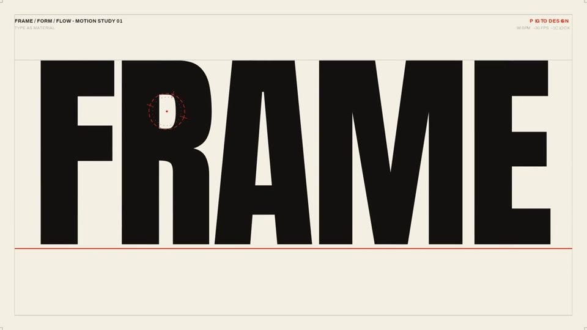 |
| 成片源码 Source | <a href="https://github.com/mexicat/pdoom-video">pdoom-video</a>★ 3,766 | 音乐视频 | <a href="https://www.youtube.com/watch?v=5EoO5413dBY">作者用 Claude Code 做的 MV，已被二创成引擎</a> <a href="https://www.xiaohongshu.com/explore/6acf3a77000000001803b8af?xsec_token=ABb7nMgHbRReQMf0cXrTtf5zJsXX1-MSpDTe23nKxu6tQ=&amp;xsec_source=pc_search">@造梦师手册 转载并拆出技术栈</a> | 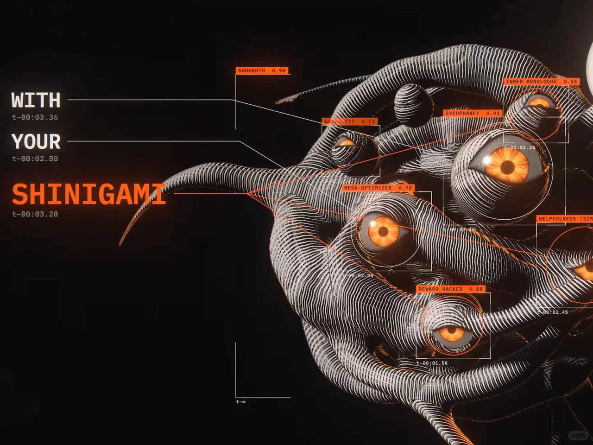 |
|  | <a href="https://github.com/JohnHeibel/PDoomVideo">PDoomVideo</a>★ 2,818 | 音乐视频 | <a href="https://github.com/JohnHeibel/PDoomVideo">仓库内容全部由模型生成，人只给两条方向</a> | 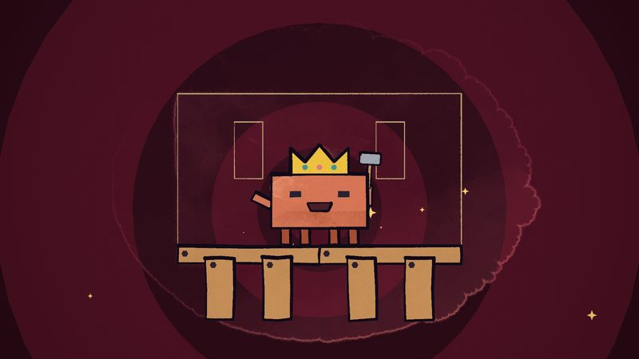 |
| 合集 Collection | <a href="https://github.com/yihui-dev/awesome-opus5-5-videos">awesome-opus5-5-videos</a>★ 1.3 万 | 全场景 | <a href="https://github.com/yihui-dev/awesome-opus5-5-videos">每条原片配一条 Skillry 复刻做对比</a> <a href="https://www.xiaohongshu.com/explore/6ac98396000000001c01da01?xsec_token=ABoa_p4OFDqaDMdC5Q2Yiq4aa0dFqYO01Zq511Ex9Uixw=&amp;xsec_source=pc_search">@程序员晓刘 收藏清单</a> | 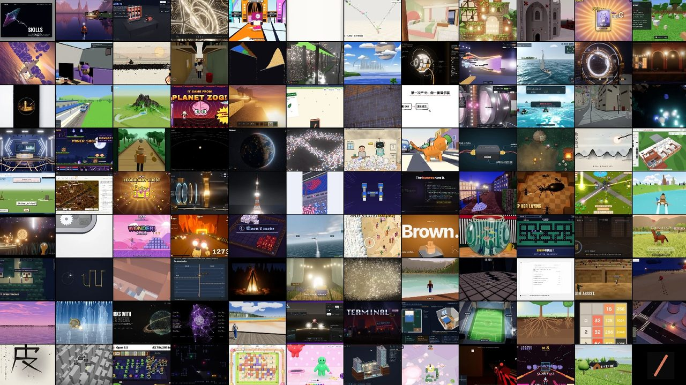 |
|  | <a href="https://github.com/zhuyansen/awesome-claude-video-skills">awesome-claude-video-skills</a>★ 1,513 | 全场景 | <a href="https://agentskillshub.top/best/claude-video-skills/#test-results">16 个 skill 同题实测：不装 skill 4.4 分钟也全部过检</a> | 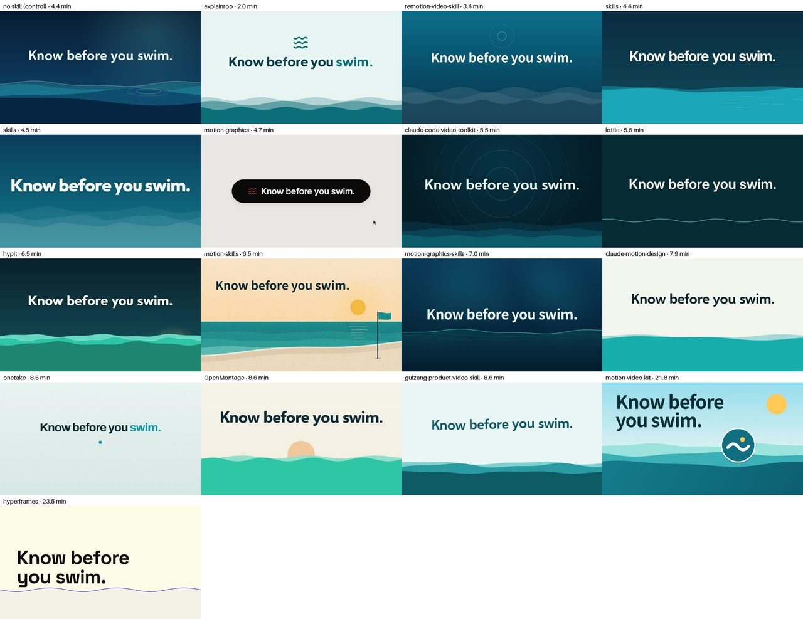 |
<!--/VIBE-PROJECTS-->

<nav class="toc view-toc"><h2>In This Section</h2><ul><li class="l2"><a href="#from-web-1">1 Every Frame Is A Pure Function Of Its Index</a></li><li class="l2"><a href="#from-web-2">2 The Deterministic Signals, Ranked</a></li><li class="l2"><a href="#from-web-3">3 Clock Freezing Gets You Close, Not To Zero</a></li></ul></nav>

## 1 Every Frame Is A Pure Function Of Its Index

Video 章只分两条路线，分界不在产物，在**确定性从哪里来**。

| | From Web | From Blender |
|---|---|---|
| 技术栈 | JS / Canvas / WebGL、p5.js、SVG / CSS、Lottie JSON、Remotion、Motion Canvas、ECharts | Blender、bpy、Cycles / EEVEE |
| 产出 | 逐帧截图合成 mp4、SVG / CSS 动画、Lottie JSON | .blend 工程加渲染序列 |
| 确定性抓手 | 冻结时钟、固定种子、固定 DPR、页面暴露 `setTime` 钩子、直读 canvas 像素 | 读 bpy 活状态：F-curve、修改器栈、物理缓存、BVH 测距 |
| 公开素材厚度 | 厚：11 条细讲、27 条管线、22 条基准 | 基本空白 |

From Web 这条路线能做硬判据，根子只有一条：**每一帧是帧号与代码的纯函数。** 同代码同帧永远渲染出相同像素，所以可逐帧复现、可写断言、可做回归。扩散视频没有这个性质。

核心发现：写代码出片对直接生成像素的优势是数量级的，不是百分比的。

用 Web 技术栈产出动画与视频：Canvas / WebGL / SVG / CSS / Lottie / Remotion / Motion Canvas。

| 发布日期 | 数据集 / 工作 | Download | Artifacts | Datasize | 影响力 | 特性 / 训练用途 | Example |
|---|---|---|---|--:|---|---|---|
| 2021/1 | R [Remotion](https://github.com/remotion-dev/remotion) Remotion AG | [GitHub](https://github.com/remotion-dev/remotion) | — | — | <a class="hf" href="https://github.com/remotion-dev/remotion"><svg class="hf-i" viewBox="0 0 24 24" fill="currentColor"><path d="M12 2.5l2.9 6 6.6.6-5 4.3 1.5 6.5L12 16.9 6 20.9l1.5-6.5-5-4.3 6.6-.6z"/></svg>63.4k</a> | 渲染器 | — |
| 2022/5 | M [Motion Canvas](https://github.com/motion-canvas/motion-canvas) Motion Canvas | [GitHub](https://github.com/motion-canvas/motion-canvas) | — | — | <a class="hf" href="https://github.com/motion-canvas/motion-canvas"><svg class="hf-i" viewBox="0 0 24 24" fill="currentColor"><path d="M12 2.5l2.9 6 6.6.6-5 4.3 1.5 6.5L12 16.9 6 20.9l1.5-6.5-5-4.3 6.6-.6z"/></svg>19.3k</a> | 渲染器 | — |
| 2024/2 |  [Keyframer](https://arxiv.org/abs/2402.06071) Apple | [GitHub](https://github.com/apple/ml-keyframer) | — | — | <a class="hf" href="https://github.com/apple/ml-keyframer"><svg class="hf-i" viewBox="0 0 24 24" fill="currentColor"><path d="M12 2.5l2.9 6 6.6.6-5 4.3 1.5 6.5L12 16.9 6 20.9l1.5-6.5-5-4.3 6.6-.6z"/></svg>76</a> | 系统 | — |
| 2025/2 |  [MoVer](https://arxiv.org/abs/2502.13372) Stanford | [GitHub](https://github.com/jama1017/MoVer) | — | — | <a class="hf" href="https://github.com/jama1017/MoVer"><svg class="hf-i" viewBox="0 0 24 24" fill="currentColor"><path d="M12 2.5l2.9 6 6.6.6-5 4.3 1.5 6.5L12 16.9 6 20.9l1.5-6.5-5-4.3 6.6-.6z"/></svg>39</a> | 系统 | — |
| 2025/10 | O [OpusAnimation](https://arxiv.org/abs/2510.03341) Opus AI Research | — | — | — | — | 系统 | — |
| 2025/10 |  [InternSVG](https://arxiv.org/abs/2510.11341) Shanghai AI Lab | [GitHub](https://github.com/hmwang2002/InternSVG) | — | — | <a class="hf" href="https://github.com/hmwang2002/InternSVG"><svg class="hf-i" viewBox="0 0 24 24" fill="currentColor"><path d="M12 2.5l2.9 6 6.6.6-5 4.3 1.5 6.5L12 16.9 6 20.9l1.5-6.5-5-4.3 6.6-.6z"/></svg>127</a> | 系统 | — |
| 2026/3 |  [OmniLottie](https://arxiv.org/abs/2603.02138) StepFun | [GitHub](https://github.com/OpenVGLab/OmniLottie) | — | — | <a class="hf" href="https://github.com/OpenVGLab/OmniLottie"><svg class="hf-i" viewBox="0 0 24 24" fill="currentColor"><path d="M12 2.5l2.9 6 6.6.6-5 4.3 1.5 6.5L12 16.9 6 20.9l1.5-6.5-5-4.3 6.6-.6z"/></svg>798</a> | 系统 | — |
| 2026/4 |  [LottieGPT](https://arxiv.org/abs/2604.11792) Tsinghua | [GitHub](https://github.com/yisuanwang/LottieGPT) | — | — | <a class="hf" href="https://github.com/yisuanwang/LottieGPT"><svg class="hf-i" viewBox="0 0 24 24" fill="currentColor"><path d="M12 2.5l2.9 6 6.6.6-5 4.3 1.5 6.5L12 16.9 6 20.9l1.5-6.5-5-4.3 6.6-.6z"/></svg>39</a> | 系统 | — |
| 2026/5 |  [VAnim](https://arxiv.org/abs/2605.01517) Beihang | — | — | — | — | 系统 | — |
| 2026/6 | H [HyperFrames](https://github.com/heygen-com/hyperframes) HeyGen | [GitHub](https://github.com/heygen-com/hyperframes) | — | — | <a class="hf" href="https://github.com/heygen-com/hyperframes"><svg class="hf-i" viewBox="0 0 24 24" fill="currentColor"><path d="M12 2.5l2.9 6 6.6.6-5 4.3 1.5 6.5L12 16.9 6 20.9l1.5-6.5-5-4.3 6.6-.6z"/></svg>61.2k</a> | 渲染器 | — |
| 2026/9 | L [Lemo-Opuscar](https://github.com/lemomo-ai/lemo-opuscar) lemomo-ai | [GitHub](https://github.com/lemomo-ai/lemo-opuscar) | — | — | <a class="hf" href="https://github.com/lemomo-ai/lemo-opuscar"><svg class="hf-i" viewBox="0 0 24 24" fill="currentColor"><path d="M12 2.5l2.9 6 6.6.6-5 4.3 1.5 6.5L12 16.9 6 20.9l1.5-6.5-5-4.3 6.6-.6z"/></svg>1.95k</a> | 系统 | — |
| 2026/9 | J [PDoomVideo](https://github.com/JohnHeibel/PDoomVideo) JohnHeibel | [GitHub](https://github.com/JohnHeibel/PDoomVideo) | — | — | <a class="hf" href="https://github.com/JohnHeibel/PDoomVideo"><svg class="hf-i" viewBox="0 0 24 24" fill="currentColor"><path d="M12 2.5l2.9 6 6.6.6-5 4.3 1.5 6.5L12 16.9 6 20.9l1.5-6.5-5-4.3 6.6-.6z"/></svg>2.0k</a> | 系统 | — |
| 2026/9 | H [Hypit](https://github.com/hypit-ai/hypit) hypit-ai | [GitHub](https://github.com/hypit-ai/hypit) | — | — | <a class="hf" href="https://github.com/hypit-ai/hypit"><svg class="hf-i" viewBox="0 0 24 24" fill="currentColor"><path d="M12 2.5l2.9 6 6.6.6-5 4.3 1.5 6.5L12 16.9 6 20.9l1.5-6.5-5-4.3 6.6-.6z"/></svg>21.4k</a> | 框架 | — |
| 2026/10 | A [huashu-art-motion](https://github.com/alchaincyf/huashu-art-motion) AlchainHust | [GitHub](https://github.com/alchaincyf/huashu-art-motion) | — | — | <a class="hf" href="https://github.com/alchaincyf/huashu-art-motion"><svg class="hf-i" viewBox="0 0 24 24" fill="currentColor"><path d="M12 2.5l2.9 6 6.6.6-5 4.3 1.5 6.5L12 16.9 6 20.9l1.5-6.5-5-4.3 6.6-.6z"/></svg>3.44k</a> | 系统 | — |

数据解读：

- **这条路线的基础设施已经成熟，但面向 agent 的只有一个。** Remotion 63.4k star、HyperFrames 61.2k star、Hypit 21.4k star、Motion Canvas 19.3k star。其中只有 HyperFrames 把「给 agent 自动化用」写进设计：命令行默认非交互、逐帧定位可复现。
- **结构化产物比整帧产物更容易验。** OmniLottie 把矢量动画做成自回归语言建模，用参数化 tokenizer 把 Lottie JSON 从约 2,562 token 压到 486（省 81%），Text-to-Lottie 成功率 88.3%；而直接让 GPT-5 吐裸 JSON 只有 12.7%。数据集 MMLottie-2M 约 200 万条，基准 MMLottieBench 900 条。注意这条的成功率在原文正文与附录间有 88.3% 与 97.3% 两个口径，引用要选一个并注明。
- **渲染反馈直接当 RL 奖励是有效的。** VAnim 在一棵持久 SVG DOM 树上只写变化的属性差分，用渲染感知 GRPO 训练，渲染成功率 100%，对照 Gemini 3 Pro 的 86.2%；语义对齐 0.281 对 Gemini 3 Pro 0.243、GPT-5.2 0.234。它的局限要一起说：主评测指标的编码器与训练奖励的编码器同属一族，有度量循环风险。
- **社区侧的高 star 项目是公开配对数据，不是基准。** Lemo-Opuscar（3,405 star，MIT 与 CC BY 4.0）是一个 Claude Code skill，51 种影片风格各配一条提示词与一支纯代码样片，并提供机读的风格清单；旗舰作把 1927 到 2025 年的 98 部奥斯卡最佳影片各做一种风格，片长 6 分 31 秒，98 种风格里 77 个 2D、4 个 2.5D、17 个 3D。作者明示风格是针对特定模型调的，换模型可能复现不出来。

## 2 The Deterministic Signals, Ranked

核心发现：这条路线的判据分三档，前两档可以当主指标，第三档只能当参考。

| 档 | 判据 | 怎么测 | 实测依据 |
|---|---|---|---|
| L1 二值 | 渲染或执行成功 | 代码能否无错渲染出帧 | VAnim 100% 对 86.2%；OmniLottie 88.3% 对裸 JSON 的 12.7% |
| L1 结构 | Lottie / SVG 结构回读 | 不渲染，直接断言图层数、关键帧时间戳、插值类型、时长、属性曲线 | OmniLottie 的产物本身就是 Lottie JSON；VAnim 的差分序列可逐帧回读 |
| L1 时序 | 时长与帧数符合 query | 读 mp4 的时长、帧率、帧数，对照任务规格 | 判据机制清楚，公开基准里没人做 |
| L1 几何 | 版式几何：重叠、出框 | 元素包围盒相交与越界 | 元素布局是全线普遍弱项，各模型 0.57 到 0.73 |
| L2 答题 | 看产物答题 | 先屏蔽知识得基线，再只看视频答题，取差值 | TeachQuiz：Opus 4.1 从 40.0 到 86.0，人类 97.1，Veo3 只有 2.5 |
| L3 参考 | VLM 看图打分 | VLM 给画面打分 | 不可当主指标。相邻方向实测与人评相关 −0.17 |
| L3 参考 | 嵌入相似度 | 渲染图与文本的余弦 | 等于没有闸。3JSBench 上三个模型通过率差 53 个百分点，SigLIP2 均值只差 0.004 |

**结构化产物是这条路线最该利用的优势。** Lottie JSON 与 SVG 差分都能不渲染就断言，成本比截图低两个数量级。ECharts 走声明式 option，option 对象同样可回读。

## 3 Clock Freezing Gets You Close, Not To Zero

逐帧确定性是路线的前提，但它不是免费的。本项目在无头 Chromium 上做过一组阶梯实测，页面用 rAF 加 `performance.now` 加 `Math.random`，不暴露任何钩子。

核心发现：只控时钟压不到逐字节一致，必须让页面暴露时间钩子。

| 方案 | 20 次截图的 md5 种类数 |
|---|---|
| 不控制 | 全不同 |
| 只装虚拟时钟 | 仍全不同，加载耗时 113 到 432 毫秒漏进了时间源 |
| 虚拟时钟加暂停、定长推进、种子化随机 | 20 次里 2 种，推测是动画帧相位差一帧 |
| 页面暴露 `setTime` 钩子并直读 canvas 像素 | 3 次全部逐字节一致 |

数据解读：时钟只能把方差压下来，压不到零。要逐字节复现，就得把「页面必须暴露时间与视角钩子」写进任务契约。对模型自由写的页面，verifier 只能用感知容差，不能比 hash。

配套的确定性闸门还有四条：固定视口与设备像素比、关掉字体 hinting 与次像素渲染、镜像里打包固定字体集并禁止页面联网拉字体、注入带种子的随机数。

吞吐上这条路线不需要 GPU。three.js 走无头 Chrome 加 SwiftShader 后端，8 视角转台约 0.2 秒；8 个浏览器各 8 个页面时稳态 14.3 任务每秒，p50 为 4.1 秒。

核心发现：RL rollout 的视觉验证不必上 GPU 沙箱。

| 配置 | 吞吐 | p50 |
|---|---|---|
| 1 浏览器 1 页 | 2.4 任务/s | 383 ms |
| 4 浏览器 8 页 | 11.6 任务/s | — |
| 8 浏览器 8 页 | 14.3 任务/s | 4.1 s |

一处本机实测到的限制：浏览器从 M139 起不显式开启就建不了 WebGL，本机实测不加对应 flag 直接没有 WebGL；而且**不要加 `--disable-gpu`**，它会把软件渲染后端一起关掉。

<nav class="toc view-toc"><h2>In This Section</h2><ul><li class="l2"><a href="#from-blender-1">1 This Line Is Empty, And That Is The Finding</a></li><li class="l2"><a href="#from-blender-2">2 Single-Frame Verifiers Are Blind To Animation</a></li><li class="l2"><a href="#from-blender-3">3 What To Borrow: BlenderWorld</a></li><li class="l2"><a href="#from-blender-4">4 The Gaps Worth Naming</a></li></ul></nav>

## 1 This Line Is Empty, And That Is The Finding

先把空白说清楚，再说该怎么填。

把本项目全部 Video 方向的调研素材按关键词全文检索一遍，「用 Blender 产出视频」这个任务**一条工作都没有**。

| 素材 | 命中 |
|---|---|
| Video 方向的 11 篇细讲 | 0，全是 Manim、SVG、Lottie、Beamer |
| 27 条视频类数据管线 | 0，无一条走 Blender |
| 22 条视频类 benchmark | 0 |
| 渲染器维度表 | Blender 没进表，列的是 Manim、SVG + CSS、Lottie、Beamer、HTML / Canvas、游戏引擎 |

对照 From Web 那条线的 11 篇细讲、27 条管线、22 条基准，差距不是厚薄之别，是有和无之别。

核心发现：代码出片的公开生态长在 Web 与 Manim 上，Blender 只长在 3D 创作上，两者没接起来。

所以这一节不综述现状，只回答一个问题：**如果要把这条线建起来，判据该落在哪里。** 答案和直觉相反——不在渲染出来的那些帧上。

## 2 Single-Frame Verifiers Are Blind To Animation

本项目在 Blender 侧做过一次变异测试，结论是整条线最确定的一个实测。

做法是取一个带动画的参考场景，把它的关键帧全部删掉（动画没了，静态造型分毫不动），然后让各类 verifier 去判这个被破坏的产物。

核心发现：把动画整个删掉，所有基于渲染图的判据都给满分。

| 判据 | 对「关键帧删光」的判定 |
|---|---|
| 单视角渲染比对 | 1.0000，完全没察觉 |
| 多视角渲染比对 | 1.0000，完全没察觉 |
| Chamfer 距离 | 1.0000，完全没察觉 |
| 体素 IoU | 1.0000，完全没察觉 |
| VLM 看图判定 | 0/8，八次全漏 |
| **读 F-curve 断言** | **抓到** |

数据解读：几何没变，所以几何判据全部失明；每一帧单独看都对，所以截图判据和 VLM 全部失明。动画缺陷只能从**活状态**里读出来，不能从产物的任何一张图里读出来。

这条结论决定了 From Blender 的 verifier 形态：**判据要读 bpy 的运行时状态，不读渲染结果。**

同向的证据来自动态场景方向的 4DBuildBench。它把规则分四族：结构、按 BVH 测距的几何、软规则、以及计划与状态比对（含运动时序）。配套两个读状态的工具——一个读修改器栈、物理缓存与动画曲线，一个按阶段逐帧采样运动。

它量出来的差距是这样的：运动通过率 0.87 对 0.67，状态通过率 0.89 对 0.70，而**同一批产物的 VLM 评分只差 0.04**。又一次同一个现象。

这条线还有两条防作弊规则值得照抄，它们封的是「用关键帧伪造物理」这类捷径：

- 求解器驱动的对象不许有密集关键帧。
- 布料与软体不许用形状键驱动运动。

## 3 What To Borrow: BlenderWorld

公开世界里唯一能撑起这条线的素材是 [BlenderWorld](https://github.com/QwenLM/BlenderWorld)（2026-10-14 建仓，MIT，136 star，[HF 数据集](https://huggingface.co/datasets/Qwen/BlenderWorld) 617 MB、上月下载 2,422，均实查于 2026-10-19）。它只有仓库里自托管的技术报告，没有 arXiv 条目，所以引用要指向仓库而不是论文编号。

必须先说清它不是什么：**它是 Blender 3D 创作基准，不是视频生成管线。** 动画只是它 9 个 domain 里的一个。但它的判定设计是目前最完整的一套，值得整体借。

| 构件 | 做法 |
|---|---|
| 规模 | 223 个任务、2,651 条二值评分项、9 个 category / 22 个 subcategory |
| 模态 | 78 纯文本、130 图加文、15 视频加文，59 个任务带尺寸、材质、相机规格附件 |
| 渲染 agent | 从实际场景自选 8 个自适应视角，Cycles 1024×1024 / 64 samples，每视角最多 2 次纠正重渲，第 4 次直接拒。允许改相机、取景、裁剪面，但几何、材质、贴图、可见性、灯光、动画、色彩管理必须不变 |
| 场景审查 agent | 用 Blender 工具读结构，处理结构类判据。**硬门控：结构判据缺失直接判评测失败，不允许用视觉猜测顶替** |
| VLM 打分模型 | 只处理渲染类判据与 8 个整体维度，每条判据只路由一次 |
| 打分 | Rubric 分按权重加权通过率，Dimension 分取 8 个维度均值，最终分二者各半 |
| 复现 | 版本钉死，版本不匹配直接中止；计划文件钉住代码、任务、评分项与提交的哈希 |

它的三条设计决定最值得抄：

1. **结构判据与渲染判据分开路由，结构那一路设硬门控。** 读不到结构就算评测失败，而不是退回让 VLM 看图猜。这正是上一节那个变异测试要求的形态。
2. **渲染 agent 的自由度被精确限定。** 可以调相机找角度，但不许动任何会改变产物的属性。否则「换个角度看不见缺陷」就成了捷径。
3. **缺失与失败的提交记 0 分且留在分母里。** 不交卷不等于不计分。

榜单数据（2026-10-19）给了两个有用的读数：

| 模型 | 最终分 | Full pass | 成本 |
|---|---|---|---|
| GPT-6 Astra | 79.9 | 42.2% | 45.6 轮 / 84.5K token |
| Claude Opus 5 | 73.0 | 25.6% | 158 轮 / 241K token |
| GPT-5.6 Sol | 67.7 | — | — |
| Qwen3.8-Max | 60.6 | — | — |
| MiniMax-M3 | 31.8 | — | — |

数据解读：

- **最强模型也只在不到一半的任务上通过全部判据（42.2%）。** 二值评分项一旦铺到 2,651 条，分数就不会虚高，量程自然张开。这正是前面 Overview 讲的「判据确定且量程在中段」。
- **拿到相近分数的代价差 3 倍。** Astra 45.6 轮、84.5K token 拿 79.9，Opus 5 要 158 轮、241K token 才拿 73.0。报分不带轮数与 token，比较就没有意义。
- **Astra 最弱的两格正好是动态维度**：Art & Animation 76.8、Rendering & Simulation 71.1。这是 From Blender 这条线真正的入场点。

人类校验这套判定的一致率是 82.99%（147 对里一致 122 对）。这个数要和前面那些 VLM judge 的数字分开看：它测的是**整套三角色判定与人的一致性**，不是单个 VLM 看图打分的可靠性。

## 4 The Gaps Worth Naming

这条线要建起来，下面几格现在是空的，没有现成答案可抄。

| 缺口 | 现状 |
|---|---|
| Blender 产出视频的公开管线 | 0 条 |
| 对应的公开 benchmark | 0 条 |
| Blender 渲染的逐字节确定性 | 没做过实验。Web 侧做过，页面暴露时间钩子后 3 次逐字节一致 |
| 动画序列渲染的吞吐与成本 | 无数字。Web 侧有：8 浏览器 8 页 14.3 任务每秒 |
| Blender 到 mp4 的具体管线 | 素材 0 条 |

无头可行性是确定的：Linux 下后台模式有 headless 后端，系统装的 4.0 与 pip 装的 4.5 都能在无 GPU 机器上跑 Workbench、EEVEE 与 Cycles；成片的确定性靠固定帧率与直接写出影片来保。一个坑要注意：纯 headless 模式下读不回贴图，也就不能截图。

所以 From Blender 的建设顺序是清楚的：**先把读活状态的 verifier 建起来（F-curve、修改器栈、物理缓存、运动采样），再去管渲染与出片。** 反过来做，就会得到一套对动画完全失明的判据。

