# Web (2D)

<style>
/* 窄屏：表格独立滚动，否则宽表会被截掉 */
@media (max-width:720px){
  .doc table{display:block;overflow-x:auto}
}
</style>

<div class="view-switch"></div>

<div class="env-view" data-view="bench" data-label="Benchmark" data-desc="各家模型在 Web 公开基准上的成绩，厂商自报与榜单排名并列。">

<nav class="toc view-toc"><h2>In This Section</h2><ul><li class="l2"><a href="#bench-1"><span class="num">1</span> Lab Reports</a></li></ul></nav>

## <a id="bench-1"></a>1 Lab Reports

<table class="frontier"><thead><tr><th>Benchmark</th><th>模型</th><th>分数</th><th>来源</th></tr></thead><tbody><tr><td class="bench" rowspan="5"><a href="https://arena.ai/leaderboard/code/webdev">Code Arena · WebDev</a></td><td>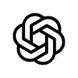 GPT-6 Astra</td><td>1793（1st）</td><td><a href="https://arena.ai/leaderboard/code/webdev">Benchmark</a></td></tr><tr><td> Claude Opus 5</td><td>1691（3rd）</td><td><a href="https://arena.ai/leaderboard/code/webdev">Benchmark</a></td></tr><tr><td> Gemini 3.7 Flash</td><td>1588</td><td><a href="https://deepmind.google/models/model-cards/gemini-3-7-flash/">Blog</a></td></tr><tr><td> Kimi K3</td><td>1678（1st，2026-07-23）</td><td><a href="https://github.com/MoonshotAI/Kimi-K3/blob/main/k3_tech_report.pdf">Blog</a></td></tr><tr><td> Seed2.1 Pro</td><td>1539（8th）</td><td><a href="https://lf3-static.bytednsdoc.com/obj/eden-cn/lapzild-tss/ljhwZthlaukjlkulzlp/seed2.1/Seed2_1_Model_Card.pdf">Blog</a></td></tr><tr><td class="bench" rowspan="2"><a href="https://www.vals.ai/benchmarks/vibe-code">Vibe Code Bench v1.1</a></td><td> GPT-6 Astra</td><td>89.59%</td><td><a href="https://www.vals.ai/benchmarks/vibe-code">Benchmark</a></td></tr><tr><td> Claude Fable 5</td><td>90.35%（1st）</td><td><a href="https://www.vals.ai/benchmarks/vibe-code">Benchmark</a></td></tr><tr><td class="bench" rowspan="2"><a href="https://arxiv.org/abs/2603.26648">Vision2Web</a></td><td> GLM-5.3-Flash</td><td>77.8</td><td><a href="https://z.ai/blog/glm-5.3-flash">Blog</a></td></tr><tr><td> Qwen3.8-Max</td><td>69.0</td><td><a href="https://qwen.ai/blog?id=qwen3.8">Blog</a></td></tr><tr><td class="bench" rowspan="1"><a href="https://arxiv.org/abs/2410.03859">SWE-bench Multimodal</a></td><td> Claude Opus 5</td><td>59.4%</td><td><a href="https://www.anthropic.com/claude-opus-5-system-card">Blog</a></td></tr><tr><td class="bench" rowspan="1"><a href="https://arxiv.org/abs/2403.03163">Design2Code</a> / Flame-VLM-Code</td><td> GLM-5V-Turbo</td><td>94.8 / 93.8</td><td><a href="https://docs.z.ai/guides/vlm/glm-5v-turbo">Blog</a></td></tr><tr><td class="bench" rowspan="1"><a href="https://artifactsbenchmark.github.io/leaderboard.html">ArtifactsBench</a></td><td> Seed2.0 Pro</td><td>66.6</td><td><a href="https://arxiv.org/abs/2607.00248">Blog</a></td></tr><tr><td class="bench" rowspan="1">Internal Design Tasks<span class="self-tag">自建</span></td><td> GPT-6 Astra</td><td>50.0%</td><td><a href="https://openai.com/index/gpt-6-astra/">Blog</a></td></tr><tr><td class="bench" rowspan="1">Kimi Webdev Bench<span class="self-tag">自建</span></td><td> Kimi K3</td><td>胜 58.6 / 平 13.8 / 负 27.6</td><td><a href="https://github.com/MoonshotAI/Kimi-K3/blob/main/k3_tech_report.pdf">Blog</a></td></tr><tr><td class="bench" rowspan="1">CC-Frontend（CC-Bench-V2）<span class="self-tag">自建</span></td><td> GLM-5V-Turbo</td><td>68.4</td><td><a href="https://docs.z.ai/guides/vlm/glm-5v-turbo">Blog</a></td></tr><tr><td class="bench" rowspan="1">QwenReactBench / QwenSVGBench<span class="self-tag">自建</span></td><td> Qwen3.8-Max</td><td>1724 / 1713</td><td><a href="https://qwen.ai/blog?id=qwen3.8">Blog</a></td></tr><tr><td class="bench" rowspan="1">Trae Web Bench / Trae Artifacts<span class="self-tag">自建</span></td><td> Seed2.1 Pro</td><td>78.4 / 51.0</td><td><a href="https://lf3-static.bytednsdoc.com/obj/eden-cn/lapzild-tss/ljhwZthlaukjlkulzlp/seed2.1/Seed2_1_Model_Card.pdf">Blog</a></td></tr><tr><td class="bench" rowspan="1">VIBE-V2 / SVG-Bench<span class="self-tag">自建</span></td><td> MiniMax-M3</td><td>50.1 / 63.7</td><td><a href="https://www.minimax.io/blog/minimax-m3">Blog</a></td></tr><tr><td class="bench" rowspan="2">未报告相关分数</td><td> DeepSeek-V4.1-Flash</td><td>未报告</td><td><a href="https://huggingface.co/deepseek-ai/DeepSeek-V4.1-Flash">Blog</a></td></tr><tr><td> Hy4 preview</td><td>未报告</td><td><a href="https://huggingface.co/tencent/Hy4-preview">Blog</a></td></tr></tbody></table>

</div>

<div class="env-view" data-view="opendata" data-label="Open Data" data-desc="按产物技术栈盘点公开的数据管线与 benchmark：35 条管线压在截图转代码这一格，多文件工程只有 2 条。">

<nav class="toc view-toc"><h2>In This Section</h2><ul><li class="l2"><a href="#opendata-1"><span class="num">1</span> Inventory</a></li><li class="l2"><a href="#opendata-2"><span class="num">2</span> Timeline</a></li><li class="l2"><a href="#opendata-3"><span class="num">3</span> Gaps</a></li><li class="l2"><a href="#opendata-4"><span class="num">4</span> How To Choose</a></li></ul></nav>

## <a id="opendata-1"></a>1 Inventory

Web 的公开数据按产物技术栈分四类，不按输入模态分：html 与 webdev 是主力，ppt 与 manim 够用即可。公开的数据管线与 benchmark 常出自同一篇论文，因此并进一张表：供给几乎全压在单文件「截图 → 代码」，多文件工程只有 2 条管线。

| 技术栈 | 产物 | 验收能做到哪一步 | 数据管线 | Benchmark | 这意味着什么 |
|---|---|---|---|---|---|
| html（主力） | 单文件 HTML、SVG、React 组件、图表绘图代码、TikZ | 渲染一次就能比对，DOM 盒模型与逐值回读都可用 | 35 | 32 | 供给充足，但形态高度同质 |
| webdev（主力） | 多文件可运行 Web App | 要起服务、要 agent 操作，验收依赖运行时状态 | 2 | 13 | 题有人出，数据没人放——这正是真实生产的形态 |
| ppt（辅助） | 幻灯片、海报、演讲视频 | 产物是版面对象树，可逐对象回读 | 5 | 5 | 够做辅助能力，不够做主力 |
| manim（辅助） | 代码驱动的讲解动画 | 产物是视频，判据只能落在渲染成功、时长与关键帧 | 8 | 5 | 管线里有三条是渲染库本身 |

<div class="tbl-tabs">

<div class="tbl-pane" data-label="HTML" data-count="67">

<p class="tbl-desc">单文件产物：截图 / 设计稿 / 草图转 HTML、SVG、React 组件、图表绘图代码。渲染一次就能比对，判据最成熟。 本组 32 条 benchmark、35 条数据管线，按发布日期混排。</p>

| 发布日期 | 名称 | 类型 | Download | 形态 | 规模 / 题量 | 影响力 | 说明 | Example |
|---|---|---|---|---|---|---|---|---|
| 2017/5/22 |  [pix2code](https://arxiv.org/abs/1705.07962) <span class="org">UIzard</span> | 数据集 | [GitHub](https://github.com/tonybeltramelli/pix2code) | GUI 截图→DSL | 3 平台合成 GUI | <a class="hf" href="https://github.com/tonybeltramelli/pix2code"><span class="hf-b hf-st" title="GitHub stars"><svg class="hf-i" viewBox="0 0 24 24" fill="currentColor"><path d="M12 2.5l2.9 6 6.6.6-5 4.3 1.5 6.5L12 16.9 6 20.9l1.5-6.5-5-4.3 6.6-.6z"/></svg>12.0k</span></a> | **最早的配对数据**：随机合成 DSL 再渲染出 GUI，截图与代码天然对齐 | <span class="sg-tile ex-tile" role="button" tabindex="0" data-sg="sg-pix2code--opendata"><span class="sg-poster">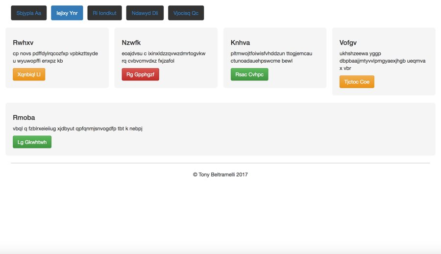</span><span class="sg-meta"><span class="deep-title sg-name"> pix2code <span class="org">UIzard</span></span><span class="sg-sub"><span class="hf"><span class="hf-b hf-st" title="GitHub stars"><svg class="hf-i" viewBox="0 0 24 24" fill="currentColor"><path d="M12 2.5l2.9 6 6.6.6-5 4.3 1.5 6.5L12 16.9 6 20.9l1.5-6.5-5-4.3 6.6-.6z"/></svg>12.0k</span></span><span class=sg-n>3 条样例</span></span></span></span> |
| 2023/9/30 |  [AutomaTikZ / DaTikZ](https://arxiv.org/abs/2310.00367) <span class="org">University of Hamburg</span> | 数据集 | [HF](https://huggingface.co/datasets/nllg/datikz) | caption↔TikZ | 120K | <a class="hf" href="https://huggingface.co/datasets/nllg/datikz"><span class="hf-b hf-dl" title="downloads"><svg class="hf-i" viewBox="0 0 24 24" fill="none" stroke="currentColor" stroke-width="2.2" stroke-linecap="round" stroke-linejoin="round"><path d="M12 3v11"/><path d="M8 11l4 4 4-4"/><path d="M4 20h16"/></svg>518</span><span class="hf-b hf-lk" title="likes"><svg class="hf-i" viewBox="0 0 24 24" fill="currentColor"><path d="M12 21C7 17.5 3 14 3 9.5 3 7 5 5 7.5 5 9.2 5 10.7 6 12 7.6 13.3 6 14.8 5 16.5 5 19 5 21 7 21 9.5 21 14 17 17.5 12 21z"/></svg>7</span></a> | **真实 TikZ 语料**：从 arXiv、TeX.SE 收集人写 TikZ，并对齐 caption | — |
| 2023/10 | <span class="org-mark" title="U. Mannheim">U</span> [AutomaTikZ](https://arxiv.org/abs/2310.00367) <span class="org">U. Mannheim</span> | Benchmark | [GitHub](https://github.com/potamides/AutomaTikZ) | caption→TikZ | DaTikZ 120k | <a class="hf" href="https://github.com/potamides/AutomaTikZ"><span class="hf-b hf-st" title="GitHub stars"><svg class="hf-i" viewBox="0 0 24 24" fill="currentColor"><path d="M12 2.5l2.9 6 6.6.6-5 4.3 1.5 6.5L12 16.9 6 20.9l1.5-6.5-5-4.3 6.6-.6z"/></svg>115</span></a> | **图即代码（静态）**：科学矢量图/LaTeX 代码合成，CLiMA 相似度超 GPT-4 | — |
| 2023/12/17 |  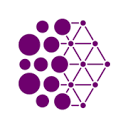 [SVG-Bench（StarVector）](https://arxiv.org/abs/2312.11556) <span class="org">ServiceNow Research · Mila</span> | Benchmark | [GitHub](https://github.com/joanrod/star-vector) | 图像/文本→SVG（SVG） | 10 数据集 | <a class="hf" href="https://github.com/joanrod/star-vector"><span class="hf-b hf-st" title="GitHub stars"><svg class="hf-i" viewBox="0 0 24 24" fill="currentColor"><path d="M12 2.5l2.9 6 6.6.6-5 4.3 1.5 6.5L12 16.9 6 20.9l1.5-6.5-5-4.3 6.6-.6z"/></svg>4.6k</span></a> | **SVG 矢量化生成**：图像矢量化、文本转 SVG、图表生成三任务 | — |
| 2023/12/17 |   [StarVector / SVG-Stack](https://arxiv.org/abs/2312.11556) <span class="org">ServiceNow Research · Mila</span> | 数据集 | [HF](https://huggingface.co/datasets/starvector/svg-stack) | 图像/文本→SVG | 2M | <a class="hf" href="https://huggingface.co/datasets/starvector/svg-stack"><span class="hf-b hf-dl" title="downloads"><svg class="hf-i" viewBox="0 0 24 24" fill="none" stroke="currentColor" stroke-width="2.2" stroke-linecap="round" stroke-linejoin="round"><path d="M12 3v11"/><path d="M8 11l4 4 4-4"/><path d="M4 20h16"/></svg>1.0k</span><span class="hf-b hf-lk" title="likes"><svg class="hf-i" viewBox="0 0 24 24" fill="currentColor"><path d="M12 21C7 17.5 3 14 3 9.5 3 7 5 5 7.5 5 9.2 5 10.7 6 12 7.6 13.3 6 14.8 5 16.5 5 19 5 21 7 21 9.5 21 14 17 17.5 12 21z"/></svg>36</span></a> | **大规模 SVG 预训练料**：从 The Stack 抽 SVG 清洗渲染，得到图-码配对 | — |
| 2024/2/19 |  [ChartX](https://arxiv.org/abs/2402.12185) <span class="org">Shanghai AI Lab</span> | Benchmark | [HF](https://huggingface.co/datasets/InternScience/ChartX) | 图表→绘图代码（Python (matplotlib)） | 48K | <a class="hf" href="https://github.com/InternScience/ChartVLM"><span class="hf-b hf-st" title="GitHub stars"><svg class="hf-i" viewBox="0 0 24 24" fill="currentColor"><path d="M12 2.5l2.9 6 6.6.6-5 4.3 1.5 6.5L12 16.9 6 20.9l1.5-6.5-5-4.3 6.6-.6z"/></svg>260</span></a> | **图表多任务推理**：含重绘代码任务，图/CSV/代码/描述四模态 | — |
| 2024/3/5 |   [Design2Code](https://arxiv.org/abs/2403.03163) <span class="org">Google DeepMind · Stanford</span> | Benchmark | [HF](https://huggingface.co/datasets/SALT-NLP/Design2Code) | 截图→HTML（HTML / CSS） | 484 | <a class="hf" href="https://github.com/NoviScl/Design2Code"><span class="hf-b hf-st" title="GitHub stars"><svg class="hf-i" viewBox="0 0 24 24" fill="currentColor"><path d="M12 2.5l2.9 6 6.6.6-5 4.3 1.5 6.5L12 16.9 6 20.9l1.5-6.5-5-4.3 6.6-.6z"/></svg>600</span></a> | **真实网页还原**：真实网页截图转 HTML，考元素召回与布局 | <span class="sg-tile ex-tile" role="button" tabindex="0" data-sg="sg-design2code--opendata"><span class="sg-poster">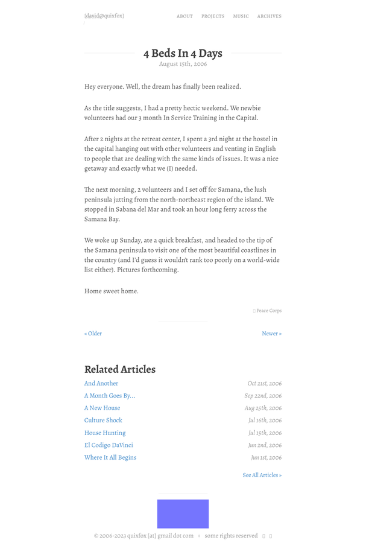</span><span class="sg-meta"><span class="deep-title sg-name">  Design2Code <span class="org">Google DeepMind · Stanford</span></span><span class="sg-sub"><span class="hf"><span class="hf-b hf-st" title="GitHub stars"><svg class="hf-i" viewBox="0 0 24 24" fill="currentColor"><path d="M12 2.5l2.9 6 6.6.6-5 4.3 1.5 6.5L12 16.9 6 20.9l1.5-6.5-5-4.3 6.6-.6z"/></svg>600</span></span><span class=sg-n>3 条样例</span></span></span></span> |
| 2024/3/5 |   [Design2Code](https://arxiv.org/abs/2403.03163) <span class="org">Google DeepMind · Stanford</span> | 数据集 | [HF](https://huggingface.co/datasets/SALT-NLP/Design2Code) | 截图→HTML | 训练 165K + 测试 484 | <a class="hf" href="https://huggingface.co/datasets/SALT-NLP/Design2Code"><span class="hf-b hf-dl" title="downloads"><svg class="hf-i" viewBox="0 0 24 24" fill="none" stroke="currentColor" stroke-width="2.2" stroke-linecap="round" stroke-linejoin="round"><path d="M12 3v11"/><path d="M8 11l4 4 4-4"/><path d="M4 20h16"/></svg>1.8k</span><span class="hf-b hf-lk" title="likes"><svg class="hf-i" viewBox="0 0 24 24" fill="currentColor"><path d="M12 21C7 17.5 3 14 3 9.5 3 7 5 5 7.5 5 9.2 5 10.7 6 12 7.6 13.3 6 14.8 5 16.5 5 19 5 21 7 21 9.5 21 14 17 17.5 12 21z"/></svg>22</span></a> | **WebSight 子集微调**：训练取 WebSight 20%，真实网页只当测试集 | <span class="sg-tile ex-tile" role="button" tabindex="0" data-sg="sg-design2code--opendata"><span class="sg-poster"></span><span class="sg-meta"><span class="deep-title sg-name">  Design2Code <span class="org">Google DeepMind · Stanford</span></span><span class="sg-sub"><span class="hf"><span class="hf-b hf-dl" title="downloads"><svg class="hf-i" viewBox="0 0 24 24" fill="none" stroke="currentColor" stroke-width="2.2" stroke-linecap="round" stroke-linejoin="round"><path d="M12 3v11"/><path d="M8 11l4 4 4-4"/><path d="M4 20h16"/></svg>1.8k</span><span class="hf-b hf-lk" title="likes"><svg class="hf-i" viewBox="0 0 24 24" fill="currentColor"><path d="M12 21C7 17.5 3 14 3 9.5 3 7 5 5 7.5 5 9.2 5 10.7 6 12 7.6 13.3 6 14.8 5 16.5 5 19 5 21 7 21 9.5 21 14 17 17.5 12 21z"/></svg>22</span></span><span class=sg-n>3 条样例</span></span></span></span> |
| 2024/3/14 |  [WebSight](https://arxiv.org/abs/2403.09029) <span class="org">HuggingFace</span> | 数据集 | [HF](https://huggingface.co/datasets/HuggingFaceM4/WebSight) | 截图→HTML 对 | 2M | <a class="hf" href="https://huggingface.co/datasets/HuggingFaceM4/WebSight"><span class="hf-b hf-dl" title="downloads"><svg class="hf-i" viewBox="0 0 24 24" fill="none" stroke="currentColor" stroke-width="2.2" stroke-linecap="round" stroke-linejoin="round"><path d="M12 3v11"/><path d="M8 11l4 4 4-4"/><path d="M4 20h16"/></svg>18.1k</span><span class="hf-b hf-lk" title="likes"><svg class="hf-i" viewBox="0 0 24 24" fill="currentColor"><path d="M12 21C7 17.5 3 14 3 9.5 3 7 5 5 7.5 5 9.2 5 10.7 6 12 7.6 13.3 6 14.8 5 16.5 5 19 5 21 7 21 9.5 21 14 17 17.5 12 21z"/></svg>400</span></a> | **纯合成 SFT 底料**：LLM 写主题与 Tailwind HTML 再渲染截图，量大干净 | <span class="sg-tile ex-tile" role="button" tabindex="0" data-sg="sg-websight--opendata"><span class="sg-poster">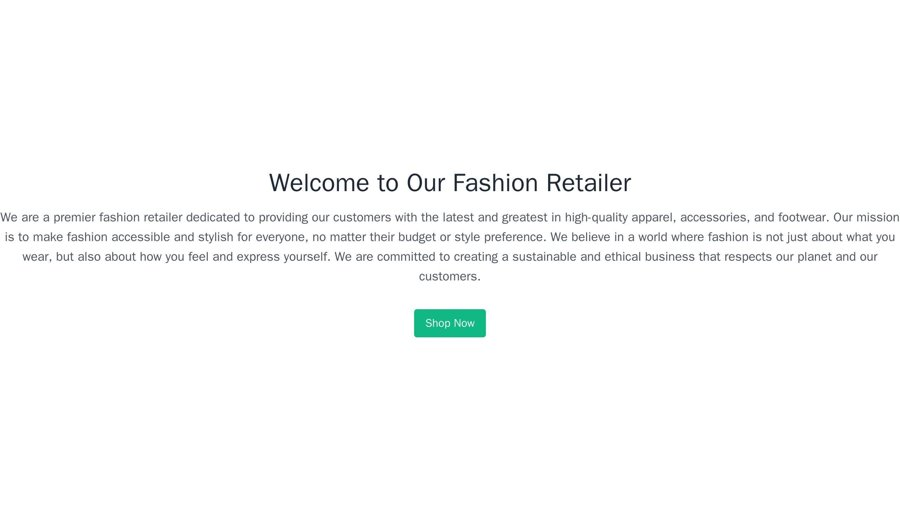</span><span class="sg-meta"><span class="deep-title sg-name"> WebSight <span class="org">HuggingFace</span></span><span class="sg-sub"><span class="hf"><span class="hf-b hf-dl" title="downloads"><svg class="hf-i" viewBox="0 0 24 24" fill="none" stroke="currentColor" stroke-width="2.2" stroke-linecap="round" stroke-linejoin="round"><path d="M12 3v11"/><path d="M8 11l4 4 4-4"/><path d="M4 20h16"/></svg>18.1k</span><span class="hf-b hf-lk" title="likes"><svg class="hf-i" viewBox="0 0 24 24" fill="currentColor"><path d="M12 21C7 17.5 3 14 3 9.5 3 7 5 5 7.5 5 9.2 5 10.7 6 12 7.6 13.3 6 14.8 5 16.5 5 19 5 21 7 21 9.5 21 14 17 17.5 12 21z"/></svg>400</span></span><span class=sg-n>3 条样例</span></span></span></span> |
| 2024/4/9 |   [WebCode2M](https://arxiv.org/abs/2404.06369) <span class="org">Rabbitpre AI · PKU</span> | Benchmark | [HF](https://huggingface.co/datasets/xcodemind/webcode2m) | 设计稿→HTML（HTML / CSS） | 2.56M | <a class="hf" href="https://huggingface.co/datasets/xcodemind/webcode2m"><span class="hf-b hf-dl" title="downloads"><svg class="hf-i" viewBox="0 0 24 24" fill="none" stroke="currentColor" stroke-width="2.2" stroke-linecap="round" stroke-linejoin="round"><path d="M12 3v11"/><path d="M8 11l4 4 4-4"/><path d="M4 20h16"/></svg>2.4k</span></a> | **设计稿转码数据**：百万级设计图-代码对，TreeBLEU 评 DOM 结构 | <span class="sg-tile ex-tile" role="button" tabindex="0" data-sg="sg-webcode2m--opendata"><span class="sg-poster">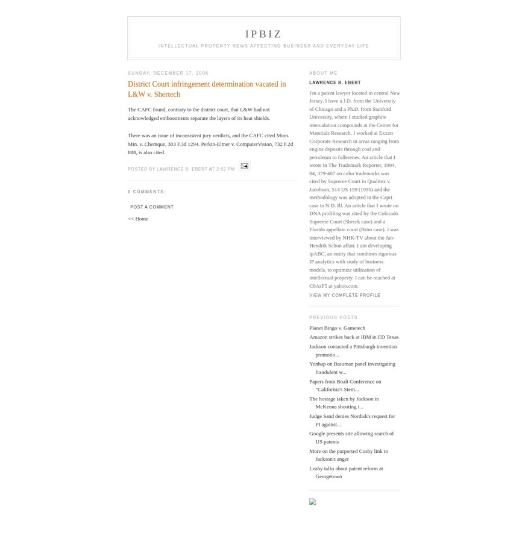</span><span class="sg-meta"><span class="deep-title sg-name">  WebCode2M <span class="org">Rabbitpre AI · PKU</span></span><span class="sg-sub"><span class="hf"><span class="hf-b hf-dl" title="downloads"><svg class="hf-i" viewBox="0 0 24 24" fill="none" stroke="currentColor" stroke-width="2.2" stroke-linecap="round" stroke-linejoin="round"><path d="M12 3v11"/><path d="M8 11l4 4 4-4"/><path d="M4 20h16"/></svg>2.4k</span></span><span class=sg-n>3 条样例</span></span></span></span> |
| 2024/4/9 |   [Vision2UI → WebCode2M](https://arxiv.org/abs/2404.06369) <span class="org">Rabbitpre AI · PKU</span> | 数据集 | [HF](https://huggingface.co/datasets/xcodemind/webcode2m) | 设计图→网页代码 | 2.56M | <a class="hf" href="https://huggingface.co/datasets/xcodemind/webcode2m"><span class="hf-b hf-dl" title="downloads"><svg class="hf-i" viewBox="0 0 24 24" fill="none" stroke="currentColor" stroke-width="2.2" stroke-linecap="round" stroke-linejoin="round"><path d="M12 3v11"/><path d="M8 11l4 4 4-4"/><path d="M4 20h16"/></svg>2.4k</span><span class="hf-b hf-lk" title="likes"><svg class="hf-i" viewBox="0 0 24 24" fill="currentColor"><path d="M12 21C7 17.5 3 14 3 9.5 3 7 5 5 7.5 5 9.2 5 10.7 6 12 7.6 13.3 6 14.8 5 16.5 5 19 5 21 7 21 9.5 21 14 17 17.5 12 21z"/></svg>48</span></a> | **真实网页大语料**：Common Crawl 网页渲染后按审美打分过滤，带布局信息 | — |
| 2024/5 | <span class="org-mark" title="U. Mannheim">U</span> [DeTikZify](https://arxiv.org/abs/2405.15306) <span class="org">U. Mannheim</span> | Benchmark | [GitHub](https://github.com/potamides/DeTikZify) | 草图/图→TikZ | DaTikZv2 360k+ | <a class="hf" href="https://github.com/potamides/DeTikZify"><span class="hf-b hf-st" title="GitHub stars"><svg class="hf-i" viewBox="0 0 24 24" fill="currentColor"><path d="M12 2.5l2.9 6 6.6.6-5 4.3 1.5 6.5L12 16.9 6 20.9l1.5-6.5-5-4.3 6.6-.6z"/></svg>1.8k</span></a> | **图像逆向代码（静态）**：MCTS 推理期精炼用编译器反馈，超 Claude 3/GPT-4V | — |
| 2024/5/13 |   [Plot2Code](https://arxiv.org/abs/2405.07990) <span class="org">Tencent ARC Lab · HKU</span> | Benchmark | [HF](https://huggingface.co/datasets/TencentARC/Plot2Code) | 图表→绘图代码（Python (matplotlib)） | 132 | <a class="hf" href="https://github.com/TencentARC/Plot2Code"><span class="hf-b hf-st" title="GitHub stars"><svg class="hf-i" viewBox="0 0 24 24" fill="currentColor"><path d="M12 2.5l2.9 6 6.6.6-5 4.3 1.5 6.5L12 16.9 6 20.9l1.5-6.5-5-4.3 6.6-.6z"/></svg>24</span></a> | **科学图转代码**：matplotlib 图还原，评通过率与整体相似 | — |
| 2024/5/24 |  [DeTikZify / DaTikZv2](https://arxiv.org/abs/2405.15306) <span class="org">University of Mannheim</span> | 数据集 | [HF](https://huggingface.co/datasets/nllg/datikz-v2) | 科研图/草图→TikZ | 360K+ | <a class="hf" href="https://huggingface.co/datasets/nllg/datikz-v2"><span class="hf-b hf-dl" title="downloads"><svg class="hf-i" viewBox="0 0 24 24" fill="none" stroke="currentColor" stroke-width="2.2" stroke-linecap="round" stroke-linejoin="round"><path d="M12 3v11"/><path d="M8 11l4 4 4-4"/><path d="M4 20h16"/></svg>366</span><span class="hf-b hf-lk" title="likes"><svg class="hf-i" viewBox="0 0 24 24" fill="currentColor"><path d="M12 21C7 17.5 3 14 3 9.5 3 7 5 5 7.5 5 9.2 5 10.7 6 12 7.6 13.3 6 14.8 5 16.5 5 19 5 21 7 21 9.5 21 14 17 17.5 12 21z"/></svg>17</span></a> | **人写 + 合成草图**：TikZ 配合成草图做输入，推理时可叠 MCTS 精修 | — |
| 2024/6 |   [ChartMimic](https://arxiv.org/abs/2406.09961) <span class="org">Tencent AI Lab · Tsinghua</span> | Benchmark | [GitHub](https://github.com/ChartMimic/ChartMimic) | 图→图表代码（Python (matplotlib)） | 4,800 三元组 | <a class="hf" href="https://github.com/ChartMimic/ChartMimic"><span class="hf-b hf-st" title="GitHub stars"><svg class="hf-i" viewBox="0 0 24 24" fill="currentColor"><path d="M12 2.5l2.9 6 6.6.6-5 4.3 1.5 6.5L12 16.9 6 20.9l1.5-6.5-5-4.3 6.6-.6z"/></svg>135</span></a> | **图表即代码（静态邻居）**：多层级评代码+渲染图，GPT-4o 仍差距明显 | — |
| 2024/6/11 |   [UICoder](https://arxiv.org/abs/2406.07739) <span class="org">Apple · CMU</span> | 数据集 | — | 文本→SwiftUI 代码 | 近 1M | — | **自生成迭代蒸馏**：编译器 + CLIP 狠滤自产代码再自训，循环 5 轮 | — |
| 2024/6/28 |   [Web2Code](https://arxiv.org/abs/2406.20098) <span class="org">Petuum · CMU</span> | Benchmark | [HF](https://huggingface.co/datasets/MBZUAI/Web2Code) | 截图→HTML（HTML / CSS） | 1179.7K | <a class="hf" href="https://github.com/MBZUAI-LLM/web2code"><span class="hf-b hf-st" title="GitHub stars"><svg class="hf-i" viewBox="0 0 24 24" fill="currentColor"><path d="M12 2.5l2.9 6 6.6.6-5 4.3 1.5 6.5L12 16.9 6 20.9l1.5-6.5-5-4.3 6.6-.6z"/></svg>103</span></a> | **网页理解+生成**：网页截图 QA 与转 HTML 双评测，补训练数据 | <span class="sg-tile ex-tile" role="button" tabindex="0" data-sg="sg-web2code--opendata"><span class="sg-poster">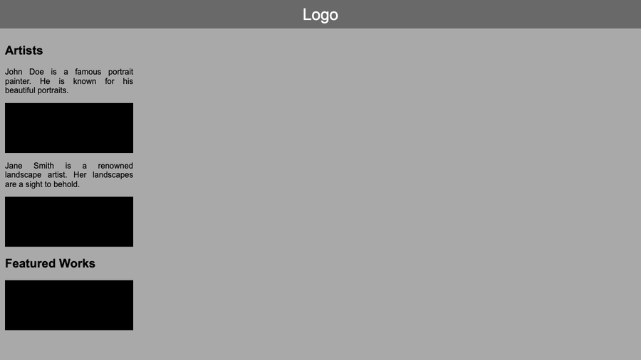</span><span class="sg-meta"><span class="deep-title sg-name">  Web2Code <span class="org">Petuum · CMU</span></span><span class="sg-sub"><span class="hf"><span class="hf-b hf-st" title="GitHub stars"><svg class="hf-i" viewBox="0 0 24 24" fill="currentColor"><path d="M12 2.5l2.9 6 6.6.6-5 4.3 1.5 6.5L12 16.9 6 20.9l1.5-6.5-5-4.3 6.6-.6z"/></svg>103</span></span><span class=sg-n>3 条样例</span></span></span></span> |
| 2024/6/28 |   [Web2Code](https://arxiv.org/abs/2406.20098) <span class="org">Petuum · CMU</span> | 数据集 | [HF](https://huggingface.co/datasets/MBZUAI/Web2Code) | 截图→HTML + 网页 QA | 1,179.7K | <a class="hf" href="https://huggingface.co/datasets/MBZUAI/Web2Code"><span class="hf-b hf-dl" title="downloads"><svg class="hf-i" viewBox="0 0 24 24" fill="none" stroke="currentColor" stroke-width="2.2" stroke-linecap="round" stroke-linejoin="round"><path d="M12 3v11"/><path d="M8 11l4 4 4-4"/><path d="M4 20h16"/></svg>1.3k</span><span class="hf-b hf-lk" title="likes"><svg class="hf-i" viewBox="0 0 24 24" fill="currentColor"><path d="M12 21C7 17.5 3 14 3 9.5 3 7 5 5 7.5 5 9.2 5 10.7 6 12 7.6 13.3 6 14.8 5 16.5 5 19 5 21 7 21 9.5 21 14 17 17.5 12 21z"/></svg>13</span></a> | **代码 + 理解双料**：GPT 新造与精修网页代码，外加网页 QA 做指令微调 | <span class="sg-tile ex-tile" role="button" tabindex="0" data-sg="sg-web2code--opendata"><span class="sg-poster"></span><span class="sg-meta"><span class="deep-title sg-name">  Web2Code <span class="org">Petuum · CMU</span></span><span class="sg-sub"><span class="hf"><span class="hf-b hf-dl" title="downloads"><svg class="hf-i" viewBox="0 0 24 24" fill="none" stroke="currentColor" stroke-width="2.2" stroke-linecap="round" stroke-linejoin="round"><path d="M12 3v11"/><path d="M8 11l4 4 4-4"/><path d="M4 20h16"/></svg>1.3k</span><span class="hf-b hf-lk" title="likes"><svg class="hf-i" viewBox="0 0 24 24" fill="currentColor"><path d="M12 21C7 17.5 3 14 3 9.5 3 7 5 5 7.5 5 9.2 5 10.7 6 12 7.6 13.3 6 14.8 5 16.5 5 19 5 21 7 21 9.5 21 14 17 17.5 12 21z"/></svg>13</span></span><span class=sg-n>3 条样例</span></span></span></span> |
| 2024/7/15 |  [VGBench](https://arxiv.org/abs/2407.10972) <span class="org">UW-Madison</span> | Benchmark | [HF](https://huggingface.co/datasets/vgbench/VGQA) | SVG 理解+生成（SVG / TikZ / Graphviz） | 10.1K | <a class="hf" href="https://github.com/vgbench/VGBench"><span class="hf-b hf-st" title="GitHub stars"><svg class="hf-i" viewBox="0 0 24 24" fill="currentColor"><path d="M12 2.5l2.9 6 6.6.6-5 4.3 1.5 6.5L12 16.9 6 20.9l1.5-6.5-5-4.3 6.6-.6z"/></svg>19</span></a> | **矢量图多格式**：SVG/TikZ/Graphviz 的理解 QA 与生成 | — |
| 2024/10/21 |  [Sketch2Code](https://arxiv.org/abs/2410.16232) <span class="org">Stanford</span> | Benchmark | [HF](https://huggingface.co/datasets/SALT-NLP/Sketch2Code) | 草图→HTML（HTML / CSS） | 731 | <a class="hf" href="https://github.com/SALT-NLP/Sketch2Code"><span class="hf-b hf-st" title="GitHub stars"><svg class="hf-i" viewBox="0 0 24 24" fill="currentColor"><path d="M12 2.5l2.9 6 6.6.6-5 4.3 1.5 6.5L12 16.9 6 20.9l1.5-6.5-5-4.3 6.6-.6z"/></svg>41</span></a> | **草图理解+多轮交互**：手绘线框转网页，含反馈与主动提问 | <span class="sg-tile ex-tile" role="button" tabindex="0" data-sg="sg-sketch2code--opendata"><span class="sg-poster">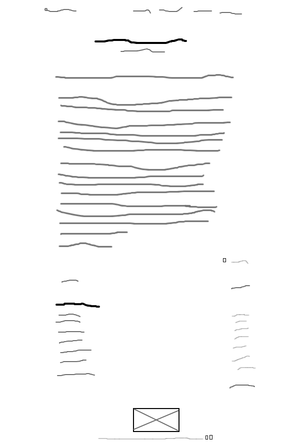</span><span class="sg-meta"><span class="deep-title sg-name"> Sketch2Code <span class="org">Stanford</span></span><span class="sg-sub"><span class="hf"><span class="hf-b hf-st" title="GitHub stars"><svg class="hf-i" viewBox="0 0 24 24" fill="currentColor"><path d="M12 2.5l2.9 6 6.6.6-5 4.3 1.5 6.5L12 16.9 6 20.9l1.5-6.5-5-4.3 6.6-.6z"/></svg>41</span></span><span class=sg-n>3 条样例</span></span></span></span> |
| 2024/10/21 |  [Sketch2Code](https://arxiv.org/abs/2410.16232) <span class="org">Stanford</span> | 数据集 | [HF](https://huggingface.co/datasets/SALT-NLP/Sketch2Code) | 手绘草图→HTML | 731 草图 / 484 网页 | <a class="hf" href="https://huggingface.co/datasets/SALT-NLP/Sketch2Code"><span class="hf-b hf-dl" title="downloads"><svg class="hf-i" viewBox="0 0 24 24" fill="none" stroke="currentColor" stroke-width="2.2" stroke-linecap="round" stroke-linejoin="round"><path d="M12 3v11"/><path d="M8 11l4 4 4-4"/><path d="M4 20h16"/></svg>552</span><span class="hf-b hf-lk" title="likes"><svg class="hf-i" viewBox="0 0 24 24" fill="currentColor"><path d="M12 21C7 17.5 3 14 3 9.5 3 7 5 5 7.5 5 9.2 5 10.7 6 12 7.6 13.3 6 14.8 5 16.5 5 19 5 21 7 21 9.5 21 14 17 17.5 12 21z"/></svg>5</span></a> | **真人手绘输入**：按线框规范给真实网页画草图，可测多轮交互反馈 | <span class="sg-tile ex-tile" role="button" tabindex="0" data-sg="sg-sketch2code--opendata"><span class="sg-poster"></span><span class="sg-meta"><span class="deep-title sg-name"> Sketch2Code <span class="org">Stanford</span></span><span class="sg-sub"><span class="hf"><span class="hf-b hf-dl" title="downloads"><svg class="hf-i" viewBox="0 0 24 24" fill="none" stroke="currentColor" stroke-width="2.2" stroke-linecap="round" stroke-linejoin="round"><path d="M12 3v11"/><path d="M8 11l4 4 4-4"/><path d="M4 20h16"/></svg>552</span><span class="hf-b hf-lk" title="likes"><svg class="hf-i" viewBox="0 0 24 24" fill="currentColor"><path d="M12 21C7 17.5 3 14 3 9.5 3 7 5 5 7.5 5 9.2 5 10.7 6 12 7.6 13.3 6 14.8 5 16.5 5 19 5 21 7 21 9.5 21 14 17 17.5 12 21z"/></svg>5</span></span><span class=sg-n>3 条样例</span></span></span></span> |
| 2024/10/24 |   [ReachQA (CIT)](https://arxiv.org/abs/2410.18798) <span class="org">Tencent · Fudan</span> | 数据集 | [HF](https://huggingface.co/datasets/hewei2001/ReachQA) | 绘图代码→图表 + QA | 3K 图 / 20K QA | <a class="hf" href="https://huggingface.co/datasets/hewei2001/ReachQA"><span class="hf-b hf-dl" title="downloads"><svg class="hf-i" viewBox="0 0 24 24" fill="none" stroke="currentColor" stroke-width="2.2" stroke-linecap="round" stroke-linejoin="round"><path d="M12 3v11"/><path d="M8 11l4 4 4-4"/><path d="M4 20h16"/></svg>372</span><span class="hf-b hf-lk" title="likes"><svg class="hf-i" viewBox="0 0 24 24" fill="currentColor"><path d="M12 21C7 17.5 3 14 3 9.5 3 7 5 5 7.5 5 9.2 5 10.7 6 12 7.6 13.3 6 14.8 5 16.5 5 19 5 21 7 21 9.5 21 14 17 17.5 12 21z"/></svg>10</span></a> | **代码当中介**：LLM 扩写 matplotlib 并渲染，再基于代码出推理 QA | — |
| 2024/10/29 |   [Image2Struct](https://arxiv.org/abs/2410.22456) <span class="org">Hitachi · Stanford</span> | Benchmark | [GitHub](https://github.com/stanford-crfm/image2struct) | 图像→结构代码（HTML / LaTeX / LilyPond） | 2,400 | <a class="hf" href="https://github.com/stanford-crfm/image2struct"><span class="hf-b hf-st" title="GitHub stars"><svg class="hf-i" viewBox="0 0 24 24" fill="currentColor"><path d="M12 2.5l2.9 6 6.6.6-5 4.3 1.5 6.5L12 16.9 6 20.9l1.5-6.5-5-4.3 6.6-.6z"/></svg>10</span></a> | **图像结构抽取**：网页/LaTeX/乐谱图转代码，渲染回图比对 | — |
| 2024/11 | <span class="org-mark" title="Westlake Univ.">W</span> [DiagramAgent](https://arxiv.org/abs/2411.11916) <span class="org">Westlake Univ.</span> | Benchmark | — | 文本→图代码 | 生成 6,983 + 编辑 1,600 | — | **图即代码（静态）**：TeX/DOT 多任务，生成 Pass@1 58.15、编辑 98.00 | — |
| 2024/11/5 |  [Interaction2Code](https://arxiv.org/abs/2411.03292) <span class="org">Tsinghua</span> | Benchmark | [HF](https://huggingface.co/datasets/whale99/Interaction2Code) | 交互原型→网页（HTML / CSS / JS） | 374 | <a class="hf" href="https://github.com/WebPAI/Interaction2Code"><span class="hf-b hf-st" title="GitHub stars"><svg class="hf-i" viewBox="0 0 24 24" fill="currentColor"><path d="M12 2.5l2.9 6 6.6.6-5 4.3 1.5 6.5L12 16.9 6 20.9l1.5-6.5-5-4.3 6.6-.6z"/></svg>62</span></a> | **交互行为实现**：按交互原型生成可交互页，对比交互前后效果 | — |
| 2024/11/5 |  [Interaction2Code](https://arxiv.org/abs/2411.03292) <span class="org">Tsinghua</span> | 数据集 | [GitHub](https://github.com/WebPAI/Interaction2Code) | 交互前后截图→交互代码 | 127 页 / 374 交互 | <a class="hf" href="https://github.com/WebPAI/Interaction2Code"><span class="hf-b hf-st" title="GitHub stars"><svg class="hf-i" viewBox="0 0 24 24" fill="currentColor"><path d="M12 2.5l2.9 6 6.6.6-5 4.3 1.5 6.5L12 16.9 6 20.9l1.5-6.5-5-4.3 6.6-.6z"/></svg>62</span></a> | **交互原型评测**：人工整理真实网页的 31 类交互，考动态行为还原 | — |
| 2024/12/15 |  [LLM4SVG / SVGX-SFT](https://arxiv.org/abs/2412.11102) <span class="org">HKU</span> | 数据集 | [HF](https://huggingface.co/datasets/xingxm/SVGX-SFT-1M) | 文本↔SVG 指令 | 580K | <a class="hf" href="https://huggingface.co/datasets/xingxm/SVGX-SFT-1M"><span class="hf-b hf-dl" title="downloads"><svg class="hf-i" viewBox="0 0 24 24" fill="none" stroke="currentColor" stroke-width="2.2" stroke-linecap="round" stroke-linejoin="round"><path d="M12 3v11"/><path d="M8 11l4 4 4-4"/><path d="M4 20h16"/></svg>419</span><span class="hf-b hf-lk" title="likes"><svg class="hf-i" viewBox="0 0 24 24" fill="currentColor"><path d="M12 21C7 17.5 3 14 3 9.5 3 7 5 5 7.5 5 9.2 5 10.7 6 12 7.6 13.3 6 14.8 5 16.5 5 19 5 21 7 21 9.5 21 14 17 17.5 12 21z"/></svg>19</span></a> | **理解 + 生成双向指令**：人设计的 SVG 经自动管线转成两类指令数据 | — |
| 2025/1/11 |  [ChartCoder / Chart2Code-160k](https://arxiv.org/abs/2501.06598) <span class="org">Tsinghua</span> | 数据集 | [HF](https://huggingface.co/datasets/xxxllz/Chart2Code-160k) | 图表→Python 代码 | 160K | <a class="hf" href="https://huggingface.co/datasets/xxxllz/Chart2Code-160k"><span class="hf-b hf-dl" title="downloads"><svg class="hf-i" viewBox="0 0 24 24" fill="none" stroke="currentColor" stroke-width="2.2" stroke-linecap="round" stroke-linejoin="round"><path d="M12 3v11"/><path d="M8 11l4 4 4-4"/><path d="M4 20h16"/></svg>148</span><span class="hf-b hf-lk" title="likes"><svg class="hf-i" viewBox="0 0 24 24" fill="currentColor"><path d="M12 21C7 17.5 3 14 3 9.5 3 7 5 5 7.5 5 9.2 5 10.7 6 12 7.6 13.3 6 14.8 5 16.5 5 19 5 21 7 21 9.5 21 14 17 17.5 12 21z"/></svg>11</span></a> | **分步生成 CoT**：LLM 合成多类型图表代码并执行，SoT 改写成分步生成 | — |
| 2025/2/20 |  [CoSyn-400K](https://arxiv.org/abs/2502.14846) <span class="org">AllenAI</span> | 数据集 | [HF](https://huggingface.co/datasets/allenai/CoSyn-400K) | 渲染代码→富文本图 + 指令 | 400K 图 / 2.7M 指令 | <a class="hf" href="https://huggingface.co/datasets/allenai/CoSyn-400K"><span class="hf-b hf-dl" title="downloads"><svg class="hf-i" viewBox="0 0 24 24" fill="none" stroke="currentColor" stroke-width="2.2" stroke-linecap="round" stroke-linejoin="round"><path d="M12 3v11"/><path d="M8 11l4 4 4-4"/><path d="M4 20h16"/></svg>11.0k</span><span class="hf-b hf-lk" title="likes"><svg class="hf-i" viewBox="0 0 24 24" fill="currentColor"><path d="M12 21C7 17.5 3 14 3 9.5 3 7 5 5 7.5 5 9.2 5 10.7 6 12 7.6 13.3 6 14.8 5 16.5 5 19 5 21 7 21 9.5 21 14 17 17.5 12 21z"/></svg>53</span></a> | **纯文本 LLM 造图**：按主题写 Python/HTML/LaTeX 渲染代码，再基于代码出 QA | <span class="sg-tile ex-tile" role="button" tabindex="0" data-sg="sg-cosyn-400k--opendata"><span class="sg-poster">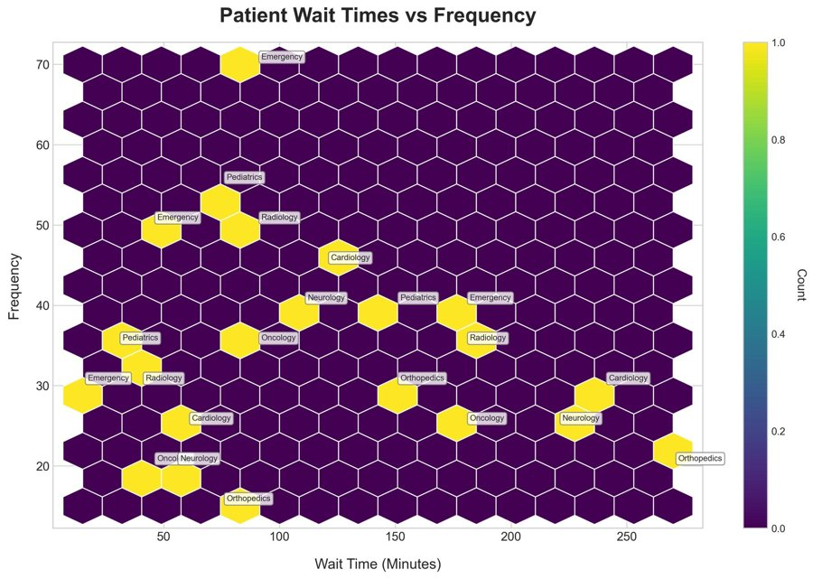</span><span class="sg-meta"><span class="deep-title sg-name"> CoSyn-400K <span class="org">AllenAI</span></span><span class="sg-sub"><span class="hf"><span class="hf-b hf-dl" title="downloads"><svg class="hf-i" viewBox="0 0 24 24" fill="none" stroke="currentColor" stroke-width="2.2" stroke-linecap="round" stroke-linejoin="round"><path d="M12 3v11"/><path d="M8 11l4 4 4-4"/><path d="M4 20h16"/></svg>11.0k</span><span class="hf-b hf-lk" title="likes"><svg class="hf-i" viewBox="0 0 24 24" fill="currentColor"><path d="M12 21C7 17.5 3 14 3 9.5 3 7 5 5 7.5 5 9.2 5 10.7 6 12 7.6 13.3 6 14.8 5 16.5 5 19 5 21 7 21 9.5 21 14 17 17.5 12 21z"/></svg>53</span></span><span class=sg-n>3 条样例</span></span></span></span> |
| 2025/4/8 |   [OmniSVG / MMSVG-2M](https://arxiv.org/abs/2504.06263) <span class="org">StepFun · Fudan</span> | 数据集 | [HF](https://huggingface.co/datasets/OmniSVG/MMSVG-Icon) | 文本/图像→SVG | 2M | <a class="hf" href="https://huggingface.co/datasets/OmniSVG/MMSVG-Icon"><span class="hf-b hf-dl" title="downloads"><svg class="hf-i" viewBox="0 0 24 24" fill="none" stroke="currentColor" stroke-width="2.2" stroke-linecap="round" stroke-linejoin="round"><path d="M12 3v11"/><path d="M8 11l4 4 4-4"/><path d="M4 20h16"/></svg>364</span><span class="hf-b hf-lk" title="likes"><svg class="hf-i" viewBox="0 0 24 24" fill="currentColor"><path d="M12 21C7 17.5 3 14 3 9.5 3 7 5 5 7.5 5 9.2 5 10.7 6 12 7.6 13.3 6 14.8 5 16.5 5 19 5 21 7 21 9.5 21 14 17 17.5 12 21z"/></svg>56</span></a> | **爬取素材 + 自动标注**：图标站爬 SVG，BLIP-2 写 caption，CLIP 分过滤 | — |
| 2025/5/17 |  [ChartEdit](https://arxiv.org/abs/2505.11935) <span class="org">Tsinghua</span> | Benchmark | [HF](https://huggingface.co/datasets/xxxllz/ChartEdit) | 图表编辑（Python (matplotlib)） | 1,405 | <a class="hf" href="https://github.com/xxlllz/ChartEdit"><span class="hf-b hf-st" title="GitHub stars"><svg class="hf-i" viewBox="0 0 24 24" fill="currentColor"><path d="M12 2.5l2.9 6 6.6.6-5 4.3 1.5 6.5L12 16.9 6 20.9l1.5-6.5-5-4.3 6.6-.6z"/></svg>12</span></a> | **图表编辑**：真实图表按指令改代码，代码层+图表层双评 | — |
| 2025/5/23 |   [FullFront](https://arxiv.org/abs/2505.17399) <span class="org">Microsoft · UW</span> | Benchmark | [HF](https://huggingface.co/datasets/Mikivis/FullFront) | 前端全流程（HTML / CSS / JS） | 3 任务 | <a class="hf" href="https://github.com/Mikivishy/FullFront"><span class="hf-b hf-st" title="GitHub stars"><svg class="hf-i" viewBox="0 0 24 24" fill="currentColor"><path d="M12 2.5l2.9 6 6.6.6-5 4.3 1.5 6.5L12 16.9 6 20.9l1.5-6.5-5-4.3 6.6-.6z"/></svg>29</span></a> | **前端全流程覆盖**：设计、页面感知 QA、代码生成三段评测 | — |
| 2025/5/24 |  [ChartGalaxy](https://arxiv.org/abs/2505.18668) <span class="org">Tsinghua</span> | 数据集 | [HF](https://huggingface.co/datasets/ChartGalaxy/ChartGalaxy) | 信息图+数据表+D3 | 1.70M + 61.8K | <a class="hf" href="https://huggingface.co/datasets/ChartGalaxy/ChartGalaxy"><span class="hf-b hf-dl" title="downloads"><svg class="hf-i" viewBox="0 0 24 24" fill="none" stroke="currentColor" stroke-width="2.2" stroke-linecap="round" stroke-linejoin="round"><path d="M12 3v11"/><path d="M8 11l4 4 4-4"/><path d="M4 20h16"/></svg>23.0k</span><span class="hf-b hf-lk" title="likes"><svg class="hf-i" viewBox="0 0 24 24" fill="currentColor"><path d="M12 21C7 17.5 3 14 3 9.5 3 7 5 5 7.5 5 9.2 5 10.7 6 12 7.6 13.3 6 14.8 5 16.5 5 19 5 21 7 21 9.5 21 14 17 17.5 12 21z"/></svg>89</span></a> | **模板程序化合成**：从真实信息图归纳 75 类模板，用 D3 批量生成 | <span class="sg-tile ex-tile" role="button" tabindex="0" data-sg="sg-chartgalaxy--opendata"><span class="sg-poster">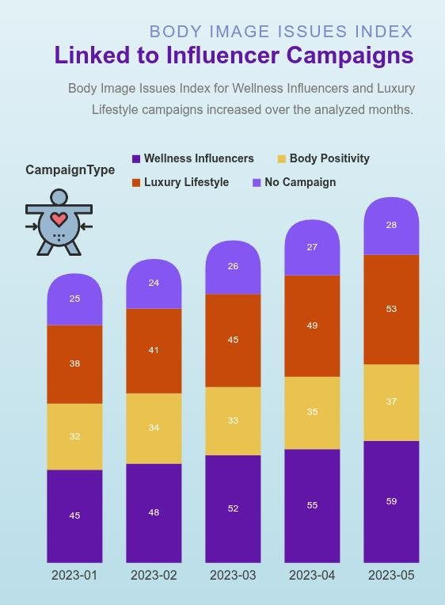</span><span class="sg-meta"><span class="deep-title sg-name"> ChartGalaxy <span class="org">Tsinghua</span></span><span class="sg-sub"><span class="hf"><span class="hf-b hf-dl" title="downloads"><svg class="hf-i" viewBox="0 0 24 24" fill="none" stroke="currentColor" stroke-width="2.2" stroke-linecap="round" stroke-linejoin="round"><path d="M12 3v11"/><path d="M8 11l4 4 4-4"/><path d="M4 20h16"/></svg>23.0k</span><span class="hf-b hf-lk" title="likes"><svg class="hf-i" viewBox="0 0 24 24" fill="currentColor"><path d="M12 21C7 17.5 3 14 3 9.5 3 7 5 5 7.5 5 9.2 5 10.7 6 12 7.6 13.3 6 14.8 5 16.5 5 19 5 21 7 21 9.5 21 14 17 17.5 12 21z"/></svg>89</span></span><span class=sg-n>4 条样例</span></span></span></span> |
| 2025/5/27 |   [RLRF](https://arxiv.org/abs/2505.20793) <span class="org">Google Research · Columbia</span> | 数据集 | — | 图像→SVG rollout | SFT 1.7M / RL 20K | — | **渲染反馈奖励**：rollout 渲染后比像素与 DreamSim，加长度惩罚做 RL | — |
| 2025/5/30 |  [Reason-SVG / SVGX-DwT-10k](https://arxiv.org/abs/2505.24499) <span class="org">HKU</span> | 数据集 | — | 设计推理 + SVG | 10K | — | **先推理后画**：每条 SVG 配显式设计推理，GRPO 用结构/语义/视觉混合奖励 | — |
| 2025/5/31 |   [ChartGen](https://arxiv.org/abs/2507.19492) <span class="org">IBM Research · MIT</span> | 数据集 | [HF](https://huggingface.co/datasets/SD122025/ChartGen-200K) | 图表↔代码 | 222.5K | <a class="hf" href="https://huggingface.co/datasets/SD122025/ChartGen-200K"><span class="hf-b hf-dl" title="downloads"><svg class="hf-i" viewBox="0 0 24 24" fill="none" stroke="currentColor" stroke-width="2.2" stroke-linecap="round" stroke-linejoin="round"><path d="M12 3v11"/><path d="M8 11l4 4 4-4"/><path d="M4 20h16"/></svg>1.7k</span><span class="hf-b hf-lk" title="likes"><svg class="hf-i" viewBox="0 0 24 24" fill="currentColor"><path d="M12 21C7 17.5 3 14 3 9.5 3 7 5 5 7.5 5 9.2 5 10.7 6 12 7.6 13.3 6 14.8 5 16.5 5 19 5 21 7 21 9.5 21 14 17 17.5 12 21z"/></svg>9</span></a> | **种子图重建扩增**：VLM 把种子图还原成脚本，代码 LLM 迭代扩出变体 | — |
| 2025/6/3 |  [SVGenius](https://arxiv.org/abs/2506.03139) <span class="org">ZJU</span> | Benchmark | [HF](https://huggingface.co/datasets/xiaoooobai/SVGenius) | SVG 理解+生成（SVG） | 2,377 | <a class="hf" href="https://github.com/ZJU-REAL/SVGenius"><span class="hf-b hf-st" title="GitHub stars"><svg class="hf-i" viewBox="0 0 24 24" fill="currentColor"><path d="M12 2.5l2.9 6 6.6.6-5 4.3 1.5 6.5L12 16.9 6 20.9l1.5-6.5-5-4.3 6.6-.6z"/></svg>79</span></a> | **SVG 三级递进**：理解→编辑→生成，考复杂度上升后的退化 | — |
| 2025/6/4 |   [VisCoder / VisCode-200K](https://arxiv.org/abs/2506.03930) <span class="org">Netmind.ai · CMU</span> | 数据集 | [HF](https://huggingface.co/datasets/TIGER-Lab/VisCode-200K) | 指令→绘图代码+纠错 | 200K+ | <a class="hf" href="https://huggingface.co/datasets/TIGER-Lab/VisCode-200K"><span class="hf-b hf-dl" title="downloads"><svg class="hf-i" viewBox="0 0 24 24" fill="none" stroke="currentColor" stroke-width="2.2" stroke-linecap="round" stroke-linejoin="round"><path d="M12 3v11"/><path d="M8 11l4 4 4-4"/><path d="M4 20h16"/></svg>111</span><span class="hf-b hf-lk" title="likes"><svg class="hf-i" viewBox="0 0 24 24" fill="currentColor"><path d="M12 21C7 17.5 3 14 3 9.5 3 7 5 5 7.5 5 9.2 5 10.7 6 12 7.6 13.3 6 14.8 5 16.5 5 19 5 21 7 21 9.5 21 14 17 17.5 12 21z"/></svg>9</span></a> | **执行验证 + 多轮纠错**：开源仓库抽可跑绘图代码，另含 45K 纠错对话 | — |
| 2025/6/9 |   [WebUIBench](https://arxiv.org/abs/2506.07818) <span class="org">China Telecom TeleAI · NJU</span> | Benchmark | [HF](https://huggingface.co/datasets/Tele-AI-MAIL/WebUIBench) | 截图→HTML（HTML / CSS） | 21K | <a class="hf" href="https://github.com/MAIL-Tele-AI/WebUIBench"><span class="hf-b hf-st" title="GitHub stars"><svg class="hf-i" viewBox="0 0 24 24" fill="currentColor"><path d="M12 2.5l2.9 6 6.6.6-5 4.3 1.5 6.5L12 16.9 6 20.9l1.5-6.5-5-4.3 6.6-.6z"/></svg>6</span></a> | **子能力拆解**：感知/HTML 编程/UI 理解/UI 转码四维定位短板 | — |
| 2025/7 |   [ArtifactsBench](https://arxiv.org/abs/2507.04952) <span class="org">Tencent Hunyuan · PKU</span> | Benchmark | [GitHub](https://github.com/Tencent-Hunyuan/ArtifactsBenchmark) | 指令→可视化/交互代码（HTML / JS / SVG） | 1,825 任务 | <a class="hf" href="https://github.com/Tencent-Hunyuan/ArtifactsBenchmark"><span class="hf-b hf-st" title="GitHub stars"><svg class="hf-i" viewBox="0 0 24 24" fill="currentColor"><path d="M12 2.5l2.9 6 6.6.6-5 4.3 1.5 6.5L12 16.9 6 20.9l1.5-6.5-5-4.3 6.6-.6z"/></svg>279</span></a> | **时序截图捕动态**：与 WebDev Arena 排名一致 94.4% | — |
| 2025/7/7 |   [ArtifactsBench](https://arxiv.org/abs/2507.04952) <span class="org">Tencent Hunyuan · PKU</span> | 数据集 | [HF](https://huggingface.co/datasets/tencent/ArtifactsBenchmark) | 交互代码+checklist | 1,825 题 | <a class="hf" href="https://huggingface.co/datasets/tencent/ArtifactsBenchmark"><span class="hf-b hf-dl" title="downloads"><svg class="hf-i" viewBox="0 0 24 24" fill="none" stroke="currentColor" stroke-width="2.2" stroke-linecap="round" stroke-linejoin="round"><path d="M12 3v11"/><path d="M8 11l4 4 4-4"/><path d="M4 20h16"/></svg>195</span><span class="hf-b hf-lk" title="likes"><svg class="hf-i" viewBox="0 0 24 24" fill="currentColor"><path d="M12 21C7 17.5 3 14 3 9.5 3 7 5 5 7.5 5 9.2 5 10.7 6 12 7.6 13.3 6 14.8 5 16.5 5 19 5 21 7 21 9.5 21 14 17 17.5 12 21z"/></svg>13</span></a> | **现成 reward 模板**：时序截图 + 逐题 checklist，MLLM 判官直接打分 | — |
| 2025/7/25 |  [ChartM³](https://arxiv.org/abs/2507.21167) <span class="org">RUC</span> | Benchmark | [HF](https://huggingface.co/datasets/Colinyyy/ChartM3) | 图表编辑（Python (matplotlib)） | 1,000 | <a class="hf" href="https://github.com/MLrollIT/ChartM3"><span class="hf-b hf-st" title="GitHub stars"><svg class="hf-i" viewBox="0 0 24 24" fill="currentColor"><path d="M12 2.5l2.9 6 6.6.6-5 4.3 1.5 6.5L12 16.9 6 20.9l1.5-6.5-5-4.3 6.6-.6z"/></svg>11</span></a> | **多模态编辑指令**：文字+视觉标记驱动图表编辑，考标记理解 | — |
| 2025/7/30 |  [ScreenCoder](https://arxiv.org/abs/2507.22827) <span class="org">CUHK</span> | 数据集 | [HF](https://huggingface.co/datasets/Leigest/ScreenCoder) | 截图→HTML | Screen-10K | <a class="hf" href="https://github.com/leigest519/ScreenCoder"><span class="hf-b hf-st" title="GitHub stars"><svg class="hf-i" viewBox="0 0 24 24" fill="currentColor"><path d="M12 2.5l2.9 6 6.6.6-5 4.3 1.5 6.5L12 16.9 6 20.9l1.5-6.5-5-4.3 6.6-.6z"/></svg>3.0k</span></a> | **agent 当数据引擎**：grounding→planning→generation 产配对，SFT 后接 RL | <span class="sg-tile ex-tile" role="button" tabindex="0" data-sg="sg-screencoder--opendata"><span class="sg-poster">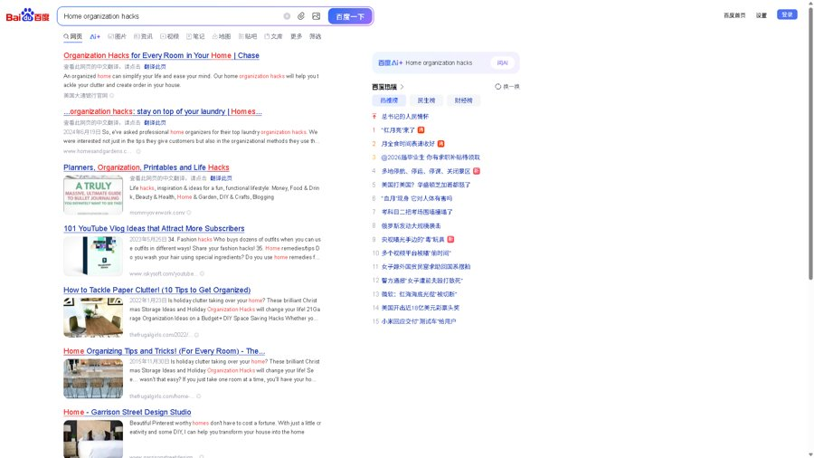</span><span class="sg-meta"><span class="deep-title sg-name"> ScreenCoder <span class="org">CUHK</span></span><span class="sg-sub"><span class="hf"><span class="hf-b hf-st" title="GitHub stars"><svg class="hf-i" viewBox="0 0 24 24" fill="currentColor"><path d="M12 2.5l2.9 6 6.6.6-5 4.3 1.5 6.5L12 16.9 6 20.9l1.5-6.5-5-4.3 6.6-.6z"/></svg>3.0k</span></span><span class=sg-n>3 条样例</span></span></span></span> |
| 2025/8/6 |   [SVGen / SVG-1M](https://arxiv.org/abs/2508.09168) <span class="org">China Telecom TeleAI · NWPU</span> | 数据集 | [HF](https://huggingface.co/datasets/gitcat-404/SVG-1M-Json) | 文本→SVG | 1M | <a class="hf" href="https://huggingface.co/datasets/gitcat-404/SVG-1M-Json"><span class="hf-b hf-dl" title="downloads"><svg class="hf-i" viewBox="0 0 24 24" fill="none" stroke="currentColor" stroke-width="2.2" stroke-linecap="round" stroke-linejoin="round"><path d="M12 3v11"/><path d="M8 11l4 4 4-4"/><path d="M4 20h16"/></svg>52</span><span class="hf-b hf-lk" title="likes"><svg class="hf-i" viewBox="0 0 24 24" fill="currentColor"><path d="M12 21C7 17.5 3 14 3 9.5 3 7 5 5 7.5 5 9.2 5 10.7 6 12 7.6 13.3 6 14.8 5 16.5 5 19 5 21 7 21 9.5 21 14 17 17.5 12 21z"/></svg>4</span></a> | **带 CoT 子集**：增强 + 标注造百万文本-SVG 对，配课程学习与 RL | — |
| 2025/8/11 |   [UniSVG](https://arxiv.org/abs/2508.07766) <span class="org">Tencent · ZJU</span> | Benchmark | [HF](https://huggingface.co/datasets/lili24/UniSVG) | SVG 理解+生成（SVG） | 525K | <a class="hf" href="https://huggingface.co/datasets/lili24/UniSVG"><span class="hf-b hf-dl" title="downloads"><svg class="hf-i" viewBox="0 0 24 24" fill="none" stroke="currentColor" stroke-width="2.2" stroke-linecap="round" stroke-linejoin="round"><path d="M12 3v11"/><path d="M8 11l4 4 4-4"/><path d="M4 20h16"/></svg>210</span></a> | **SVG 统一数据**：理解与文本/图像转 SVG，补开源训练数据 | — |
| 2025/8/11 |   [UniSVG](https://arxiv.org/abs/2508.07766) <span class="org">Tencent · ZJU</span> | 数据集 | [HF](https://huggingface.co/datasets/lili24/UniSVG) | 文本/图像↔SVG | 525K | <a class="hf" href="https://huggingface.co/datasets/lili24/UniSVG"><span class="hf-b hf-dl" title="downloads"><svg class="hf-i" viewBox="0 0 24 24" fill="none" stroke="currentColor" stroke-width="2.2" stroke-linecap="round" stroke-linejoin="round"><path d="M12 3v11"/><path d="M8 11l4 4 4-4"/><path d="M4 20h16"/></svg>210</span><span class="hf-b hf-lk" title="likes"><svg class="hf-i" viewBox="0 0 24 24" fill="currentColor"><path d="M12 21C7 17.5 3 14 3 9.5 3 7 5 5 7.5 5 9.2 5 10.7 6 12 7.6 13.3 6 14.8 5 16.5 5 19 5 21 7 21 9.5 21 14 17 17.5 12 21z"/></svg>11</span></a> | **多源统一格式**：整合多源 SVG，统一成生成 + 理解两类任务 | — |
| 2025/8/25 |   [ChartMaster / ReChartPrompt-240K](https://arxiv.org/abs/2508.17608) <span class="org">JD · Wuhan University</span> | 数据集 | [HF](https://huggingface.co/datasets/TwT-6/ReChartPrompt-240K) | 真实图表→代码 | 240K | <a class="hf" href="https://huggingface.co/datasets/TwT-6/ReChartPrompt-240K"><span class="hf-b hf-dl" title="downloads"><svg class="hf-i" viewBox="0 0 24 24" fill="none" stroke="currentColor" stroke-width="2.2" stroke-linecap="round" stroke-linejoin="round"><path d="M12 3v11"/><path d="M8 11l4 4 4-4"/><path d="M4 20h16"/></svg>7</span><span class="hf-b hf-lk" title="likes"><svg class="hf-i" viewBox="0 0 24 24" fill="currentColor"><path d="M12 21C7 17.5 3 14 3 9.5 3 7 5 5 7.5 5 9.2 5 10.7 6 12 7.6 13.3 6 14.8 5 16.5 5 19 5 21 7 21 9.5 21 14 17 17.5 12 21z"/></svg>2</span></a> | **真实 arXiv 图当 prompt**：比纯合成更贴真实分布，配相似度 RL 奖励 | — |
| 2025/10/5 |   [WebRenderBench / ALISA](https://arxiv.org/abs/2510.04097) <span class="org">Huawei Cloud · PKU</span> | 数据集 | [HF](https://huggingface.co/datasets/aleversn/WebRenderBench) | 截图→网页代码 | 45.1K | <a class="hf" href="https://huggingface.co/datasets/aleversn/WebRenderBench"><span class="hf-b hf-dl" title="downloads"><svg class="hf-i" viewBox="0 0 24 24" fill="none" stroke="currentColor" stroke-width="2.2" stroke-linecap="round" stroke-linejoin="round"><path d="M12 3v11"/><path d="M8 11l4 4 4-4"/><path d="M4 20h16"/></svg>159</span><span class="hf-b hf-lk" title="likes"><svg class="hf-i" viewBox="0 0 24 24" fill="currentColor"><path d="M12 21C7 17.5 3 14 3 9.5 3 7 5 5 7.5 5 9.2 5 10.7 6 12 7.6 13.3 6 14.8 5 16.5 5 19 5 21 7 21 9.5 21 14 17 17.5 12 21z"/></svg>2</span></a> | **真实门户 + 渲染奖励**：从渲染结果算布局与样式一致性，直接当 RL reward | <span class="sg-tile ex-tile" role="button" tabindex="0" data-sg="sg-webrenderbench--opendata"><span class="sg-poster">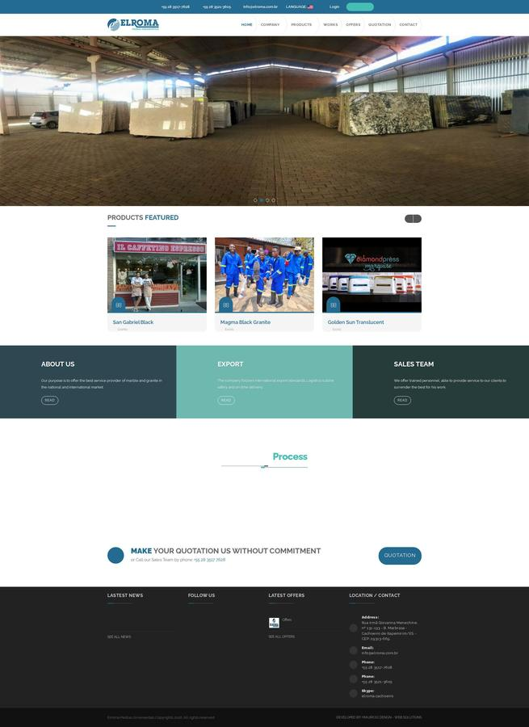</span><span class="sg-meta"><span class="deep-title sg-name">  WebRenderBench / ALISA <span class="org">Huawei Cloud · PKU</span></span><span class="sg-sub"><span class="hf"><span class="hf-b hf-dl" title="downloads"><svg class="hf-i" viewBox="0 0 24 24" fill="none" stroke="currentColor" stroke-width="2.2" stroke-linecap="round" stroke-linejoin="round"><path d="M12 3v11"/><path d="M8 11l4 4 4-4"/><path d="M4 20h16"/></svg>159</span><span class="hf-b hf-lk" title="likes"><svg class="hf-i" viewBox="0 0 24 24" fill="currentColor"><path d="M12 21C7 17.5 3 14 3 9.5 3 7 5 5 7.5 5 9.2 5 10.7 6 12 7.6 13.3 6 14.8 5 16.5 5 19 5 21 7 21 9.5 21 14 17 17.5 12 21z"/></svg>2</span></span><span class=sg-n>3 条样例</span></span></span></span> |
| 2025/10/13 |  [SArena（InternSVG）](https://arxiv.org/abs/2510.11341) <span class="org">Shanghai AI Lab</span> | Benchmark | [HF](https://huggingface.co/datasets/InternSVG/SArena) | SVG 理解+生成（SVG） | — | <a class="hf" href="https://github.com/hmwang2002/InternSVG"><span class="hf-b hf-st" title="GitHub stars"><svg class="hf-i" viewBox="0 0 24 24" fill="currentColor"><path d="M12 2.5l2.9 6 6.6.6-5 4.3 1.5 6.5L12 16.9 6 20.9l1.5-6.5-5-4.3 6.6-.6z"/></svg>124</span></a> | **SVG 统一评测**：多领域多难度的理解、编辑、生成一体评测 | — |
| 2025/10/13 |   [ReLook](https://arxiv.org/abs/2510.11498) <span class="org">Tencent · PKU</span> | 数据集 | — | 生成→诊断→修复轨迹 | 3,000 任务 | — | **视觉 critic RL**：72B VLM 看截图打分，渲染失败给 0，只收严格变好的修订 | — |
| 2025/10/13 |  [InternSVG / SAgoge](https://arxiv.org/abs/2510.11341) <span class="org">Shanghai AI Lab</span> | 数据集 | [HF](https://huggingface.co/datasets/InternSVG/SAgoge) | SVG 理解/编辑/生成 | 16M | <a class="hf" href="https://huggingface.co/datasets/InternSVG/SAgoge"><span class="hf-b hf-dl" title="downloads"><svg class="hf-i" viewBox="0 0 24 24" fill="none" stroke="currentColor" stroke-width="2.2" stroke-linecap="round" stroke-linejoin="round"><path d="M12 3v11"/><path d="M8 11l4 4 4-4"/><path d="M4 20h16"/></svg>663</span><span class="hf-b hf-lk" title="likes"><svg class="hf-i" viewBox="0 0 24 24" fill="currentColor"><path d="M12 21C7 17.5 3 14 3 9.5 3 7 5 5 7.5 5 9.2 5 10.7 6 12 7.6 13.3 6 14.8 5 16.5 5 19 5 21 7 21 9.5 21 14 17 17.5 12 21z"/></svg>7</span></a> | **全任务 SVG 大库**：爬图标站 + 化学分子转 SVG + 合成动画，多 MLLM 标注 | — |
| 2025/10/17 |   [WebGen-V Bench](https://arxiv.org/abs/2510.15306) <span class="org">Sony · NYCU</span> | Benchmark | [GitHub](https://github.com/sony/web_gen_v_bench) | 指令→HTML（HTML / CSS / JS） | — | <a class="hf" href="https://github.com/sony/web_gen_v_bench"><span class="hf-b hf-st" title="GitHub stars"><svg class="hf-i" viewBox="0 0 24 24" fill="currentColor"><path d="M12 2.5l2.9 6 6.6.6-5 4.3 1.5 6.5L12 16.9 6 20.9l1.5-6.5-5-4.3 6.6-.6z"/></svg>2</span></a> | **分区细粒度评测**：按页面分区对齐文本、布局与视觉打分 | — |
| 2025/10/20 |  [Chart2Code](https://arxiv.org/abs/2510.17932) <span class="org">NUS</span> | Benchmark | [HF](https://huggingface.co/datasets/CSU-JPG/Chart2Code) | 图表→绘图代码（Python (matplotlib)） | 2,023 | <a class="hf" href="https://github.com/CSU-JPG/Chart2Code"><span class="hf-b hf-st" title="GitHub stars"><svg class="hf-i" viewBox="0 0 24 24" fill="currentColor"><path d="M12 2.5l2.9 6 6.6.6-5 4.3 1.5 6.5L12 16.9 6 20.9l1.5-6.5-5-4.3 6.6-.6z"/></svg>31</span></a> | **分层图表转码**：复现→编辑→长表格转图，逐级加难 | — |
| 2025/10/24 |   [VisCoder2 / VisCode-Multi-679K](https://arxiv.org/abs/2510.23642) <span class="org">Netmind.ai · CMU</span> | 数据集 | [HF](https://huggingface.co/datasets/TIGER-Lab/VisCode-Multi-679K) | 12 语言可视化代码 | 679K | <a class="hf" href="https://huggingface.co/datasets/TIGER-Lab/VisCode-Multi-679K"><span class="hf-b hf-dl" title="downloads"><svg class="hf-i" viewBox="0 0 24 24" fill="none" stroke="currentColor" stroke-width="2.2" stroke-linecap="round" stroke-linejoin="round"><path d="M12 3v11"/><path d="M8 11l4 4 4-4"/><path d="M4 20h16"/></svg>49</span><span class="hf-b hf-lk" title="likes"><svg class="hf-i" viewBox="0 0 24 24" fill="currentColor"><path d="M12 21C7 17.5 3 14 3 9.5 3 7 5 5 7.5 5 9.2 5 10.7 6 12 7.6 13.3 6 14.8 5 16.5 5 19 5 21 7 21 9.5 21 14 17 17.5 12 21z"/></svg>7</span></a> | **多语言执行验证**：the-stack-v2 等抽代码，Jupyter 跑通后 GPT-4.1 写指令 | — |
| 2025/11 |  [MermaidSeqBench](https://arxiv.org/abs/2511.14967) <span class="org">IBM Research</span> | Benchmark | [GitHub](https://github.com/IBM/MermaidSeqBench-Eval) | NL→Mermaid 时序图 | 132 对 | <a class="hf" href="https://github.com/IBM/MermaidSeqBench-Eval"><span class="hf-b hf-st" title="GitHub stars"><svg class="hf-i" viewBox="0 0 24 24" fill="currentColor"><path d="M12 2.5l2.9 6 6.6.6-5 4.3 1.5 6.5L12 16.9 6 20.9l1.5-6.5-5-4.3 6.6-.6z"/></svg>3</span></a> | **图即代码（静态）**：双判官 6 维，排名随判官翻转 | — |
| 2025/11/1 |   [VinciCoder](https://arxiv.org/abs/2511.00391) <span class="org">Meituan · CASIA</span> | 数据集 | [HF](https://huggingface.co/datasets/DocTron-Hub/VinciCoder-1.6M-SFT) | 图→多域代码 + 修正 | 1.6M SFT + 42K RL | <a class="hf" href="https://huggingface.co/datasets/DocTron-Hub/VinciCoder-1.6M-SFT"><span class="hf-b hf-dl" title="downloads"><svg class="hf-i" viewBox="0 0 24 24" fill="none" stroke="currentColor" stroke-width="2.2" stroke-linecap="round" stroke-linejoin="round"><path d="M12 3v11"/><path d="M8 11l4 4 4-4"/><path d="M4 20h16"/></svg>829</span><span class="hf-b hf-lk" title="likes"><svg class="hf-i" viewBox="0 0 24 24" fill="currentColor"><path d="M12 21C7 17.5 3 14 3 9.5 3 7 5 5 7.5 5 9.2 5 10.7 6 12 7.6 13.3 6 14.8 5 16.5 5 19 5 21 7 21 9.5 21 14 17 17.5 12 21z"/></svg>2</span></a> | **看图修代码对**：汇总各域开源数据，初版模型的不完美输出组成修正对 | — |
| 2025/11/9 |   [WebVIA](https://arxiv.org/abs/2511.06251) <span class="org">Zhipu AI · Tsinghua</span> | 数据集 | — | 多状态截图→交互 HTML | 11K 页 + 180K 探索 | <a class="hf" href="https://github.com/zheny2751-dotcom/WebVIA"><span class="hf-b hf-st" title="GitHub stars"><svg class="hf-i" viewBox="0 0 24 24" fill="currentColor"><path d="M12 2.5l2.9 6 6.6.6-5 4.3 1.5 6.5L12 16.9 6 20.9l1.5-6.5-5-4.3 6.6-.6z"/></svg>39</span></a> | **agent 探索造交互数据**：截多状态后生成交互代码，再验证交互确实生效 | — |
| 2025/11/11 |   [UI2Code^N](https://arxiv.org/abs/2511.08195) <span class="org">Zhipu AI · Tsinghua</span> | 数据集 | — | 截图→HTML 多轮 | CPT 20M / SFT 80K / RL 42K | <a class="hf" href="https://github.com/zai-org/UI2Code_N"><span class="hf-b hf-st" title="GitHub stars"><svg class="hf-i" viewBox="0 0 24 24" fill="currentColor"><path d="M12 2.5l2.9 6 6.6.6-5 4.3 1.5 6.5L12 16.9 6 20.9l1.5-6.5-5-4.3 6.6-.6z"/></svg>87</span></a> | **逆向合成打磨任务**：先造复杂 HTML 真值，再倒推待打磨输入，覆盖起草/打磨/编辑 | — |
| 2026/2/17 |  [ChartEditBench](https://arxiv.org/abs/2602.15758) <span class="org">CMU</span> | Benchmark | — | 多轮图表编辑（Python (matplotlib)） | 5,000 | — | **多轮增量编辑**：多步编辑链，考执行、像素与代码逻辑一致 | — |
| 2026/2/22 |   [VectorGym](https://arxiv.org/abs/2603.29852) <span class="org">ServiceNow Research · Mila</span> | Benchmark | [HF](https://huggingface.co/datasets/ServiceNow/VectorGym) | 草图/文本→SVG（SVG） | 4 任务 | <a class="hf" href="https://huggingface.co/datasets/ServiceNow/VectorGym"><span class="hf-b hf-dl" title="downloads"><svg class="hf-i" viewBox="0 0 24 24" fill="none" stroke="currentColor" stroke-width="2.2" stroke-linecap="round" stroke-linejoin="round"><path d="M12 3v11"/><path d="M8 11l4 4 4-4"/><path d="M4 20h16"/></svg>86</span></a> | **SVG 多任务生成**：草图转 SVG、编辑、文本转 SVG 与描述 | — |
| 2026/3/26 |   [AnyDoc / DocHTML](https://arxiv.org/abs/2603.25118) <span class="org">Adobe Research · XJTU</span> | 数据集 | — | 意图/截图/元素→HTML 文档 | 265K | — | **多模型流水线合成**：抽元数据→标意图→写 HTML→配图→过滤溢出，高度比做奖励 | — |
| 2026/4/15 |  [Figma2Code](https://arxiv.org/abs/2604.13648) <span class="org">ZJU</span> | Benchmark | [HF](https://huggingface.co/datasets/xcodemind/Figma2Code) | Figma 设计稿→代码（HTML + Tailwind） | 213 | <a class="hf" href="https://huggingface.co/datasets/xcodemind/Figma2Code"><span class="hf-b hf-dl" title="downloads"><svg class="hf-i" viewBox="0 0 24 24" fill="none" stroke="currentColor" stroke-width="2.2" stroke-linecap="round" stroke-linejoin="round"><path d="M12 3v11"/><path d="M8 11l4 4 4-4"/><path d="M4 20h16"/></svg>916</span></a> | **真实设计稿转码**：Figma 多模态稿转代码，考响应式与可维护性 | — |
| 2026/5/6 | [The Single-File Test](https://arxiv.org/abs/2605.06707) <span class="org">独立作者</span> | Benchmark | [GitHub](https://github.com/diegocp01/html_ai_battle) | 指令→单文件 HTML（HTML / CSS / JS） | 68 | <a class="hf" href="https://github.com/diegocp01/html_ai_battle"><span class="hf-b hf-st" title="GitHub stars"><svg class="hf-i" viewBox="0 0 24 24" fill="currentColor"><path d="M12 2.5l2.9 6 6.6.6-5 4.3 1.5 6.5L12 16.9 6 20.9l1.5-6.5-5-4.3 6.6-.6z"/></svg>8</span></a> | **首发输出质量**：公开实验对比单文件 HTML，人评+模型评 | — |
| 2026/5/11 |  [Vision2Code](https://arxiv.org/abs/2605.11307) <span class="org">Duke</span> | Benchmark | [GitHub](https://github.com/image2code/vision2code) | 图像→渲染代码（Python (matplotlib)） | 2,169 | <a class="hf" href="https://github.com/image2code/vision2code"><span class="hf-b hf-st" title="GitHub stars"><svg class="hf-i" viewBox="0 0 24 24" fill="currentColor"><path d="M12 2.5l2.9 6 6.6.6-5 4.3 1.5 6.5L12 16.9 6 20.9l1.5-6.5-5-4.3 6.6-.6z"/></svg>5</span></a> | **跨领域图转码**：无参考代码，渲染后 VLM 按 rubric 打分 | — |
| 2026/5/29 |  [WebIGBench](https://arxiv.org/abs/2606.00154) <span class="org">HIT</span> | Benchmark | — | 截图→交互网页（HTML / CSS / JS） | 103 | — | **复杂交互还原**：按预设路径回放交互，评视觉保真与交互一致 | — |
| 2026/6/16 |  [LongWebBench](https://arxiv.org/abs/2606.17727) <span class="org">Tsinghua</span> | Benchmark | [GitHub](https://github.com/zheny2751-dotcom/LongWebBench) | 指令→长网页（HTML / CSS / JS） | 490+507 | — | **长程结构一致性**：长页面结构保真+多步交互功能验证 | — |
| 2026/8/4 |   [MT-Web2Code](https://arxiv.org/abs/2608.03474) <span class="org">Meituan LongCat · HIT</span> | 数据集 | — | 多轮修复轨迹 | 102 页 × 5 轮 | — | **反向腐蚀造轨迹**：往金标页注入缺陷再倒放，得到确定性的逐轮修复过程 | — |

</div>

<div class="tbl-pane" data-label="WebDev" data-count="15">

<p class="tbl-desc">多文件 Web App：从规格或多轮对话生成可运行应用，由浏览器 agent 实测功能与跨页状态。 本组 13 条 benchmark、2 条数据管线，按发布日期混排。</p>

| 发布日期 | 名称 | 类型 | Download | 形态 | 规模 / 题量 | 影响力 | 说明 | Example |
|---|---|---|---|---|---|---|---|---|
| 2024/12 |  [WebDev Arena](https://arena.ai/blog/webdev-arena) <span class="org">Arena</span> | Benchmark | [HF](https://huggingface.co/datasets/lmarena-ai/webdev-arena-preference-10k) | 指令→Web App（React (Next.js)） | 80K+ 投票 | <a class="hf" href="https://huggingface.co/datasets/lmarena-ai/webdev-arena-preference-10k"><span class="hf-b hf-dl" title="downloads"><svg class="hf-i" viewBox="0 0 24 24" fill="none" stroke="currentColor" stroke-width="2.2" stroke-linecap="round" stroke-linejoin="round"><path d="M12 3v11"/><path d="M8 11l4 4 4-4"/><path d="M4 20h16"/></svg>375</span></a> | **真实用户偏好**：同 prompt 两模型生成 app，用户试用后投票 | — |
| 2025/5/6 |  [WebGen-Bench](https://arxiv.org/abs/2505.03733) <span class="org">CUHK</span> | Benchmark | [HF](https://huggingface.co/datasets/luzimu/WebGen-Bench) | 指令→Web App（HTML/CSS/JS/TS） | 647 | <a class="hf" href="https://github.com/mnluzimu/WebGen-Bench"><span class="hf-b hf-st" title="GitHub stars"><svg class="hf-i" viewBox="0 0 24 24" fill="currentColor"><path d="M12 2.5l2.9 6 6.6.6-5 4.3 1.5 6.5L12 16.9 6 20.9l1.5-6.5-5-4.3 6.6-.6z"/></svg>60</span></a> | **多文件网站功能**：从零生成网站，UI agent 执行测试用例 | — |
| 2025/5/6 |  [WebGen-Bench / WebGen-Instruct](https://arxiv.org/abs/2505.03733) <span class="org">CUHK</span> | 数据集 | [HF](https://huggingface.co/datasets/luzimu/WebGen-Bench_train_data) | 指令→多文件网站 | 训练 6,667 + 测试 101 | <a class="hf" href="https://huggingface.co/datasets/luzimu/WebGen-Bench_train_data"><span class="hf-b hf-dl" title="downloads"><svg class="hf-i" viewBox="0 0 24 24" fill="none" stroke="currentColor" stroke-width="2.2" stroke-linecap="round" stroke-linejoin="round"><path d="M12 3v11"/><path d="M8 11l4 4 4-4"/><path d="M4 20h16"/></svg>85</span><span class="hf-b hf-lk" title="likes"><svg class="hf-i" viewBox="0 0 24 24" fill="currentColor"><path d="M12 21C7 17.5 3 14 3 9.5 3 7 5 5 7.5 5 9.2 5 10.7 6 12 7.6 13.3 6 14.8 5 16.5 5 19 5 21 7 21 9.5 21 14 17 17.5 12 21z"/></svg>1</span></a> | **带 GUI 用例的指令集**：GPT-4o 写指令和功能用例，Bolt.diy 轨迹可直接 SFT | — |
| 2025/6/6 |  [DesignBench](https://arxiv.org/abs/2506.06251) <span class="org">CUHK</span> | Benchmark | [HF](https://huggingface.co/datasets/whale99/DesignBench) | 设计稿→前端框架代码（React / Vue / Angular / HTML） | 900 | <a class="hf" href="https://github.com/WebPAI/DesignBench"><span class="hf-b hf-st" title="GitHub stars"><svg class="hf-i" viewBox="0 0 24 24" fill="currentColor"><path d="M12 2.5l2.9 6 6.6.6-5 4.3 1.5 6.5L12 16.9 6 20.9l1.5-6.5-5-4.3 6.6-.6z"/></svg>57</span></a> | **多框架前端工程**：多框架下的生成、编辑、修复三类任务 | <span class="sg-tile ex-tile" role="button" tabindex="0" data-sg="sg-designbench--opendata"><span class="sg-poster">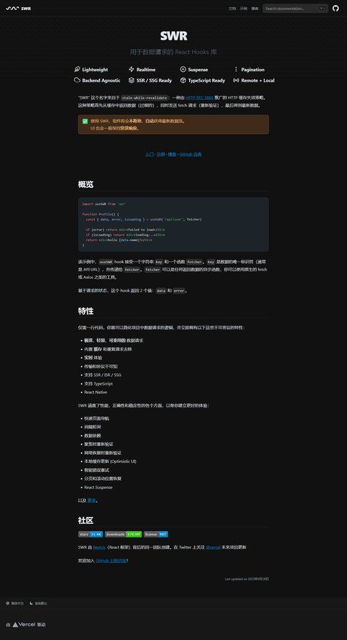</span><span class="sg-meta"><span class="deep-title sg-name"> DesignBench <span class="org">CUHK</span></span><span class="sg-sub"><span class="hf"><span class="hf-b hf-st" title="GitHub stars"><svg class="hf-i" viewBox="0 0 24 24" fill="currentColor"><path d="M12 2.5l2.9 6 6.6.6-5 4.3 1.5 6.5L12 16.9 6 20.9l1.5-6.5-5-4.3 6.6-.6z"/></svg>57</span></span><span class=sg-n>3 条样例</span></span></span></span> |
| 2025/8/28 |   [UI-Bench](https://arxiv.org/abs/2508.20410) <span class="org">AfterQuery · UPenn</span> | Benchmark | [HF](https://huggingface.co/datasets/AfterQuery/ui-bench) | 指令→Web App | 300 | <a class="hf" href="https://huggingface.co/datasets/AfterQuery/ui-bench"><span class="hf-b hf-dl" title="downloads"><svg class="hf-i" viewBox="0 0 24 24" fill="none" stroke="currentColor" stroke-width="2.2" stroke-linecap="round" stroke-linejoin="round"><path d="M12 3v11"/><path d="M8 11l4 4 4-4"/><path d="M4 20h16"/></svg>151</span></a> | **视觉设计质量**：专家两两对比 text-to-app 工具的设计 | — |
| 2025/9/26 | <span class="org-mark" title="Ace Robotics">A</span>  [WebGen-Agent](https://arxiv.org/abs/2509.22644) <span class="org">Ace Robotics · CUHK</span> | 数据集 | [HF](https://huggingface.co/datasets/luzimu/webgen-agent_train_sft) | 多步 agent 轨迹 | 700 轨迹 + 500 指令 | <a class="hf" href="https://huggingface.co/datasets/luzimu/webgen-agent_train_sft"><span class="hf-b hf-dl" title="downloads"><svg class="hf-i" viewBox="0 0 24 24" fill="none" stroke="currentColor" stroke-width="2.2" stroke-linecap="round" stroke-linejoin="round"><path d="M12 3v11"/><path d="M8 11l4 4 4-4"/><path d="M4 20h16"/></svg>163</span></a> | **逐步奖励轨迹**：DeepSeek-V3 跑 agent，截图分 + GUI 测试分当 step reward | — |
| 2025/12/5 |   [FronTalk](https://arxiv.org/abs/2601.04203) <span class="org">Meta Superintelligence Labs · UCLA</span> | Benchmark | [HF](https://huggingface.co/datasets/xqwu/FronTalk) | 多轮对话→前端（HTML / CSS / JS） | 100 | <a class="hf" href="https://github.com/shirley-wu/frontalk"><span class="hf-b hf-st" title="GitHub stars"><svg class="hf-i" viewBox="0 0 24 24" fill="currentColor"><path d="M12 2.5l2.9 6 6.6.6-5 4.3 1.5 6.5L12 16.9 6 20.9l1.5-6.5-5-4.3 6.6-.6z"/></svg>14</span></a> | **多轮需求保持**：模拟用户多轮提需求，考功能不被遗忘覆盖 | — |
| 2026/1/5 |  [WebCoderBench](https://arxiv.org/abs/2601.02430) <span class="org">PKU</span> | Benchmark | [HF](https://huggingface.co/spaces/CompileError/WebCoderBench) | 指令→Web App（HTML / CSS / JS） | 1,572 | — | **真实需求多维评测**：24 指标按人类偏好加权，可解释打分 | — |
| 2026/2/20 |  [1D-Bench](https://arxiv.org/abs/2602.18548) <span class="org">Alibaba Taobao & Tmall</span> | Benchmark | — | 设计稿→UI 代码（React） | — | — | **迭代视觉反馈**：电商设计稿多轮组件级编辑，带渲染反馈 | — |
| 2026/3/4 |   [Vibe Code Bench](https://arxiv.org/abs/2603.04601) <span class="org">Vals AI · MIT</span> | Benchmark | [GitHub](https://github.com/vals-ai/vibe-code-bench-cais-2026-artifacts) | 规格说明→Web App（React / Supabase） | 100 | <a class="hf" href="https://github.com/vals-ai/vibe-code-bench-cais-2026-artifacts"><span class="hf-b hf-st" title="GitHub stars"><svg class="hf-i" viewBox="0 0 24 24" fill="currentColor"><path d="M12 2.5l2.9 6 6.6.6-5 4.3 1.5 6.5L12 16.9 6 20.9l1.5-6.5-5-4.3 6.6-.6z"/></svg>1</span></a> | **端到端应用交付**：按规格构建部署完整 app，浏览器 agent 走查 | — |
| 2026/4/20 |   [WebCompass](https://arxiv.org/abs/2604.18224) <span class="org">Kuaishou · NJU</span> | Benchmark | [HF](https://huggingface.co/datasets/NJU-LINK/WebCompass) | 多模态→网页（React / Vue / HTML） | 7 类任务 | <a class="hf" href="https://github.com/NJU-LINK/WebCompass"><span class="hf-b hf-st" title="GitHub stars"><svg class="hf-i" viewBox="0 0 24 24" fill="currentColor"><path d="M12 2.5l2.9 6 6.6.6-5 4.3 1.5 6.5L12 16.9 6 20.9l1.5-6.5-5-4.3 6.6-.6z"/></svg>25</span></a> | **全生命周期覆盖**：文本/图像/视频输入，生成、编辑、修复分档 | <span class="sg-tile ex-tile" role="button" tabindex="0" data-sg="sg-webcompass--opendata"><span class="sg-poster">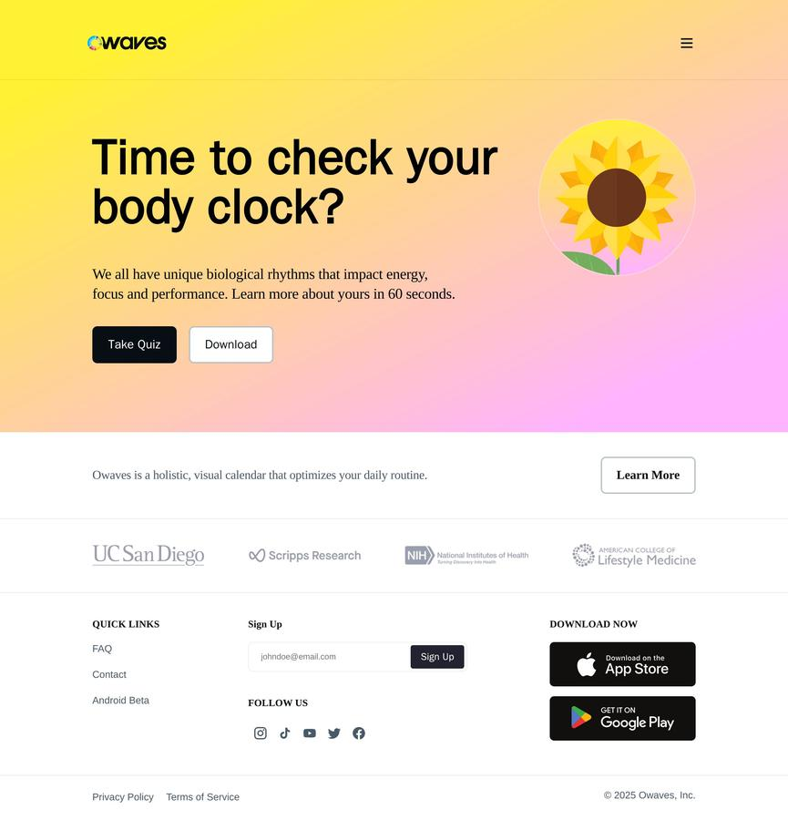</span><span class="sg-meta"><span class="deep-title sg-name">  WebCompass <span class="org">Kuaishou · NJU</span></span><span class="sg-sub"><span class="hf"><span class="hf-b hf-st" title="GitHub stars"><svg class="hf-i" viewBox="0 0 24 24" fill="currentColor"><path d="M12 2.5l2.9 6 6.6.6-5 4.3 1.5 6.5L12 16.9 6 20.9l1.5-6.5-5-4.3 6.6-.6z"/></svg>25</span></span><span class=sg-n>3 条样例</span></span></span></span> |
| 2026/5/28 |  [Cookie-Bench](https://arxiv.org/abs/2605.30000) <span class="org">Baidu</span> | Benchmark | [HF](https://huggingface.co/datasets/Y36521478Y/Cookie-Bench) | 指令→Web App（React / HTML） | 1,000 | <a class="hf" href="https://github.com/Haoyue-Yang/Cookie-Bench"><span class="hf-b hf-st" title="GitHub stars"><svg class="hf-i" viewBox="0 0 24 24" fill="currentColor"><path d="M12 2.5l2.9 6 6.6.6-5 4.3 1.5 6.5L12 16.9 6 20.9l1.5-6.5-5-4.3 6.6-.6z"/></svg>16</span></a> | **连续交互评测**：静态感知→agent 自主交互→动态打分三阶段 | — |
| 2026/5/30 |  [I-WebGenBench](https://arxiv.org/abs/2606.00750) <span class="org">Univ. of Liverpool</span> | Benchmark | [GitHub](https://github.com/vast88912-stack/I-WebGenBench) | 论文→交互网页（React + TypeScript） | 19 | — | **科学应用交互性**：论文转交互式网页，区分能编译与真响应 | — |
| 2026/7/7 |  [UI2App](https://arxiv.org/abs/2607.06306) <span class="org">HKUST</span> | Benchmark | [HF](https://huggingface.co/datasets/UI2App/UI2App) | 多页截图→Web App（React + TypeScript） | 327 | <a class="hf" href="https://github.com/chenmancm169/UI2App"><span class="hf-b hf-st" title="GitHub stars"><svg class="hf-i" viewBox="0 0 24 24" fill="currentColor"><path d="M12 2.5l2.9 6 6.6.6-5 4.3 1.5 6.5L12 16.9 6 20.9l1.5-6.5-5-4.3 6.6-.6z"/></svg>4</span></a> | **跨页交互推断**：从多页截图推断导航与状态，生成可执行应用 | — |
| 2026/8/4 |   [LiveEvalBench](https://arxiv.org/abs/2608.03689) <span class="org">Ant Group · ZJU</span> | Benchmark | [HF](https://huggingface.co/datasets/wyysteelhead/LiveEvalBench) | 开放前端项目（不限框架） | — | <a class="hf" href="https://github.com/wyysteelhead/LiveEvalBench"><span class="hf-b hf-st" title="GitHub stars"><svg class="hf-i" viewBox="0 0 24 24" fill="currentColor"><path d="M12 2.5l2.9 6 6.6.6-5 4.3 1.5 6.5L12 16.9 6 20.9l1.5-6.5-5-4.3 6.6-.6z"/></svg>2</span></a> | **开放世界评审**：构建/审查/UI 测试三 agent 协作评项目 | — |

</div>

<div class="tbl-pane" data-label="PPT" data-count="10">

<p class="tbl-desc">幻灯片 / 海报 / 演讲视频代码：python-pptx、Beamer、SlidesLib，产物是版面对象树，可逐对象回读。 本组 5 条 benchmark、5 条数据管线，按发布日期混排。</p>

| 发布日期 | 名称 | 类型 | Download | 形态 | 规模 / 题量 | 影响力 | 说明 | Example |
|---|---|---|---|---|---|---|---|---|
| 2025/1 |  [AutoPresent · SlidesBench](https://arxiv.org/abs/2501.00912) <span class="org">UC Berkeley</span> | Benchmark | [GitHub](https://github.com/para-lost/AutoPresent) | 指令→幻灯片代码 | 585 测试 | <a class="hf" href="https://github.com/para-lost/AutoPresent"><span class="hf-b hf-st" title="GitHub stars"><svg class="hf-i" viewBox="0 0 24 24" fill="currentColor"><path d="M12 2.5l2.9 6 6.6.6-5 4.3 1.5 6.5L12 16.9 6 20.9l1.5-6.5-5-4.3 6.6-.6z"/></svg>181</span></a> | **幻灯片即代码**：程序化出片优于端到端图像，8B 达 GPT-4o 水平 | — |
| 2025/1 | <span class="org-mark" title="ISCAS">I</span> [PPTAgent · PPTEval](https://arxiv.org/abs/2501.03936) <span class="org">ISCAS</span> | Benchmark | [GitHub](https://github.com/icip-cas/PPTAgent) | 文档→PPT 编辑 | 500 任务 | <a class="hf" href="https://github.com/icip-cas/PPTAgent"><span class="hf-b hf-st" title="GitHub stars"><svg class="hf-i" viewBox="0 0 24 24" fill="currentColor"><path d="M12 2.5l2.9 6 6.6.6-5 4.3 1.5 6.5L12 16.9 6 20.9l1.5-6.5-5-4.3 6.6-.6z"/></svg>5.1k</span></a> | **套模板编辑**：三维 VLM 评测，成功率 95.0%、均分 3.67 | — |
| 2025/1 |  [AutoPresent](https://arxiv.org/abs/2501.00912) <span class="org">UC Berkeley</span> | 数据集 | [GitHub](https://github.com/para-lost/AutoPresent) | Python(SlidesLib) | — | <a class="hf" href="https://github.com/para-lost/AutoPresent"><span class="hf-b hf-st" title="GitHub stars"><svg class="hf-i" viewBox="0 0 24 24" fill="currentColor"><path d="M12 2.5l2.9 6 6.6.6-5 4.3 1.5 6.5L12 16.9 6 20.9l1.5-6.5-5-4.3 6.6-.6z"/></svg>181</span></a> | 系统 | — |
| 2025/1 | <span class="org-mark" title="ISCAS">I</span> [PPTAgent](https://arxiv.org/abs/2501.03936) <span class="org">ISCAS</span> | 数据集 | [GitHub](https://github.com/icip-cas/PPTAgent) | Python(python-pptx) | — | <a class="hf" href="https://github.com/icip-cas/PPTAgent"><span class="hf-b hf-st" title="GitHub stars"><svg class="hf-i" viewBox="0 0 24 24" fill="currentColor"><path d="M12 2.5l2.9 6 6.6.6-5 4.3 1.5 6.5L12 16.9 6 20.9l1.5-6.5-5-4.3 6.6-.6z"/></svg>5.1k</span></a> | 系统 | — |
| 2025/5 | <span class="org-mark" title="Oxford">O</span> [Paper2Poster · PaperQuiz](https://arxiv.org/abs/2505.21497) <span class="org">Oxford</span> | Benchmark | [GitHub](https://github.com/Paper2Poster/Paper2Poster) | 论文→海报 | 约 100 对 | <a class="hf" href="https://github.com/Paper2Poster/Paper2Poster"><span class="hf-b hf-st" title="GitHub stars"><svg class="hf-i" viewBox="0 0 24 24" fill="currentColor"><path d="M12 2.5l2.9 6 6.6.6-5 4.3 1.5 6.5L12 16.9 6 20.9l1.5-6.5-5-4.3 6.6-.6z"/></svg>4.0k</span></a> | **看海报答题（PaperQuiz）**：开源版多指标超 GPT-4o，省 87% token | — |
| 2025/5 | <span class="org-mark" title="Oxford">O</span> [Paper2Poster](https://arxiv.org/abs/2505.21497) <span class="org">Oxford</span> | 数据集 | [GitHub](https://github.com/Paper2Poster/Paper2Poster) | Python(python-pptx) | — | <a class="hf" href="https://github.com/Paper2Poster/Paper2Poster"><span class="hf-b hf-st" title="GitHub stars"><svg class="hf-i" viewBox="0 0 24 24" fill="currentColor"><path d="M12 2.5l2.9 6 6.6.6-5 4.3 1.5 6.5L12 16.9 6 20.9l1.5-6.5-5-4.3 6.6-.6z"/></svg>4.0k</span></a> | 系统 | — |
| 2025/7 | <span class="org-mark" title="AIGeeksGroup">A</span> [PresentAgent · PresentEval](https://arxiv.org/abs/2507.04036) <span class="org">AIGeeksGroup</span> | Benchmark | [GitHub](https://github.com/AIGeeksGroup/PresentAgent) | 文档→演讲视频 | 30 对 | <a class="hf" href="https://github.com/AIGeeksGroup/PresentAgent"><span class="hf-b hf-st" title="GitHub stars"><svg class="hf-i" viewBox="0 0 24 24" fill="currentColor"><path d="M12 2.5l2.9 6 6.6.6-5 4.3 1.5 6.5L12 16.9 6 20.9l1.5-6.5-5-4.3 6.6-.6z"/></svg>146</span></a> | **看视频答题**：quiz 0.64 接近人类 0.56 | — |
| 2025/7 | <span class="org-mark" title="AIGeeksGroup">A</span> [PresentAgent](https://arxiv.org/abs/2507.04036) <span class="org">AIGeeksGroup</span> | 数据集 | [GitHub](https://github.com/AIGeeksGroup/PresentAgent) | Python(python-pptx) | — | <a class="hf" href="https://github.com/AIGeeksGroup/PresentAgent"><span class="hf-b hf-st" title="GitHub stars"><svg class="hf-i" viewBox="0 0 24 24" fill="currentColor"><path d="M12 2.5l2.9 6 6.6.6-5 4.3 1.5 6.5L12 16.9 6 20.9l1.5-6.5-5-4.3 6.6-.6z"/></svg>146</span></a> | 系统 | — |
| 2025/10 |  [Paper2Video](https://arxiv.org/abs/2510.05096) <span class="org">NUS</span> | Benchmark | [GitHub](https://github.com/showlab/Paper2Video) | 论文→演讲视频 | 101 篇 | <a class="hf" href="https://github.com/showlab/Paper2Video"><span class="hf-b hf-st" title="GitHub stars"><svg class="hf-i" viewBox="0 0 24 24" fill="currentColor"><path d="M12 2.5l2.9 6 6.6.6-5 4.3 1.5 6.5L12 16.9 6 20.9l1.5-6.5-5-4.3 6.6-.6z"/></svg>2.4k</span></a> | **PresentQuiz 0.842 超人类 0.738**；端到端视频模型各项垫底 | — |
| 2025/10 |  [Paper2Video](https://arxiv.org/abs/2510.05096) <span class="org">NUS</span> | 数据集 | [GitHub](https://github.com/showlab/Paper2Video) | LaTeX(Beamer)+Python | — | <a class="hf" href="https://github.com/showlab/Paper2Video"><span class="hf-b hf-st" title="GitHub stars"><svg class="hf-i" viewBox="0 0 24 24" fill="currentColor"><path d="M12 2.5l2.9 6 6.6.6-5 4.3 1.5 6.5L12 16.9 6 20.9l1.5-6.5-5-4.3 6.6-.6z"/></svg>2.4k</span></a> | 系统 | — |

</div>

<div class="tbl-pane" data-label="Manim" data-count="13">

<p class="tbl-desc">代码驱动的讲解动画：Manim 及同类引擎，产物是视频，判据要落在渲染成功、时长与关键帧上。 本组 5 条 benchmark、8 条数据管线，按发布日期混排。</p>

| 发布日期 | 名称 | 类型 | Download | 形态 | 规模 / 题量 | 影响力 | 说明 | Example |
|---|---|---|---|---|---|---|---|---|
| 2018/3 | <span class="org-mark" title="Grant Sanderson">G</span> [3b1b/manim](https://github.com/3b1b/manim) <span class="org">Grant Sanderson</span> | 数据集 | [GitHub](https://github.com/3b1b/manim) | Python(OpenGL) | — | <a class="hf" href="https://github.com/3b1b/manim"><span class="hf-b hf-st" title="GitHub stars"><svg class="hf-i" viewBox="0 0 24 24" fill="currentColor"><path d="M12 2.5l2.9 6 6.6.6-5 4.3 1.5 6.5L12 16.9 6 20.9l1.5-6.5-5-4.3 6.6-.6z"/></svg>94.9k</span></a> | 渲染器 | — |
| 2020/6 | <span class="org-mark" title="Manim Community">M</span> [Manim Community](https://github.com/ManimCommunity/manim) <span class="org">Manim Community</span> | 数据集 | [GitHub](https://github.com/ManimCommunity/manim) | Python(Cairo/OpenGL) | — | <a class="hf" href="https://github.com/ManimCommunity/manim"><span class="hf-b hf-st" title="GitHub stars"><svg class="hf-i" viewBox="0 0 24 24" fill="currentColor"><path d="M12 2.5l2.9 6 6.6.6-5 4.3 1.5 6.5L12 16.9 6 20.9l1.5-6.5-5-4.3 6.6-.6z"/></svg>41.5k</span></a> | 渲染器 | — |
| 2025/2 | <span class="org-mark" title="U. Waterloo">U</span> [TheoremExplainBench](https://arxiv.org/abs/2502.19400) <span class="org">U. Waterloo</span> | Benchmark | [HF](https://huggingface.co/datasets/TIGER-Lab/TheoremExplainBench) | 定理→Manim 视频 | 240 定理 | <a class="hf" href="https://github.com/TIGER-AI-Lab/TheoremExplainAgent"><span class="hf-b hf-st" title="GitHub stars"><svg class="hf-i" viewBox="0 0 24 24" fill="currentColor"><path d="M12 2.5l2.9 6 6.6.6-5 4.3 1.5 6.5L12 16.9 6 20.9l1.5-6.5-5-4.3 6.6-.6z"/></svg>1.5k</span></a> | **长视频多模态讲解**：o3-mini 成功率 93.8%/0.77，版式为普遍弱项 | — |
| 2025/2 | <span class="org-mark" title="U. Waterloo">U</span> [TheoremExplainAgent](https://arxiv.org/abs/2502.19400) <span class="org">U. Waterloo</span> | 数据集 | [GitHub](https://github.com/TIGER-AI-Lab/TheoremExplainAgent) | Python(Manim) | — | <a class="hf" href="https://github.com/TIGER-AI-Lab/TheoremExplainAgent"><span class="hf-b hf-st" title="GitHub stars"><svg class="hf-i" viewBox="0 0 24 24" fill="currentColor"><path d="M12 2.5l2.9 6 6.6.6-5 4.3 1.5 6.5L12 16.9 6 20.9l1.5-6.5-5-4.3 6.6-.6z"/></svg>1.5k</span></a> | 系统 | — |
| 2025/7 | <span class="org-mark" title="PES University">P</span> [manimator](https://arxiv.org/abs/2507.14306) <span class="org">PES University</span> | 数据集 | [GitHub](https://github.com/HyperCluster-Tech/manimator) | Python(Manim) | — | <a class="hf" href="https://github.com/HyperCluster-Tech/manimator"><span class="hf-b hf-st" title="GitHub stars"><svg class="hf-i" viewBox="0 0 24 24" fill="currentColor"><path d="M12 2.5l2.9 6 6.6.6-5 4.3 1.5 6.5L12 16.9 6 20.9l1.5-6.5-5-4.3 6.6-.6z"/></svg>74</span></a> | 系统 | — |
| 2025/10 |  [Code2Video · MMMC](https://arxiv.org/abs/2510.01174) <span class="org">NUS</span> | Benchmark | [GitHub](https://github.com/showlab/Code2Video) | 主题→Manim 视频 | 456 单元 | <a class="hf" href="https://github.com/showlab/Code2Video"><span class="hf-b hf-st" title="GitHub stars"><svg class="hf-i" viewBox="0 0 24 24" fill="currentColor"><path d="M12 2.5l2.9 6 6.6.6-5 4.3 1.5 6.5L12 16.9 6 20.9l1.5-6.5-5-4.3 6.6-.6z"/></svg>2.1k</span></a> | **知识传递（TeachQuiz）**：Opus 4.1 达 86.0，扩散基线 Veo3 仅 2.5 | — |
| 2025/10 |  [DTVBench · JanusCoder](https://arxiv.org/abs/2510.23538) <span class="org">Shanghai AI Lab</span> | Benchmark | [GitHub](https://github.com/InternLM/JanusCoder) | 可视化→代码（Manim 引擎） | 102 任务 | — | **视觉-程序接口**：7–14B 开源逼近或超过商用模型 | — |
| 2025/10 |  [Code2Video](https://arxiv.org/abs/2510.01174) <span class="org">NUS</span> | 数据集 | [GitHub](https://github.com/showlab/Code2Video) | Python(Manim) | — | <a class="hf" href="https://github.com/showlab/Code2Video"><span class="hf-b hf-st" title="GitHub stars"><svg class="hf-i" viewBox="0 0 24 24" fill="currentColor"><path d="M12 2.5l2.9 6 6.6.6-5 4.3 1.5 6.5L12 16.9 6 20.9l1.5-6.5-5-4.3 6.6-.6z"/></svg>2.1k</span></a> | 系统 | — |
| 2025/11 | <span class="org-mark" title="South China Normal Univ.">S</span> [VisualEDU](https://aclanthology.org/2025.findings-emnlp.889/) <span class="org">South China Normal Univ.</span> | Benchmark | — | 数学题→Manim 解题视频 | 200 题 | — | **分步解题动画**：难题上 GPT-4o 等均 <56% | — |
| 2026/1 | <span class="org-mark" title="AzurIce">A</span> [ranim](https://github.com/AzurIce/ranim) <span class="org">AzurIce</span> | 数据集 | [GitHub](https://github.com/AzurIce/ranim) | Rust(wgpu) | — | <a class="hf" href="https://github.com/AzurIce/ranim"><span class="hf-b hf-st" title="GitHub stars"><svg class="hf-i" viewBox="0 0 24 24" fill="currentColor"><path d="M12 2.5l2.9 6 6.6.6-5 4.3 1.5 6.5L12 16.9 6 20.9l1.5-6.5-5-4.3 6.6-.6z"/></svg>0.7k</span></a> | 渲染器 | — |
| 2026/2 |  [SimuScene](https://arxiv.org/abs/2602.10840) <span class="org">MBZUAI</span> | Benchmark | [GitHub](https://github.com/Yanan-Wang-cs/SimuScene) | 文本→物理动画代码 | 7,659 场景 | — | **代码渲染视频做 RL 奖励**：最强 LLM 仅 21.5%，RL 后 32B 72.2% | — |
| 2026/2 |  [SimuScene](https://arxiv.org/abs/2602.10840) <span class="org">MBZUAI</span> | 数据集 | [GitHub](https://github.com/Yanan-Wang-cs/SimuScene) | Python(OpenCV cv2) | — | — | 系统 | — |
| 2026/6 | <span class="org-mark" title="Southeast Univ.">S</span> [ManimAgent](https://arxiv.org/abs/2606.30296) <span class="org">Southeast Univ.</span> | 数据集 | — | Python(Manim) | — | — | 系统 | — |

</div>

</div>

1. 分类看产物，不看输入：输入是截图还是文字，换的只是 Query；产物是单文件还是多文件工程，换的是整条验收链路。
2. 主力与辅助按能不能产出可训练的判定信号来分，不按难度分。
   - ppt 与 manim 够用即可，不自建，也不单开小节，只在本节的表里按技术栈列出
3. html 条目最多、Verifier 最成熟，但早期题目只适合做回归测试。
   - [Design2Code](https://arxiv.org/abs/2403.03163)：484 个真实网页按渲染相似度打分；厂商自报相似分已在 93 以上（GLM-5V-Turbo 94.8、Qwen3-VL-235B-Thinking 93.4）
   - 图表与 SVG 一支最确定：产物能逐值回读，不用看图
4. webdev 倒挂：benchmark 13 条，数据管线只有 2 条，且出自同一组作者。
   - WebGen-Instruct：训练集 6,600 余条、测试集 100 余条；WebGen-Agent：700 条轨迹、500 条指令
   - 这个量级撑不起一次完整的难度分桶
5. webdev 的分数还没饱和，模型差距拉得开。
   - [WebGen-Bench](https://arxiv.org/abs/2505.03733)：UI agent 执行 647 个测试用例，最好组合 27.8%
   - [Vibe Code Bench](https://www.vals.ai/benchmarks/vibe-code)：从规格说明构建并部署应用，论文最好模型 61.8%；接入外部服务后从 71% 降到 30%
6. 起点是合成，规模也靠合成。
   - 2017 年 pix2code 随机生成领域专用语言再渲染出截图；2024 年 WebSight 把同一思路推到约 200 万条
7. 2025 年后，管线报告的重心从数据量转向 Verifier。
   - 早期报数据量；近两年报渲染成功率、交互契约，并把渲染反馈直接当 RL reward
8. 同源的训练集与测试集必须分开用，因此去污染必须做。
   - 做法与效果数字见 Sources 页的 Curation Pipeline

## <a id="opendata-2"></a>2 Timeline

<div class="tl-wrap"><div class="tl"><div class="tl-band"><span>评测对象：输出是否与参考一致</span><i></i><span>输出能否使用</span></div><div class="tl-col" style="--c:#9aa1ab"><div class="tl-date">2023 – 2024-06</div><div class="tl-node"></div><div class="tl-title">截图转代码</div><div class="tl-chips"><span class="tl-chip m-vis">视觉相似度</span></div><div class="tl-card"><div class="nm"><a href="https://arxiv.org/abs/2403.03163">Design2Code</a><span>2024-03</span></div><p>484 个真实网页；标注者判 GPT-4V 生成页 49% 可替代原页</p><div class="tl-m later"><span class="bar"><i style="width:94.8%"></i></span><b>94.8</b><em>2026 厂商自报（GLM-5V-Turbo）</em></div></div><div class="tl-card"><div class="nm"><a href="https://arxiv.org/abs/2404.06369">WebCode2M</a><span>2024-04</span></div><p>2.56M 条图码配对</p></div><div class="tl-card"><div class="nm"><a href="https://arxiv.org/abs/2406.20098">Web2Code</a><span>2024-06</span></div><p>1179.7k 条指令对</p></div></div><div class="tl-col" style="--c:#7f8fc4"><div class="tl-date">2024-07 – 2024-12</div><div class="tl-node"></div><div class="tl-title">多轮交互反馈</div><div class="tl-chips"><span class="tl-chip m-vis">视觉相似度</span><span class="tl-chip m-vote">人工投票</span></div><div class="tl-card"><div class="nm"><a href="https://arxiv.org/abs/2410.16232">Sketch2Code</a><span>2024-10</span></div><p>731 张手绘草图 + 多轮反馈；10 个 VLM 均难读懂草图</p></div><div class="tl-card"><div class="nm"><a href="https://arxiv.org/abs/2411.03292">Interaction2Code</a><span>2024-11</span></div><p>374 个交互；交互部分得分低于整页生成</p></div><div class="tl-card"><div class="nm"><a href="https://arena.ai/blog/webdev-arena">WebDev Arena</a><span>2024-12</span></div><p>8 万+ 票；平局率 26%（Chatbot Arena 35%）</p></div></div><div class="tl-col" style="--c:#6380d6"><div class="tl-date">2025</div><div class="tl-node"></div><div class="tl-title">验收产物</div><div class="tl-chips"><span class="tl-chip m-agent">agent 实测</span><span class="tl-chip m-mllm">MLLM checklist</span></div><div class="tl-card"><div class="nm"><a href="https://arxiv.org/abs/2505.03733">WebGen-Bench</a><span>2025-05</span></div><p>647 个测试用例由 UI agent 执行</p><div class="tl-m"><span class="bar"><i style="width:27.8%"></i></span><b>27.8%</b><em>发布时最好</em></div></div><div class="tl-card"><div class="nm"><a href="https://arxiv.org/abs/2505.11935">ChartEdit</a><span>2025-05</span></div><p>1,405 条图表编辑指令</p><div class="tl-m"><span class="bar"><i style="width:59.96%"></i></span><b>59.96</b><em>发布时最好</em></div></div><div class="tl-card"><div class="nm"><a href="https://arxiv.org/abs/2507.04952">ArtifactsBench</a><span>2025-07</span></div><p>1,825 个任务；与 WebDev Arena 排名一致性 94.4%</p></div></div><div class="tl-col" style="--c:#4876ea"><div class="tl-date">2025-12 – 2026-04</div><div class="tl-node"></div><div class="tl-title">端到端交付与多轮编辑</div><div class="tl-chips"><span class="tl-chip m-agent">agent 实测</span></div><div class="tl-card"><div class="nm"><a href="https://arxiv.org/abs/2601.04203">FronTalk</a><span>2025-12</span></div><p>100 段多轮对话；模型会覆盖已实现的功能</p></div><div class="tl-card"><div class="nm"><a href="https://arxiv.org/abs/2603.04601">Vibe Code Bench</a><span>2026-03</span></div><p>964 条工作流由浏览器 agent 走查</p><div class="tl-m"><span class="bar"><i style="width:61.8%"></i></span><b>61.8%</b><em>论文最好</em></div><div class="tl-m later"><span class="bar"><i style="width:90.35%"></i></span><b>90.35%</b><em>v1.1 榜单 2026-09；差距成因口径待补</em></div></div><div class="tl-card"><div class="nm"><a href="https://arxiv.org/abs/2604.13648">Figma2Code</a><span>2026-04</span></div><p>213 例；闭源模型视觉保真高，响应式与可维护性差</p></div></div><div class="tl-col" style="--c:#2f6bff"><div class="tl-date">2026-06 – 2026-07</div><div class="tl-node"></div><div class="tl-title">长页面与多页状态</div><div class="tl-chips"><span class="tl-chip m-agent">agent 实测</span></div><div class="tl-card"><div class="nm"><a href="https://arxiv.org/abs/2606.17727">LongWebBench</a><span>2026-06</span></div><p>490 个长网页；页面越长，结构保真度越低</p></div><div class="tl-card"><div class="nm"><a href="https://arxiv.org/abs/2607.06306">UI2App</a><span>2026-07</span></div><p>45 组多页状态序列；跨页状态上一半模型得 0 分</p></div></div></div></div>
<div class="tl-legend"><span><i style="background:var(--brand)"></i>发布时最好成绩</span><span><i style="background:#b8bfc9"></i>后续成绩（厂商自报或榜单）</span></div>

## <a id="opendata-3"></a>3 Gaps

公开数据稳定提供的只有图码配对（一张截图与一份源码），因此它是无监督训练与蒸馏的素材，不是 RL 任务的来源。

- 补齐方式：Query 见 Sources 页，Verifier 见 Verifier 页，Harness 见 Train 页

可验证任务需要的 Query（题干）、Verifier（判据）、Harness（运行环境）与难度标注，公开数据都不稳定提供。

1. 公开管线的 Query 来自产物反推或模型改写，不来自真实用户。
   - 两种来源的占比，口径待补
2. 公开管线以视觉相似度或 MLLM 打分判定，不提供可程序化执行的 Verifier。
   - 两种判定方式的占比，口径待补
3. 公开基准常不记录 Harness 版本，因此结果不可复现。
   - BlenderGym（CVPR，3D 方向）未写明所用 Blender 版本；Web 方向的同类统计口径待补
4. 公开数据不提供难度分桶，而截图转代码偏易，因此不分桶时 RL 奖励没有区分度。
   - Design2Code 上厂商自报分数在 93 以上：GLM-5V-Turbo 94.8、Qwen3-VL-235B-Thinking 93.4

## <a id="opendata-4"></a>4 How To Choose

按目标能力选，不按名气选：执行类与 agent 实测类可以当主指标，MLLM checklist 要先与人工评审对齐，纯视觉相似度只作参考。

| 目标能力 | 用哪些 | 能不能当主指标 |
|---|---|---|
| 交互实现 | Interaction2Code、WebIGBench、UI2App | 能，由 agent 实测 |
| 功能正确与端到端交付 | WebGen-Bench、Vibe Code Bench | 能，但必须锁 harness 版本 |
| 多轮编辑 | FronTalk、1D-Bench、ChartEditBench | 能 |
| 图表与 SVG 精度 | ChartMimic、Chart2Code、SVGenius | 能，逐值回读 |
| 审美与设计质量 | ArtifactsBench、UI-Bench、WebDev Arena | 不能直接当，需先与人工评审对齐 |
| 视觉还原 | Design2Code、WebCode2M | 只能做回归测试 |

<div class="sg-body" id="sg-chartgalaxy--opendata"><div class="sg-bar"><span class="deep-title"> <a href="https://arxiv.org/abs/2505.18668">ChartGalaxy</a> <span class="org">Tsinghua</span> <a class="hf" href="https://huggingface.co/datasets/ChartGalaxy/ChartGalaxy"><span class="hf-b hf-dl" title="downloads"><svg class="hf-i" viewBox="0 0 24 24" fill="none" stroke="currentColor" stroke-width="2.2" stroke-linecap="round" stroke-linejoin="round"><path d="M12 3v11"/><path d="M8 11l4 4 4-4"/><path d="M4 20h16"/></svg>23.0k</span><span class="hf-b hf-lk" title="likes"><svg class="hf-i" viewBox="0 0 24 24" fill="currentColor"><path d="M12 21C7 17.5 3 14 3 9.5 3 7 5 5 7.5 5 9.2 5 10.7 6 12 7.6 13.3 6 14.8 5 16.5 5 19 5 21 7 21 9.5 21 14 17 17.5 12 21z"/></svg>89</span></a></span><span class="sg-nav"><button type="button" class="sg-prev" title="上一个（←）">‹</button><span class="sg-pos"></span><button type="button" class="sg-next" title="下一个（→）">›</button><button type="button" class="sg-x" title="关闭（Esc）">✕</button></span></div><div class="sg-stage">

<div class="ds-demo"><div class="ds-head"><b>数据样例</b> · <a href="https://huggingface.co/datasets/ChartGalaxy/ChartGalaxy">ChartGalaxy/ChartGalaxy</a></div><div class="ds-grid"><div class="ds-card"><details class="ds-code"><summary>data（共 128 行，展示前 60 行）</summary><pre>{&#10;    "data": [&#10;        {&#10;            "Month": "2023-01",&#10;            "BodyImageIssuesIndex": 45.0,&#10;            "CampaignType": "Wellness Influencers"&#10;        },&#10;        {&#10;            "Month": "2023-02",&#10;            "BodyImageIssuesIndex": 48.0,&#10;            "CampaignType": "Wellness Influencers"&#10;        },&#10;        {&#10;            "Month": "2023-03",&#10;            "BodyImageIssuesIndex": 52.0,&#10;            "CampaignType": "Wellness Influencers"&#10;        },&#10;        {&#10;            "Month": "2023-04",&#10;            "BodyImageIssuesIndex": 55.0,&#10;            "CampaignType": "Wellness Influencers"&#10;        },&#10;        {&#10;            "Month": "2023-05",&#10;            "BodyImageIssuesIndex": 59.0,&#10;            "CampaignType": "Wellness Influencers"&#10;        },&#10;        {&#10;            "Month": "2023-01",&#10;            "BodyImageIssuesIndex": 32.0,&#10;            "CampaignType": "Body Positivity"&#10;        },&#10;        {&#10;            "Month": "2023-02",&#10;            "BodyImageIssuesIndex": 34.0,&#10;            "CampaignType": "Body Positivity"&#10;        },&#10;        {&#10;            "Month": "2023-03",&#10;            "BodyImageIssuesIndex": 33.0,&#10;            "CampaignType": "Body Positivity"&#10;        },&#10;        {&#10;            "Month": "2023-04",&#10;            "BodyImageIssuesIndex": 35.0,&#10;            "CampaignType": "Body Positivity"&#10;        },&#10;        {&#10;            "Month": "2023-05",&#10;            "BodyImageIssuesIndex": 37.0,&#10;            "CampaignType": "Body Positivity"&#10;        },&#10;        {&#10;            "Month": "2023-01",&#10;            "BodyImageIssuesIndex": 38.0,&#10;            "CampaignType": "Luxury Lifestyle"&#10;        },&#10;        {&#10;            "Month": "2023-02",&#10;            "BodyImageIssuesIndex": 41.0,&#10;…（截断，原文共 128 行）</pre></details></div><div class="ds-card">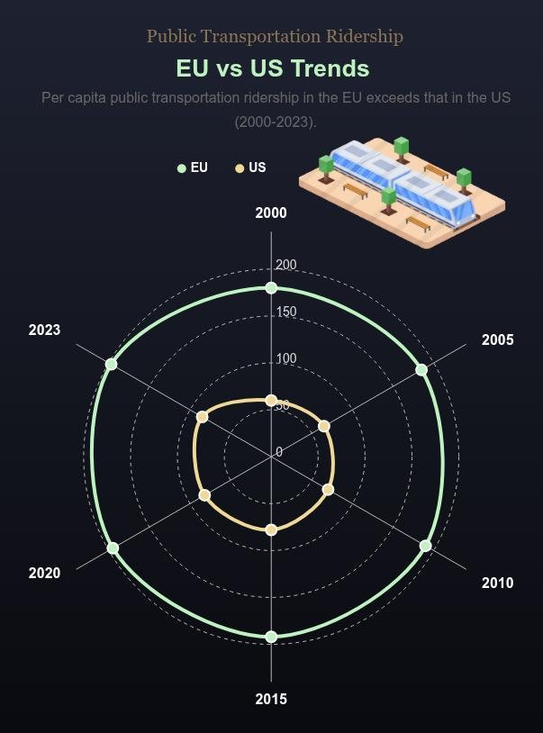<details class="ds-code"><summary>data（共 88 行，展示前 60 行）</summary><pre>{&#10;    "data": [&#10;        {&#10;            "Year": "2000",&#10;            "Ridership": 60.0,&#10;            "Region": "US"&#10;        },&#10;        {&#10;            "Year": "2000",&#10;            "Ridership": 180.0,&#10;            "Region": "EU"&#10;        },&#10;        {&#10;            "Year": "2005",&#10;            "Ridership": 65.0,&#10;            "Region": "US"&#10;        },&#10;        {&#10;            "Year": "2005",&#10;            "Ridership": 185.0,&#10;            "Region": "EU"&#10;        },&#10;        {&#10;            "Year": "2010",&#10;            "Ridership": 70.0,&#10;            "Region": "US"&#10;        },&#10;        {&#10;            "Year": "2010",&#10;            "Ridership": 190.0,&#10;            "Region": "EU"&#10;        },&#10;        {&#10;            "Year": "2015",&#10;            "Ridership": 78.0,&#10;            "Region": "US"&#10;        },&#10;        {&#10;            "Year": "2015",&#10;            "Ridership": 192.0,&#10;            "Region": "EU"&#10;        },&#10;        {&#10;            "Year": "2020",&#10;            "Ridership": 82.0,&#10;            "Region": "US"&#10;        },&#10;        {&#10;            "Year": "2020",&#10;            "Ridership": 195.0,&#10;            "Region": "EU"&#10;        },&#10;        {&#10;            "Year": "2023",&#10;            "Ridership": 85.0,&#10;            "Region": "US"&#10;        },&#10;        {&#10;            "Year": "2023",&#10;            "Ridership": 197.0,&#10;…（截断，原文共 88 行）</pre></details></div><div class="ds-card">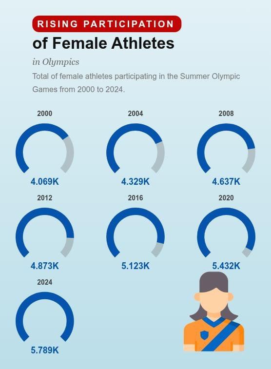<details class="ds-code"><summary>data（共 49 行）</summary><pre>{&#10;    "data": [&#10;        {&#10;            "Year": "2000",&#10;            "Total": 4069.0&#10;        },&#10;        {&#10;            "Year": "2004",&#10;            "Total": 4329.0&#10;        },&#10;        {&#10;            "Year": "2008",&#10;            "Total": 4637.0&#10;        },&#10;        {&#10;            "Year": "2012",&#10;            "Total": 4873.0&#10;        },&#10;        {&#10;            "Year": "2016",&#10;            "Total": 5123.0&#10;        },&#10;        {&#10;            "Year": "2020",&#10;            "Total": 5432.0&#10;        },&#10;        {&#10;            "Year": "2024",&#10;            "Total": 5789.0&#10;        }&#10;    ],&#10;    "columns": [&#10;        {&#10;            "name": "Year",&#10;            "description": "Year of the Summer Olympic Games (2000-2024)",&#10;            "data_type": "temporal",&#10;            "unit": "",&#10;            "role": "x"&#10;        },&#10;        {&#10;            "name": "Total",&#10;            "description": "Total number of female athletes participating in Summer Olympic sports",&#10;            "data_type": "numerical",&#10;            "unit": "",&#10;            "role": "y"&#10;        }&#10;    ],&#10;    "type_combination": "temporal + numerical"&#10;}</pre></details></div><div class="ds-card">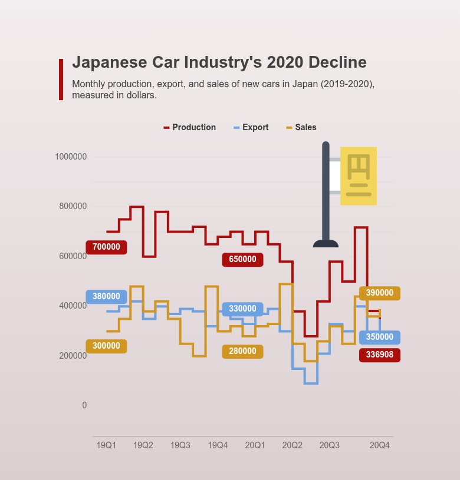<div class="ds-meta"><b>bench500 #427</b></div><details class="ds-code"><summary>prompt（共 44 行）</summary><pre>You are an expert data‐visualization engineer and front‐end developer.&#10;&#10;Your task is to take a chart image and generate a HTML file that, when loaded in a browser, reproduces the chart exactly. The chart must be centered in the viewport.&#10;&#10;## Constraints:&#10;- No Explanations: Do not include comments, reasoning, or explanatory text. Output only valid HTML with JavaScript code.&#10;&#10;## Technical Requirements&#10;- **Charting library**: Use D3.js to implement the chart. Write the code to be clean, modular, and easy to understand and modify.&#10;- **Single file output**: Provide one standalone HTML file that includes everything needed to render the chart.&#10;- **Chart fidelity**: Replicate all visual elements—shapes, colors, axes, labels, legends, fonts, line weights, markers—exactly as in the original image.&#10;- **No animations**: The chart must render immediately in its final state.&#10;- **Aspect ratio &amp; sizing**: The chart’s content area (including margins, paddings, and plot area) must match the original image’s proportions precisely.&#10;- **Image**: Recreate any icon/image content using SVG &lt;g&gt; and shapes. Do not use &lt;image&gt;, base64 images, or links.&#10;- **Text**: Place all text in &lt;text&gt; leaf nodes. Do not use &lt;tspan&gt; or nested text structures.&#10;&#10;## Grouping Requirements&#10;You should use following `class` names for SVG groups with specific semantics:&#10;- title: The title area (may contain title, subtitle, and shapes)&#10;- image: Each individual icon/image/pictogram (no annotation text, no grouped images)&#10;- legend: Legend area&#10;- axis: Axis area&#10;&#10;## Output Format&#10;Return only the following standalone HTML file:&#10;&#10;```html&#10;&lt;!DOCTYPE html&gt;&#10;&lt;html lang="en"&gt;&#10;    &lt;head&gt;&#10;        &lt;meta charset="UTF-8" /&gt;&#10;        &lt;title&gt;Recreated Chart&lt;/title&gt;&#10;        &lt;!-- &lt;style&gt; --&gt;&#10;    &lt;/head&gt;&#10;    &lt;body&gt;&#10;        &lt;div id="chart-container"&gt;&lt;/div&gt;&#10;        &lt;script src="https://d3js.org/d3.v7.min.js"&gt;&lt;/script&gt;&#10;        &lt;script&gt;&#10;            &lt;!-- Your D3 code here --&gt;&#10;        &lt;/script&gt;&#10;    &lt;/body&gt;&#10;&lt;/html&gt;&#10;```&#10;Only output this file. No comments or explanation. Keep it minimal and strictly within the token limits.</pre></details><details class="ds-code"><summary>svg（共 25 行）</summary><pre>&lt;svg xmlns="http://www.w3.org/2000/svg" xmlns:xlink="http://www.w3.org/1999/xlink" width="780" height="815" style="font-family: Arial, 'Liberation Sans', 'DejaVu Sans', sans-serif;"&gt;&#10;        &lt;defs&gt;&#10;    &lt;!-- 背景渐变 --&gt;&#10;    &lt;linearGradient id="gradient_4737" x1="0%" y1="0%" x2="0%" y2="100%"&gt;&#10;        &lt;stop offset="0%" stop-color="#F2EDEE" /&gt;&#10;        &lt;stop offset="100%" stop-color="#dccfd2" /&gt;&#10;    &lt;/linearGradient&gt;&#10;&lt;/defs&gt;&#10;&#10;&lt;!-- 背景矩形 --&gt;&#10;&lt;rect x="0" y="0" width="780" height="815" fill="url(#gradient_4737)" /&gt;&#10;        &lt;g class="chart" transform="translate(100, 207)"&gt;&lt;g xmlns="http://www.w3.org/2000/svg" xmlns:xlink="http://www.w3.org/1999/xlink" transform="translate(-2.8000000000000114, -5.692957746478868)"&gt;             &lt;g xmlns="http://www.w3.org/2000/svg" xmlns:xlink="http://www.w3.org/1999/xlink" trans …（本行原长 8588 字符）&#10;        &lt;g class="text" fill="#414141" transform="translate(100, 100)"&gt;&lt;g xmlns="http://www.w3.org/2000/svg" class="title" transform="translate(22.22, -5)"&gt;&lt;rect x="0" y="0" width="7" height="70" fill="#aa0f0e" transform="translate(-22.22, 5) translate(0, 0)"/&gt;&lt;text dominant-baseline="hanging" text- …（本行原长 898 字符）&#10;        &#10;                &lt;image&#10;                    class="image"&#10;                    x="495"&#10;                    y="240"&#10;                    width="180"&#10;                    height="180"&#10;                    preserveAspectRatio="none"&#10;                    href=" …（本行原长 7581 字符）&#10;                    opacity="1"&#10;                /&gt;&#10;&lt;/svg&gt;</pre></details><details class="ds-code"><summary>data.json</summary><pre>[&#10; {&#10;  "Month": "2019-01",&#10;  "Dollars": 700000.0,&#10;  "Business Functions": "Production"&#10; },&#10; {&#10;  "Month": "2019-01",&#10;  "Dollars": 380000.0,&#10;  "Business Functions": "Export"&#10; },&#10; {&#10;  "Month": "2019-01",&#10;  "Dollars": 300000.0,&#10;  "Business Functions": "Sales"&#10; },&#10; {&#10;  "Month": "2019-02",&#10;  "Dollars": 750000.0,&#10;  "Business Functions": "Production"&#10; },&#10; {&#10;  "Month": "2019-02",&#10;  "Dollars": 400000.0,&#10;  "Business Functions": "Export"&#10; },&#10; {&#10;  "Month": "2019-02",&#10;  "Dollars": 350000.0,&#10;  "Business Functions": "Sales"&#10; },&#10; {&#10;  "Month": "2019-03",&#10;  "Dollars": 800000.0,&#10;  "Business Functions": "Production"&#10; },&#10; {&#10;  "Month": "2019-03",&#10;  "Dollars": 420000.0,&#10;  "Business Functions": "Export"&#10; },&#10; {&#10;  "Month": "2019-03",&#10;  "Dollars": 480000.0,&#10;  "Business Functions": "Sales"&#10; }&#10;]</pre></details></div></div></div>

- **定位**：百万级「信息图表 + 数据表 + D3.js 代码」数据，给 VLM 补上「设计感强的图表」这一块的理解与 chart-to-code 能力

<figure class="paper-fig">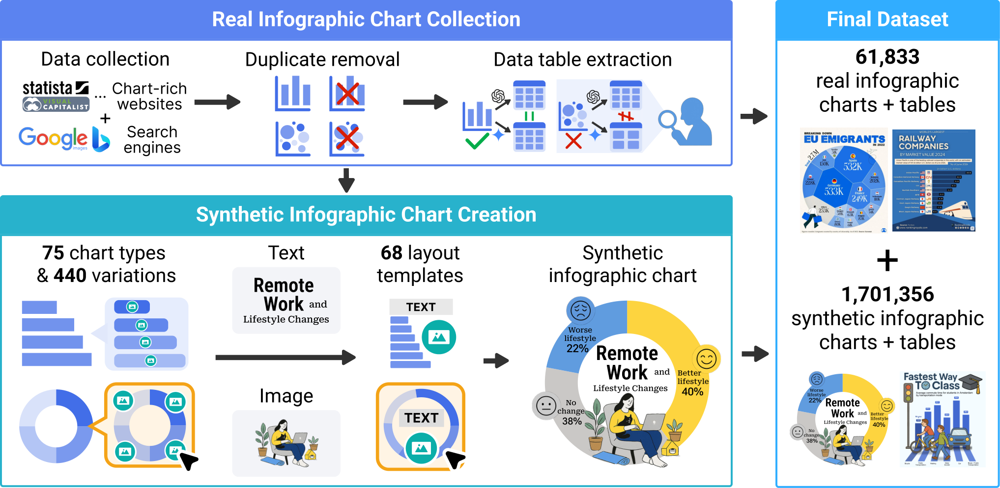<figcaption>ChartGalaxy · Fig. 2：上半部收集真实信息图并抽表，下半部用归纳出的图型、变体和布局模板程序化合成</figcaption></figure>

- **自动化合成流程**（对照上图，先上排再下排，从左往右读）
  1. **Data collection**：从 18 个允许研究使用的图表网站（Visual Capitalist、Statista 等）爬取，再用 Google / Bing 图片搜索补充，只保留 CC 许可的图；爬虫加平台许可过滤器完成
  2. **Duplicate removal**：用感知哈希加 CLIP 相似度去重（程序）
  3. **Data table extraction**：Gemini-2.0-Flash 和 GPT-4o-mini 并行抽表，两者一致就直接收；不一致时由 GPT-4o 第三票裁决，还不一致才交人工。产出 61,833 张带表的真实图
  4. **75 chart types & 440 variations**：人工参照 Data Viz Project、Datylon 两套分类，归纳出 75 类图型、440 种视觉变体，全部用 D3.js 实现成可参数化的渲染程序
  5. **Text** / **Image**
     - 文字：先检索后生成。Sentence-BERT 按主题和数据事实检索 3 张最相关的真实图作为 in-context 示例，再让 Gemini-2.0-Flash 写标题和副标题
     - 图片：从 Icon645、Noun Project 等来源建图标库，先用启发式规则去掉墨水比低、分辨率差、长宽比极端的图，再由 Gemini-2.0-Flash 给每张图写关键词和描述，剔除过于写实或杂乱的，最后得到 681,459 张。检索时拿 Sentence-BERT 比对关键词和标题
  6. **68 layout templates**：人在环路里扩展模板。3 位作者先在 1,500 张真实图上标框，归纳出 55 个模板 → 用这些模板合成 12 万张带框图，训练 InternImage + DINO 检测器 → 在未标注真实图上检测元素（文字用 PP-OCRv4）→ LTSim 相似度低的布局作为候选 → k-means 聚类后人工看中心，新增 13 个模板，共 68 个
  7. **Synthetic infographic chart**：数据表先按规则映射出候选图型，候选有多个时由 Gemini-2.0-Flash 挑；变体用 adaptive sampling 抽，偏向出现少的变体；配色取自真实图的调色板。布局求解时先滤掉与元素冲突的模板，再对剩下的做网格搜索式紧凑排布（约束问题），选墨水比最高的那个
  - （图外）**数据表来源**：真实表 200,085 张（VizNet、UN data、Our World in Data、Papers with Code），另有 Gemini-2.0-Flash 合成的 98,483 张；每张表都由 Gemini-2.0-Flash 补一个主题和若干数据事实
- **质量控制**
  - 真实图抽表：43.6% 在双模型一致时直接接受；剩下 56.4% 里，GPT-4o 解决了 76.2%。合计 86.6% 全自动完成，13.4% 由人工校正。抽查 200 条完全一致的样本，全部正确
  - 一致性判据：数据点数相同、列名和类别值相同、数值偏差 ≤ 5%
  - 敏感话题：用 Gemini-2.0-Flash 过滤宗教冲突、可识别个人的医疗记录等内容
  - 合成图的配套框标注来自程序本身，不需要人工
- **关键数字**
  - 规模：1,701,356 张合成图 + 61,833 张真实图；75 类图型 / 440 种变体 / 68 个模板
  - 指令集：从 70,248 张图生成 443,455 条 QA
  - 下游：InternVL3-8B 在 InfographicVQA 上 +3.80、ChartQAPro 上 +5.98；Qwen2.5-VL-7B 分别 +4.44、+3.59；在自建评测集上整体 +26.87 / +23.85
  - 消融（InternVL3-8B，自建评测集）：只训真实图 55.74，只训合成图 76.08，两者都训 80.07
  - 代码基准：500 张合成图，测 D3.js 复现；Gemini-2.5-Pro 最高，总分 85.21
- **局限**
  - 只有单图信息图，没有多图叙事（论文自述）
  - 真实图只发布 URL，不发原图
  - 合成图的收益主要体现在自建集上；InternVL3 在 ChartQAPro 上只训真实图（42.58）反而略高于只训合成图（41.76）
  - 模板扩展和抽表的兜底环节仍依赖人工
- **可借鉴**
  - 「归纳 → 程序化」闭环：先从真实数据里抽图型、变体、模板，再用合成数据训检测器反过来挖掘新模板
  - 双模型交叉抽取、第三模型仲裁、最后才人工兜底：把人工比例压到 13.4%
  - 用墨水比加最小间距约束做自动排版，美观度指标可以直接算出来

</div></div>

<div class="sg-body" id="sg-cosyn-400k--opendata"><div class="sg-bar"><span class="deep-title"> <a href="https://arxiv.org/abs/2502.14846">CoSyn-400K</a> <span class="org">AllenAI</span> <a class="hf" href="https://huggingface.co/datasets/allenai/CoSyn-400K"><span class="hf-b hf-dl" title="downloads"><svg class="hf-i" viewBox="0 0 24 24" fill="none" stroke="currentColor" stroke-width="2.2" stroke-linecap="round" stroke-linejoin="round"><path d="M12 3v11"/><path d="M8 11l4 4 4-4"/><path d="M4 20h16"/></svg>11.0k</span><span class="hf-b hf-lk" title="likes"><svg class="hf-i" viewBox="0 0 24 24" fill="currentColor"><path d="M12 21C7 17.5 3 14 3 9.5 3 7 5 5 7.5 5 9.2 5 10.7 6 12 7.6 13.3 6 14.8 5 16.5 5 19 5 21 7 21 9.5 21 14 17 17.5 12 21z"/></svg>53</span></a></span><span class="sg-nav"><button type="button" class="sg-prev" title="上一个（←）">‹</button><span class="sg-pos"></span><button type="button" class="sg-next" title="下一个（→）">›</button><button type="button" class="sg-x" title="关闭（Esc）">✕</button></span></div><div class="sg-stage">

<div class="ds-demo"><div class="ds-head"><b>数据样例</b> · <a href="https://huggingface.co/datasets/allenai/CoSyn-400K">allenai/CoSyn-400K</a></div><div class="ds-grid"><div class="ds-card"><details class="ds-code"><summary>code（共 48 行）</summary><pre>import numpy as np&#10;import matplotlib.pyplot as plt&#10;import io&#10;from PIL import Image&#10;&#10;def generate_plot(data):&#10;    plt.style.use('seaborn-v0_8-whitegrid')&#10;    &#10;    # Prepare data&#10;    x = data['Wait_Time_Minutes']&#10;    y = data['Frequency']&#10;    &#10;    # Create figure and axis&#10;    fig, ax = plt.subplots(figsize=(12, 8))&#10;    &#10;    # Create hexbin plot&#10;    hb = ax.hexbin(x, y, gridsize=15, cmap='viridis', edgecolors='white')&#10;    &#10;    # Customize plot&#10;    ax.set_title('Patient Wait Times vs Frequency', fontsize=20, fontweight='bold', pad=20)&#10;    ax.set_xlabel('Wait Time (Minutes)', fontsize=14, labelpad=15)&#10;    ax.set_ylabel('Frequency', fontsize=14, labelpad=15)&#10;    &#10;    # Add colorbar&#10;    cbar = plt.colorbar(hb, ax=ax)&#10;    cbar.set_label('Count', rotation=270, labelpad=20, fontsize=12)&#10;    &#10;    # Customize ticks&#10;    ax.tick_params(axis='both', which='major', labelsize=12)&#10;    &#10;    # Add text annotations for departments&#10;    for _, row in data.iterrows():&#10;        ax.annotate(row['Department'], (row['Wait_Time_Minutes'], row['Frequency']),&#10;                    xytext=(5, 5), textcoords='offset points', fontsize=8,&#10;                    bbox=dict(boxstyle="round,pad=0.3", fc="white", ec="gray", alpha=0.8))&#10;    &#10;    # Adjust layout&#10;    plt.tight_layout()&#10;    &#10;    # Save plot to BytesIO object&#10;    buf = io.BytesIO()&#10;    plt.savefig(buf, format='png', dpi=300, bbox_inches='tight')&#10;    buf.seek(0)&#10;    &#10;    # Convert to PIL Image&#10;    img = Image.open(buf)&#10;    &#10;    return img</pre></details><details class="ds-code"><summary>data（共 23 行）</summary><pre>Department,Urgency,Wait_Time_Minutes,Frequency&#10;Emergency,Critical,15,30&#10;Emergency,High,45,50&#10;Emergency,Medium,90,70&#10;Emergency,Low,180,40&#10;Cardiology,High,60,25&#10;Cardiology,Medium,120,45&#10;Cardiology,Low,240,30&#10;Oncology,High,45,20&#10;Oncology,Medium,90,35&#10;Oncology,Low,180,25&#10;Orthopedics,High,75,15&#10;Orthopedics,Medium,150,30&#10;Orthopedics,Low,270,20&#10;Pediatrics,High,30,35&#10;Pediatrics,Medium,75,55&#10;Pediatrics,Low,150,40&#10;Radiology,High,40,30&#10;Radiology,Medium,90,50&#10;Radiology,Low,180,35&#10;Neurology,High,55,20&#10;Neurology,Medium,110,40&#10;Neurology,Low,220,25</pre></details><details class="ds-code"><summary>qa_pairs（共 26 行）</summary><pre>Q1: What is the title of the figure?&#10;A: Patient Wait Times vs Frequency&#10;&#10;Q2: What is the range of wait times shown on the x-axis?&#10;A: 15 to 270 minutes&#10;&#10;Q3: Which department has the highest wait time for the 'Low' urgency level?&#10;A: Orthopedics&#10;&#10;Q4: How many departments have a wait time of at least 180 minutes for the 'Low' urgency level?&#10;A: Three departments&#10;&#10;Q5: What is the color representing the highest density of data points?&#10;A: Dark purple&#10;&#10;Q6: Between Pediatrics and Neurology, which department has a lower average wait time for the 'High' urgency level?&#10;A: Pediatrics&#10;&#10;Q7: Which urgency level seems to exhibit the widest range of wait times across all departments?&#10;A: Low&#10;&#10;Q8: How does the frequency distribution of 'Medium' urgency levels compare between Oncology and Radiology?&#10;A: Radiology has a higher frequency for 'Medium' urgency&#10;&#10;Q9: Which department has the closest frequency for 'High' urgency levels to the Emergency department?&#10;A: Radiology</pre></details><details class="ds-code"><summary>metadata（共 5 行）</summary><pre>{&#10; "figure_type": "Hexbin Plot",&#10; "persona": "A nurse navigator who helps patients navigate the complex healthcare system and access necessary treatments",&#10; "topic": "Patient wait times across different departments in a hospital, broken down by urgency levels"&#10;}</pre></details></div><div class="ds-card">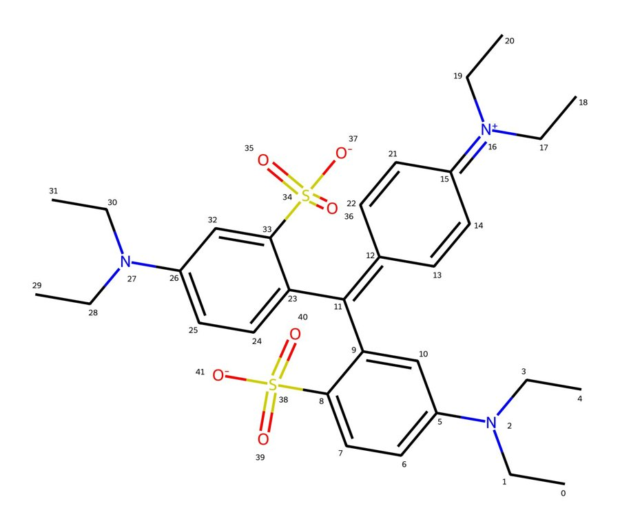<details class="ds-code"><summary>code（共 1 行）</summary><pre>CCN(CC)c1ccc(c(c1)C(=C2C=CC(=[N+](CC)CC)C=C2)c3ccc(N(CC)CC)cc3S(=O)(=O)[O-])S(=O)(=O)[O-]</pre></details><details class="ds-code"><summary>data（共 1 行）</summary><pre>CCN(CC)c1ccc(c(c1)C(=C2C=CC(=[N+](CC)CC)C=C2)c3ccc(N(CC)CC)cc3S(=O)(=O)[O-])S(=O)(=O)[O-]</pre></details><details class="ds-code"><summary>qa_pairs（共 17 行）</summary><pre>Q1: What is the main functional group present in this chemical structure?&#10;A: sulfonyl&#10;&#10;Q2: How many nitrogen atoms are in this chemical?&#10;A: three&#10;&#10;Q3: What type of chemical compound is this classified as?&#10;A: sulfonamide&#10;&#10;Q4: In which element does this chemical primarily derive its green color?&#10;A: nitrogen&#10;&#10;Q5: What is the total number of carbon atoms present in this compound?&#10;A: twenty-five&#10;&#10;Q6: Why might this compound be used in food coloring for St. Patrick's Day?&#10;A: stability</pre></details><details class="ds-code"><summary>metadata（共 5 行）</summary><pre>{&#10; "figure_type": "drug",&#10; "persona": "A young Brazilian engineer taking evening classes to learn about Irish literature and folklore",&#10; "topic": "The chemical components of green food coloring used in St. Patrick's Day celebrations"&#10;}</pre></details></div><div class="ds-card">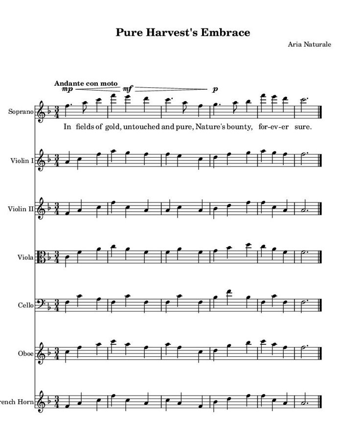<details class="ds-code"><summary>code（共 91 行，展示前 60 行）</summary><pre>\version "2.22.1"&#10;&#10;\paper {&#10;  #(set-paper-size "a4")&#10;  top-margin = 20&#10;  bottom-margin = 20&#10;  left-margin = 20&#10;  right-margin = 20&#10;  indent = 0&#10;  ragged-last-bottom = ##f&#10;}&#10;&#10;\header {&#10;  title = "Pure Harvest's Embrace"&#10;  composer = "Aria Naturale"&#10;  tagline = ##f&#10;}&#10;&#10;global = {&#10;  \key f \major&#10;  \time 3/4&#10;  \tempo "Andante con moto"&#10;}&#10;&#10;soprano = \relative c'' {&#10;  \global&#10;  \dynamicUp&#10;  f4.\mp\&lt; a8 c4 &#124; f e\mf\&gt; d &#124; c4. a8 f4 &#124; g4.\p a8 bes4 &#124; &#10;  f' e d &#124; c2.&#10;  \bar "&#124;."&#10;}&#10;&#10;violinI = \relative c'' {&#10;  \global&#10;  a4 c f &#124; a g f &#124; f e c &#124; d f g &#124;&#10;  a g f &#124; f2.&#10;}&#10;&#10;violinII = \relative c'' {&#10;  \global&#10;  f,4 a c &#124; f c a &#124; a c a &#124; bes d f &#124;&#10;  f c a &#124; a2.&#10;}&#10;&#10;viola = \relative c' {&#10;  \global&#10;  c4 f a &#124; c a f &#124; f a f &#124; g bes d &#124;&#10;  c a f &#124; f2.&#10;}&#10;&#10;cello = \relative c {&#10;  \global&#10;  f4 c' a &#124; f c' f, &#124; f c' f, &#124; bes f' bes, &#124;&#10;  f c' f, &#124; f2.&#10;}&#10;&#10;oboe = \relative c'' {&#10;  \global&#10;  c4 f a &#124; c a f &#124; a f c &#124; d g bes &#124;&#10;  c a f &#124; f2.&#10;…（截断，原文共 91 行）</pre></details><details class="ds-code"><summary>data（共 34 行）</summary><pre>{&#10;  "song_title": "Pure Harvest's Embrace",&#10;  "composer": "Aria Naturale",&#10;  "time_signature": "3/4",&#10;  "key_signature": "F major",&#10;  "tempo": "Andante con moto",&#10;  "instrumentation": [&#10;    "Soprano voice",&#10;    "Violin I",&#10;    "Violin II",&#10;    "Viola",&#10;    "Cello",&#10;    "Oboe",&#10;    "French Horn"&#10;  ],&#10;  "melody": {&#10;    "notes": "F4 A4 C5 &#124; F5 E5 D5 &#124; C5 A4 F4 &#124; G4 Bb4 D5 &#124; F5 E5 D5 &#124; C5 - - &#124;",&#10;    "rhythm": "4. 8 4 &#124; 4 4 4 &#124; 4. 8 4 &#124; 4. 8 4 &#124; 4 4 4 &#124; 2. &#124;"&#10;  },&#10;  "harmony": [&#10;    "F major",&#10;    "C7",&#10;    "F major",&#10;    "Bb major",&#10;    "C7",&#10;    "F major"&#10;  ],&#10;  "lyrics": "In fields of gold, untouched and pure,\nNature's bounty, forever sure.\nNo poison here, just Earth's sweet yield,\nA harvest blessed, in this fair field.",&#10;  "dynamics": "mp &lt; mf &gt; p",&#10;  "articulation": "legato",&#10;  "ornaments": "grace notes on 'pure' and 'yield'",&#10;  "mood": "serene and nostalgic",&#10;  "scene_description": "A soprano sings while overlooking a vast, pesticide-free wheat field at sunset, emphasizing the beauty and purity of natural farming methods."&#10;}</pre></details><details class="ds-code"><summary>qa_pairs（共 20 行）</summary><pre>Q1: What is the key signature of this music?&#10;A: F major&#10;&#10;Q2: What is the time signature of this piece?&#10;A: 3/4&#10;&#10;Q3: What is the tempo marking of this score?&#10;A: Andante con moto&#10;&#10;Q4: How many measures does the soprano staff contain?&#10;A: 6&#10;&#10;Q5: Which instruments are included in the ensemble?&#10;A: Soprano, Violin I, Violin II, Viola, Cello, Oboe, French Horn&#10;&#10;Q6: What mood or theme does the text of the piece suggest?&#10;A: Purity and idyllic rural life&#10;&#10;Q7: What is the dynamics marking at the beginning of the soprano part?&#10;A: mezzo-piano</pre></details><details class="ds-code"><summary>metadata（共 5 行）</summary><pre>{&#10; "figure_type": "Opera",&#10; "persona": "A nutritionist skeptical about the health effects of chemical pesticides in food production",&#10; "topic": "Romantic operas set in idyllic rural communities untouched by chemical pesticides"&#10;}</pre></details></div></div></div>

- **定位**：用纯文本 LLM 写渲染代码来批量造「富文本图 + 指令」，一套框架覆盖图表、文档、表格、图示、乐谱、电路、化学结构等 9 类

<figure class="paper-fig">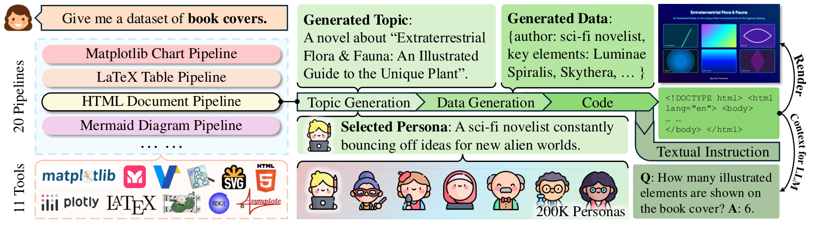<figcaption>CoSyn-400K · Fig. 2：一句查询选中渲染管线，persona 驱动主题，LLM 依次写数据和代码，渲染出图，再以代码为上下文生成问答</figcaption></figure>

- **自动化合成流程**（对照上图，从左往右读）
  1. **20 Pipelines / 11 Tools**：根据用户查询（如 "book covers"）选一条管线。11 种渲染工具包括 Matplotlib、Plotly、Vega-Lite、LaTeX、HTML、Mermaid、Graphviz、SVG、Asymptote、LilyPond、RDKit；每种工具都有对应的执行函数
  2. **Selected Persona**：从 Ge et al. 发布的 20 万个 persona 里采样一个，塞进 prompt，用来打散 LLM 的输出分布
  3. **Topic Generation**：LLM 以 persona 为条件，一次生成若干个不重叠的主题
  4. **Data Generation**：Claude-3.5-Sonnet 按主题生成 JSON 格式的具体内容，prompt 要求用真实实体名，禁止 xxA、[Name] 这类占位
  5. **Code**：Claude-3.5-Sonnet 把数据硬编码进单文件渲染代码，prompt 要求单页、不重叠、不引用外部文件
  6. **Render**：执行代码，得到图片
  7. **Textual Instruction**（Context for LLM）：只把数据和代码给 GPT-4o-mini（不给图），让它生成「问题 | 解释 | 短答案」三元组，每张图 5–10 条，天然带 CoT
  - （图外）**Pointing 数据**：让 LLM 读源码，提一个指点类问题，并改代码在答案位置画上指定颜色的点；再从像素里读出 (x, y)，归一化到 0–100
- **质量控制**
  - 论文没有单独的过滤、去重或打分环节，也没给丢弃比例；质量主要靠三点：代码必须能执行出图、prompt 约束、选用强代码模型
  - 生成模型对比：各造 10 万张图表后，用 Claude-3.5-Sonnet 数据训出的模型 ChartQA 77.2，用 GPT-4o 的只有 72.4；GPT-4o 在冷门库上的代码失败率更高
  - 多样性量化：图像用 CLIP、文本用 Sentence-BERT 算平均两两余弦距离；图表子集的图像多样性 0.596，ChartQA 是 0.340
- **关键数字**
  - 规模：40 万张图、270 万条指令、9 类图像；文档一类就用了 100 多个查询
  - 成本：40 万张图约 8,000 美元
  - 下游：7B 模型（CLIP ViT-L/14 + Mistral-7B，沿用 Molmo 训练流程）在 7 个富文本基准上平均 80.9，比 Llama 3.2 11B 高 3.9；不看任何评测集训练数据的 zero-shot 版本也有 74.7
  - 工具多样性：同样 45K 张图，只用 Matplotlib 时 ChartQA 73.9，换成 5 种工具混合后 75.2
  - 新任务：只合成 7K 张营养成分表样本，就在 NutritionQA 上超过大多数开源 VLM
  - Pointing：65K 张合成图的效果接近 155K 张人工标注图（ScreenSpot 68.0 vs 68.5）；两者合并 74.9，超过用 130 万张截图训练的 UGround（73.3）
  - 去偏：ChartQA 上人写问题与机器生成问题之间的分差，从 21.8 降到 14.2
- **局限**
  - 效果高度依赖 prompt 和渲染管线的设计；小众领域要单独做 prompt 工程（论文自述）
  - 只有英文
  - 缺少显式质检，渲染成功但画面有瑕疵（比如文字重叠）的样本可能混进来（推断）
- **可借鉴**
  - 把代码当图文之间的桥：问答只看源码生成，答案可以做到精确，不依赖 VLM 去读图
  - persona 条件采样是低成本的多样性开关
  - 同一类图用多种渲染工具生成，本身就是有效的增强
  - 改源码画点来造 grounding 数据，坐标可以从像素里读出来，不用人标

</div></div>

<div class="sg-body" id="sg-design2code--opendata"><div class="sg-bar"><span class="deep-title">  <a href="https://arxiv.org/abs/2403.03163">Design2Code</a> <span class="org">Google DeepMind · Stanford</span> <a class="hf" href="https://huggingface.co/datasets/SALT-NLP/Design2Code"><span class="hf-b hf-dl" title="downloads"><svg class="hf-i" viewBox="0 0 24 24" fill="none" stroke="currentColor" stroke-width="2.2" stroke-linecap="round" stroke-linejoin="round"><path d="M12 3v11"/><path d="M8 11l4 4 4-4"/><path d="M4 20h16"/></svg>1.8k</span><span class="hf-b hf-lk" title="likes"><svg class="hf-i" viewBox="0 0 24 24" fill="currentColor"><path d="M12 21C7 17.5 3 14 3 9.5 3 7 5 5 7.5 5 9.2 5 10.7 6 12 7.6 13.3 6 14.8 5 16.5 5 19 5 21 7 21 9.5 21 14 17 17.5 12 21z"/></svg>22</span></a></span><span class="sg-nav"><button type="button" class="sg-prev" title="上一个（←）">‹</button><span class="sg-pos"></span><button type="button" class="sg-next" title="下一个（→）">›</button><button type="button" class="sg-x" title="关闭（Esc）">✕</button></span></div><div class="sg-stage">

<div class="ds-demo"><div class="ds-head"><b>数据样例</b> · <a href="https://huggingface.co/datasets/SALT-NLP/Design2Code">SALT-NLP/Design2Code</a></div><div class="ds-grid"><div class="ds-card"><div class="ds-meta"><b>5485.png</b></div><details class="ds-code"><summary>5485.html（共 419 行，展示前 60 行）</summary><pre>&lt;!DOCTYPE html&gt;&#10;&lt;html lang="en"&gt;&#10; &lt;head&gt;&#10;  &lt;meta content="text/html; charset=utf-8" http-equiv="Content-Type"&gt;&#10;  &lt;meta content="Hey everyone. Well, the dream has finally been realized. quixfox.com is up and running, thanks mostly to the time, patience, and dinero of my loving mother, Meredith Fox. But really, thanks mom." name="description"&gt;&#10;  &lt;meta content="Hey everyone. Well, the dream has finally been realized. quixfox.com is up and running, thanks mostly to the time, patience, and dinero of my loving mother, Meredith Fox. But really, thanks mom." property="og:description"&gt;&#10;  &lt;meta content="David Fox" name="author"&gt;&#10;  &lt;meta content="ZPPhoaxZwCeh2Cxm_q4zLTl8DsIAOuEy09hTVpj8Rq8" name="google-site-verification"&gt;&#10;  &lt;meta content="width=device-width, initial-scale=1" name="viewport"&gt;&#10;  &lt;meta content="website" property="og:type"&gt;&#10;  &lt;meta content="" property="og:image"&gt;&#10;  &lt;meta content="1800" property="og:image:width"&gt;&#10;  &lt;meta content="1105" property="og:image:height"&gt;&#10;  &lt;title&gt;&#10;   4 Beds In 4 Days [david@quixfox]&#10;  &lt;/title&gt;&#10;  &lt;meta content="4 Beds In 4 Days [david@quixfox]" name="title" property="og:title"&gt;&#10;  &lt;style&gt;&#10;   @font-face {&#10;  font-family: 'Alegreya';&#10;  font-style: italic;&#10;  font-weight: 400;&#10;  font-display: swap;&#10;  src: url(https://fonts.gstatic.com/s/alegreya/v35/4UaSrEBBsBhlBjvfkSLk3abBFkvpkARTPlbgv5qhmSA.ttf) format('truetype');&#10;}&#10;@font-face {&#10;  font-family: 'Alegreya';&#10;  font-style: italic;&#10;  font-weight: 700;&#10;  font-display: swap;&#10;  src: url(https://fonts.gstatic.com/s/alegreya/v35/4UaSrEBBsBhlBjvfkSLk3abBFkvpkARTPlYHuJqhmSA.ttf) format('truetype');&#10;}&#10;@font-face {&#10;  font-family: 'Alegreya';&#10;  font-style: italic;&#10;  font-weight: 900;&#10;  font-display: swap;&#10;  src: url(https://fonts.gstatic.com/s/alegreya/v35/4UaSrEBBsBhlBjvfkSLk3abBFkvpkARTPlZJuJqhmSA.ttf) format('truetype');&#10;}&#10;@font-face {&#10;  font-family: 'Alegreya';&#10;  font-style: normal;&#10;  font-weight: 400;&#10;  font-display: swap;&#10;  src: url(https://fonts.gstatic.com/s/alegreya/v35/4UacrEBBsBhlBjvfkQjt71kZfyBzPgNG9hU4-6qm.ttf) format('truetype');&#10;}&#10;@font-face {&#10;  font-family: 'Alegreya';&#10;  font-style: normal;&#10;  font-weight: 700;&#10;  font-display: swap;&#10;  src: url(https://fonts.gstatic.com/s/alegreya/v35/4UacrEBBsBhlBjvfkQjt71kZfyBzPgNGERI4-6qm.ttf) format('truetype');&#10;}&#10;@font-face {&#10;  font-family: 'Alegreya';&#10;  font-style: normal;&#10;  font-weight: 900;&#10;  font-display: swap;&#10;  src: url(https://fonts.gstatic.com/s/alegreya/v35/4UacrEBBsBhlBjvfkQjt71kZfyBzPgNGXxI4-6qm.ttf) format('truetype');&#10;}&#10;…（截断，原文共 419 行）</pre></details></div><div class="ds-card">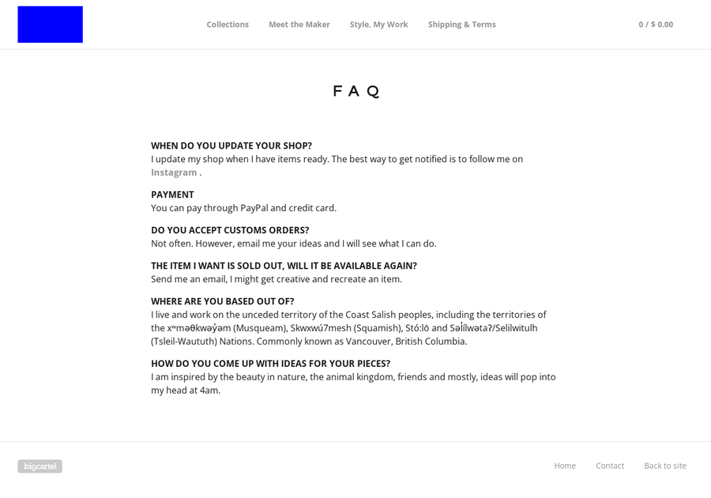<div class="ds-meta"><b>13004.png</b></div><details class="ds-code"><summary>13004.html（共 3042 行，展示前 60 行）</summary><pre>&lt;!DOCTYPE html&gt;&#10;&lt;html&gt;&#10; &lt;head&gt;&#10;  &lt;style&gt;&#10;   /* Magnific Popup CSS */&#10;&#10;.mfp-bg {&#10;  top: 0;&#10;  left: 0;&#10;  width: 100%;&#10;  height: 100%;&#10;  z-index: 1042;&#10;  overflow: hidden;&#10;  position: fixed;&#10;  background: #0b0b0b;&#10;  opacity: 0.8;&#10;  filter: alpha(opacity=80); }&#10;&#10;.mfp-wrap {&#10;  top: 0;&#10;  left: 0;&#10;  width: 100%;&#10;  height: 100%;&#10;  z-index: 1043;&#10;  position: fixed;&#10;  outline: none !important;&#10;  -webkit-backface-visibility: hidden; }&#10;&#10;.mfp-container {&#10;  text-align: center;&#10;  position: absolute;&#10;  width: 100%;&#10;  height: 100%;&#10;  left: 0;&#10;  top: 0;&#10;  padding: 0 8px;&#10;  -webkit-box-sizing: border-box;&#10;  -moz-box-sizing: border-box;&#10;  box-sizing: border-box; }&#10;&#10;.mfp-container:before {&#10;  content: '';&#10;  display: inline-block;&#10;  height: 100%;&#10;  vertical-align: middle; }&#10;&#10;.mfp-align-top .mfp-container:before {&#10;  display: none; }&#10;&#10;.mfp-content {&#10;  position: relative;&#10;  display: inline-block;&#10;  vertical-align: middle;&#10;  margin: 0 auto;&#10;  text-align: left;&#10;  z-index: 1045; }&#10;&#10;.mfp-inline-holder .mfp-content, .mfp-ajax-holder .mfp-content {&#10;  width: 100%;&#10;  cursor: auto; }&#10;…（截断，原文共 3042 行）</pre></details></div><div class="ds-card">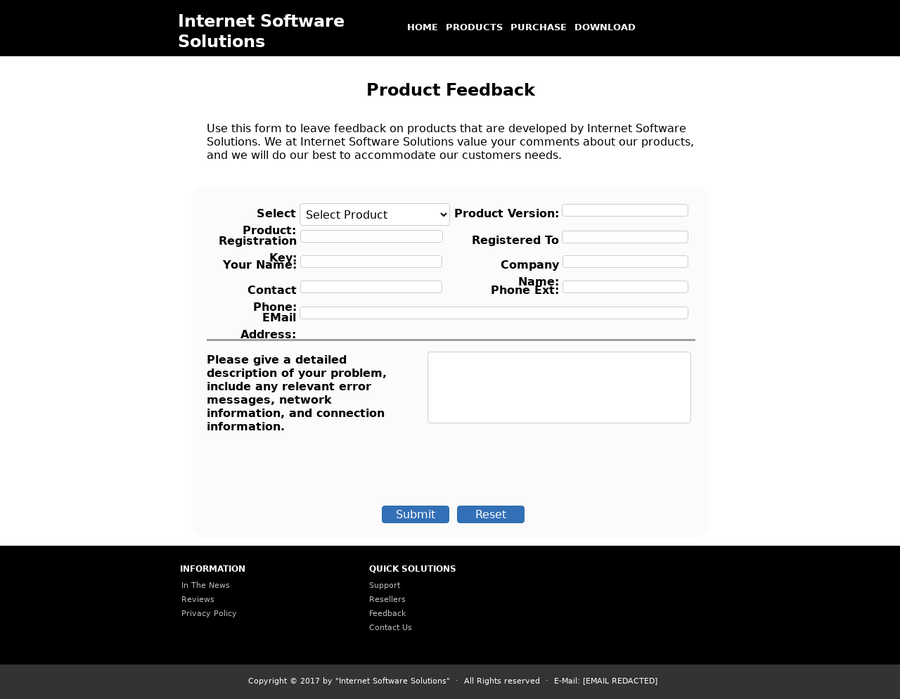<div class="ds-meta"><b>10564.png</b></div><details class="ds-code"><summary>10564.html（共 2279 行，展示前 60 行）</summary><pre>&lt;!DOCTYPE html PUBLIC "-//W3C//DTD HTML 4.01 Transitional//EN" ""&gt;&#10;&lt;html&gt;&#10; &lt;head&gt;&#10;  &lt;style&gt;&#10;   /*! jQuery UI - v1.12.1 - 2017-03-26&#10;* http://jqueryui.com&#10;* Includes: draggable.css, core.css, resizable.css, selectable.css, sortable.css, accordion.css, autocomplete.css, menu.css, button.css, controlgroup.css, checkboxradio.css, datepicker.css, dialog.css, progressbar.css, selectmenu.css, slider.css, spinner.css, tabs.css, tooltip.css, theme.css&#10;* To view and modify this theme, visit http://jqueryui.com/themeroller/?scope=&amp;folderName=base&amp;cornerRadiusShadow=8px&amp;offsetLeftShadow=0px&amp;offsetTopShadow=0px&amp;thicknessShadow=5px&amp;opacityShadow=30&amp;bgImgOpacityShadow=0&amp;bgTextureShadow=flat&amp;bgColorShadow=666666&amp;opacityOverlay=30&amp;bgImgOpacityOverlay=0&amp;bgTextureOverlay=flat&amp;bgColorOverlay=aaaaaa&amp;iconColorError=cc0000&amp;fcError=5f3f3f&amp;borderColorError=f1a…（本行共 1188 字符）&#10;* Copyright jQuery Foundation and other contributors; Licensed MIT */&#10;&#10;.ui-draggable-handle {&#10;	-ms-touch-action: none;&#10;	touch-action: none;&#10;}&#10;/* Layout helpers&#10;----------------------------------*/&#10;.ui-helper-hidden {&#10;	display: none;&#10;}&#10;.ui-helper-hidden-accessible {&#10;	border: 0;&#10;	clip: rect(0 0 0 0);&#10;	height: 1px;&#10;	margin: -1px;&#10;	overflow: hidden;&#10;	padding: 0;&#10;	position: absolute;&#10;	width: 1px;&#10;}&#10;.ui-helper-reset {&#10;	margin: 0;&#10;	padding: 0;&#10;	border: 0;&#10;	outline: 0;&#10;	line-height: 1.3;&#10;	text-decoration: none;&#10;	font-size: 100%;&#10;	list-style: none;&#10;}&#10;.ui-helper-clearfix:before,&#10;.ui-helper-clearfix:after {&#10;	content: "";&#10;	display: table;&#10;	border-collapse: collapse;&#10;}&#10;.ui-helper-clearfix:after {&#10;	clear: both;&#10;}&#10;.ui-helper-zfix {&#10;	width: 100%;&#10;	height: 100%;&#10;	top: 0;&#10;	left: 0;&#10;	position: absolute;&#10;	opacity: 0;&#10;	filter:Alpha(Opacity=0); /* support: IE8 */&#10;}&#10;&#10;.ui-front {&#10;	z-index: 100;&#10;…（截断，原文共 2279 行）</pre></details></div></div></div>

</div></div>

<div class="sg-body" id="sg-designbench--opendata"><div class="sg-bar"><span class="deep-title"> <a href="https://arxiv.org/abs/2506.06251">DesignBench</a> <span class="org">CUHK</span> <a class="hf" href="https://github.com/WebPAI/DesignBench"><span class="hf-b hf-st" title="GitHub stars"><svg class="hf-i" viewBox="0 0 24 24" fill="currentColor"><path d="M12 2.5l2.9 6 6.6.6-5 4.3 1.5 6.5L12 16.9 6 20.9l1.5-6.5-5-4.3 6.6-.6z"/></svg>57</span></a></span><span class="sg-nav"><button type="button" class="sg-prev" title="上一个（←）">‹</button><span class="sg-pos"></span><button type="button" class="sg-next" title="下一个（→）">›</button><button type="button" class="sg-x" title="关闭（Esc）">✕</button></span></div><div class="sg-stage">

<div class="ds-demo"><div class="ds-head"><b>数据样例</b> · <a href="https://huggingface.co/datasets/whale99/DesignBench">whale99/DesignBench</a></div><div class="ds-grid"><div class="ds-card"><div class="ds-meta"><b>generation/react/45</b></div><details class="ds-code"><summary>45.json（共 9 行）</summary><pre>{&#10;  "url": "https://swr.vercel.app/",&#10;  "github_link": "https://github.com/vercel/swr",&#10;  "topic": "software",&#10;  "star": 31417,&#10;  "fork": 1265,&#10;  "framework": "react",&#10;  "type": "github"&#10;}</pre></details><details class="ds-code"><summary>45.html（共 52 行）</summary><pre>&lt;!DOCTYPE html&gt; &lt;html lang=zh-CN class="js-focus-visible dark" style=color-scheme:dark dir=ltr data-js-focus-visible&gt;&lt;!--&#10; Page saved with SingleFile &#10; url: https://swr.vercel.app/ &#10; saved date: Fri May 02 2025 13:29:28 GMT+0800 (香港标准时间)&#10;--&gt;&lt;meta charset=utf-8&gt;&lt;title&gt;用于数据请求的 React Hooks 库 – SWR&lt;/title&gt;&lt;meta name=robots content=index,follow&gt;&lt;meta property=og:title content="用于数据请求的 React Hooks 库 – SWR"&gt;&lt;meta name=viewport content="width=device-width, initial-scale=1.0, viewport-fit=cover"&gt;&lt;style&gt;:root{--nextra-primary-hue:212deg;--nextra-navbar-height:4rem;--nextra-menu-height:3.75rem;--nextra-banner-height:2.5rem}.dark{--nextra-pri…（本行共 50540 字符）&#10;&lt;h1 class="text-center text-4xl tracking-tighter font-extrabold md:text-5xl mt-8"&gt;SWR&lt;/h1&gt;&#10;&lt;div class="nextra-bleed nx-relative -nx-mx-6 nx-mt-6 md:-nx-mx-8 2xl:-nx-mx-24"&gt;&lt;div class="mx-auto max-w-full w-[880px] text-center px-4 mb-10"&gt;&lt;p class="text-lg mb-2 text-gray-600 md:!text-2xl"&gt;用于数据请求的 React Hooks 库&lt;div class=features_features__OBEXl&gt;&lt;div class=features_feature__4SvtF&gt;&lt;svg viewBox="0 0 24 24" width=24 height=24 stroke=currentColor stroke-width=2 fill=none stroke-linecap=round s…（本行共 3104 字符）&#10;&lt;p class="nx-mt-6 nx-leading-7 first:nx-mt-0"&gt;“SWR” 这个名字来自于 &lt;code class="nx-border-black nx-border-opacity-[0.04] nx-bg-opacity-[0.03] nx-bg-black nx-break-words nx-rounded-md nx-border nx-py-0.5 nx-px-[.25em] nx-text-[.9em] dark:nx-border-white/10 dark:nx-bg-white/10" dir=ltr&gt;stale-while-revalidate&lt;/code&gt;：一种由 &lt;a href=https://tools.ietf.org/html/rfc5861 target=_blank rel=noreferrer class="nx-text-…（本行共 624 字符）&#10;&lt;div class="nextra-callout nx-overflow-x-auto nx-mt-6 nx-flex nx-rounded-lg nx-border nx-py-2 ltr:nx-pr-4 rtl:nx-pl-4 contrast-more:nx-border-current contrast-more:dark:nx-border-current nx-border-orange-100 nx-bg-orange-50 nx-text-orange-800 dark:nx-border-orange-400/30 dark:nx-bg-orange-400/20 dark:nx-text-orange-300"&gt;&lt;div class="nx-select-none nx-text-xl ltr:nx-pl-3 ltr:nx-pr-2 rtl:nx-pr-3 rtl:…（本行共 647 字符）&#10;UI 也会一直保持&lt;strong&gt;快速响应&lt;/strong&gt;。&lt;/p&gt;&lt;/div&gt;&lt;/div&gt;&#10;&lt;div class="mt-16 mb-20 text-center"&gt;&lt;p class="nx-mt-6 nx-leading-7 first:nx-mt-0"&gt;&lt;a class="nx-text-primary-600 nx-underline nx-decoration-from-font [text-underline-position:from-font]" href=https://swr.vercel.app/zh-CN/docs/getting-started&gt;入门&lt;/a&gt; · &lt;a class="nx-text-primary-600 nx-underline nx-decoration-from-font [text-underline-position:from-font]" href=https://swr.vercel.app/zh-CN/examples/ba…（本行共 807 字符）&#10;&lt;h2 class="nx-font-semibold nx-tracking-tight nx-text-slate-900 dark:nx-text-slate-100 nx-mt-10 nx-border-b nx-pb-1 nx-text-3xl nx-border-neutral-200/70 contrast-more:nx-border-neutral-400 dark:nx-border-primary-100/10 contrast-more:dark:nx-border-neutral-400"&gt;概览&lt;span class="nx-absolute -nx-mt-20" id=overview&gt;&lt;/span&gt;&lt;a href=https://swr.vercel.app/zh-CN#overview class=subheading-anchor aria-label="…（本行共 437 字符）&#10;&lt;div class="nextra-code-block nx-relative nx-mt-6 first:nx-mt-0"&gt;&lt;pre class="nx-bg-primary-700/5 nx-mb-4 nx-overflow-x-auto nx-rounded-xl nx-subpixel-antialiased dark:nx-bg-primary-300/10 nx-text-[.9em] contrast-more:nx-border contrast-more:nx-border-primary-900/20 contrast-more:nx-contrast-150 contrast-more:dark:nx-border-primary-100/40 nx-py-4" data-language=jsx data-theme=default&gt;&lt;code class="n…（本行共 953 字符）&#10;&lt;span class=line&gt; &lt;/span&gt;&#10;&lt;span class=line&gt;&lt;span style=color:var(--shiki-token-keyword)&gt;function&lt;/span&gt;&lt;span style=color:var(--shiki-color-text)&gt; &lt;/span&gt;&lt;span style=color:var(--shiki-token-function)&gt;Profile&lt;/span&gt;&lt;span style=color:var(--shiki-color-text)&gt;() {&lt;/span&gt;&lt;/span&gt;&#10;&lt;span class=line&gt;&lt;span style=color:var(--shiki-color-text)&gt;  &lt;/span&gt;&lt;span style=color:var(--shiki-token-keyword)&gt;const&lt;/span&gt;&lt;span style=color:var(--shiki-color-text)&gt; { &lt;/span&gt;&lt;span style=color:var(--shiki-token-constant)&gt;data&lt;/span&gt;&lt;span style=color:var(--shiki-token-punctuation)&gt;,&lt;/span&gt;&lt;span style=color:var(--shiki-color-text)&gt; &lt;/span&gt;&lt;span style=color:var(--shiki-token-constant)&gt;error&lt;/span&gt;&lt;…（本行共 1027 字符）&#10;&lt;span class=line&gt; &lt;/span&gt;&#10;&lt;span class=line&gt;&lt;span style=color:var(--shiki-color-text)&gt;  &lt;/span&gt;&lt;span style=color:var(--shiki-token-keyword)&gt;if&lt;/span&gt;&lt;span style=color:var(--shiki-color-text)&gt; (error) &lt;/span&gt;&lt;span style=color:var(--shiki-token-keyword)&gt;return&lt;/span&gt;&lt;span style=color:var(--shiki-color-text)&gt; &amp;lt;&lt;/span&gt;&lt;span style=color:var(--shiki-token-string-expression)&gt;div&lt;/span&gt;&lt;span style=color:var(--shiki-color-text)&gt;&amp;…（本行共 554 字符）&#10;&lt;span class=line&gt;&lt;span style=color:var(--shiki-color-text)&gt;  &lt;/span&gt;&lt;span style=color:var(--shiki-token-keyword)&gt;if&lt;/span&gt;&lt;span style=color:var(--shiki-color-text)&gt; (isLoading) &lt;/span&gt;&lt;span style=color:var(--shiki-token-keyword)&gt;return&lt;/span&gt;&lt;span style=color:var(--shiki-color-text)&gt; &amp;lt;&lt;/span&gt;&lt;span style=color:var(--shiki-token-string-expression)&gt;div&lt;/span&gt;&lt;span style=color:var(--shiki-color-tex…（本行共 554 字符）&#10;&lt;span class=line&gt;&lt;span style=color:var(--shiki-color-text)&gt;  &lt;/span&gt;&lt;span style=color:var(--shiki-token-keyword)&gt;return&lt;/span&gt;&lt;span style=color:var(--shiki-color-text)&gt; &amp;lt;&lt;/span&gt;&lt;span style=color:var(--shiki-token-string-expression)&gt;div&lt;/span&gt;&lt;span style=color:var(--shiki-color-text)&gt;&amp;gt;hello {&lt;/span&gt;&lt;span style=color:var(--shiki-token-constant)&gt;data&lt;/span&gt;&lt;span style=color:var(--shiki-color-te…（本行共 548 字符）&#10;&lt;span class=line&gt;&lt;span style=color:var(--shiki-color-text)&gt;}&lt;/span&gt;&lt;/span&gt;&lt;/code&gt;&lt;/pre&gt;&lt;div class="nx-opacity-0 nx-transition [div:hover&gt;&amp;amp;]:nx-opacity-100 focus-within:nx-opacity-100 nx-flex nx-gap-1 nx-absolute nx-m-[11px] nx-right-0 nx-top-0"&gt;&lt;button class="nextra-button nx-transition-all active:nx-opacity-50 nx-bg-primary-700/5 nx-border nx-border-black/5 nx-text-gray-600 hover:nx-text-gray…（本行共 1610 字符）&#10;&lt;p class="nx-mt-6 nx-leading-7 first:nx-mt-0"&gt;该示例中，&lt;code class="nx-border-black nx-border-opacity-[0.04] nx-bg-opacity-[0.03] nx-bg-black nx-break-words nx-rounded-md nx-border nx-py-0.5 nx-px-[.25em] nx-text-[.9em] dark:nx-border-white/10 dark:nx-bg-white/10" dir=ltr&gt;useSWR&lt;/code&gt; hook 接受一个字符串 &lt;code class="nx-border-black nx-border-opacity-[0.04] nx-bg-opacity-[0.03] nx-bg-black nx-break-words nx…（本行共 1535 字符）&#10;&lt;p class="nx-mt-6 nx-leading-7 first:nx-mt-0"&gt;基于请求的状态，这个 hook 返回 2 个值：&lt;code class="nx-border-black nx-border-opacity-[0.04] nx-bg-opacity-[0.03] nx-bg-black nx-break-words nx-rounded-md nx-border nx-py-0.5 nx-px-[.25em] nx-text-[.9em] dark:nx-border-white/10 dark:nx-bg-white/10" dir=ltr&gt;data&lt;/code&gt; 和 &lt;code class="nx-border-black nx-border-opacity-[0.04] nx-bg-opacity-[0.03] nx-bg-black nx-break-wo…（本行共 537 字符）&#10;&lt;h2 class="nx-font-semibold nx-tracking-tight nx-text-slate-900 dark:nx-text-slate-100 nx-mt-10 nx-border-b nx-pb-1 nx-text-3xl nx-border-neutral-200/70 contrast-more:nx-border-neutral-400 dark:nx-border-primary-100/10 contrast-more:dark:nx-border-neutral-400"&gt;特性&lt;span class="nx-absolute -nx-mt-20" id=features&gt;&lt;/span&gt;&lt;a href=https://swr.vercel.app/zh-CN#features class=subheading-anchor aria-label="…（本行共 437 字符）&#10;&lt;p class="nx-mt-6 nx-leading-7 first:nx-mt-0"&gt;仅需一行代码，你就可以简化项目中数据请求的逻辑，并立即拥有以下这些不可思议的特性：&lt;/p&gt;&#10;&lt;ul class="nx-mt-6 nx-list-disc first:nx-mt-0 ltr:nx-ml-6 rtl:nx-mr-6"&gt;&#10;&lt;li class=nx-my-2&gt;&lt;strong&gt;极速&lt;/strong&gt;、&lt;strong&gt;轻量&lt;/strong&gt;、&lt;strong&gt;可重用的&lt;/strong&gt; 数据请求&lt;/li&gt;&#10;&lt;li class=nx-my-2&gt;内置 &lt;strong&gt;缓存&lt;/strong&gt; 和重复请求去除&lt;/li&gt;&#10;&lt;li class=nx-my-2&gt;&lt;strong&gt;实时&lt;/strong&gt; 体验&lt;/li&gt;&#10;&lt;li class=nx-my-2&gt;传输和协议不可知&lt;/li&gt;&#10;&lt;li class=nx-my-2&gt;支持 SSR / ISR / SSG&lt;/li&gt;&#10;&lt;li class=nx-my-2&gt;支持 TypeScript&lt;/li&gt;&#10;&lt;li class=nx-my-2&gt;React Native&lt;/li&gt;&#10;&lt;/ul&gt;&#10;&lt;p class="nx-mt-6 nx-leading-7 first:nx-mt-0"&gt;SWR 涵盖了性能，正确性和稳定性的各个方面，以帮你建立更好的体验：&lt;/p&gt;&#10;&lt;ul class="nx-mt-6 nx-list-disc first:nx-mt-0 ltr:nx-ml-6 rtl:nx-mr-6"&gt;&#10;&lt;li class=nx-my-2&gt;快速页面导航&lt;/li&gt;&#10;&lt;li class=nx-my-2&gt;间隔轮询&lt;/li&gt;&#10;&lt;li class=nx-my-2&gt;数据依赖&lt;/li&gt;&#10;&lt;li class=nx-my-2&gt;聚焦时重新验证&lt;/li&gt;&#10;&lt;li class=nx-my-2&gt;网络恢复时重新验证&lt;/li&gt;&#10;&lt;li class=nx-my-2&gt;本地缓存更新 (Optimistic UI)&lt;/li&gt;&#10;&lt;li class=nx-my-2&gt;智能错误重试&lt;/li&gt;&#10;&lt;li class=nx-my-2&gt;分页和滚动位置恢复&lt;/li&gt;&#10;&lt;li class=nx-my-2&gt;React Suspense&lt;/li&gt;&#10;&lt;/ul&gt;&#10;&lt;p class="nx-mt-6 nx-leading-7 first:nx-mt-0"&gt;以及 &lt;a class="nx-text-primary-600 nx-underline nx-decoration-from-font [text-underline-position:from-font]" href=https://swr.vercel.app/zh-CN/docs/getting-started&gt;更多&lt;/a&gt;。&lt;/p&gt;&#10;&lt;h2 class="nx-font-semibold nx-tracking-tight nx-text-slate-900 dark:nx-text-slate-100 nx-mt-10 nx-border-b nx-pb-1 nx-text-3xl nx-border-neutral-200/70 contrast-more:nx-border-neutral-400 dark:nx-border-primary-100/10 contrast-more:dark:nx-border-neutral-400"&gt;社区&lt;span class="nx-absolute -nx-mt-20" id=community&gt;&lt;/span&gt;&lt;a href=https://swr.vercel.app/zh-CN#community class=subheading-anchor aria-label…（本行共 439 字符）&#10;&lt;p class="flex h-6 mt-4 gap-2"&gt;&lt;img alt=stars src=…（本行共 4231 字符）&#10;&lt;p class="nx-mt-6 nx-leading-7 first:nx-mt-0"&gt;SWR 由 &lt;a href=https://nextjs.org/ target=_blank rel=noreferrer class="nx-text-primary-600 nx-underline nx-decoration-from-font [text-underline-position:from-font]"&gt;Next.js&lt;span class=nx-sr-only&gt; (opens in a new tab)&lt;/span&gt;&lt;/a&gt;（React 框架）背后的同一团队创建。&#10;在 Twitter 上关注 &lt;a href=https://twitter.com/vercel target=_blank rel=noreferrer class="nx-text-primary-600 nx-underline nx-decoration-from-font [text-underline-position:from-font]"&gt;@vercel&lt;span class=nx-sr-only&gt; (opens in a new tab)&lt;/span&gt;&lt;/a&gt; 未来项目更新&lt;/p&gt;&#10;&lt;p class="nx-mt-6 nx-leading-7 first:nx-mt-0"&gt;欢迎加入 &lt;a href=https://github.com/vercel/swr/discussions target=_blank rel=noreferrer class="nx-text-primary-600 nx-underline nx-decoration-from-font [text-underline-position:from-font]"&gt;GitHub 上的讨论&lt;span class=nx-sr-only&gt; (opens in a new tab)&lt;/span&gt;&lt;/a&gt;！&lt;div class="nx-mt-12 nx-mb-8 nx-block nx-text-xs nx-text-gray-500 ltr:nx-text-right rtl:nx-text-left d…（本行共 4568 字符）</pre></details></div><div class="ds-card">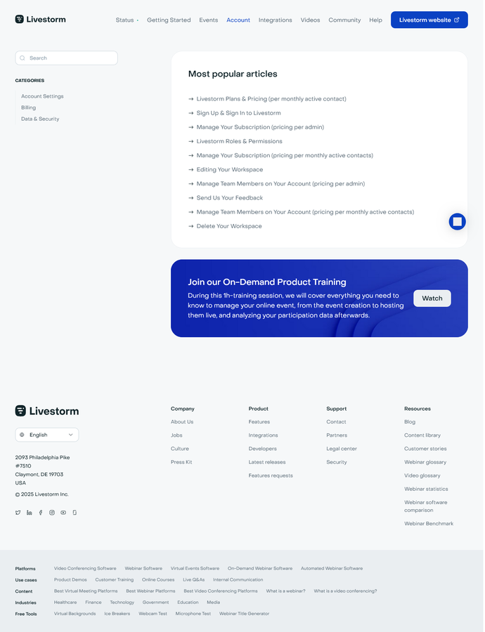<div class="ds-meta"><b>generation/vue/45</b></div><details class="ds-code"><summary>45.json（共 9 行）</summary><pre>{&#10;  "url": "https://support.livestorm.co/collection/155-account",&#10;  "github_link": "",&#10;  "topic": "application",&#10;  "star": "",&#10;  "fork": "",&#10;  "framework": "vue",&#10;  "type": "commercial"&#10;}</pre></details><details class="ds-code"><summary>45.html（共 47 行）</summary><pre>&lt;!DOCTYPE html&gt; &lt;html data-capo style=--cookie-control-barBackground:#000;--cookie-control-barButtonBackground:#fff;--cookie-control-barButtonColor:#000;--cookie-control-barButtonHoverBackground:#333;--cookie-control-barButtonHoverColor:#fff;--cookie-control-barTextColor:#fff;--cookie-control-checkboxActiveBackground:#000;--cookie-control-checkboxActiveCircleBackground:#fff;--cookie-control-checkb…（本行共 1188 字符）&#10; Page saved with SingleFile &#10; url: https://support.livestorm.co/collection/155-account &#10; saved date: Sun May 04 2025 17:56:19 GMT+0800 (香港标准时间)&#10;--&gt;&lt;meta charset=utf-8&gt;&#10;&lt;meta name=viewport content="width=device-width, initial-scale=1"&gt;&#10;&lt;title&gt;Manage Your Livestorm Account &#124; Expert Guidance and Resources&lt;/title&gt;&#10;&lt;style&gt;*,:after,:before{--tw-border-spacing-x:0;--tw-border-spacing-y:0;--tw-translate-x:0;--tw-translate-y:0;--tw-rotate:0;--tw-skew-x:0;--tw-skew-y:0;--tw-scale-x:1;--tw-scale-y:1;--tw-pan-x: ;--tw-pan-y: ;--tw-pinch-zoom: ;--tw-scroll-snap-strictness:proximity;--tw-gradient-from-position: ;--tw-gradient-via-position: ;--tw-gradient-to-position: ;--tw-ordinal: ;--tw-slashed-zero: ;--tw-numeric-f…（本行共 130781 字符）&#10;&lt;style&gt;.cookieControl{position:relative;z-index:100000}@media screen and (max-width:768px){}.cookieControl__ControlButton svg{backface-visibility:hidden;color:var(--cookie-control-controlButtonIconColor);left:50%;max-height:24px;max-width:24px;min-height:24px;min-width:24px;position:absolute;top:50%;transform:translate(-50%,-50%);transition:color .2s}.cookieControl__ControlButton:hover svg{color:v…（本行共 457 字符）&#10;&lt;style&gt;@media (min-width:1328px){.logo[data-v-b9000827]{height:1.5rem}}&lt;/style&gt;&#10;&lt;style&gt;@media (min-width:768px) and (max-height:767px){.h1[data-v-35c2712d]{font-size:3rem;line-height:64px}}@media (min-width:768px) and (min-height:768px){.h1[data-v-35c2712d]{font-size:3.75rem;line-height:80px}}@media (min-width:768px) and (max-height:767px){}@media (min-width:768px) and (min-height:768px){}@media (min-width:768px) and (max-height:767px){}@media (min-width:768px) and (min-heigh…（本行共 822 字符）&#10;&lt;style&gt;@media (min-width:768px){}@media (min-width:768px){}@media (min-width:768px){}@media (min-width:768px){}@media (min-width:1024px){}@media (min-width:1024px){}@media (min-width:768px){}@media (min-width:1024px){}@media (min-width:1024px){}@media (min-width:768px){}@media (min-width:768px){}@media (min-width:768px){}@media (min-width:768px){}@media (min-width:768px){}&lt;/style&gt;&#10;&lt;style&gt;.icon[data-v-a6a03936]{font-family:Icon Font,Icon Font fallback!important;font-style:normal!important;font-weight:400!important;line-height:1!important;-webkit-font-smoothing:antialiased!important;-moz-osx-font-smoothing:grayscale!important}.icon[data-v-a6a03936]:before{--tw-content:attr(data-unicode);content:var(--tw-content)}&lt;/style&gt;&#10;&lt;style&gt;.button[data-v-623b9421]{transition-property:color,background-color,border-color,text-decoration-color,fill,stroke,opacity,box-shadow,transform,filter,-webkit-backdrop-filter;transition-property:color,background-color,border-color,text-decoration-color,fill,stroke,opacity,box-shadow,transform,filter,backdrop-filter,-webkit-backdrop-filter}.button[data-v-623b9421]:focus{outline:2px solid tra…（本行共 803 字符）&#10;&lt;style&gt;@media (min-width:768px){.container[data-v-8175ce6d]{padding-left:1.5rem;padding-right:1.5rem}}@media (min-width:1328px){.container.span-start-0[data-v-8175ce6d]{padding-left:1.5rem}.container.span-end-0[data-v-8175ce6d]{padding-right:1.5rem}}&lt;/style&gt;&#10;&lt;style&gt;@media (min-width:1328px){}@media (min-width:1328px){}.nav[data-v-3140d759]:before{height:.5rem;left:-1rem;position:absolute;top:-.5rem;visibility:hidden;--tw-bg-opacity:1;background-color:rgb(255 255 255/var(--tw-bg-opacity,1));opacity:0;transition-duration:.6s;transition-property:all;transition-timing-function:cubic-bezier(.4,0,.2,1);--tw-content:"";content:var(--tw-content);width:calc(10…（本行共 1501 字符）&#10;&lt;style&gt;@media (min-width:768px){}@media (min-width:1328px){}.input input[data-v-2e9e0b88]{transition-property:color,background-color,border-color,text-decoration-color,fill,stroke,opacity,box-shadow,transform,filter,-webkit-backdrop-filter;transition-property:color,background-color,border-color,text-decoration-color,fill,stroke,opacity,box-shadow,transform,filter,backdrop-filter,-webkit-backdrop-f…（本行共 880 字符）&#10;&lt;style&gt;@media (min-width:1328px){}@media (min-width:768px){}@media (min-width:1328px){}@media (min-width:768px){}&lt;/style&gt;&#10;&lt;style&gt;@media (min-width:1328px){#app[data-v-d8ebf9eb]{padding-top:2rem}}@media (min-width:768px){#app .app__footer[data-v-d8ebf9eb]{margin-top:8rem}}&lt;/style&gt;&#10;&lt;style&gt;@media (min-width:768px){.page[data-v-99abde55]{margin-top:3rem}}@media (min-width:1328px){.page[data-v-99abde55]{flex-direction:row;flex-wrap:wrap;gap:0;justify-content:space-between;margin-top:4rem}}@media (min-width:1328px){.page .aside[data-v-99abde55]{width:22.65625%}}.page .aside .search .input[data-v-99abde55] input:focus{--tw-border-opacity:1;border-color:rgb(164 181 193/var(--tw-bo…（本行共 1321 字符）&#10;&lt;style&gt;@media (min-width:768px){.footer[data-v-c70fd729]{margin-top:4rem}}@media (min-width:768px){.footer .sitemap[data-v-c70fd729]{justify-content:flex-start}}@media (min-width:1328px){.footer .sitemap[data-v-c70fd729]{flex-wrap:nowrap}}@media (min-width:768px){.footer .sitemap .about[data-v-c70fd729]{margin-bottom:4rem}}@media (min-width:1328px){.footer .sitemap .about[data-v-c70fd729]{margin-b…（本行共 4609 字符）&#10;&lt;style&gt;.select.light select[data-v-d97e5b02]:focus{--tw-border-opacity:1;border-color:rgb(11 66 195/var(--tw-border-opacity,1))}.select.light select[data-v-d97e5b02]:hover{--tw-border-opacity:1;border-color:rgb(93 109 121/var(--tw-border-opacity,1))}.select select[data-v-d97e5b02]{-webkit-appearance:none;-moz-appearance:none;transition-property:color,background-color,border-color,text-decoration-c…（本行共 920 字符）&#10;&lt;style&gt;@media (min-width:768px){.on-demand-demo[data-v-81d0ad19]{align-items:center;flex-direction:row;justify-content:space-between;padding:3rem}}@media (min-width:768px){.on-demand-demo .description[data-v-81d0ad19]{max-width:728px}}@media (min-width:768px){.on-demand-demo .action[data-v-81d0ad19]{width:auto}}@media (min-width:768px){.on-demand-demo .action .button[data-v-81d0ad19]{width:auto}}&lt;…（本行共 407 字符）&#10;&lt;style&gt;.logo[data-v-b9000827]{align-items:center;display:flex;height:1.25rem;position:relative;z-index:50}@media (min-width:1328px){.logo[data-v-b9000827]{height:1.5rem}}.wrapper[data-v-1e19d926]{box-sizing:border-box;display:flex;max-width:100vw;width:100%}.h1[data-v-35c2712d],.h4[data-v-35c2712d],.h6[data-v-35c2712d]{font-family:Object Sans,Object Sans fallback;white-space:pre-line}.h1.light[dat…（本行共 8656 字符）&#10;&lt;style&gt;.on-demand-demo[data-v-81d0ad19]{border-radius:32px;display:flex;flex-direction:column;gap:1.5rem;width:100%;--tw-bg-opacity:1;background-color:rgb(11 66 195/var(--tw-bg-opacity,1));background-image:/* original URL: https://livestorm.imgix.net/1127/1621603238-call-to-action-pattern.png?h=420&amp;w=1280&amp;fm=png&amp;auto=format&amp;q=40&amp;dpr=2 */url(data:image/avif;base64,AAAAIGZ0eXBhdmlmAAAAAGF2aWZtaWYxbW…（本行共 9509 字符）&#10;&lt;meta property=og:image content=https://livestorm.imgix.net/1127/1725374874-support-og-image-en.jpg&gt;&#10;&lt;meta name=description content="Discover Livestorm's support resources to manage your account effortlessly. Access detailed guides, troubleshooting tips and essential information for setup, customization, and maintenance."&gt;&#10;&lt;meta property=og:title content="Manage Your Livestorm Account &#124; Expert Guidance and Resources"&gt;&#10;&lt;meta property=og:description content="Discover Livestorm's support resources to manage your account effortlessly. Access detailed guides, troubleshooting tips and essential information for setup, customization, and maintenance."&gt;&#10;&lt;meta name=twitter:title content="Manage Your Livestorm Account &#124; Expert Guidance and Resources"&gt;&#10;&lt;meta name=twitter:description content="Discover Livestorm's support resources to manage your account effortlessly. Access detailed guides, troubleshooting tips and essential information for setup, customization, and maintenance."&gt;&#10;&lt;link id=i18n-alt-en rel=alternate href=https://support.livestorm.co/collection/155-account hreflang=en&gt;&#10;&lt;link id=i18n-alt-fr rel=alternate href=https://support.livestorm.co/fr/collection/compte hreflang=fr&gt;&#10;&lt;link id=i18n-xd rel=alternate href=https://support.livestorm.co/collection/155-account hreflang=x-default&gt;&#10;&lt;link id=i18n-can rel=canonical href=https://support.livestorm.co/collection/155-account&gt;&#10;&lt;meta id=i18n-og-url property=og:url content=https://support.livestorm.co/collection/155-account&gt;&#10;&lt;meta id=i18n-og property=og:locale content=en&gt;&#10;&lt;meta id=i18n-og-alt-fr property=og:locale:alternate content=fr&gt;&#10;&lt;style&gt;.page[data-v-99abde55]{flex-direction:column;gap:1.5rem;margin-top:2rem}@media (min-width:768px){.page[data-v-99abde55]{margin-top:3rem}}@media (min-width:1328px){.page[data-v-99abde55]{flex-direction:row;flex-wrap:wrap;gap:0;justify-content:space-between;margin-top:4rem}}.page .aside[data-v-99abde55]{flex-direction:column;gap:2rem}@media (min-width:1328px){.page .aside[data-v-99abde55]{wid…（本行共 46776 字符）&#10;&lt;div id=spyglass-ext-details style=display:none&gt;{"isExtJs":false,"extJsVersion":""}&lt;/div&gt;&lt;iframe id=intercom-frame style=position:absolute!important;opacity:0!important;width:1px!important;height:1px!important;top:0!important;left:0!important;border:none!important;display:block!important;z-index:-1!important;pointer-events:none aria-hidden=true tabindex=-1 title=Intercom sandbox="allow-popups allo…（本行共 573 字符）&#10;&lt;meta name=referrer content=no-referrer&gt;&lt;style&gt;.sf-hidden{display:none!important}&lt;/style&gt;&lt;meta http-equiv=content-security-policy content=&amp;quot;default-src 'none'; font-src 'self' data:; img-src 'self' data:; style-src 'unsafe-inline'; media-src 'self' data:; script-src 'unsafe-inline' data:; object-src 'self' data:; frame-src 'self' data:;&amp;quot;&gt;&lt;/head&gt;&#10; &lt;body data-new-gr-c-s-check-loaded=14.1233.0 data-gr-ext-installed&gt;&#10; &#10; &lt;grammarly-desktop-integration data-grammarly-shadow-root=true&gt;&lt;template shadowrootmode=open&gt;&lt;style class=sf-hidden&gt;div.grammarly-desktop-integration{position:absolute;width:1px;height:1px;padding:0;margin:-1px;overflow:hidden;clip:rect(0,0,0,0);white-space:nowrap;border:0;-moz-user-select:none;-webkit-user-select:none;-ms-user-select:none;user-select:none}div.grammarly-desktop-integration:before…（本行共 2522 字符）&#10; &lt;path fill-rule=evenodd clip-rule=evenodd d="M18.601 8.39897C18.269 8.06702 17.7309 8.06702 17.3989 8.39897L12 13.7979L6.60099 8.39897C6.26904 8.06702 5.73086 8.06702 5.39891 8.39897C5.06696 8.73091 5.06696 9.2691 5.39891 9.60105L11.3989 15.601C11.7309 15.933 12.269 15.933 12.601 15.601L18.601 9.60105C18.9329 9.2691 18.9329 8.73091 18.601 8.39897Z" fill=white&gt;&lt;/path&gt;&#10;&lt;/svg&gt;&#10;&lt;/div&gt;&lt;/div&gt;&lt;style id=intercom-lightweight-app-style class=sf-hidden&gt;@keyframes intercom-lightweight-app-launcher{from{opacity:0;transform:scale(0.5)}to{opacity:1;transform:scale(1)}}@keyframes intercom-lightweight-app-gradient{from{opacity:0}to{opacity:1}}@keyframes intercom-lightweight-app-messenger{0%{opacity:0;transform:scale(0)}40%{opacity:1}100%{transform:scale(1)}}.intercom-lightweight-app{…（本行共 3080 字符）</pre></details></div><div class="ds-card">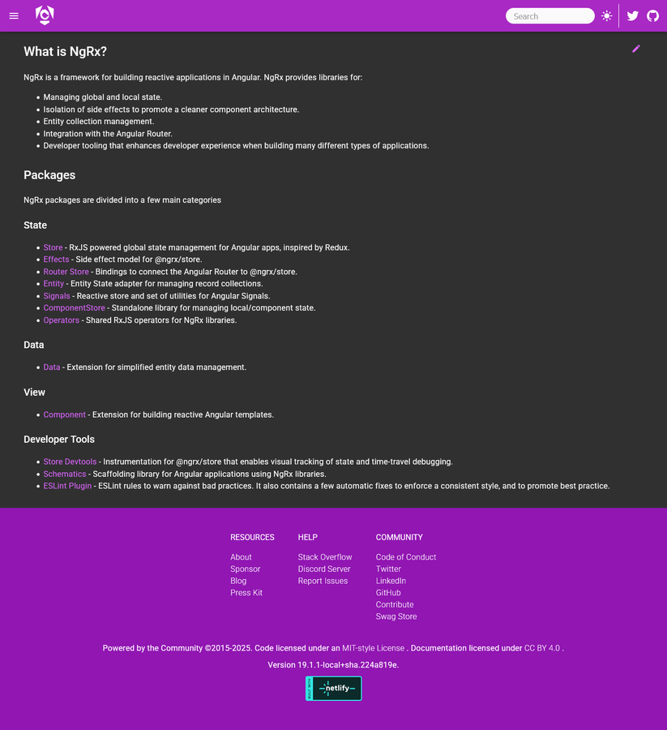<div class="ds-meta"><b>generation/angular/45</b></div><details class="ds-code"><summary>45.json（共 9 行）</summary><pre>{&#10;  "url": "https://ngrx.io/docs",&#10;  "github_link": "https://github.com/ngrx/platform",&#10;  "topic": "tool",&#10;  "star": 8194,&#10;  "fork": 2010,&#10;  "framework": "angular",&#10;  "type": "github"&#10;}</pre></details><details class="ds-code"><summary>45.html（共 75 行，展示前 60 行）</summary><pre>&lt;!DOCTYPE html&gt; &lt;html data-critters-container style&gt;&lt;!--&#10; Page saved with SingleFile &#10; url: https://ngrx.io/docs &#10; saved date: Sun May 04 2025 18:36:20 GMT+0800 (香港标准时间)&#10;--&gt;&lt;meta charset=utf-8&gt;&#10;&lt;title&gt;NgRx - What is NgRx?&lt;/title&gt;&#10;&#10;&lt;meta name=viewport content="width=device-width, initial-scale=1"&gt;&#10;&lt;link rel=icon type=image/png href="data:image/png;base64,iVBORw0KGgoAAAANSUhEUgAAACAAAAAgCAIAAAD8GO2jAAAAPklEQVR4nO3NQQ0AMAzDwGwqlvKHUQxB098YRNrDBuA7M6NkJam7Q3fbN7R+AQAAAAAAAAAAAPwClCTbOWABRZsIKvEtXukAAAAASUVORK5CYII=" sizes=32x32&gt;&#10;&lt;style&gt;@font-face{font-family:"Material Icons";font-style:normal;font-weight:400;src:url(…（本行共 171569 字符）&#10;&lt;style&gt;/*!&#10; *  Font Awesome 4.7.0 by @davegandy - http://fontawesome.io - @fontawesome&#10; *  License - http://fontawesome.io/license (Font: SIL OFL 1.1, CSS: MIT License)&#10; */@-webkit-keyframes fa-spin{0%{-webkit-transform:rotate(0deg);transform:rotate(0deg)}100%{-webkit-transform:rotate(359deg);transform:rotate(359deg)}}@keyframes fa-spin{0%{-webkit-transform:rotate(0deg);transform:rotate(0deg)}100%{-webkit-transform:rotate(359deg);transform:rotate(359deg)}}&lt;/style&gt;&#10;&lt;style&gt;@font-face{font-family:"Roboto";font-style:normal;font-weight:300;font-stretch:100%;src:url(…（本行共 247782 字符）&#10;&lt;meta name=theme-color content=#a829c3&gt;&#10;&lt;meta name=apple-mobile-web-app-capable content=yes&gt;&#10;&lt;meta name=apple-mobile-web-app-status-bar-style content=translucent&gt;&#10;&lt;style&gt;body{-webkit-font-smoothing:antialiased;-moz-osx-font-smoothing:grayscale}@media screen and (max-width:600px){h2{margin:8px 0}}@media (max-width:480px){}@media (max-width:780px){}@media (max-width:780px){}@media (max-width:780px){}&lt;/style&gt;&lt;style&gt;body{font-size:16px;line-height:24px;font-family:Roboto,Helvetica Neue Light,Helvetica Neue,Helvetica,Arial,Lucida Grande,sans-serif;margin:0;-webk…（本行共 61873 字符）&#10;&lt;body&gt;&#10; &lt;aio-shell ng-version=17.2.2 class="aio-notification-hide folder-docs mode-stable page-docs sidenav-closed view-SideNav view-TopBar view-TopBarNarrow"&gt;&lt;div id=top-of-page&gt;&lt;/div&gt;&lt;mat-toolbar color=primary class="mat-toolbar app-toolbar no-print mat-primary mat-toolbar-multiple-rows"&gt;&lt;mat-toolbar-row class="mat-toolbar-row notification-container"&gt;&lt;aio-notification notificationid=angular-v6-announce…（本行共 9849 字符）&#10; &lt;div class=github-links&gt;&#10; &lt;a href="https://github.com/ngrx/platform/edit/main/projects/ngrx.io/content/marketing/docs.md?message=docs%3A%20describe%20your%20change..." aria-label="Suggest Edits" title="Suggest Edits"&gt;&lt;i class=material-icons aria-hidden=true role=img&gt;mode_edit&lt;/i&gt;&lt;/a&gt;&#10; &lt;/div&gt;&#10;&lt;div class=content&gt;&#10;&lt;h1 class=no-toc id=what-is-ngrx&gt;What is NgRx?&lt;a title="Link to this heading" class=header-link aria-hidden=true href=#what-is-ngrx&gt;&lt;i class=material-icons&gt;link&lt;/i&gt;&lt;/a&gt;&lt;/h1&gt;&#10;&lt;p&gt;NgRx is a framework for building reactive applications in Angular. NgRx provides libraries for:&lt;/p&gt;&#10;&lt;ul&gt;&#10;&lt;li&gt;Managing global and local state.&lt;/li&gt;&#10;&lt;li&gt;Isolation of side effects to promote a cleaner component architecture.&lt;/li&gt;&#10;&lt;li&gt;Entity collection management.&lt;/li&gt;&#10;&lt;li&gt;Integration with the Angular Router.&lt;/li&gt;&#10;&lt;li&gt;Developer tooling that enhances developer experience when building many different types of applications.&lt;/li&gt;&#10;&lt;/ul&gt;&#10;&lt;h2 id=packages&gt;Packages&lt;a title="Link to this heading" class=header-link aria-hidden=true href=#packages&gt;&lt;i class=material-icons&gt;link&lt;/i&gt;&lt;/a&gt;&lt;/h2&gt;&#10;&lt;p&gt;NgRx packages are divided into a few main categories&lt;/p&gt;&#10;&lt;h3 id=state&gt;State&lt;a title="Link to this heading" class=header-link aria-hidden=true href=#state&gt;&lt;i class=material-icons&gt;link&lt;/i&gt;&lt;/a&gt;&lt;/h3&gt;&#10;&lt;ul&gt;&#10;&lt;li&gt;&lt;a href=https://ngrx.io/guide/store&gt;Store&lt;/a&gt; - RxJS powered global state management for Angular apps, inspired by Redux.&lt;/li&gt;&#10;&lt;li&gt;&lt;a href=https://ngrx.io/guide/effects&gt;Effects&lt;/a&gt; - Side effect model for @ngrx/store.&lt;/li&gt;&#10;&lt;li&gt;&lt;a href=https://ngrx.io/guide/router-store&gt;Router Store&lt;/a&gt; - Bindings to connect the Angular Router to @ngrx/store.&lt;/li&gt;&#10;&lt;li&gt;&lt;a href=https://ngrx.io/guide/entity&gt;Entity&lt;/a&gt; - Entity State adapter for managing record collections.&lt;/li&gt;&#10;&lt;li&gt;&lt;a href=https://ngrx.io/guide/signals&gt;Signals&lt;/a&gt; - Reactive store and set of utilities for Angular Signals.&lt;/li&gt;&#10;&lt;li&gt;&lt;a href=https://ngrx.io/guide/component-store&gt;ComponentStore&lt;/a&gt; - Standalone library for managing local/component state.&lt;/li&gt;&#10;&lt;li&gt;&lt;a href=https://ngrx.io/guide/operators&gt;Operators&lt;/a&gt; - Shared RxJS operators for NgRx libraries.&lt;/li&gt;&#10;&lt;/ul&gt;&#10;&lt;h3 id=data&gt;Data&lt;a title="Link to this heading" class=header-link aria-hidden=true href=#data&gt;&lt;i class=material-icons&gt;link&lt;/i&gt;&lt;/a&gt;&lt;/h3&gt;&#10;&lt;ul&gt;&#10;&lt;li&gt;&lt;a href=https://ngrx.io/guide/data&gt;Data&lt;/a&gt; - Extension for simplified entity data management.&lt;/li&gt;&#10;&lt;/ul&gt;&#10;&lt;h3 id=view&gt;View&lt;a title="Link to this heading" class=header-link aria-hidden=true href=#view&gt;&lt;i class=material-icons&gt;link&lt;/i&gt;&lt;/a&gt;&lt;/h3&gt;&#10;&lt;ul&gt;&#10;&lt;li&gt;&lt;a href=https://ngrx.io/guide/component&gt;Component&lt;/a&gt; - Extension for building reactive Angular templates.&lt;/li&gt;&#10;&lt;/ul&gt;&#10;&lt;h3 id=developer-tools&gt;Developer Tools&lt;a title="Link to this heading" class=header-link aria-hidden=true href=#developer-tools&gt;&lt;i class=material-icons&gt;link&lt;/i&gt;&lt;/a&gt;&lt;/h3&gt;&#10;&lt;ul&gt;&#10;&lt;li&gt;&lt;a href=https://ngrx.io/guide/store-devtools&gt;Store Devtools&lt;/a&gt; - Instrumentation for @ngrx/store that enables visual tracking of state and time-travel debugging.&lt;/li&gt;&#10;&lt;li&gt;&lt;a href=https://ngrx.io/guide/schematics&gt;Schematics&lt;/a&gt; - Scaffolding library for Angular applications using NgRx libraries.&lt;/li&gt;&#10;&lt;li&gt;&lt;a href=https://ngrx.io/guide/eslint-plugin&gt;ESLint Plugin&lt;/a&gt; - ESLint rules to warn against bad practices. It also contains a few automatic fixes to enforce a consistent style, and to promote best practice.&lt;/li&gt;&#10;&lt;/ul&gt;&#10;…（截断，原文共 75 行）</pre></details></div></div></div>

</div></div>

<div class="sg-body" id="sg-pix2code--opendata"><div class="sg-bar"><span class="deep-title"> <a href="https://arxiv.org/abs/1705.07962">pix2code</a> <span class="org">UIzard</span> <a class="hf" href="https://github.com/tonybeltramelli/pix2code"><span class="hf-b hf-st" title="GitHub stars"><svg class="hf-i" viewBox="0 0 24 24" fill="currentColor"><path d="M12 2.5l2.9 6 6.6.6-5 4.3 1.5 6.5L12 16.9 6 20.9l1.5-6.5-5-4.3 6.6-.6z"/></svg>12.0k</span></a></span><span class="sg-nav"><button type="button" class="sg-prev" title="上一个（←）">‹</button><span class="sg-pos"></span><button type="button" class="sg-next" title="下一个（→）">›</button><button type="button" class="sg-x" title="关闭（Esc）">✕</button></span></div><div class="sg-stage">

<div class="ds-demo"><div class="ds-head"><b>数据样例</b> · <a href="https://github.com/tonybeltramelli/pix2code">tonybeltramelli/pix2code</a></div><div class="ds-grid"><div class="ds-card"><details class="ds-code"><summary>.gui（共 22 行）</summary><pre>header {&#10;btn-inactive, btn-active, btn-inactive, btn-inactive, btn-inactive&#10;}&#10;row {&#10;quadruple {&#10;small-title, text, btn-orange&#10;}&#10;quadruple {&#10;small-title, text, btn-red&#10;}&#10;quadruple {&#10;small-title, text, btn-green&#10;}&#10;quadruple {&#10;small-title, text, btn-orange&#10;}&#10;}&#10;row {&#10;single {&#10;small-title, text, btn-green&#10;}&#10;}</pre></details></div><div class="ds-card">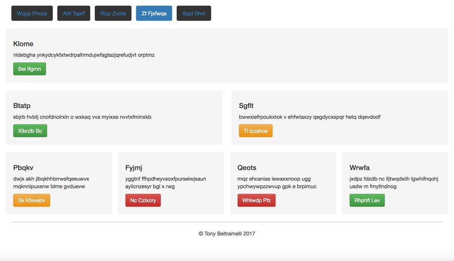<details class="ds-code"><summary>.gui（共 30 行）</summary><pre>header {&#10;btn-inactive, btn-inactive, btn-inactive, btn-active, btn-inactive&#10;}&#10;row {&#10;single {&#10;small-title, text, btn-green&#10;}&#10;}&#10;row {&#10;double {&#10;small-title, text, btn-green&#10;}&#10;double {&#10;small-title, text, btn-orange&#10;}&#10;}&#10;row {&#10;quadruple {&#10;small-title, text, btn-orange&#10;}&#10;quadruple {&#10;small-title, text, btn-red&#10;}&#10;quadruple {&#10;small-title, text, btn-red&#10;}&#10;quadruple {&#10;small-title, text, btn-green&#10;}&#10;}</pre></details></div><div class="ds-card">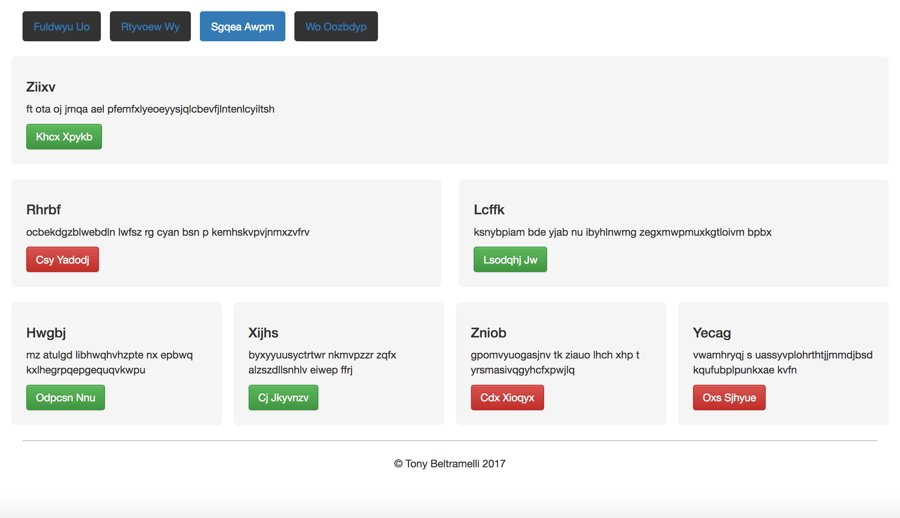<details class="ds-code"><summary>.gui（共 30 行）</summary><pre>header {&#10;btn-inactive, btn-inactive, btn-active, btn-inactive&#10;}&#10;row {&#10;single {&#10;small-title, text, btn-green&#10;}&#10;}&#10;row {&#10;double {&#10;small-title, text, btn-red&#10;}&#10;double {&#10;small-title, text, btn-green&#10;}&#10;}&#10;row {&#10;quadruple {&#10;small-title, text, btn-green&#10;}&#10;quadruple {&#10;small-title, text, btn-green&#10;}&#10;quadruple {&#10;small-title, text, btn-red&#10;}&#10;quadruple {&#10;small-title, text, btn-red&#10;}&#10;}</pre></details></div></div></div>

- **定位**：最早的截图转代码工作，第一次公开发布「GUI 截图 ↔ 代码」合成配对数据（iOS / Android / Web 三个平台）

<figure class="paper-fig"><div class="flow"><div class="step"><b>DSL</b>人工设计布局 / 组件 DSL</div><span class="arr">→</span><div class="step"><b>Stochastic UI generator</b>按语法随机组合 GUI</div><span class="arr">→</span><div class="step"><b>DSL compiler</b>编译成 iOS / Android / HTML</div><span class="arr">→</span><div class="step"><b>渲染截图</b>各平台渲染得到截图</div><span class="arr">→</span><div class="step"><b>滑窗切样本</b>48 token 窗口配整张截图</div></div><figcaption>pix2code · 自绘流程图（论文无数据管线图，依据正文描述）</figcaption></figure>

- **自动化合成流程**（对照上面的自绘图）
  1. **DSL 设计**：人工设计一套轻量的类标记语言 DSL，只描述布局、组件和层级，不管标签里的文字，所以词表很小
  2. **Stochastic user interface generator**：随机生成器按 DSL 语法随机组合出 GUI 描述（纯程序，不用模型）
  3. **DSL compiler**：编译器把 DSL 编译成目标平台代码（iOS Storyboard、Android XML、HTML/CSS），标签文字随机填
  4. **渲染截图**：在对应平台渲染编译出的代码并截图，得到（截图，代码）对
  5. **滑窗切样本**：DSL 按 48 个 token 的滑窗切开，每个窗口和整张截图配成一个训练样本
- **质量控制**
  - 数据由语法和编译器生成，天然保证正确，论文没有另设过滤或去重步骤
- **关键数字**
  - 生成器可产出的不同配置数：iOS 26×10⁵、Android 21×10⁶、Web 31×10⁴
  - 实际使用：每个平台 1,500 对训练、250 对测试；训练样本（图-序列对）分别为 93,672 / 85,756 / 143,850
  - 效果：greedy 解码的 token 错误率 iOS 22.73%、Android 22.34%、Web 12.14%；模型约 109×10⁶ 参数
- **局限**
  - DSL 只表达布局，不管真实文本，离真实代码很远
  - 生成器组合空间有限，数据量很小，界面风格单一
  - 输入统一缩放到 256×256，不保长宽比
- **可借鉴**
  - 先定义「DSL + 编译器」，再用随机文法采样造数据：配对天然正确、零标注成本，而且同一份 DSL 可以编译到多个平台
  - 训练目标用中间 DSL 而不是原始代码，能缩小词表和搜索空间

</div></div>

<div class="sg-body" id="sg-screencoder--opendata"><div class="sg-bar"><span class="deep-title"> <a href="https://arxiv.org/abs/2507.22827">ScreenCoder</a> <span class="org">CUHK</span> <a class="hf" href="https://github.com/leigest519/ScreenCoder"><span class="hf-b hf-st" title="GitHub stars"><svg class="hf-i" viewBox="0 0 24 24" fill="currentColor"><path d="M12 2.5l2.9 6 6.6.6-5 4.3 1.5 6.5L12 16.9 6 20.9l1.5-6.5-5-4.3 6.6-.6z"/></svg>3.0k</span></a></span><span class="sg-nav"><button type="button" class="sg-prev" title="上一个（←）">‹</button><span class="sg-pos"></span><button type="button" class="sg-next" title="下一个（→）">›</button><button type="button" class="sg-x" title="关闭（Esc）">✕</button></span></div><div class="sg-stage">

<div class="ds-demo"><div class="ds-head"><b>数据样例</b> · <a href="https://huggingface.co/datasets/Leigest/ScreenCoder">Leigest/ScreenCoder</a></div><div class="ds-grid"><div class="ds-card"><details class="ds-code"><summary>HTML（共 8245 行，展示前 60 行）</summary><pre>&lt;!DOCTYPE html&gt;&#10;&lt;html class=""&gt;&lt;!-- &#10; single html processed by https://github.com/zTrix/webpage2html&#10; title: Home organization hacks_百度搜索&#10; url: baidu_snaps_1000/original\Home_organization_hacks.html&#10; date: Tue Sep 23 21:37:38 2025&#10;--&gt;&lt;head&gt;&#10;&lt;meta content="IE=edge,chrome=1" http-equiv="X-UA-Compatible"/&gt;&#10;&lt;meta content="text/html;charset=utf-8" http-equiv="content-type"/&gt;&#10;&lt;meta content="origin-when-cross-origin" name="referrer"/&gt;&#10;&lt;meta content="#ffffff" name="theme-color"/&gt;&#10;&lt;link data-href="https://www.baidu.com/favicon.ico" href="placeholder.png" rel="shortcut icon" type="image/x-icon"/&gt;&#10;&lt;link data-href="https://www.baidu.com/favicon.ico" href="placeholder.png" mask="" rel="icon" sizes="any"/&gt;&#10;&lt;link data-href="/content-search.xml" href="/content-search.xml" rel="search" title="百度搜索" type="application/opensearchdescription+xml"/&gt;&#10;&lt;style data-for="result" data-href="https://pss.bdstatic.com/r/www/static/font/cosmic/pc/cos-icon_acd3da0.css" rel="stylesheet" type="text/css"&gt;@font-face {&#10;    font-family: "cos-icon"; /* Project id 1775033 */&#10;    font-weight: 400;&#10;    src: url(); /* IE9 */&#10;    src: url(), /* IE6-IE8 */&#10;        url(),&#10;        url(),&#10;        url(),&#10;        url(placeholder.png) format('svg');&#10;}&#10;&#10;.cos-icon {&#10;    font-family: "cos-icon" !important;&#10;    font-style: normal;&#10;    -webkit-font-smoothing: antialiased;&#10;    -moz-osx-font-smoothing: grayscale;&#10;}&#10;&#10;.cos-icon-photo-stack::before {&#10;    content: "\e626";&#10;}&#10;&#10;.cos-icon-new-dialog::before {&#10;    content: "\e620";&#10;}&#10;&#10;.cos-icon-suggestion::before {&#10;    content: "\e621";&#10;}&#10;&#10;.cos-icon-dqa::before {&#10;    content: "\e622";&#10;}&#10;&#10;.cos-icon-quick-entry::before {&#10;    content: "\e623";&#10;}&#10;&#10;.cos-icon-expand-panel::before {&#10;    content: "\e624";&#10;}&#10;&#10;.cos-icon-stowed-panel::before {&#10;    content: "\e625";&#10;}&#10;&#10;…（截断，原文共 8245 行）</pre></details></div><div class="ds-card"><details class="ds-code"><summary>HTML（共 6901 行，展示前 60 行）</summary><pre>&lt;!DOCTYPE html&gt;&#10;&lt;html darker-dark-theme="" darker-dark-theme-deprecate="" lang="zh-Hant-HK" style="font-size: 10px;font-family: Roboto, Arial, sans-serif;" system-icons="" typography="" typography-spacing=""&gt;&lt;!-- &#10; single html processed by https://github.com/zTrix/webpage2html&#10; title: country music - YouTube&#10; url: yt_snaps/original\country-music.html&#10; date: Wed Sep 24 08:50:44 2025&#10;--&gt;&lt;head&gt;&lt;meta content="ApvK67ociHgr2egd6c2ZjrfPuRs8BHcvSggogIOPQNH7GJ3cVlyJ1NOq/COCdj0+zxskqHt9HgLLETc8qqD+vwsAAABteyJvcmlnaW4iOiJodHRwczovL3lvdXR1YmUuY29tOjQ0MyIsImZlYXR1cmUiOiJQcml2YWN5U2FuZGJveEFkc0FQSXMiLCJleHBpcnkiOjE2OTUxNjc5OTksImlzU3ViZG9tYWluIjp0cnVlfQ==" http-equiv="origin-trial"/&gt;&lt;link d…（本行共 46,848 字符，截断）&#10;  /*! rtl:ignore */background:#065fd4}.yt-spec-button-shape-next--call-to-action.yt-spec-button-shape-next--filled:hover{&#10;  /*! rtl:ignore */background:#0556bf;border-color:transparent}@media (hover:none){.yt-spec-button-shape-next--call-to-action.yt-spec-button-shape-next--filled:hover{&#10;    /*! rtl:ignore */background:#065fd4}}@media (hover:none){.yt-spec-button-shape-next--call-to-action.yt-spec-button-shape-next--filled:active{&#10;    /*! rtl:ignore */background:#0556bf;border-color:transparent}}@media (-ms-high-contrast:active),(forced-colors:active){.yt-spec-button-shape-next--call-to-action.yt-spec-button-shape-next--filled{border:1px solid rgba(0,0,0,0.1)}}.yt-spec-button-shape-next--call-to-action.yt-spec-button-shape-ne…（本行共 439 字符，截断）&#10;  /*! rtl:ignore */background:#def1ff;border-color:transparent}@media (hover:none){.yt-spec-button-shape-next--call-to-action.yt-spec-button-shape-next--outline:hover{&#10;    /*! rtl:ignore */border-color:rgba(0,0,0,0.1)}}@media (hover:none){.yt-spec-button-shape-next--call-to-action.yt-spec-button-shape-next--outline:active{&#10;    /*! rtl:ignore */background:#def1ff;border-color:transparent}}.yt-spec-button-shape-next--call-to-action.yt-spec-button-shape-next--text{color:#065fd4}.yt-spec-button-shape-next--call-to-action.yt-spec-button-shape-next--text:hover{&#10;  /*! rtl:ignore */background:#def1ff;border-color:transparent}@media (hover:none){}@media (hover:none){.yt-spec-button-shape-next--call-to-action.yt-spec-button-shape-next--text:active{&#10;    /*! rtl:ignore */background:#def1ff;border-color:transparent}}.yt-spec-button-shape-next--call-to-action.yt-spec-button-shape-next--tonal{color:#065fd4;&#10;  /*! rtl:ignore */background:#def1ff}.yt-spec-button-shape-next--call-to-action.yt-spec-button-shape-next--tonal:hover{&#10;  /*! rtl:ignore */background:#dadfe6;border-color:transparent}@media (hover:none){.yt-spec-button-shape-next--call-to-action.yt-spec-button-shape-next--tonal:hover{&#10;    /*! rtl:ignore */background:#def1ff}}@media (hover:none){.yt-spec-button-shape-next--call-to-action.yt-spec-button-shape-next--tonal:active{&#10;    /*! rtl:ignore */background:#dadfe6;border-color:transparent}}@media (-ms-high-contrast:active),(forced-colors:active){.yt-spec-button-shape-next--call-to-action.yt-spec-button-shape-next--tonal{border:1px solid rgba(0,0,0,0.1)}}.yt-spec-button-shape-next--call-to-action.yt-spec-button-shape-nex…（本行共 325 字符，截断）&#10;  /*! rtl:ignore */background:unset;border-color:#065fd4}.yt-spec-button-shape-next--call-to-action.yt-spec-button-shape-next--focused:hover{&#10;  /*! rtl:ignore */background:#def1ff;border-color:transparent}@media (hover:none){.yt-spec-button-shape-next--call-to-action.yt-spec-button-shape-next--focused:hover{&#10;    /*! rtl:ignore */background:unset;border-color:#065fd4}}@media (hover:none){.yt-spec-button-shape-next--call-to-action.yt-spec-button-shape-next--focused:active{&#10;    /*! rtl:ignore */background:#def1ff;border-color:transparent}}.yt-spec-button-shape-next--call-to-action-inverse.yt-spec-button-shape-next--text{color:#3ea6ff}.yt-spec-button-shape-next--call-to-action-inverse.yt-spec-button-shape-next--text:hover{&#10;  /*! rtl:ignore */background:#263850;border-color:transparent}@media (hover:none){}@media (hover:none){.yt-spec-button-shape-next--call-to-action-inverse.yt-spec-button-shape-next--text:active{&#10;    /*! rtl:ignore */background:#263850;border-color:transparent}}.yt-spec-button-shape-next--call-to-action-overlay.yt-spec-button-shape-next--filled{color:#030303;&#10;  /*! rtl:ignore */background:#3ea6ff}.yt-spec-button-shape-next--call-to-action-overlay.yt-spec-button-shape-next--filled:hover{&#10;  /*! rtl:ignore */background:#65b8ff;border-color:transparent}@media (hover:none){.yt-spec-button-shape-next--call-to-action-overlay.yt-spec-button-shape-next--filled:hover{&#10;    /*! rtl:ignore */background:#3ea6ff}}@media (hover:none){.yt-spec-button-shape-next--call-to-action-overlay.yt-spec-button-shape-next--filled:active{&#10;    /*! rtl:ignore */background:#65b8ff;border-color:transparent}}.yt-spec-button-shape-next--call-to-action-overlay.yt-spec-button-shape-next--focused{color:#3ea6ff;&#10;  /*! rtl:ignore */background:#000;border-color:#3ea6ff}.yt-spec-button-shape-next--call-to-action-overlay.yt-spec-button-shape-next--focused:hover{&#10;  /*! rtl:ignore */background:#65b8ff;border-color:transparent}@media (hover:none){.yt-spec-button-shape-next--call-to-action-overlay.yt-spec-button-shape-next--focused:hover{&#10;    /*! rtl:ignore */background:#000;border-color:#3ea6ff}}@media (hover:none){.yt-spec-button-shape-next--call-to-action-overlay.yt-spec-button-shape-next--focused:active{&#10;    /*! rtl:ignore */background:#65b8ff;border-color:transparent}}.yt-spec-button-shape-next--mono.yt-spec-button-shape-next--filled{color:#fff;&#10;  /*! rtl:ignore */background:#0f0f0f}.yt-spec-button-shape-next--mono.yt-spec-button-shape-next--filled:hover{&#10;  /*! rtl:ignore */background:#272727;border-color:transparent}@media (hover:none){.yt-spec-button-shape-next--mono.yt-spec-button-shape-next--filled:hover{&#10;    /*! rtl:ignore */background:#0f0f0f}}@media (hover:none){.yt-spec-button-shape-next--mono.yt-spec-button-shape-next--filled:active{&#10;    /*! rtl:ignore */background:#272727;border-color:transparent}}@media (-ms-high-contrast:active),(forced-colors:active){.yt-spec-button-shape-next--mono.yt-spec-button-shape-next--filled{border:1px solid rgba(0,0,0,0.1)}}.yt-spec-button-shape-next--mono.yt-spec-button-shape-next--outline{color:#0…（本行共 409 字符，截断）&#10;  /*! rtl:ignore */background:rgba(0,0,0,0.1);border-color:transparent}@media (hover:none){.yt-spec-button-shape-next--mono.yt-spec-button-shape-next--outline:hover{&#10;    /*! rtl:ignore */border-color:rgba(0,0,0,0.1)}}@media (hover:none){.yt-spec-button-shape-next--mono.yt-spec-button-shape-next--outline:active{&#10;    /*! rtl:ignore */background:rgba(0,0,0,0.1);border-color:transparent}}.yt-spec-button-shape-next--mono.yt-spec-button-shape-next--text{color:#0f0f0f}.yt-spec-button-shape-next--mono.yt-spec-button-shape-next--text:hover{&#10;  /*! rtl:ignore */background:rgba(0,0,0,0.1);border-color:transparent}@media (hover:none){}@media (hover:none){.yt-spec-button-shape-next--mono.yt-spec-button-shape-next--text:active{&#10;    /*! rtl:ignore */background:rgba(0,0,0,0.1);border-color:transparent}}.yt-spec-button-shape-next--mono.yt-spec-button-shape-next--tonal{color:#0f0f0f;&#10;  /*! rtl:ignore */background:rgba(0,0,0,0.05)}.yt-spec-button-shape-next--mono.yt-spec-button-shape-next--tonal:hover{&#10;  /*! rtl:ignore */background:rgba(0,0,0,0.1);border-color:transparent}@media (hover:none){.yt-spec-button-shape-next--mono.yt-spec-button-shape-next--tonal:hover{&#10;    /*! rtl:ignore */background:rgba(0,0,0,0.05)}}@media (hover:none){.yt-spec-button-shape-next--mono.yt-spec-button-shape-next--tonal:active{&#10;    /*! rtl:ignore */background:rgba(0,0,0,0.1);border-color:transparent}}@media (-ms-high-contrast:active),(forced-colors:active){.yt-spec-button-shape-next--mono.yt-spec-button-shape-next--tonal{border:1px solid rgba(0,0,0,0.1)}}.yt-spec-button-shape-next--mono.yt-spec-button-shape-next--focused{c…（本行共 313 字符，截断）&#10;  /*! rtl:ignore */background:unset;border-color:#0f0f0f}.yt-spec-button-shape-next--mono.yt-spec-button-shape-next--focused:hover{&#10;  /*! rtl:ignore */background:rgba(0,0,0,0.1);border-color:transparent}@media (hover:none){.yt-spec-button-shape-next--mono.yt-spec-button-shape-next--focused:hover{&#10;    /*! rtl:ignore */background:unset;border-color:#0f0f0f}}@media (hover:none){.yt-spec-button-shape-next--mono.yt-spec-button-shape-next--focused:active{&#10;    /*! rtl:ignore */background:rgba(0,0,0,0.1);border-color:transparent}}.yt-spec-button-shape-next--mono-inverse.yt-spec-button-shape-next--filled{color:#0f0f0f;&#10;  /*! rtl:ignore */background:#fff}.yt-spec-button-shape-next--mono-inverse.yt-spec-button-shape-next--filled:hover{&#10;  /*! rtl:ignore */background:#d9d9d9;border-color:transparent}@media (hover:none){.yt-spec-button-shape-next--mono-inverse.yt-spec-button-shape-next--filled:hover{&#10;    /*! rtl:ignore */background:#fff}}@media (hover:none){.yt-spec-button-shape-next--mono-inverse.yt-spec-button-shape-next--filled:active{&#10;    /*! rtl:ignore */background:#d9d9d9;border-color:transparent}}@media (-ms-high-contrast:active),(forced-colors:active){.yt-spec-button-shape-next--mono-inverse.yt-spec-button-shape-next--filled{border:1px solid rgba(0,0,0,0.1)}}.yt-spec-button-shape-next--mono-inverse.yt-spec-button-shape-next--…（本行共 436 字符，截断）&#10;  /*! rtl:ignore */background:rgba(255,255,255,0.1);border-color:transparent}@media (hover:none){.yt-spec-button-shape-next--mono-inverse.yt-spec-button-shape-next--outline:hover{&#10;    /*! rtl:ignore */border-color:rgba(255,255,255,0.2)}}@media (hover:none){.yt-spec-button-shape-next--mono-inverse.yt-spec-button-shape-next--outline:active{&#10;    /*! rtl:ignore */background:rgba(255,255,255,0.1);border-color:transparent}}.yt-spec-button-shape-next--mono-inverse.yt-spec-button-shape-next--text{color:#fff}.yt-spec-button-shape-next--mono-inverse.yt-spec-button-shape-next--text:hover{&#10;  /*! rtl:ignore */background:rgba(0,0,0,0.1);border-color:transparent}@media (hover:none){}@media (hover:none){.yt-spec-button-shape-next--mono-inverse.yt-spec-button-shape-next--text:active{&#10;    /*! rtl:ignore */background:rgba(0,0,0,0.1);border-color:transparent}}.yt-spec-button-shape-next--mono-inverse.yt-spec-button-shape-next--tonal{color:#fff;&#10;…（截断，原文共 6901 行）</pre></details></div><div class="ds-card">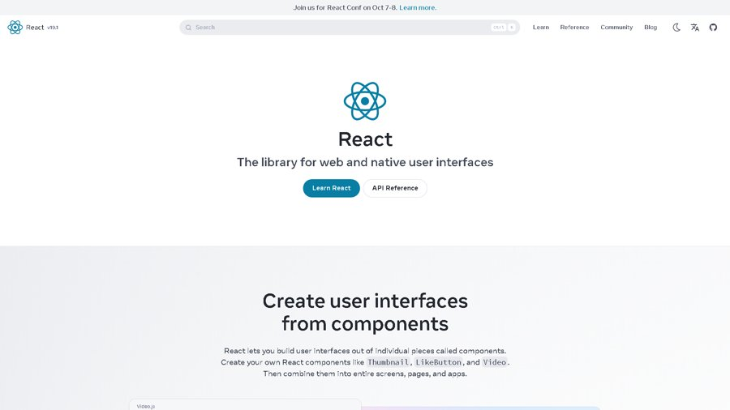<details class="ds-code"><summary>HTML（共 15 行）</summary><pre>&lt;!DOCTYPE html&gt;&#10;&lt;html dir="ltr" lang="en"&gt;&lt;!-- &#10; single html processed by https://github.com/zTrix/webpage2html&#10; title: React&#10; url: https://react.dev/&#10; date: Tue Sep 23 20:13:44 2025&#10;--&gt;&lt;head&gt;&lt;meta charset="utf-8" data-next-head=""/&gt;&lt;meta content="width=device-width, initial-scale=1" data-next-head="" name="viewport"/&gt;&lt;title data-next-head=""&gt;React&lt;/title&gt;&lt;meta content="React is the library for web and native user interfaces. Build user interfaces out of individual pieces called…（本行共 25,416 字符，截断）&#10;&#10;/*&#10; ! tailwindcss v3.4.1 &#124; MIT License &#124; https://tailwindcss.com&#10; */*,:after,:before{box-sizing:border-box;border:0 solid #e5e7eb}:after,:before{--tw-content:""}:host,html{line-height:1.5;-webkit-text-size-adjust:100%;-moz-tab-size:4;-o-tab-size:4;tab-size:4;font-family:ui-sans-serif,system-ui,sans-serif,Apple Color Emoji,Segoe UI Emoji,Segoe UI Symbol,Noto Color…（本行共 106,814 字符，截断）&#10;&#10;/*&#10; ! tailwindcss v3.4.1 &#124; MIT License &#124; https://tailwindcss.com&#10; */*,:after,:before{box-sizing:border-box;border:0 solid #e5e7eb}:after,:before{--tw-content:""}:host,html{line-height:1.5;-webkit-text-size-adjust:100%;-moz-tab-size:4;-o-tab-size:4;tab-size:4;font-family:ui-sans-serif,system-ui,sans-serif,Apple Color Emoji,Segoe UI Emoji,Segoe UI Symbol,Noto Color…（本行共 351,632 字符，截断）</pre></details></div></div></div>

- **定位**：模块化多 agent 的截图转 HTML 框架，同时当作数据引擎，产出 Screen-10K，用于 SFT + RL 两阶段后训练

<figure class="paper-fig">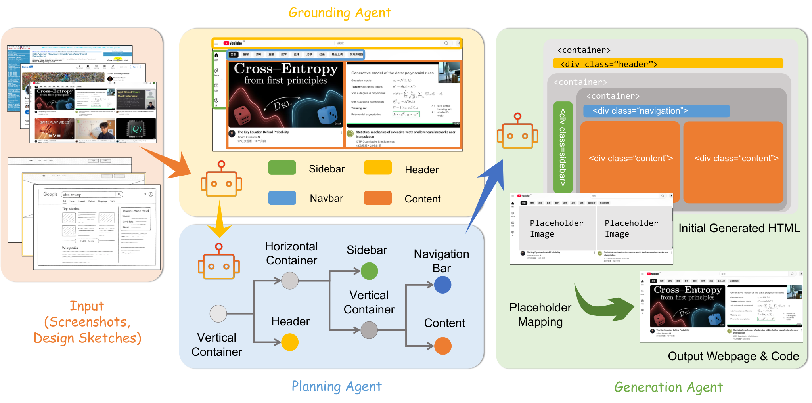<figcaption>ScreenCoder · Fig. 3：Grounding 标出组件区域，Planning 建布局树，Generation 写带占位符的 HTML，最后用原图素材回填占位</figcaption></figure>

- **自动化合成流程**（对照上图，从左往右读）
  1. **Input (Screenshots, Design Sketches)**：网页截图或设计草图；做数据时的输入是爬到的 5 万个网页
  2. **Grounding Agent**：用 MLLM 按文字提问定位 Sidebar / Header / Navbar / Content，返回框和标签。后处理全靠规则：类内 NMS 去重；漏检时按空间先验兜底（顶部又宽又矮的框视为 header）；把不与任何组件重叠的最大矩形推断为主内容区
  3. **Planning Agent**：一个确定性算法（Visual-to-Structural Tree Mapping），把框转成 DOM 式布局树。像素坐标换成百分比并用绝对定位；带子区域的节点设为 CSS Grid 容器。整个过程不调用模型
  4. **Generation Agent**：遍历布局树，每个节点用一个自适应 prompt（包含语义标签、树上下文和可选的用户指令）让 LLM 写代码，再按树结构拼成 **Initial Generated HTML**，图片先放占位符
  5. **Placeholder Mapping**：用 UIED 检测原图里的图标和图片，按规划得到的区域分组；以负 CIoU 作代价、Hungarian 算法一对一匹配占位框，然后从原图裁图回填
  6. **Output Webpage & Code**：得到最终页面和代码
  - （图外）**Screen-10K**：爬取 5 万个网页，经过自动过滤留下 1 万对高质量图-码对；其中 9K 用于 SFT，1K 用于 RL
  - （图外）**RL 奖励**：把生成的代码渲染出来，和原图算 −MSE，用 GRPO 优化
- **质量控制**
  - 50K → 10K，只保留 20%；论文只说是「严格的自动化过滤」，没有公开过滤标准
  - grounding 阶段有规则后处理（NMS、兜底、主内容推断）
  - RL 阶段用像素级渲染对比当奖励，相当于在线的执行校验
- **关键数字**
  - 规模：Screen-10K 共 10,000 对；ScreenBench 有 1,000 个网页
  - 训练：基座 Qwen2.5-VL-32B，LLaMA-Factory，16 张 A100
  - 后训练收益（ScreenBench）：Block 0.723 → SFT 0.741 → RL 0.758；Position 0.613 → 0.705 → 0.742；CLIP 0.762 → 0.784 → 0.791
  - 人评：与 GPT-4o 两两对比，ScreenCoder 胜 65%、负 11%、平 24%
- **局限**
  - 过滤规则、数据引擎用的具体 MLLM 都没在正文写明（prompt 只以图片形式放在附录）
  - 规划器输出的是百分比 + 绝对定位的代码，响应式能力和代码风格都被锁死（推断）
  - v1 和 v2 口径不一致：v1 写的是 5 万对数据集、3,000 对评测集、「块 + 文本 + 位置」组合奖励；v2 改成 1 万对、1,000 对、−MSE
- **可借鉴**
  - 把感知、规划、生成拆开：规划用确定性算法，结构不会跑偏，数据更干净
  - 图片占位加上「检测 + Hungarian 匹配 + 裁原图回填」，截图里的真实素材就能进到代码里
  - 渲染 −MSE 奖励最简单，拿同一批数据接着做 RL 就行

</div></div>

<div class="sg-body" id="sg-sketch2code--opendata"><div class="sg-bar"><span class="deep-title"> <a href="https://arxiv.org/abs/2410.16232">Sketch2Code</a> <span class="org">Stanford</span> <a class="hf" href="https://huggingface.co/datasets/SALT-NLP/Sketch2Code"><span class="hf-b hf-dl" title="downloads"><svg class="hf-i" viewBox="0 0 24 24" fill="none" stroke="currentColor" stroke-width="2.2" stroke-linecap="round" stroke-linejoin="round"><path d="M12 3v11"/><path d="M8 11l4 4 4-4"/><path d="M4 20h16"/></svg>552</span><span class="hf-b hf-lk" title="likes"><svg class="hf-i" viewBox="0 0 24 24" fill="currentColor"><path d="M12 21C7 17.5 3 14 3 9.5 3 7 5 5 7.5 5 9.2 5 10.7 6 12 7.6 13.3 6 14.8 5 16.5 5 19 5 21 7 21 9.5 21 14 17 17.5 12 21z"/></svg>5</span></a></span><span class="sg-nav"><button type="button" class="sg-prev" title="上一个（←）">‹</button><span class="sg-pos"></span><button type="button" class="sg-next" title="下一个（→）">›</button><button type="button" class="sg-x" title="关闭（Esc）">✕</button></span></div><div class="sg-stage">

<div class="ds-demo"><div class="ds-head"><b>数据样例</b> · <a href="https://huggingface.co/datasets/SALT-NLP/Sketch2Code">SALT-NLP/Sketch2Code</a></div><div class="ds-grid"><div class="ds-card"><div class="ds-meta"><b>5485_0.png</b></div><details class="ds-code"><summary>5485.html（共 419 行，展示前 60 行）</summary><pre>&lt;!DOCTYPE html&gt;&#10;&lt;html lang="en"&gt;&#10; &lt;head&gt;&#10;  &lt;meta content="text/html; charset=utf-8" http-equiv="Content-Type"&gt;&#10;  &lt;meta content="Hey everyone. Well, the dream has finally been realized. quixfox.com is up and running, thanks mostly to the time, patience, and dinero of my loving mother, Meredith Fox. But really, thanks mom." name="description"&gt;&#10;  &lt;meta content="Hey everyone. Well, the dream has finally been realized. quixfox.com is up and running, thanks mostly to the time, patience, and dinero of my loving mother, Meredith Fox. But really, thanks mom." property="og:description"&gt;&#10;  &lt;meta content="David Fox" name="author"&gt;&#10;  &lt;meta content="ZPPhoaxZwCeh2Cxm_q4zLTl8DsIAOuEy09hTVpj8Rq8" name="google-site-verification"&gt;&#10;  &lt;meta content="width=device-width, initial-scale=1" name="viewport"&gt;&#10;  &lt;meta content="website" property="og:type"&gt;&#10;  &lt;meta content="" property="og:image"&gt;&#10;  &lt;meta content="1800" property="og:image:width"&gt;&#10;  &lt;meta content="1105" property="og:image:height"&gt;&#10;  &lt;title&gt;&#10;   4 Beds In 4 Days [david@quixfox]&#10;  &lt;/title&gt;&#10;  &lt;meta content="4 Beds In 4 Days [david@quixfox]" name="title" property="og:title"&gt;&#10;  &lt;style&gt;&#10;   @font-face {&#10;  font-family: 'Alegreya';&#10;  font-style: italic;&#10;  font-weight: 400;&#10;  font-display: swap;&#10;  src: url(https://fonts.gstatic.com/s/alegreya/v35/4UaSrEBBsBhlBjvfkSLk3abBFkvpkARTPlbgv5qhmSA.ttf) format('truetype');&#10;}&#10;@font-face {&#10;  font-family: 'Alegreya';&#10;  font-style: italic;&#10;  font-weight: 700;&#10;  font-display: swap;&#10;  src: url(https://fonts.gstatic.com/s/alegreya/v35/4UaSrEBBsBhlBjvfkSLk3abBFkvpkARTPlYHuJqhmSA.ttf) format('truetype');&#10;}&#10;@font-face {&#10;  font-family: 'Alegreya';&#10;  font-style: italic;&#10;  font-weight: 900;&#10;  font-display: swap;&#10;  src: url(https://fonts.gstatic.com/s/alegreya/v35/4UaSrEBBsBhlBjvfkSLk3abBFkvpkARTPlZJuJqhmSA.ttf) format('truetype');&#10;}&#10;@font-face {&#10;  font-family: 'Alegreya';&#10;  font-style: normal;&#10;  font-weight: 400;&#10;  font-display: swap;&#10;  src: url(https://fonts.gstatic.com/s/alegreya/v35/4UacrEBBsBhlBjvfkQjt71kZfyBzPgNG9hU4-6qm.ttf) format('truetype');&#10;}&#10;@font-face {&#10;  font-family: 'Alegreya';&#10;  font-style: normal;&#10;  font-weight: 700;&#10;  font-display: swap;&#10;  src: url(https://fonts.gstatic.com/s/alegreya/v35/4UacrEBBsBhlBjvfkQjt71kZfyBzPgNGERI4-6qm.ttf) format('truetype');&#10;}&#10;@font-face {&#10;  font-family: 'Alegreya';&#10;  font-style: normal;&#10;  font-weight: 900;&#10;  font-display: swap;&#10;  src: url(https://fonts.gstatic.com/s/alegreya/v35/4UacrEBBsBhlBjvfkQjt71kZfyBzPgNGXxI4-6qm.ttf) format('truetype');&#10;}&#10;…（截断，原文共 419 行）</pre></details></div><div class="ds-card">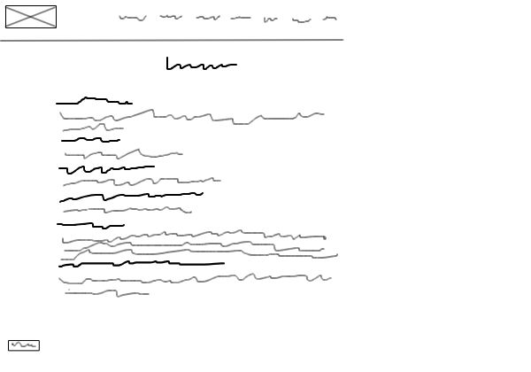<div class="ds-meta"><b>13004_0.png</b></div><details class="ds-code"><summary>13004.html（共 3042 行，展示前 60 行）</summary><pre>&lt;!DOCTYPE html&gt;&#10;&lt;html&gt;&#10; &lt;head&gt;&#10;  &lt;style&gt;&#10;   /* Magnific Popup CSS */&#10;&#10;.mfp-bg {&#10;  top: 0;&#10;  left: 0;&#10;  width: 100%;&#10;  height: 100%;&#10;  z-index: 1042;&#10;  overflow: hidden;&#10;  position: fixed;&#10;  background: #0b0b0b;&#10;  opacity: 0.8;&#10;  filter: alpha(opacity=80); }&#10;&#10;.mfp-wrap {&#10;  top: 0;&#10;  left: 0;&#10;  width: 100%;&#10;  height: 100%;&#10;  z-index: 1043;&#10;  position: fixed;&#10;  outline: none !important;&#10;  -webkit-backface-visibility: hidden; }&#10;&#10;.mfp-container {&#10;  text-align: center;&#10;  position: absolute;&#10;  width: 100%;&#10;  height: 100%;&#10;  left: 0;&#10;  top: 0;&#10;  padding: 0 8px;&#10;  -webkit-box-sizing: border-box;&#10;  -moz-box-sizing: border-box;&#10;  box-sizing: border-box; }&#10;&#10;.mfp-container:before {&#10;  content: '';&#10;  display: inline-block;&#10;  height: 100%;&#10;  vertical-align: middle; }&#10;&#10;.mfp-align-top .mfp-container:before {&#10;  display: none; }&#10;&#10;.mfp-content {&#10;  position: relative;&#10;  display: inline-block;&#10;  vertical-align: middle;&#10;  margin: 0 auto;&#10;  text-align: left;&#10;  z-index: 1045; }&#10;&#10;.mfp-inline-holder .mfp-content, .mfp-ajax-holder .mfp-content {&#10;  width: 100%;&#10;  cursor: auto; }&#10;…（截断，原文共 3042 行）</pre></details></div><div class="ds-card">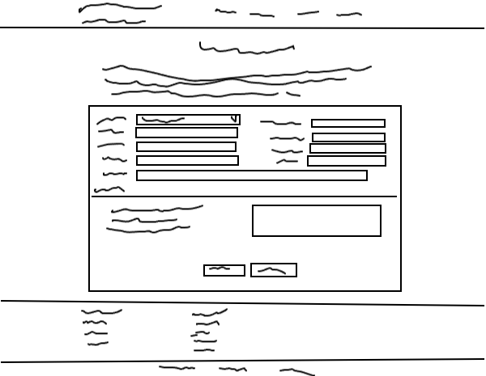<div class="ds-meta"><b>10564_0.png</b></div><details class="ds-code"><summary>10564.html（共 2279 行，展示前 60 行）</summary><pre>&lt;!DOCTYPE html PUBLIC "-//W3C//DTD HTML 4.01 Transitional//EN" ""&gt;&#10;&lt;html&gt;&#10; &lt;head&gt;&#10;  &lt;style&gt;&#10;   /*! jQuery UI - v1.12.1 - 2017-03-26&#10;* http://jqueryui.com&#10;* Includes: draggable.css, core.css, resizable.css, selectable.css, sortable.css, accordion.css, autocomplete.css, menu.css, button.css, controlgroup.css, checkboxradio.css, datepicker.css, dialog.css, progressbar.css, selectmenu.css, slider.css, spinner.css, tabs.css, tooltip.css, theme.css&#10;* To view and modify this theme, visit http://jqueryui.com/themeroller/?scope=&amp;folderName=base&amp;cornerRadiusShadow=8px&amp;offsetLeftShadow=0px&amp;offsetTopShadow=0px&amp;thicknessShadow=5px&amp;opacityShadow=30&amp;bgImgOpacityShadow=0&amp;bgTextureShadow=flat&amp;bgColorShadow=666666&amp;opacityOverlay=30&amp;bgImgOpacityOverlay=0&amp;bgTextureOverlay=flat&amp;bgColorOverlay=aaaaaa&amp;iconColorError=cc0000&amp;fcError=5f3f3f&amp;borderColorError=f1a…（本行共 1188 字符）&#10;* Copyright jQuery Foundation and other contributors; Licensed MIT */&#10;&#10;.ui-draggable-handle {&#10;	-ms-touch-action: none;&#10;	touch-action: none;&#10;}&#10;/* Layout helpers&#10;----------------------------------*/&#10;.ui-helper-hidden {&#10;	display: none;&#10;}&#10;.ui-helper-hidden-accessible {&#10;	border: 0;&#10;	clip: rect(0 0 0 0);&#10;	height: 1px;&#10;	margin: -1px;&#10;	overflow: hidden;&#10;	padding: 0;&#10;	position: absolute;&#10;	width: 1px;&#10;}&#10;.ui-helper-reset {&#10;	margin: 0;&#10;	padding: 0;&#10;	border: 0;&#10;	outline: 0;&#10;	line-height: 1.3;&#10;	text-decoration: none;&#10;	font-size: 100%;&#10;	list-style: none;&#10;}&#10;.ui-helper-clearfix:before,&#10;.ui-helper-clearfix:after {&#10;	content: "";&#10;	display: table;&#10;	border-collapse: collapse;&#10;}&#10;.ui-helper-clearfix:after {&#10;	clear: both;&#10;}&#10;.ui-helper-zfix {&#10;	width: 100%;&#10;	height: 100%;&#10;	top: 0;&#10;	left: 0;&#10;	position: absolute;&#10;	opacity: 0;&#10;	filter:Alpha(Opacity=0); /* support: IE8 */&#10;}&#10;&#10;.ui-front {&#10;	z-index: 100;&#10;…（截断，原文共 2279 行）</pre></details></div></div></div>

</div></div>

<div class="sg-body" id="sg-web2code--opendata"><div class="sg-bar"><span class="deep-title">  <a href="https://arxiv.org/abs/2406.20098">Web2Code</a> <span class="org">Petuum · CMU</span> <a class="hf" href="https://huggingface.co/datasets/MBZUAI/Web2Code"><span class="hf-b hf-dl" title="downloads"><svg class="hf-i" viewBox="0 0 24 24" fill="none" stroke="currentColor" stroke-width="2.2" stroke-linecap="round" stroke-linejoin="round"><path d="M12 3v11"/><path d="M8 11l4 4 4-4"/><path d="M4 20h16"/></svg>1.3k</span><span class="hf-b hf-lk" title="likes"><svg class="hf-i" viewBox="0 0 24 24" fill="currentColor"><path d="M12 21C7 17.5 3 14 3 9.5 3 7 5 5 7.5 5 9.2 5 10.7 6 12 7.6 13.3 6 14.8 5 16.5 5 19 5 21 7 21 9.5 21 14 17 17.5 12 21z"/></svg>13</span></a></span><span class="sg-nav"><button type="button" class="sg-prev" title="上一个（←）">‹</button><span class="sg-pos"></span><button type="button" class="sg-next" title="下一个（→）">›</button><button type="button" class="sg-x" title="关闭（Esc）">✕</button></span></div><div class="sg-stage">

<div class="ds-demo"><div class="ds-head"><b>数据样例</b> · <a href="https://huggingface.co/datasets/MBZUAI/Web2Code">MBZUAI/Web2Code</a></div><div class="ds-grid"><div class="ds-card"><div class="ds-meta"><b>WebSight_images_new/image_3627_5.png</b></div><details class="ds-code"><summary>conversations[0]（共 2 行）</summary><pre>&lt;image&gt;&#10;Observing the layout and design in the image, fashion the HTML script. Grant code characterized by facets of material design.</pre></details><details class="ds-code"><summary>conversations[1]（共 52 行）</summary><pre>&lt;html&gt;&#10;&lt;style&gt;&#10;body {&#10;    background-color: #a9a9a9;&#10;    color: #000;&#10;    font-family: Arial, sans-serif;&#10;    margin: 0;&#10;    padding: 0;&#10;}&#10;header {&#10;    background-color: #696969;&#10;    color: #fff;&#10;    text-align: center;&#10;    padding: 10px 0;&#10;}&#10;#logo {&#10;    font-size: 2em;&#10;}&#10;nav {&#10;    width: 20%;&#10;    float: left;&#10;    padding: 10px;&#10;    background-color: #a9a9a9;&#10;}&#10;nav h2 {&#10;    font-size: 1.5em;&#10;}&#10;nav p {&#10;    font-size: 1em;&#10;    text-align: justify;&#10;}&#10;#artist-img, #featured-img {&#10;    background-color: #000;&#10;    height: 100px;&#10;    margin: 10px 0;&#10;}&#10;&lt;/style&gt;&#10;&lt;body&gt;&#10;    &lt;header&gt;&#10;        &lt;div id="logo"&gt;Logo&lt;/div&gt;&#10;    &lt;/header&gt;&#10;    &lt;nav id="sidebar"&gt;&#10;        &lt;h2&gt;Artists&lt;/h2&gt;&#10;        &lt;p&gt;John Doe is a famous portrait painter. He is known for his beautiful portraits.&lt;/p&gt;&#10;        &lt;div id="artist-img"&gt;&lt;/div&gt;&#10;        &lt;p&gt;Jane Smith is a renowned landscape artist. Her landscapes are a sight to behold.&lt;/p&gt;&#10;        &lt;div id="artist-img"&gt;&lt;/div&gt;&#10;        &lt;h2&gt;Featured Works&lt;/h2&gt;&#10;        &lt;div id="featured-img"&gt;&lt;/div&gt;&#10;    &lt;/nav&gt;&#10;&lt;/body&gt;&#10;&lt;/html&gt;</pre></details></div><div class="ds-card">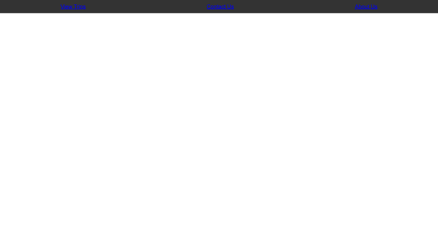<div class="ds-meta"><b>WebSight_images_new/image_10742_14.png</b></div><details class="ds-code"><summary>conversations[0]（共 2 行）</summary><pre>&lt;image&gt;&#10;Look at the webpage screenshot. How could you translate these visual elements into HTML code? Generate code that compliments the architecture of material design.</pre></details><details class="ds-code"><summary>conversations[1]（共 47 行）</summary><pre>&lt;html&gt;&#10;&lt;style&gt;&#10;body {&#10;  margin: 0;&#10;  padding: 0;&#10;  font-family: Arial, sans-serif;&#10;}&#10;&#10;nav ul {&#10;  display: flex;&#10;  list-style: none;&#10;  justify-content: space-around;&#10;  padding: 10px 0;&#10;  background-color: #333;&#10;  color: #fff;&#10;}&#10;&#10;nav ul li {&#10;  margin: 0 10px;&#10;}&#10;&#10;.banner {&#10;  background: url('destination.jpg');&#10;  background-size: cover;&#10;  height: 500px;&#10;  display: flex;&#10;  justify-content: center;&#10;  align-items: center;&#10;  color: #fff;&#10;  font-size: 2em;&#10;  text-align: center;&#10;  line-height: 1.5;&#10;}&#10;&lt;/style&gt;&#10;&lt;body&gt;&#10;  &lt;nav&gt;&#10;    &lt;ul&gt;&#10;      &lt;li&gt;&lt;a href="#"&gt;View Trips&lt;/a&gt;&lt;/li&gt;&#10;      &lt;li&gt;&lt;a href="#"&gt;Contact Us&lt;/a&gt;&lt;/li&gt;&#10;      &lt;li&gt;&lt;a href="#"&gt;About Us&lt;/a&gt;&lt;/li&gt;&#10;    &lt;/ul&gt;&#10;  &lt;/nav&gt;&#10;  &lt;div class="banner"&gt;&#10;    &lt;p&gt;Welcome to our travel agency. We offer the best trips around the globe.&lt;/p&gt;&#10;  &lt;/div&gt;&#10;&lt;/body&gt;&#10;&lt;/html&gt;</pre></details></div><div class="ds-card">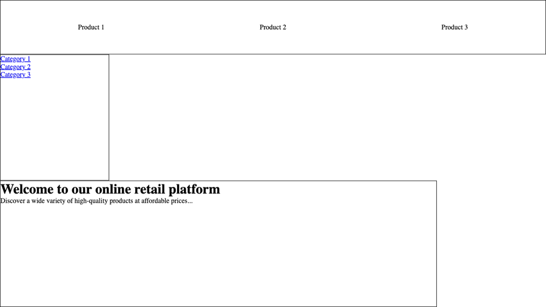<div class="ds-meta"><b>WebSight_images_new/image_4405_7.png</b></div><details class="ds-code"><summary>conversations[0]（共 2 行）</summary><pre>&lt;image&gt;&#10;Regenerate the layout and styling of the webpage visible in the screenshot into HTML/CSS code. Lay out code which respects the guidelines of material design styling.</pre></details><details class="ds-code"><summary>conversations[1]（共 66 行，展示前 60 行）</summary><pre>&lt;html&gt;&#10;&lt;style&gt;&#10;* {&#10;    box-sizing: border-box;&#10;    margin: 0;&#10;    padding: 0;&#10;}&#10;&#10;body {&#10;    display: flex;&#10;    flex-direction: column;&#10;    height: 100vh;&#10;}&#10;&#10;/* Slider Styles */&#10;#banner {&#10;    height: 30%;&#10;    display: flex;&#10;    justify-content: space-between;&#10;    align-items: center;&#10;    overflow: hidden;&#10;    border: 1px solid;&#10;}&#10;&#10;.slide {&#10;    flex: 1;&#10;    display: flex;&#10;    justify-content: center;&#10;    align-items: center;&#10;}&#10;&#10;/* Sidebar Styles */&#10;#sidebar {&#10;    height: 70%;&#10;    width: 20%;&#10;    border: 1px solid;&#10;}&#10;&#10;/* Main content styles */&#10;#content {&#10;    height: 70%;&#10;    width: 80%;&#10;    border: 1px solid;&#10;}&#10;&lt;/style&gt;&#10;&lt;body&gt;&#10;    &lt;div id="banner"&gt;&#10;        &lt;div class="slide"&gt;Product 1&lt;/div&gt;&#10;        &lt;div class="slide"&gt;Product 2&lt;/div&gt;&#10;        &lt;div class="slide"&gt;Product 3&lt;/div&gt;&#10;    &lt;/div&gt;&#10;    &lt;aside id="sidebar"&gt;&#10;        &lt;nav&gt;&#10;            &lt;ul&gt;&#10;                &lt;li&gt;&lt;a href="#"&gt;Category 1&lt;/a&gt;&lt;/li&gt;&#10;                &lt;li&gt;&lt;a href="#"&gt;Category 2&lt;/a&gt;&lt;/li&gt;&#10;                &lt;li&gt;&lt;a href="#"&gt;Category 3&lt;/a&gt;&lt;/li&gt;&#10;            &lt;/ul&gt;&#10;        &lt;/nav&gt;&#10;    &lt;/aside&gt;&#10;…（截断，原文共 66 行）</pre></details></div></div></div>

</div></div>

<div class="sg-body" id="sg-webcode2m--opendata"><div class="sg-bar"><span class="deep-title">  <a href="https://arxiv.org/abs/2404.06369">WebCode2M</a> <span class="org">Rabbitpre AI · PKU</span> <a class="hf" href="https://huggingface.co/datasets/xcodemind/webcode2m"><span class="hf-b hf-dl" title="downloads"><svg class="hf-i" viewBox="0 0 24 24" fill="none" stroke="currentColor" stroke-width="2.2" stroke-linecap="round" stroke-linejoin="round"><path d="M12 3v11"/><path d="M8 11l4 4 4-4"/><path d="M4 20h16"/></svg>2.4k</span></a></span><span class="sg-nav"><button type="button" class="sg-prev" title="上一个（←）">‹</button><span class="sg-pos"></span><button type="button" class="sg-next" title="下一个（→）">›</button><button type="button" class="sg-x" title="关闭（Esc）">✕</button></span></div><div class="sg-stage">

<div class="ds-demo"><div class="ds-head"><b>数据样例</b> · <a href="https://huggingface.co/datasets/xcodemind/webcode2m">xcodemind/webcode2m</a></div><div class="ds-grid"><div class="ds-card"><details class="ds-code"><summary>text（共 182 行，展示前 60 行）</summary><pre>&lt;!DOCTYPE html&gt;&#10;&#10;&lt;html&gt;&lt;head&gt;&lt;title&gt;IPBiz: District Court infringement determination vacated in L&amp;amp;W v. Shertech&lt;/title&gt;&lt;/head&gt;&lt;body&gt;&lt;div id="navbar-iframe-container"&gt;&lt;/div&gt;&lt;div id="header"&gt;&lt;h1 id="blog-title"&gt;&lt;a&gt;&#10;	IPBiz&#10;	&lt;/a&gt;&lt;/h1&gt;&lt;p id="description"&gt;Intellectual property news affecting business and everyday life&lt;/p&gt;&lt;/div&gt;&lt;div id="content"&gt;&lt;div id="main"&gt;&lt;div id="main2"&gt;&lt;h2 class="date-header"&gt;Sunday, December 17, 2006&lt;/h2&gt;&lt;div class="post"&gt;&lt;a&gt;&lt;/a&gt;&lt;h3 class="post-title"&gt;&#10;	 District Court infringement determination vacated in L&amp;amp;W v. Shertech&#10;    &lt;/h3&gt;&lt;div class="post-body"&gt;&lt;div&gt;&lt;div style="clear:both;"&gt;&lt;/div&gt;The CAFC found, contrary to the district court, that L&amp;amp;W had not acknowledged embossments separate the layers of its heat shields.&lt;br/&gt;&lt;br/&gt;There was an issue of inconsistent jury verdicts, and the CAFC cited Minn. Min. v. Chemque, 303 F.3d 1294.  Perkin-Elmer v. ComputerVision, 732 F.2d 888, is also cited.&lt;div style="clear:both; padding-bottom:0.25em"&gt;&lt;/div&gt;&lt;/div&gt;&lt;/div&gt;&lt;p class="post-footer"&gt;&lt;em&gt;posted by Lawrence B. Ebert at &lt;a&gt;2:02 PM&lt;/a&gt;&lt;/em&gt;&lt;span class="item-action"&gt;&lt;a&gt;&lt;img class="icon-action" height="13" src="https://resources.blogblog.com/img/icon18_email.gif" width="18"/&gt;&lt;/a&gt;&lt;/span&gt;&lt;/p&gt;&lt;/div&gt;&lt;div id="comments"&gt;&lt;a&gt;&lt;/a&gt;&lt;h4&gt;0 Comments:&lt;/h4&gt;&lt;dl id="comments-block"&gt;&lt;/dl&gt;&lt;p class="comment-timestamp"&gt;&lt;a class="comment-link"&gt;Post a Comment&lt;/a&gt;&lt;/p&gt;&lt;p class="comment-timestamp"&gt;&lt;a&gt;&amp;lt;&amp;lt; Home&lt;/a&gt;&lt;/p&gt;&lt;/div&gt;&lt;/div&gt;&lt;/div&gt;&lt;div id="sidebar"&gt;&lt;div id="sidebar2"&gt;&lt;div id="profile-container"&gt;&lt;h2 class="sidebar-title"&gt;About Me&lt;/h2&gt;&lt;dl class="profile-datablock"&gt;&lt;dd class="profile-data"&gt;&lt;strong&gt;Name:&lt;/strong&gt; &lt;a&gt; Lawrence B. Ebert &lt;/a&gt;&lt;/dd&gt;&lt;/dl&gt;&lt;p class="profile-textblock"&gt;I'm a patent lawyer located in central New Jersey.  I have a J.D. from the University of Chicago and a Ph.D. from Stanford University, where I studied graphite intercalation compounds at the Center for Materials Research.  I worked at Exxon Corporate Research in areas ranging from engine deposits through coal and petroleum to fullerenes. An article that I wrote in The Trademark Reporter, 1994, 84, 379-407 on color trademarks was cited by Supreme Court in Qualitex v. Jacobson, 514 US 159 (1995) and the methodology was adopted&#10;in the Capri case in N.D. Ill. An article that I wrote on DNA profiling was cited by the Colorado Supreme Court (Shreck case) and a Florida appellate court (Brim case). I was interviewed by NHK-TV about the Jan-Hendrik Schon affair.  I am developing ipABC, an entity that combines rigorous IP analytics with study of business models, to optimize utilization of intellectual property.  I can be reached at C8AsF5 at yahoo.com.&lt;/p&gt;&lt;p class="profile-link"&gt;&lt;a&gt;View my complete profile&lt;/a&gt;&lt;/p&gt;&lt;/div&gt;&lt;h2 class="sidebar-title"&gt;Previous Posts&lt;/h2&gt;&lt;ul id="recently"&gt;&lt;li&gt;&lt;a&gt;Planet Bingo v. Gametech&lt;/a&gt;&lt;/li&gt;&lt;li&gt;&lt;a&gt;Amazon strikes back at IBM in ED Texas&lt;/a&gt;&lt;/li&gt;&lt;li&gt;&lt;a&gt;Jackson contacted  a Pittsburgh invention promotio...&lt;/a&gt;&lt;/li&gt;&lt;li&gt;&lt;a&gt;Yonhap on Brauman panel investigating fraudulent w...&lt;/a&gt;&lt;/li&gt;&lt;li&gt;&lt;a&gt;Papers from Boalt Conference on "California's Stem...&lt;/a&gt;&lt;/li&gt;&lt;li&gt;&lt;a&gt;The hostage taken by Jackson in McKenna shooting i...&lt;/a&gt;&lt;/li&gt;&lt;li&gt;&lt;a&gt;Judge Sand denies Nordisk's request for PI against...&lt;/a&gt;&lt;/li&gt;&lt;li&gt;&lt;a&gt;Google presents site allowing search of US patents&lt;/a&gt;&lt;/li&gt;&lt;li&gt;&lt;a&gt;More on the purported Cosby link to Jackson's anger&lt;/a&gt;&lt;/li&gt;&lt;li&gt;&lt;a&gt;Leahy talks about patent reform at Georgetown&lt;/a&gt;&lt;/li&gt;&lt;/ul&gt;&lt;p id="powered-by"&gt;&lt;a&gt;&lt;img src="https://lh3.googleusercontent.com/blogger_img_proxy/ALY8t1tc3h8aQynq56Rr1Uhw8qtsr65wBjbiXooxuXgbZuNBFesYZvF_wLTK8OpEljVy2UrBuUINVYiMzTF06qeDkLz3FLa5rC8kIK1E83LgDFd5=s0-d"/&gt;&lt;/a&gt;&lt;/p&gt;&lt;/div&gt;&lt;/div&gt;&lt;/div&gt;&lt;div id="footer"&gt;&lt;hr/&gt;&lt;p&gt; &lt;/p&gt;&lt;/div&gt;&lt;noscript&gt;&lt;a&gt;&lt;img src="https://lh3.googleusercontent.com/blogger_img_proxy/ALY8t1uqANWQSlq2qLr6cQdXF3i3P1-L0lmXQUEsiSfnNpq4eHtXP0qGb48-0sWy_ccK5dn5WRv6uhq-g3pA47sX1M33G7DIUDS3DFeyAHktrplLS2B7u4c0=s0-d"/&gt;&lt;/a&gt;&lt;/noscript&gt;&lt;style&gt;body {&#10;    background: #fff;&#10;    margin: 0;&#10;    padding: 40px 20px;&#10;    font: x-small Georgia, Serif;&#10;    text-align: center;&#10;    color: #333;&#10;    font-size/* */: /**/ small;&#10;    font-size: /**/ small&#10;    }&#10;a img {&#10;    border-width: 0&#10;    }&#10;#header {&#10;    width: 660px;&#10;    margin: 0 auto 10px;&#10;    border: 1px solid #ccc&#10;    }&#10;#blog-title {&#10;    margin: 5px 5px 0;&#10;    padding: 20px 20px 0.25em;&#10;    border: 1px solid #eee;&#10;    border-width: 1px 1px 0;&#10;    font-size: 200%;&#10;    line-height: 1.2em;&#10;    font-weight: normal;&#10;    color: #666;&#10;    text-transform: uppercase;&#10;    letter-spacing: 0.2em&#10;    }&#10;#blog-title a {&#10;    color: #666;&#10;    text-decoration: none&#10;    }&#10;#description {&#10;    margin: 0 5px 5px;&#10;    padding: 0 20px 20px;&#10;    border: 1px solid #eee;&#10;    border-width: 0 1px 1px;&#10;    max-width: 700px;&#10;    font: 78%/1.4em "Trebuchet MS", Trebuchet, Arial, Verdana, Sans-serif;&#10;    text-transform: uppercase;&#10;    letter-spacing: 0.2em;&#10;    color: #999&#10;    }&#10;#content {&#10;    width: 660px;&#10;    margin: 0 auto;&#10;    padding: 0;&#10;    text-align: left&#10;    }&#10;#main {&#10;    width: 410px;&#10;…（截断，原文共 182 行）</pre></details><details class="ds-code"><summary>bbox（共 88 行，展示前 60 行）</summary><pre>{&#10; "type": "body",&#10; "content": "",&#10; "style": "background: #fff; margin: 0; padding: 40px 20px; font: x-small Georgia, Serif; text-align: center; color: #333; font-size: small; font-size: small",&#10; "bbox": [&#10;  0,&#10;  0,&#10;  1280,&#10;  1314&#10; ],&#10; "children": [&#10;  {&#10;   "type": "div",&#10;   "content": "",&#10;   "style": "width: 660px; margin: 0 auto 10px; border: 1px solid #ccc",&#10;   "bbox": [&#10;    309,&#10;    40,&#10;    662,&#10;    105&#10;   ],&#10;   "children": [&#10;    {&#10;     "type": "h1",&#10;     "content": "",&#10;     "style": "margin: 5px 5px 0; padding: 20px 20px 0.25em; border: 1px solid #eee; border-width: 1px 1px 0; font-size: 200%; line-height: 1.2em; font-weight: normal; color: #666; text-transform: uppercase; letter-spacing: 0.2em",&#10;     "bbox": [&#10;      315,&#10;      46,&#10;      650,&#10;      58&#10;     ],&#10;     "children": [&#10;      {&#10;       "type": "a",&#10;       "content": "IPBiz",&#10;       "style": "color: #666; text-decoration: none",&#10;       "bbox": [&#10;        594,&#10;        68,&#10;        91,&#10;        29&#10;       ],&#10;       "children": []&#10;      }&#10;     ]&#10;    },&#10;    {&#10;     "type": "p",&#10;     "content": "Intellectual property news affecting business and everyday life",&#10;     "style": "margin: 0 5px 5px; padding: 0 20px 20px; border: 1px solid #eee; border-width: 0 1px 1px; max-width: 700px; font: 78%/1.4em \"Trebuchet MS\", Trebuchet, Arial, Verdana, Sans-serif; text-transform: uppercase; letter-spacing: 0.2em; color: #999",&#10;     "bbox": [&#10;      315,&#10;      104,&#10;      650,&#10;      35&#10;     ],&#10;     "children": []&#10;    }&#10;   ]&#10;…（截断，原文共 88 行）</pre></details></div><div class="ds-card">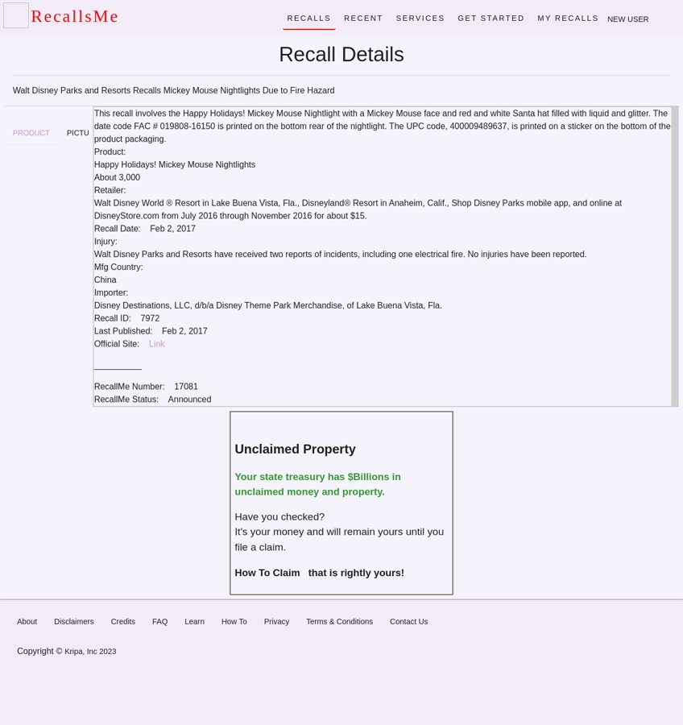<details class="ds-code"><summary>text（共 638 行，展示前 60 行）</summary><pre>&lt;!DOCTYPE html&gt;&#10;&#10;&lt;html&gt;&lt;head&gt;&lt;title&gt;Walt Disney Parks and Resorts Recalls Mickey Mouse · RecallsMe&lt;/title&gt;&lt;/head&gt;&lt;body&gt;&lt;div id="page-view"&gt; &lt;div class="MuiBox-root css-hqeimm"&gt;&lt;div class="MuiContainer-root MuiContainer-maxWidthXl MuiContainer-disableGutters css-1g5pnzw"&gt;&lt;header class="MuiPaper-root MuiPaper-elevation MuiPaper-elevation0 MuiAppBar-root MuiAppBar-colorPrimary MuiAppBar-positionFixed mui-fixed css-1oi7wav"&gt;&lt;div class="MuiContainer-root MuiContainer-maxWidthXl css-1ekb41w"&gt;&lt;div class="MuiToolbar-root MuiToolbar-regular css-12brgso"&gt;&lt;div class="MuiBox-root css-is797a"&gt;&lt;div class="MuiBox-root css-1gs754q"&gt;&lt;a class="MuiTypography-root MuiTypography-inherit MuiLink-root MuiLink-underlineAlways css-13f3l8y"&gt;&lt;img height="48" src="/images/logo/logo.png" width="48"/&gt;&lt;/a&gt;&lt;/div&gt;&lt;div class="MuiBox-root css-1451br9"&gt;&lt;a class="MuiTypography-root MuiTypography-h6 MuiTypography-noWrap css-oyhw1d"&gt;&lt;span class="MuiBox-root css-1fog0o5"&gt;RecallsMe&lt;/span&gt;&lt;/a&gt;&lt;/div&gt;&lt;/div&gt;&lt;div class="MuiBox-root css-ievg8a"&gt;&lt;a class="MuiTypography-root MuiTypography-inherit MuiLink-root MuiLink-underlineAlways MuiButtonBase-root MuiButton-root MuiButton-text MuiButton-textPrimary MuiButton-sizeMedium MuiButton-textSizeMedium MuiButton-root MuiButton-text MuiButton-textPrimary MuiButton-sizeMedium MuiButton-textSizeMedium css-kxrbgp"&gt;Recalls&lt;/a&gt;&lt;a class="MuiTypography-root MuiTypography-inherit MuiLink-root MuiLink-underlineAlways MuiButtonBase-root MuiButton-root MuiButton-text MuiButton-textPrimary MuiButton-sizeMedium MuiButton-textSizeMedium MuiButton-root MuiButton-text MuiButton-textPrimary MuiButton-sizeMedium MuiButton-textSizeMedium css-1m4pwot"&gt;Recent&lt;/a&gt;&lt;a class="MuiTypography-root MuiTypography-inherit MuiLink-root MuiLink-underlineAlways MuiButtonBase-root MuiButton-root MuiButton-text MuiButton-textPrimary MuiButton-sizeMedium MuiButton-textSizeMedium MuiButton-root MuiButton-text MuiButton-textPrimary MuiButton-sizeMedium MuiButton-textSizeMedium css-1m4pwot"&gt;Services&lt;/a&gt;&lt;a class="MuiTypography-root MuiTypography-inherit MuiLink-root MuiLink-underlineAlways MuiButtonBase-root MuiButton-root MuiButton-text MuiButton-textPrimary MuiButton-sizeMedium MuiButton-textSizeMedium MuiButton-root MuiButton-text MuiButton-textPrimary MuiButton-sizeMedium MuiButton-textSizeMedium css-1m4pwot"&gt;Get Started&lt;/a&gt;&lt;a class="MuiTypography-root MuiTypography-inherit MuiLink-root MuiLink-underlineAlways MuiButtonBase-root MuiButton-root MuiButton-text MuiButton-textPrimary MuiButton-sizeMedium MuiButton-textSizeMedium MuiButton-root MuiButton-text MuiButton-textPrimary MuiButton-sizeMedium MuiButton-textSizeMedium css-1m4pwot"&gt;My Recalls&lt;/a&gt;&lt;/div&gt;&lt;div class="MuiBox-root css-z9bsr1"&gt;&lt;button class="MuiButtonBase-root MuiIconButton-root MuiIconButton-sizeMedium css-148fdm8"&gt;&lt;span class="MuiTypography-root MuiTypography-span css-h3qoqk"&gt;NEW USER&lt;/span&gt;&lt;/button&gt;&lt;/div&gt;&lt;div class="MuiBox-root css-t2oejo"&gt;&lt;/div&gt;&lt;div class="MuiBox-root css-p52qg0"&gt;&lt;button class="MuiButtonBase-root MuiIconButton-root MuiIconButton-colorInherit MuiIconButton-sizeMedium css-1sez342"&gt;&lt;svg class="MuiSvgIcon-root MuiSvgIcon-fontSizeMedium css-vubbuv"&gt;&lt;path&gt;&lt;/path&gt;&lt;/svg&gt;&lt;/button&gt;&lt;/div&gt;&lt;div class="MuiBox-root css-1ov9cr1"&gt;&lt;/div&gt;&lt;/div&gt;&lt;/div&gt;&lt;/header&gt;&lt;div class="MuiBox-root css-167lj4j"&gt;&lt;/div&gt;&lt;main&gt;&lt;div class="MuiGrid-root MuiGrid-container css-1d3bbye"&gt;&lt;div class="MuiPaper-root MuiPaper-elevation MuiPaper-elevation1 css-1eftu4k"&gt;&lt;div class="MuiGrid-root MuiGrid-container MuiGrid-item MuiGrid-spacing-xs-1 css-rk8e6v"&gt;&lt;div class="MuiGrid-root MuiGrid-item MuiGrid-grid-xs-12 MuiGrid-grid-sm-12 MuiGrid-grid-md-9 css-1xd5sck"&gt;&lt;h1 class="MuiTypography-root MuiTypography-h1 MuiTypography-alignCenter MuiTypography-gutterBottom css-1yyrvhg"&gt;Recall Details&lt;/h1&gt;&lt;h2 class="MuiTypography-root MuiTypography-h2 MuiTypography-alignCenter css-12jsxq1"&gt;&lt;/h2&gt;&lt;hr class="MuiDivider-root MuiDivider-middle css-zy8cjw"/&gt;&lt;div class="MuiGrid-root MuiGrid-container MuiGrid-spacing-xs-1 css-skvbsg"&gt;&lt;div class="MuiGrid-root MuiGrid-item MuiGrid-grid-xs-12 css-15j76c0"&gt; &lt;div class="MuiGrid-root MuiGrid-item MuiGrid-grid-xs-12 css-15j76c0"&gt;&lt;div class="MuiBox-root css-0"&gt;&lt;/div&gt;&lt;/div&gt;&lt;div class="MuiGrid-root MuiGrid-item MuiGrid-grid-xs-12 css-15j76c0"&gt;&lt;p class="MuiTypography-root MuiTypography-body1 MuiTypography-alignLeft MuiTypography-gutterBottom css-16it7j0"&gt;Walt Disney Parks and Resorts Recalls Mickey Mouse Nightlights Due to Fire Hazard&lt;/p&gt;&lt;hr class="MuiDivider-root MuiDivider-fullWidth css-39bbo6"/&gt;&lt;div class="MuiBox-root css-1v9avh5"&gt;&lt;div class="MuiTabs-root css-ujj5ys"&gt;&lt;div class="MuiTabs-scrollableX MuiTabs-hideScrollbar css-oqr85h" style="width:99px;height:99px;position:absolute;top:-9999px;overflow:scroll"&gt;&lt;/div&gt;&lt;div class="MuiTabs-scroller MuiTabs-hideScrollbar MuiTabs-scrollableX css-12qnib" style="overflow:hidden;margin-bottom:0"&gt;&lt;div class="MuiTabs-flexContainer css-k008qs"&gt;&lt;button class="MuiButtonBase-root MuiTab-root MuiTab-labelIcon MuiTab-textColorSecondary Mui-selected css-pltj1d" id="vertical-tab-detail-0"&gt;&lt;svg class="MuiSvgIcon-root MuiSvgIcon-fontSizeMedium MuiTab-iconWrapper css-vubbuv" style="vertical-align:middle;font-size:2.4rem"&gt;&lt;path&gt;&lt;/path&gt;&lt;/svg&gt;Product&lt;span class="MuiTabs-indicator css-at2bun"&gt;&lt;/span&gt;&lt;/button&gt;&lt;button class="MuiButtonBase-root MuiTab-root MuiTab-labelIcon MuiTab-textColorSecondary css-pltj1d" id="vertical-tab-detail-1"&gt;&lt;svg class="MuiSvgIcon-root MuiSvgIcon-fontSizeMedium MuiTab-iconWrapper css-vubbuv" style="vertical-align:middle;font-size:2.4rem"&gt;&lt;path&gt;&lt;/path&gt;&lt;/svg&gt;Pictures&lt;/button&gt;&lt;button class="MuiButtonBase-root MuiTab-root MuiTab-labelIcon MuiTab-textColorSecondary css-pltj1d" id="vertical-tab-detail-2"&gt;&lt;svg class="MuiSvgIcon-root MuiSvgIcon-fontSizeMedium MuiTab-iconWrapper css-vubbuv" style="vertical-align:middle;font-size:2.4rem"&gt;&lt;path&gt;&lt;/path&gt;&lt;/svg&gt;Hazard&lt;/button&gt;&lt;button class="MuiButtonBase-root MuiTab-root MuiTab-labelIcon MuiTab-textColorSecondary css-pltj1d" id="vertical-tab-detail-3"&gt;&lt;svg class="MuiSvgIcon-root MuiSvgIcon-fontSizeMedium MuiTab-iconWrapper css-vubbuv" style="vertical-align:middle;font-size:2.4rem"&gt;&lt;path&gt;&lt;/path&gt;&lt;/svg&gt;Contact&lt;/button&gt;&lt;/div&gt;&lt;/div&gt;&lt;/div&gt;&lt;div class="MuiTypography-root MuiTypography-body1 css-183gz39" id="vertical-tabpanel-detail-0"&gt;&lt;div class="MuiBox-root css-0"&gt;&lt;div class="MuiBox-root css-0"&gt;&lt;div class="MuiGrid-root MuiGrid-container css-1d3bbye"&gt;&lt;div class="MuiGrid-root MuiGrid-item MuiGrid-grid-xs-12 MuiGrid-grid-sm-12 MuiGrid-grid-md-6 css-1vwhtk1"&gt;&lt;div class="MuiBox-root css-1nsp1l3"&gt;&lt;span&gt;This recall involves the Happy Holidays! Mickey Mouse Nightlight with a Mickey Mouse face and red and white Santa hat filled with liquid and glitter. The date code FAC # 019808-16150 is printed on the bottom rear of the nightlight. The UPC code, 400009489637, is printed on a sticker on the bottom of the product packaging.&lt;/span&gt;&lt;/div&gt;&lt;div class="MuiBox-root css-1nsp1l3"&gt;&lt;div class="MuiBox-root css-10rvbm3"&gt;Product:&lt;/div&gt;&lt;div class="MuiBox-root css-0"&gt;&lt;span style="display:block;padding-left:1,1.25,1.5,1.75,2"&gt;Happy Holidays! Mickey Mouse Nightlights&lt;/span&gt;&lt;span style="display:block;padding-left:1,1.25,1.5,1.75,2"&gt;About 3,000&lt;/span&gt;&lt;/div&gt;&lt;/div&gt;&lt;div class="MuiBox-root css-1nsp1l3"&gt;&lt;div class="MuiBox-root css-10rvbm3"&gt;Retailer:&lt;/div&gt;&lt;div class="MuiBox-root css-0"&gt;&lt;span style="display:block;padding-left:1,1.25,1.5,1.75,2"&gt;Walt Disney World ® Resort in Lake Buena Vista, Fla., Disneyland® Resort in Anaheim, Calif., Shop Disney Parks mobile app, and online at DisneyStore.com from July 2016 through November 2016 for about &#36;15.&lt;/span&gt;&lt;/div&gt;&lt;/div&gt;&lt;div class="MuiBox-root css-1nsp1l3"&gt;&lt;span style="font-weight:500"&gt;Recall Date:    &lt;/span&gt;&lt;span&gt;Feb 2, 2017&lt;/span&gt;&lt;/div&gt;&lt;div class="MuiBox-root css-1nsp1l3"&gt;&lt;div class="MuiBox-root css-10rvbm3"&gt;Injury:&lt;/div&gt;&lt;div class="MuiBox-root css-0"&gt;&lt;span style="display:block;padding-left:1,1.25,1.5,1.75,2"&gt;Walt Disney Parks and Resorts have received two reports of incidents, including one electrical fire. No injuries have been reported.&lt;/span&gt;&lt;/div&gt;&lt;/div&gt;&lt;/div&gt;&lt;div class="MuiGrid-root MuiGrid-item MuiGrid-grid-xs-12 MuiGrid-grid-sm-12 MuiGrid-grid-md-6 css-1vwhtk1"&gt;&lt;div class="MuiBox-root css-1nsp1l3"&gt;&lt;div class="MuiBox-root css-10rvbm3"&gt;Mfg Country:&lt;/div&gt;&lt;div class="MuiBox-root css-0"&gt;&lt;span style="display:block;padding-left:1,1.25,1.5,1.75,2"&gt;China&lt;/span&gt;&lt;/div&gt;&lt;/div&gt;&lt;div class="MuiBox-root css-1nsp1l3"&gt;&lt;div class="MuiBox-root css-10rvbm3"&gt;Importer:&lt;/div&gt;&lt;div class="MuiBox-root css-0"&gt;&lt;span style="display:block;padding-left:1,1.25,1.5,1.75,2"&gt;Disney Destinations, LLC, d/b/a Disney Theme Park Merchandise, of Lake Buena Vista, Fla.&lt;/span&gt;&lt;/div&gt;&lt;/div&gt;&lt;div class="MuiBox-root css-1nsp1l3"&gt;&lt;span style="font-weight:500"&gt;Recall ID:    &lt;/span&gt;&lt;span&gt;7972&lt;/span&gt;&lt;/div&gt;&lt;div class="MuiBox-root css-1nsp1l3"&gt;&lt;span style="font-weight:500"&gt;Last Published:    &lt;/span&gt;&lt;span&gt;Feb 2, 2017&lt;/span&gt;&lt;/div&gt;&lt;div class="MuiBox-root css-1nsp1l3"&gt;&lt;span style="font-weight:500"&gt;Official Site:    &lt;/span&gt;&lt;span&gt;&lt;a class="MuiTypography-root MuiTypography-inherit MuiLink-root MuiLink-underlineAlways css-1bw0jzo"&gt;Link&lt;/a&gt;&lt;/span&gt;&lt;/div&gt;&lt;p&gt;__________&lt;/p&gt;&lt;div class="MuiBox-root css-1nsp1l3"&gt;&lt;span style="font-weight:500"&gt;RecallMe Number:    &lt;/span&gt;&lt;span&gt;17081&lt;/span&gt;&lt;/div&gt;&lt;div class="MuiBox-root css-1nsp1l3"&gt;&lt;span style="font-weight:500"&gt;RecallMe Status:    &lt;/span&gt;&lt;span&gt;Announced&lt;/span&gt;&lt;/div&gt;&lt;/div&gt;&lt;/div&gt;&lt;/div&gt;&lt;/div&gt;&lt;/div&gt;&lt;div class="MuiTypography-root MuiTypography-body1 css-183gz39" id="vertical-tabpanel-detail-1"&gt;&lt;/div&gt;&lt;div class="MuiTypography-root MuiTypography-body1 css-183gz39" id="vertical-tabpanel-detail-2"&gt;&lt;/div&gt;&lt;div class="MuiTypography-root MuiTypography-body1 css-183gz39" id="vertical-tabpanel-detail-3"&gt;&lt;/div&gt;&lt;/div&gt;&lt;/div&gt;&lt;/div&gt;&lt;/div&gt;&lt;/div&gt;&lt;div class="MuiGrid-root MuiGrid-item MuiGrid-grid-xs-12 MuiGrid-grid-sm-12 MuiGrid-grid-md-3 css-1ha4th6"&gt;&lt;div class="MuiBox-root css-1e5bgxv"&gt;&lt;div class="MuiBox-root css-0"&gt;&lt;img src="/images/claim/Unclaimed.jpg" style="object-fit:scale-down;background-color:white" width="100%"/&gt;&lt;div class="MuiBox-root css-0"&gt;&lt;h2&gt;Unclaimed Property&lt;/h2&gt;&lt;h3 style="color:#339933"&gt;Your state treasury has &#36;Billions in unclaimed money and property.&lt;/h3&gt;&lt;p style="font-size:1.2rem;padding:0;margin:0"&gt;Have you checked?&lt;/p&gt;&lt;p style="font-size:1.2rem;padding:0;margin:0"&gt;It's your money and will remain yours until you file a claim.&lt;/p&gt;&lt;h3&gt;&lt;a&gt;How To Claim &lt;/a&gt;   that is rightly yours!&lt;/h3&gt;&lt;/div&gt;&lt;/div&gt;&lt;/div&gt;&lt;/div&gt;&lt;/div&gt;&lt;/div&gt;&lt;/div&gt;&lt;/main&gt;&lt;footer&gt;&lt;div class="MuiBox-root css-5oqqb0"&gt;&lt;div class="MuiContainer-root MuiContainer-maxWidthLg css-172zz1e"&gt;&lt;div class="MuiBox-root css-16ilbvt"&gt;&lt;a class="MuiTypography-root MuiTypography-inherit MuiLink-root MuiLink-underlineAlways css-7hpag4"&gt;About&lt;/a&gt;&lt;a class="MuiTypography-root MuiTypography-inherit MuiLink-root MuiLink-underlineAlways css-7hpag4"&gt;Disclaimers&lt;/a&gt;&lt;a class="MuiTypography-root MuiTypography-inherit MuiLink-root MuiLink-underlineAlways css-7hpag4"&gt;Credits&lt;/a&gt;&lt;a class="MuiTypography-root MuiTypography-inherit MuiLink-root MuiLink-underlineAlways css-7hpag4"&gt;FAQ&lt;/a&gt;&lt;a class="MuiTypography-root MuiTypography-inherit MuiLink-root MuiLink-underlineAlways css-7hpag4"&gt;Learn&lt;/a&gt;&lt;a class="MuiTypography-root MuiTypography-inherit MuiLink-root MuiLink-underlineAlways css-7hpag4"&gt;How To&lt;/a&gt;&lt;a class="MuiTypography-root MuiTypography-inherit MuiLink-root MuiLink-underlineAlways css-7hpag4"&gt;Privacy&lt;/a&gt;&lt;a class="MuiTypography-root MuiTypography-inherit MuiLink-root MuiLink-underlineAlways css-7hpag4"&gt;Terms &amp;amp; Conditions&lt;/a&gt;&lt;a class="MuiTypography-root MuiTypography-inherit MuiLink-root MuiLink-underlineAlways css-7hpag4"&gt;Contact Us&lt;/a&gt;&lt;/div&gt;&lt;div class="MuiBox-root css-aetwd0"&gt;&lt;div class="MuiBox-root css-0"&gt;Copyright © &lt;a class="MuiTypography-root MuiTypography-inherit MuiLink-root MuiLink-underlineAlways css-lrx8c"&gt;Kripa, Inc 2023&lt;/a&gt;&lt;/div&gt;&lt;/div&gt;&lt;div class="MuiBox-root css-1jt0dql"&gt;&lt;div class="MuiBox-root css-qqlq20"&gt;&lt;/div&gt;&lt;span style="min-width:70%;font-size:0.8rem;letter-spacing:0.2rem;cursor:grab;height:30px;width:100px;display:table-cell"&gt;   &lt;/span&gt;&lt;/div&gt;&lt;/div&gt;&lt;/div&gt;&lt;/footer&gt;&lt;/div&gt;&lt;/div&gt; &lt;/div&gt;&lt;style&gt;html {&#10;    box-sizing: border-box&#10;    }&#10;body {&#10;    margin: 0;&#10;    color: rgba(0, 0, 0, 0.87);&#10;    font-family: Roboto, Helvetica, Arial, sans-serif;&#10;    font-weight: 400;&#10;    font-size: 1rem;&#10;    line-height: 1.5;&#10;    background-color: #fff&#10;    }&#10;.css-hqeimm {&#10;    background: #f1ecf7;&#10;    padding: 0&#10;    }&#10;.css-1g5pnzw {&#10;    width: 100%;&#10;    margin-left: auto;&#10;    box-sizing: border-box;&#10;    margin-right: auto;&#10;    display: block&#10;    }&#10;.css-1oi7wav {&#10;    background-color: #fff;&#10;    color: rgba(0, 0, 0, 0.87);&#10;    transition: box-shadow 300ms cubic-bezier(0.4, 0, 0.2, 1) 0ms;&#10;    box-shadow: none;&#10;    display: -webkit-box;&#10;    display: -webkit-flex;&#10;    display: -ms-flexbox;&#10;    display: flex;&#10;    flex-direction: column;&#10;    width: 100%;&#10;    box-sizing: border-box;&#10;    flex-shrink: 0;&#10;    position: fixed;&#10;    z-index: 1100;&#10;    top: 0;&#10;    left: auto;&#10;    right: 0;&#10;    background-color: #f1ecf7;&#10;    color: rgba(0, 0, 0, 0.87);&#10;    background-color: #f1ecf7&#10;    }&#10;.css-1ekb41w {&#10;    width: 100%;&#10;    margin-left: auto;&#10;    box-sizing: border-box;&#10;    margin-right: auto;&#10;    display: block;&#10;    padding-left: 16px;&#10;    padding-right: 16px&#10;    }&#10;.css-12brgso {&#10;    position: relative;&#10;    display: -webkit-box;&#10;    display: -webkit-flex;&#10;…（截断，原文共 638 行）</pre></details><details class="ds-code"><summary>bbox（共 1677 行，展示前 60 行）</summary><pre>{&#10; "type": "body",&#10; "content": "",&#10; "style": "margin: 0; color: rgba(0, 0, 0, 0.87); font-family: Roboto, Helvetica, Arial, sans-serif; font-weight: 400; font-size: 1rem; line-height: 1.5; background-color: #fff",&#10; "bbox": [&#10;  0,&#10;  0,&#10;  1280,&#10;  1359&#10; ],&#10; "children": [&#10;  {&#10;   "type": "div",&#10;   "content": "",&#10;   "style": null,&#10;   "bbox": [&#10;    0,&#10;    0,&#10;    1280,&#10;    1359&#10;   ],&#10;   "children": [&#10;    {&#10;     "type": "div",&#10;     "content": "",&#10;     "style": "background: #f1ecf7; padding: 0",&#10;     "bbox": [&#10;      0,&#10;      0,&#10;      1280,&#10;      1359&#10;     ],&#10;     "children": [&#10;      {&#10;       "type": "div",&#10;       "content": "",&#10;       "style": "width: 100%; margin-left: auto; box-sizing: border-box; margin-right: auto; display: block",&#10;       "bbox": [&#10;        0,&#10;        0,&#10;        1280,&#10;        1359&#10;       ],&#10;       "children": [&#10;        {&#10;         "type": "header",&#10;         "content": "",&#10;         "style": "background-color: #fff; color: rgba(0, 0, 0, 0.87); transition: box-shadow 300ms cubic-bezier(0.4, 0, 0.2, 1) 0ms; box-shadow: none; display: -webkit-box; display: -webkit-flex; display: -ms-flexbox; display: flex; flex-direction: column; width: 100%; box-sizing: border-box; flex-shrink: 0; position: fixed; z-index: 1100; top: 0; left: auto; right: 0; background-color: #f1ecf7; color: rgba(0, 0, 0, 0.87); background-color: #f1ecf7",&#10;         "bbox": [&#10;          0,&#10;          0,&#10;          1280,&#10;          64&#10;         ],&#10;         "children": [&#10;          {&#10;           "type": "div",&#10;           "content": "",&#10;           "style": "width: 100%; margin-left: auto; box-sizing: border-box; margin-right: auto; display: block; padding-left: 16px; padding-right: 16px",&#10;           "bbox": [&#10;…（截断，原文共 1677 行）</pre></details></div><div class="ds-card">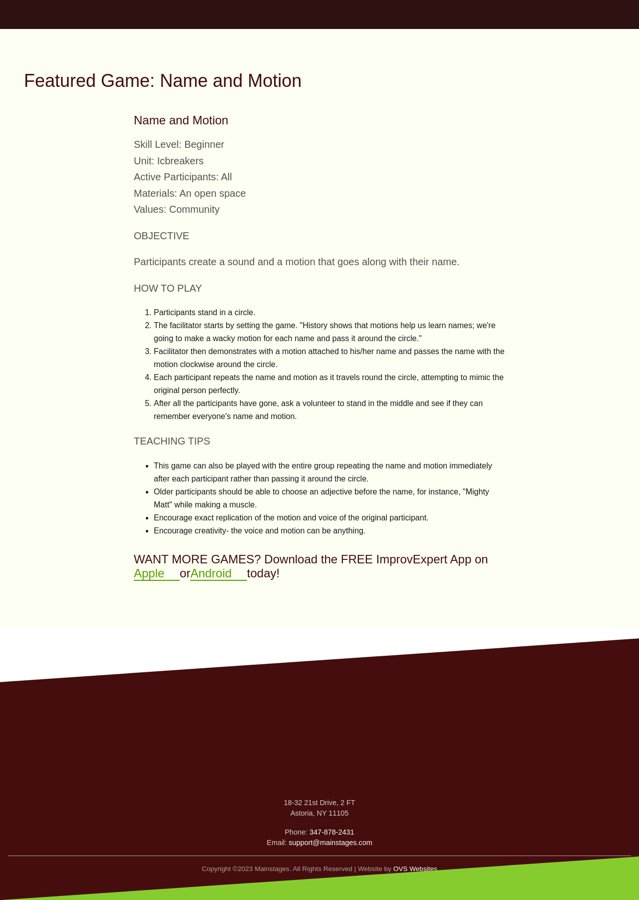<details class="ds-code"><summary>text（共 367 行，展示前 60 行）</summary><pre>&lt;!DOCTYPE html&gt;&#10;&#10;&lt;!DOCTYPE html&gt;&#10;&#10;&lt;html&gt;&lt;head&gt;&lt;title&gt;Name and Motion: Icebreaker for Kids &#124; mainstages&lt;/title&gt;&lt;/head&gt;&lt;body&gt;&lt;div id="___gatsby"&gt;&lt;div id="gatsby-focus-wrapper" style="outline:none"&gt;&lt;div class="css-fg6u3d"&gt;&lt;header class="header"&gt;&lt;div id="overlay"&gt;&lt;/div&gt;&lt;div class="header__wrapper"&gt;&lt;a class="header__logo"&gt;&lt;img src="/images/mainstages-logo-horizontal.png" width="250"/&gt;&lt;/a&gt;&lt;nav class="top-nav__header-menu"&gt;&lt;div class="top-nav__main-menu-wrapper"&gt;&lt;div class="top-nav__menus css-1xvm8ud"&gt;&lt;p class="top-nav__mobile-title"&gt;Mainstages&lt;/p&gt;&lt;div class="menu-cross-links"&gt;&lt;span class="menu-cross-links__title css-1dhgl5b"&gt;&lt;a&gt;&lt;svg height="1em" width="1em"&gt;&lt;path&gt;&lt;/path&gt;&lt;/svg&gt; 347-878-2431&lt;/a&gt;&lt;/span&gt;&lt;div class="css-1ugf0iw"&gt;&lt;a class="active"&gt;&lt;span&gt;Virtual Entertainment&lt;/span&gt;&lt;/a&gt;&lt;a class=""&gt;&lt;span&gt;In-person Programs&lt;/span&gt;&lt;/a&gt;&lt;a class=""&gt;&lt;span&gt;In-person Performances&lt;/span&gt;&lt;/a&gt;&lt;/div&gt;&lt;/div&gt;&lt;ul class="top-nav__outer-list" id="menu-main-menu"&gt;&lt;li class="top-nav__item-level-1 menu-item top-nav__has-children"&gt;&lt;a&gt;Virtual Offerings&lt;/a&gt;&lt;span class="top-nav__submenu-button css-la3nd4"&gt;&lt;svg height="1em" width="1em"&gt;&lt;path&gt;&lt;/path&gt;&lt;/svg&gt;&lt;/span&gt;&lt;/li&gt;&lt;li class="top-nav__item-level-1 menu-item top-nav__has-children"&gt;&lt;a&gt;About Us&lt;/a&gt;&lt;span class="top-nav__submenu-button css-la3nd4"&gt;&lt;svg height="1em" width="1em"&gt;&lt;path&gt;&lt;/path&gt;&lt;/svg&gt;&lt;/span&gt;&lt;/li&gt;&lt;li class="top-nav__item-level-1 menu-item top-nav__has-children"&gt;&lt;a&gt;Jobs&lt;/a&gt;&lt;span class="top-nav__submenu-button css-la3nd4"&gt;&lt;svg height="1em" width="1em"&gt;&lt;path&gt;&lt;/path&gt;&lt;/svg&gt;&lt;/span&gt;&lt;/li&gt;&lt;li class="top-nav__item-level-1 menu-item"&gt;&lt;a&gt;The Faces of mainstages&lt;/a&gt;&lt;/li&gt;&lt;li class="top-nav__item-level-1 menu-item"&gt;&lt;a&gt;Blog&lt;/a&gt;&lt;/li&gt;&lt;li class="top-nav__item-level-1 menu-item"&gt;&lt;a&gt;Get a Quote&lt;/a&gt;&lt;/li&gt;&lt;li class="top-nav__item-level-1 menu-item"&gt;&lt;a&gt;Contact Us&lt;/a&gt;&lt;/li&gt;&lt;/ul&gt;&lt;/div&gt;&lt;/div&gt;&lt;div class="top-nav__image-buttons-wrapper"&gt;&lt;a class="image-button"&gt;&lt;span&gt;Virtual Entertainment&lt;/span&gt;&lt;/a&gt;&lt;a class="image-button sectionSwitch_btn--programming"&gt;&lt;span&gt;In-person Programs&lt;/span&gt;&lt;/a&gt;&lt;a class="image-button sectionSwitch_btn--performances"&gt;&lt;span&gt;In-person Performances&lt;/span&gt;&lt;/a&gt;&lt;/div&gt;&lt;/nav&gt;&lt;a class="header__menu-trigger"&gt;&lt;span class="label"&gt;Menu&lt;/span&gt;&lt;div class="header__menu-icon"&gt;&lt;div class="header__menu-icon__middle"&gt;&lt;/div&gt;&lt;/div&gt;&lt;/a&gt;&lt;/div&gt;&lt;/header&gt;&lt;div class="css-1lggbir"&gt;&lt;h1 class="css-pokxtt"&gt;Featured Game: Name and Motion&lt;/h1&gt;&lt;/div&gt;&lt;section class="css-14r1apu"&gt;&lt;div class="css-1v34t8r"&gt;&lt;div&gt;&lt;h3&gt;Name and Motion&lt;/h3&gt;&lt;p&gt;Skill Level: Beginner&lt;br/&gt;Unit: Icbreakers&lt;br/&gt;Active Participants: All&lt;br/&gt;Materials: An open space&lt;br/&gt;Values: Community&lt;/p&gt;&lt;p&gt;OBJECTIVE&lt;/p&gt;&lt;p&gt;Participants create a sound and a motion that goes along with their name.&lt;/p&gt;&lt;p&gt;HOW TO PLAY&lt;/p&gt;&lt;ol&gt;&lt;li&gt;Participants stand in a circle.&lt;/li&gt;&lt;li&gt;The facilitator starts by setting the game. "History shows that motions help us learn names; we're going to make a wacky motion for each name and pass it around the circle."&lt;/li&gt;&lt;li&gt;Facilitator then demonstrates with a motion attached to his/her name and passes the name with the motion clockwise around the circle.&lt;/li&gt;&lt;li&gt;Each participant repeats the name and motion as it travels round the circle, attempting to mimic the original person perfectly.&lt;/li&gt;&lt;li&gt;After all the participants have gone, ask a volunteer to stand in the middle and see if they can remember everyone's name and motion.&lt;/li&gt;&lt;/ol&gt;&lt;p&gt;TEACHING TIPS&lt;/p&gt;&lt;ul&gt;&lt;li&gt;This game can also be played with the entire group repeating the name and motion immediately after each participant rather than passing it around the circle.&lt;/li&gt;&lt;li&gt;Older participants should be able to choose an adjective before the name, for instance, "Mighty Matt" while making a muscle.&lt;/li&gt;&lt;li&gt;Encourage exact replication of the motion and voice of the original participant.&lt;/li&gt;&lt;li&gt;Encourage creativity- the voice and motion can be anything.&lt;/li&gt;&lt;/ul&gt;&lt;h3&gt;WANT MORE GAMES? Download the FREE ImprovExpert App on &lt;a class="externalLink"&gt;Apple  &lt;svg height="1em" width="1em"&gt;&lt;path&gt;&lt;/path&gt;&lt;/svg&gt;&lt;/a&gt;or&lt;a class="externalLink"&gt;Android  &lt;svg height="1em" width="1em"&gt;&lt;path&gt;&lt;/path&gt;&lt;/svg&gt;&lt;/a&gt;today!&lt;/h3&gt;&lt;/div&gt;&lt;/div&gt;&lt;/section&gt;&lt;div class="css-1lggbir"&gt;&lt;/div&gt;&lt;div class="footer__wrapper"&gt;&lt;footer class="footer"&gt;&lt;div class="footer__inner-wrapper"&gt;&lt;div class="footer__social-media"&gt;&lt;a&gt;&lt;svg height="1em" width="1em"&gt;&lt;path&gt;&lt;/path&gt;&lt;/svg&gt;&lt;/a&gt;&lt;a&gt;&lt;svg height="1em" width="1em"&gt;&lt;path&gt;&lt;/path&gt;&lt;/svg&gt;&lt;/a&gt;&lt;a&gt;&lt;svg height="1em" width="1em"&gt;&lt;path&gt;&lt;/path&gt;&lt;/svg&gt;&lt;/a&gt;&lt;/div&gt;&lt;div class="footer__logos"&gt;&lt;a class="footer__logo-link"&gt;&lt;img src="/images/nystea-logo.png"/&gt;&lt;/a&gt;&lt;a class="footer__logo-link"&gt;&lt;img src="/images/roundtable-logo.jpg"/&gt;&lt;/a&gt;&lt;a class="footer__logo-link"&gt;&lt;img src="/images/mainstages-logo-classic.png"/&gt;&lt;/a&gt;&lt;/div&gt;&lt;div class="footer__row"&gt;&lt;div class="footer__column footer__column--1"&gt;&lt;div class="adr"&gt;&lt;div class="street-address"&gt;18-32 21st Drive, 2 FT&lt;/div&gt;&lt;div&gt;&lt;span class="locality"&gt;Astoria&lt;/span&gt;, &lt;span class="region"&gt;NY&lt;/span&gt;&lt;span class="postal-code"&gt; 11105&lt;/span&gt;&lt;/div&gt;&lt;div class="country-name"&gt;USA&lt;/div&gt;&lt;/div&gt;&lt;/div&gt;&lt;div class="footer__column footer__column--2"&gt;&lt;div&gt;Phone: &lt;a class="tel"&gt;347-878-2431&lt;/a&gt;&lt;/div&gt;&lt;div&gt;Email: &lt;a class="email"&gt;support@mainstages.com&lt;/a&gt;&lt;/div&gt;&lt;/div&gt;&lt;/div&gt;&lt;p class="footer__copyright"&gt;Copyright ©2023 Mainstages. All Rights Reserved &#124; Website by &lt;a&gt;OVS Websites&lt;/a&gt;&lt;/p&gt;&lt;/div&gt;&lt;/footer&gt;&lt;/div&gt;&lt;/div&gt;&lt;/div&gt;&lt;div id="gatsby-announcer" style="position:absolute;top:0;width:1px;height:1px;padding:0;overflow:hidden;clip:rect(0, 0, 0, 0);white-space:nowrap;border:0"&gt;&lt;/div&gt;&lt;/div&gt;&lt;style&gt;.top-nav__header-menu {&#10;    position: absolute;&#10;    display: flex;&#10;    flex-direction: row-reverse;&#10;    flex-wrap: nowrap;&#10;    justify-content: flex-start;&#10;    right: 0;&#10;    top: 0;&#10;    background-color: #301111;&#10;    transform: scalex(0);&#10;    max-width: 840px;&#10;    z-index: 1;&#10;    overflow: auto;&#10;    opacity: 0;&#10;    pointer-events: none;&#10;    transition: all 0.2s;&#10;    transform-origin: 100% 50%;&#10;    width: 100%;&#10;    min-height: 100vh;&#10;    box-shadow: -5px 0 3px rgba(0, 0, 0, 0.4)&#10;    }&#10;.top-nav__main-menu-wrapper {&#10;    position: relative;&#10;    width: 100%;&#10;    padding-top: 70px;&#10;    overflow: auto&#10;    }&#10;.top-nav__main-menu-wrapper .top-nav__menus {&#10;    overflow: auto&#10;    }&#10;.top-nav__main-menu-wrapper .top-nav__outer-list {&#10;    padding: 0;&#10;    margin: 0;&#10;    list-style: none&#10;    }&#10;.top-nav__main-menu-wrapper .top-nav__outer-list a {&#10;    color: #fff;&#10;    text-decoration: none;&#10;    font-size: 1.2rem&#10;    }&#10;.top-nav__mobile-title {&#10;    color: #fff;&#10;    margin: 0.7rem 1rem 1.3rem;&#10;    font-size: 2em;&#10;    position: absolute;&#10;    top: 0;&#10;    left: 0&#10;    }&#10;.top-nav__outer-list {&#10;    list-style: none;&#10;    margin: 0;&#10;    padding: 0&#10;    }&#10;.top-nav__item-level-1, .top-nav__item-level-2 {&#10;    position: relative;&#10;    border-bottom: 1px solid hsla(0, 0%, 100%, 0.2)&#10;…（截断，原文共 367 行）</pre></details><details class="ds-code"><summary>bbox（共 824 行，展示前 60 行）</summary><pre>{&#10; "type": "body",&#10; "content": "",&#10; "style": "color: var(--theme-ui-colors-text, #181818); background-color: var(--theme-ui-colors-background, #fcfff2); box-sizing: border-box; margin: 0; font-family: \"Europa\", sans-serif; line-height: 1.625; font-weight: 400; box-sizing: border-box; margin: 0; overflow: auto",&#10; "bbox": [&#10;  0,&#10;  0,&#10;  1280,&#10;  1802&#10; ],&#10; "children": [&#10;  {&#10;   "type": "div",&#10;   "content": "",&#10;   "style": "box-sizing: border-box; box-sizing: border-box",&#10;   "bbox": [&#10;    0,&#10;    0,&#10;    1280,&#10;    1802&#10;   ],&#10;   "children": [&#10;    {&#10;     "type": "div",&#10;     "content": "",&#10;     "style": "outline:none; box-sizing: border-box; box-sizing: border-box",&#10;     "bbox": [&#10;      0,&#10;      0,&#10;      1280,&#10;      1802&#10;     ],&#10;     "children": [&#10;      {&#10;       "type": "div",&#10;       "content": "",&#10;       "style": "box-sizing: border-box; padding-top: 80px; overflow: hidden; box-sizing: border-box",&#10;       "bbox": [&#10;        0,&#10;        0,&#10;        1280,&#10;        1802&#10;       ],&#10;       "children": [&#10;        {&#10;         "type": "header",&#10;         "content": "",&#10;         "style": "background-size: 100px; position: fixed; top: 0; left: 0; right: 0; width: 100%; z-index: 990; box-sizing: border-box; box-sizing: border-box",&#10;         "bbox": [&#10;          0,&#10;          0,&#10;          1280,&#10;          90&#10;         ],&#10;         "children": [&#10;          {&#10;           "type": "div",&#10;           "content": "",&#10;           "style": "background: linear-gradient(180deg, #301111 65%, hsla(0, 0%, 100%, 0) 0); min-height: 100px; padding: 1rem 1rem 2rem; display: flex; justify-content: space-between; min-height: 90px; box-sizing: border-box; box-sizing: border-box",&#10;           "bbox": [&#10;…（截断，原文共 824 行）</pre></details></div></div></div>

- **定位**：来自真实网页的大规模「设计图 → HTML/CSS + 布局树」数据，用来弥补 WebSight 这类合成数据结构过于简单的问题

<figure class="paper-fig">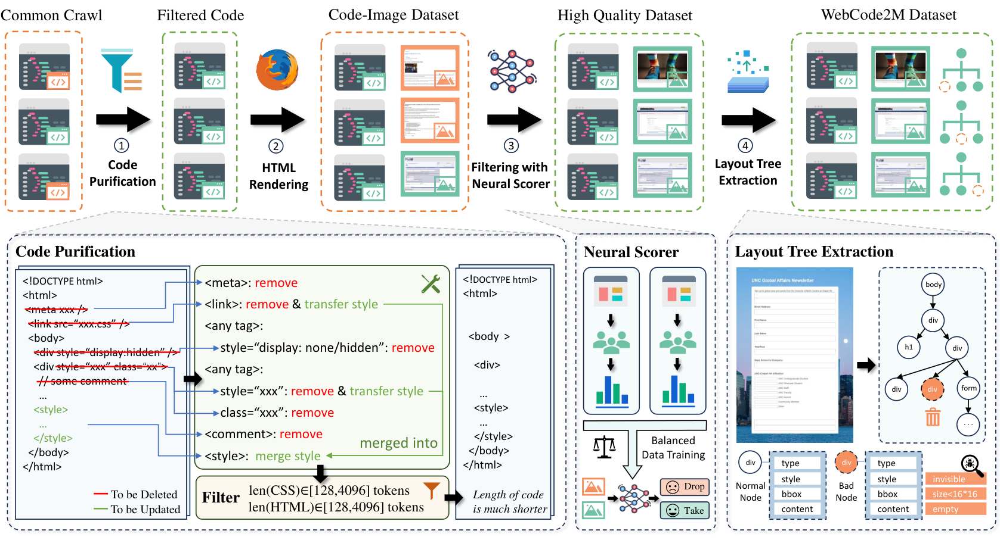<figcaption>Vision2UI → WebCode2M · Fig. 1：Common Crawl 网页经过代码净化、渲染截图、神经打分器过滤、布局树抽取，得到三元组数据</figcaption></figure>

- **自动化合成流程**（对照上图，从左往右读）
  1. **Common Crawl**：从 CC-MAIN-2023-50 第一段（约 33.5 亿网页）里随机抽约 5 亿个网页
  2. **Code Purification**（规则程序）
     - 按长度快筛：HTML 限 [128×5, 2048×5] 字符，CSS 限 [128×5, 4096×5] 字符（图中写的是按 token 算：CSS 和 HTML 都在 [128, 4096]）
     - 删除注释、`<meta>` / `<script>`、隐藏元素（hidden、零尺寸、出界），属性只保留 class / id / width / height / style / src
     - 删掉不生效的 CSS；外链 CSS 和行内 CSS 全部合并进一个 `<style>`
  3. **HTML Rendering**：用 Playwright 无头浏览器渲染截图，占总处理时间约 80%，整个流程跑了约一个月
  4. **Filtering with Neural Scorer**
     - 6 名有 3 年以上前端经验的标注员分 2 组做共识标注，按 5 条标准各给 1 分：布局正常、样式正常、没有大片空白、配色丰富、整体美观。约两周标完 1 万条
     - 用这些标注训 ResNet-50 打分器，删掉得分 < 2 的样本
  5. **Layout Tree Extraction**：从渲染后的 DOM 抽出每个元素的类型、样式、框和内容，组成布局树；图中标出的坏节点是 invisible、`size<16*16`、empty，会被删掉
  6. **WebCode2M Dataset**：每条是（代码，设计图，布局）三元组
  - （图外）**合规过滤**：截图过一遍 NSFW 图像分类器，文本过一遍脏词表，两者都通过才保留
  - （图外）**去重与划分**：先用截图哈希去重；再挑约 2K 条得分 > 4 的作为测试候选，用 CLIP 相似度再去一次重并人工检查；按 2048 / 4096 两个长度阈值切成 Short / Mid / Long，每档 256 条
- **质量控制**
  - 人工标注的子集里 80% 得分只有 0–1，说明原始网页大多是低质
  - 打分器 5 分类准确率 75%，「是否 ≥ 2」的二分类约 90%
  - 按分数删掉的样本占原始数据的 52.5%
- **关键数字**
  - 规模：训练集 2,563,905 条；测试集 3×256 条
  - 复杂度（训练集）：平均 5,366 token、184 个标签、DOM 深度 15；WebSight 只有 647 token、19 个标签、深度 5
  - 下游：Pix2Struct-1.3B 全量微调得到 WebCoder。在 Short 集上 Visual 0.78、TreeBLEU 0.35；Design2Code-18B 是 0.75 / 0.04；同一个基座改训 WebSight，只有 0.42 / 0.06
  - 训练资源：4 张 A800 80GB
- **局限**
  - 净化后代码仍然很长，训练和推理成本都高（论文自述）
  - 打分器准确率约 90%，仍有低质样本混入；而且标准偏主观
  - 所有模型都复现不了图片元素
  - 正文引言写的平均长度是 31,216 token、158 个标签、深度 13，其实是表 2 里 Design2Code 那一列；WebCode2M 训练集的实际值是 5,366 token、184 个标签、深度 15，原文前后不一致
- **可借鉴**
  - 真实网页的净化规则可以直接照搬：删隐藏元素、白名单属性、合并 CSS、按长度卡阈值
  - 「少量人工多维打分 → 训小 CNN 打分器 → 按阈值批量过滤」的审美门控，成本低、能扩到百万级
  - 渲染后顺手从 DOM 导出布局树，给数据额外加一个结构监督信号

</div></div>

<div class="sg-body" id="sg-webcompass--opendata"><div class="sg-bar"><span class="deep-title">  <a href="https://arxiv.org/abs/2604.18224">WebCompass</a> <span class="org">Kuaishou · NJU</span> <a class="hf" href="https://github.com/NJU-LINK/WebCompass"><span class="hf-b hf-st" title="GitHub stars"><svg class="hf-i" viewBox="0 0 24 24" fill="currentColor"><path d="M12 2.5l2.9 6 6.6.6-5 4.3 1.5 6.5L12 16.9 6 20.9l1.5-6.5-5-4.3 6.6-.6z"/></svg>25</span></a></span><span class="sg-nav"><button type="button" class="sg-prev" title="上一个（←）">‹</button><span class="sg-pos"></span><button type="button" class="sg-next" title="下一个（→）">›</button><button type="button" class="sg-x" title="关闭（Esc）">✕</button></span></div><div class="sg-stage">

<div class="ds-demo"><div class="ds-head"><b>数据样例</b> · <a href="https://huggingface.co/datasets/NJU-LINK/WebCompass">NJU-LINK/WebCompass</a></div><div class="ds-grid"><div class="ds-card"><div class="ds-meta"><b>2847874_owaves.com_L12_1</b></div><details class="ds-code"><summary>index.html（共 142 行，展示前 60 行）</summary><pre>&lt;!DOCTYPE html&gt;&#10;&#10;&lt;html lang="en-US"&gt;&lt;head&gt;&lt;meta content="text/html; charset=utf-8" http-equiv="Content-Type"/&gt;&lt;script src="cid:js-33f07394-58fb-4b47-810b-17f08da67f35@mhtml.blink"&gt;&lt;/script&gt;&#10;&lt;meta content="width=device-width" name="viewport"/&gt;&#10;&lt;link href="https://owaves.com/favicon.ico" rel="icon" sizes="any"/&gt;&#10;&lt;link href="https://owaves.com/favicon.svg" rel="icon" type="image/svg+xml"/&gt;&#10;&lt;link href="https://owaves.com/site.webmanifest" rel="manifest"/&gt;&#10;&lt;meta content="Astro v2.1.4" name="generator"/&gt;&#10;&lt;meta content="app-id=869648628" name="apple-itunes-app"/&gt;&#10;&lt;meta content="rfa2nsg4RTAnLWLFjNhbwAxsgw91F0KNOQWRK-tAtYg" name="google-site-verification"/&gt;&#10;&lt;title&gt;Owaves — Find Your Rhythm&lt;/title&gt;&#10;&lt;link href="https://owaves.com/" rel="canonical"/&gt;&#10;&lt;meta content="A holistic calendar designed to optimize your circadian rhythm Plan meals, exercise, and sleep into your day Download now on iPhone, iPad, and Apple Watch" name="description"/&gt;&#10;&lt;meta content="index, follow" name="robots"/&gt;&#10;&lt;meta content="" property="og:title"/&gt;&#10;&lt;meta content="" property="og:type"/&gt;&#10;&lt;meta content="" property="og:image"/&gt;&#10;&lt;meta content="https://owaves.com/" property="og:url"/&gt;&#10;&lt;meta content="A holistic calendar designed to optimize your circadian rhythm Plan meals, exercise, and sleep into your day Download now on iPhone, iPad, and Apple Watch" property="og:description"/&gt;&#10;&lt;meta content="" name="twitter:image"/&gt;&lt;meta content="" name="twitter:title"/&gt;&lt;meta content="A holistic calendar designed to optimize your circadian rhythm Plan meals, exercise, and sleep into your day Download now on iPhone, iPad, and Apple Watch" name="twitter:description"/&gt;&#10;&lt;!-- Google Tag Manager --&gt;&#10;&lt;!-- End Google Tag Manager --&gt;&#10;&lt;link href="./resources/index.240af574.css" rel="stylesheet"/&gt;&#10;&lt;link href="./resources/index.4dcf6f2b.css" rel="stylesheet"/&gt;&#10;&lt;link href="./resources/_...slug_.6bd4d39b.css" rel="stylesheet"/&gt;&#10;&lt;link href="./resources/_...slug_.1df5dfc3.css" rel="stylesheet"/&gt;&lt;/head&gt;&#10;&lt;body&gt;&#10;&lt;nav class="sidenav astro-2J44JLRM" id="sidebar"&gt;&#10;&lt;div class="menu-header astro-2J44JLRM"&gt;&#10;&lt;h2 class="astro-2J44JLRM"&gt;Menu&lt;/h2&gt;&#10;&lt;button class="close-button astro-2J44JLRM" id="closeButton" type="button"&gt;&lt;div class="sr-only astro-2J44JLRM"&gt;Close Menu&lt;/div&gt;&lt;svg astro-icon="mdi:close" class="astro-2J44JLRM" viewbox="0 0 24 24"&gt;&lt;path d="M19 6.41 17.59 5 12 10.59 6.41 5 5 6.41 10.59 12 5 17.59 6.41 19 12 13.41 17.59 19 19 17.59 13.41 12 19 6.41z" fill="currentColor"&gt;&lt;/path&gt;&lt;/svg&gt;&lt;/button&gt;&#10;&lt;/div&gt;&#10;&lt;div class="links astro-2J44JLRM"&gt;&#10;&lt;a class="link astro-2J44JLRM" data-kmt="1" href="index.html" target="_blank"&gt;Get Owaves&lt;/a&gt;&#10;&lt;a class="link astro-2J44JLRM" data-kmt="1" href="index.html"&gt;Take Quiz&lt;/a&gt;&#10;&lt;a class="link active astro-2J44JLRM" data-kmt="1" href="index.html"&gt;Home&lt;/a&gt;&#10;&lt;a class="link astro-2J44JLRM" data-kmt="1" href="index.html"&gt;Team&lt;/a&gt;&#10;&lt;a class="link astro-2J44JLRM" data-kmt="1" href="index.html"&gt;Blog&lt;/a&gt;&#10;&lt;/div&gt;&#10;&lt;/nav&gt;&#10;&lt;header class="header astro-3EF6KSR2 header-home" id="header"&gt;&#10;&lt;div class="head-bar astro-3EF6KSR2"&gt;&#10;&lt;a class="astro-3EF6KSR2" data-kmt="1" href="index.html"&gt;&lt;img alt="Owaves" class="astro-3EF6KSR2" height="24" src="./resources/logo.542977cd.svg" width="128"/&gt;&lt;/a&gt;&#10;&lt;button class="open-nav astro-3EF6KSR2"&gt;&lt;img alt="Owaves" class="burger-menu-icon astro-3EF6KSR2" height="20" src="./resources/navigation.415be2ab.svg" width="20"/&gt;&lt;/button&gt;&#10;&lt;/div&gt;&#10;&lt;/header&gt;&#10;&lt;main&gt;&#10;&lt;div class="hero astro-J7PV25F6"&gt;&#10;&lt;div class="hero-top astro-J7PV25F6"&gt;&#10;&lt;img alt="Sunflower Plavatar" class="hero-image astro-J7PV25F6" height="257" src="./resources/plavatar.505bffa0.svg" width="257"/&gt;&#10;&lt;!-- &lt;div class="hero-text"&gt;&#10;				&lt;h1 class=""&gt;Time to check your body clock?&lt;/h1&gt;&#10;				&lt;h2 class="paragraph--100---light"&gt;Owaves is a holistic calendar designed to optimize your circadian rhythm. Plan meals, exercise, and sleep into your day.&lt;/h2&gt;&#10;			&lt;/div&gt; --&gt;&#10;&lt;div class="hero-text astro-J7PV25F6"&gt;&#10;&lt;h1 class="astro-J7PV25F6"&gt;Time to check your body clock?&lt;/h1&gt;&#10;&lt;h2 class="paragraph--100---light astro-J7PV25F6"&gt;We all have unique biological rhythms that impact energy, focus and performance. Learn more about yours in 60 seconds.&lt;/h2&gt;&#10;&lt;/div&gt;&#10;&lt;/div&gt;&#10;&lt;div class="button-group astro-J7PV25F6"&gt;&#10;…（截断，原文共 142 行）</pre></details><details class="ds-code"><summary>about.html（共 123 行，展示前 60 行）</summary><pre>&lt;!DOCTYPE html&gt;&#10;&#10;&lt;html lang="en-US"&gt;&lt;head&gt;&lt;meta content="text/html; charset=utf-8" http-equiv="Content-Type"/&gt;&lt;script src="cid:js-33f07394-58fb-4b47-810b-17f08da67f35@mhtml.blink"&gt;&lt;/script&gt;&#10;&lt;meta content="width=device-width" name="viewport"/&gt;&#10;&lt;link href="https://owaves.com/favicon.ico" rel="icon" sizes="any"/&gt;&#10;&lt;link href="https://owaves.com/favicon.svg" rel="icon" type="image/svg+xml"/&gt;&#10;&lt;link href="https://owaves.com/site.webmanifest" rel="manifest"/&gt;&#10;&lt;meta content="Astro v2.1.4" name="generator"/&gt;&#10;&lt;meta content="app-id=869648628" name="apple-itunes-app"/&gt;&#10;&lt;meta content="rfa2nsg4RTAnLWLFjNhbwAxsgw91F0KNOQWRK-tAtYg" name="google-site-verification"/&gt;&#10;&lt;title&gt;About - Owaves — Find Your Rhythm&lt;/title&gt;&#10;&lt;link href="https://owaves.com/" rel="canonical"/&gt;&#10;&lt;meta content="A holistic calendar designed to optimize your circadian rhythm Plan meals, exercise, and sleep into your day Download now on iPhone, iPad, and Apple Watch" name="description"/&gt;&#10;&lt;meta content="index, follow" name="robots"/&gt;&#10;&lt;meta content="" property="og:title"/&gt;&#10;&lt;meta content="" property="og:type"/&gt;&#10;&lt;meta content="" property="og:image"/&gt;&#10;&lt;meta content="https://owaves.com/" property="og:url"/&gt;&#10;&lt;meta content="A holistic calendar designed to optimize your circadian rhythm Plan meals, exercise, and sleep into your day Download now on iPhone, iPad, and Apple Watch" property="og:description"/&gt;&#10;&lt;meta content="" name="twitter:image"/&gt;&lt;meta content="" name="twitter:title"/&gt;&lt;meta content="A holistic calendar designed to optimize your circadian rhythm Plan meals, exercise, and sleep into your day Download now on iPhone, iPad, and Apple Watch" name="twitter:description"/&gt;&#10;&lt;!-- Google Tag Manager --&gt;&#10;&lt;!-- End Google Tag Manager --&gt;&#10;&lt;link href="./resources/index.240af574.css" rel="stylesheet"/&gt;&#10;&lt;link href="./resources/index.4dcf6f2b.css" rel="stylesheet"/&gt;&#10;&lt;link href="./resources/_...slug_.6bd4d39b.css" rel="stylesheet"/&gt;&#10;&lt;link href="./resources/_...slug_.1df5dfc3.css" rel="stylesheet"/&gt;&lt;/head&gt;&#10;&lt;body&gt;&#10;&lt;nav class="sidenav astro-2J44JLRM" id="sidebar"&gt;&#10;&lt;div class="menu-header astro-2J44JLRM"&gt;&#10;&lt;h2 class="astro-2J44JLRM"&gt;Menu&lt;/h2&gt;&#10;&lt;button class="close-button astro-2J44JLRM" id="closeButton" type="button"&gt;&lt;div class="sr-only astro-2J44JLRM"&gt;Close Menu&lt;/div&gt;&lt;svg astro-icon="mdi:close" class="astro-2J44JLRM" viewbox="0 0 24 24"&gt;&lt;path d="M19 6.41 17.59 5 12 10.59 6.41 5 5 6.41 10.59 12 5 17.59 6.41 19 12 13.41 17.59 19 19 17.59 13.41 12 19 6.41z" fill="currentColor"&gt;&lt;/path&gt;&lt;/svg&gt;&lt;/button&gt;&#10;&lt;/div&gt;&#10;&lt;div class="links astro-2J44JLRM"&gt;&#10;&lt;a class="link astro-2J44JLRM" data-kmt="1" href="index.html" target="_blank"&gt;Get Owaves&lt;/a&gt;&#10;&lt;a class="link astro-2J44JLRM" data-kmt="1" href="index.html"&gt;Take Quiz&lt;/a&gt;&#10;&lt;a class="link active astro-2J44JLRM" data-kmt="1" href="index.html"&gt;Home&lt;/a&gt;&#10;&lt;a class="link astro-2J44JLRM" data-kmt="1" href="index.html"&gt;Team&lt;/a&gt;&#10;&lt;a class="link astro-2J44JLRM" data-kmt="1" href="index.html"&gt;Blog&lt;/a&gt;&#10;&lt;/div&gt;&#10;&lt;/nav&gt;&#10;&lt;header class="header astro-3EF6KSR2 header-home" id="header"&gt;&#10;&lt;div class="head-bar astro-3EF6KSR2"&gt;&#10;&lt;a class="astro-3EF6KSR2" data-kmt="1" href="index.html"&gt;&lt;img alt="Owaves" class="astro-3EF6KSR2" height="24" src="./resources/logo.542977cd.svg" width="128"/&gt;&lt;/a&gt;&#10;&lt;button class="open-nav astro-3EF6KSR2"&gt;&lt;img alt="Owaves" class="burger-menu-icon astro-3EF6KSR2" height="20" src="./resources/navigation.415be2ab.svg" width="20"/&gt;&lt;/button&gt;&#10;&lt;/div&gt;&#10;&lt;/header&gt;&#10;&lt;main&gt;&lt;h1&gt;About Us&lt;/h1&gt;&#10;&lt;div class="about-content"&gt;&#10;&lt;p&gt;Welcome to Owaves — Find Your Rhythm. We are dedicated to providing excellent services and solutions to our clients.&lt;/p&gt;&#10;&lt;h2&gt;Our Story&lt;/h2&gt;&#10;&lt;p&gt;Founded with a vision to deliver quality and innovation, Owaves — Find Your Rhythm has been serving customers with dedication and expertise. Our team is committed to excellence in everything we do.&lt;/p&gt;&#10;&lt;h2&gt;Our Mission&lt;/h2&gt;&#10;&lt;p&gt;To provide outstanding services that exceed our customers' expectations while maintaining the highest standards of quality and professionalism.&lt;/p&gt;&#10;&lt;h2&gt;Why Choose Us&lt;/h2&gt;&#10;&lt;ul&gt;&#10;&lt;li&gt;Experienced and professional team&lt;/li&gt;&#10;&lt;li&gt;Quality service delivery&lt;/li&gt;&#10;&lt;li&gt;Customer-focused approach&lt;/li&gt;&#10;&lt;li&gt;Competitive pricing&lt;/li&gt;&#10;&lt;li&gt;Reliable and timely service&lt;/li&gt;&#10;…（截断，原文共 123 行）</pre></details></div><div class="ds-card">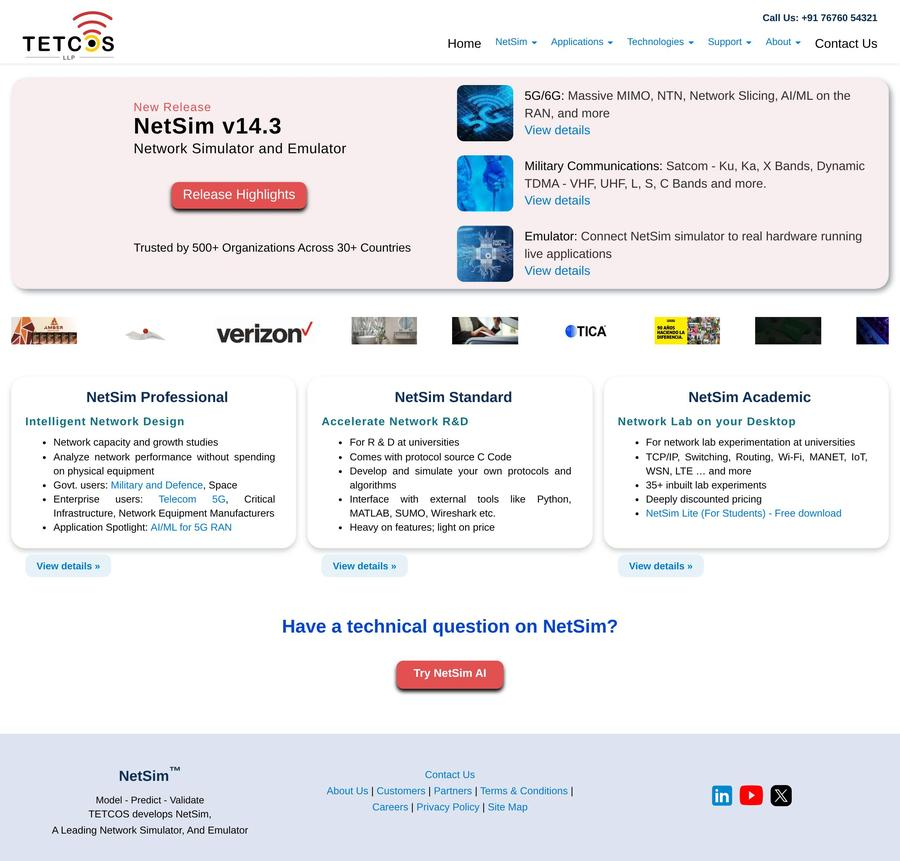<div class="ds-meta"><b>2849864_www.tetcos.com_L4_2</b></div><details class="ds-code"><summary>index.html（共 937 行，展示前 60 行）</summary><pre>&lt;!DOCTYPE html&gt;&#10;&#10;&lt;html lang="en"&gt;&lt;head&gt;&lt;meta content="text/html; charset=utf-8" http-equiv="Content-Type"/&gt;&lt;script src="cid:js-7ea2d86b-bfb8-48ee-9fdb-c00832b65660@mhtml.blink"&gt;&lt;/script&gt;&#10;&lt;meta content="IE=edge" http-equiv="X-UA-Compatible"/&gt;&#10;&lt;meta content="width=device-width, initial-scale=1.0" name="viewport"/&gt;&#10;&lt;title&gt;NetSim Home &#124; Network Simulator for 5G, IoT, Military Communication, VANETs, Sat Comm., UWAN and more&#10;    &lt;/title&gt;&#10;&lt;link href="https://www.tetcos.com/images/netsim_logo.png" rel="icon" type="image/png"/&gt;&#10;&lt;meta content="A trusted name in the field of network simulation and emulation. NetSim, network simulator and emulator, is used by 500+ organizations globally for network design, protocol analysis, modeling military communications and network R &amp;amp; D. NetSim emulator allows users to connect real hardware to the simulator." name="description"/&gt;&#10;&lt;meta content="NetSim, Tetcos, Network Simulation, Network Simulator, Network Emulator, AI, ML, WSN, Machine Learning, IOT, SDN, MANET, VANET, Satellite communication, Military Radio, NTN, Wireless Sensor Network, NS 2, NS 3, OPNET, Qualnet, 5G, 6G, communications simulator" name="keywords"/&gt;&#10;&lt;meta content="Tetcos" name="author"/&gt;&#10;&lt;meta content="Tetcos: NetSim - Network Simulation Software, India" property="og:title"/&gt;&#10;&lt;meta content="A trusted name in the field of network simulation and emulation." property="og:description"/&gt;&#10;&lt;meta content="https://www.tetcos.com/images/logo.svg" property="og:image"/&gt;&#10;&lt;meta content="Tetcos: Logo" property="og:image:alt"/&gt;&#10;&lt;meta content="en_GB" property="og:locale"/&gt;&#10;&lt;meta content="website" property="og:type"/&gt;&#10;&lt;meta content="summary_large_image" name="twitter:card"/&gt;&#10;&lt;meta content="https://www.tetcos.com/index.html" property="og:url"/&gt;&#10;&lt;link href="https://www.tetcos.com/index.html" rel="canonical"/&gt;&#10;&lt;link href="./resources/main.css" rel="stylesheet"/&gt;&#10;&lt;link as="style" href="https://www.tetcos.com/css/modern.css" rel="preload"/&gt;&#10;&lt;link as="font" crossorigin="" href="https://www.tetcos.com/fonts/your-main-font.woff2" rel="preload"/&gt;&#10;&lt;meta content="#CE3335" name="theme-color"/&gt;&#10;&lt;style&gt;&#10;        #imgModal {&#10;            display: none;&#10;            position: fixed;&#10;            z-index: 10000;&#10;            top: 0; left: 0;&#10;            width: 100%; height: 100%;&#10;            background: rgba(255, 255, 255, 0.85);&#10;            text-align: center;&#10;            padding-top: 60px;&#10;            cursor: default;&#10;        }&#10;        .img-container {&#10;            position: absolute;&#10;            top: 0;&#10;            left: 0;&#10;            width: 100%;&#10;            height: 100%;&#10;            overflow: hidden;&#10;            touch-action: none;&#10;            display: flex;&#10;            justify-content: center;&#10;            align-items: center;&#10;            cursor: default;&#10;        }&#10;        .img-popup {&#10;            max-width: 90%;&#10;            max-height: 90%;&#10;            object-fit: contain;&#10;            transition: transform 0.1s ease;&#10;            transform-origin: center center;&#10;            position: absolute; /* required for left/top */&#10;            left: 0px;&#10;            top: 0px;&#10;            cursor: grab;&#10;        }&#10;…（截断，原文共 937 行）</pre></details><details class="ds-code"><summary>about.html（共 841 行，展示前 60 行）</summary><pre>&lt;!DOCTYPE html&gt;&#10;&#10;&lt;html lang="en"&gt;&lt;head&gt;&lt;meta content="text/html; charset=utf-8" http-equiv="Content-Type"/&gt;&lt;script src="cid:js-7ea2d86b-bfb8-48ee-9fdb-c00832b65660@mhtml.blink"&gt;&lt;/script&gt;&#10;&lt;meta content="IE=edge" http-equiv="X-UA-Compatible"/&gt;&#10;&lt;meta content="width=device-width, initial-scale=1.0" name="viewport"/&gt;&#10;&lt;title&gt;About - NetSim Home &#124; Network Simulator for 5G, IoT, Military Communication, VANETs, Sat Comm., UWAN and more&lt;/title&gt;&#10;&lt;link href="https://www.tetcos.com/images/netsim_logo.png" rel="icon" type="image/png"/&gt;&#10;&lt;meta content="A trusted name in the field of network simulation and emulation. NetSim, network simulator and emulator, is used by 500+ organizations globally for network design, protocol analysis, modeling military communications and network R &amp;amp; D. NetSim emulator allows users to connect real hardware to the simulator." name="description"/&gt;&#10;&lt;meta content="NetSim, Tetcos, Network Simulation, Network Simulator, Network Emulator, AI, ML, WSN, Machine Learning, IOT, SDN, MANET, VANET, Satellite communication, Military Radio, NTN, Wireless Sensor Network, NS 2, NS 3, OPNET, Qualnet, 5G, 6G, communications simulator" name="keywords"/&gt;&#10;&lt;meta content="Tetcos" name="author"/&gt;&#10;&lt;meta content="Tetcos: NetSim - Network Simulation Software, India" property="og:title"/&gt;&#10;&lt;meta content="A trusted name in the field of network simulation and emulation." property="og:description"/&gt;&#10;&lt;meta content="https://www.tetcos.com/images/logo.svg" property="og:image"/&gt;&#10;&lt;meta content="Tetcos: Logo" property="og:image:alt"/&gt;&#10;&lt;meta content="en_GB" property="og:locale"/&gt;&#10;&lt;meta content="website" property="og:type"/&gt;&#10;&lt;meta content="summary_large_image" name="twitter:card"/&gt;&#10;&lt;meta content="https://www.tetcos.com/index.html" property="og:url"/&gt;&#10;&lt;link href="https://www.tetcos.com/index.html" rel="canonical"/&gt;&#10;&lt;link href="./resources/main.css" rel="stylesheet"/&gt;&#10;&lt;link as="style" href="https://www.tetcos.com/css/modern.css" rel="preload"/&gt;&#10;&lt;link as="font" crossorigin="" href="https://www.tetcos.com/fonts/your-main-font.woff2" rel="preload"/&gt;&#10;&lt;meta content="#CE3335" name="theme-color"/&gt;&#10;&lt;style&gt;&#10;        #imgModal {&#10;            display: none;&#10;            position: fixed;&#10;            z-index: 10000;&#10;            top: 0; left: 0;&#10;            width: 100%; height: 100%;&#10;            background: rgba(255, 255, 255, 0.85);&#10;            text-align: center;&#10;            padding-top: 60px;&#10;            cursor: default;&#10;        }&#10;        .img-container {&#10;            position: absolute;&#10;            top: 0;&#10;            left: 0;&#10;            width: 100%;&#10;            height: 100%;&#10;            overflow: hidden;&#10;            touch-action: none;&#10;            display: flex;&#10;            justify-content: center;&#10;            align-items: center;&#10;            cursor: default;&#10;        }&#10;        .img-popup {&#10;            max-width: 90%;&#10;            max-height: 90%;&#10;            object-fit: contain;&#10;            transition: transform 0.1s ease;&#10;            transform-origin: center center;&#10;            position: absolute; /* required for left/top */&#10;            left: 0px;&#10;            top: 0px;&#10;            cursor: grab;&#10;        }&#10;        .img-close {&#10;…（截断，原文共 841 行）</pre></details></div><div class="ds-card">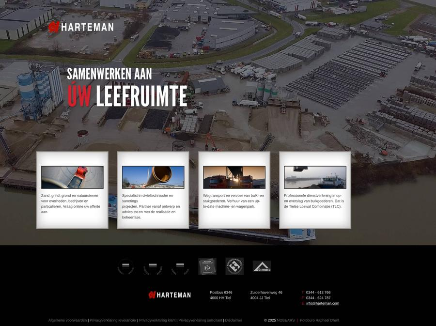<div class="ds-meta"><b>2872267_www.harteman.com_L4_2</b></div><details class="ds-code"><summary>index.html（共 174 行，展示前 60 行）</summary><pre>&lt;!DOCTYPE html PUBLIC "-//W3C//DTD XHTML 1.0 Strict//EN" "http://www.w3.org/TR/xhtml1/DTD/xhtml1-strict.dtd"&gt;&#10;&#10;&lt;html class="cufon-active cufon-ready" xmlns="http://www.w3.org/1999/xhtml"&gt;&lt;head&gt;&lt;meta content="text/html; charset=utf-8" http-equiv="Content-Type"/&gt;&lt;script src="cid:js-78f798ce-027f-453e-9556-d98b3e3d027c@mhtml.blink"&gt;&lt;/script&gt;&#10;&lt;meta content="width=device-width, initial-scale=1" name="viewport"/&gt;&#10;&lt;link href="https://www.harteman.com/favicon.ico" rel="icon" type="image/x-icon"/&gt;&lt;link href="https://www.harteman.com/favicon.ico" rel="shortcut icon" type="image/x-icon"/&gt; &lt;meta content="Al sinds 1978 is Harteman in Tiel uw partner in weg- en waterbouw, zand en grind producten, verhuur, op- en overslag en geotechnisch en milieukundig onderzoek." name="description"/&gt; &lt;title&gt;Harteman, uw partner i…（本行共 439 字符）&#10;&lt;link href="./resources/reset.css" rel="stylesheet" type="text/css"/&gt;&#10;&lt;link href="./resources/style.css" rel="stylesheet" type="text/css"/&gt;&#10;&lt;link href="./resources/fancybox.css" rel="stylesheet" type="text/css"/&gt;&#10;&lt;!--[if IE 7]&gt;&#10;		&#10;	&lt;link rel="stylesheet" type="text/css" href="/css/ie7.css"/&gt;&#10;	&lt;![endif]--&gt;&#10;&lt;style type="text/css"&gt;cufon{text-indent:0!important;}@media screen,projection{cufon{display:inline!important;display:inline-block!important;position:relative!important;vertical-align:middle!important;font-size:1px!important;line-height:1px!important;}cufon cufontext{display:-moz-inline-box!important;display:inline-block!important;width:0!important;height:0!important;overflow:hidden!important;text…（本行共 557 字符）&#10;&lt;/head&gt;&#10;&lt;body&gt;&#10;&lt;div id="ajaxcalls"&gt;&lt;/div&gt;&#10;&lt;!-- Video bg --&gt;&#10;&lt;div class="video-bg"&gt;&#10;&lt;video autoplay="" disablepictureinpicture="" loop="" muted="" playsinline=""&gt;&#10;&lt;source src="https://www.harteman.com/files/harteman_fullhd_23.mp4" type="video/mp4"/&gt;&#10;&lt;/video&gt;&#10;&lt;/div&gt;&#10;&lt;div id="bground"&gt;&#10;&lt;div class="mob-header" style="background: url('img/template/bghome1.jpg') top center"&gt;&lt;/div&gt;&#10;&lt;div class="mob-header" style="background: url('img/template/bghome2.jpg') top center"&gt;&lt;/div&gt;&#10;&lt;div class="mob-header" style="background: url('img/template/bghome3.jpg') top center"&gt;&lt;/div&gt;&#10;&lt;div class="mob-header" style="background: url('img/template/bghome4.jpg') top center"&gt;&lt;/div&gt;&#10;&lt;div class="mob-header" style="background: url('img/template/bghome5.jpg') top center"&gt;&lt;/div&gt;&#10;&lt;div class="mob-header" style="background: url('img/template/bghome6.jpg') top center"&gt;&lt;/div&gt;&#10;&lt;/div&gt;&#10;&lt;div class="wrapper" id="navigation"&gt;&#10;&lt;div id="logo-mobile"&gt;&#10;&lt;a href="index.html"&gt;&lt;img alt="" src="./resources/logo.png"/&gt;&lt;/a&gt; &lt;/div&gt;&#10;&lt;ul id="nav"&gt;&#10;&lt;li&gt;&lt;a class="cufon active" href="index.html"&gt;&lt;cufon alt="Home" class="cufon cufon-canvas" style="width: 33px; height: 14px;"&gt;&lt;canvas height="17" style="width: 39px; height: 17px; top: -2px; left: -1px;" width="39"&gt;&lt;/canvas&gt;&lt;cufontext&gt;Home&lt;/cufontext&gt;&lt;/cufon&gt;&lt;/a&gt;&lt;/li&gt;&#10;&lt;li&gt;&lt;a class="cufon" href="index.html"&gt;&lt;cufon alt="Over " class="cufon cufon-canvas" style="width: 30px; height: 14px;"&gt;&lt;canvas height="17" style="width: 40px; height: 17px; top: -2px; left: -1px;" width="40"&gt;&lt;/canvas&gt;&lt;cufontext&gt;Over &lt;/cufontext&gt;&lt;/cufon&gt;&lt;cufon alt="ons" class="cufon cufon-canvas" style="width: 21px; height: 14px;"&gt;&lt;canvas height="17" style="width: 27px; height: 17px; top: -2px; le…（本行共 474 字符）&#10;&lt;li&gt;&lt;a class="cufon" href="index.html"&gt;&lt;cufon alt="Nieuws" class="cufon cufon-canvas" style="width: 43px; height: 14px;"&gt;&lt;canvas height="17" style="width: 49px; height: 17px; top: -2px; left: -1px;" width="49"&gt;&lt;/canvas&gt;&lt;cufontext&gt;Nieuws&lt;/cufontext&gt;&lt;/cufon&gt;&lt;/a&gt;&lt;/li&gt;&#10;&lt;li&gt;&lt;a class="cufon" href="index.html"&gt;&lt;cufon alt="MVO" class="cufon cufon-canvas" style="width: 26px; height: 14px;"&gt;&lt;canvas height="17" style="width: 31px; height: 17px; top: -2px; left: -1px;" width="31"&gt;&lt;/canvas&gt;&lt;cufontext&gt;MVO&lt;/cufontext&gt;&lt;/cufon&gt;&lt;/a&gt;&lt;/li&gt;&#10;&lt;li&gt;&lt;a class="cufon" href="index.html"&gt;&lt;cufon alt="Vacatures" class="cufon cufon-canvas" style="width: 57px; height: 14px;"&gt;&lt;canvas height="17" style="width: 63px; height: 17px; top: -2px; left: -1px;" width="63"&gt;&lt;/canvas&gt;&lt;cufontext&gt;Vacatures&lt;/cufontext&gt;&lt;/cufon&gt;&lt;/a&gt;&lt;/li&gt;&#10;&lt;li&gt;&lt;a class="cufon" href="contact.html"&gt;&lt;cufon alt="Contact" class="cufon cufon-canvas" style="width: 43px; height: 14px;"&gt;&lt;canvas height="17" style="width: 52px; height: 17px; top: -2px; left: -1px;" width="52"&gt;&lt;/canvas&gt;&lt;cufontext&gt;Contact&lt;/cufontext&gt;&lt;/cufon&gt;&lt;/a&gt;&lt;/li&gt;&#10;&lt;div id="mobile-menu"&gt;&#10;&lt;li&gt;&lt;a class="subnav" href="index.html"&gt;&lt;cufon alt="Zand " class="cufon cufon-canvas" style="width: 31px; height: 14px;"&gt;&lt;canvas height="17" style="width: 41px; height: 17px; top: -2px; left: -1px;" width="41"&gt;&lt;/canvas&gt;&lt;cufontext&gt;Zand &lt;/cufontext&gt;&lt;/cufon&gt;&lt;cufon alt="&amp;amp; " class="cufon cufon-canvas" style="width: 12px; height: 14px;"&gt;&lt;canvas height="17" style="width: 21px; height: 17px; top: -2px…（本行共 696 字符）&#10;&lt;li&gt;&lt;a class="subnav" href="index.html"&gt;&lt;cufon alt="Weg- " class="cufon cufon-canvas" style="width: 36px; height: 14px;"&gt;&lt;canvas height="17" style="width: 45px; height: 17px; top: -2px; left: -1px;" width="45"&gt;&lt;/canvas&gt;&lt;cufontext&gt;Weg- &lt;/cufontext&gt;&lt;/cufon&gt;&lt;cufon alt="&amp;amp; " class="cufon cufon-canvas" style="width: 12px; height: 14px;"&gt;&lt;canvas height="17" style="width: 21px; height: 17px; top: -2px…（本行共 704 字符）&#10;&lt;li&gt;&lt;a class="subnav" href="index.html"&gt;&lt;cufon alt="Verhuur" class="cufon cufon-canvas" style="width: 46px; height: 14px;"&gt;&lt;canvas height="17" style="width: 54px; height: 17px; top: -2px; left: -1px;" width="54"&gt;&lt;/canvas&gt;&lt;cufontext&gt;Verhuur&lt;/cufontext&gt;&lt;/cufon&gt;&lt;/a&gt;&lt;/li&gt;&#10;&lt;li&gt;&lt;a class="subnav" href="index.html"&gt;&lt;cufon alt="Op- " class="cufon cufon-canvas" style="width: 26px; height: 14px;"&gt;&lt;canvas height="17" style="width: 36px; height: 17px; top: -2px; left: -1px;" width="36"&gt;&lt;/canvas&gt;&lt;cufontext&gt;Op- &lt;/cufontext&gt;&lt;/cufon&gt;&lt;cufon alt="&amp;amp; " class="cufon cufon-canvas" style="width: 12px; height: 14px;"&gt;&lt;canvas height="17" style="width: 21px; height: 17px; top: -2px; …（本行共 700 字符）&#10;&lt;/div&gt;&#10;&lt;/ul&gt;&#10;&lt;div class="burger"&gt;&#10;&lt;img alt="Burger" src="./resources/burgermenu.svg"/&gt;&#10;&lt;/div&gt;&#10;&lt;/div&gt;&#10;&lt;div id="header-stretch"&gt;&#10;&lt;div class="wrapper" id="header"&gt;&#10;&lt;div id="logo"&gt;&#10;&lt;a href="index.html"&gt;&lt;img alt="" src="./resources/logo.png"/&gt;&lt;/a&gt; &lt;/div&gt;&#10;&lt;div id="subnavigation"&gt;&#10;&lt;ul id="subnav"&gt;&#10;&lt;li&gt;&lt;a class="subnav" href="index.html"&gt;&lt;cufon alt="Zand " class="cufon cufon-canvas" style="width: 38px; height: 17px;"&gt;&lt;canvas height="21" style="width: 50px; height: 21px; top: -2px; left: -1px;" width="50"&gt;&lt;/canvas&gt;&lt;cufontext&gt;Zand &lt;/cufontext&gt;&lt;/cufon&gt;&lt;cufon alt="&amp;amp; " class="cufon cufon-canvas" style="width: 15px; height: 17px;"&gt;&lt;canvas height="21" style="width: 26px; height: 21px; top: -2px…（本行共 696 字符）&#10;&lt;li&gt;&lt;a class="subnav" href="index.html"&gt;&lt;cufon alt="Weg- " class="cufon cufon-canvas" style="width: 44px; height: 17px;"&gt;&lt;canvas height="21" style="width: 56px; height: 21px; top: -2px; left: -1px;" width="56"&gt;&lt;/canvas&gt;&lt;cufontext&gt;Weg- &lt;/cufontext&gt;&lt;/cufon&gt;&lt;cufon alt="&amp;amp; " class="cufon cufon-canvas" style="width: 15px; height: 17px;"&gt;&lt;canvas height="21" style="width: 26px; height: 21px; top: -2px…（本行共 704 字符）&#10;&lt;li&gt;&lt;a class="subnav" href="index.html"&gt;&lt;cufon alt="Verhuur" class="cufon cufon-canvas" style="width: 57px; height: 17px;"&gt;&lt;canvas height="21" style="width: 66px; height: 21px; top: -2px; left: -1px;" width="66"&gt;&lt;/canvas&gt;&lt;cufontext&gt;Verhuur&lt;/cufontext&gt;&lt;/cufon&gt;&lt;/a&gt;&lt;/li&gt;&#10;…（截断，原文共 174 行）</pre></details><details class="ds-code"><summary>about.html（共 140 行，展示前 60 行）</summary><pre>&lt;!DOCTYPE html PUBLIC "-//W3C//DTD XHTML 1.0 Strict//EN" "http://www.w3.org/TR/xhtml1/DTD/xhtml1-strict.dtd"&gt;&#10;&#10;&lt;html class="cufon-active cufon-ready" xmlns="http://www.w3.org/1999/xhtml"&gt;&lt;head&gt;&lt;meta content="text/html; charset=utf-8" http-equiv="Content-Type"/&gt;&lt;script src="cid:js-78f798ce-027f-453e-9556-d98b3e3d027c@mhtml.blink"&gt;&lt;/script&gt;&#10;&lt;meta content="width=device-width, initial-scale=1" name="viewport"/&gt;&#10;&lt;link href="https://www.harteman.com/favicon.ico" rel="icon" type="image/x-icon"/&gt;&lt;link href="https://www.harteman.com/favicon.ico" rel="shortcut icon" type="image/x-icon"/&gt; &lt;meta content="Al sinds 1978 is Harteman in Tiel uw partner in weg- en waterbouw, zand en grind producten, verhuur, op- en overslag en geotechnisch en milieukundig onderzoek." name="description"/&gt; &lt;title&gt;About - Harteman, uw p…（本行共 447 字符）&#10;&lt;link href="./resources/reset.css" rel="stylesheet" type="text/css"/&gt;&#10;&lt;link href="./resources/style.css" rel="stylesheet" type="text/css"/&gt;&#10;&lt;link href="./resources/fancybox.css" rel="stylesheet" type="text/css"/&gt;&#10;&lt;!--[if IE 7]&gt;&#10;		&#10;	&lt;link rel="stylesheet" type="text/css" href="/css/ie7.css"/&gt;&#10;	&lt;![endif]--&gt;&#10;&lt;style type="text/css"&gt;cufon{text-indent:0!important;}@media screen,projection{cufon{display:inline!important;display:inline-block!important;position:relative!important;vertical-align:middle!important;font-size:1px!important;line-height:1px!important;}cufon cufontext{display:-moz-inline-box!important;display:inline-block!important;width:0!important;height:0!important;overflow:hidden!important;text…（本行共 557 字符）&#10;&lt;/head&gt;&#10;&lt;body&gt;&#10;&lt;div id="ajaxcalls"&gt;&lt;/div&gt;&#10;&lt;!-- Video bg --&gt;&#10;&lt;div class="video-bg"&gt;&#10;&lt;video autoplay="" disablepictureinpicture="" loop="" muted="" playsinline=""&gt;&#10;&lt;source src="https://www.harteman.com/files/harteman_fullhd_23.mp4" type="video/mp4"/&gt;&#10;&lt;/video&gt;&#10;&lt;/div&gt;&#10;&lt;div id="bground"&gt;&#10;&lt;div class="mob-header" style="background: url('img/template/bghome1.jpg') top center"&gt;&lt;/div&gt;&#10;&lt;div class="mob-header" style="background: url('img/template/bghome2.jpg') top center"&gt;&lt;/div&gt;&#10;&lt;div class="mob-header" style="background: url('img/template/bghome3.jpg') top center"&gt;&lt;/div&gt;&#10;&lt;div class="mob-header" style="background: url('img/template/bghome4.jpg') top center"&gt;&lt;/div&gt;&#10;&lt;div class="mob-header" style="background: url('img/template/bghome5.jpg') top center"&gt;&lt;/div&gt;&#10;&lt;div class="mob-header" style="background: url('img/template/bghome6.jpg') top center"&gt;&lt;/div&gt;&#10;&lt;/div&gt;&#10;&lt;div class="wrapper" id="navigation"&gt;&#10;&lt;div id="logo-mobile"&gt;&#10;&lt;a href="index.html"&gt;&lt;img alt="" src="./resources/logo.png"/&gt;&lt;/a&gt; &lt;/div&gt;&#10;&lt;ul id="nav"&gt;&#10;&lt;li&gt;&lt;a class="cufon active" href="index.html"&gt;&lt;cufon alt="Home" class="cufon cufon-canvas" style="width: 33px; height: 14px;"&gt;&lt;canvas height="17" style="width: 39px; height: 17px; top: -2px; left: -1px;" width="39"&gt;&lt;/canvas&gt;&lt;cufontext&gt;Home&lt;/cufontext&gt;&lt;/cufon&gt;&lt;/a&gt;&lt;/li&gt;&#10;&lt;li&gt;&lt;a class="cufon" href="index.html"&gt;&lt;cufon alt="Over " class="cufon cufon-canvas" style="width: 30px; height: 14px;"&gt;&lt;canvas height="17" style="width: 40px; height: 17px; top: -2px; left: -1px;" width="40"&gt;&lt;/canvas&gt;&lt;cufontext&gt;Over &lt;/cufontext&gt;&lt;/cufon&gt;&lt;cufon alt="ons" class="cufon cufon-canvas" style="width: 21px; height: 14px;"&gt;&lt;canvas height="17" style="width: 27px; height: 17px; top: -2px; le…（本行共 474 字符）&#10;&lt;li&gt;&lt;a class="cufon" href="index.html"&gt;&lt;cufon alt="Nieuws" class="cufon cufon-canvas" style="width: 43px; height: 14px;"&gt;&lt;canvas height="17" style="width: 49px; height: 17px; top: -2px; left: -1px;" width="49"&gt;&lt;/canvas&gt;&lt;cufontext&gt;Nieuws&lt;/cufontext&gt;&lt;/cufon&gt;&lt;/a&gt;&lt;/li&gt;&#10;&lt;li&gt;&lt;a class="cufon" href="index.html"&gt;&lt;cufon alt="MVO" class="cufon cufon-canvas" style="width: 26px; height: 14px;"&gt;&lt;canvas height="17" style="width: 31px; height: 17px; top: -2px; left: -1px;" width="31"&gt;&lt;/canvas&gt;&lt;cufontext&gt;MVO&lt;/cufontext&gt;&lt;/cufon&gt;&lt;/a&gt;&lt;/li&gt;&#10;&lt;li&gt;&lt;a class="cufon" href="index.html"&gt;&lt;cufon alt="Vacatures" class="cufon cufon-canvas" style="width: 57px; height: 14px;"&gt;&lt;canvas height="17" style="width: 63px; height: 17px; top: -2px; left: -1px;" width="63"&gt;&lt;/canvas&gt;&lt;cufontext&gt;Vacatures&lt;/cufontext&gt;&lt;/cufon&gt;&lt;/a&gt;&lt;/li&gt;&#10;&lt;li&gt;&lt;a class="cufon" href="contact.html"&gt;&lt;cufon alt="Contact" class="cufon cufon-canvas" style="width: 43px; height: 14px;"&gt;&lt;canvas height="17" style="width: 52px; height: 17px; top: -2px; left: -1px;" width="52"&gt;&lt;/canvas&gt;&lt;cufontext&gt;Contact&lt;/cufontext&gt;&lt;/cufon&gt;&lt;/a&gt;&lt;/li&gt;&#10;&lt;div id="mobile-menu"&gt;&#10;&lt;li&gt;&lt;a class="subnav" href="index.html"&gt;&lt;cufon alt="Zand " class="cufon cufon-canvas" style="width: 31px; height: 14px;"&gt;&lt;canvas height="17" style="width: 41px; height: 17px; top: -2px; left: -1px;" width="41"&gt;&lt;/canvas&gt;&lt;cufontext&gt;Zand &lt;/cufontext&gt;&lt;/cufon&gt;&lt;cufon alt="&amp;amp; " class="cufon cufon-canvas" style="width: 12px; height: 14px;"&gt;&lt;canvas height="17" style="width: 21px; height: 17px; top: -2px…（本行共 696 字符）&#10;&lt;li&gt;&lt;a class="subnav" href="index.html"&gt;&lt;cufon alt="Weg- " class="cufon cufon-canvas" style="width: 36px; height: 14px;"&gt;&lt;canvas height="17" style="width: 45px; height: 17px; top: -2px; left: -1px;" width="45"&gt;&lt;/canvas&gt;&lt;cufontext&gt;Weg- &lt;/cufontext&gt;&lt;/cufon&gt;&lt;cufon alt="&amp;amp; " class="cufon cufon-canvas" style="width: 12px; height: 14px;"&gt;&lt;canvas height="17" style="width: 21px; height: 17px; top: -2px…（本行共 704 字符）&#10;&lt;li&gt;&lt;a class="subnav" href="index.html"&gt;&lt;cufon alt="Verhuur" class="cufon cufon-canvas" style="width: 46px; height: 14px;"&gt;&lt;canvas height="17" style="width: 54px; height: 17px; top: -2px; left: -1px;" width="54"&gt;&lt;/canvas&gt;&lt;cufontext&gt;Verhuur&lt;/cufontext&gt;&lt;/cufon&gt;&lt;/a&gt;&lt;/li&gt;&#10;&lt;li&gt;&lt;a class="subnav" href="index.html"&gt;&lt;cufon alt="Op- " class="cufon cufon-canvas" style="width: 26px; height: 14px;"&gt;&lt;canvas height="17" style="width: 36px; height: 17px; top: -2px; left: -1px;" width="36"&gt;&lt;/canvas&gt;&lt;cufontext&gt;Op- &lt;/cufontext&gt;&lt;/cufon&gt;&lt;cufon alt="&amp;amp; " class="cufon cufon-canvas" style="width: 12px; height: 14px;"&gt;&lt;canvas height="17" style="width: 21px; height: 17px; top: -2px; …（本行共 700 字符）&#10;&lt;/div&gt;&#10;&lt;/ul&gt;&#10;&lt;div class="burger"&gt;&#10;&lt;img alt="Burger" src="./resources/burgermenu.svg"/&gt;&#10;&lt;/div&gt;&#10;&lt;/div&gt;&#10;&lt;div id="header-stretch"&gt;&#10;&lt;div class="wrapper" id="header"&gt;&#10;&lt;div id="logo"&gt;&#10;&lt;a href="index.html"&gt;&lt;img alt="" src="./resources/logo.png"/&gt;&lt;/a&gt; &lt;/div&gt;&#10;&lt;div id="subnavigation"&gt;&#10;&lt;ul id="subnav"&gt;&#10;&lt;li&gt;&lt;a class="subnav" href="index.html"&gt;&lt;cufon alt="Zand " class="cufon cufon-canvas" style="width: 38px; height: 17px;"&gt;&lt;canvas height="21" style="width: 50px; height: 21px; top: -2px; left: -1px;" width="50"&gt;&lt;/canvas&gt;&lt;cufontext&gt;Zand &lt;/cufontext&gt;&lt;/cufon&gt;&lt;cufon alt="&amp;amp; " class="cufon cufon-canvas" style="width: 15px; height: 17px;"&gt;&lt;canvas height="21" style="width: 26px; height: 21px; top: -2px…（本行共 696 字符）&#10;&lt;li&gt;&lt;a class="subnav" href="index.html"&gt;&lt;cufon alt="Weg- " class="cufon cufon-canvas" style="width: 44px; height: 17px;"&gt;&lt;canvas height="21" style="width: 56px; height: 21px; top: -2px; left: -1px;" width="56"&gt;&lt;/canvas&gt;&lt;cufontext&gt;Weg- &lt;/cufontext&gt;&lt;/cufon&gt;&lt;cufon alt="&amp;amp; " class="cufon cufon-canvas" style="width: 15px; height: 17px;"&gt;&lt;canvas height="21" style="width: 26px; height: 21px; top: -2px…（本行共 704 字符）&#10;&lt;li&gt;&lt;a class="subnav" href="index.html"&gt;&lt;cufon alt="Verhuur" class="cufon cufon-canvas" style="width: 57px; height: 17px;"&gt;&lt;canvas height="21" style="width: 66px; height: 21px; top: -2px; left: -1px;" width="66"&gt;&lt;/canvas&gt;&lt;cufontext&gt;Verhuur&lt;/cufontext&gt;&lt;/cufon&gt;&lt;/a&gt;&lt;/li&gt;&#10;…（截断，原文共 140 行）</pre></details></div></div></div>

</div></div>

<div class="sg-body" id="sg-webrenderbench--opendata"><div class="sg-bar"><span class="deep-title">  <a href="https://arxiv.org/abs/2510.04097">WebRenderBench / ALISA</a> <span class="org">Huawei Cloud · PKU</span> <a class="hf" href="https://huggingface.co/datasets/aleversn/WebRenderBench"><span class="hf-b hf-dl" title="downloads"><svg class="hf-i" viewBox="0 0 24 24" fill="none" stroke="currentColor" stroke-width="2.2" stroke-linecap="round" stroke-linejoin="round"><path d="M12 3v11"/><path d="M8 11l4 4 4-4"/><path d="M4 20h16"/></svg>159</span><span class="hf-b hf-lk" title="likes"><svg class="hf-i" viewBox="0 0 24 24" fill="currentColor"><path d="M12 21C7 17.5 3 14 3 9.5 3 7 5 5 7.5 5 9.2 5 10.7 6 12 7.6 13.3 6 14.8 5 16.5 5 19 5 21 7 21 9.5 21 14 17 17.5 12 21z"/></svg>2</span></a></span><span class="sg-nav"><button type="button" class="sg-prev" title="上一个（←）">‹</button><span class="sg-pos"></span><button type="button" class="sg-next" title="下一个（→）">›</button><button type="button" class="sg-x" title="关闭（Esc）">✕</button></span></div><div class="sg-stage">

<div class="ds-demo"><div class="ds-head"><b>数据样例</b> · <a href="https://huggingface.co/datasets/aleversn/WebRenderBench">aleversn/WebRenderBench</a></div><div class="ds-grid"><div class="ds-card"><div class="ds-meta"><b>1000344_www.elroma.com.br</b></div><details class="ds-code"><summary>index.html（共 574 行，展示前 60 行）</summary><pre>&lt;!DOCTYPE html&gt;&#10;&#10;&lt;html class="round no-touch"&gt;&lt;head&gt;&lt;meta content="text/html; charset=utf-8" http-equiv="Content-Type"/&gt;&lt;script src="cid:js-8d284a1b-1473-4f60-b748-6d7be0904253@mhtml.blink"&gt;&lt;/script&gt;&#10;&lt;title&gt;Elroma Pedras Ornamentais&lt;/title&gt;&#10;&lt;meta content="Elroma Pedras Ornamentais" name="description"/&gt;&#10;&lt;meta content="Elroma, elroma stones, elroma ornamental stones, ornamental stones, marble, granite, marble and granite, rocks, ornamental stones" name="keywords"/&gt;&#10;&lt;meta content="Mauricio Design - Web Solutions - Design and Website Development" name="author"/&gt;&#10;&lt;!-- Mobile Meta --&gt;&#10;&lt;meta content="width=device-width, initial-scale=1, maximum-scale=1" name="viewport"/&gt;&#10;&lt;!-- Put favicon.ico and apple-touch-icon(s).png in the images folder --&gt;&#10;&lt;link href="https://www.elroma.com.br/assets/images/favicon.ico" rel="shortcut icon"/&gt;&#10;&lt;!-- CSS StyleSheets --&gt;&#10;&lt;link href="https://fonts.googleapis.com/css?family=Raleway:400,100,200,300,500,600,700,800,900" rel="stylesheet" type="text/css"/&gt;&#10;&lt;link href="./resources/assets.css" rel="stylesheet"/&gt;&#10;&lt;link href="./resources/style.css" rel="stylesheet"/&gt;&#10;&lt;link href="./resources/light.css" id="theme_css" rel="stylesheet"/&gt;&#10;&lt;!-- REVOLUTION SLIDER STYLES --&gt;&#10;&lt;link href="./resources/pe-icon-7-stroke.css" rel="stylesheet" type="text/css"/&gt;&#10;&lt;link href="./resources/settings.css" rel="stylesheet" type="text/css"/&gt;&#10;&lt;link href="./resources/layers.css" rel="stylesheet" type="text/css"/&gt;&#10;&lt;link href="./resources/navigation.css" rel="stylesheet" type="text/css"/&gt;&#10;&lt;!--[if lt IE 9]&gt;&#10;	    	&lt;script type="text/javascript" src="assets/js/html5.js"&gt;&lt;/script&gt;&#10;	    &lt;![endif]--&gt;&#10;&lt;!-- Skin CSS file --&gt;&#10;&lt;link href="./resources/default.css" id="skin_css" rel="stylesheet"/&gt;&#10;&lt;style data-fbcssmodules="css:fb.css.base css:fb.css.dialog css:fb.css.iframewidget" type="text/css"&gt;.fb_hidden{position:absolute;top:-10000px;z-index:10001}.fb_reposition{overflow:hidden;position:relative}.fb_invisible{display:none}.fb_reset{background:none;border:0px;border-spacing:0;color:#000;cursor:auto;direction:ltr;font-family:lucida grande,tahoma,verdana,arial,sans-serif;font-size:11px;fon…（本行共 838 字符）&#10;&#10;.fb_hidden{position:absolute;top:-10000px;z-index:10001}.fb_reposition{overflow:hidden;position:relative}.fb_invisible{display:none}.fb_reset{background:none;border:0px;border-spacing:0;color:#000;cursor:auto;direction:ltr;font-family:lucida grande,tahoma,verdana,arial,sans-serif;font-size:11px;font-style:normal;font-variant:normal;font-weight:400;letter-spacing:normal;line-height:1;margin:0;overf…（本行共 737 字符）&#10;&#10;.fb_dialog{background:#525252b3;position:absolute;top:-10000px;z-index:10001}.fb_dialog_advanced{border-radius:8px;padding:10px}.fb_dialog_content{background:#fff;color:#373737}.fb_dialog_close_icon{background:url(https://connect.facebook.net/rsrc.php/v4/yq/r/IE9JII6Z1Ys.png) no-repeat scroll 0 0 transparent;cursor:pointer;display:block;height:15px;position:absolute;right:18px;top:17px;width:15px}…（本行共 4193 字符）&#10;&#10;.fb_iframe_widget{display:inline-block;position:relative}.fb_iframe_widget span{display:inline-block;position:relative;text-align:justify}.fb_iframe_widget iframe{position:absolute}.fb_iframe_widget_fluid_desktop,.fb_iframe_widget_fluid_desktop span,.fb_iframe_widget_fluid_desktop iframe{max-width:100%}.fb_iframe_widget_fluid_desktop iframe{min-width:220px;position:relative}.fb_iframe_widget_lift{…（本行共 489 字符）&#10;&lt;/style&gt;&lt;/head&gt;&lt;body&gt;&lt;div class="fb_reset" id="fb-root"&gt;&lt;div style="position: absolute; top: -10000px; width: 0px; height: 0px;"&gt;&lt;div&gt;&lt;/div&gt;&lt;/div&gt;&lt;/div&gt;&#10;&lt;div class="pageWrapper animsition" style="animation-duration: 2000ms; opacity: 1;"&gt;&lt;a class="navbtn" href="https://www.elroma.com.br/#"&gt;&lt;i class="fa fa-navicon"&gt;&lt;/i&gt;&lt;/a&gt;&lt;div class="new-nav"&gt;&#10;&lt;ul&gt;&#10;&lt;li class="selected"&gt;&lt;a href="https://www.elroma.com.br/index.php"&gt;&lt;span data-hover="Home"&gt;Home&lt;/span&gt;&lt;/a&gt;&lt;/li&gt;&#10;&lt;li class="hasChildren"&gt;&lt;a href="https://www.elroma.com.br/page.php?secao=company"&gt;&lt;span data-hover="Company"&gt;Company&lt;/span&gt;&lt;/a&gt;&#10;&lt;ul&gt;&#10;&lt;li&gt;&lt;a href="https://www.elroma.com.br/page.php?secao=aboutus"&gt;About Us&lt;/a&gt;&lt;/li&gt;&#10;&lt;li&gt;&lt;a href="https://www.elroma.com.br/page.php?secao=export"&gt;Export&lt;/a&gt;&lt;/li&gt;&#10;&lt;li&gt;&lt;a href="https://www.elroma.com.br/page.php?secao=sales-team"&gt;Sales Team&lt;/a&gt;&lt;/li&gt;&#10;&lt;li&gt;&lt;a href="https://www.elroma.com.br/events.php"&gt;Events&lt;/a&gt;&lt;/li&gt;&#10;&lt;li&gt;&lt;a href="https://www.elroma.com.br/localization.php"&gt;Localization&lt;/a&gt;&lt;/li&gt;&#10;&lt;/ul&gt;&#10;&lt;/li&gt;&#10;&lt;li class="hasChildren"&gt;&lt;a href="https://www.elroma.com.br/products.php"&gt;&lt;span data-hover="Products"&gt;Products&lt;/span&gt;&lt;/a&gt;&#10;&lt;ul&gt;&#10;&lt;li&gt;&lt;a href="https://www.elroma.com.br/products.php"&gt;Exotic&lt;/a&gt;&lt;/li&gt;&#10;&lt;li&gt;&lt;a href="https://www.elroma.com.br/products.php"&gt;Granite&lt;/a&gt;&lt;/li&gt;&#10;&lt;li&gt;&lt;a href="https://www.elroma.com.br/products.php"&gt;Marble&lt;/a&gt;&lt;/li&gt;&#10;&lt;li&gt;&lt;a href="https://www.elroma.com.br/products.php"&gt;Precious Stones&lt;/a&gt;&lt;/li&gt;&#10;&lt;/ul&gt;&#10;&lt;/li&gt;&#10;&lt;li&gt;&lt;a href="https://www.elroma.com.br/works.php"&gt;&lt;span data-hover="Works"&gt;Works&lt;/span&gt;&lt;/a&gt;&lt;/li&gt;&#10;&lt;li&gt;&lt;a href="https://www.elroma.com.br/offers.php"&gt;&lt;span data-hover="Offers"&gt;Offers&lt;/span&gt;&lt;/a&gt;&lt;/li&gt;&#10;&lt;li&gt;&lt;a href="https://www.elroma.com.br/quotation.php"&gt;&lt;span data-hover="Quotation"&gt;Quotation&lt;/span&gt;&lt;/a&gt;&lt;/li&gt;&#10;&lt;li&gt;&lt;a href="https://www.elroma.com.br/contact.php"&gt;&lt;span data-hover="Contact"&gt;Contact&lt;/span&gt;&lt;/a&gt;&lt;/li&gt;&#10;&lt;/ul&gt;&#10;&lt;/div&gt;&#10;…（截断，原文共 574 行）</pre></details></div><div class="ds-card">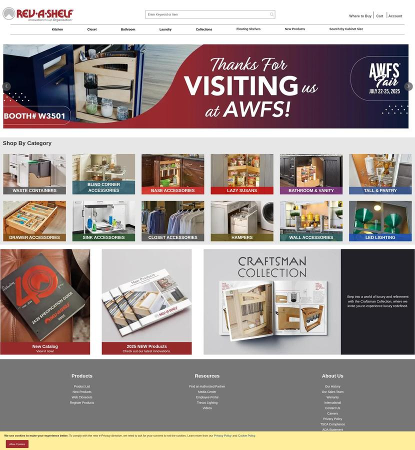<div class="ds-meta"><b>1000846_rev-a-shelf.com_</b></div><details class="ds-code"><summary>index.html（共 1300 行，展示前 60 行）</summary><pre>&lt;!DOCTYPE html&gt;&#10;&#10;&lt;html class="es6number mix-blend-mode-support" lang="en"&gt;&lt;head&gt;&lt;meta content="text/html; charset=utf-8" http-equiv="Content-Type"/&gt;&lt;script src="cid:js-7501b2c9-a1f7-4758-a283-b4741035d449@mhtml.blink"&gt;&lt;/script&gt;&lt;meta content="A7vZI3v+Gz7JfuRolKNM4Aff6zaGuT7X0mf3wtoZTnKv6497cVMnhy03KDqX7kBz/q/iidW7srW31oQbBt4VhgoAAACUeyJvcmlnaW4iOiJodHRwczovL3d3dy5nb29nbGUuY29tOjQ0MyIsImZlYXR1cmUiOiJEaXNhYmxlVGhpcmR…（本行共 546 字符）&#10;&lt;meta content="Rev-A-Shelf" name="title"/&gt;&#10;&lt;meta content="Rev-A-Shelf manufactures thousands of innovative storage organizing accessories designed for residential stock or custom kitchen, bath or closet cabinetry." name="description"/&gt;&#10;&lt;meta content="Kitchen Storage Organizing Accessories, Kitchen, Storage, Organization, Closet, Closet Organization, Bathroom Organization&#10;" name="keywords"/&gt;&#10;&lt;meta content="INDEX,FOLLOW" name="robots"/&gt;&#10;&lt;meta content="width=device-width, initial-scale=1, maximum-scale=1.0, user-scalable=yes" name="viewport"/&gt;&#10;&lt;meta content="telephone=no" name="format-detection"/&gt;&#10;&lt;title&gt;Rev-A-Shelf&lt;/title&gt;&#10;&lt;link href="./resources/a8f87d7b2ddcbc4f2ee25d7437a1bfad.css" media="all" rel="stylesheet" type="text/css"/&gt;&#10;&lt;link href="./resources/styles-l.css" media="screen and (min-width: 768px)" rel="stylesheet" type="text/css"/&gt;&#10;&lt;link as="style" href="https://maxcdn.bootstrapcdn.com/font-awesome/latest/css/font-awesome.min.css" rel="preload" type="text/css"/&gt;&#10;&lt;link href="https://rev-a-shelf.com/media/favicon/stores/1/favicon.png" rel="icon" type="image/x-icon"/&gt;&#10;&lt;link href="https://rev-a-shelf.com/media/favicon/stores/1/favicon.png" rel="shortcut icon" type="image/x-icon"/&gt;&#10;&lt;!--kIQQPH7nkD94N0Z8IZRanFHb9B3JzjFB--&gt;&#10;&lt;style type="text/css"&gt;&#10;        .tiles-container .tile-item:hover .tile-image,&#10;              .tiles-container .tile-item__link:focus .tile-image {&#10;                         transform: translateX(-50%) scale(1.14);&#10;         }&#10;	.amsearch-products-section .amsearch-product-list {&#10;		width: 100%;&#10;	}&#10;	@media only screen and (max-width: 1440px) {&#10;		.amsearch-products-section.-grid:not(.-slider) .amsearch-item {&#10;			padding: 10px;&#10;    		max-width: 49%;&#10;		}&#10;	}&#10; @media (max-width: 972px) {&#10;    .sticky-container {&#10;            &amp;.px4 {&#10;                padding: 0;&#10;            }&#10;        }&#10;}&#10;@media (max-width: 972px) {&#10;    .product-info-container .product-selector .new_class_fieldset {&#10;        overflow-x: auto;&#10;    }&#10;    .product-info-container .selector-container {&#10;        max-width: 320px;&#10;        width: 100%;&#10;        overflow-x: unset;&#10;    }&#10; }&#10;.contactusform-index-index .field-recaptcha {&#10;    z-index: 5;&#10;}&#10;&#10;.contactusform-index-index .ui-widget-content.ui-autocomplete {&#10;    z-index: 8;&#10;}&#10;@media only screen and (min-width: 767px) {&#10;  .contactusform-index-index ul#ui-id-1 {&#10;      max-width: 44.7% !important;&#10;      width: 100% !important;&#10;  }&#10;…（截断，原文共 1300 行）</pre></details></div><div class="ds-card">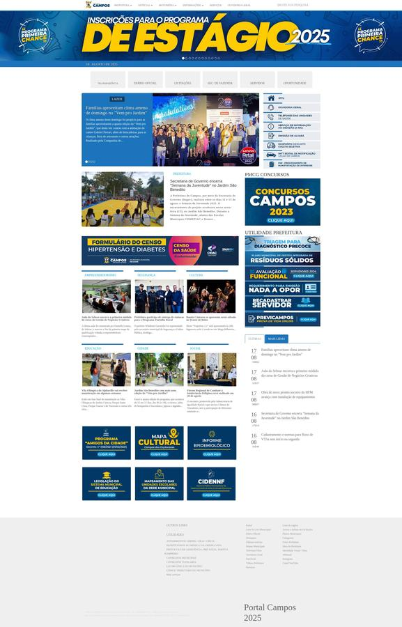<div class="ds-meta"><b>1000945_www.campos.rj.gov.br_portal_index.php</b></div><details class="ds-code"><summary>index.html（共 967 行，展示前 60 行）</summary><pre>&lt;!DOCTYPE html&gt;&#10;&#10;&lt;html&gt;&lt;head&gt;&lt;meta content="text/html; charset=utf-8" http-equiv="Content-Type"/&gt;&lt;script src="cid:js-e844fe8e-0d4f-464b-b2d9-900dde2877d4@mhtml.blink"&gt;&lt;/script&gt;&#10;&lt;meta content="width=device-width" name="viewport"/&gt;&#10;&lt;meta content="IE=edge" http-equiv="X-UA-Compatible"/&gt;&#10;&lt;title&gt;Portal Oficial da Prefeitura Municipal de Campos dos Goytacazes&lt;/title&gt;&#10;&lt;meta content="Portal Oficial da Prefeitura Municipal de Campos dos Goytacazes" name="description"/&gt;&#10;&lt;meta content="prefeitura, cidade, concurso, mapas da cidade, diário oficial, notícias, campos, campos dos goytacazes " name="keywords"/&gt;&#10;&lt;link href="https://www.campos.rj.gov.br/images/favicon.ico" rel="shortcut icon"/&gt;&#10;&lt;link href="https://www.campos.rj.gov.br/images/brasao.ico" rel="apple-touch-icon"/&gt;&#10;&lt;link href="./resources/font.css" rel="stylesheet"/&gt;&#10;&lt;link href="./resources/bootstrap.css" rel="stylesheet"/&gt;&#10;&lt;link href="./resources/bootstrap-theme.css" rel="stylesheet"/&gt;&#10;&lt;link href="./resources/simpleplaylist.css" rel="stylesheet"/&gt;&#10;&lt;link href="./resources/font-awesome.css" rel="stylesheet"/&gt;&#10;&lt;link href="./resources/validationEngine.jquery.css" rel="stylesheet"/&gt;&#10;&lt;link href="./resources/juicyslider-min.css" rel="stylesheet"/&gt;&#10;&lt;link href="./resources/weather-icons.css" rel="stylesheet"/&gt;&#10;&lt;link href="./resources/print_detail.css" media="print" rel="stylesheet"/&gt;&#10;&lt;link href="./resources/blueimp-gallery.min.css" rel="stylesheet"/&gt;&#10;&lt;link href="./resources/style.css" rel="stylesheet"/&gt;&#10;&lt;link href="https://www.campos.rj.gov.br/manifest.json" rel="manifest"/&gt;&#10;&lt;!--&#10; &lt;script src="https://cdn.onesignal.com/sdks/OneSignalSDK.js" async='async'&gt;&lt;/script&gt;&#10;  &lt;script&gt;&#10;    var OneSignal = window.OneSignal &#124;&#124; [];&#10;    OneSignal.push(["init", {&#10;      appId: "16f931a0-121e-4e16-b054-f28a2893521a",&#10;      autoRegister: true, /* Set to true to automatically prompt visitors */&#10;       welcomeNotification: {&#10;        disable: true&#10;    }, &#10;&#10; &#10;      httpPermissionRequest: {&#10;        enable: true,&#10;        useCustomModal: false,&#10;        modalTitle: 'Obrigado por se inscrever!',&#10;        modalMessage: "Agora você está inscrito nas notificações do Portal.",&#10;        modalButtonText: 'Fechar'&#10;&#10;      },&#10;      notifyButton: {&#10;          enable: false, /* Set to false to hide */&#10;&#10;    text: {&#10;            'tip.state.unsubscribed': 'Assine as notificações do Portal',&#10;            'tip.state.subscribed': "Você está inscrito para receber notificações",&#10;            'tip.state.blocked': "Você bloqueou suas notificações",&#10;            'message.prenotify': 'Click para assinar as notificações',&#10;            'message.action.subscribed': "Obrigado por se inscrever!",&#10;            'message.action.resubscribed': "Você está inscrito para receber notificações",&#10;            'message.action.unsubscribed': "Você não receberá notificações novamente",&#10;            'dialog.main.title': 'Gerenciar Notificações',&#10;            'dialog.main.button.subscribe': 'Inscrever',&#10;            'dialog.main.button.unsubscribe': 'Remover Inscrição',&#10;            'dialog.blocked.title': 'Bloquear notificações',&#10;            'dialog.blocked.message': "Siga as instruções para receber notificações do Portal:"&#10;        }   &#10;}&#10;…（截断，原文共 967 行）</pre></details></div></div></div>

</div></div>

<div class="sg-body" id="sg-websight--opendata"><div class="sg-bar"><span class="deep-title"> <a href="https://arxiv.org/abs/2403.09029">WebSight</a> <span class="org">HuggingFace</span> <a class="hf" href="https://huggingface.co/datasets/HuggingFaceM4/WebSight"><span class="hf-b hf-dl" title="downloads"><svg class="hf-i" viewBox="0 0 24 24" fill="none" stroke="currentColor" stroke-width="2.2" stroke-linecap="round" stroke-linejoin="round"><path d="M12 3v11"/><path d="M8 11l4 4 4-4"/><path d="M4 20h16"/></svg>18.1k</span><span class="hf-b hf-lk" title="likes"><svg class="hf-i" viewBox="0 0 24 24" fill="currentColor"><path d="M12 21C7 17.5 3 14 3 9.5 3 7 5 5 7.5 5 9.2 5 10.7 6 12 7.6 13.3 6 14.8 5 16.5 5 19 5 21 7 21 9.5 21 14 17 17.5 12 21z"/></svg>400</span></a></span><span class="sg-nav"><button type="button" class="sg-prev" title="上一个（←）">‹</button><span class="sg-pos"></span><button type="button" class="sg-next" title="下一个（→）">›</button><button type="button" class="sg-x" title="关闭（Esc）">✕</button></span></div><div class="sg-stage">

<div class="ds-demo"><div class="ds-head"><b>数据样例</b> · <a href="https://huggingface.co/datasets/HuggingFaceM4/WebSight">HuggingFaceM4/WebSight</a></div><div class="ds-grid"><div class="ds-card"><details class="ds-code"><summary>text（共 12 行）</summary><pre>&lt;html&gt;&#10;&lt;link href="https://cdn.jsdelivr.net/npm/tailwindcss@2.2.19/dist/tailwind.min.css" rel="stylesheet"&gt;&#10;&lt;body class="bg-white"&gt;&#10;  &lt;div class="flex flex-col items-center justify-center h-screen"&gt;&#10;    &lt;h1 class="text-4xl font-bold text-center text-gray-800"&gt;Welcome to Our Fashion Retailer&lt;/h1&gt;&#10;    &lt;p class="mt-4 text-lg text-center text-gray-600"&gt;&#10;      We are a premier fashion retailer dedicated to providing our customers with the latest and greatest in high-quality apparel, accessories, and footwear. Our mission is to make fashion accessible and stylish for everyone, no matter their budget or style preference. We believe in a world where fa…（本行共 496 字符，截断）&#10;    &lt;/p&gt;&#10;    &lt;button class="mt-8 px-4 py-2 text-white bg-green-500 rounded hover:bg-green-600"&gt;Shop Now&lt;/button&gt;&#10;  &lt;/div&gt;&#10;&lt;/body&gt;&#10;&lt;/html&gt;</pre></details><details class="ds-code"><summary>llm_generated_idea（共 1 行）</summary><pre>Fashion Retailer: A grid layout featuring high-quality product images with a white background. A colored band runs horizontally across the top, showcasing the brand logo and the primary call-to-action.</pre></details></div><div class="ds-card">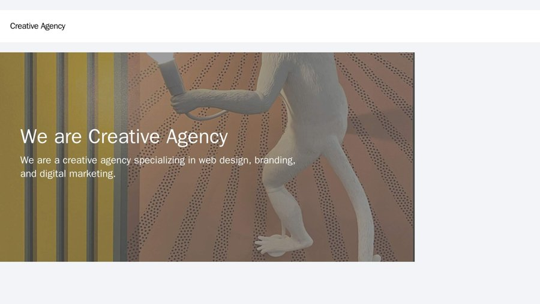<details class="ds-code"><summary>text（共 34 行）</summary><pre>&lt;html&gt;&#10;&lt;link href="https://cdn.jsdelivr.net/npm/tailwindcss@2.2.19/dist/tailwind.min.css" rel="stylesheet"&gt;&#10;&lt;body class="bg-gray-100 font-sans leading-normal tracking-normal"&gt;&#10;    &lt;div class="relative flex flex-col min-h-screen overflow-hidden"&gt;&#10;        &lt;div class="relative z-10 flex flex-col flex-1 pt-6 pb-6 md:pb-8"&gt;&#10;            &lt;header class="flex items-center justify-between flex-wrap bg-white p-6"&gt;&#10;                &lt;div class="flex items-center flex-shrink-0 mr-6"&gt;&#10;                    &lt;span class="font-semibold text-xl tracking-tight"&gt;Creative Agency&lt;/span&gt;&#10;                &lt;/div&gt;&#10;                &lt;div class="block md:hidden"&gt;&#10;                    &lt;button id="menu-button" class="flex items-center px-3 py-2 border rounded text-teal-200 border-teal-400 hover:text-white hover:border-white"&gt;&#10;                        &lt;svg class="fill-current h-3 w-3" viewBox="0 0 20 20" xmlns="http://www.w3.org/2000/svg"&gt;&lt;title&gt;Menu&lt;/title&gt;&lt;path d="M0 3h20v2H0V3zm0 6h20v2H0V9zm0 6h20v2H0v-2z"/&gt;&lt;/svg&gt;&#10;                    &lt;/button&gt;&#10;                &lt;/div&gt;&#10;            &lt;/header&gt;&#10;            &lt;main class="flex-1 relative z-0 overflow-y-auto focus:outline-none md:py-6"&gt;&#10;                &lt;div class="opacity-75 fixed pin bg-no-repeat bg-center bg-cover" style="background-image: url('https://source.unsplash.com/random/1600x900/?creative');"&gt;&#10;                    &lt;div class="inset-0 bg-black opacity-50 absolute"&gt;&lt;/div&gt;&#10;                    &lt;div class="container mx-auto px-6 md:px-12 relative z-10 flex items-center py-32 xl:py-40"&gt;&#10;                        &lt;div class="w-full lg:w-3/4"&gt;&#10;                            &lt;h1 class="my-4 text-3xl md:text-5xl text-white leading-tight"&gt;&#10;                                We are Creative Agency&#10;                            &lt;/h1&gt;&#10;                            &lt;p class="leading-normal text-white text-2xl md:text-2xl mb-8"&gt;&#10;                                We are a creative agency specializing in web design, branding, and digital marketing.&#10;                            &lt;/p&gt;&#10;                        &lt;/div&gt;&#10;                    &lt;/div&gt;&#10;                &lt;/div&gt;&#10;            &lt;/main&gt;&#10;        &lt;/div&gt;&#10;    &lt;/div&gt;&#10;&lt;/body&gt;&#10;&lt;/html&gt;</pre></details><details class="ds-code"><summary>llm_generated_idea（共 1 行）</summary><pre>Creative Agency: A full-screen video background with an opaque overlay displaying the company name and tagline. A hidden sidebar menu reveals as you hover over the hamburger icon. The color palette is bright and playful.</pre></details></div><div class="ds-card">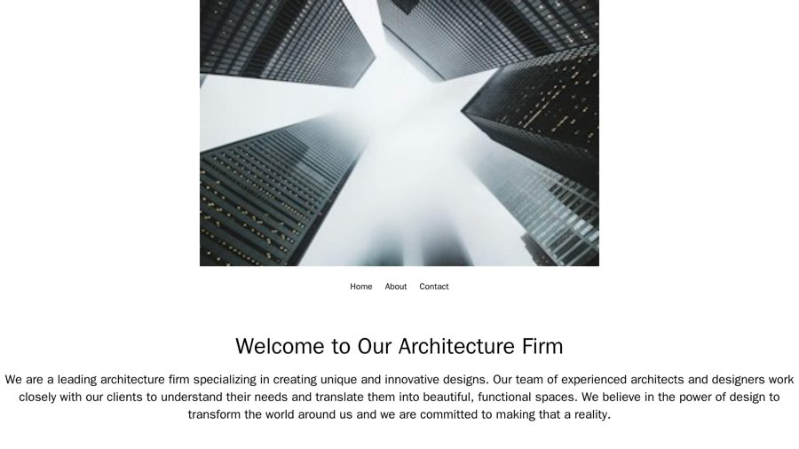<details class="ds-code"><summary>text（共 33 行）</summary><pre>&lt;html&gt;&#10;&lt;link href="https://cdn.jsdelivr.net/npm/tailwindcss@2.2.19/dist/tailwind.min.css" rel="stylesheet"&gt;&#10;&lt;body class="font-sans leading-normal tracking-normal"&gt;&#10;    &lt;header class="bg-white text-center"&gt;&#10;        &lt;div class="container mx-auto"&gt;&#10;            &lt;img src="https://source.unsplash.com/random/300x200/?architecture" alt="" class="w-1/2 mx-auto"&gt;&#10;            &lt;nav class="flex items-center justify-between flex-wrap p-6"&gt;&#10;                &lt;div class="w-full block flex-grow lg:flex lg:items-center lg:w-auto"&gt;&#10;                    &lt;div class="text-sm lg:flex-grow"&gt;&#10;                        &lt;a href="#responsive-header" class="block mt-4 lg:inline-block lg:mt-0 text-teal-200 hover:text-white mr-4"&gt;&#10;                            Home&#10;                        &lt;/a&gt;&#10;                        &lt;a href="#responsive-header" class="block mt-4 lg:inline-block lg:mt-0 text-teal-200 hover:text-white mr-4"&gt;&#10;                            About&#10;                        &lt;/a&gt;&#10;                        &lt;a href="#responsive-header" class="block mt-4 lg:inline-block lg:mt-0 text-teal-200 hover:text-white"&gt;&#10;                            Contact&#10;                        &lt;/a&gt;&#10;                    &lt;/div&gt;&#10;                &lt;/div&gt;&#10;            &lt;/nav&gt;&#10;        &lt;/div&gt;&#10;    &lt;/header&gt;&#10;    &lt;main class="container mx-auto"&gt;&#10;        &lt;section class="py-10"&gt;&#10;            &lt;h1 class="text-4xl text-center"&gt;Welcome to Our Architecture Firm&lt;/h1&gt;&#10;            &lt;p class="text-xl text-center mt-5"&gt;&#10;                We are a leading architecture firm specializing in creating unique and innovative designs. Our team of experienced architects and designers work closely with our clients to understand their needs and translate them into beautiful, functional spaces. We believe in the power of design …（本行共 379 字符，截断）&#10;            &lt;/p&gt;&#10;        &lt;/section&gt;&#10;    &lt;/main&gt;&#10;&lt;/body&gt;&#10;&lt;/html&gt;</pre></details><details class="ds-code"><summary>llm_generated_idea（共 1 行）</summary><pre>Architecture Firm: A grid layout that showcases images of buildings with text overlays providing information about each project. A full-width image header with a centered logo and minimalist menu helps convey a professional image.</pre></details></div></div></div>

- **定位**：第一个百万级、完全合成的「截图 → HTML + Tailwind」配对数据，被 Design2Code 等后续工作当作训练集基线

<figure class="paper-fig"><div class="flow"><div class="step"><b>Website concepts</b>Mistral-7B 批量出网站概念</div><span class="arr">→</span><div class="step"><b>Tailwind only</b>规定只用 Tailwind，HTML 自包含</div><span class="arr">→</span><div class="step"><b>Code LLM</b>Deepseek-Coder-33B 写整页 HTML</div><span class="arr">→</span><div class="step"><b>Filtering</b>去掉空泛 / 配图不符的页面</div><span class="arr">→</span><div class="step"><b>Screenshot</b>Playwright 渲染整页截图</div></div><figcaption>WebSight · 自绘流程图（论文无管线图，依据正文描述）</figcaption></figure>

- **自动化合成流程**（对照上面的自绘图）
  1. **Generating diverse website concepts**：Mistral-7B-Instruct 用一条固定 prompt 批量生成网站概念，每次 10 个，要求公司领域、配色、布局位置各不相同，累计几百万条
  2. **Opting for Tailwind CSS**：规定只用 Tailwind 工具类，让 HTML 自包含、不需要外部样式文件，代码更短、更好学
  3. **Using a code specialized LLM to generate the HTML codes**：Deepseek-Coder-33b-instruct 把概念写成完整页面。prompt 禁止出现 Lorem ipsum；图片一律写成 `source.unsplash.com/random/WxH/?keyword`，按关键词动态取图
  4. **Filtering**：丢掉文字太少、内容空泛、配图与主题不符的页面，剩下 200 万
  5. **Screenshot capture process**：Playwright 渲染并截取整页，所以截图分辨率不固定
- **质量控制**
  - 只有第 4 步这一道过滤，标准如上；论文没给过滤掉多少
  - 训练时发现验证 loss 不能反映真实效果，改为人工看生成样例来选 checkpoint
- **关键数字**
  - 规模：v0.1 有 823K 对（HTML + 传统 CSS，图片是色块占位）；v0.2 有 200 万对，是 v0.1 的 2.5 倍，换成真实图片和 Tailwind
  - 训练：自家 8B VLM（Mistral-7B + SigLIP-SO400M）用 DoRA（rank 64）微调，每步 2016 个样本，共 1100 步，不到 1 个 epoch，得到 Sightseer
  - 下游：论文只做了定性评测，没有给量化指标
- **局限**
  - 页面结构简单，复杂布局、长文本、和训练分布差异大的设计都复现不好（论文自述）
  - Tailwind 在基座预训练语料里出现得少，模型偶尔写出错误语法，或者文字和背景同色
  - 图片 URL 是随机取图，同一段代码再渲染一次，得到的图可能不同（推断）
- **可借鉴**
  - 两段式生成：小模型负责发散主题，大的代码模型负责落地，多样性和代码质量分开控制
  - 选输出格式时优先考虑「单文件自包含」，这样训练目标更干净
  - 用带关键词的图库 URL 当图片占位，既省掉生图步骤，又让截图里有和主题相关的真实图片

</div></div>


</div>

<div class="env-view" data-view="data" data-label="Sources" data-desc="素材从哪来、怎么筛；同一份资产可拆成 Query、Verifier 参考答案或 Hint。">

<nav class="toc view-toc"><h2>In This Section</h2><ul><li class="l2"><a href="#data-1"><span class="num">1</span> Three Parts</a></li><li class="l2"><a href="#data-2"><span class="num">2</span> Material</a></li><li class="l3"><a href="#data-2-1"><span class="num">2.1</span> Overview</a></li><li class="l3"><a href="#data-2-2"><span class="num">2.2</span> GitHub</a></li><li class="l4"><a href="#data-2-2-1"><span class="num">2.2.1</span> Golden Images</a></li><li class="l4"><a href="#data-2-2-2"><span class="num">2.2.2</span> Issues</a></li><li class="l3"><a href="#data-2-3"><span class="num">2.3</span> Datasets</a></li><li class="l3"><a href="#data-2-4"><span class="num">2.4</span> Website</a></li><li class="l2"><a href="#data-3"><span class="num">3</span> Funnel</a></li><li class="l2"><a href="#data-4"><span class="num">4</span> Curation Pipeline</a></li></ul></nav>

Task = Query + Verifier + Harness，三件都从同一批素材里切出来；本页只讲素材。

- 素材：可公开获取的原始物件，如截图、源码、测试断言；同一份素材可拆成 Query、Verifier 的参考答案或 Hint（训练时给模型的部分答案信息，评测时不给）
- 其余两页：Verifier 给轨迹打 reward；Train 讲 Harness 与三件的组合用法

## <a id="data-1"></a>1 Three Parts

缺任何一件，素材只是数据，不是可验证任务。

| 件 | Web 上的形态 | 缺了会怎样 |
|---|---|---|
| Query（全称 Omni Reference Query） | 需求描述，加零到四层参考：参考图、参考页面、参考录屏、参考音频 | 只有源码时只能做无监督训练 |
| Verifier | 把采集到的证据判成通过或不通过的规则 | 没有 reward，只能人工评审 |
| Harness | 无头浏览器、冻结时钟、固定视口、运行时状态读取、多视口截图 | 产物跑不起来，Verifier 无法执行 |

## <a id="data-2"></a>2 Material

供给上限由来源决定：三类来源里只有 Golden Images（测试用的标准答案截图）自带图码配对。

### <a id="data-2-1"></a>2.1 Overview

可挖来源分 GitHub、HuggingFace、Website 三类，自带图码配对的只有 Golden Images，8 个仓库共 14,522 张截图。

- 图码配对：一张截图与生成它的源码
- Golden Images：前端仓库为每份测试代码存的标准答案截图；每次改代码后重新渲染、与它逐像素比对，这种测试叫视觉回归测试（Visual Regression Testing，VRT），因此代码与截图天然成对

**Artifacts 词表**：全书来源表共用六类标签，颜色即类别。

| 类别 | 含义 | 标签（共 100 个） |
|---|---|---|
| **图像** | 已经渲染出来的画面 | <span class="art a-img">截图</span><span class="art a-img">图表图</span><span class="art a-img">多视角图</span><span class="art a-img">bug 截图</span><span class="art a-img">设计稿</span><span class="art a-img">手绘草图</span><span class="art a-img">截图（交互前后）</span><span class="art a-img">截图（多状态）</span><span class="art a-img">科研图</span><span class="art a-img">信息图</span><span class="art a-img">全长截图</span><span class="art a-img">缩略图</span><span class="art a-img">图片</span> |
| **文本** | 人写或模型写的自然语言 | <span class="art a-txt">描述</span><span class="art a-txt">标题</span><span class="art a-txt">指令</span><span class="art a-txt">问题描述</span><span class="art a-txt">标签</span><span class="art a-txt">问答</span><span class="art a-txt">评分</span><span class="art a-txt">轨迹（agent）</span><span class="art a-txt">轨迹（修复）</span><span class="art a-txt">指令（多轮）</span><span class="art a-txt">轨迹（多轮修复）</span><span class="art a-txt">推理过程</span><span class="art a-txt">描述（9%）</span><span class="art a-txt">教程文章</span><span class="art a-txt">评语</span><span class="art a-txt">描述（多级）</span><span class="art a-txt">指令（固定）</span><span class="art a-txt">指令（编辑）</span> |
| **代码** | 要再经一道工具才出画面的源码与中间表示 | <span class="art a-code">源码</span><span class="art a-code">.js</span><span class="art a-code">Next.js 工程</span><span class="art a-code">代码片段</span><span class="art a-code">bpy .py</span><span class="art a-code">.tsx</span><span class="art a-code">.ts</span><span class="art a-code">CadQuery .py</span><span class="art a-code">绘图代码</span><span class="art a-code">.json</span><span class="art a-code">补丁</span><span class="art a-code">源码（交互）</span><span class="art a-code">TikZ</span><span class="art a-code">.py</span><span class="art a-code">html / css / js 三段</span><span class="art a-code">.css</span><span class="art a-code">工程</span><span class="art a-code">作者仓库</span><span class="art a-code">整站源码</span><span class="art a-code">CAD 序列（命令）</span><span class="art a-code">DSL</span><span class="art a-code">SwiftUI</span><span class="art a-code">D3</span><span class="art a-code">绘图代码（12 语言）</span><span class="art a-code">源码（多域）</span><span class="art a-code">.e2e.ts</span><span class="art a-code">.js（p5 草图）</span><span class="art a-code">GLSL</span><span class="art a-code">笔记本</span><span class="art a-code">多文件工程</span><span class="art a-code">R3F 工程</span><span class="art a-code">React 组件</span><span class="art a-code">断言</span><span class="art a-code">.py（插件）</span><span class="art a-code">bpy .py（分部件）</span><span class="art a-code">.py（起始）</span><span class="art a-code">bpy .py（编辑后）</span><span class="art a-code">CAD 序列（构造）</span> |
| **可运行件** | 跑一次就出画面的整件 | <span class="art a-run">.html</span><span class="art a-run">.blend</span><span class="art a-run">.svg</span><span class="art a-run">多页</span><span class="art a-run">单文件 .html</span><span class="art a-run">多文件工程</span><span class="art a-run">demo 页</span><span class="art a-run">整站</span><span class="art a-run">Blender 场景</span><span class="art a-run">index.html</span><span class="art a-run">demo 站</span><span class="art a-run">单页</span><span class="art a-run">.blend（少量）</span><span class="art a-run">作品链接</span><span class="art a-run">在线预览</span><span class="art a-run">实验页</span> |
| **资产** | 几何与贴图，不含代码 | <span class="art a-asset">网格</span><span class="art a-asset">点云</span><span class="art a-asset">HDRI</span><span class="art a-asset">贴图</span><span class="art a-asset">glTF</span><span class="art a-asset">网格（GLB）</span><span class="art a-asset">网格（OBJ / USD）</span><span class="art a-asset">音频</span> |
| **结构化字段** | 机器可读、能逐项比对的字段 | <span class="art a-meta">元数据</span><span class="art a-meta">布局框</span><span class="art a-meta">评分项</span><span class="art a-meta">数据表</span><span class="art a-meta">要改的文件 / 函数</span><span class="art a-meta">点赞 / 克隆数</span><span class="art a-meta">JSON 元数据</span> |

1. 一个标签只写一个物件。
2. 同义词归一：渲染结果、GUI 截图都写「截图」。
3. 限定语写进括号，如 `bpy .py（分部件）`；文件类型直接写扩展名。

| Source | Type | Datasize | Example | Artifacts |
| --- | --- | --: | --- | --- |
| **GitHub** | Golden Images（VRT 基线） | 8 仓 · 14,522 图 | [primer/react](https://github.com/primer/react) · [MapLibre](https://github.com/maplibre/maplibre-gl-js) · [Chart.js](https://github.com/chartjs/Chart.js) | <span class="art a-img">截图</span><span class="art a-code">.tsx</span><span class="art a-code">.js</span><span class="art a-code">.json</span> |
|  | VRT 下游仓库（未挖） | 458,596 依赖仓（Playwright 一家） | [Playwright](https://github.com/microsoft/playwright) · Storybook · BackstopJS | <span class="art a-img">截图</span><span class="art a-code">断言</span><span class="art a-code">源码</span> |
|  | Issue + 截图 + Pull Request | ≈ 1,400 条 | [SWE-bench Multimodal](https://arxiv.org/abs/2410.03859) · OmniGIRL | <span class="art a-txt">问题描述</span><span class="art a-img">截图</span><span class="art a-code">补丁</span> |
| **HuggingFace** | 图码配对集 | 80 – 3.17M | [WebCode2M](https://huggingface.co/datasets/xcodemind/webcode2m) · [WebSight](https://huggingface.co/datasets/HuggingFaceM4/WebSight) · [Design2Code](https://arxiv.org/abs/2403.03163) | <span class="art a-img">截图</span><span class="art a-run">.html</span> |
| **Website** | 社区站 / 问答站 | 2,799 – 10M | [CodePen](https://codepen.io/) · [Shadertoy](https://www.shadertoy.com/) · [js13kGames](https://js13kgames.com/) | <span class="art a-img">截图</span><span class="art a-txt">标题</span><span class="art a-run">.html</span><span class="art a-code">代码片段</span> |
|  | 真实门户页 | 45.1k 页 | [WebRenderBench](https://arxiv.org/abs/2510.04097) | <span class="art a-run">.html</span><span class="art a-img">截图</span> |
|  | 设计站与获奖画廊 | 3,116 – 62 万 | [Awwwards](https://www.awwwards.com/) · [One Page Love](https://onepagelove.com/) · [Mobbin](https://mobbin.com/) | <span class="art a-img">截图</span><span class="art a-txt">评分</span><span class="art a-txt">标签</span> |
|  | 可克隆站 / 主题 / 组件库 | 560 – 95,246 | [Webflow](https://webflow.com/made-in-webflow) · [Codrops](https://github.com/codrops) · [Astro 主题](https://astro.build/themes/) | <span class="art a-run">.html</span><span class="art a-code">源码</span><span class="art a-img">截图</span> |

- Artifacts 列：该渠道直接拿到的物件
- 数量口径：「458,596 依赖仓」只计 Playwright 一家；「80 – 3.17M」「2,799 – 10M」是该类各数据集或站点的区间，不是合计

### <a id="data-2-2"></a>2.2 GitHub

GitHub 上有三类来源，成熟度各不相同：

- **Golden Images**（测试用的标准答案截图）：截图和代码天然配对，但只能检查「像不像」，且一部分拿不到
- **VRT 下游仓库**：用了 VRT（视觉回归测试：改完代码重新截图，与标准截图比对）工具、自己写了截图测试的项目；潜在数量大，目前只有规模估算，还没挖
- **带图 issue**：不是图码配对，用途是「看图修 bug」，能用的约 1,400 条

#### <a id="data-2-2-1"></a>2.2.1 Golden Images

Golden Images 是测试里存的「标准答案截图」。前端仓库常为每份测试代码配一张页面截图，每次改代码后重新渲染，再与这张截图逐像素比对，查界面有没有被意外改坏；这种测试叫视觉回归测试（Visual Regression Testing，VRT）。所以这类仓库里，代码和截图天然一一配对。

8 个仓库共 14,522 张截图、约 5,799 份代码，严格一图一码的只有 Chart.js 与 OpenLayers。

<div class="wide">

| 建库 | 仓库 | Download | Artifacts | Datasize（图 / 码） | 影响力 | 特性 | Permitted | Example |
|---|---|---|---|--:|---|---|---|---|
| 2013/3/17 | <span class="org-mark" title="Chart.js">C</span> [Chart.js](https://github.com/chartjs/Chart.js) <span class="org">Chart.js</span> | [GitHub](https://github.com/chartjs/Chart.js) | <span class="art a-img">截图</span><span class="art a-code">.js</span> | 667 图 / 667 码（1 : 1） | <a class="hf" href="https://github.com/chartjs/Chart.js"><span class="hf-b hf-st" title="GitHub stars"><svg class="hf-i" viewBox="0 0 24 24" fill="currentColor"><path d="M12 2.5l2.9 6 6.6.6-5 4.3 1.5 6.5L12 16.9 6 20.9l1.5-6.5-5-4.3 6.6-.6z"/></svg>67.8k</span></a> | **严格一图一码**：全库两家之一，配对无歧义 | ✓ MIT | <span class="sg-tile ex-tile" role="button" tabindex="0" data-sg="sg-chartjs--data"><span class="sg-poster">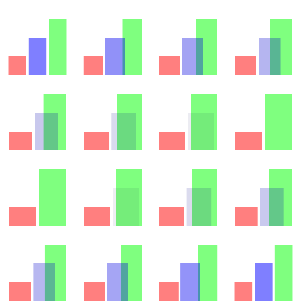</span><span class="sg-meta"><span class="deep-title sg-name"><span class="org-mark h-logo" title="Chart.js">C</span> Chart.js</span><span class="sg-sub"><span class="hf"><span class="hf-b hf-st" title="GitHub stars"><svg class="hf-i" viewBox="0 0 24 24" fill="currentColor"><path d="M12 2.5l2.9 6 6.6.6-5 4.3 1.5 6.5L12 16.9 6 20.9l1.5-6.5-5-4.3 6.6-.6z"/></svg>67.8k</span></span><span class=sg-n>3 条样例</span></span></span></span> |
| 2013/1/21 | <span class="org-mark" title="PixiJS">P</span> [PixiJS](https://github.com/pixijs/pixijs) <span class="org">PixiJS</span> | [GitHub](https://github.com/pixijs/pixijs) | <span class="art a-img">截图</span><span class="art a-txt">描述</span><span class="art a-code">.ts</span> | 1,711 图 / 460 码（3.7 : 1） | <a class="hf" href="https://github.com/pixijs/pixijs"><span class="hf-b hf-st" title="GitHub stars"><svg class="hf-i" viewBox="0 0 24 24" fill="currentColor"><path d="M12 2.5l2.9 6 6.6.6-5 4.3 1.5 6.5L12 16.9 6 20.9l1.5-6.5-5-4.3 6.6-.6z"/></svg>48.4k</span></a> | **多渲染后端**：同一份用例在不同后端各出一张基线 | ✓ MIT | <span class="sg-tile ex-tile" role="button" tabindex="0" data-sg="sg-pixijs--data"><span class="sg-poster"></span><span class="sg-meta"><span class="deep-title sg-name"><span class="org-mark h-logo" title="PixiJS">P</span> PixiJS</span><span class="sg-sub"><span class="hf"><span class="hf-b hf-st" title="GitHub stars"><svg class="hf-i" viewBox="0 0 24 24" fill="currentColor"><path d="M12 2.5l2.9 6 6.6.6-5 4.3 1.5 6.5L12 16.9 6 20.9l1.5-6.5-5-4.3 6.6-.6z"/></svg>48.4k</span></span><span class=sg-n>3 条样例</span></span></span></span> |
| 2013/2/26 | <span class="org-mark" title="Processing">P</span> [p5.js](https://github.com/processing/p5.js) <span class="org">Processing</span> | [GitHub](https://github.com/processing/p5.js) | <span class="art a-img">截图</span><span class="art a-txt">描述</span><span class="art a-code">.js</span> | 605 图 / 442 码（1.4 : 1） | <a class="hf" href="https://github.com/processing/p5.js"><span class="hf-b hf-st" title="GitHub stars"><svg class="hf-i" viewBox="0 0 24 24" fill="currentColor"><path d="M12 2.5l2.9 6 6.6.6-5 4.3 1.5 6.5L12 16.9 6 20.9l1.5-6.5-5-4.3 6.6-.6z"/></svg>24.2k</span></a> | **多帧**：动画用例一份代码出多帧基线；许可有传染性 | △ LGPL-2.1 | <span class="sg-tile ex-tile" role="button" tabindex="0" data-sg="sg-p5js--data"><span class="sg-poster"></span><span class="sg-meta"><span class="deep-title sg-name"><span class="org-mark h-logo" title="Processing">P</span> p5.js <span class="org">Processing</span></span><span class="sg-sub"><span class="hf"><span class="hf-b hf-st" title="GitHub stars"><svg class="hf-i" viewBox="0 0 24 24" fill="currentColor"><path d="M12 2.5l2.9 6 6.6.6-5 4.3 1.5 6.5L12 16.9 6 20.9l1.5-6.5-5-4.3 6.6-.6z"/></svg>24.2k</span></span><span class=sg-n>3 条样例</span></span></span></span> |
| 2015/11/5 | <span class="org-mark" title="Plotly">P</span> [plotly.js](https://github.com/plotly/plotly.js) <span class="org">Plotly</span> | [GitHub](https://github.com/plotly/plotly.js) | <span class="art a-img">截图</span><span class="art a-code">.json</span> | 1,324 图 / 1,309 码（1 : 1） | <a class="hf" href="https://github.com/plotly/plotly.js"><span class="hf-b hf-st" title="GitHub stars"><svg class="hf-i" viewBox="0 0 24 24" fill="currentColor"><path d="M12 2.5l2.9 6 6.6.6-5 4.3 1.5 6.5L12 16.9 6 20.9l1.5-6.5-5-4.3 6.6-.6z"/></svg>18.4k</span></a> | **声明式用例**：基线由 JSON 图表定义渲染出来，不是写渲染代码 | ✓ MIT | <span class="sg-tile ex-tile" role="button" tabindex="0" data-sg="sg-plotlyjs--data"><span class="sg-poster">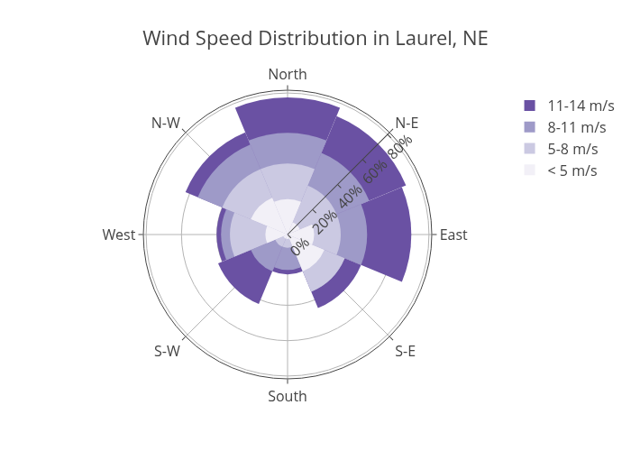</span><span class="sg-meta"><span class="deep-title sg-name"><span class="org-mark h-logo" title="Plotly">P</span> plotly.js <span class="org">Plotly</span></span><span class="sg-sub"><span class="hf"><span class="hf-b hf-st" title="GitHub stars"><svg class="hf-i" viewBox="0 0 24 24" fill="currentColor"><path d="M12 2.5l2.9 6 6.6.6-5 4.3 1.5 6.5L12 16.9 6 20.9l1.5-6.5-5-4.3 6.6-.6z"/></svg>18.4k</span></span><span class=sg-n>3 条样例</span></span></span></span> |
| 2015/12/15 | <span class="org-mark" title="vis.gl">V</span> [deck.gl](https://github.com/visgl/deck.gl) <span class="org">vis.gl</span> | [GitHub](https://github.com/visgl/deck.gl) | <span class="art a-img">截图</span><span class="art a-code">.ts</span> | 252 图 / ≈199 码（≈1.3 : 1） | <a class="hf" href="https://github.com/visgl/deck.gl"><span class="hf-b hf-st" title="GitHub stars"><svg class="hf-i" viewBox="0 0 24 24" fill="currentColor"><path d="M12 2.5l2.9 6 6.6.6-5 4.3 1.5 6.5L12 16.9 6 20.9l1.5-6.5-5-4.3 6.6-.6z"/></svg>14.7k</span></a> | **码数是估算**：用例按目录组织，无法逐文件一一对上 | ✓ MIT | <span class="sg-tile ex-tile" role="button" tabindex="0" data-sg="sg-deckgl--data"><span class="sg-poster">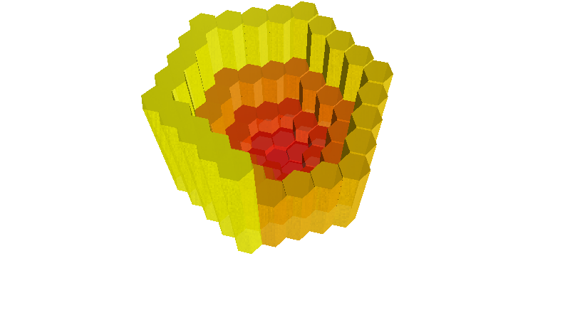</span><span class="sg-meta"><span class="deep-title sg-name"><span class="org-mark h-logo" title="vis.gl">V</span> deck.gl <span class="org">vis.gl</span></span><span class="sg-sub"><span class="hf"><span class="hf-b hf-st" title="GitHub stars"><svg class="hf-i" viewBox="0 0 24 24" fill="currentColor"><path d="M12 2.5l2.9 6 6.6.6-5 4.3 1.5 6.5L12 16.9 6 20.9l1.5-6.5-5-4.3 6.6-.6z"/></svg>14.7k</span></span><span class=sg-n>3 条样例</span></span></span></span> |
| 2012/6/20 | <span class="org-mark" title="OpenLayers">O</span> [OpenLayers](https://github.com/openlayers/openlayers) <span class="org">OpenLayers</span> | [GitHub](https://github.com/openlayers/openlayers) | <span class="art a-img">截图</span><span class="art a-code">.js</span> | 235 图 / 235 码（1 : 1） | <a class="hf" href="https://github.com/openlayers/openlayers"><span class="hf-b hf-st" title="GitHub stars"><svg class="hf-i" viewBox="0 0 24 24" fill="currentColor"><path d="M12 2.5l2.9 6 6.6.6-5 4.3 1.5 6.5L12 16.9 6 20.9l1.5-6.5-5-4.3 6.6-.6z"/></svg>12.6k</span></a> | **严格一图一码**：全库两家之一，配对无歧义 | ✓ BSD-2 | <span class="sg-tile ex-tile" role="button" tabindex="0" data-sg="sg-openlayers--data"><span class="sg-poster">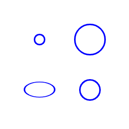</span><span class="sg-meta"><span class="deep-title sg-name"><span class="org-mark h-logo" title="OpenLayers">O</span> OpenLayers</span><span class="sg-sub"><span class="hf"><span class="hf-b hf-st" title="GitHub stars"><svg class="hf-i" viewBox="0 0 24 24" fill="currentColor"><path d="M12 2.5l2.9 6 6.6.6-5 4.3 1.5 6.5L12 16.9 6 20.9l1.5-6.5-5-4.3 6.6-.6z"/></svg>12.6k</span></span><span class=sg-n>3 条样例</span></span></span></span> |
| 2020/12/8 | <span class="org-mark" title="MapLibre">M</span> [MapLibre GL JS](https://github.com/maplibre/maplibre-gl-js) <span class="org">MapLibre</span> | [GitHub](https://github.com/maplibre/maplibre-gl-js) | <span class="art a-img">截图</span><span class="art a-txt">描述（9%）</span><span class="art a-code">.json</span> | 1,960 图 / 1,734 码（1.1 : 1） | <a class="hf" href="https://github.com/maplibre/maplibre-gl-js"><span class="hf-b hf-st" title="GitHub stars"><svg class="hf-i" viewBox="0 0 24 24" fill="currentColor"><path d="M12 2.5l2.9 6 6.6.6-5 4.3 1.5 6.5L12 16.9 6 20.9l1.5-6.5-5-4.3 6.6-.6z"/></svg>11.9k</span></a> | **接近一图一码**：9% 的基线带整句描述，其余只有文件名 | ✓ BSD-3 | <span class="sg-tile ex-tile" role="button" tabindex="0" data-sg="sg-maplibre--data"><span class="sg-poster">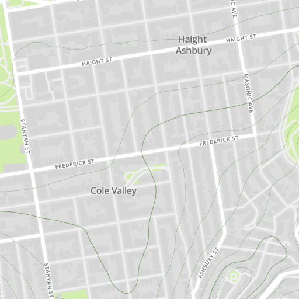</span><span class="sg-meta"><span class="deep-title sg-name"><span class="org-mark h-logo" title="MapLibre">M</span> MapLibre GL JS <span class="org">MapLibre</span></span><span class="sg-sub"><span class="hf"><span class="hf-b hf-st" title="GitHub stars"><svg class="hf-i" viewBox="0 0 24 24" fill="currentColor"><path d="M12 2.5l2.9 6 6.6.6-5 4.3 1.5 6.5L12 16.9 6 20.9l1.5-6.5-5-4.3 6.6-.6z"/></svg>11.9k</span></span><span class=sg-n>3 条样例</span></span></span></span> |
| 2018/2/17 | <span class="org-mark" title="GitHub">G</span> [primer/react](https://github.com/primer/react) <span class="org">GitHub</span> | [GitHub](https://github.com/primer/react) | <span class="art a-img">截图</span><span class="art a-txt">标题</span><span class="art a-code">.tsx</span> | 7,768 图 / 753 码（10.3 : 1） | <a class="hf" href="https://github.com/primer/react"><span class="hf-b hf-st" title="GitHub stars"><svg class="hf-i" viewBox="0 0 24 24" fill="currentColor"><path d="M12 2.5l2.9 6 6.6.6-5 4.3 1.5 6.5L12 16.9 6 20.9l1.5-6.5-5-4.3 6.6-.6z"/></svg>3.9k</span></a> | **图 : 码 10.3 : 1**：一份测试代码覆盖多个主题，同一组件出多张基线 | ✓ MIT | <span class="sg-tile ex-tile" role="button" tabindex="0" data-sg="sg-primer-react--data"><span class="sg-poster"></span><span class="sg-meta"><span class="deep-title sg-name"><span class="org-mark h-logo" title="GitHub">G</span> primer/react <span class="org">GitHub</span></span><span class="sg-sub"><span class="hf"><span class="hf-b hf-st" title="GitHub stars"><svg class="hf-i" viewBox="0 0 24 24" fill="currentColor"><path d="M12 2.5l2.9 6 6.6.6-5 4.3 1.5 6.5L12 16.9 6 20.9l1.5-6.5-5-4.3 6.6-.6z"/></svg>3.9k</span></span><span class=sg-n>3 条样例</span></span></span></span> |

</div>

这类配对只够做最弱一档 Verifier：把生成的代码渲染成截图，再让模型打分。

另一个来源是 VRT 下游仓库，即用了 Playwright 等 VRT 工具、自己写了截图测试的项目，估计有几千个仓库、几万个 PR（口径待补），还没挖。先实扫两个最典型的：

<div class="wide">

| 建库 | 仓库 | Download | Artifacts | Datasize（图 / 码） | 影响力 | 特性 | Permitted | Example |
|---|---|---|---|--:|---|---|---|---|
| 2013/8/20 | <span class="org-mark" title="Ionic">I</span> [Ionic Framework](https://github.com/ionic-team/ionic-framework) <span class="org">Ionic</span> | [GitHub](https://github.com/ionic-team/ionic-framework) | <span class="art a-img">截图</span><span class="art a-code">.e2e.ts</span><span class="art a-run">index.html</span> | 7,402 图 / 331 码（22.4 : 1） | <a class="hf" href="https://github.com/ionic-team/ionic-framework"><span class="hf-b hf-st" title="GitHub stars"><svg class="hf-i" viewBox="0 0 24 24" fill="currentColor"><path d="M12 2.5l2.9 6 6.6.6-5 4.3 1.5 6.5L12 16.9 6 20.9l1.5-6.5-5-4.3 6.6-.6z"/></svg>52.7k</span></a> | **一码多基线**：同一用例按 iOS / Material、LTR / RTL、三种浏览器各出一张基线 | ✓ MIT | <span class="sg-tile ex-tile" role="button" tabindex="0" data-sg="sg-ionic--data"><span class="sg-poster">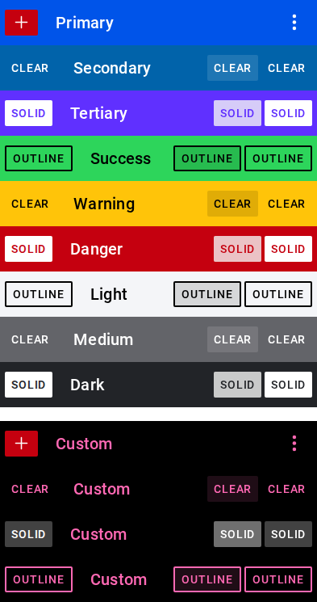</span><span class="sg-meta"><span class="deep-title sg-name"><span class="org-mark h-logo" title="Ionic">I</span> Ionic Framework <span class="org">Ionic</span></span><span class="sg-sub"><span class="hf"><span class="hf-b hf-st" title="GitHub stars"><svg class="hf-i" viewBox="0 0 24 24" fill="currentColor"><path d="M12 2.5l2.9 6 6.6.6-5 4.3 1.5 6.5L12 16.9 6 20.9l1.5-6.5-5-4.3 6.6-.6z"/></svg>52.7k</span></span><span class=sg-n>3 条样例</span></span></span></span> |
| 2022/1/27 | <span class="org-mark" title="Vercel">V</span> [vercel/satori](https://github.com/vercel/satori) <span class="org">Vercel</span> | [GitHub](https://github.com/vercel/satori) | <span class="art a-img">截图</span><span class="art a-code">.tsx</span> | 780 图 / 89 码（8.8 : 1） | <a class="hf" href="https://github.com/vercel/satori"><span class="hf-b hf-st" title="GitHub stars"><svg class="hf-i" viewBox="0 0 24 24" fill="currentColor"><path d="M12 2.5l2.9 6 6.6.6-5 4.3 1.5 6.5L12 16.9 6 20.9l1.5-6.5-5-4.3 6.6-.6z"/></svg>14.2k</span></a> | **用例即 JSX**：测试里的 JSX 片段渲染成 SVG 再比对，一份测试文件配一组基线 | △ MPL-2.0 | <span class="sg-tile ex-tile" role="button" tabindex="0" data-sg="sg-satori--data"><span class="sg-poster">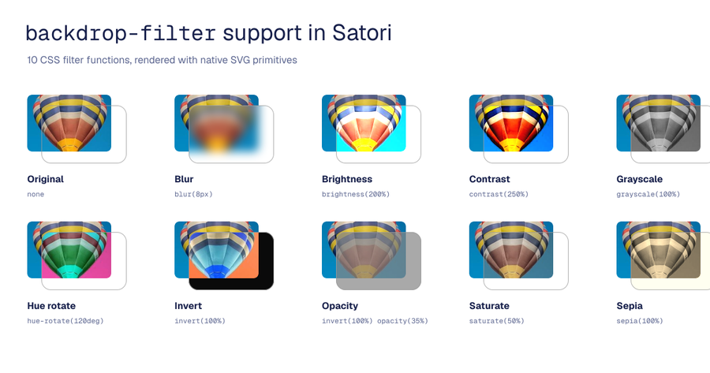</span><span class="sg-meta"><span class="deep-title sg-name"><span class="org-mark h-logo" title="Vercel">V</span> vercel/satori <span class="org">Vercel</span></span><span class="sg-sub"><span class="hf"><span class="hf-b hf-st" title="GitHub stars"><svg class="hf-i" viewBox="0 0 24 24" fill="currentColor"><path d="M12 2.5l2.9 6 6.6.6-5 4.3 1.5 6.5L12 16.9 6 20.9l1.5-6.5-5-4.3 6.6-.6z"/></svg>14.2k</span></span><span class=sg-n>3 条样例</span></span></span></span> |

</div>

- 口径：2026-11-07 读 GitHub trees API。图 = 基线目录（`*-snapshots/`、`__image_snapshots__/`）下的 .png；码 = 同目录产出这些基线的测试文件
- 这两个仓库本身没进上面的 8 个，上面那张表是已经扫完入库的，这两个只是下游这一档的样子

#### <a id="data-2-2-2"></a>2.2.2 Issues

带截图的 issue 不是图码配对，而是三件套：问题描述 + bug 截图 + 修复补丁，可用来训练「看图修 bug」；能用的约 1,400 条。

1. 这类题必须看图。
   - [SWE-bench Multimodal](https://arxiv.org/abs/2410.03859)：论文正文 619 道题、17 个 JavaScript 库（摘要写 617）；含图的 557 道中，人工确认 83.5% 不看图做不出来
   - 公开数据集行数与论文不一致：HF 旧版（princeton-nlp）612 行；官方现行版（SWE-bench）580 行、16 个库
2. 这类题很难。
   - [OmniGIRL](https://arxiv.org/abs/2505.04606)：959 道题中含图 19 道；Claude-3.5-Sonnet 直接看图只解决 3.5%，用 agent 方法为 0%
   - 10.5% 是最好成绩：直接给出要改的文件，且先把图片内容改写成文字
3. 量少：检索能命中几十万条，能整理成三件套的只有约 1,400 条。
   - 按 issue 里的图片地址检索：新版地址命中 TypeScript 192,818、JavaScript 51,136、CSS 3,488；旧版地址另有 TypeScript 76,009、JavaScript 40,801
   - 1,400 = 约 30 万条候选 × 0.457% 转化率；转化率出处口径待补

<div class="wide">

| 发布 | 数据集 | Download | Artifacts | Datasize（题 / 图） | 影响力 | 特性 | Permitted | Example |
|---|---|---|---|--:|---|---|---|---|
| 2024/10/4 |  [SWE-bench Multimodal](https://arxiv.org/abs/2410.03859) <span class="org">Princeton</span> | [HF](https://huggingface.co/datasets/SWE-bench/SWE-bench_Multimodal) | <span class="art a-txt">问题描述</span><span class="art a-img">bug 截图</span><span class="art a-code">补丁</span> | 580 题 / 557 含图 | <a class="hf" href="https://huggingface.co/datasets/SWE-bench/SWE-bench_Multimodal"><span class="hf-b hf-dl" title="downloads"><svg class="hf-i" viewBox="0 0 24 24" fill="none" stroke="currentColor" stroke-width="2.2" stroke-linecap="round" stroke-linejoin="round"><path d="M12 3v11"/><path d="M8 11l4 4 4-4"/><path d="M4 20h16"/></svg>10.2k</span><span class="hf-b hf-lk" title="likes"><svg class="hf-i" viewBox="0 0 24 24" fill="currentColor"><path d="M12 21C7 17.5 3 14 3 9.5 3 7 5 5 7.5 5 9.2 5 10.7 6 12 7.6 13.3 6 14.8 5 16.5 5 19 5 21 7 21 9.5 21 14 17 17.5 12 21z"/></svg>14</span></a> | **必须看图**：含图的 557 道里人工确认 83.5% 不看图做不出；HF 现行版 580 题 / 16 库，论文 619 题 / 17 库 | ？数据卡未声明许可 | <span class="sg-tile ex-tile" role="button" tabindex="0" data-sg="sg-swe-bench-m--data"><span class="sg-poster"></span><span class="sg-meta"><span class="deep-title sg-name"> SWE-bench Multimodal <span class="org">Princeton</span></span><span class="sg-sub"><span class="hf"><span class="hf-b hf-dl" title="downloads"><svg class="hf-i" viewBox="0 0 24 24" fill="none" stroke="currentColor" stroke-width="2.2" stroke-linecap="round" stroke-linejoin="round"><path d="M12 3v11"/><path d="M8 11l4 4 4-4"/><path d="M4 20h16"/></svg>10.2k</span><span class="hf-b hf-lk" title="likes"><svg class="hf-i" viewBox="0 0 24 24" fill="currentColor"><path d="M12 21C7 17.5 3 14 3 9.5 3 7 5 5 7.5 5 9.2 5 10.7 6 12 7.6 13.3 6 14.8 5 16.5 5 19 5 21 7 21 9.5 21 14 17 17.5 12 21z"/></svg>14</span></span><span class=sg-n>3 条样例</span></span></span></span> |
| 2025/5/7 |  <span class="org-mark" title="SYSU">S</span> [OmniGIRL](https://arxiv.org/abs/2505.04606) <span class="org">Huawei Cloud · SYSU</span> | [HF](https://huggingface.co/datasets/Deep-Software-Analytics/OmniGIRL) | <span class="art a-txt">问题描述</span><span class="art a-img">bug 截图</span><span class="art a-code">补丁</span> | 959 题 / 19 含图 | <a class="hf" href="https://huggingface.co/datasets/Deep-Software-Analytics/OmniGIRL"><span class="hf-b hf-dl" title="downloads"><svg class="hf-i" viewBox="0 0 24 24" fill="none" stroke="currentColor" stroke-width="2.2" stroke-linecap="round" stroke-linejoin="round"><path d="M12 3v11"/><path d="M8 11l4 4 4-4"/><path d="M4 20h16"/></svg>206</span><span class="hf-b hf-lk" title="likes"><svg class="hf-i" viewBox="0 0 24 24" fill="currentColor"><path d="M12 21C7 17.5 3 14 3 9.5 3 7 5 5 7.5 5 9.2 5 10.7 6 12 7.6 13.3 6 14.8 5 16.5 5 19 5 21 7 21 9.5 21 14 17 17.5 12 21z"/></svg>1</span></a> | **最难的一档**：Claude-3.5-Sonnet 直接看图只解 3.5%，agent 方法 0%；最好 10.5% 要先把图改写成文字 | △ CC-BY-NC-SA-4.0 | <span class="sg-tile ex-tile" role="button" tabindex="0" data-sg="sg-omnigirl--data"><span class="sg-poster">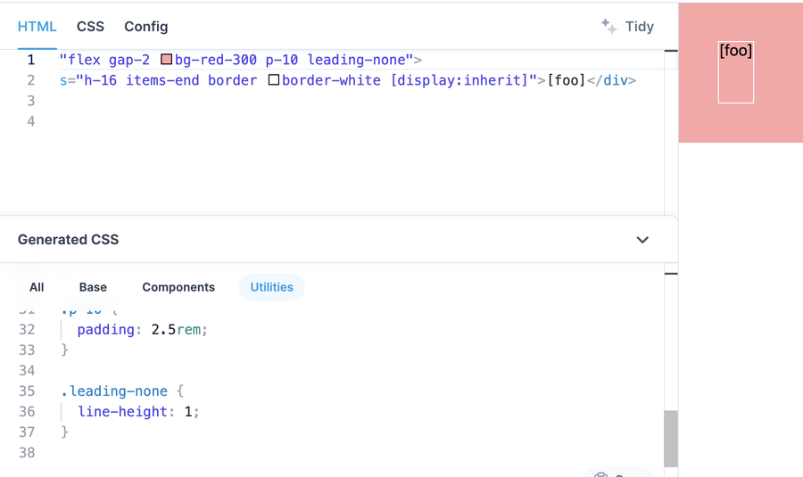</span><span class="sg-meta"><span class="deep-title sg-name"> <span class="org-mark h-logo" title="SYSU">S</span> OmniGIRL <span class="org">Huawei Cloud · SYSU</span></span><span class="sg-sub"><span class="hf"><span class="hf-b hf-dl" title="downloads"><svg class="hf-i" viewBox="0 0 24 24" fill="none" stroke="currentColor" stroke-width="2.2" stroke-linecap="round" stroke-linejoin="round"><path d="M12 3v11"/><path d="M8 11l4 4 4-4"/><path d="M4 20h16"/></svg>206</span><span class="hf-b hf-lk" title="likes"><svg class="hf-i" viewBox="0 0 24 24" fill="currentColor"><path d="M12 21C7 17.5 3 14 3 9.5 3 7 5 5 7.5 5 9.2 5 10.7 6 12 7.6 13.3 6 14.8 5 16.5 5 19 5 21 7 21 9.5 21 14 17 17.5 12 21z"/></svg>1</span></span><span class=sg-n>3 条样例</span></span></span></span> |
| 2026/7/16 |   [MM-IssueLoc](https://arxiv.org/abs/2607.15205) <span class="org">JD · Tsinghua</span> | [HF](https://huggingface.co/datasets/Jasaxion/MM-IssueLocBench) | <span class="art a-txt">问题描述</span><span class="art a-img">bug 截图</span><span class="art a-meta">要改的文件 / 函数</span> | 652 题 / 1,050 图 | <a class="hf" href="https://huggingface.co/datasets/Jasaxion/MM-IssueLocBench"><span class="hf-b hf-dl" title="downloads"><svg class="hf-i" viewBox="0 0 24 24" fill="none" stroke="currentColor" stroke-width="2.2" stroke-linecap="round" stroke-linejoin="round"><path d="M12 3v11"/><path d="M8 11l4 4 4-4"/><path d="M4 20h16"/></svg>156</span></a> | **只定位不改码**：给 issue 正文加截图，让模型指出要改哪些文件；652 题含 450 人标 + 202 AI 扩充，另 343 题标到函数级 | △ CC-BY-NC-4.0 | <span class="sg-tile ex-tile" role="button" tabindex="0" data-sg="sg-mm-issueloc--data"><span class="sg-poster"></span><span class="sg-meta"><span class="deep-title sg-name">  MM-IssueLoc <span class="org">JD · Tsinghua</span></span><span class="sg-sub"><span class="hf"><span class="hf-b hf-dl" title="downloads"><svg class="hf-i" viewBox="0 0 24 24" fill="none" stroke="currentColor" stroke-width="2.2" stroke-linecap="round" stroke-linejoin="round"><path d="M12 3v11"/><path d="M8 11l4 4 4-4"/><path d="M4 20h16"/></svg>156</span></span><span class=sg-n>3 条样例</span></span></span></span> |

</div>

- 口径：题数 2026-11-07 读自 HF datasets-server，与论文口径不一致的在「特性」里标了出处
- 标记：✓ 宽松许可，△ 有条件，？未声明

### <a id="data-2-3"></a>2.3 Datasets

公开网页配对数据共 37 条，35 条集中在单文件「截图 → 代码」，多文件 Web App 只有 2 条。

<div class="tbl-tabs wide">

<div class="tbl-pane" data-label="HTML" data-count="35">

<p class="tbl-desc">单文件产物：截图 / 设计稿 / 草图转 HTML、SVG、React 组件、图表绘图代码。渲染一次就能比对，判据最成熟。</p>

| 发布日期 | 数据集 / 工作 | Download | Artifacts | Datasize | 影响力 | 特性 / 训练用途 | Example |
|---|---|---|---|--:|---|---|---|
| 2017/5/22 |  [pix2code](https://arxiv.org/abs/1705.07962) <span class="org">UIzard</span> | [GitHub](https://github.com/tonybeltramelli/pix2code) | <span class="art a-img">截图</span><span class="art a-code">DSL</span> | 3 平台合成 GUI | <a class="hf" href="https://github.com/tonybeltramelli/pix2code"><span class="hf-b hf-st" title="GitHub stars"><svg class="hf-i" viewBox="0 0 24 24" fill="currentColor"><path d="M12 2.5l2.9 6 6.6.6-5 4.3 1.5 6.5L12 16.9 6 20.9l1.5-6.5-5-4.3 6.6-.6z"/></svg>12.0k</span></a> | **最早的配对数据**：随机合成 DSL 再渲染出 GUI，截图与代码天然对齐 | <span class="sg-tile ex-tile" role="button" tabindex="0" data-sg="sg-pix2code--data"><span class="sg-poster"></span><span class="sg-meta"><span class="deep-title sg-name"> pix2code <span class="org">UIzard</span></span><span class="sg-sub"><span class="hf"><span class="hf-b hf-st" title="GitHub stars"><svg class="hf-i" viewBox="0 0 24 24" fill="currentColor"><path d="M12 2.5l2.9 6 6.6.6-5 4.3 1.5 6.5L12 16.9 6 20.9l1.5-6.5-5-4.3 6.6-.6z"/></svg>12.0k</span></span><span class=sg-n>3 条样例</span></span></span></span> |
| 2023/9/30 |  [AutomaTikZ / DaTikZ](https://arxiv.org/abs/2310.00367) <span class="org">University of Hamburg</span> | [HF](https://huggingface.co/datasets/nllg/datikz) | <span class="art a-txt">描述</span><span class="art a-code">TikZ</span> | 120K | <a class="hf" href="https://huggingface.co/datasets/nllg/datikz"><span class="hf-b hf-dl" title="downloads"><svg class="hf-i" viewBox="0 0 24 24" fill="none" stroke="currentColor" stroke-width="2.2" stroke-linecap="round" stroke-linejoin="round"><path d="M12 3v11"/><path d="M8 11l4 4 4-4"/><path d="M4 20h16"/></svg>518</span><span class="hf-b hf-lk" title="likes"><svg class="hf-i" viewBox="0 0 24 24" fill="currentColor"><path d="M12 21C7 17.5 3 14 3 9.5 3 7 5 5 7.5 5 9.2 5 10.7 6 12 7.6 13.3 6 14.8 5 16.5 5 19 5 21 7 21 9.5 21 14 17 17.5 12 21z"/></svg>7</span></a> | **真实 TikZ 语料**：从 arXiv、TeX.SE 收集人写 TikZ，并对齐 caption | — |
| 2023/12/17 |   [StarVector / SVG-Stack](https://arxiv.org/abs/2312.11556) <span class="org">ServiceNow Research · Mila</span> | [HF](https://huggingface.co/datasets/starvector/svg-stack) | <span class="art a-img">截图</span><span class="art a-txt">描述</span><span class="art a-run">.svg</span> | 2M | <a class="hf" href="https://huggingface.co/datasets/starvector/svg-stack"><span class="hf-b hf-dl" title="downloads"><svg class="hf-i" viewBox="0 0 24 24" fill="none" stroke="currentColor" stroke-width="2.2" stroke-linecap="round" stroke-linejoin="round"><path d="M12 3v11"/><path d="M8 11l4 4 4-4"/><path d="M4 20h16"/></svg>1.0k</span><span class="hf-b hf-lk" title="likes"><svg class="hf-i" viewBox="0 0 24 24" fill="currentColor"><path d="M12 21C7 17.5 3 14 3 9.5 3 7 5 5 7.5 5 9.2 5 10.7 6 12 7.6 13.3 6 14.8 5 16.5 5 19 5 21 7 21 9.5 21 14 17 17.5 12 21z"/></svg>36</span></a> | **大规模 SVG 预训练料**：从 The Stack 抽 SVG 清洗渲染，得到图-码配对 | — |
| 2024/3/5 |   [Design2Code](https://arxiv.org/abs/2403.03163) <span class="org">Google DeepMind · Stanford</span> | [HF](https://huggingface.co/datasets/SALT-NLP/Design2Code) | <span class="art a-img">截图</span><span class="art a-run">.html</span> | 训练 165K + 测试 484 | <a class="hf" href="https://huggingface.co/datasets/SALT-NLP/Design2Code"><span class="hf-b hf-dl" title="downloads"><svg class="hf-i" viewBox="0 0 24 24" fill="none" stroke="currentColor" stroke-width="2.2" stroke-linecap="round" stroke-linejoin="round"><path d="M12 3v11"/><path d="M8 11l4 4 4-4"/><path d="M4 20h16"/></svg>1.8k</span><span class="hf-b hf-lk" title="likes"><svg class="hf-i" viewBox="0 0 24 24" fill="currentColor"><path d="M12 21C7 17.5 3 14 3 9.5 3 7 5 5 7.5 5 9.2 5 10.7 6 12 7.6 13.3 6 14.8 5 16.5 5 19 5 21 7 21 9.5 21 14 17 17.5 12 21z"/></svg>22</span></a> | **WebSight 子集微调**：训练取 WebSight 20%，真实网页只当测试集 | <span class="sg-tile ex-tile" role="button" tabindex="0" data-sg="sg-design2code--data"><span class="sg-poster"></span><span class="sg-meta"><span class="deep-title sg-name">  Design2Code <span class="org">Google DeepMind · Stanford</span></span><span class="sg-sub"><span class="hf"><span class="hf-b hf-dl" title="downloads"><svg class="hf-i" viewBox="0 0 24 24" fill="none" stroke="currentColor" stroke-width="2.2" stroke-linecap="round" stroke-linejoin="round"><path d="M12 3v11"/><path d="M8 11l4 4 4-4"/><path d="M4 20h16"/></svg>1.8k</span><span class="hf-b hf-lk" title="likes"><svg class="hf-i" viewBox="0 0 24 24" fill="currentColor"><path d="M12 21C7 17.5 3 14 3 9.5 3 7 5 5 7.5 5 9.2 5 10.7 6 12 7.6 13.3 6 14.8 5 16.5 5 19 5 21 7 21 9.5 21 14 17 17.5 12 21z"/></svg>22</span></span><span class=sg-n>3 条样例</span></span></span></span> |
| 2024/3/14 |  [WebSight](https://arxiv.org/abs/2403.09029) <span class="org">HuggingFace</span> | [HF](https://huggingface.co/datasets/HuggingFaceM4/WebSight) | <span class="art a-img">截图</span><span class="art a-run">.html</span> | 2M | <a class="hf" href="https://huggingface.co/datasets/HuggingFaceM4/WebSight"><span class="hf-b hf-dl" title="downloads"><svg class="hf-i" viewBox="0 0 24 24" fill="none" stroke="currentColor" stroke-width="2.2" stroke-linecap="round" stroke-linejoin="round"><path d="M12 3v11"/><path d="M8 11l4 4 4-4"/><path d="M4 20h16"/></svg>18.1k</span><span class="hf-b hf-lk" title="likes"><svg class="hf-i" viewBox="0 0 24 24" fill="currentColor"><path d="M12 21C7 17.5 3 14 3 9.5 3 7 5 5 7.5 5 9.2 5 10.7 6 12 7.6 13.3 6 14.8 5 16.5 5 19 5 21 7 21 9.5 21 14 17 17.5 12 21z"/></svg>400</span></a> | **纯合成 SFT 底料**：LLM 写主题与 Tailwind HTML 再渲染截图，量大干净 | <span class="sg-tile ex-tile" role="button" tabindex="0" data-sg="sg-websight--data"><span class="sg-poster"></span><span class="sg-meta"><span class="deep-title sg-name"> WebSight <span class="org">HuggingFace</span></span><span class="sg-sub"><span class="hf"><span class="hf-b hf-dl" title="downloads"><svg class="hf-i" viewBox="0 0 24 24" fill="none" stroke="currentColor" stroke-width="2.2" stroke-linecap="round" stroke-linejoin="round"><path d="M12 3v11"/><path d="M8 11l4 4 4-4"/><path d="M4 20h16"/></svg>18.1k</span><span class="hf-b hf-lk" title="likes"><svg class="hf-i" viewBox="0 0 24 24" fill="currentColor"><path d="M12 21C7 17.5 3 14 3 9.5 3 7 5 5 7.5 5 9.2 5 10.7 6 12 7.6 13.3 6 14.8 5 16.5 5 19 5 21 7 21 9.5 21 14 17 17.5 12 21z"/></svg>400</span></span><span class=sg-n>3 条样例</span></span></span></span> |
| 2024/4/9 |   [Vision2UI → WebCode2M](https://arxiv.org/abs/2404.06369) <span class="org">Rabbitpre AI · PKU</span> | [HF](https://huggingface.co/datasets/xcodemind/webcode2m) | <span class="art a-img">设计稿</span><span class="art a-run">.html</span><span class="art a-meta">布局框</span> | 2.56M | <a class="hf" href="https://huggingface.co/datasets/xcodemind/webcode2m"><span class="hf-b hf-dl" title="downloads"><svg class="hf-i" viewBox="0 0 24 24" fill="none" stroke="currentColor" stroke-width="2.2" stroke-linecap="round" stroke-linejoin="round"><path d="M12 3v11"/><path d="M8 11l4 4 4-4"/><path d="M4 20h16"/></svg>2.4k</span><span class="hf-b hf-lk" title="likes"><svg class="hf-i" viewBox="0 0 24 24" fill="currentColor"><path d="M12 21C7 17.5 3 14 3 9.5 3 7 5 5 7.5 5 9.2 5 10.7 6 12 7.6 13.3 6 14.8 5 16.5 5 19 5 21 7 21 9.5 21 14 17 17.5 12 21z"/></svg>48</span></a> | **真实网页大语料**：Common Crawl 网页渲染后按审美打分过滤，带布局信息 | — |
| 2024/5/24 |  [DeTikZify / DaTikZv2](https://arxiv.org/abs/2405.15306) <span class="org">University of Mannheim</span> | [HF](https://huggingface.co/datasets/nllg/datikz-v2) | <span class="art a-img">科研图</span><span class="art a-img">手绘草图</span><span class="art a-code">TikZ</span> | 360K+ | <a class="hf" href="https://huggingface.co/datasets/nllg/datikz-v2"><span class="hf-b hf-dl" title="downloads"><svg class="hf-i" viewBox="0 0 24 24" fill="none" stroke="currentColor" stroke-width="2.2" stroke-linecap="round" stroke-linejoin="round"><path d="M12 3v11"/><path d="M8 11l4 4 4-4"/><path d="M4 20h16"/></svg>366</span><span class="hf-b hf-lk" title="likes"><svg class="hf-i" viewBox="0 0 24 24" fill="currentColor"><path d="M12 21C7 17.5 3 14 3 9.5 3 7 5 5 7.5 5 9.2 5 10.7 6 12 7.6 13.3 6 14.8 5 16.5 5 19 5 21 7 21 9.5 21 14 17 17.5 12 21z"/></svg>17</span></a> | **人写 + 合成草图**：TikZ 配合成草图做输入，推理时可叠 MCTS 精修 | — |
| 2024/6/11 |   [UICoder](https://arxiv.org/abs/2406.07739) <span class="org">Apple · CMU</span> | — | <span class="art a-txt">描述</span><span class="art a-code">SwiftUI</span> | 近 1M | — | **自生成迭代蒸馏**：编译器 + CLIP 狠滤自产代码再自训，循环 5 轮 | — |
| 2024/6/28 |   [Web2Code](https://arxiv.org/abs/2406.20098) <span class="org">Petuum · CMU</span> | [HF](https://huggingface.co/datasets/MBZUAI/Web2Code) | <span class="art a-img">截图</span><span class="art a-run">.html</span><span class="art a-txt">问答</span> | 1,179.7K | <a class="hf" href="https://huggingface.co/datasets/MBZUAI/Web2Code"><span class="hf-b hf-dl" title="downloads"><svg class="hf-i" viewBox="0 0 24 24" fill="none" stroke="currentColor" stroke-width="2.2" stroke-linecap="round" stroke-linejoin="round"><path d="M12 3v11"/><path d="M8 11l4 4 4-4"/><path d="M4 20h16"/></svg>1.3k</span><span class="hf-b hf-lk" title="likes"><svg class="hf-i" viewBox="0 0 24 24" fill="currentColor"><path d="M12 21C7 17.5 3 14 3 9.5 3 7 5 5 7.5 5 9.2 5 10.7 6 12 7.6 13.3 6 14.8 5 16.5 5 19 5 21 7 21 9.5 21 14 17 17.5 12 21z"/></svg>13</span></a> | **代码 + 理解双料**：GPT 新造与精修网页代码，外加网页 QA 做指令微调 | <span class="sg-tile ex-tile" role="button" tabindex="0" data-sg="sg-web2code--data"><span class="sg-poster"></span><span class="sg-meta"><span class="deep-title sg-name">  Web2Code <span class="org">Petuum · CMU</span></span><span class="sg-sub"><span class="hf"><span class="hf-b hf-dl" title="downloads"><svg class="hf-i" viewBox="0 0 24 24" fill="none" stroke="currentColor" stroke-width="2.2" stroke-linecap="round" stroke-linejoin="round"><path d="M12 3v11"/><path d="M8 11l4 4 4-4"/><path d="M4 20h16"/></svg>1.3k</span><span class="hf-b hf-lk" title="likes"><svg class="hf-i" viewBox="0 0 24 24" fill="currentColor"><path d="M12 21C7 17.5 3 14 3 9.5 3 7 5 5 7.5 5 9.2 5 10.7 6 12 7.6 13.3 6 14.8 5 16.5 5 19 5 21 7 21 9.5 21 14 17 17.5 12 21z"/></svg>13</span></span><span class=sg-n>3 条样例</span></span></span></span> |
| 2024/10/21 |  [Sketch2Code](https://arxiv.org/abs/2410.16232) <span class="org">Stanford</span> | [HF](https://huggingface.co/datasets/SALT-NLP/Sketch2Code) | <span class="art a-img">手绘草图</span><span class="art a-run">.html</span> | 731 草图 / 484 网页 | <a class="hf" href="https://huggingface.co/datasets/SALT-NLP/Sketch2Code"><span class="hf-b hf-dl" title="downloads"><svg class="hf-i" viewBox="0 0 24 24" fill="none" stroke="currentColor" stroke-width="2.2" stroke-linecap="round" stroke-linejoin="round"><path d="M12 3v11"/><path d="M8 11l4 4 4-4"/><path d="M4 20h16"/></svg>552</span><span class="hf-b hf-lk" title="likes"><svg class="hf-i" viewBox="0 0 24 24" fill="currentColor"><path d="M12 21C7 17.5 3 14 3 9.5 3 7 5 5 7.5 5 9.2 5 10.7 6 12 7.6 13.3 6 14.8 5 16.5 5 19 5 21 7 21 9.5 21 14 17 17.5 12 21z"/></svg>5</span></a> | **真人手绘输入**：按线框规范给真实网页画草图，可测多轮交互反馈 | <span class="sg-tile ex-tile" role="button" tabindex="0" data-sg="sg-sketch2code--data"><span class="sg-poster"></span><span class="sg-meta"><span class="deep-title sg-name"> Sketch2Code <span class="org">Stanford</span></span><span class="sg-sub"><span class="hf"><span class="hf-b hf-dl" title="downloads"><svg class="hf-i" viewBox="0 0 24 24" fill="none" stroke="currentColor" stroke-width="2.2" stroke-linecap="round" stroke-linejoin="round"><path d="M12 3v11"/><path d="M8 11l4 4 4-4"/><path d="M4 20h16"/></svg>552</span><span class="hf-b hf-lk" title="likes"><svg class="hf-i" viewBox="0 0 24 24" fill="currentColor"><path d="M12 21C7 17.5 3 14 3 9.5 3 7 5 5 7.5 5 9.2 5 10.7 6 12 7.6 13.3 6 14.8 5 16.5 5 19 5 21 7 21 9.5 21 14 17 17.5 12 21z"/></svg>5</span></span><span class=sg-n>3 条样例</span></span></span></span> |
| 2024/10/24 |   [ReachQA (CIT)](https://arxiv.org/abs/2410.18798) <span class="org">Tencent · Fudan</span> | [HF](https://huggingface.co/datasets/hewei2001/ReachQA) | <span class="art a-code">绘图代码</span><span class="art a-img">图表图</span><span class="art a-txt">问答</span> | 3K 图 / 20K QA | <a class="hf" href="https://huggingface.co/datasets/hewei2001/ReachQA"><span class="hf-b hf-dl" title="downloads"><svg class="hf-i" viewBox="0 0 24 24" fill="none" stroke="currentColor" stroke-width="2.2" stroke-linecap="round" stroke-linejoin="round"><path d="M12 3v11"/><path d="M8 11l4 4 4-4"/><path d="M4 20h16"/></svg>372</span><span class="hf-b hf-lk" title="likes"><svg class="hf-i" viewBox="0 0 24 24" fill="currentColor"><path d="M12 21C7 17.5 3 14 3 9.5 3 7 5 5 7.5 5 9.2 5 10.7 6 12 7.6 13.3 6 14.8 5 16.5 5 19 5 21 7 21 9.5 21 14 17 17.5 12 21z"/></svg>10</span></a> | **代码当中介**：LLM 扩写 matplotlib 并渲染，再基于代码出推理 QA | — |
| 2024/11/5 |  [Interaction2Code](https://arxiv.org/abs/2411.03292) <span class="org">Tsinghua</span> | [GitHub](https://github.com/WebPAI/Interaction2Code) | <span class="art a-img">截图（交互前后）</span><span class="art a-code">源码（交互）</span> | 127 页 / 374 交互 | <a class="hf" href="https://github.com/WebPAI/Interaction2Code"><span class="hf-b hf-st" title="GitHub stars"><svg class="hf-i" viewBox="0 0 24 24" fill="currentColor"><path d="M12 2.5l2.9 6 6.6.6-5 4.3 1.5 6.5L12 16.9 6 20.9l1.5-6.5-5-4.3 6.6-.6z"/></svg>62</span></a> | **交互原型评测**：人工整理真实网页的 31 类交互，考动态行为还原 | — |
| 2024/12/15 |  [LLM4SVG / SVGX-SFT](https://arxiv.org/abs/2412.11102) <span class="org">HKU</span> | [HF](https://huggingface.co/datasets/xingxm/SVGX-SFT-1M) | <span class="art a-txt">指令</span><span class="art a-run">.svg</span> | 580K | <a class="hf" href="https://huggingface.co/datasets/xingxm/SVGX-SFT-1M"><span class="hf-b hf-dl" title="downloads"><svg class="hf-i" viewBox="0 0 24 24" fill="none" stroke="currentColor" stroke-width="2.2" stroke-linecap="round" stroke-linejoin="round"><path d="M12 3v11"/><path d="M8 11l4 4 4-4"/><path d="M4 20h16"/></svg>419</span><span class="hf-b hf-lk" title="likes"><svg class="hf-i" viewBox="0 0 24 24" fill="currentColor"><path d="M12 21C7 17.5 3 14 3 9.5 3 7 5 5 7.5 5 9.2 5 10.7 6 12 7.6 13.3 6 14.8 5 16.5 5 19 5 21 7 21 9.5 21 14 17 17.5 12 21z"/></svg>19</span></a> | **理解 + 生成双向指令**：人设计的 SVG 经自动管线转成两类指令数据 | — |
| 2025/1/11 |  [ChartCoder / Chart2Code-160k](https://arxiv.org/abs/2501.06598) <span class="org">Tsinghua</span> | [HF](https://huggingface.co/datasets/xxxllz/Chart2Code-160k) | <span class="art a-img">图表图</span><span class="art a-code">.py</span> | 160K | <a class="hf" href="https://huggingface.co/datasets/xxxllz/Chart2Code-160k"><span class="hf-b hf-dl" title="downloads"><svg class="hf-i" viewBox="0 0 24 24" fill="none" stroke="currentColor" stroke-width="2.2" stroke-linecap="round" stroke-linejoin="round"><path d="M12 3v11"/><path d="M8 11l4 4 4-4"/><path d="M4 20h16"/></svg>148</span><span class="hf-b hf-lk" title="likes"><svg class="hf-i" viewBox="0 0 24 24" fill="currentColor"><path d="M12 21C7 17.5 3 14 3 9.5 3 7 5 5 7.5 5 9.2 5 10.7 6 12 7.6 13.3 6 14.8 5 16.5 5 19 5 21 7 21 9.5 21 14 17 17.5 12 21z"/></svg>11</span></a> | **分步生成 CoT**：LLM 合成多类型图表代码并执行，SoT 改写成分步生成 | — |
| 2025/2/20 |  [CoSyn-400K](https://arxiv.org/abs/2502.14846) <span class="org">AllenAI</span> | [HF](https://huggingface.co/datasets/allenai/CoSyn-400K) | <span class="art a-code">绘图代码</span><span class="art a-img">截图</span><span class="art a-txt">指令</span> | 400K 图 / 2.7M 指令 | <a class="hf" href="https://huggingface.co/datasets/allenai/CoSyn-400K"><span class="hf-b hf-dl" title="downloads"><svg class="hf-i" viewBox="0 0 24 24" fill="none" stroke="currentColor" stroke-width="2.2" stroke-linecap="round" stroke-linejoin="round"><path d="M12 3v11"/><path d="M8 11l4 4 4-4"/><path d="M4 20h16"/></svg>11.0k</span><span class="hf-b hf-lk" title="likes"><svg class="hf-i" viewBox="0 0 24 24" fill="currentColor"><path d="M12 21C7 17.5 3 14 3 9.5 3 7 5 5 7.5 5 9.2 5 10.7 6 12 7.6 13.3 6 14.8 5 16.5 5 19 5 21 7 21 9.5 21 14 17 17.5 12 21z"/></svg>53</span></a> | **纯文本 LLM 造图**：按主题写 Python/HTML/LaTeX 渲染代码，再基于代码出 QA | <span class="sg-tile ex-tile" role="button" tabindex="0" data-sg="sg-cosyn-400k--data"><span class="sg-poster"></span><span class="sg-meta"><span class="deep-title sg-name"> CoSyn-400K <span class="org">AllenAI</span></span><span class="sg-sub"><span class="hf"><span class="hf-b hf-dl" title="downloads"><svg class="hf-i" viewBox="0 0 24 24" fill="none" stroke="currentColor" stroke-width="2.2" stroke-linecap="round" stroke-linejoin="round"><path d="M12 3v11"/><path d="M8 11l4 4 4-4"/><path d="M4 20h16"/></svg>11.0k</span><span class="hf-b hf-lk" title="likes"><svg class="hf-i" viewBox="0 0 24 24" fill="currentColor"><path d="M12 21C7 17.5 3 14 3 9.5 3 7 5 5 7.5 5 9.2 5 10.7 6 12 7.6 13.3 6 14.8 5 16.5 5 19 5 21 7 21 9.5 21 14 17 17.5 12 21z"/></svg>53</span></span><span class=sg-n>3 条样例</span></span></span></span> |
| 2025/4/8 |   [OmniSVG / MMSVG-2M](https://arxiv.org/abs/2504.06263) <span class="org">StepFun · Fudan</span> | [HF](https://huggingface.co/datasets/OmniSVG/MMSVG-Icon) | <span class="art a-txt">描述</span><span class="art a-img">截图</span><span class="art a-run">.svg</span> | 2M | <a class="hf" href="https://huggingface.co/datasets/OmniSVG/MMSVG-Icon"><span class="hf-b hf-dl" title="downloads"><svg class="hf-i" viewBox="0 0 24 24" fill="none" stroke="currentColor" stroke-width="2.2" stroke-linecap="round" stroke-linejoin="round"><path d="M12 3v11"/><path d="M8 11l4 4 4-4"/><path d="M4 20h16"/></svg>364</span><span class="hf-b hf-lk" title="likes"><svg class="hf-i" viewBox="0 0 24 24" fill="currentColor"><path d="M12 21C7 17.5 3 14 3 9.5 3 7 5 5 7.5 5 9.2 5 10.7 6 12 7.6 13.3 6 14.8 5 16.5 5 19 5 21 7 21 9.5 21 14 17 17.5 12 21z"/></svg>56</span></a> | **爬取素材 + 自动标注**：图标站爬 SVG，BLIP-2 写 caption，CLIP 分过滤 | — |
| 2025/5/24 |  [ChartGalaxy](https://arxiv.org/abs/2505.18668) <span class="org">Tsinghua</span> | [HF](https://huggingface.co/datasets/ChartGalaxy/ChartGalaxy) | <span class="art a-img">信息图</span><span class="art a-meta">数据表</span><span class="art a-code">D3</span> | 1.70M + 61.8K | <a class="hf" href="https://huggingface.co/datasets/ChartGalaxy/ChartGalaxy"><span class="hf-b hf-dl" title="downloads"><svg class="hf-i" viewBox="0 0 24 24" fill="none" stroke="currentColor" stroke-width="2.2" stroke-linecap="round" stroke-linejoin="round"><path d="M12 3v11"/><path d="M8 11l4 4 4-4"/><path d="M4 20h16"/></svg>23.0k</span><span class="hf-b hf-lk" title="likes"><svg class="hf-i" viewBox="0 0 24 24" fill="currentColor"><path d="M12 21C7 17.5 3 14 3 9.5 3 7 5 5 7.5 5 9.2 5 10.7 6 12 7.6 13.3 6 14.8 5 16.5 5 19 5 21 7 21 9.5 21 14 17 17.5 12 21z"/></svg>89</span></a> | **模板程序化合成**：从真实信息图归纳 75 类模板，用 D3 批量生成 | <span class="sg-tile ex-tile" role="button" tabindex="0" data-sg="sg-chartgalaxy--data"><span class="sg-poster"></span><span class="sg-meta"><span class="deep-title sg-name"> ChartGalaxy <span class="org">Tsinghua</span></span><span class="sg-sub"><span class="hf"><span class="hf-b hf-dl" title="downloads"><svg class="hf-i" viewBox="0 0 24 24" fill="none" stroke="currentColor" stroke-width="2.2" stroke-linecap="round" stroke-linejoin="round"><path d="M12 3v11"/><path d="M8 11l4 4 4-4"/><path d="M4 20h16"/></svg>23.0k</span><span class="hf-b hf-lk" title="likes"><svg class="hf-i" viewBox="0 0 24 24" fill="currentColor"><path d="M12 21C7 17.5 3 14 3 9.5 3 7 5 5 7.5 5 9.2 5 10.7 6 12 7.6 13.3 6 14.8 5 16.5 5 19 5 21 7 21 9.5 21 14 17 17.5 12 21z"/></svg>89</span></span><span class=sg-n>4 条样例</span></span></span></span> |
| 2025/5/27 |   [RLRF](https://arxiv.org/abs/2505.20793) <span class="org">Google Research · Columbia</span> | — | <span class="art a-img">截图</span><span class="art a-run">.svg</span> | SFT 1.7M / RL 20K | — | **渲染反馈奖励**：rollout 渲染后比像素与 DreamSim，加长度惩罚做 RL | — |
| 2025/5/30 |  [Reason-SVG / SVGX-DwT-10k](https://arxiv.org/abs/2505.24499) <span class="org">HKU</span> | — | <span class="art a-txt">推理过程</span><span class="art a-run">.svg</span> | 10K | — | **先推理后画**：每条 SVG 配显式设计推理，GRPO 用结构/语义/视觉混合奖励 | — |
| 2025/5/31 |   [ChartGen](https://arxiv.org/abs/2507.19492) <span class="org">IBM Research · MIT</span> | [HF](https://huggingface.co/datasets/SD122025/ChartGen-200K) | <span class="art a-img">图表图</span><span class="art a-code">源码</span> | 222.5K | <a class="hf" href="https://huggingface.co/datasets/SD122025/ChartGen-200K"><span class="hf-b hf-dl" title="downloads"><svg class="hf-i" viewBox="0 0 24 24" fill="none" stroke="currentColor" stroke-width="2.2" stroke-linecap="round" stroke-linejoin="round"><path d="M12 3v11"/><path d="M8 11l4 4 4-4"/><path d="M4 20h16"/></svg>1.7k</span><span class="hf-b hf-lk" title="likes"><svg class="hf-i" viewBox="0 0 24 24" fill="currentColor"><path d="M12 21C7 17.5 3 14 3 9.5 3 7 5 5 7.5 5 9.2 5 10.7 6 12 7.6 13.3 6 14.8 5 16.5 5 19 5 21 7 21 9.5 21 14 17 17.5 12 21z"/></svg>9</span></a> | **种子图重建扩增**：VLM 把种子图还原成脚本，代码 LLM 迭代扩出变体 | — |
| 2025/6/4 |   [VisCoder / VisCode-200K](https://arxiv.org/abs/2506.03930) <span class="org">Netmind.ai · CMU</span> | [HF](https://huggingface.co/datasets/TIGER-Lab/VisCode-200K) | <span class="art a-txt">指令</span><span class="art a-code">绘图代码</span> | 200K+ | <a class="hf" href="https://huggingface.co/datasets/TIGER-Lab/VisCode-200K"><span class="hf-b hf-dl" title="downloads"><svg class="hf-i" viewBox="0 0 24 24" fill="none" stroke="currentColor" stroke-width="2.2" stroke-linecap="round" stroke-linejoin="round"><path d="M12 3v11"/><path d="M8 11l4 4 4-4"/><path d="M4 20h16"/></svg>111</span><span class="hf-b hf-lk" title="likes"><svg class="hf-i" viewBox="0 0 24 24" fill="currentColor"><path d="M12 21C7 17.5 3 14 3 9.5 3 7 5 5 7.5 5 9.2 5 10.7 6 12 7.6 13.3 6 14.8 5 16.5 5 19 5 21 7 21 9.5 21 14 17 17.5 12 21z"/></svg>9</span></a> | **执行验证 + 多轮纠错**：开源仓库抽可跑绘图代码，另含 45K 纠错对话 | — |
| 2025/7/7 |   [ArtifactsBench](https://arxiv.org/abs/2507.04952) <span class="org">Tencent Hunyuan · PKU</span> | [HF](https://huggingface.co/datasets/tencent/ArtifactsBenchmark) | <span class="art a-code">源码（交互）</span><span class="art a-meta">评分项</span> | 1,825 题 | <a class="hf" href="https://huggingface.co/datasets/tencent/ArtifactsBenchmark"><span class="hf-b hf-dl" title="downloads"><svg class="hf-i" viewBox="0 0 24 24" fill="none" stroke="currentColor" stroke-width="2.2" stroke-linecap="round" stroke-linejoin="round"><path d="M12 3v11"/><path d="M8 11l4 4 4-4"/><path d="M4 20h16"/></svg>195</span><span class="hf-b hf-lk" title="likes"><svg class="hf-i" viewBox="0 0 24 24" fill="currentColor"><path d="M12 21C7 17.5 3 14 3 9.5 3 7 5 5 7.5 5 9.2 5 10.7 6 12 7.6 13.3 6 14.8 5 16.5 5 19 5 21 7 21 9.5 21 14 17 17.5 12 21z"/></svg>13</span></a> | **现成 reward 模板**：时序截图 + 逐题 checklist，MLLM 判官直接打分 | — |
| 2025/7/30 |  [ScreenCoder](https://arxiv.org/abs/2507.22827) <span class="org">CUHK</span> | [HF](https://huggingface.co/datasets/Leigest/ScreenCoder) | <span class="art a-img">截图</span><span class="art a-run">.html</span> | Screen-10K | <a class="hf" href="https://github.com/leigest519/ScreenCoder"><span class="hf-b hf-st" title="GitHub stars"><svg class="hf-i" viewBox="0 0 24 24" fill="currentColor"><path d="M12 2.5l2.9 6 6.6.6-5 4.3 1.5 6.5L12 16.9 6 20.9l1.5-6.5-5-4.3 6.6-.6z"/></svg>3.0k</span></a> | **agent 当数据引擎**：grounding→planning→generation 产配对，SFT 后接 RL | <span class="sg-tile ex-tile" role="button" tabindex="0" data-sg="sg-screencoder--data"><span class="sg-poster"></span><span class="sg-meta"><span class="deep-title sg-name"> ScreenCoder <span class="org">CUHK</span></span><span class="sg-sub"><span class="hf"><span class="hf-b hf-st" title="GitHub stars"><svg class="hf-i" viewBox="0 0 24 24" fill="currentColor"><path d="M12 2.5l2.9 6 6.6.6-5 4.3 1.5 6.5L12 16.9 6 20.9l1.5-6.5-5-4.3 6.6-.6z"/></svg>3.0k</span></span><span class=sg-n>3 条样例</span></span></span></span> |
| 2025/8/6 |   [SVGen / SVG-1M](https://arxiv.org/abs/2508.09168) <span class="org">China Telecom TeleAI · NWPU</span> | [HF](https://huggingface.co/datasets/gitcat-404/SVG-1M-Json) | <span class="art a-txt">描述</span><span class="art a-run">.svg</span> | 1M | <a class="hf" href="https://huggingface.co/datasets/gitcat-404/SVG-1M-Json"><span class="hf-b hf-dl" title="downloads"><svg class="hf-i" viewBox="0 0 24 24" fill="none" stroke="currentColor" stroke-width="2.2" stroke-linecap="round" stroke-linejoin="round"><path d="M12 3v11"/><path d="M8 11l4 4 4-4"/><path d="M4 20h16"/></svg>52</span><span class="hf-b hf-lk" title="likes"><svg class="hf-i" viewBox="0 0 24 24" fill="currentColor"><path d="M12 21C7 17.5 3 14 3 9.5 3 7 5 5 7.5 5 9.2 5 10.7 6 12 7.6 13.3 6 14.8 5 16.5 5 19 5 21 7 21 9.5 21 14 17 17.5 12 21z"/></svg>4</span></a> | **带 CoT 子集**：增强 + 标注造百万文本-SVG 对，配课程学习与 RL | — |
| 2025/8/11 |   [UniSVG](https://arxiv.org/abs/2508.07766) <span class="org">Tencent · ZJU</span> | [HF](https://huggingface.co/datasets/lili24/UniSVG) | <span class="art a-txt">描述</span><span class="art a-img">截图</span><span class="art a-run">.svg</span> | 525K | <a class="hf" href="https://huggingface.co/datasets/lili24/UniSVG"><span class="hf-b hf-dl" title="downloads"><svg class="hf-i" viewBox="0 0 24 24" fill="none" stroke="currentColor" stroke-width="2.2" stroke-linecap="round" stroke-linejoin="round"><path d="M12 3v11"/><path d="M8 11l4 4 4-4"/><path d="M4 20h16"/></svg>210</span><span class="hf-b hf-lk" title="likes"><svg class="hf-i" viewBox="0 0 24 24" fill="currentColor"><path d="M12 21C7 17.5 3 14 3 9.5 3 7 5 5 7.5 5 9.2 5 10.7 6 12 7.6 13.3 6 14.8 5 16.5 5 19 5 21 7 21 9.5 21 14 17 17.5 12 21z"/></svg>11</span></a> | **多源统一格式**：整合多源 SVG，统一成生成 + 理解两类任务 | — |
| 2025/8/25 |   [ChartMaster / ReChartPrompt-240K](https://arxiv.org/abs/2508.17608) <span class="org">JD · Wuhan University</span> | [HF](https://huggingface.co/datasets/TwT-6/ReChartPrompt-240K) | <span class="art a-img">图表图</span><span class="art a-code">源码</span> | 240K | <a class="hf" href="https://huggingface.co/datasets/TwT-6/ReChartPrompt-240K"><span class="hf-b hf-dl" title="downloads"><svg class="hf-i" viewBox="0 0 24 24" fill="none" stroke="currentColor" stroke-width="2.2" stroke-linecap="round" stroke-linejoin="round"><path d="M12 3v11"/><path d="M8 11l4 4 4-4"/><path d="M4 20h16"/></svg>7</span><span class="hf-b hf-lk" title="likes"><svg class="hf-i" viewBox="0 0 24 24" fill="currentColor"><path d="M12 21C7 17.5 3 14 3 9.5 3 7 5 5 7.5 5 9.2 5 10.7 6 12 7.6 13.3 6 14.8 5 16.5 5 19 5 21 7 21 9.5 21 14 17 17.5 12 21z"/></svg>2</span></a> | **真实 arXiv 图当 prompt**：比纯合成更贴真实分布，配相似度 RL 奖励 | — |
| 2025/10/5 |   [WebRenderBench / ALISA](https://arxiv.org/abs/2510.04097) <span class="org">Huawei Cloud · PKU</span> | [HF](https://huggingface.co/datasets/aleversn/WebRenderBench) | <span class="art a-img">截图</span><span class="art a-run">.html</span> | 45.1K | <a class="hf" href="https://huggingface.co/datasets/aleversn/WebRenderBench"><span class="hf-b hf-dl" title="downloads"><svg class="hf-i" viewBox="0 0 24 24" fill="none" stroke="currentColor" stroke-width="2.2" stroke-linecap="round" stroke-linejoin="round"><path d="M12 3v11"/><path d="M8 11l4 4 4-4"/><path d="M4 20h16"/></svg>159</span><span class="hf-b hf-lk" title="likes"><svg class="hf-i" viewBox="0 0 24 24" fill="currentColor"><path d="M12 21C7 17.5 3 14 3 9.5 3 7 5 5 7.5 5 9.2 5 10.7 6 12 7.6 13.3 6 14.8 5 16.5 5 19 5 21 7 21 9.5 21 14 17 17.5 12 21z"/></svg>2</span></a> | **真实门户 + 渲染奖励**：从渲染结果算布局与样式一致性，直接当 RL reward | <span class="sg-tile ex-tile" role="button" tabindex="0" data-sg="sg-webrenderbench--data"><span class="sg-poster"></span><span class="sg-meta"><span class="deep-title sg-name">  WebRenderBench / ALISA <span class="org">Huawei Cloud · PKU</span></span><span class="sg-sub"><span class="hf"><span class="hf-b hf-dl" title="downloads"><svg class="hf-i" viewBox="0 0 24 24" fill="none" stroke="currentColor" stroke-width="2.2" stroke-linecap="round" stroke-linejoin="round"><path d="M12 3v11"/><path d="M8 11l4 4 4-4"/><path d="M4 20h16"/></svg>159</span><span class="hf-b hf-lk" title="likes"><svg class="hf-i" viewBox="0 0 24 24" fill="currentColor"><path d="M12 21C7 17.5 3 14 3 9.5 3 7 5 5 7.5 5 9.2 5 10.7 6 12 7.6 13.3 6 14.8 5 16.5 5 19 5 21 7 21 9.5 21 14 17 17.5 12 21z"/></svg>2</span></span><span class=sg-n>3 条样例</span></span></span></span> |
| 2025/10/13 |   [ReLook](https://arxiv.org/abs/2510.11498) <span class="org">Tencent · PKU</span> | — | <span class="art a-txt">轨迹（修复）</span> | 3,000 任务 | — | **视觉 critic RL**：72B VLM 看截图打分，渲染失败给 0，只收严格变好的修订 | — |
| 2025/10/13 |  [InternSVG / SAgoge](https://arxiv.org/abs/2510.11341) <span class="org">Shanghai AI Lab</span> | [HF](https://huggingface.co/datasets/InternSVG/SAgoge) | <span class="art a-txt">指令</span><span class="art a-run">.svg</span> | 16M | <a class="hf" href="https://huggingface.co/datasets/InternSVG/SAgoge"><span class="hf-b hf-dl" title="downloads"><svg class="hf-i" viewBox="0 0 24 24" fill="none" stroke="currentColor" stroke-width="2.2" stroke-linecap="round" stroke-linejoin="round"><path d="M12 3v11"/><path d="M8 11l4 4 4-4"/><path d="M4 20h16"/></svg>663</span><span class="hf-b hf-lk" title="likes"><svg class="hf-i" viewBox="0 0 24 24" fill="currentColor"><path d="M12 21C7 17.5 3 14 3 9.5 3 7 5 5 7.5 5 9.2 5 10.7 6 12 7.6 13.3 6 14.8 5 16.5 5 19 5 21 7 21 9.5 21 14 17 17.5 12 21z"/></svg>7</span></a> | **全任务 SVG 大库**：爬图标站 + 化学分子转 SVG + 合成动画，多 MLLM 标注 | — |
| 2025/10/24 |   [VisCoder2 / VisCode-Multi-679K](https://arxiv.org/abs/2510.23642) <span class="org">Netmind.ai · CMU</span> | [HF](https://huggingface.co/datasets/TIGER-Lab/VisCode-Multi-679K) | <span class="art a-code">绘图代码（12 语言）</span><span class="art a-img">图表图</span> | 679K | <a class="hf" href="https://huggingface.co/datasets/TIGER-Lab/VisCode-Multi-679K"><span class="hf-b hf-dl" title="downloads"><svg class="hf-i" viewBox="0 0 24 24" fill="none" stroke="currentColor" stroke-width="2.2" stroke-linecap="round" stroke-linejoin="round"><path d="M12 3v11"/><path d="M8 11l4 4 4-4"/><path d="M4 20h16"/></svg>49</span><span class="hf-b hf-lk" title="likes"><svg class="hf-i" viewBox="0 0 24 24" fill="currentColor"><path d="M12 21C7 17.5 3 14 3 9.5 3 7 5 5 7.5 5 9.2 5 10.7 6 12 7.6 13.3 6 14.8 5 16.5 5 19 5 21 7 21 9.5 21 14 17 17.5 12 21z"/></svg>7</span></a> | **多语言执行验证**：the-stack-v2 等抽代码，Jupyter 跑通后 GPT-4.1 写指令 | — |
| 2025/11/1 |   [VinciCoder](https://arxiv.org/abs/2511.00391) <span class="org">Meituan · CASIA</span> | [HF](https://huggingface.co/datasets/DocTron-Hub/VinciCoder-1.6M-SFT) | <span class="art a-img">截图</span><span class="art a-code">源码（多域）</span> | 1.6M SFT + 42K RL | <a class="hf" href="https://huggingface.co/datasets/DocTron-Hub/VinciCoder-1.6M-SFT"><span class="hf-b hf-dl" title="downloads"><svg class="hf-i" viewBox="0 0 24 24" fill="none" stroke="currentColor" stroke-width="2.2" stroke-linecap="round" stroke-linejoin="round"><path d="M12 3v11"/><path d="M8 11l4 4 4-4"/><path d="M4 20h16"/></svg>829</span><span class="hf-b hf-lk" title="likes"><svg class="hf-i" viewBox="0 0 24 24" fill="currentColor"><path d="M12 21C7 17.5 3 14 3 9.5 3 7 5 5 7.5 5 9.2 5 10.7 6 12 7.6 13.3 6 14.8 5 16.5 5 19 5 21 7 21 9.5 21 14 17 17.5 12 21z"/></svg>2</span></a> | **看图修代码对**：汇总各域开源数据，初版模型的不完美输出组成修正对 | — |
| 2025/11/9 |   [WebVIA](https://arxiv.org/abs/2511.06251) <span class="org">Zhipu AI · Tsinghua</span> | — | <span class="art a-img">截图（多状态）</span><span class="art a-run">.html</span> | 11K 页 + 180K 探索 | <a class="hf" href="https://github.com/zheny2751-dotcom/WebVIA"><span class="hf-b hf-st" title="GitHub stars"><svg class="hf-i" viewBox="0 0 24 24" fill="currentColor"><path d="M12 2.5l2.9 6 6.6.6-5 4.3 1.5 6.5L12 16.9 6 20.9l1.5-6.5-5-4.3 6.6-.6z"/></svg>39</span></a> | **agent 探索造交互数据**：截多状态后生成交互代码，再验证交互确实生效 | — |
| 2025/11/11 |   [UI2Code^N](https://arxiv.org/abs/2511.08195) <span class="org">Zhipu AI · Tsinghua</span> | — | <span class="art a-img">截图</span><span class="art a-run">.html</span><span class="art a-txt">指令（多轮）</span> | CPT 20M / SFT 80K / RL 42K | <a class="hf" href="https://github.com/zai-org/UI2Code_N"><span class="hf-b hf-st" title="GitHub stars"><svg class="hf-i" viewBox="0 0 24 24" fill="currentColor"><path d="M12 2.5l2.9 6 6.6.6-5 4.3 1.5 6.5L12 16.9 6 20.9l1.5-6.5-5-4.3 6.6-.6z"/></svg>87</span></a> | **逆向合成打磨任务**：先造复杂 HTML 真值，再倒推待打磨输入，覆盖起草/打磨/编辑 | — |
| 2026/3/26 |   [AnyDoc / DocHTML](https://arxiv.org/abs/2603.25118) <span class="org">Adobe Research · XJTU</span> | — | <span class="art a-txt">描述</span><span class="art a-img">截图</span><span class="art a-meta">布局框</span><span class="art a-run">.html</span> | 265K | — | **多模型流水线合成**：抽元数据→标意图→写 HTML→配图→过滤溢出，高度比做奖励 | — |
| 2026/8/4 |   [MT-Web2Code](https://arxiv.org/abs/2608.03474) <span class="org">Meituan LongCat · HIT</span> | — | <span class="art a-txt">轨迹（多轮修复）</span> | 102 页 × 5 轮 | — | **反向腐蚀造轨迹**：往金标页注入缺陷再倒放，得到确定性的逐轮修复过程 | — |

</div>

<div class="tbl-pane" data-label="WebDev" data-count="2">

<p class="tbl-desc">多文件 Web App：从规格或多轮对话生成可运行应用，由浏览器 agent 实测功能与跨页状态。</p>

| 发布日期 | 数据集 / 工作 | Download | Artifacts | Datasize | 影响力 | 特性 / 训练用途 | Example |
|---|---|---|---|--:|---|---|---|
| 2025/5/6 |  [WebGen-Bench / WebGen-Instruct](https://arxiv.org/abs/2505.03733) <span class="org">CUHK</span> | [HF](https://huggingface.co/datasets/luzimu/WebGen-Bench_train_data) | <span class="art a-txt">指令</span><span class="art a-run">多文件工程</span> | 训练 6,667 + 测试 101 | <a class="hf" href="https://huggingface.co/datasets/luzimu/WebGen-Bench_train_data"><span class="hf-b hf-dl" title="downloads"><svg class="hf-i" viewBox="0 0 24 24" fill="none" stroke="currentColor" stroke-width="2.2" stroke-linecap="round" stroke-linejoin="round"><path d="M12 3v11"/><path d="M8 11l4 4 4-4"/><path d="M4 20h16"/></svg>85</span><span class="hf-b hf-lk" title="likes"><svg class="hf-i" viewBox="0 0 24 24" fill="currentColor"><path d="M12 21C7 17.5 3 14 3 9.5 3 7 5 5 7.5 5 9.2 5 10.7 6 12 7.6 13.3 6 14.8 5 16.5 5 19 5 21 7 21 9.5 21 14 17 17.5 12 21z"/></svg>1</span></a> | **带 GUI 用例的指令集**：GPT-4o 写指令和功能用例，Bolt.diy 轨迹可直接 SFT | — |
| 2025/9/26 | <span class="org-mark" title="Ace Robotics">A</span>  [WebGen-Agent](https://arxiv.org/abs/2509.22644) <span class="org">Ace Robotics · CUHK</span> | [HF](https://huggingface.co/datasets/luzimu/webgen-agent_train_sft) | <span class="art a-txt">轨迹（agent）</span> | 700 轨迹 + 500 指令 | <a class="hf" href="https://huggingface.co/datasets/luzimu/webgen-agent_train_sft"><span class="hf-b hf-dl" title="downloads"><svg class="hf-i" viewBox="0 0 24 24" fill="none" stroke="currentColor" stroke-width="2.2" stroke-linecap="round" stroke-linejoin="round"><path d="M12 3v11"/><path d="M8 11l4 4 4-4"/><path d="M4 20h16"/></svg>163</span></a> | **逐步奖励轨迹**：DeepSeek-V3 跑 agent，截图分 + GUI 测试分当 step reward | — |

</div>

</div>

### <a id="data-2-4"></a>2.4 Website

高质量网页作品按能拿到什么分档：Webflow 可克隆站规模最大，Codrops 的 MIT 仓库动效最密，开源官网是真实的多页生产站，获奖画廊只给截图与评分；社区站多是单文件或片段。

<div class="wide">

| 类型 | 站点 | 获取方式 | Artifacts | Datasize | 特性 | Permitted | Example |
|---|---|---|---|--:|---|---|---|
| **社区站** | <span class="org-mark" title="CodePen">C</span> [CodePen](https://codepen.io/) | — | <span class="art a-img">截图</span><span class="art a-txt">标题</span><span class="art a-code">html / css / js 三段</span> | 10M → 25k | **名义与可用差两个数量级**：自报千万级，按许可过滤后约 2.5 万 | △ MIT 须署名；拿不到量 | <span class="sg-tile ex-tile" role="button" tabindex="0" data-sg="sg-codepen--data"><span class="sg-poster"><pre class="sg-code">&lt;!DOCTYPE html&gt;&#10;&lt;html lang="en" &gt;&#10;&#10;&lt;head&gt;&#10;  &#10;  &lt;meta charset="UTF-8"&gt;&#10;  &#10;  &#10;  &#10;&#10;  &lt;title&gt;Pure CSS 3D animated carousel - minimal code, heavily commented&lt;/title&gt;&#10;&#10;    &lt;link rel="canonical" href="https://codepen.io/thebabydino/pen/dPXVyqN"&gt;&#10;  &lt;meta name="viewport" content="width=device-width, initial-scale=1"&gt;&#10;  &#10;  &#10;  &#10;&lt;style&gt;</pre></span><span class="sg-meta"><span class="deep-title sg-name"><span class="org-mark h-logo" title="CodePen">C</span> CodePen</span><span class="sg-sub"><span class=sg-n>6 条样例</span></span></span></span> |
|  | <span class="org-mark" title="OpenProcessing">O</span> [OpenProcessing](https://openprocessing.org/) | — | <span class="art a-img">截图</span><span class="art a-txt">标题</span><span class="art a-txt">描述</span><span class="art a-code">.js（p5 草图）</span> | 1M+ | **抓取成本高**：要按 6 秒间隔慢爬，且每件作品的许可要单独核 | △ 逐件核；限速 6 s | <span class="sg-tile ex-tile" role="button" tabindex="0" data-sg="sg-openprocessing--data"><span class="sg-poster"></span><span class="sg-meta"><span class="deep-title sg-name"><span class="org-mark h-logo" title="OpenProcessing">O</span> OpenProcessing</span><span class="sg-sub"><span class=sg-n>3 条样例</span></span></span></span> |
|  |  [Hugging Face 静态空间](https://huggingface.co/spaces) | — | <span class="art a-txt">标题</span><span class="art a-txt">描述</span><span class="art a-run">多文件工程</span> | 331,654 个 | **唯一可批量筛许可的来源**：许可是结构化字段，不用逐件人工核 | ✓ 按许可字段筛 | <span class="sg-tile ex-tile" role="button" tabindex="0" data-sg="sg-hf-spaces--data"><span class="sg-poster"></span><span class="sg-meta"><span class="deep-title sg-name"> Hugging Face 静态空间 <span class="org">HuggingFace</span></span><span class="sg-sub"><span class=sg-n>3 条样例</span></span></span></span> |
|  | <span class="org-mark" title="Shadertoy">S</span> [Shadertoy](https://www.shadertoy.com/) | — | <span class="art a-img">截图</span><span class="art a-txt">标题</span><span class="art a-code">GLSL</span> | 52k 个 | **不是页面**：着色器源码要补一层固定渲染外壳才能进 harness；非商用条款 | △ 默认 CC BY-NC-SA 3.0：科研可用、不可商用 | <span class="sg-tile ex-tile" role="button" tabindex="0" data-sg="sg-shadertoy--data"><span class="sg-poster"></span><span class="sg-meta"><span class="deep-title sg-name"><span class="org-mark h-logo" title="Shadertoy">S</span> Shadertoy</span><span class="sg-sub"><span class=sg-n>6 条样例</span></span></span></span> |
|  | <span class="org-mark" title="Frontend Mentor">F</span> [Frontend Mentor](https://www.frontendmentor.io/) | — | <span class="art a-img">设计稿</span><span class="art a-txt">描述</span><span class="art a-run">多文件工程</span> | 7,155 个 | **唯一自带设计稿的来源**，但设计稿不可再分发，只能用提交的代码 | △ 设计稿不可再分发 | <span class="sg-tile ex-tile" role="button" tabindex="0" data-sg="sg-frontend-mentor--data"><span class="sg-poster"></span><span class="sg-meta"><span class="deep-title sg-name"><span class="org-mark h-logo" title="Frontend Mentor">F</span> Frontend Mentor</span><span class="sg-sub"><span class=sg-n>3 条样例</span></span></span></span> |
|  | <span class="org-mark" title="js13kGames">J</span> [js13kGames](https://js13kgames.com/) | — | <span class="art a-img">截图</span><span class="art a-txt">标题</span><span class="art a-run">单文件 .html</span> | 2,799 件 | **体积上限当质量闸**：提交包压缩后不超过 13 KB，作品天然自包含、可单文件渲染。但抽的 8 件里有 4 件首帧是开始屏、加载屏或空画布 —— 要渲染后比对，先得解决「怎么进到有画面的那一帧」 | ✓ 逐件核许可 | <span class="sg-tile ex-tile" role="button" tabindex="0" data-sg="sg-js13kgames--data"><span class="sg-poster"></span><span class="sg-meta"><span class="deep-title sg-name"><span class="org-mark h-logo" title="js13kGames">J</span> js13kGames</span><span class="sg-sub"><span class=sg-n>8 条样例</span></span></span></span> |
|  | <span class="org-mark" title="Observable">O</span> [Observable](https://observablehq.com/) | — | <span class="art a-txt">标题</span><span class="art a-txt">描述</span><span class="art a-code">笔记本</span> | 未取到 | **离开自己的运行环境不可渲染**：单元格依赖运行时求值顺序；无许可等于保留一切权利 | ✗ 无默认许可 | <span class="sg-tile ex-tile" role="button" tabindex="0" data-sg="sg-observable--data"><span class="sg-poster"></span><span class="sg-meta"><span class="deep-title sg-name"><span class="org-mark h-logo" title="Observable">O</span> Observable</span><span class="sg-sub"><span class=sg-n>6 条样例</span></span></span></span> |
|  | <span class="org-mark" title="JSFiddle">J</span> [JSFiddle](https://jsfiddle.net/) | — | <span class="art a-txt">标题</span><span class="art a-code">html / css / js 三段</span> | 未取到 | **取不到总量**，且无默认许可 | ✗ 无默认许可 | <span class="sg-tile ex-tile" role="button" tabindex="0" data-sg="sg-jsfiddle--data"><span class="sg-poster"><pre class="sg-code">&lt;svg width="400" height="300" xmlns="http://www.w3.org/2000/svg"&gt;&#10;&#10;  &lt;style&gt;&#10;    .label {&#10;      font-family: sans-serif;&#10;      font-size: 14px;&#10;      fill: #333;&#10;    }&#10;    .hex-label {&#10;      font-family: monospace;&#10;      font-size: 10px;&#10;      fill: #555;&#10;      text-anchor: middle;&#10;    }&#10;  &lt;/style&gt;&#10;&#10;  &lt;defs&gt;&#10;    &lt;filter id="shadow" x="-20%" y="-20%" width="140%" height="140%"&gt;</pre></span><span class="sg-meta"><span class="deep-title sg-name"><span class="org-mark h-logo" title="JSFiddle">J</span> JSFiddle</span><span class="sg-sub"><span class=sg-n>3 条样例</span></span></span></span> |
| **可克隆站与教程 demo** | <span class="org-mark" title="Webflow">W</span> [Webflow 可克隆站](https://webflow.com/made-in-webflow) | [sitemap](https://webflow.com/sitemap.xml) | <span class="art a-run">.html</span><span class="art a-code">.css</span><span class="art a-meta">点赞 / 克隆数</span> | 95,246 个条目 | **规模最大，高质量的少**：可克隆原创约 5.7 万，点赞 ≥ 10 的约 4,700（抽 300 外推）；高赞的多是单页交互效果演示；HTML 由工具生成 | ✓ 可克隆站 CC0；robots 写 ai-train=yes | <span class="sg-tile ex-tile" role="button" tabindex="0" data-sg="sg-webflow-cloneable--data"><span class="sg-poster"></span><span class="sg-meta"><span class="deep-title sg-name"><span class="org-mark h-logo" title="Webflow">W</span> Webflow 可克隆站 <span class="org">Webflow</span></span><span class="sg-sub"><span class=sg-n>6 条样例</span></span></span></span> |
|  | <span class="org-mark" title="Codrops">C</span> [Codrops](https://tympanus.net/codrops/) | [GitHub](https://github.com/codrops) | <span class="art a-code">源码</span><span class="art a-run">demo 页</span><span class="art a-txt">教程文章</span> | 349 个仓库 | **动效最密**：MIT 的 129 个里 91% 用 GSAP、WebGL 只占 10%；手写代码中位 1,059 行 | ✓ demo 默认 MIT；2012–2019 老仓禁止原样再分发；文章不得整篇转载 | <span class="sg-tile ex-tile" role="button" tabindex="0" data-sg="sg-codrops--data"><span class="sg-poster"></span><span class="sg-meta"><span class="deep-title sg-name"><span class="org-mark h-logo" title="Codrops">C</span> Codrops</span><span class="sg-sub"><span class=sg-n>6 条样例</span></span></span></span> |
| **主题、模板与组件库** | <span class="org-mark" title="Uiverse">U</span> [Uiverse · HyperUI](https://uiverse.io/) | [GitHub](https://github.com/uiverse-io/galaxy) | <span class="art a-run">单文件 .html</span><span class="art a-code">.css</span> | 4,362 个 | **免构建的小元素**：Uiverse 3,802、HyperUI 560；微交互与 CSS 动画，难度低到中 | ✓ MIT | <span class="sg-tile ex-tile" role="button" tabindex="0" data-sg="sg-uiverse--data"><span class="sg-poster"><pre class="sg-code">&lt;button class="button"&gt;&#10;  &lt;svg&#10;    class="send-icon"&#10;    xmlns="http://www.w3.org/2000/svg"&#10;    width="48"&#10;    height="48"&#10;    viewBox="0 0 24 24"&#10;  &gt;&#10;    &lt;path&#10;      fill="currentColor"&#10;      fill-opacity="0.4"&#10;      d="m16.066 10.184l-3.89-1.795c-2.154-.994-3.231-1.491-3.725-.982c-.493.509.038 1.572 1.101 3.698c.22.44.33.659.33.895s-.11.456-.33.895c-1.063 2.126-1.594 3.19-1.1 3.698c.493.51 1.57.012 3.725-.982l3.889-1.795c1.698-.784 2.548-1.176 2.548-1.816c0-.64-.85-1.032-2.549-1.816"&#10;    &gt;&lt;/path&gt;&#10;    &lt;path&#10;      fill="currentColor"&#10;      d="M8.895 11.684L8.174 9.52a1 1 0 0 0-.707-.654l-1.78-.445a.8.8 0 0 0-.91 1.134l1.111 2.22a.5.5 0 0 1 0 .448l-1.11 2.22a.8.8 0 0 0 .91 1.134l1.78-.445a1 1 0 0 0 .706-.654l.72-2.163a1 1 0 0 0 0-.632"&#10;    &gt;&lt;/path&gt;&#10;  &lt;/svg&gt;</pre></span><span class="sg-meta"><span class="deep-title sg-name"><span class="org-mark h-logo" title="Uiverse">U</span> Uiverse · HyperUI <span class="org">Uiverse</span></span><span class="sg-sub"><span class=sg-n>6 条样例</span></span></span></span> |
|  | <span class="org-mark" title="Hugo">H</span> [主题目录：Astro / Hugo / Jamstack](https://themes.gohugo.io/) | [Astro](https://astro.build/themes/) | <span class="art a-code">多文件工程</span><span class="art a-img">截图</span><span class="art a-run">demo 站</span> | 3,186 个 | **唯一成规模的多页整站**：Astro 1,348（免费 567）、Hugo 638、Jamstack 1,200；响应式、暗色模式 | ✓ Hugo 只收 OSI 许可；Astro、Jamstack 逐仓核 | <span class="sg-tile ex-tile" role="button" tabindex="0" data-sg="sg-hugo-themes--data"><span class="sg-poster"></span><span class="sg-meta"><span class="deep-title sg-name"><span class="org-mark h-logo" title="Hugo">H</span> 主题目录：Astro / Hugo / Jamstack <span class="org">Hugo</span></span><span class="sg-sub"><span class=sg-n>6 条样例</span></span></span></span> |
|  | <span class="org-mark" title="shadcn">S</span> [shadcn/ui 与 registry](https://ui.shadcn.com/blocks) | [registries.json](https://ui.shadcn.com/r/registries.json) | <span class="art a-code">.tsx</span><span class="art a-meta">JSON 元数据</span> | 471 项 + 第三方 508 家 | **设计系统一致**：token 与亮暗主题统一；要套固定外壳才能渲染 | ✓ shadcn/ui、Magic UI 为 MIT；第三方逐家核 | <span class="sg-tile ex-tile" role="button" tabindex="0" data-sg="sg-shadcn-blocks--data"><span class="sg-poster"><pre class="sg-code">import { GalleryVerticalEnd } from "lucide-react"&#10;&#10;import { LoginForm } from "@/registry/new-york-v4/blocks/login-03/components/login-form"&#10;&#10;export default function LoginPage() {&#10;  return (&#10;    &lt;div className="flex min-h-svh flex-col items-center justify-center gap-6 bg-muted p-6 md:p-10"&gt;&#10;      &lt;div className="flex w-full max-w-sm flex-col gap-6"&gt;&#10;        &lt;a href="#" className="flex items-center gap-2 self-center font-medium"&gt;&#10;          &lt;div className="flex size-6 items-center justify-center rounded-md bg-primary text-primary-foreground"&gt;&#10;            &lt;GalleryVerticalEnd className="size-4" /&gt;&#10;          &lt;/div&gt;&#10;          Acme Inc.&#10;        &lt;/a&gt;&#10;        &lt;LoginForm /&gt;&#10;      &lt;/div&gt;&#10;    &lt;/div&gt;&#10;  )</pre></span><span class="sg-meta"><span class="deep-title sg-name"><span class="org-mark h-logo" title="shadcn">S</span> shadcn/ui 与 registry <span class="org">shadcn</span></span><span class="sg-sub"><span class=sg-n>6 条样例</span></span></span></span> |
|  | <span class="org-mark" title="HTML5 UP">H</span> [HTML5 UP · Start Bootstrap](https://html5up.net/) | [Start Bootstrap](https://startbootstrap.com/themes) | <span class="art a-run">.html</span><span class="art a-img">截图</span> | 94 个 | **成熟模板**：响应式单页，风格偏老 | ✓ HTML5 UP CC BY 3.0（须署名）；Start Bootstrap 43 个 MIT | — |
| **开源生产级官网** | <span class="org-mark" title="Supabase">S</span> [supabase.com](https://supabase.com) | [GitHub](https://github.com/supabase/supabase/tree/master/apps/www) | <span class="art a-code">Next.js 工程</span><span class="art a-run">多页</span> | 100 个路由 | **大型营销站**：GSAP、ogl、着色器组件、3D 地球；另有 567 篇 md/mdx | ✓ Apache-2.0（apps/www 为 MIT） | — |
|  | <span class="org-mark" title="Payload">P</span> [payloadcms.com](https://payloadcms.com) | [GitHub](https://github.com/payloadcms/website) | <span class="art a-code">Next.js 工程</span><span class="art a-run">多页</span> | 98 个路由 | **获奖官网**：Awwwards Honorable Mention 2022-11-25，获奖版本在仓库历史里 | ✓ MIT | — |
|  | <span class="org-mark" title="Resend">R</span> [react.email](https://react.email) | [GitHub](https://github.com/resend/react-email/tree/main/apps/web) | <span class="art a-code">Next.js 工程</span><span class="art a-run">多页</span> | 28 个路由 | three.js、react-three-fiber、framer-motion | ✓ MIT | — |
|  | <span class="org-mark" title="Raycast">R</span> [ray.so](https://ray.so) | [GitHub](https://github.com/raycast/ray-so) | <span class="art a-code">Next.js 工程</span><span class="art a-run">多页</span> | 16 个路由 | **交互工具站**：代码截图、icon、主题等多个工具页 | ✓ MIT | — |
|  | <span class="org-mark" title="Ghostty">G</span> [开发者工具官网：ghostty / nuxt / radix / pixelpoint](https://ghostty.org) | [GitHub](https://github.com/ghostty-org/website) | <span class="art a-code">工程</span><span class="art a-run">多页</span> | 3–36 个路由 | 设计系统官网；pixelpoint.io 是设计工作室自站（Rive 动效） | ✓ MIT | — |
|  |  [openai.fm](https://www.openai.fm) | [GitHub](https://github.com/openai/openai-fm) | <span class="art a-code">Next.js 工程</span><span class="art a-run">单页</span> | 1 页 | 小而精的单页交互演示；Next 15 + Tailwind 4 | ✓ MIT | — |
|  | <span class="org-mark" title="GitHub">G</span> [开源的获奖个人站](https://github.com/brunosimon/folio-2019) | — | <span class="art a-code">工程</span><span class="art a-run">整站</span> | 几十个 | **难度最高**：WebGL 场景、物理、自定义着色器；README 自述 SOTD ≥ 20★ 的 18 个、FWA 的 28 个 | △ 逐仓核：folio-2019 MIT，部分无许可 | <span class="sg-tile ex-tile" role="button" tabindex="0" data-sg="sg-oss-sites--data"><span class="sg-poster"></span><span class="sg-meta"><span class="deep-title sg-name"><span class="org-mark h-logo" title="GitHub">G</span> 开源的获奖个人站 <span class="org">GitHub</span></span><span class="sg-sub"><span class=sg-n>6 条样例</span></span></span></span> |
| **获奖画廊** | <span class="org-mark" title="Land-book">L</span> [Land-book](https://land-book.com/) | — | <span class="art a-img">截图</span><span class="art a-txt">标签</span> | 20,000+ 个 | robots 欢迎 AI 爬虫；引用须链回条目并署名设计方 | △ 只有截图 | — |
|  | <span class="org-mark" title="One Page Love">O</span> [One Page Love](https://onepagelove.com/) | — | <span class="art a-img">全长截图</span><span class="art a-txt">评语</span><span class="art a-txt">标签</span> | 9,402 个 | 技术标签可当难度分层（GSAP 142、Three.js 51） | △ 截图与评语归站方；API 未公开条款，页面自称可用于训练数据集 | <span class="sg-tile ex-tile" role="button" tabindex="0" data-sg="sg-onepagelove--data"><span class="sg-poster"></span><span class="sg-meta"><span class="deep-title sg-name"><span class="org-mark h-logo" title="One Page Love">O</span> One Page Love</span><span class="sg-sub"><span class=sg-n>6 条样例</span></span></span></span> |
|  | <span class="org-mark" title="Awwwards">A</span> [Awwwards](https://www.awwwards.com/websites/sites_of_the_day/) | — | <span class="art a-img">截图</span><span class="art a-txt">评分</span><span class="art a-txt">标签</span> | 约 6,100 个 | 评审分（Dev Award 含分项）可校准审美 reward；只有外链，没有源码 | ✗ 站内素材禁止复制；外链只渲进评测集 | — |
|  | <span class="org-mark" title="Httpster">H</span> [Httpster · SiteInspire](https://httpster.net/) | — | <span class="art a-img">截图</span> | 3,116 个 | 人工策展；SiteInspire 总数口径待补 | △ 只作发现入口 | — |

</div>

## <a id="data-3"></a>3 Funnel

素材从名义规模走到可训任务，要依次过可用性、执行校验、人工复核几道关。真实挖矿最后多只剩 0.2%–5%，损耗主要在执行这一步，因此真实素材只作评测集与分布锚点，不作 RL 题库主体。

- 两次收缩：名义规模（自报或检索数）→ 可用素材，差一到两个数量级；可用素材 → 可训任务（带执行校验），再差两个数量级
- 口径：留存率 = 终点 ÷ 起点；Webflow 与 Codrops 两行止于许可干净的可用素材，不产出任务；SWE 系列与 WebCode2M 的终点经过执行或渲染校验；检索计数随时间漂移，引用须注明查询条件

| Source | Name | Unit | Filter | Funnel | Retention |
|---|---|:-:|---|--:|--:|
| **GitHub** | [SWE-bench](https://arxiv.org/abs/2310.06770) | PR | 12 个热门 Python 仓的 PR → 属性过滤 → 执行校验 | 93k → 11k → **2.3k** | 2.5% |
| | [SWE-Gym](https://arxiv.org/abs/2412.21139) | 条 | 358 个 Python 仓的 PR → 选 11 仓 → 执行校验 | 65k → **2.4k** | 3.8% |
| | [SWE-rebench](https://arxiv.org/abs/2505.20411) | PR | GitHub 公开 PR → 下载 → 安装与校验 | 10M → 450k → **21k** | 0.21% |
| | [SWE-smith](https://arxiv.org/abs/2504.21798)（合成） | bug | 128 个 Python 仓合成 bug → 执行校验 | 100k → **50k** | 50.1% |
| **HuggingFace** | [Design2Code](https://arxiv.org/abs/2403.03163) | 页 | [C4](https://huggingface.co/datasets/allenai/c4) 验证集网页 → 长度去重 → 抽 7k 人工检查 | 128k → 14k → **484** | 0.38% |
| | [WebCode2M](https://huggingface.co/datasets/xcodemind/webcode2m) | 页 | [Common Crawl](https://commoncrawl.org/) 抽样 → 长度 → 渲染 → 打分器 → 截图去重 | 500M → **2.56M** | 0.51% |
| | [The Stack v2](https://arxiv.org/abs/2402.19173)（html） | GB | [Software Heritage](https://www.softwareheritage.org/) 源码存档 → 许可 → 近似去重 → 质量 | 2.4T → **99G** | 4.1% |
| **Website** | [CodePen](https://blog.codepen.io/2016/11/25/10000000/) | 作品 | [CodePen](https://codepen.io/) 官方自报作品数 → 无列举接口 → 只剩公开镜像 | 10M → **25k** | 0.25% |
| | [shaders21k](https://arxiv.org/abs/2211.16412) | 作品 | [Shadertoy](https://www.shadertoy.com/) 公开作品 → 可编译 → 去重 → 去静态画面 | 52k → **21k** | 40.5% |
| | [ShaderMatch](https://huggingface.co/spaces/Vipitis/shadermatch) | 函数 | [shaders21k](https://arxiv.org/abs/2211.16412) + [Shadertoy](https://www.shadertoy.com/) 接口的函数 → 执行确认 | 202k → **467** | 0.23% |
| | [Webflow 可克隆站](https://webflow.com/made-in-webflow)（估） | 条目 | sitemap 条目 → 可克隆原创 → 点赞 ≥ 10（抽样 300 外推） | 95k → ≈57k → **≈4.7k** | 5% |
| | [Codrops](https://github.com/codrops) | 仓 | 全部仓库 → MIT → 含 WebGL | 349 → 129 → **13** | 3.7% |

**一、真实挖矿**

损耗集中在执行校验与人工复核两步。

1. 执行校验是最大的损耗环节。
   - [SWE-rebench](https://arxiv.org/abs/2505.20411)：安装与校验约 14% 通过；31% 的仓库能产出至少一个任务
2. 留存率只在同一终点之间可比。
   - shaders21k 的 40.5% 止于可用素材（只过编译与去重）；同一批作品做成任务（ShaderMatch）后为 0.23%
3. 人工复核再剔除大部分，本步留存 6.9%–31.7%。
   - Design2Code：人工检查 7k 页，留 484 页，留存 6.9%
   - SWE-bench Verified：从 2,294 条抽 1,699 条人工复核，判废 68.3%；题面欠规约 38.3%、测试误杀正确解 61.1%（两类重叠，分母均为 1,699）

**二、合成扩产**

合成能把产能提高一个数量级以上，但留存率由合成策略决定。

1. 少量种子即可扩出大量已验证任务。
   - RST：639 个种子任务经 15 轮扩展得到 37,484 个已验证任务（约 59 倍）；每个通过任务约 0.05 美元，人工对照每题数百到数千美元，出处口径待补
2. 策略之间留存率相差 52 倍。
   - [SWE-smith](https://arxiv.org/abs/2504.21798)：组合类 97.43% / 96.16% > 模型造 bug 55.98% > 重写函数 35.04% > 打乱类内方法 1.88%
   - 组合类只拼接已验证补丁，不产生新信息，因此高留存不等于高产出

## <a id="data-4"></a>4 Curation Pipeline

真实网页有四个问题：归档渲染不出来，八成质量低，平均长度 31.2k token，约为可训长度 5k 的 6 倍，原文文字进提示词反而降低效果。所以原始网页要过十道闸才能进训练集，按渲染前、渲染、渲染后三段排开。顺序比闸本身更要紧：渲染最贵，长度与结构闸必须排在它前面。

<div class="wide"><div class="gp-wrap"><div class="gp gf">
<div class="gp-grp" style="grid-column:2/3;--g:var(--brand)">渲染前 · 源码</div>
<div class="gp-grp" style="grid-column:3/4;--g:#e8913a">渲染</div>
<div class="gp-grp" style="grid-column:4/5;--g:#6a4fd6">渲染后 · 截图</div>
<div class="gp-grp" style="grid-column:5/6;--g:#d6455d">入库前 · 全库比对与许可</div>
<div class="gp-end gp-in arr">原始<br>源码</div>
<div class="gf-col arr">
<div class="gf-gate"><div class="gf-h"><span class="gp-step">01</span><b>长度粗筛</b></div><div class="gf-r">渲染最贵，不先挡掉空页与超长页就白烧；31.2k 是 Design2Code 484 页均值（±23.9k），5k 是唯一经实验验证的可训长度</div><div class="gf-src"><a href="https://arxiv.org/abs/2404.06369">WebCode2M</a> · <a href="https://arxiv.org/abs/2403.03163">Design2Code</a> · <a href="https://arxiv.org/abs/2412.04626">BigDocs</a></div></div>
<div class="gf-gate"><div class="gf-h"><span class="gp-step">02</span><b>资产本地化</b></div><div class="gf-r">外链离线超时，测到的是网络不是设计；归档页缺图片与样式表，须重爬</div><div class="gf-src"><a href="https://arxiv.org/abs/2404.06369">WebCode2M</a> · <a href="https://arxiv.org/abs/2403.03346">S4</a> · <a href="https://arxiv.org/abs/2403.03163">Design2Code</a></div></div>
<div class="gf-gate"><div class="gf-h"><span class="gp-step">03</span><b>图片占位</b></div><div class="gf-r">图床会失效，<a href="https://huggingface.co/datasets/HuggingFaceM4/WebSight">WebSight</a> 192 万条因此不可复现</div><div class="gf-src"><a href="https://arxiv.org/abs/2403.03163">Design2Code</a> · <a href="https://arxiv.org/abs/2412.04626">BigDocs</a></div></div>
<div class="gf-gate"><div class="gf-h"><span class="gp-step">04</span><b>不可见剪枝</b></div><div class="gf-r">看不见的元素让图码对不齐，<a href="https://arxiv.org/abs/2201.04100">CLAY</a> 37.4% 屏含无效元素</div><div class="gf-src"><a href="https://arxiv.org/abs/2403.03346">S4</a> · <a href="https://arxiv.org/abs/2404.06369">WebCode2M</a></div></div>
<div class="gf-gate no-src"><div class="gf-h"><span class="gp-step">05</span><b>去编译产物</b><span class="gf-tag warn">无出处</span></div><div class="gf-r">打包代码不是人写的，仅推论</div></div>
</div>
<div class="gp-g gp-hot arr"><div class="gp-step">成本瓶颈</div><div class="gp-name">渲染</div><div class="gp-big">80%<small>总耗时</small></div><div class="gp-row"><span>耗时占比</span><b>80%</b><span class="gp-bar"><i style="width:80%;background:#e8913a"></i></span></div><div class="gp-cap"><a href="https://arxiv.org/abs/2404.06369">WebCode2M</a> 实测，全程约一个月；本项目估算：2,000 万页约需 2,000 CPU-day</div></div>
<div class="gf-col arr">
<div class="gf-gate"><div class="gf-h"><span class="gp-step">06</span><b>审美过滤</b></div><div class="gf-r">80% 真实页只有 0–1 分（6 名标注员打 1 万个分，五分制）</div><div class="gf-src"><a href="https://arxiv.org/abs/2404.06369">WebCode2M</a></div></div>
<div class="gf-gate"><div class="gf-h"><span class="gp-step">07</span><b>内容安全</b></div><div class="gf-r">去色情脏话</div><div class="gf-src"><a href="https://arxiv.org/abs/2404.06369">WebCode2M</a></div></div>
</div>
<div class="gf-col arr">
<div class="gf-gate"><div class="gf-h"><span class="gp-step">08</span><b>去重</b></div><div class="gf-r">重复让指标虚高一倍（<a href="https://arxiv.org/abs/1812.06469">Allamanis</a>），10% 重复 ≈ 模型小两倍（<a href="https://arxiv.org/abs/2205.10487">Hernandez</a>）</div><div class="gf-src"><a href="https://arxiv.org/abs/2211.15533">The Stack</a> · <a href="https://arxiv.org/abs/2402.19173">StarCoder2</a> · <a href="https://arxiv.org/abs/2303.09540">SemDeDup</a></div></div>
<div class="gf-gate"><div class="gf-h"><span class="gp-step">09</span><b>去污染</b></div><div class="gf-r">评测集与训练集同源 C4 / CC，n 元组挡不住改写；剔除答案泄漏的题后，解决率 12.47% → 3.97%（<span class="warn">Python 修复任务，Web 口径待补</span>）</div><div class="gf-src"><a href="https://arxiv.org/abs/2410.13824">MultiUI</a> · <a href="https://arxiv.org/abs/2304.14108">DataComp</a> · <a href="https://arxiv.org/abs/2410.06992">SWE-Bench+</a></div></div>
<div class="gf-gate"><div class="gf-h"><span class="gp-step">10</span><b>许可核对</b></div><div class="gf-r">截图端看仓库许可，代码端还要看上游库许可，两端分别核对；聚合站点无列举接口，逐件许可无法批量读取</div><div class="gf-src"><a href="https://arxiv.org/abs/2211.15533">The Stack</a> · <a href="https://arxiv.org/abs/2402.19173">StarCoder2</a></div></div>
</div>
<div class="gp-end gp-out">可用<br>素材</div>
<div class="gp-lock">顺序锁定：长度与结构闸排在渲染之前</div>
</div></div></div>

**数据清洗心得**

1. 审美分不能拿来排序，也不能直接当 reward，只能用来卡住两头。
   - 「双侧区间」指太丑的不要，太「极简」的也不要；「否决闸」指只用来一票否决
   - 原因一：传统审美指标能被刷。留白越多、颜色越少分越高，拿它当 reward，模型会学出一张空白页
   - 原因二：好看本身没有共识。[DesignPref](https://arxiv.org/abs/2511.20513) 里 20 位专业设计师判同样 600 对页面，只有 62.4% 意见一致；在这份数据上训的模型准确率 57.45%
   - 推论：谁说自己的审美 reward 准确率远高于 60%，先怀疑是不是测试数据泄漏了
2. CLIP 这类通用图文模型不能当质量闸，也不能用来查重复。
   - 它找相似图的能力太弱：同一精度下只能找回 2% 的重复（[DataComp](https://arxiv.org/abs/2304.14108)）。查重复要用专门做图片拷贝检测的模型
3. 去重会过头。
   - [FineWeb](https://arxiv.org/abs/2406.17557) 把所有快照放在一起全局去重，15T 压到 4T，训练效果反而和不去重差不多；每个快照各自去重，留下 20T，效果更好
   - 真正有用的是去掉几十万篇规模的巨型重复簇；只有几十份副本的小簇，再去重反而有害

<div class="sg-body" id="sg-chartgalaxy--data"><div class="sg-bar"><span class="deep-title"> <a href="https://arxiv.org/abs/2505.18668">ChartGalaxy</a> <span class="org">Tsinghua</span> <a class="hf" href="https://huggingface.co/datasets/ChartGalaxy/ChartGalaxy"><span class="hf-b hf-dl" title="downloads"><svg class="hf-i" viewBox="0 0 24 24" fill="none" stroke="currentColor" stroke-width="2.2" stroke-linecap="round" stroke-linejoin="round"><path d="M12 3v11"/><path d="M8 11l4 4 4-4"/><path d="M4 20h16"/></svg>23.0k</span><span class="hf-b hf-lk" title="likes"><svg class="hf-i" viewBox="0 0 24 24" fill="currentColor"><path d="M12 21C7 17.5 3 14 3 9.5 3 7 5 5 7.5 5 9.2 5 10.7 6 12 7.6 13.3 6 14.8 5 16.5 5 19 5 21 7 21 9.5 21 14 17 17.5 12 21z"/></svg>89</span></a></span><span class="sg-nav"><button type="button" class="sg-prev" title="上一个（←）">‹</button><span class="sg-pos"></span><button type="button" class="sg-next" title="下一个（→）">›</button><button type="button" class="sg-x" title="关闭（Esc）">✕</button></span></div><div class="sg-stage">

<div class="ds-demo"><div class="ds-head"><b>数据样例</b> · <a href="https://huggingface.co/datasets/ChartGalaxy/ChartGalaxy">ChartGalaxy/ChartGalaxy</a></div><div class="ds-grid"><div class="ds-card"><details class="ds-code"><summary>data（共 128 行，展示前 60 行）</summary><pre>{&#10;    "data": [&#10;        {&#10;            "Month": "2023-01",&#10;            "BodyImageIssuesIndex": 45.0,&#10;            "CampaignType": "Wellness Influencers"&#10;        },&#10;        {&#10;            "Month": "2023-02",&#10;            "BodyImageIssuesIndex": 48.0,&#10;            "CampaignType": "Wellness Influencers"&#10;        },&#10;        {&#10;            "Month": "2023-03",&#10;            "BodyImageIssuesIndex": 52.0,&#10;            "CampaignType": "Wellness Influencers"&#10;        },&#10;        {&#10;            "Month": "2023-04",&#10;            "BodyImageIssuesIndex": 55.0,&#10;            "CampaignType": "Wellness Influencers"&#10;        },&#10;        {&#10;            "Month": "2023-05",&#10;            "BodyImageIssuesIndex": 59.0,&#10;            "CampaignType": "Wellness Influencers"&#10;        },&#10;        {&#10;            "Month": "2023-01",&#10;            "BodyImageIssuesIndex": 32.0,&#10;            "CampaignType": "Body Positivity"&#10;        },&#10;        {&#10;            "Month": "2023-02",&#10;            "BodyImageIssuesIndex": 34.0,&#10;            "CampaignType": "Body Positivity"&#10;        },&#10;        {&#10;            "Month": "2023-03",&#10;            "BodyImageIssuesIndex": 33.0,&#10;            "CampaignType": "Body Positivity"&#10;        },&#10;        {&#10;            "Month": "2023-04",&#10;            "BodyImageIssuesIndex": 35.0,&#10;            "CampaignType": "Body Positivity"&#10;        },&#10;        {&#10;            "Month": "2023-05",&#10;            "BodyImageIssuesIndex": 37.0,&#10;            "CampaignType": "Body Positivity"&#10;        },&#10;        {&#10;            "Month": "2023-01",&#10;            "BodyImageIssuesIndex": 38.0,&#10;            "CampaignType": "Luxury Lifestyle"&#10;        },&#10;        {&#10;            "Month": "2023-02",&#10;            "BodyImageIssuesIndex": 41.0,&#10;…（截断，原文共 128 行）</pre></details></div><div class="ds-card"><details class="ds-code"><summary>data（共 88 行，展示前 60 行）</summary><pre>{&#10;    "data": [&#10;        {&#10;            "Year": "2000",&#10;            "Ridership": 60.0,&#10;            "Region": "US"&#10;        },&#10;        {&#10;            "Year": "2000",&#10;            "Ridership": 180.0,&#10;            "Region": "EU"&#10;        },&#10;        {&#10;            "Year": "2005",&#10;            "Ridership": 65.0,&#10;            "Region": "US"&#10;        },&#10;        {&#10;            "Year": "2005",&#10;            "Ridership": 185.0,&#10;            "Region": "EU"&#10;        },&#10;        {&#10;            "Year": "2010",&#10;            "Ridership": 70.0,&#10;            "Region": "US"&#10;        },&#10;        {&#10;            "Year": "2010",&#10;            "Ridership": 190.0,&#10;            "Region": "EU"&#10;        },&#10;        {&#10;            "Year": "2015",&#10;            "Ridership": 78.0,&#10;            "Region": "US"&#10;        },&#10;        {&#10;            "Year": "2015",&#10;            "Ridership": 192.0,&#10;            "Region": "EU"&#10;        },&#10;        {&#10;            "Year": "2020",&#10;            "Ridership": 82.0,&#10;            "Region": "US"&#10;        },&#10;        {&#10;            "Year": "2020",&#10;            "Ridership": 195.0,&#10;            "Region": "EU"&#10;        },&#10;        {&#10;            "Year": "2023",&#10;            "Ridership": 85.0,&#10;            "Region": "US"&#10;        },&#10;        {&#10;            "Year": "2023",&#10;            "Ridership": 197.0,&#10;…（截断，原文共 88 行）</pre></details></div><div class="ds-card"><details class="ds-code"><summary>data（共 49 行）</summary><pre>{&#10;    "data": [&#10;        {&#10;            "Year": "2000",&#10;            "Total": 4069.0&#10;        },&#10;        {&#10;            "Year": "2004",&#10;            "Total": 4329.0&#10;        },&#10;        {&#10;            "Year": "2008",&#10;            "Total": 4637.0&#10;        },&#10;        {&#10;            "Year": "2012",&#10;            "Total": 4873.0&#10;        },&#10;        {&#10;            "Year": "2016",&#10;            "Total": 5123.0&#10;        },&#10;        {&#10;            "Year": "2020",&#10;            "Total": 5432.0&#10;        },&#10;        {&#10;            "Year": "2024",&#10;            "Total": 5789.0&#10;        }&#10;    ],&#10;    "columns": [&#10;        {&#10;            "name": "Year",&#10;            "description": "Year of the Summer Olympic Games (2000-2024)",&#10;            "data_type": "temporal",&#10;            "unit": "",&#10;            "role": "x"&#10;        },&#10;        {&#10;            "name": "Total",&#10;            "description": "Total number of female athletes participating in Summer Olympic sports",&#10;            "data_type": "numerical",&#10;            "unit": "",&#10;            "role": "y"&#10;        }&#10;    ],&#10;    "type_combination": "temporal + numerical"&#10;}</pre></details></div><div class="ds-card"><div class="ds-meta"><b>bench500 #427</b></div><details class="ds-code"><summary>prompt（共 44 行）</summary><pre>You are an expert data‐visualization engineer and front‐end developer.&#10;&#10;Your task is to take a chart image and generate a HTML file that, when loaded in a browser, reproduces the chart exactly. The chart must be centered in the viewport.&#10;&#10;## Constraints:&#10;- No Explanations: Do not include comments, reasoning, or explanatory text. Output only valid HTML with JavaScript code.&#10;&#10;## Technical Requirements&#10;- **Charting library**: Use D3.js to implement the chart. Write the code to be clean, modular, and easy to understand and modify.&#10;- **Single file output**: Provide one standalone HTML file that includes everything needed to render the chart.&#10;- **Chart fidelity**: Replicate all visual elements—shapes, colors, axes, labels, legends, fonts, line weights, markers—exactly as in the original image.&#10;- **No animations**: The chart must render immediately in its final state.&#10;- **Aspect ratio &amp; sizing**: The chart’s content area (including margins, paddings, and plot area) must match the original image’s proportions precisely.&#10;- **Image**: Recreate any icon/image content using SVG &lt;g&gt; and shapes. Do not use &lt;image&gt;, base64 images, or links.&#10;- **Text**: Place all text in &lt;text&gt; leaf nodes. Do not use &lt;tspan&gt; or nested text structures.&#10;&#10;## Grouping Requirements&#10;You should use following `class` names for SVG groups with specific semantics:&#10;- title: The title area (may contain title, subtitle, and shapes)&#10;- image: Each individual icon/image/pictogram (no annotation text, no grouped images)&#10;- legend: Legend area&#10;- axis: Axis area&#10;&#10;## Output Format&#10;Return only the following standalone HTML file:&#10;&#10;```html&#10;&lt;!DOCTYPE html&gt;&#10;&lt;html lang="en"&gt;&#10;    &lt;head&gt;&#10;        &lt;meta charset="UTF-8" /&gt;&#10;        &lt;title&gt;Recreated Chart&lt;/title&gt;&#10;        &lt;!-- &lt;style&gt; --&gt;&#10;    &lt;/head&gt;&#10;    &lt;body&gt;&#10;        &lt;div id="chart-container"&gt;&lt;/div&gt;&#10;        &lt;script src="https://d3js.org/d3.v7.min.js"&gt;&lt;/script&gt;&#10;        &lt;script&gt;&#10;            &lt;!-- Your D3 code here --&gt;&#10;        &lt;/script&gt;&#10;    &lt;/body&gt;&#10;&lt;/html&gt;&#10;```&#10;Only output this file. No comments or explanation. Keep it minimal and strictly within the token limits.</pre></details><details class="ds-code"><summary>svg（共 25 行）</summary><pre>&lt;svg xmlns="http://www.w3.org/2000/svg" xmlns:xlink="http://www.w3.org/1999/xlink" width="780" height="815" style="font-family: Arial, 'Liberation Sans', 'DejaVu Sans', sans-serif;"&gt;&#10;        &lt;defs&gt;&#10;    &lt;!-- 背景渐变 --&gt;&#10;    &lt;linearGradient id="gradient_4737" x1="0%" y1="0%" x2="0%" y2="100%"&gt;&#10;        &lt;stop offset="0%" stop-color="#F2EDEE" /&gt;&#10;        &lt;stop offset="100%" stop-color="#dccfd2" /&gt;&#10;    &lt;/linearGradient&gt;&#10;&lt;/defs&gt;&#10;&#10;&lt;!-- 背景矩形 --&gt;&#10;&lt;rect x="0" y="0" width="780" height="815" fill="url(#gradient_4737)" /&gt;&#10;        &lt;g class="chart" transform="translate(100, 207)"&gt;&lt;g xmlns="http://www.w3.org/2000/svg" xmlns:xlink="http://www.w3.org/1999/xlink" transform="translate(-2.8000000000000114, -5.692957746478868)"&gt;             &lt;g xmlns="http://www.w3.org/2000/svg" xmlns:xlink="http://www.w3.org/1999/xlink" trans …（本行原长 8588 字符）&#10;        &lt;g class="text" fill="#414141" transform="translate(100, 100)"&gt;&lt;g xmlns="http://www.w3.org/2000/svg" class="title" transform="translate(22.22, -5)"&gt;&lt;rect x="0" y="0" width="7" height="70" fill="#aa0f0e" transform="translate(-22.22, 5) translate(0, 0)"/&gt;&lt;text dominant-baseline="hanging" text- …（本行原长 898 字符）&#10;        &#10;                &lt;image&#10;                    class="image"&#10;                    x="495"&#10;                    y="240"&#10;                    width="180"&#10;                    height="180"&#10;                    preserveAspectRatio="none"&#10;                    href=" …（本行原长 7581 字符）&#10;                    opacity="1"&#10;                /&gt;&#10;&lt;/svg&gt;</pre></details><details class="ds-code"><summary>data.json</summary><pre>[&#10; {&#10;  "Month": "2019-01",&#10;  "Dollars": 700000.0,&#10;  "Business Functions": "Production"&#10; },&#10; {&#10;  "Month": "2019-01",&#10;  "Dollars": 380000.0,&#10;  "Business Functions": "Export"&#10; },&#10; {&#10;  "Month": "2019-01",&#10;  "Dollars": 300000.0,&#10;  "Business Functions": "Sales"&#10; },&#10; {&#10;  "Month": "2019-02",&#10;  "Dollars": 750000.0,&#10;  "Business Functions": "Production"&#10; },&#10; {&#10;  "Month": "2019-02",&#10;  "Dollars": 400000.0,&#10;  "Business Functions": "Export"&#10; },&#10; {&#10;  "Month": "2019-02",&#10;  "Dollars": 350000.0,&#10;  "Business Functions": "Sales"&#10; },&#10; {&#10;  "Month": "2019-03",&#10;  "Dollars": 800000.0,&#10;  "Business Functions": "Production"&#10; },&#10; {&#10;  "Month": "2019-03",&#10;  "Dollars": 420000.0,&#10;  "Business Functions": "Export"&#10; },&#10; {&#10;  "Month": "2019-03",&#10;  "Dollars": 480000.0,&#10;  "Business Functions": "Sales"&#10; }&#10;]</pre></details></div></div></div>

- **定位**：百万级「信息图表 + 数据表 + D3.js 代码」数据，给 VLM 补上「设计感强的图表」这一块的理解与 chart-to-code 能力

<figure class="paper-fig"><figcaption>ChartGalaxy · Fig. 2：上半部收集真实信息图并抽表，下半部用归纳出的图型、变体和布局模板程序化合成</figcaption></figure>

- **自动化合成流程**（对照上图，先上排再下排，从左往右读）
  1. **Data collection**：从 18 个允许研究使用的图表网站（Visual Capitalist、Statista 等）爬取，再用 Google / Bing 图片搜索补充，只保留 CC 许可的图；爬虫加平台许可过滤器完成
  2. **Duplicate removal**：用感知哈希加 CLIP 相似度去重（程序）
  3. **Data table extraction**：Gemini-2.0-Flash 和 GPT-4o-mini 并行抽表，两者一致就直接收；不一致时由 GPT-4o 第三票裁决，还不一致才交人工。产出 61,833 张带表的真实图
  4. **75 chart types & 440 variations**：人工参照 Data Viz Project、Datylon 两套分类，归纳出 75 类图型、440 种视觉变体，全部用 D3.js 实现成可参数化的渲染程序
  5. **Text** / **Image**
     - 文字：先检索后生成。Sentence-BERT 按主题和数据事实检索 3 张最相关的真实图作为 in-context 示例，再让 Gemini-2.0-Flash 写标题和副标题
     - 图片：从 Icon645、Noun Project 等来源建图标库，先用启发式规则去掉墨水比低、分辨率差、长宽比极端的图，再由 Gemini-2.0-Flash 给每张图写关键词和描述，剔除过于写实或杂乱的，最后得到 681,459 张。检索时拿 Sentence-BERT 比对关键词和标题
  6. **68 layout templates**：人在环路里扩展模板。3 位作者先在 1,500 张真实图上标框，归纳出 55 个模板 → 用这些模板合成 12 万张带框图，训练 InternImage + DINO 检测器 → 在未标注真实图上检测元素（文字用 PP-OCRv4）→ LTSim 相似度低的布局作为候选 → k-means 聚类后人工看中心，新增 13 个模板，共 68 个
  7. **Synthetic infographic chart**：数据表先按规则映射出候选图型，候选有多个时由 Gemini-2.0-Flash 挑；变体用 adaptive sampling 抽，偏向出现少的变体；配色取自真实图的调色板。布局求解时先滤掉与元素冲突的模板，再对剩下的做网格搜索式紧凑排布（约束问题），选墨水比最高的那个
  - （图外）**数据表来源**：真实表 200,085 张（VizNet、UN data、Our World in Data、Papers with Code），另有 Gemini-2.0-Flash 合成的 98,483 张；每张表都由 Gemini-2.0-Flash 补一个主题和若干数据事实
- **质量控制**
  - 真实图抽表：43.6% 在双模型一致时直接接受；剩下 56.4% 里，GPT-4o 解决了 76.2%。合计 86.6% 全自动完成，13.4% 由人工校正。抽查 200 条完全一致的样本，全部正确
  - 一致性判据：数据点数相同、列名和类别值相同、数值偏差 ≤ 5%
  - 敏感话题：用 Gemini-2.0-Flash 过滤宗教冲突、可识别个人的医疗记录等内容
  - 合成图的配套框标注来自程序本身，不需要人工
- **关键数字**
  - 规模：1,701,356 张合成图 + 61,833 张真实图；75 类图型 / 440 种变体 / 68 个模板
  - 指令集：从 70,248 张图生成 443,455 条 QA
  - 下游：InternVL3-8B 在 InfographicVQA 上 +3.80、ChartQAPro 上 +5.98；Qwen2.5-VL-7B 分别 +4.44、+3.59；在自建评测集上整体 +26.87 / +23.85
  - 消融（InternVL3-8B，自建评测集）：只训真实图 55.74，只训合成图 76.08，两者都训 80.07
  - 代码基准：500 张合成图，测 D3.js 复现；Gemini-2.5-Pro 最高，总分 85.21
- **局限**
  - 只有单图信息图，没有多图叙事（论文自述）
  - 真实图只发布 URL，不发原图
  - 合成图的收益主要体现在自建集上；InternVL3 在 ChartQAPro 上只训真实图（42.58）反而略高于只训合成图（41.76）
  - 模板扩展和抽表的兜底环节仍依赖人工
- **可借鉴**
  - 「归纳 → 程序化」闭环：先从真实数据里抽图型、变体、模板，再用合成数据训检测器反过来挖掘新模板
  - 双模型交叉抽取、第三模型仲裁、最后才人工兜底：把人工比例压到 13.4%
  - 用墨水比加最小间距约束做自动排版，美观度指标可以直接算出来

</div></div>

<div class="sg-body" id="sg-chartjs--data"><div class="sg-bar"><span class="deep-title"><span class="org-mark h-logo" title="Chart.js">C</span> <a href="https://github.com/chartjs/Chart.js">Chart.js</a> <a class="hf" href="https://github.com/chartjs/Chart.js"><span class="hf-b hf-st" title="GitHub stars"><svg class="hf-i" viewBox="0 0 24 24" fill="currentColor"><path d="M12 2.5l2.9 6 6.6.6-5 4.3 1.5 6.5L12 16.9 6 20.9l1.5-6.5-5-4.3 6.6-.6z"/></svg>67.8k</span></a></span><span class="sg-nav"><button type="button" class="sg-prev" title="上一个（←）">‹</button><span class="sg-pos"></span><button type="button" class="sg-next" title="下一个（→）">›</button><button type="button" class="sg-x" title="关闭（Esc）">✕</button></span></div><div class="sg-stage">

<div class="ds-demo"><div class="ds-head"><b>数据样例</b> · <a href="https://github.com/chartjs/Chart.js/tree/master/test/fixtures">chartjs/Chart.js</a></div><div class="ds-grid"><div class="ds-card"><div class="ds-meta"><b>bar-animation-hide-show.png</b></div><details class="ds-code"><summary>bar-animation-hide-show.js（共 85 行，展示前 60 行）</summary><pre>const canvas = document.createElement('canvas');&#10;canvas.width = 512;&#10;canvas.height = 512;&#10;const ctx = canvas.getContext('2d');&#10;&#10;module.exports = {&#10;  config: {&#10;    type: 'bar',&#10;    data: {&#10;      labels: [0],&#10;      datasets: [&#10;        {&#10;          data: [1],&#10;          backgroundColor: 'rgba(255,0,0,0.5)'&#10;        },&#10;        {&#10;          data: [2],&#10;          backgroundColor: 'rgba(0,0,255,0.5)'&#10;        },&#10;        {&#10;          data: [3],&#10;          backgroundColor: 'rgba(0,255,0,0.5)'&#10;        }&#10;      ]&#10;    },&#10;    options: {&#10;      animation: {&#10;        duration: 14000,&#10;        easing: 'linear'&#10;      },&#10;      events: [],&#10;      scales: {&#10;        x: {display: false},&#10;        y: {display: false, max: 4}&#10;      }&#10;    }&#10;  },&#10;  options: {&#10;    canvas: {&#10;      height: 512,&#10;      width: 512&#10;    },&#10;    run: function(chart) {&#10;      const animator = Chart.animator;&#10;      const anims = animator._getAnims(chart);&#10;      // disable animator&#10;      const backup = animator._refresh;&#10;      animator._refresh = function() { };&#10;&#10;      return new Promise((resolve) =&gt; {&#10;        window.requestAnimationFrame(() =&gt; {&#10;          // make sure previous animation is finished&#10;          animator._update(Date.now() * 2);&#10;&#10;          chart.hide(1);&#10;          let start = anims.items[0]._start;&#10;          for (let i = 0; i &lt; 8; i++) {&#10;            animator._update(start + i * 2000);&#10;            let x = i % 4 * 128;&#10;            let y = Math.floor(i / 4) * 128;&#10;…（截断，原文共 85 行）</pre></details></div><div class="ds-card"><div class="ds-meta"><b>bar-base-value.png</b></div><details class="ds-code"><summary>bar-base-value.js（共 30 行）</summary><pre>module.exports = {&#10;  config: {&#10;    type: 'bar',&#10;    data: {&#10;      labels: [0, 1, 3, 4],&#10;      datasets: [&#10;        {&#10;          data: [5, 20, 10, 11],&#10;          base: 10,&#10;          backgroundColor: '#00ff00',&#10;          borderColor: '#ff0000',&#10;          borderWidth: 2,&#10;        }&#10;      ]&#10;    },&#10;    options: {&#10;      scales: {&#10;        x: {display: false},&#10;        y: {display: false}&#10;      }&#10;    }&#10;  },&#10;  options: {&#10;    canvas: {&#10;      height: 256,&#10;      width: 512&#10;    }&#10;  }&#10;};&#10;</pre></details></div><div class="ds-card"><div class="ds-meta"><b>aligned-pixels.png</b></div><details class="ds-code"><summary>aligned-pixels.js（共 30 行）</summary><pre>module.exports = {&#10;  config: {&#10;    type: 'bar',&#10;    data: {&#10;      labels: ['a'],&#10;      datasets: [{&#10;        data: [-1]&#10;      }, {&#10;        data: [1]&#10;      }]&#10;    },&#10;    options: {&#10;      indexAxis: 'y',&#10;      events: [],&#10;      backgroundColor: 'navy',&#10;      devicePixelRatio: 1.25,&#10;      scales: {&#10;        x: {display: false, alignToPixels: true},&#10;        y: {display: false, stacked: true}&#10;      }&#10;    }&#10;  },&#10;  options: {&#10;    canvas: {&#10;      width: 100,&#10;      height: 500&#10;    }&#10;  }&#10;};&#10;</pre></details></div></div></div>

</div></div>

<div class="sg-body" id="sg-codepen--data"><div class="sg-bar"><span class="deep-title"><span class="org-mark h-logo" title="CodePen">C</span> <a href="https://codepen.io/">CodePen</a> </span><span class="sg-nav"><button type="button" class="sg-prev" title="上一个（←）">‹</button><span class="sg-pos"></span><button type="button" class="sg-next" title="下一个（→）">›</button><button type="button" class="sg-x" title="关闭（Esc）">✕</button></span></div><div class="sg-stage">

<div class="ds-demo"><div class="ds-head"><b>数据样例</b> · <a href="https://blog.codepen.io/2026/07/03/432-trends-of-2026-so-far/">codepen.io</a></div><div class="ds-grid"><div class="ds-card"><div class="ds-meta"><b>thebabydino/pen/dPXVyqN</b></div><details class="ds-code"><summary>pen/debug/dPXVyqN（共 100 行，展示前 60 行）</summary><pre>&lt;!DOCTYPE html&gt;&#10;&lt;html lang="en" &gt;&#10;&#10;&lt;head&gt;&#10;  &#10;  &lt;meta charset="UTF-8"&gt;&#10;  &#10;  &#10;  &#10;&#10;  &lt;title&gt;Pure CSS 3D animated carousel - minimal code, heavily commented&lt;/title&gt;&#10;&#10;    &lt;link rel="canonical" href="https://codepen.io/thebabydino/pen/dPXVyqN"&gt;&#10;  &lt;meta name="viewport" content="width=device-width, initial-scale=1"&gt;&#10;  &#10;  &#10;  &#10;&lt;style&gt;&#10;/* ====== Relevant CSS ====== */&#10;.scene, .a3d {&#10;  display: grid;&#10;}&#10;&#10;.scene {&#10;  /* prevent scrollbars */&#10;  overflow: hidden;&#10;  /* for 3D look; smaller = more extreme effect */&#10;  perspective: 35em;&#10;  mask: linear-gradient(90deg, #0000, red 20% 80%, #0000);&#10;}&#10;&#10;.a3d {&#10;  place-self: center;&#10;  /* don't flatten 3D transformed children &#10;   * of this parent having its own 3D transform */&#10;  transform-style: preserve-3d;&#10;  animation: ry 32s linear infinite;&#10;}&#10;&#10;/* simplest y axis rotation */&#10;@keyframes ry {&#10;  to {&#10;    rotate: y 1turn;&#10;  }&#10;}&#10;.card {&#10;  /* base card width, you may change this */&#10;  --w: 17.5em;&#10;  /* compute base angle corresponding to a card */&#10;  --ba: 1turn/var(--n);&#10;  /* in the future: sibling-count() */&#10;  grid-area: 1/1;&#10;  width: var(--w);&#10;  aspect-ratio: 7/10;&#10;  object-fit: cover;&#10;  border-radius: 1.5em;&#10;  /* don't want to see back of cards in front of screen plane */&#10;  backface-visibility: hidden;&#10;  /* need to use a transform chain here, cannot use separate &#10;   * rotate &amp; translate properties because they'd be applied &#10;…（截断，原文共 100 行）</pre></details></div><div class="ds-card"><div class="ds-meta"><b>t_afif/pen/PwGPJOB</b></div><details class="ds-code"><summary>pen/debug/PwGPJOB（共 156 行，展示前 60 行）</summary><pre>&lt;!DOCTYPE html&gt;&#10;&lt;html lang="en" &gt;&#10;&#10;&lt;head&gt;&#10;  &#10;  &lt;meta charset="UTF-8"&gt;&#10;  &#10;  &#10;  &#10;&#10;  &lt;title&gt;Select your Fruit!&lt;/title&gt;&#10;&#10;    &lt;link rel="canonical" href="https://codepen.io/t_afif/pen/PwGPJOB"&gt;&#10;  &#10;  &#10;  &#10;  &#10;&lt;style&gt;&#10;select,::picker(select) {&#10;  appearance: base-select;&#10;  cursor: pointer;&#10;}&#10;select {&#10;  font: 40px system-ui,sans-serif;&#10;  border-radius: 10px;&#10;  background: #2a9d8f;&#10;  color: #fff;&#10;  transition: .3s;&#10;}&#10;select:hover {&#10;  background: #1e7369;&#10;}&#10;select::picker-icon {&#10;  display: none;&#10;}&#10;::picker(select) {&#10;  inset: 0;&#10;  width: 100%;&#10;  height: 100%;&#10;  position-anchor: none;&#10;  transition: .3s allow-discrete .2s;&#10;  background: linear-gradient(0deg, #6c757d 50px,#e8e8e4 150px);&#10;  overflow: hidden;&#10;  cursor: url('data:image/svg+xml;utf8,&lt;svg xmlns="http://www.w3.org/2000/svg" width="48" height="48" viewBox="0 0 48 48"&gt;&lt;foreignObject width="100%" height="100%"&gt;&lt;div xmlns="http://www.w3.org/1999/xhtml" style="width:100%;height:100%;border-radius:50%;background:conic-gradient(from 90deg at 4px 4px,%230000 90deg, %232f2b2f 0) -4px -4px/calc(50% + 2px) calc(50% + 2px),repeating-radial-gradient(%2…（本行共 477 字符）&#10;  clip-path: circle(0%);&#10;}&#10;select:open::picker(select) {&#10;  transition: .6s allow-discrete;&#10;  clip-path: circle(72%);&#10;  @starting-style {&#10;    clip-path: circle(0%);&#10;  }&#10;}&#10;::picker(select)::after {&#10;  content:"";&#10;  position: absolute;&#10;  inset: auto 0 0;&#10;  height: 160px;&#10;  margin: auto;&#10;  translate: 50% 0;&#10;…（截断，原文共 156 行）</pre></details></div><div class="ds-card"><div class="ds-meta"><b>una/pen/bNeLmoZ</b></div><details class="ds-code"><summary>pen/debug/bNeLmoZ（共 403 行，展示前 60 行）</summary><pre>&lt;!DOCTYPE html&gt;&#10;&lt;html lang="en" &gt;&#10;&#10;&lt;head&gt;&#10;  &#10;  &lt;meta charset="UTF-8"&gt;&#10;  &#10;  &#10;  &#10;&#10;  &lt;title&gt;Border-shape demo&lt;/title&gt;&#10;&#10;    &lt;link rel="canonical" href="https://codepen.io/una/pen/bNeLmoZ"&gt;&#10;  &#10;  &#10;  &#10;  &#10;&lt;style&gt;&#10;:root {&#10;  --bg-color: #f8fafc;&#10;  --panel-bg: #ffffff;&#10;  --text-color: #334155;&#10;  --accent-color: #6366f1;&#10;  --border-color: #e2e8f0;&#10;}&#10;&#10;body {&#10;  font-family: system-ui;&#10;  background: var(--bg-color);&#10;  color: var(--text-color);&#10;  display: flex;&#10;  flex-direction: column;&#10;  align-items: center;&#10;  padding: 2rem;&#10;  gap: 2rem;&#10;  min-height: 100vh;&#10;  justify-content: center;&#10;}&#10;&#10;h1 { margin: 0; font-size: 1.5rem; }&#10;&#10;/* --- The Preview Area --- */&#10;.preview-stage {&#10;  position: relative;&#10;  background: var(--panel-bg);&#10;  border-radius: 16px;&#10;  box-shadow: 0 10px 15px -3px rgba(0, 0, 0, 0.1);&#10;  width: 340px;&#10;  height: 340px;&#10;  display: flex;&#10;  justify-content: center;&#10;  align-items: center;&#10;  border: 1px solid var(--border-color);&#10;  /* Checkerboard for transparency */&#10;  background-image: linear-gradient(45deg, #f1f5f9 25%, transparent 25%), &#10;    linear-gradient(-45deg, #f1f5f9 25%, transparent 25%), &#10;    linear-gradient(45deg, transparent 75%, #f1f5f9 75%), &#10;    linear-gradient(-45deg, transparent 75%, #f1f5f9 75%);&#10;  background-size: 20px 20px;&#10;  background-position: 0 0, 0 10px, 10px -10px, -10px 0px;&#10;…（截断，原文共 403 行）</pre></details></div><div class="ds-card"><div class="ds-meta"><b>cbolson/pen/MYebgqj</b></div><details class="ds-code"><summary>pen/debug/MYebgqj（共 311 行，展示前 60 行）</summary><pre>&lt;!DOCTYPE html&gt;&#10;&lt;html lang="en" &gt;&#10;&#10;&lt;head&gt;&#10;  &#10;  &lt;meta charset="UTF-8"&gt;&#10;  &#10;  &#10;  &#10;&#10;  &lt;title&gt;Circular animation-timeline scroll gallery&lt;/title&gt;&#10;&#10;    &lt;link rel="canonical" href="https://codepen.io/cbolson/pen/MYebgqj"&gt;&#10;  &#10;  &#10;  &#10;  &#10;&lt;style&gt;&#10;@import url(https://fonts.bunny.net/css?family=just-me-again-down-here:400);&#10;@layer base, mouse, demo;&#10;&#10;@layer demo {&#10;  @property --rotate {&#10;    syntax: "&lt;number&gt;";&#10;    inherits: true;&#10;    initial-value: 0;&#10;  }&#10; &#10;  body {&#10;    height: 1200svh;&#10;    margin: 0;&#10;   &#10;    animation: --page-rotate 1s linear;&#10;    animation-timeline: scroll(nearest block);&#10;  &#10;    /** this allows us to rotate to exactly each card.&#10;    BUT, it either needs to be set via JS or hardcoded as we can't accesss the .wrapper sibling-count() value  from the body */&#10;    --cards: 20;&#10;		animation-timing-function: steps(var(--cards)); &#10;  }&#10;  &#10;  @keyframes --page-rotate {&#10;    to { --rotate: 1; }&#10;  }&#10;  &#10;  .wrapper {&#10;    --card-border-radius: 14px;&#10;    --cards: sibling-count();&#10;    --card-width: max(150px, 20vw);&#10;    &#10;    --card-height: calc(var(--card-width) * 6 / 4);&#10;    /* radius large enough so cards don't overlap */&#10;    --radius: calc(var(--card-width) * var(--cards) / (2 * 3.1416));&#10;&#10;    &#10;    font-family: 'Just Me Again Down Here', handwriting;&#10;    position: fixed;&#10;    width: calc(var(--radius) * 2);&#10;    height: calc(var(--radius) * 2);&#10;  &#10;…（截断，原文共 311 行）</pre></details></div><div class="ds-card"><div class="ds-meta"><b>una/pen/ogzRBWV</b></div><details class="ds-code"><summary>pen/debug/ogzRBWV（共 163 行，展示前 60 行）</summary><pre>&lt;!DOCTYPE html&gt;&#10;&lt;html lang="en" &gt;&#10;&#10;&lt;head&gt;&#10;  &#10;  &lt;meta charset="UTF-8"&gt;&#10;  &#10;  &#10;  &#10;&#10;  &lt;title&gt;shape() in shape-outside&lt;/title&gt;&#10;&#10;    &lt;link rel="canonical" href="https://codepen.io/una/pen/ogzRBWV"&gt;&#10;  &lt;link rel="stylesheet" href="https://fonts.googleapis.com/css2?family=Material+Symbols+Outlined:opsz,wght,FILL,GRAD@24,400,0,0&amp;icon_names=refresh" /&gt;&#10;  &#10;  &#10;  &#10;&lt;style&gt;&#10;:root {&#10;  --shape: shape(&#10;      from 0px 0px,&#10;      line to 100px 0px,&#10;      curve to 150px 100px with 100px 40px / 150px 60px,&#10;      curve to 100px 200px with 150px 140px / 100px 160px,&#10;      curve to 50px 300px with 100px 240px / 50px 260px,&#10;      curve to 100px 400px with 50px 340px / 100px 360px,&#10;      line to 0px 400px,&#10;      close&#10;    );&#10;}&#10;&#10;body {&#10;  font-family: system-ui, -apple-system, sans-serif;&#10;  line-height: 1.6;&#10;  background-color: #f9fafb;&#10;  color: #1f2937;&#10;  padding: 2rem;&#10;}&#10;&#10;.container {&#10;  max-width: 600px;&#10;  height: 450px;&#10;  position: relative;&#10;  margin: 0 auto;&#10;  background: #ffffff;&#10;  padding: 2rem;&#10;  border-radius: 8px;&#10;  box-shadow: 0 4px 6px -1px rgb(0 0 0 / 0.1);&#10;}&#10;&#10;.squiggle-float {&#10;  float: left;&#10;  width: 150px;&#10;  height: 380px;&#10;  shape-margin: 1rem;&#10;  background: linear-gradient(to bottom, #3b82f6, #06b6d4);&#10;&#10;  shape-outside: var(--shape);&#10;  clip-path: var(--shape);&#10;&#10;…（截断，原文共 163 行）</pre></details></div><div class="ds-card"><div class="ds-meta"><b>t_afif/pen/JoKYwXO</b></div><details class="ds-code"><summary>pen/debug/JoKYwXO（共 194 行，展示前 60 行）</summary><pre>&lt;!DOCTYPE html&gt;&#10;&lt;html lang="en" &gt;&#10;&#10;&lt;head&gt;&#10;  &#10;  &lt;meta charset="UTF-8"&gt;&#10;  &#10;  &#10;  &#10;&#10;  &lt;title&gt;CSS-only Mario World (with keyboard!)&lt;/title&gt;&#10;&#10;    &lt;link rel="canonical" href="https://codepen.io/t_afif/pen/JoKYwXO"&gt;&#10;  &#10;  &#10;  &#10;  &#10;&lt;style&gt;&#10;@import url('https://fonts.cdnfonts.com/css/retro-mario');&#10;@property --x0 {syntax: "&lt;number&gt;";initial-value: 0;inherits: true}&#10;@property --x1 {syntax: "&lt;number&gt;";initial-value: 0;inherits: true}&#10;@property --y0 {syntax: "&lt;number&gt;";initial-value: 1;inherits: true}&#10;@property --y1 {syntax: "&lt;number&gt;";initial-value: 1;inherits: true}&#10;@property --p {syntax: "&lt;integer&gt;";initial-value: 1;inherits: true}&#10;&#10;html {&#10;  --b: 50px; /* control the block size */&#10;  --s: 80px; /* control the jump of mario */&#10;  --t: 20px; /* control the movment of the block */&#10;  --nc: 2153; /* keep this as big as possible. What it does? It's a secret ... */  &#10;  animation: --y0 linear both,--x0 linear both;&#10;  animation-timeline: scroll(y self), scroll(x self);&#10;  --_i: calc(round(var(--x0)*(100vw - var(--b)),var(--b))/var(--b));&#10;  background: &#10;    url(https://assets.codepen.io/1480814/bgmario.png?v=1) &#10;    0 100%/calc(11*var(--b)) repeat-x fixed #5c94fc;&#10;  container-type: scroll-state;&#10;  font-family: 'Retro Mario', sans serif;&#10;  scrollbar-width: none;&#10;  writing-mode: sideways-lr;&#10;}&#10;@keyframes --y0 {to {--y0: var(--nc)}}&#10;@keyframes --x0 {to {--x0: 1}}&#10;&#10;body {&#10;  display: grid;&#10;  height: calc(100vh + calc(var(--nc)*40px));&#10;  width: 500vw;&#10;  margin: 0;&#10;}&#10;body *,&#10;body:before,&#10;body:after {&#10;  writing-mode: initial;&#10;}&#10;body:before {&#10;  content:"";&#10;  width: var(--b);&#10;  aspect-ratio: 2/3;&#10;  background: url(https://assets.codepen.io/1480814/mario-a.png) 0/auto 100% no-repeat;&#10;…（截断，原文共 194 行）</pre></details></div></div></div>

</div></div>

<div class="sg-body" id="sg-codrops--data"><div class="sg-bar"><span class="deep-title"><span class="org-mark h-logo" title="Codrops">C</span> <a href="https://github.com/codrops">Codrops</a> </span><span class="sg-nav"><button type="button" class="sg-prev" title="上一个（←）">‹</button><span class="sg-pos"></span><button type="button" class="sg-next" title="下一个（→）">›</button><button type="button" class="sg-x" title="关闭（Esc）">✕</button></span></div><div class="sg-stage">

<div class="ds-demo"><div class="ds-head"><b>数据样例</b> · <a href="https://github.com/codrops">codrops</a></div><div class="ds-grid"><div class="ds-card"><div class="ds-meta"><b>codrops/OnScrollTypographyAnimations</b></div><details class="ds-code"><summary>src/index.html（共 267 行，展示前 60 行）</summary><pre>&lt;!DOCTYPE html&gt;&#10;&lt;html lang="en" class="no-js"&gt;&#10;&#10;&lt;head&gt;&#10;    &lt;meta charset="UTF-8" /&gt;&#10;    &lt;meta name="viewport" content="width=device-width, initial-scale=1"&gt;&#10;    &lt;title&gt;On-Scroll Typygorahy Animations &#124; Set 1 &#124; Codrops&lt;/title&gt;&#10;    &lt;meta name="description" content="Some inspiration for text animations on scroll." /&gt;&#10;    &lt;meta name="keywords" content="typography, animation, on-scroll, gsap, ScrollTrigger" /&gt;&#10;    &lt;meta name="author" content="Codrops" /&gt;&#10;    &lt;link rel="shortcut icon" href="favicon.ico"&gt;&#10;    &lt;link rel="stylesheet" href="https://use.typekit.net/cvn8slu.css"&gt;&#10;    &lt;link rel="stylesheet" type="text/css" href="css/base.css" /&gt;&#10;    &lt;script src="https://ajax.googleapis.com/ajax/libs/webfont/1.6.26/webfont.js"&gt;&lt;/script&gt;&#10;    &lt;script&gt;&#10;    document.documentElement.className = "js";&#10;    var supportsCssVars = function() { var e, t = document.createElement("style"); return t.innerHTML = "root: { --tmp-var: bold; }", document.head.appendChild(t), e = !!(window.CSS &amp;&amp; window.CSS.supports &amp;&amp; window.CSS.supports("font-weight", "var(--tmp-var)")), t.parentNode.removeChild(t), e };&#10;    supportsCssVars() &#124;&#124; alert("Please view this demo in a modern browser that supports CSS Variables.");&#10;    &lt;/script&gt;&#10;    &lt;script src="//tympanus.net/codrops/adpacks/analytics.js"&gt;&lt;/script&gt;&#10;&lt;/head&gt;&#10;&#10;&lt;body class="demo-1 loading"&gt;&#10;    &lt;main&gt;&#10;        &lt;div class="frame"&gt;&#10;            &lt;div class="frame__title"&gt;&#10;                &lt;a aria-label="Back to the article" class="frame__title-back" href="https://tympanus.net/codrops/?p=69734"&gt;&#10;                    &lt;span&gt;Back to the article&lt;/span&gt;&#10;                    &lt;svg width="18px" height="18px" viewBox="0 0 24 24"&gt;&#10;                        &lt;path vector-effect="non-scaling-stroke" d="M18.25 15.5a.75.75 0 00.75-.75v-9a.75.75 0 00-.75-.75h-9a.75.75 0 000 1.5h7.19L6.22 16.72a.75.75 0 101.06 1.06L17.5 7.56v7.19c0 .414.336.75.75.75z"&gt;&lt;/path&gt;&#10;                    &lt;/svg&gt;&#10;                &lt;/a&gt;&#10;            &lt;/div&gt;&#10;            &lt;a class="frame__prev" href="https://tympanus.net/Tutorials/LoopScrolling/"&gt;Previous demo&lt;/a&gt;&#10;            &lt;nav class="frame__demos"&gt;&#10;                &lt;span&gt;Set 1&lt;/span&gt;&#10;                &lt;a href="index2.html"&gt;Set 2&lt;/a&gt;&#10;            &lt;/nav&gt;&#10;        &lt;/div&gt;&#10;        &lt;div class="intro"&gt;&#10;            &lt;h1 class="intro__title"&gt;&#10;                &lt;span class="intro__title-pre"&gt;On-Scroll&lt;/span&gt;&#10;                &lt;span class="intro__title-sub"&gt;Typography Animations&lt;/span&gt;&#10;            &lt;/h1&gt;&#10;            &lt;span class="intro__info"&gt;Please scroll moderately to fully experience the animations&lt;/span&gt;&#10;        &lt;/div&gt;&#10;        &lt;div class="content content--highlight"&gt;&#10;            &lt;p&gt;My legacy &amp;#x2014;&lt;br&gt;&#10;                What will it be?&lt;br&gt;&#10;                Flowers in spring,&lt;br&gt;&#10;                The cuckoo in summer,&lt;br&gt;&#10;                And the crimson maples&lt;br&gt;&#10;                Of autumn...&lt;/p&gt;&#10;        &lt;/div&gt;&#10;        &lt;div class="content"&gt;&#10;            &lt;h2 class="content__title content__title--small" data-splitting data-effect1&gt;&lt;span&gt;Beyond&lt;/span&gt;&lt;span class="font-6"&gt;meaning&lt;/span&gt;&lt;/h2&gt;&#10;            &lt;p&gt;Studying texts and stiff meditation can make you lose your Original Mind.&#10;                A solitary tune by a fisherman, though, can be an invaluable treasure.&#10;                Dusk rain on the river, the moon peeking in and out of the clouds;&#10;                Elegant beyond words, he chants his songs night after night.&lt;/p&gt;&#10;…（截断，原文共 267 行）</pre></details></div><div class="ds-card"><div class="ds-meta"><b>codrops/TypeShuffleAnimation</b></div><details class="ds-code"><summary>src/index.html（共 117 行，展示前 60 行）</summary><pre>&lt;!DOCTYPE html&gt;&#10;&lt;html lang="en" class="no-js"&gt;&#10;&#10;&lt;head&gt;&#10;	&lt;meta charset="UTF-8" /&gt;&#10;	&lt;meta name="viewport" content="width=device-width, initial-scale=1"&gt;&#10;	&lt;title&gt;Type Shuffle Animation &#124; Codrops&lt;/title&gt;&#10;	&lt;meta name="description" content="A shuffling letter animation with a variety of effects. " /&gt;&#10;	&lt;meta name="keywords" content="type animation, terminal, typography, monospace, letter animation, gsap" /&gt;&#10;	&lt;meta name="author" content="Codrops" /&gt;&#10;	&lt;link rel="shortcut icon" href="favicon.ico"&gt;&#10;	&lt;link rel="stylesheet" href="https://use.typekit.net/biu0hfr.css"&gt;&#10;	&lt;link rel="stylesheet" type="text/css" href="css/base.css" /&gt;&#10;	&lt;script src="https://ajax.googleapis.com/ajax/libs/webfont/1.6.26/webfont.js"&gt;&lt;/script&gt;&#10;	&lt;script&gt;&#10;	document.documentElement.className = "js";&#10;	var supportsCssVars = function() { var e, t = document.createElement("style"); return t.innerHTML = "root: { --tmp-var: bold; }", document.head.appendChild(t), e = !!(window.CSS &amp;&amp; window.CSS.supports &amp;&amp; window.CSS.supports("font-weight", "var(--tmp-var)")), t.parentNode.removeChild(t), e };&#10;	supportsCssVars() &#124;&#124; alert("Please view this demo in a modern browser that supports CSS Variables.");&#10;	&lt;/script&gt;&#10;	&lt;script src="//tympanus.net/codrops/adpacks/analytics.js"&gt;&lt;/script&gt;&#10;&lt;/head&gt;&#10;&#10;&lt;body class=""&gt;&#10;	&lt;main&gt;&#10;		&lt;pre class="ascii"&gt;&#10;          .'   .*'   `*.   `. ; / .'    .*'`-.&#10;        .'   .'         \    \ : /   .*'      `-.&#10;       /    /            ,   ',          -.      `.&#10;      /    /      _.._   :   '.   .-*""*-.    `.   \&#10;     /   .'    .-'    `-.   '/ .'         `-.   \   \&#10;    ,  ,'   .'   .*""*-.\,: ,.-*"*-.        `.       .&#10;      /   .'   .'       `  `        `.        `.&#10;   '     /    /                       `.        \ .   `&#10;  ,     .    /                          \        \ `   ;&#10;  :         ,                            \    :   \ `  :&#10;  ;    .                                  \    .   \ \ &#124;&#10;  &#124; '  :   ,                               .    \   ; ;:&#10;  &#124;:   ;                                      `  \  : ;&#124;&#10;  &#124;&#124;   &#124;  ;                                 .     ; ; ;;&#10;  ;:   &#124;  &#124;                                    `  ; &#124; &#124;&#124;&#10;  L.\  &#124;  &#124;  .d&#36;&#36;s.                    .s&#36;&#36;b..  ; : &#124;.:J&#10; / __`';  &#124; *'   `*Tb._            _.dP*'   `*  &#124; &#124; :__ \&#10;..' .`.:  &#124;         `*Ts'        `sP*'        ; &#124;   '. `,,&#10;;  /   ,  ;   .+s**s.   `.           .s**s+.  :_;-.'  \  :&#10;: ,   /:; :   \ *ss* \    ;         / *ss* /    +: \   . ;&#10; .`  :  :  ,  .+s&#36;&#36;&#36;s+.            .+s&#36;&#36;&#36;s+.  .* ;  ;  ',&#10;  \   *.   ;*d&#36;P*"&#36;&#36;&#36;T&#36;b  ,+**+,  d&#36;P*"&#36;&#36;&#36;T&#36;b*   .*    /&#10;   \     ; ::&#36;; +:&#36;&#36;&#36;:&#36;&#36;;*      *:&#36;; +:&#36;&#36;&#36;:&#36;&#36;;  :     /&#10;         :   T&#36;b._&#36;&#36;&#36;d&#36;P          T&#36;b._&#36;&#36;&#36;d&#36;P   ;&#10;     `._.;  ; `*T&#36;&#36;&#36;P*'            `*T&#36;&#36;&#36;P*'    :._.'&#10;         &#124;; :             '                     &#124;   `.&#10;         ;:  \           :.     ,               : `.  \&#10;         ` \  `._        `*.__.*'               '   \  \&#10;          . *--*'           ""                 ,     ;  .&#10;           \                                  / .       :&#10;            \          .+*"*--*"*+.          /   `      &#124;&#10;             `.       :._.--..--._.;       .';    ;  :  ;&#10;               ;.      `.        .'      .'  &#124;    &#124;  ,&#10;               : `.      `*----*'      .'    &#124;    &#124;    :&#10;               &#124;   `.                .'      &#124;    :   .&#10;…（截断，原文共 117 行）</pre></details></div><div class="ds-card"><div class="ds-meta"><b>codrops/ScrollBasedLayoutAnimations</b></div><details class="ds-code"><summary>index.html（共 279 行，展示前 60 行）</summary><pre>&lt;!DOCTYPE html&gt;&#10;&lt;html lang="en" class="no-js"&gt;&#10;	&lt;head&gt;&#10;		&lt;meta charset="UTF-8" /&gt;&#10;		&lt;meta name="viewport" content="width=device-width, initial-scale=1"&gt;&#10;		&lt;title&gt;On-Scroll Image Layout Animations &#124; Codrops&lt;/title&gt;&#10;		&lt;meta name="description" content="An exploration of different scroll based layout switch animations." /&gt;&#10;		&lt;meta name="keywords" content="" /&gt;&#10;		&lt;meta name="author" content="Codrops" /&gt;&#10;		&lt;link rel="shortcut icon" href="favicon.ico"&gt;&#10;		&lt;link rel="stylesheet" href="https://use.typekit.net/cch1nog.css"&gt;&#10;		&lt;link rel="stylesheet" type="text/css" href="css/base.css" /&gt;&#10;		&lt;script&gt;document.documentElement.className="js";var supportsCssVars=function(){var e,t=document.createElement("style");return t.innerHTML="root: { --tmp-var: bold; }",document.head.appendChild(t),e=!!(window.CSS&amp;&amp;window.CSS.supports&amp;&amp;window.CSS.supports("font-weight","var(--tmp-var)")),t.parentNode.removeChild(t),e};supportsCssVars()&#124;&#124;alert("Please view this demo in a modern browser that support…（本行共 428 字符）&#10;		&lt;script src="//tympanus.net/codrops/adpacks/analytics.js"&gt;&lt;/script&gt;&#10;	&lt;/head&gt;&#10;	&lt;body class="loading"&gt;&#10;		&lt;main&gt;&#10;			&lt;div class="frame"&gt;&#10;				&lt;div class="frame__title"&gt; &#10;					&lt;h1 class="frame__title-main"&gt;On-Scroll Image Layout Animations&lt;/h1&gt; &#10;					&lt;a aria-label="Back to the article" class="frame__title-back" href="https://tympanus.net/codrops/?p=72941"&gt; &#10;						&lt;span class="oh__inner"&gt;Back to the article&lt;/span&gt; &#10;						&lt;svg width="18px" height="18px" viewBox="0 0 24 24"&gt;&lt;path vector-effect="non-scaling-stroke" d="M18.25 15.5a.75.75 0 00.75-.75v-9a.75.75 0 00-.75-.75h-9a.75.75 0 000 1.5h7.19L6.22 16.72a.75.75 0 101.06 1.06L17.5 7.56v7.19c0 .414.336.75.75.75z"&gt;&lt;/path&gt;&#10;						&lt;/svg&gt;&#10;					&lt;/a&gt;&#10;				&lt;/div&gt;&#10;				&lt;a class="frame__prev" href="https://tympanus.net/Development/TextBlockTransitions/"&gt;Previous demo&lt;/a&gt;&#10;			&lt;/div&gt;&#10;			&lt;section class="project project--intro"&gt;&#10;				&lt;span class="project__label project__label--name"&gt;Project&lt;/span&gt;&#10;				&lt;span class="project__name"&gt;AI Art&lt;/span&gt;&#10;				&lt;span class="project__label project__label--date"&gt;Date&lt;/span&gt;&#10;				&lt;span class="project__date"&gt;July, 2023&lt;/span&gt;&#10;				&lt;h2 class="project__title"&gt;&#10;					&lt;span class="project__title-line"&gt;Creativity&lt;/span&gt;&#10;					&lt;span class="project__title-line"&gt;Redefined&lt;/span&gt;&#10;				&lt;/h2&gt;&#10;				&lt;span class="project__label project__label--mission"&gt;Mission&lt;/span&gt;&#10;				&lt;div class="project__mission"&gt;&#10;					&lt;p&gt;The AI-Art Project is a transformative initiative dedicated to exploring the immense impact of AI-generated art on the art world and artists. We aim to discover and promote exceptional AI-generated artworks that push the boundaries of creativity, redefine traditional practices, and provoke thought. &lt;/p&gt;&#10;					&lt;p&gt;Through collaborations with artists, workshops, and educational programs, we empower artists to leverage AI as a tool for exploration, expanding their artistic horizons and embracing new forms of expression.&lt;/p&gt;&#10;				&lt;/div&gt;&#10;			&lt;/section&gt;&#10;			&lt;div class="gallery-wrap"&gt;&#10;				&lt;div class="gallery gallery--row" id="gallery-1"&gt;&#10;					&lt;div class="gallery__item gallery__item--s" style="background-image:url(img/6.jpg)"&gt;&lt;/div&gt;&#10;					&lt;div class="gallery__item gallery__item--m" style="background-image:url(img/3.jpg)"&gt;&lt;/div&gt;&#10;					&lt;div class="gallery__item gallery__item--l" style="background-image:url(img/4.jpg)"&gt;&lt;/div&gt;&#10;					&lt;div class="gallery__item gallery__item--xl gallery__item--center" style="background-image:url(img/1.jpg)"&gt;&lt;/div&gt;&#10;					&lt;div class="gallery__item gallery__item--l" style="background-image:url(img/5.jpg)"&gt;&lt;/div&gt;&#10;					&lt;div class="gallery__item gallery__item--m" style="background-image:url(img/2.jpg)"&gt;&lt;/div&gt;&#10;					&lt;div class="gallery__item gallery__item--s" style="background-image:url(img/6.jpg)"&gt;&lt;/div&gt;&#10;					&lt;div class="caption"&gt;&#10;						Within this meticulously arranged AI-generated ensemble lies a tantalizing facade, captivating our gaze. Yet, as we search for the soul of human expression, we question whether algorithms can truly embody the essence of authentic art.&#10;					&lt;/div&gt;&#10;				&lt;/div&gt;&#10;			&lt;/div&gt;&#10;			&lt;section class="project project--details project--left"&gt;&#10;				&lt;span class="project__label project__label--default"&gt;Ethical Considerations&lt;/span&gt;&#10;				&lt;p&gt;The emergence of AI-generated art raises ethical questions and concerns. One of the key challenges is navigating the boundaries of authorship and ownership. Determining the role of AI algorithms and their creators in the artistic process, as well as addressing issues of attribution and intellectual property, requires careful deliberation. Additionally, ensuring that AI-generated art does no…（本行共 530 字符）&#10;…（截断，原文共 279 行）</pre></details></div><div class="ds-card"><div class="ds-meta"><b>codrops/MagneticButtons</b></div><details class="ds-code"><summary>src/index.html（共 49 行）</summary><pre>&lt;!DOCTYPE html&gt;&#10;&lt;html lang="en" class="no-js"&gt;&#10;	&lt;head&gt;&#10;		&lt;meta charset="UTF-8" /&gt;&#10;		&lt;meta name="viewport" content="width=device-width, initial-scale=1"&gt;&#10;		&lt;title&gt;Magnetic Buttons with Hover Effects &#124; Demo 1 &#124; Codrops&lt;/title&gt;&#10;		&lt;meta name="description" content="A set of buttons with a magnetic interaction and some hover effect." /&gt;&#10;		&lt;meta name="keywords" content="css button, magnetic, hover, ui, javascript, web design" /&gt;&#10;		&lt;meta name="author" content="Codrops" /&gt;&#10;		&lt;link rel="shortcut icon" href="favicon.ico"&gt;&#10;		&lt;link rel="stylesheet" href="https://use.typekit.net/jpv1bvw.css"&gt;&#10;		&lt;link rel="stylesheet" type="text/css" href="css/base.css" /&gt;&#10;		&lt;link rel="stylesheet" type="text/css" href="css/demo1/button.css" /&gt;&#10;		&lt;script&gt;document.documentElement.className="js";var supportsCssVars=function(){var e,t=document.createElement("style");return t.innerHTML="root: { --tmp-var: bold; }",document.head.appendChild(t),e=!!(window.CSS&amp;&amp;window.CSS.supports&amp;&amp;window.CSS.supports("font-weight","var(--tmp-var)")),t.parentNode.removeChild(t),e};supportsCssVars()&#124;&#124;alert("Please view this demo in a modern browser that support…（本行共 428 字符）&#10;	&lt;/head&gt;&#10;	&lt;body class="demo-1"&gt;&#10;		&lt;main&gt;&#10;			&lt;header class="header"&gt;&#10;				&lt;h1 class="header__title"&gt;Magnetic Buttons inspired by &lt;a href="https://cuberto.com/services/"&gt;Cuberto&lt;/a&gt;&lt;/h1&gt;&#10;				&lt;div class="header__links"&gt;&#10;					&lt;a href="https://tympanus.net/Development/RapidImageHoverMenuEffects/"&gt;Previous demo&lt;/a&gt;&#10;					&lt;a href="https://tympanus.net/codrops/?p=50513"&gt;Article&lt;/a&gt;&#10;					&lt;a href="https://github.com/codrops/MagneticButtons/"&gt;GitHub&lt;/a&gt;&#10;				&lt;/div&gt;&#10;			&lt;/header&gt;&#10;			&lt;div class="content"&gt;&#10;				&lt;button class="button"&gt;&#10;					&lt;span class="button__text"&gt;&#10;						&lt;span class="button__text-inner"&gt;Send&lt;/span&gt;&#10;					&lt;/span&gt;&#10;				&lt;/button&gt;&#10;			&lt;/div&gt;&#10;			&lt;nav class="demos"&gt;&#10;				&lt;a href="index.html" class="demo demo--current" aria-label="Demo 1"&gt;&lt;/a&gt;&#10;				&lt;a href="index2.html" class="demo" aria-label="Demo 2"&gt;&lt;/a&gt;&#10;				&lt;a href="index3.html" class="demo" aria-label="Demo 3"&gt;&lt;/a&gt;&#10;				&lt;a href="index4.html" class="demo" aria-label="Demo 4"&gt;&lt;/a&gt;&#10;				&lt;a href="index5.html" class="demo" aria-label="Demo 5"&gt;&lt;/a&gt;&#10;				&lt;a href="index6.html" class="demo" aria-label="Demo 6"&gt;&lt;/a&gt;&#10;			&lt;/nav&gt;&#10;		&lt;/main&gt;&#10;		&lt;svg class="cursor" width="25" height="25" viewBox="0 0 25 25"&gt;&#10;			&lt;circle class="cursor__inner" cx="12.5" cy="12.5" r="6.25"/&gt;&#10;		&lt;/svg&gt;&#10;		&lt;script src="js/demo.js"&gt;&lt;/script&gt;&#10;		&lt;script src="js/demo1/index.js"&gt;&lt;/script&gt;&#10;	&lt;/body&gt;&#10;&lt;/html&gt;&#10;</pre></details></div><div class="ds-card"><div class="ds-meta"><b>codrops/ImageGridMotionEffect</b></div><details class="ds-code"><summary>src/index.html（共 57 行）</summary><pre>&lt;!DOCTYPE html&gt;&#10;&lt;html lang="en" class="no-js"&gt;&#10;	&lt;head&gt;&#10;		&lt;meta charset="UTF-8" /&gt;&#10;		&lt;meta name="viewport" content="width=device-width, initial-scale=1"&gt;&#10;		&lt;title&gt;Image Grid Motion Effect &#124; Demo 1 &#124; Codrops&lt;/title&gt;&#10;		&lt;meta name="description" content="" /&gt;&#10;		&lt;meta name="keywords" content="" /&gt;&#10;		&lt;meta name="author" content="Codrops" /&gt;&#10;		&lt;link rel="shortcut icon" href="favicon.ico"&gt;&#10;		&lt;link rel="stylesheet" href="https://use.typekit.net/eqx3jwb.css"&gt;&#10;		&lt;link rel="stylesheet" type="text/css" href="css/base.css" /&gt;&#10;		&lt;script&gt;document.documentElement.className="js";var supportsCssVars=function(){var e,t=document.createElement("style");return t.innerHTML="root: { --tmp-var: bold; }",document.head.appendChild(t),e=!!(window.CSS&amp;&amp;window.CSS.supports&amp;&amp;window.CSS.supports("font-weight","var(--tmp-var)")),t.parentNode.removeChild(t),e};supportsCssVars()&#124;&#124;alert("Please view this demo in a modern browser that support…（本行共 428 字符）&#10;	&lt;/head&gt;&#10;	&lt;body class="demo-1 loading"&gt;&#10;		&lt;main&gt;&#10;			&lt;div class="message"&gt;Please view this demo on a desktop to see the effect.&lt;/div&gt;&#10;			&lt;div class="frame"&gt;&#10;				&lt;div class="frame__title-wrap"&gt;&#10;					&lt;h1 class="frame__title"&gt;Image Grid Motion Interaction&lt;/h1&gt;&#10;				&lt;/div&gt;&#10;				&lt;div class="frame__links"&gt;&#10;					&lt;a href="https://tympanus.net/Tutorials/codrops-kinetic-typo/"&gt;Previous demo&lt;/a&gt;&#10;					&lt;a href="https://tympanus.net/codrops/?p=50073"&gt;Article&lt;/a&gt;&#10;					&lt;a href="https://github.com/codrops/ImageGridMotionEffect"&gt;GitHub&lt;/a&gt;&#10;				&lt;/div&gt;&#10;				&lt;div class="frame__demos"&gt;&#10;					&lt;a href="index.html" class="frame__demo frame__demo--current"&gt;01&lt;/a&gt;&#10;					&lt;a href="index2.html" class="frame__demo"&gt;02&lt;/a&gt;&#10;					&lt;a href="index3.html" class="frame__demo"&gt;03&lt;/a&gt;&#10;				&lt;/div&gt;&#10;			&lt;/div&gt;&#10;			&lt;div class="content"&gt;&#10;				&lt;div class="grid"&gt;&#10;					&lt;div class="grid__item pos-1"&gt;&lt;div class="grid__item-img" style="background-image:url(img/1.jpg);"&gt;&lt;/div&gt;&lt;/div&gt;&#10;					&lt;div class="grid__item pos-2"&gt;&lt;div class="grid__item-img" style="background-image:url(img/2.jpg);"&gt;&lt;/div&gt;&lt;/div&gt;&#10;					&lt;div class="grid__item pos-3"&gt;&lt;div class="grid__item-img" style="background-image:url(img/3.jpg);"&gt;&lt;/div&gt;&lt;/div&gt;&#10;					&lt;div class="grid__item pos-4"&gt;&lt;div class="grid__item-img" style="background-image:url(img/4.jpg);"&gt;&lt;/div&gt;&lt;/div&gt;&#10;					&lt;div class="grid__item pos-5"&gt;&lt;div class="grid__item-img" style="background-image:url(img/5.jpg);"&gt;&lt;/div&gt;&lt;/div&gt;&#10;					&lt;div class="grid__item pos-6"&gt;&lt;div class="grid__item-img" style="background-image:url(img/6.jpg);"&gt;&lt;/div&gt;&lt;/div&gt;&#10;					&lt;div class="grid__item pos-7"&gt;&lt;div class="grid__item-img" style="background-image:url(img/7.jpg);"&gt;&lt;/div&gt;&lt;/div&gt;&#10;					&lt;div class="grid__item pos-8"&gt;&lt;div class="grid__item-img" style="background-image:url(img/8.jpg);"&gt;&lt;/div&gt;&lt;/div&gt;&#10;					&lt;div class="grid__item pos-9"&gt;&lt;div class="grid__item-img" style="background-image:url(img/9.jpg);"&gt;&lt;/div&gt;&lt;/div&gt;&#10;					&lt;div class="grid__item pos-10"&gt;&lt;div class="grid__item-img" style="background-image:url(img/10.jpg);"&gt;&lt;/div&gt;&lt;/div&gt;&#10;				&lt;/div&gt;&#10;				&lt;h2 class="content__title no-select"&gt;&#10;					&lt;span&gt;Grip&lt;/span&gt;&#10;					&lt;span class="content__title-sub"&gt;tapes&lt;/span&gt;&#10;				&lt;/h2&gt;&#10;			&lt;/div&gt;&#10;		&lt;/main&gt;&#10;        &lt;svg class="cursor" width="80" height="80" viewBox="0 0 80 80"&gt;&#10;			&lt;circle class="cursor__inner" cx="40" cy="40" r="20"/&gt;&#10;		&lt;/svg&gt;&#10;		&lt;script src="js/demo1/index.js"&gt;&lt;/script&gt;&#10;	&lt;/body&gt;&#10;&lt;/html&gt;</pre></details></div><div class="ds-card"><div class="ds-meta"><b>codrops/SlideshowAnimations</b></div><details class="ds-code"><summary>index.html（共 178 行，展示前 60 行）</summary><pre>&lt;!DOCTYPE html&gt;&#10;&lt;html lang="en" class="no-js"&gt;&#10;  &lt;head&gt;&#10;    &lt;meta charset="UTF-8" /&gt;&#10;    &lt;meta name="viewport" content="width=device-width, initial-scale=1" /&gt;&#10;    &lt;title&gt;Fullscreen Image Slideshow Animations &#124; Codrops&lt;/title&gt;&#10;    &lt;meta&#10;      name="description"&#10;      content="32 fullscreen image slideshow transitions made with GSAP, six of them in WebGL with three.js. Part of Codrops' Slideshow Animations."&#10;    /&gt;&#10;    &lt;meta&#10;      name="keywords"&#10;      content="slideshow, transition, image transition, image animation, gsap, modern"&#10;    /&gt;&#10;    &lt;meta name="author" content="Codrops" /&gt;&#10;    &lt;link rel="canonical" href="https://tympanus.net/Development/SlideshowAnimations/" /&gt;&#10;    &lt;!-- Social preview: absolute URLs, image 1200x630 --&gt;&#10;    &lt;meta property="og:type" content="website" /&gt;&#10;    &lt;meta property="og:site_name" content="Codrops" /&gt;&#10;    &lt;meta property="og:title" content="Fullscreen Image Slideshow Animations &#124; Codrops" /&gt;&#10;    &lt;meta property="og:description" content="32 fullscreen image slideshow transitions made with GSAP, six of them in WebGL with three.js. Part of Codrops' Slideshow Animations." /&gt;&#10;    &lt;meta property="og:url" content="https://tympanus.net/Development/SlideshowAnimations/" /&gt;&#10;    &lt;meta property="og:image" content="https://tympanus.net/Development/SlideshowAnimations/og-image.jpg" /&gt;&#10;    &lt;meta property="og:image:width" content="1200" /&gt;&#10;    &lt;meta property="og:image:height" content="630" /&gt;&#10;    &lt;meta property="og:image:alt" content="A pale stone sculpture on a dark background dissolving into grains of sand, from Codrops' Slideshow Animations" /&gt;&#10;    &lt;meta name="twitter:card" content="summary_large_image" /&gt;&#10;    &lt;meta name="twitter:site" content="@codrops" /&gt;&#10;    &lt;meta name="twitter:title" content="Fullscreen Image Slideshow Animations &#124; Codrops" /&gt;&#10;    &lt;meta name="twitter:description" content="32 fullscreen image slideshow transitions made with GSAP, six of them in WebGL with three.js. Part of Codrops' Slideshow Animations." /&gt;&#10;    &lt;meta name="twitter:image" content="https://tympanus.net/Development/SlideshowAnimations/og-image.jpg" /&gt;&#10;    &lt;meta name="twitter:image:alt" content="A pale stone sculpture on a dark background dissolving into grains of sand, from Codrops' Slideshow Animations" /&gt;&#10;    &lt;link rel="preconnect" href="https://use.typekit.net" crossorigin /&gt;&#10;    &lt;link rel="preconnect" href="https://p.typekit.net" crossorigin /&gt;&#10;    &lt;link rel="preload" as="image" href="img/1.jpg" fetchpriority="high" /&gt;&#10;    &lt;link rel="stylesheet" href="https://use.typekit.net/uoh2fuj.css" /&gt;&#10;    &lt;link rel="icon" type="image/svg+xml" href="https://tympanus.net/favicon/favicon.svg" /&gt;&#10;    &lt;link rel="shortcut icon" href="https://tympanus.net/favicon/favicon.ico" /&gt;&#10;    &lt;link rel="stylesheet" type="text/css" href="css/base.css" /&gt;&#10;    &lt;script&gt;&#10;      document.documentElement.className = 'js';&#10;    &lt;/script&gt;&#10;    &lt;script type="application/ld+json"&gt;&#10;      {&#10;        "@context": "https://schema.org",&#10;        "@type": "WebPage",&#10;        "name": "Fullscreen Image Slideshow Animations",&#10;        "description": "32 fullscreen image slideshow transitions made with GSAP, six of them in WebGL with three.js. Part of Codrops' Slideshow Animations.",&#10;        "url": "https://tympanus.net/Development/SlideshowAnimations/",&#10;        "image": "https://tympanus.net/Development/SlideshowAnimations/og-image.jpg",&#10;        "inLanguage": "en",&#10;        "author": {&#10;          "@type": "Organization",&#10;          "name": "Codrops",&#10;          "url": "https://tympanus.net/codrops/"&#10;        },&#10;        "publisher": {&#10;          "@type": "Organization",&#10;          "name": "Codrops",&#10;          "url": "https://tympanus.net/codrops/"&#10;…（截断，原文共 178 行）</pre></details></div></div></div>

</div></div>

<div class="sg-body" id="sg-cosyn-400k--data"><div class="sg-bar"><span class="deep-title"> <a href="https://arxiv.org/abs/2502.14846">CoSyn-400K</a> <span class="org">AllenAI</span> <a class="hf" href="https://huggingface.co/datasets/allenai/CoSyn-400K"><span class="hf-b hf-dl" title="downloads"><svg class="hf-i" viewBox="0 0 24 24" fill="none" stroke="currentColor" stroke-width="2.2" stroke-linecap="round" stroke-linejoin="round"><path d="M12 3v11"/><path d="M8 11l4 4 4-4"/><path d="M4 20h16"/></svg>11.0k</span><span class="hf-b hf-lk" title="likes"><svg class="hf-i" viewBox="0 0 24 24" fill="currentColor"><path d="M12 21C7 17.5 3 14 3 9.5 3 7 5 5 7.5 5 9.2 5 10.7 6 12 7.6 13.3 6 14.8 5 16.5 5 19 5 21 7 21 9.5 21 14 17 17.5 12 21z"/></svg>53</span></a></span><span class="sg-nav"><button type="button" class="sg-prev" title="上一个（←）">‹</button><span class="sg-pos"></span><button type="button" class="sg-next" title="下一个（→）">›</button><button type="button" class="sg-x" title="关闭（Esc）">✕</button></span></div><div class="sg-stage">

<div class="ds-demo"><div class="ds-head"><b>数据样例</b> · <a href="https://huggingface.co/datasets/allenai/CoSyn-400K">allenai/CoSyn-400K</a></div><div class="ds-grid"><div class="ds-card"><details class="ds-code"><summary>code（共 48 行）</summary><pre>import numpy as np&#10;import matplotlib.pyplot as plt&#10;import io&#10;from PIL import Image&#10;&#10;def generate_plot(data):&#10;    plt.style.use('seaborn-v0_8-whitegrid')&#10;    &#10;    # Prepare data&#10;    x = data['Wait_Time_Minutes']&#10;    y = data['Frequency']&#10;    &#10;    # Create figure and axis&#10;    fig, ax = plt.subplots(figsize=(12, 8))&#10;    &#10;    # Create hexbin plot&#10;    hb = ax.hexbin(x, y, gridsize=15, cmap='viridis', edgecolors='white')&#10;    &#10;    # Customize plot&#10;    ax.set_title('Patient Wait Times vs Frequency', fontsize=20, fontweight='bold', pad=20)&#10;    ax.set_xlabel('Wait Time (Minutes)', fontsize=14, labelpad=15)&#10;    ax.set_ylabel('Frequency', fontsize=14, labelpad=15)&#10;    &#10;    # Add colorbar&#10;    cbar = plt.colorbar(hb, ax=ax)&#10;    cbar.set_label('Count', rotation=270, labelpad=20, fontsize=12)&#10;    &#10;    # Customize ticks&#10;    ax.tick_params(axis='both', which='major', labelsize=12)&#10;    &#10;    # Add text annotations for departments&#10;    for _, row in data.iterrows():&#10;        ax.annotate(row['Department'], (row['Wait_Time_Minutes'], row['Frequency']),&#10;                    xytext=(5, 5), textcoords='offset points', fontsize=8,&#10;                    bbox=dict(boxstyle="round,pad=0.3", fc="white", ec="gray", alpha=0.8))&#10;    &#10;    # Adjust layout&#10;    plt.tight_layout()&#10;    &#10;    # Save plot to BytesIO object&#10;    buf = io.BytesIO()&#10;    plt.savefig(buf, format='png', dpi=300, bbox_inches='tight')&#10;    buf.seek(0)&#10;    &#10;    # Convert to PIL Image&#10;    img = Image.open(buf)&#10;    &#10;    return img</pre></details><details class="ds-code"><summary>data（共 23 行）</summary><pre>Department,Urgency,Wait_Time_Minutes,Frequency&#10;Emergency,Critical,15,30&#10;Emergency,High,45,50&#10;Emergency,Medium,90,70&#10;Emergency,Low,180,40&#10;Cardiology,High,60,25&#10;Cardiology,Medium,120,45&#10;Cardiology,Low,240,30&#10;Oncology,High,45,20&#10;Oncology,Medium,90,35&#10;Oncology,Low,180,25&#10;Orthopedics,High,75,15&#10;Orthopedics,Medium,150,30&#10;Orthopedics,Low,270,20&#10;Pediatrics,High,30,35&#10;Pediatrics,Medium,75,55&#10;Pediatrics,Low,150,40&#10;Radiology,High,40,30&#10;Radiology,Medium,90,50&#10;Radiology,Low,180,35&#10;Neurology,High,55,20&#10;Neurology,Medium,110,40&#10;Neurology,Low,220,25</pre></details><details class="ds-code"><summary>qa_pairs（共 26 行）</summary><pre>Q1: What is the title of the figure?&#10;A: Patient Wait Times vs Frequency&#10;&#10;Q2: What is the range of wait times shown on the x-axis?&#10;A: 15 to 270 minutes&#10;&#10;Q3: Which department has the highest wait time for the 'Low' urgency level?&#10;A: Orthopedics&#10;&#10;Q4: How many departments have a wait time of at least 180 minutes for the 'Low' urgency level?&#10;A: Three departments&#10;&#10;Q5: What is the color representing the highest density of data points?&#10;A: Dark purple&#10;&#10;Q6: Between Pediatrics and Neurology, which department has a lower average wait time for the 'High' urgency level?&#10;A: Pediatrics&#10;&#10;Q7: Which urgency level seems to exhibit the widest range of wait times across all departments?&#10;A: Low&#10;&#10;Q8: How does the frequency distribution of 'Medium' urgency levels compare between Oncology and Radiology?&#10;A: Radiology has a higher frequency for 'Medium' urgency&#10;&#10;Q9: Which department has the closest frequency for 'High' urgency levels to the Emergency department?&#10;A: Radiology</pre></details><details class="ds-code"><summary>metadata（共 5 行）</summary><pre>{&#10; "figure_type": "Hexbin Plot",&#10; "persona": "A nurse navigator who helps patients navigate the complex healthcare system and access necessary treatments",&#10; "topic": "Patient wait times across different departments in a hospital, broken down by urgency levels"&#10;}</pre></details></div><div class="ds-card"><details class="ds-code"><summary>code（共 1 行）</summary><pre>CCN(CC)c1ccc(c(c1)C(=C2C=CC(=[N+](CC)CC)C=C2)c3ccc(N(CC)CC)cc3S(=O)(=O)[O-])S(=O)(=O)[O-]</pre></details><details class="ds-code"><summary>data（共 1 行）</summary><pre>CCN(CC)c1ccc(c(c1)C(=C2C=CC(=[N+](CC)CC)C=C2)c3ccc(N(CC)CC)cc3S(=O)(=O)[O-])S(=O)(=O)[O-]</pre></details><details class="ds-code"><summary>qa_pairs（共 17 行）</summary><pre>Q1: What is the main functional group present in this chemical structure?&#10;A: sulfonyl&#10;&#10;Q2: How many nitrogen atoms are in this chemical?&#10;A: three&#10;&#10;Q3: What type of chemical compound is this classified as?&#10;A: sulfonamide&#10;&#10;Q4: In which element does this chemical primarily derive its green color?&#10;A: nitrogen&#10;&#10;Q5: What is the total number of carbon atoms present in this compound?&#10;A: twenty-five&#10;&#10;Q6: Why might this compound be used in food coloring for St. Patrick's Day?&#10;A: stability</pre></details><details class="ds-code"><summary>metadata（共 5 行）</summary><pre>{&#10; "figure_type": "drug",&#10; "persona": "A young Brazilian engineer taking evening classes to learn about Irish literature and folklore",&#10; "topic": "The chemical components of green food coloring used in St. Patrick's Day celebrations"&#10;}</pre></details></div><div class="ds-card"><details class="ds-code"><summary>code（共 91 行，展示前 60 行）</summary><pre>\version "2.22.1"&#10;&#10;\paper {&#10;  #(set-paper-size "a4")&#10;  top-margin = 20&#10;  bottom-margin = 20&#10;  left-margin = 20&#10;  right-margin = 20&#10;  indent = 0&#10;  ragged-last-bottom = ##f&#10;}&#10;&#10;\header {&#10;  title = "Pure Harvest's Embrace"&#10;  composer = "Aria Naturale"&#10;  tagline = ##f&#10;}&#10;&#10;global = {&#10;  \key f \major&#10;  \time 3/4&#10;  \tempo "Andante con moto"&#10;}&#10;&#10;soprano = \relative c'' {&#10;  \global&#10;  \dynamicUp&#10;  f4.\mp\&lt; a8 c4 &#124; f e\mf\&gt; d &#124; c4. a8 f4 &#124; g4.\p a8 bes4 &#124; &#10;  f' e d &#124; c2.&#10;  \bar "&#124;."&#10;}&#10;&#10;violinI = \relative c'' {&#10;  \global&#10;  a4 c f &#124; a g f &#124; f e c &#124; d f g &#124;&#10;  a g f &#124; f2.&#10;}&#10;&#10;violinII = \relative c'' {&#10;  \global&#10;  f,4 a c &#124; f c a &#124; a c a &#124; bes d f &#124;&#10;  f c a &#124; a2.&#10;}&#10;&#10;viola = \relative c' {&#10;  \global&#10;  c4 f a &#124; c a f &#124; f a f &#124; g bes d &#124;&#10;  c a f &#124; f2.&#10;}&#10;&#10;cello = \relative c {&#10;  \global&#10;  f4 c' a &#124; f c' f, &#124; f c' f, &#124; bes f' bes, &#124;&#10;  f c' f, &#124; f2.&#10;}&#10;&#10;oboe = \relative c'' {&#10;  \global&#10;  c4 f a &#124; c a f &#124; a f c &#124; d g bes &#124;&#10;  c a f &#124; f2.&#10;…（截断，原文共 91 行）</pre></details><details class="ds-code"><summary>data（共 34 行）</summary><pre>{&#10;  "song_title": "Pure Harvest's Embrace",&#10;  "composer": "Aria Naturale",&#10;  "time_signature": "3/4",&#10;  "key_signature": "F major",&#10;  "tempo": "Andante con moto",&#10;  "instrumentation": [&#10;    "Soprano voice",&#10;    "Violin I",&#10;    "Violin II",&#10;    "Viola",&#10;    "Cello",&#10;    "Oboe",&#10;    "French Horn"&#10;  ],&#10;  "melody": {&#10;    "notes": "F4 A4 C5 &#124; F5 E5 D5 &#124; C5 A4 F4 &#124; G4 Bb4 D5 &#124; F5 E5 D5 &#124; C5 - - &#124;",&#10;    "rhythm": "4. 8 4 &#124; 4 4 4 &#124; 4. 8 4 &#124; 4. 8 4 &#124; 4 4 4 &#124; 2. &#124;"&#10;  },&#10;  "harmony": [&#10;    "F major",&#10;    "C7",&#10;    "F major",&#10;    "Bb major",&#10;    "C7",&#10;    "F major"&#10;  ],&#10;  "lyrics": "In fields of gold, untouched and pure,\nNature's bounty, forever sure.\nNo poison here, just Earth's sweet yield,\nA harvest blessed, in this fair field.",&#10;  "dynamics": "mp &lt; mf &gt; p",&#10;  "articulation": "legato",&#10;  "ornaments": "grace notes on 'pure' and 'yield'",&#10;  "mood": "serene and nostalgic",&#10;  "scene_description": "A soprano sings while overlooking a vast, pesticide-free wheat field at sunset, emphasizing the beauty and purity of natural farming methods."&#10;}</pre></details><details class="ds-code"><summary>qa_pairs（共 20 行）</summary><pre>Q1: What is the key signature of this music?&#10;A: F major&#10;&#10;Q2: What is the time signature of this piece?&#10;A: 3/4&#10;&#10;Q3: What is the tempo marking of this score?&#10;A: Andante con moto&#10;&#10;Q4: How many measures does the soprano staff contain?&#10;A: 6&#10;&#10;Q5: Which instruments are included in the ensemble?&#10;A: Soprano, Violin I, Violin II, Viola, Cello, Oboe, French Horn&#10;&#10;Q6: What mood or theme does the text of the piece suggest?&#10;A: Purity and idyllic rural life&#10;&#10;Q7: What is the dynamics marking at the beginning of the soprano part?&#10;A: mezzo-piano</pre></details><details class="ds-code"><summary>metadata（共 5 行）</summary><pre>{&#10; "figure_type": "Opera",&#10; "persona": "A nutritionist skeptical about the health effects of chemical pesticides in food production",&#10; "topic": "Romantic operas set in idyllic rural communities untouched by chemical pesticides"&#10;}</pre></details></div></div></div>

- **定位**：用纯文本 LLM 写渲染代码来批量造「富文本图 + 指令」，一套框架覆盖图表、文档、表格、图示、乐谱、电路、化学结构等 9 类

<figure class="paper-fig"><figcaption>CoSyn-400K · Fig. 2：一句查询选中渲染管线，persona 驱动主题，LLM 依次写数据和代码，渲染出图，再以代码为上下文生成问答</figcaption></figure>

- **自动化合成流程**（对照上图，从左往右读）
  1. **20 Pipelines / 11 Tools**：根据用户查询（如 "book covers"）选一条管线。11 种渲染工具包括 Matplotlib、Plotly、Vega-Lite、LaTeX、HTML、Mermaid、Graphviz、SVG、Asymptote、LilyPond、RDKit；每种工具都有对应的执行函数
  2. **Selected Persona**：从 Ge et al. 发布的 20 万个 persona 里采样一个，塞进 prompt，用来打散 LLM 的输出分布
  3. **Topic Generation**：LLM 以 persona 为条件，一次生成若干个不重叠的主题
  4. **Data Generation**：Claude-3.5-Sonnet 按主题生成 JSON 格式的具体内容，prompt 要求用真实实体名，禁止 xxA、[Name] 这类占位
  5. **Code**：Claude-3.5-Sonnet 把数据硬编码进单文件渲染代码，prompt 要求单页、不重叠、不引用外部文件
  6. **Render**：执行代码，得到图片
  7. **Textual Instruction**（Context for LLM）：只把数据和代码给 GPT-4o-mini（不给图），让它生成「问题 | 解释 | 短答案」三元组，每张图 5–10 条，天然带 CoT
  - （图外）**Pointing 数据**：让 LLM 读源码，提一个指点类问题，并改代码在答案位置画上指定颜色的点；再从像素里读出 (x, y)，归一化到 0–100
- **质量控制**
  - 论文没有单独的过滤、去重或打分环节，也没给丢弃比例；质量主要靠三点：代码必须能执行出图、prompt 约束、选用强代码模型
  - 生成模型对比：各造 10 万张图表后，用 Claude-3.5-Sonnet 数据训出的模型 ChartQA 77.2，用 GPT-4o 的只有 72.4；GPT-4o 在冷门库上的代码失败率更高
  - 多样性量化：图像用 CLIP、文本用 Sentence-BERT 算平均两两余弦距离；图表子集的图像多样性 0.596，ChartQA 是 0.340
- **关键数字**
  - 规模：40 万张图、270 万条指令、9 类图像；文档一类就用了 100 多个查询
  - 成本：40 万张图约 8,000 美元
  - 下游：7B 模型（CLIP ViT-L/14 + Mistral-7B，沿用 Molmo 训练流程）在 7 个富文本基准上平均 80.9，比 Llama 3.2 11B 高 3.9；不看任何评测集训练数据的 zero-shot 版本也有 74.7
  - 工具多样性：同样 45K 张图，只用 Matplotlib 时 ChartQA 73.9，换成 5 种工具混合后 75.2
  - 新任务：只合成 7K 张营养成分表样本，就在 NutritionQA 上超过大多数开源 VLM
  - Pointing：65K 张合成图的效果接近 155K 张人工标注图（ScreenSpot 68.0 vs 68.5）；两者合并 74.9，超过用 130 万张截图训练的 UGround（73.3）
  - 去偏：ChartQA 上人写问题与机器生成问题之间的分差，从 21.8 降到 14.2
- **局限**
  - 效果高度依赖 prompt 和渲染管线的设计；小众领域要单独做 prompt 工程（论文自述）
  - 只有英文
  - 缺少显式质检，渲染成功但画面有瑕疵（比如文字重叠）的样本可能混进来（推断）
- **可借鉴**
  - 把代码当图文之间的桥：问答只看源码生成，答案可以做到精确，不依赖 VLM 去读图
  - persona 条件采样是低成本的多样性开关
  - 同一类图用多种渲染工具生成，本身就是有效的增强
  - 改源码画点来造 grounding 数据，坐标可以从像素里读出来，不用人标

</div></div>

<div class="sg-body" id="sg-deckgl--data"><div class="sg-bar"><span class="deep-title"><span class="org-mark h-logo" title="vis.gl">V</span> <a href="https://github.com/visgl/deck.gl">deck.gl</a> <span class="org">vis.gl</span> <a class="hf" href="https://github.com/visgl/deck.gl"><span class="hf-b hf-st" title="GitHub stars"><svg class="hf-i" viewBox="0 0 24 24" fill="currentColor"><path d="M12 2.5l2.9 6 6.6.6-5 4.3 1.5 6.5L12 16.9 6 20.9l1.5-6.5-5-4.3 6.6-.6z"/></svg>14.7k</span></a></span><span class="sg-nav"><button type="button" class="sg-prev" title="上一个（←）">‹</button><span class="sg-pos"></span><button type="button" class="sg-next" title="下一个（→）">›</button><button type="button" class="sg-x" title="关闭（Esc）">✕</button></span></div><div class="sg-stage">

<div class="ds-demo"><div class="ds-head"><b>数据样例</b> · <a href="https://github.com/visgl/deck.gl/tree/master/test/render/golden-images">visgl/deck.gl</a></div><div class="ds-grid"><div class="ds-card"><div class="ds-meta"><b>test/render/golden-images/h3-hexagon.png</b></div><details class="ds-code"><summary>test/render/test-cases/h3-layers.spec.ts#L13-L32（共 20 行）</summary><pre>  {&#10;    name: 'h3-hexagon-layer',&#10;    viewState: {&#10;      latitude: 37.78,&#10;      longitude: -122.45,&#10;      zoom: 11,&#10;      pitch: 30,&#10;      bearing: 0&#10;    },&#10;    layers: [&#10;      new H3HexagonLayer({&#10;        data: gridDisk('882830829bfffff', 4),&#10;        opacity: 0.8,&#10;        getHexagon: d =&gt; d,&#10;        getFillColor: (d, {index}) =&gt; [255, index * 5, 0],&#10;        getElevation: (d, {index}) =&gt; index * 100&#10;      })&#10;    ],&#10;    goldenImage: './test/render/golden-images/h3-hexagon.png'&#10;  },</pre></details></div><div class="ds-card"><div class="ds-meta"><b>test/render/golden-images/arc-lnglat-3d.png</b></div><details class="ds-code"><summary>test/render/test-cases/arc-layer.spec.ts#L89-L119（共 31 行）</summary><pre>  {&#10;    name: 'arc-lnglat-3d',&#10;    viewState: {&#10;      latitude: 37.788,&#10;      longitude: -122.45,&#10;      zoom: 13,&#10;      pitch: 60,&#10;      bearing: 0&#10;    },&#10;    layers: [&#10;      new ArcLayer({&#10;        id: 'arc-lnglat-3d',&#10;        data: [&#10;          {source: [-122.46, 37.77, -150], target: [-122.44, 37.77, 450], height: 0.5},&#10;          {source: [-122.46, 37.77, -150], target: [-122.44, 37.77, 450], height: 1},&#10;          {source: [-122.46, 37.77, -150], target: [-122.44, 37.77, 450], height: 2},&#10;          {source: [-122.46, 37.78, 600], target: [-122.44, 37.78, 0], height: 0.5},&#10;          {source: [-122.46, 37.78, 600], target: [-122.44, 37.78, 0], height: 1},&#10;          {source: [-122.46, 37.78, 600], target: [-122.44, 37.78, 0], height: 2}&#10;        ],&#10;        opacity: 0.8,&#10;        getWidth: 4,&#10;        getSourcePosition: d =&gt; d.source,&#10;        getTargetPosition: d =&gt; d.target,&#10;        getHeight: d =&gt; d.height,&#10;        getSourceColor: [255, 255, 0],&#10;        getTargetColor: [255, 0, 0]&#10;      })&#10;    ],&#10;    goldenImage: './test/render/golden-images/arc-lnglat-3d.png'&#10;  },</pre></details></div><div class="ds-card"><div class="ds-meta"><b>test/render/golden-images/terrain-layer.png</b></div><details class="ds-code"><summary>test/render/test-cases/terrain-layer.spec.ts#L16-L25（共 10 行）</summary><pre>const ELEVATION_DATA = '/test/data/terrain-tiles/{z}/{x}/{y}.png';&#10;const TEXTURE = '/test/data/raster-tiles/{z}/{x}/{y}.png';&#10;// https://www.mapzen.com/blog/terrain-tile-service/&#10;// Exageration added for testing purpose&#10;const DECODER = {&#10;  rScaler: 256 * 4,&#10;  gScaler: 1 * 4,&#10;  bScaler: (1 / 256) * 4,&#10;  offset: -32768 * 4&#10;};</pre></details><details class="ds-code"><summary>test/render/test-cases/terrain-layer.spec.ts#L49-L66（共 18 行）</summary><pre>  {&#10;    name: 'terrain-layer',&#10;    viewState: {&#10;      longitude: -122.45,&#10;      latitude: 37.75,&#10;      zoom: 11.5,&#10;      pitch: 60,&#10;      bearing: 0&#10;    },&#10;    layers: [&#10;      new TerrainLayer({&#10;        elevationData: ELEVATION_DATA,&#10;        texture: TEXTURE,&#10;        elevationDecoder: DECODER&#10;      })&#10;    ],&#10;    goldenImage: './test/render/golden-images/terrain-layer.png'&#10;  },</pre></details></div></div></div>

</div></div>

<div class="sg-body" id="sg-design2code--data"><div class="sg-bar"><span class="deep-title">  <a href="https://arxiv.org/abs/2403.03163">Design2Code</a> <span class="org">Google DeepMind · Stanford</span> <a class="hf" href="https://huggingface.co/datasets/SALT-NLP/Design2Code"><span class="hf-b hf-dl" title="downloads"><svg class="hf-i" viewBox="0 0 24 24" fill="none" stroke="currentColor" stroke-width="2.2" stroke-linecap="round" stroke-linejoin="round"><path d="M12 3v11"/><path d="M8 11l4 4 4-4"/><path d="M4 20h16"/></svg>1.8k</span><span class="hf-b hf-lk" title="likes"><svg class="hf-i" viewBox="0 0 24 24" fill="currentColor"><path d="M12 21C7 17.5 3 14 3 9.5 3 7 5 5 7.5 5 9.2 5 10.7 6 12 7.6 13.3 6 14.8 5 16.5 5 19 5 21 7 21 9.5 21 14 17 17.5 12 21z"/></svg>22</span></a></span><span class="sg-nav"><button type="button" class="sg-prev" title="上一个（←）">‹</button><span class="sg-pos"></span><button type="button" class="sg-next" title="下一个（→）">›</button><button type="button" class="sg-x" title="关闭（Esc）">✕</button></span></div><div class="sg-stage">

<div class="ds-demo"><div class="ds-head"><b>数据样例</b> · <a href="https://huggingface.co/datasets/SALT-NLP/Design2Code">SALT-NLP/Design2Code</a></div><div class="ds-grid"><div class="ds-card"><div class="ds-meta"><b>5485.png</b></div><details class="ds-code"><summary>5485.html（共 419 行，展示前 60 行）</summary><pre>&lt;!DOCTYPE html&gt;&#10;&lt;html lang="en"&gt;&#10; &lt;head&gt;&#10;  &lt;meta content="text/html; charset=utf-8" http-equiv="Content-Type"&gt;&#10;  &lt;meta content="Hey everyone. Well, the dream has finally been realized. quixfox.com is up and running, thanks mostly to the time, patience, and dinero of my loving mother, Meredith Fox. But really, thanks mom." name="description"&gt;&#10;  &lt;meta content="Hey everyone. Well, the dream has finally been realized. quixfox.com is up and running, thanks mostly to the time, patience, and dinero of my loving mother, Meredith Fox. But really, thanks mom." property="og:description"&gt;&#10;  &lt;meta content="David Fox" name="author"&gt;&#10;  &lt;meta content="ZPPhoaxZwCeh2Cxm_q4zLTl8DsIAOuEy09hTVpj8Rq8" name="google-site-verification"&gt;&#10;  &lt;meta content="width=device-width, initial-scale=1" name="viewport"&gt;&#10;  &lt;meta content="website" property="og:type"&gt;&#10;  &lt;meta content="" property="og:image"&gt;&#10;  &lt;meta content="1800" property="og:image:width"&gt;&#10;  &lt;meta content="1105" property="og:image:height"&gt;&#10;  &lt;title&gt;&#10;   4 Beds In 4 Days [david@quixfox]&#10;  &lt;/title&gt;&#10;  &lt;meta content="4 Beds In 4 Days [david@quixfox]" name="title" property="og:title"&gt;&#10;  &lt;style&gt;&#10;   @font-face {&#10;  font-family: 'Alegreya';&#10;  font-style: italic;&#10;  font-weight: 400;&#10;  font-display: swap;&#10;  src: url(https://fonts.gstatic.com/s/alegreya/v35/4UaSrEBBsBhlBjvfkSLk3abBFkvpkARTPlbgv5qhmSA.ttf) format('truetype');&#10;}&#10;@font-face {&#10;  font-family: 'Alegreya';&#10;  font-style: italic;&#10;  font-weight: 700;&#10;  font-display: swap;&#10;  src: url(https://fonts.gstatic.com/s/alegreya/v35/4UaSrEBBsBhlBjvfkSLk3abBFkvpkARTPlYHuJqhmSA.ttf) format('truetype');&#10;}&#10;@font-face {&#10;  font-family: 'Alegreya';&#10;  font-style: italic;&#10;  font-weight: 900;&#10;  font-display: swap;&#10;  src: url(https://fonts.gstatic.com/s/alegreya/v35/4UaSrEBBsBhlBjvfkSLk3abBFkvpkARTPlZJuJqhmSA.ttf) format('truetype');&#10;}&#10;@font-face {&#10;  font-family: 'Alegreya';&#10;  font-style: normal;&#10;  font-weight: 400;&#10;  font-display: swap;&#10;  src: url(https://fonts.gstatic.com/s/alegreya/v35/4UacrEBBsBhlBjvfkQjt71kZfyBzPgNG9hU4-6qm.ttf) format('truetype');&#10;}&#10;@font-face {&#10;  font-family: 'Alegreya';&#10;  font-style: normal;&#10;  font-weight: 700;&#10;  font-display: swap;&#10;  src: url(https://fonts.gstatic.com/s/alegreya/v35/4UacrEBBsBhlBjvfkQjt71kZfyBzPgNGERI4-6qm.ttf) format('truetype');&#10;}&#10;@font-face {&#10;  font-family: 'Alegreya';&#10;  font-style: normal;&#10;  font-weight: 900;&#10;  font-display: swap;&#10;  src: url(https://fonts.gstatic.com/s/alegreya/v35/4UacrEBBsBhlBjvfkQjt71kZfyBzPgNGXxI4-6qm.ttf) format('truetype');&#10;}&#10;…（截断，原文共 419 行）</pre></details></div><div class="ds-card"><div class="ds-meta"><b>13004.png</b></div><details class="ds-code"><summary>13004.html（共 3042 行，展示前 60 行）</summary><pre>&lt;!DOCTYPE html&gt;&#10;&lt;html&gt;&#10; &lt;head&gt;&#10;  &lt;style&gt;&#10;   /* Magnific Popup CSS */&#10;&#10;.mfp-bg {&#10;  top: 0;&#10;  left: 0;&#10;  width: 100%;&#10;  height: 100%;&#10;  z-index: 1042;&#10;  overflow: hidden;&#10;  position: fixed;&#10;  background: #0b0b0b;&#10;  opacity: 0.8;&#10;  filter: alpha(opacity=80); }&#10;&#10;.mfp-wrap {&#10;  top: 0;&#10;  left: 0;&#10;  width: 100%;&#10;  height: 100%;&#10;  z-index: 1043;&#10;  position: fixed;&#10;  outline: none !important;&#10;  -webkit-backface-visibility: hidden; }&#10;&#10;.mfp-container {&#10;  text-align: center;&#10;  position: absolute;&#10;  width: 100%;&#10;  height: 100%;&#10;  left: 0;&#10;  top: 0;&#10;  padding: 0 8px;&#10;  -webkit-box-sizing: border-box;&#10;  -moz-box-sizing: border-box;&#10;  box-sizing: border-box; }&#10;&#10;.mfp-container:before {&#10;  content: '';&#10;  display: inline-block;&#10;  height: 100%;&#10;  vertical-align: middle; }&#10;&#10;.mfp-align-top .mfp-container:before {&#10;  display: none; }&#10;&#10;.mfp-content {&#10;  position: relative;&#10;  display: inline-block;&#10;  vertical-align: middle;&#10;  margin: 0 auto;&#10;  text-align: left;&#10;  z-index: 1045; }&#10;&#10;.mfp-inline-holder .mfp-content, .mfp-ajax-holder .mfp-content {&#10;  width: 100%;&#10;  cursor: auto; }&#10;…（截断，原文共 3042 行）</pre></details></div><div class="ds-card"><div class="ds-meta"><b>10564.png</b></div><details class="ds-code"><summary>10564.html（共 2279 行，展示前 60 行）</summary><pre>&lt;!DOCTYPE html PUBLIC "-//W3C//DTD HTML 4.01 Transitional//EN" ""&gt;&#10;&lt;html&gt;&#10; &lt;head&gt;&#10;  &lt;style&gt;&#10;   /*! jQuery UI - v1.12.1 - 2017-03-26&#10;* http://jqueryui.com&#10;* Includes: draggable.css, core.css, resizable.css, selectable.css, sortable.css, accordion.css, autocomplete.css, menu.css, button.css, controlgroup.css, checkboxradio.css, datepicker.css, dialog.css, progressbar.css, selectmenu.css, slider.css, spinner.css, tabs.css, tooltip.css, theme.css&#10;* To view and modify this theme, visit http://jqueryui.com/themeroller/?scope=&amp;folderName=base&amp;cornerRadiusShadow=8px&amp;offsetLeftShadow=0px&amp;offsetTopShadow=0px&amp;thicknessShadow=5px&amp;opacityShadow=30&amp;bgImgOpacityShadow=0&amp;bgTextureShadow=flat&amp;bgColorShadow=666666&amp;opacityOverlay=30&amp;bgImgOpacityOverlay=0&amp;bgTextureOverlay=flat&amp;bgColorOverlay=aaaaaa&amp;iconColorError=cc0000&amp;fcError=5f3f3f&amp;borderColorError=f1a…（本行共 1188 字符）&#10;* Copyright jQuery Foundation and other contributors; Licensed MIT */&#10;&#10;.ui-draggable-handle {&#10;	-ms-touch-action: none;&#10;	touch-action: none;&#10;}&#10;/* Layout helpers&#10;----------------------------------*/&#10;.ui-helper-hidden {&#10;	display: none;&#10;}&#10;.ui-helper-hidden-accessible {&#10;	border: 0;&#10;	clip: rect(0 0 0 0);&#10;	height: 1px;&#10;	margin: -1px;&#10;	overflow: hidden;&#10;	padding: 0;&#10;	position: absolute;&#10;	width: 1px;&#10;}&#10;.ui-helper-reset {&#10;	margin: 0;&#10;	padding: 0;&#10;	border: 0;&#10;	outline: 0;&#10;	line-height: 1.3;&#10;	text-decoration: none;&#10;	font-size: 100%;&#10;	list-style: none;&#10;}&#10;.ui-helper-clearfix:before,&#10;.ui-helper-clearfix:after {&#10;	content: "";&#10;	display: table;&#10;	border-collapse: collapse;&#10;}&#10;.ui-helper-clearfix:after {&#10;	clear: both;&#10;}&#10;.ui-helper-zfix {&#10;	width: 100%;&#10;	height: 100%;&#10;	top: 0;&#10;	left: 0;&#10;	position: absolute;&#10;	opacity: 0;&#10;	filter:Alpha(Opacity=0); /* support: IE8 */&#10;}&#10;&#10;.ui-front {&#10;	z-index: 100;&#10;…（截断，原文共 2279 行）</pre></details></div></div></div>

</div></div>

<div class="sg-body" id="sg-frontend-mentor--data"><div class="sg-bar"><span class="deep-title"><span class="org-mark h-logo" title="Frontend Mentor">F</span> <a href="https://www.frontendmentor.io/">Frontend Mentor</a> </span><span class="sg-nav"><button type="button" class="sg-prev" title="上一个（←）">‹</button><span class="sg-pos"></span><button type="button" class="sg-next" title="下一个（→）">›</button><button type="button" class="sg-x" title="关闭（Esc）">✕</button></span></div><div class="sg-stage">

<div class="ds-demo"><div class="ds-head"><b>数据样例</b> · <a href="https://www.frontendmentor.io/challenges">frontendmentor.io</a></div><div class="ds-grid"><div class="ds-card"><div class="ds-meta"><b>typing-speed-test</b></div><details class="ds-code"><summary>index.html（共 58 行）</summary><pre>&lt;!DOCTYPE html&gt;&#10;&lt;html lang="en"&gt;&#10;&lt;head&gt;&#10;  &lt;meta charset="UTF-8"&gt;&#10;  &lt;meta name="viewport" content="width=device-width, initial-scale=1.0"&gt; &lt;!-- displays site properly based on user's device --&gt;&#10;&#10;  &lt;link rel="icon" type="image/png" sizes="32x32" href="./assets/images/favicon-32x32.png"&gt;&#10;  &#10;  &lt;title&gt;Frontend Mentor &#124; Typing Speed Test&lt;/title&gt;&#10;&#10;  &lt;!-- Feel free to remove these styles or customise in your own stylesheet 👍 --&gt;&#10;  &lt;style&gt;&#10;    .attribution { font-size: 0.6875rem; text-align: center; }&#10;    .attribution a { color: hsl(228, 45%, 44%); }&#10;  &lt;/style&gt;&#10;&lt;/head&gt;&#10;&lt;body&gt;&#10;&#10;  Personal best: &lt;!-- PB --&gt; WPM&#10;&#10;  WPM: &lt;!-- WPM --&gt;&#10;  Accuracy: &lt;!-- Accuracy --&gt;&#10;  Time: &lt;!-- Time --&gt;&#10;&#10;  Difficulty:&#10;  Easy&#10;  Medium&#10;  Hard&#10;&#10;  Mode:&#10;  Timed (60s)&#10;  Passage&#10;&#10;  &lt;!-- Passage --&gt;&#10;&#10;  Start Typing Test&#10;  Or click the text and start typing&#10;&#10;  &lt;!-- Test Complete Start --&gt;&#10;&#10;  Test Complete!&#10;  Solid run. Keep pushing to beat your high score.&#10;&#10;  WPM: &lt;!-- WPM --&gt;&#10;  Accuracy: &lt;!-- Accuracy --&gt;&#10;  Characters: &lt;!-- Correct/Incorrect --&gt;&#10;&#10;  Go Again&#10;  &#10;  &lt;!-- Test Complete End --&gt;&#10;&#10;  &lt;footer class="attribution"&gt;&#10;    Challenge by &lt;a href="https://www.frontendmentor.io?ref=challenge"&gt;Frontend Mentor&lt;/a&gt;. &#10;    Coded by &lt;a href="#"&gt;Your Name Here&lt;/a&gt;.&#10;  &lt;/footer&gt;&#10;&lt;/body&gt;&#10;&lt;/html&gt;&#10;</pre></details><details class="ds-code"><summary>style-guide.md（共 51 行）</summary><pre># Front-end Style Guide&#10;&#10;## Layout&#10;&#10;The designs were created to the following widths:&#10;&#10;- Mobile: 375px&#10;- Desktop: 1440px&#10;&#10;&gt; 💡 These are just the design sizes. Ensure content is responsive and meets WCAG requirements by testing the full range of screen sizes from 320px to large screens.&#10;&#10;## Colors&#10;&#10;### Neutral&#10;&#10;- **Neutral 900**: hsl(0, 0%, 7%)&#10;- **Neutral 800**: hsl(0, 0%, 15%)&#10;- **Neutral 500**: hsl(240, 3%, 46%)&#10;- **Neutral 400**: hsl(240, 1%, 59%)&#10;- **Neutral 0**: hsl(0, 0%, 100%)&#10;&#10;### Blue&#10;&#10;- **Blue 600**: hsl(214, 100%, 55%)&#10;- **Blue 400**: hsl(210, 100%, 65%)&#10;&#10;### Red&#10;&#10;- **Red 500**: hsl(354, 63%, 57%)&#10;&#10;### Green&#10;&#10;- **Green 500**: hsl(140, 63%, 57%)&#10;&#10;### Yellow&#10;&#10;- **Yellow 400**: hsl(49, 85%, 70%)&#10;&#10;## Typography&#10;&#10;### Body Copy&#10;&#10;- Font size (labels): 16px&#10;&#10;### Font&#10;&#10;- Family: [Sora](https://fonts.google.com/specimen/Sora)&#10;- Weights: 400, 600, 700&#10;&#10;&gt; 💎 [Upgrade to Pro](https://www.frontendmentor.io/pro?ref=style-guide) for design file access to see all design details and get hands-on experience using a professional workflow with tools like Figma. The design file for this challenge also includes a design system and tablet layout to help you build a more accurate solution faster.&#10;</pre></details></div><div class="ds-card"><div class="ds-meta"><b>weather-app-K1FhddVm49</b></div><details class="ds-code"><summary>index.html（共 66 行，展示前 60 行）</summary><pre>&lt;!DOCTYPE html&gt;&#10;&lt;html lang="en"&gt;&#10;&lt;head&gt;&#10;  &lt;meta charset="UTF-8"&gt;&#10;  &lt;meta name="viewport" content="width=device-width, initial-scale=1.0"&gt; &lt;!-- displays site properly based on user's device --&gt;&#10;&#10;  &lt;link rel="icon" type="image/png" sizes="32x32" href="./assets/images/favicon-32x32.png"&gt;&#10;  &#10;  &lt;title&gt;Frontend Mentor &#124; Weather app&lt;/title&gt;&#10;&#10;  &lt;!-- Feel free to remove these styles or customise in your own stylesheet 👍 --&gt;&#10;  &lt;style&gt;&#10;    .attribution { font-size: 0.6875rem; text-align: center; }&#10;    .attribution a { color: hsl(228, 45%, 44%); }&#10;  &lt;/style&gt;&#10;&lt;/head&gt;&#10;&lt;body&gt;&#10;&#10;  Units&#10;&#10;  Switch to Imperial/Metric&#10;&#10;  Temperature&#10;&#10;  Celsius (°C)&#10;  Fahrenheit (°F)&#10;&#10;  Wind Speed&#10;&#10;  km/h&#10;  mph&#10;&#10;  Precipitation&#10;&#10;  Millimeters (mm)&#10;  Inches (in)&#10;&#10;  How's the sky looking today?&#10;&#10;  Search for a city, e.g., New York&#10;  Search&#10;&#10;  Feels like&#10;  &lt;!-- Insert temperature here --&gt;&#10;&#10;  Humidity&#10;  &lt;!-- Insert humidity here --&gt;&#10;&#10;  Wind&#10;  &lt;!-- Insert wind here --&gt;   &#10;  &#10;  Precipitation&#10;  &lt;!-- Insert precipitation here --&gt;&#10;&#10;  Daily forecast&#10;  &lt;!-- Insert daily forecast for the next 7 days here --&gt;&#10;&#10;  Hourly forecast&#10;  &lt;!-- Insert hourly forecast for the selected day here --&gt;&#10;&#10;…（截断，原文共 66 行）</pre></details><details class="ds-code"><summary>style-guide.md（共 47 行）</summary><pre># Front-end Style Guide&#10;&#10;## Layout&#10;&#10;The designs were created to the following widths:&#10;&#10;- Mobile: 375px&#10;- Desktop: 1440px&#10;&#10;&gt; 💡 These are just the design sizes. Ensure content is responsive and meets WCAG requirements by testing the full range of screen sizes from 320px to large screens.&#10;&#10;## Colors&#10;&#10;### Neutral&#10;&#10;- **Neutral 900**: hsl(243, 96%, 9%)&#10;- **Neutral 800**: hsl(243, 27%, 20%)&#10;- **Neutral 700**: hsl(243, 23%, 24%)&#10;- **Neutral 600**: hsl(243, 23%, 30%)&#10;- **Neutral 300**: hsl(240, 6%, 70%)&#10;- **Neutral 200**: hsl(250, 6%, 84%)&#10;- **Neutral 0**: hsl(0, 0%, 100%)&#10;&#10;### Orange&#10;&#10;- **Orange 500**: hsl(28, 100%, 52%)&#10;&#10;### Blue&#10;&#10;- **Blue 500**: hsl(233, 67%, 56%)&#10;- **Blue 700**: hsl(248, 70%, 36%)&#10;&#10;## Typography&#10;&#10;### Body Copy&#10;&#10;- Font size: 18px&#10;&#10;### Font&#10;&#10;- Family: [DM Sans](https://fonts.google.com/specimen/DM+Sans)&#10;- Weights: 300, 500, 600, 600i, 700&#10;&#10;- Family: [Bricolage Grotesque](https://fonts.google.com/specimen/Bricolage+Grotesque)&#10;- Weights: 700&#10;&#10;&gt; 💎 [Upgrade to Pro](https://www.frontendmentor.io/pro?ref=style-guide) for design file access to see all design details and get hands-on experience using a professional workflow with tools like Figma. The design file for this challenge also includes a design system and tablet layout to help you build a more accurate solution faster.</pre></details></div><div class="ds-card"><div class="ds-meta"><b>browser-extension-manager-ui-yNZnOfsMAp</b></div><details class="ds-code"><summary>index.html（共 80 行，展示前 60 行）</summary><pre>&lt;!DOCTYPE html&gt;&#10;&lt;html lang="en"&gt;&#10;&lt;head&gt;&#10;  &lt;meta charset="UTF-8"&gt;&#10;  &lt;meta name="viewport" content="width=device-width, initial-scale=1.0"&gt; &lt;!-- displays site properly based on user's device --&gt;&#10;&#10;  &lt;link rel="icon" type="image/png" sizes="32x32" href="./assets/images/favicon-32x32.png"&gt;&#10;  &#10;  &lt;title&gt;Frontend Mentor &#124; Browser extensions manager UI&lt;/title&gt;&#10;&#10;  &lt;!-- Feel free to remove these styles or customise in your own stylesheet 👍 --&gt;&#10;  &lt;style&gt;&#10;    .attribution { font-size: 0.6875rem; text-align: center; }&#10;    .attribution a { color: hsl(228, 45%, 44%); }&#10;  &lt;/style&gt;&#10;&lt;/head&gt;&#10;&lt;body&gt;&#10;&#10;  Extensions List&#10;&#10;  All&#10;  Active&#10;  Inactive&#10;&#10;  &lt;!-- If you plan to use the JSON file to populate the data dynamically, you can delete the content below --&gt;&#10;&#10;  DevLens&#10;  Quickly inspect page layouts and visualize element boundaries.&#10;  Remove&#10;&#10;  StyleSpy&#10;  Instantly analyze and copy CSS from any webpage element.&#10;  Remove&#10;&#10;  SpeedBoost&#10;  Optimizes browser resource usage to accelerate page loading.&#10;  Remove&#10;&#10;  JSONWizard&#10;  Formats, validates, and prettifies JSON responses in-browser.&#10;  Remove&#10;&#10;  TabMaster Pro&#10;  Organizes browser tabs into groups and sessions.&#10;  Remove&#10;&#10;  ViewportBuddy&#10;  Simulates various screen resolutions directly within the browser.&#10;  Remove&#10;&#10;  Markup Notes&#10;  Enables annotation and notes directly onto webpages for collaborative debugging.&#10;  Remove&#10;&#10;  GridGuides&#10;  Overlay customizable grids and alignment guides on any webpage.&#10;  Remove&#10;&#10;  Palette Picker&#10;  Instantly extracts color palettes from any webpage.&#10;…（截断，原文共 80 行）</pre></details><details class="ds-code"><summary>style-guide.md（共 47 行）</summary><pre># Front-end Style Guide&#10;&#10;## Layout&#10;&#10;The designs were created to the following widths:&#10;&#10;- **Mobile**: 375px&#10;- **Desktop**: 1440px&#10;&#10;&gt; 💡 These are just the design sizes. Ensure content is responsive and meets WCAG requirements by testing the full range of screen sizes from 320px to large screens.&#10;&#10;## Colors&#10;&#10;### Neutral&#10;&#10;- **Neutral 900**: `hsl(227, 75%, 14%)`&#10;- **Neutral 800**: `hsl(226, 25%, 17%)`&#10;- **Neutral 700**: `hsl(225, 23%, 24%)`&#10;- **Neutral 600**: `hsl(226, 11%, 37%)`&#10;- **Neutral 300**: `hsl(0, 0%, 78%)`&#10;- **Neutral 200**: `hsl(217, 61%, 90%)`&#10;- **Neutral 100**: `hsl(0, 0%, 93%)`&#10;- **Neutral 0**: `hsl(200, 60%, 99%)`&#10;&#10;### Red&#10;&#10;- **Red 400**: `hsl(3, 86%, 64%)`&#10;- **Red 500**: `hsl(3, 71%, 56%)`&#10;- **Red 700**: `hsl(3, 77%, 44%)`&#10;&#10;### Gradient&#10;&#10;- **Light Gradient**: `linear-gradient(180deg, #EBF2FC 0%, #EEF8F9 100%)`&#10;- **Dark Gradient**: `linear-gradient(180deg, #040918 0%, #091540 100%)`&#10;&#10;## Typography&#10;&#10;### Body Copy&#10;&#10;- **Font size (paragraph)**: 16px&#10;&#10;### Font&#10;&#10;- **Family**: [Noto Sans](https://fonts.google.com/noto/specimen/Noto+Sans)&#10;- **Weights**: 400, 500, 700&#10;&#10;&gt; 💎 [Upgrade to Pro](https://www.frontendmentor.io/pro?ref=style-guide) for design file access to see all design details and get hands-on experience using a professional workflow with tools like Figma. The design file for this challenge also includes a design system and tablet layout to help you build a more accurate solution faster.</pre></details></div></div></div>

</div></div>

<div class="sg-body" id="sg-hf-spaces--data"><div class="sg-bar"><span class="deep-title"> <a href="https://huggingface.co/spaces">Hugging Face 静态空间</a> <span class="org">HuggingFace</span> </span><span class="sg-nav"><button type="button" class="sg-prev" title="上一个（←）">‹</button><span class="sg-pos"></span><button type="button" class="sg-next" title="下一个（→）">›</button><button type="button" class="sg-x" title="关闭（Esc）">✕</button></span></div><div class="sg-stage">

<div class="ds-demo"><div class="ds-head"><b>数据样例</b> · <a href="https://huggingface.co/spaces">HuggingFace Spaces</a></div><div class="ds-grid"><div class="ds-card"><div class="ds-meta"><b>victor/deepsite-gallery</b></div><details class="ds-code"><summary>index.html（共 150 行，展示前 60 行）</summary><pre>&lt;!DOCTYPE html&gt;&#10;&lt;html lang="en"&gt;&#10;&lt;head&gt;&#10;    &lt;meta charset="UTF-8"&gt;&#10;    &lt;meta name="viewport" content="width=device-width, initial-scale=1.0"&gt;&#10;    &lt;title&gt;Screenshot Gallery&lt;/title&gt;&#10;    &lt;script src="https://cdn.tailwindcss.com"&gt;&lt;/script&gt;&#10;    &lt;style&gt;&#10;        /* Ensure html and body take full height */&#10;        html, body {&#10;            height: 100%;&#10;            margin: 0;&#10;            padding: 0;&#10;            background-color: #1a202c; /* Dark background */&#10;        }&#10;        /* Ensure the grid container takes full height */&#10;        #screenshot-grid {&#10;&#10;        }&#10;        /* Style for individual grid items */&#10;        .grid-item {&#10;            border-radius:12px;&#10;        }&#10;&#10;        .grid-item:hover {&#10;            filter: brightness(1.2);&#10;        }&#10;        /* Style for images within grid items */&#10;        .grid-item img {&#10;&#10;        }&#10;    &lt;/style&gt;&#10;&lt;/head&gt;&#10;&lt;body class="bg-gray-900 text-gray-100"&gt;&#10;    &lt;header class="p-4 flex justify-between items-center border-b border-gray-700"&gt;&#10;        &lt;h1 class="text-2xl font-bold"&gt;&lt;span class="font-normal"&gt;Made with&lt;/span&gt; DeepSite&lt;/h1&gt;&#10;        &lt;p class="max-sm:text-xs max-sm:w-40"&gt;⚠️ Do not share personal information. User-submitted apps may contain malicious code.&lt;/p&gt;&#10;        &lt;a href="https://huggingface.co/spaces/enzostvs/deepsite" target="_blank" rel="noopener noreferrer" class="bg-blue-500 hover:bg-blue-700 text-white font-bold py-2 px-4 rounded"&gt;&#10;            Open DeepSite&#10;        &lt;/a&gt;&#10;    &lt;/header&gt;&#10;    &lt;div id="screenshot-grid" class="grid grid-cols-2 sm:grid-cols-3 2xl:grid-cols-4 gap-2 p-4"&gt;&#10;        &lt;!-- Screenshots will be loaded here --&gt;&#10;    &lt;/div&gt;&#10;&#10;    &lt;script&gt;&#10;        async function loadScreenshots() {&#10;            try {&#10;                const response = await fetch('screenshots.json');&#10;                if (!response.ok) {&#10;                    throw new Error(`HTTP error! status: &#36;{response.status}`);&#10;                }&#10;                // Read the JSON body ONCE&#10;                const screenshotsData = await response.json();&#10;                // screenshotsData is now an array of objects: [{filename: "...", rating: N}, ...]&#10;&#10;                const grid = document.getElementById('screenshot-grid');&#10;                grid.innerHTML = ''; // Clear existing content&#10;                const fragment = document.createDocumentFragment(); // Create a fragment&#10;&#10;…（截断，原文共 150 行）</pre></details></div><div class="ds-card"><div class="ds-meta"><b>CompVis/stable-diffusion-license</b></div><details class="ds-code"><summary>index.html（共 243 行，展示前 60 行）</summary><pre>&lt;!DOCTYPE html&gt;&#10;&lt;!-- Created by pdf2htmlEX (https://github.com/pdf2htmlEX/pdf2htmlEX) --&gt;&#10;&lt;html xmlns="http://www.w3.org/1999/xhtml"&gt;&#10;&lt;head&gt;&#10;&lt;meta charset="utf-8"/&gt;&#10;&lt;meta name="generator" content="pdf2htmlEX"/&gt;&#10;&lt;meta http-equiv="X-UA-Compatible" content="IE=edge,chrome=1"/&gt;&#10;&lt;style type="text/css"&gt;&#10;/*! &#10; * Base CSS for pdf2htmlEX&#10; * Copyright 2012,2013 Lu Wang &lt;coolwanglu@gmail.com&gt; &#10; * https://github.com/pdf2htmlEX/pdf2htmlEX/blob/master/share/LICENSE&#10; */#sidebar{position:absolute;top:0;left:0;bottom:0;width:250px;padding:0;margin:0;overflow:auto}#page-container{position:absolute;top:0;left:0;margin:0;padding:0;border:0}@media screen{#sidebar.opened+#page-container{left:250px}#page-container{bottom:0;right:0;overflow:auto}.loading-indicator{display:none}.loading-indicator.active{display:block;position:absolute;width:64px;height:64px;top:50%;lef…（本行共 2240 字符）&#10;&lt;style type="text/css"&gt;&#10;/*! &#10; * Fancy styles for pdf2htmlEX&#10; * Copyright 2012,2013 Lu Wang &lt;coolwanglu@gmail.com&gt; &#10; * https://github.com/pdf2htmlEX/pdf2htmlEX/blob/master/share/LICENSE&#10; */@keyframes fadein{from{opacity:0}to{opacity:1}}@-webkit-keyframes fadein{from{opacity:0}to{opacity:1}}@keyframes swing{0{transform:rotate(0)}10%{transform:rotate(0)}90%{transform:rotate(720deg)}100%{transform:rotate(720deg)}}@-webkit-keyframes swing{0{-webkit-transform:rotate(0)}10%{-webkit-transform:rotate(0)}90%{-webkit-transform:rotate(720deg)}100%{-webkit-transform:rotate(720deg)}}@media sc…（本行共 3036 字符）&#10;&lt;style type="text/css"&gt;&#10;.ff0{font-family:sans-serif;visibility:hidden;}&#10;@font-face{font-family:ff1;src:url('…（本行共 92311 字符）&#10;@font-face{font-family:ff2;src:url('…（本行共 82827 字符）&#10;.m0{transform:matrix(0.250000,0.000000,0.000000,0.250000,0,0);-ms-transform:matrix(0.250000,0.000000,0.000000,0.250000,0,0);-webkit-transform:matrix(0.250000,0.000000,0.000000,0.250000,0,0);}&#10;.v0{vertical-align:0.000000px;}&#10;.ls2{letter-spacing:-0.384000px;}&#10;.ls1{letter-spacing:0.000000px;}&#10;.ls0{letter-spacing:0.096000px;}&#10;.sc_{text-shadow:none;}&#10;.sc0{text-shadow:-0.015em 0 transparent,0 0.015em transparent,0.015em 0 transparent,0 -0.015em  transparent;}&#10;@media screen and (-webkit-min-device-pixel-ratio:0){&#10;.sc_{-webkit-text-stroke:0px transparent;}&#10;.sc0{-webkit-text-stroke:0.015em transparent;text-shadow:none;}&#10;}&#10;.ws0{word-spacing:-25.440000px;}&#10;.ws2{word-spacing:-24.960000px;}&#10;.ws1{word-spacing:0.000000px;}&#10;._0{margin-left:-1.098240px;}&#10;.fc0{color:rgb(0,0,0);}&#10;.fs0{font-size:42.240000px;}&#10;.y0{bottom:-0.500000px;}&#10;.y1{bottom:0.000000px;}&#10;.y37{bottom:80.544000px;}&#10;.y36{bottom:92.424000px;}&#10;.y35{bottom:104.300000px;}&#10;.y34{bottom:116.180000px;}&#10;.y33{bottom:128.060000px;}&#10;.y32{bottom:139.940000px;}&#10;.y31{bottom:151.820000px;}&#10;.y30{bottom:163.700000px;}&#10;.y2f{bottom:175.700000px;}&#10;.y2e{bottom:187.580000px;}&#10;.y2d{bottom:199.460000px;}&#10;.y2c{bottom:211.370000px;}&#10;.y2b{bottom:223.250000px;}&#10;.y2a{bottom:235.130000px;}&#10;.y29{bottom:247.010000px;}&#10;.y28{bottom:258.890000px;}&#10;.y27{bottom:270.890000px;}&#10;.y26{bottom:282.770000px;}&#10;…（截断，原文共 243 行）</pre></details></div><div class="ds-card"><div class="ds-meta"><b>Xenova/whisper-web</b></div><details class="ds-code"><summary>index.html（共 16 行）</summary><pre>&lt;!DOCTYPE html&gt;&#10;&lt;html lang="en"&gt;&#10;  &lt;head&gt;&#10;    &lt;meta charset="UTF-8" /&gt;&#10;    &lt;link rel="icon" type="image/svg+xml" href="/vite.svg" /&gt;&#10;    &lt;meta name="viewport" content="width=device-width, initial-scale=1.0" /&gt;&#10;    &lt;title&gt;Whisper Web&lt;/title&gt;&#10;    &lt;script type="module" crossorigin src="/assets/index-47e1f68a.js"&gt;&lt;/script&gt;&#10;    &lt;link rel="stylesheet" href="/assets/index-9018b2d2.css"&gt;&#10;  &lt;/head&gt;&#10;  &lt;body&gt;&#10;    &lt;div id="root"&gt;&lt;/div&gt;&#10;    &#10;  &lt;/body&gt;&#10;&lt;/html&gt;&#10;</pre></details></div></div></div>

</div></div>

<div class="sg-body" id="sg-hugo-themes--data"><div class="sg-bar"><span class="deep-title"><span class="org-mark h-logo" title="Hugo">H</span> <a href="https://astro.build/themes/">主题目录：Astro / Hugo / Jamstack</a> <span class="org">Hugo</span> </span><span class="sg-nav"><button type="button" class="sg-prev" title="上一个（←）">‹</button><span class="sg-pos"></span><button type="button" class="sg-next" title="下一个（→）">›</button><button type="button" class="sg-x" title="关闭（Esc）">✕</button></span></div><div class="sg-stage">

<div class="ds-demo"><div class="ds-head"><b>数据样例</b> · <a href="https://github.com/adityatelange/hugo-PaperMod">adityatelange/hugo-PaperMod</a> · <a href="https://github.com/nunocoracao/blowfish">nunocoracao/blowfish</a> · <a href="https://github.com/jpanther/congo">jpanther/congo</a> · <a href="https://github.com/luizdepra/hugo-coder">luizdepra/hugo-coder</a> · <a href="https://github.com/hugo-sid/hugo-blog-awesome">hugo-sid/hugo-blog-awesome</a> · <a href="https://github.com/zhaohuabing/hugo-theme-cleanwhite">zhaohuabing/hugo-theme-cleanwhite</a></div><div class="ds-grid"><div class="ds-card"><div class="ds-meta"><b>adityatelange/hugo-PaperMod · images/screenshot.png</b></div><details class="ds-code"><summary>layouts/baseof.html（共 32 行）</summary><pre>{{- if lt hugo.Version "0.158.0" }}&#10;{{- errorf "=&gt; hugo v0.158.0 or greater is required for hugo-PaperMod to build " }}&#10;{{- end -}}&#10;&#10;&lt;!DOCTYPE html&gt;&#10;{{- &#36;theme := site.Params.defaultTheme &#124; default "auto" }}&#10;{{- if eq &#36;theme "dark" }}&#10;&lt;html lang="{{ site.Language }}" dir="{{ .Language.Direction &#124; default "auto" }}" data-theme="dark"&gt;&#10;{{- else if eq &#36;theme "light" }}&#10;&lt;html lang="{{ site.Language }}" dir="{{ .Language.Direction &#124; default "auto" }}" data-theme="light"&gt;&#10;{{- else }}&#10;&lt;html lang="{{ site.Language }}" dir="{{ .Language.Direction &#124; default "auto" }}" data-theme="auto"&gt;&#10;{{- end }}&#10;&#10;&lt;head&gt;&#10;    {{- partial "head.html" . }}&#10;&lt;/head&gt;&#10;&#10;{{- if (or (ne .Kind `page` ) (eq .Layout `archives`) (eq .Layout `search`)) }}&#10;&lt;body class="list" id="top"&gt;&#10;{{- else }}&#10;&lt;body id="top"&gt;&#10;{{- end }}&#10;    {{ partialCached "header.html" . .Page -}}&#10;    &lt;main class="main"&gt;&#10;        {{- block "main" . }}{{ end }}&#10;    &lt;/main&gt;&#10;    {{ partialCached "footer.html" . .Layout .Kind (.Param "hideFooter") (.Param "ShowCodeCopyButtons") -}}&#10;&lt;/body&gt;&#10;&#10;&lt;/html&gt;&#10;</pre></details></div><div class="ds-card"><div class="ds-meta"><b>nunocoracao/blowfish · images/screenshot.png</b></div><details class="ds-code"><summary>layouts/index.html（共 16 行）</summary><pre>{{ define "main" }}&#10;  {{ if .Site.Params.homepage.layoutSwitcher &#124; default false }}&#10;    {{ partial "home/layout-switcher.html" . }}&#10;  {{ else }}&#10;    {{ &#36;partial := print "home/" .Site.Params.homepage.layout ".html" }}&#10;    {{ if templates.Exists ( printf "partials/%s" &#36;partial ) }}&#10;      {{ partial &#36;partial . }}&#10;    {{ else }}&#10;      {{ partial "home/profile.html" . }}&#10;    {{ end }}&#10;  {{ end }}&#10;  &lt;section&gt;&#10;    {{ partial "recent-articles/main.html" . }}&#10;  &lt;/section&gt;&#10;{{ end }}&#10;</pre></details></div><div class="ds-card"><div class="ds-meta"><b>jpanther/congo · images/screenshot.png</b></div><details class="ds-code"><summary>layouts/index.html（共 9 行）</summary><pre>{{ define "main" }}&#10;  {{ &#36;partial := print "home/" .Site.Params.homepage.layout ".html" }}&#10;  {{ if templates.Exists ( printf "_partials/%s" &#36;partial) }}&#10;    {{ partial &#36;partial . }}&#10;  {{ else }}&#10;    {{ partial "home/page.html" . }}&#10;  {{ end }}&#10;{{ end }}&#10;</pre></details></div><div class="ds-card"><div class="ds-meta"><b>luizdepra/hugo-coder · images/screenshot.png</b></div><details class="ds-code"><summary>layouts/baseof.html（共 143 行，展示前 60 行）</summary><pre>&lt;!DOCTYPE html&gt;&#10;&lt;html lang="{{ .Site.Language.Lang }}"&gt;&#10;&#10;&lt;head&gt;&#10;  &lt;title&gt;{{ block "title" . }}{{ .Site.Params.HeadTitle &#124; default .Site.Title }}{{ end }}&lt;/title&gt;&#10;  {{ partial "head.html" . }}&#10;&#10;&lt;/head&gt;&#10;&#10;{{ &#36;csClass := "colorscheme-light" }}&#10;{{ if eq .Site.Params.colorScheme "dark" }}&#10;{{ &#36;csClass = "colorscheme-dark" }}&#10;{{ else if eq .Site.Params.colorScheme "auto" }}&#10;{{ &#36;csClass = "colorscheme-auto" }}&#10;{{ end }}&#10;&#10;&lt;body class="preload-transitions {{ &#36;csClass }}{{ if .Site.Params.rtl }} rtl{{ end }}"&gt;&#10;  {{ partial "float" . }}&#10;  &lt;main class="wrapper"&gt;&#10;    {{ partial "header.html" . }}&#10;&#10;    &lt;div class="content"&gt;&#10;      {{ block "content" . }}{{ end }}&#10;    &lt;/div&gt;&#10;&#10;    {{ partial "footer.html" . }}&#10;  &lt;/main&gt;&#10;&#10;  {{ if .HasShortcode "mermaid" }}&#10;  &lt;script src="https://cdn.jsdelivr.net/npm/mermaid@11.13.0/dist/mermaid.min.js"&#10;    integrity="sha256-PiACvzM5B/rnwdaGC7x49dpBe8cLZPPSJoWBuguouWo=" crossorigin="anonymous"&gt;&lt;/script&gt;&#10;  &lt;script&gt;&#10;    mermaid.initialize({startOnLoad: true});&#10;  &lt;/script&gt;&#10;  {{ end }}&#10;&#10;  {{ if .Site.Params.disableDefaultJsScripts }}&#10;  {{ if not .Site.Params.hideColorSchemeToggle }}&#10;  {{ errorf "Invalid configuration. Default JS scripts are disabled, but 'hideColorSchemeToggle' is false." }}&#10;  {{end}}&#10;  {{ else if hugo.IsServer }}&#10;  {{ &#36;script := resources.Get "js/coder.js" }}&#10;  &lt;script src="{{ &#36;script.RelPermalink }}"&gt;&lt;/script&gt;&#10;  {{ else }}&#10;  {{ &#36;script := resources.Get "js/coder.js" &#124; resources.Minify &#124; resources.Fingerprint }}&#10;  &lt;script src="{{ &#36;script.RelPermalink }}" integrity="{{ &#36;script.Data.Integrity }}"&gt;&lt;/script&gt;&#10;  {{ end }}&#10;&#10;  {{ range .Site.Params.customJS }}&#10;  {{ if hugo.IsServer }}&#10;  {{ &#36;script := resources.Get . }}&#10;  &lt;script src="{{ &#36;script.RelPermalink }}"&gt;&lt;/script&gt;&#10;  {{ else }}&#10;  {{ &#36;script := resources.Get . &#124; resources.Minify &#124; resources.Fingerprint }}&#10;  &lt;script src="{{ &#36;script.RelPermalink }}" integrity="{{ &#36;script.Data.Integrity }}"&gt;&lt;/script&gt;&#10;  {{ end }}&#10;  {{ end }}&#10;&#10;  {{ range .Site.Params.customRemoteJS }}&#10;  {{ if hugo.IsServer }}&#10;…（截断，原文共 143 行）</pre></details></div><div class="ds-card"><div class="ds-meta"><b>hugo-sid/hugo-blog-awesome · images/screenshot.png</b></div><details class="ds-code"><summary>layouts/baseof.html（共 12 行）</summary><pre>&lt;!DOCTYPE html&gt;&#10;&lt;html lang="{{ .Site.Language.Locale }}"&gt;&#10;    {{- partial "head.html" . -}}&#10;    &lt;body data-theme = "{{ .Site.Params.defaultColor }}" class="notransition"&gt;&#10;        {{- partial "scriptsBodyStart.html" . -}}&#10;        {{- partial "header.html" . -}}&#10;        {{- block "main" . }}{{- end }}&#10;        {{- partial "footer.html" . -}}&#10;        {{- partial "scriptsBodyEnd.html" . -}}&#10;    &lt;/body&gt;&#10;&lt;/html&gt;&#10;</pre></details></div><div class="ds-card"><div class="ds-meta"><b>zhaohuabing/hugo-theme-cleanwhite · images/screenshot.png</b></div><details class="ds-code"><summary>layouts/baseof.html（共 38 行）</summary><pre>&lt;!DOCTYPE html&gt;&#10;&lt;html lang="{{ .Site.LanguageCode }}"&gt;&#10;{{ partial "head.html" . }}&#10;{{ partial "nav.html" . }}&#10;&lt;!-- Page Header --&gt;&#10;{{ block "header" .}}&#10;&lt;header class="intro-header" style="background-image: url('{{ .Site.Params.header_image &#124; relURL }}')"&gt;&#10;    &lt;div class="container"&gt;&#10;        &lt;div class="row"&gt;&#10;            &lt;div class="col-lg-8 col-lg-offset-2 col-md-10 col-md-offset-1 "&gt;&#10;                &lt;div class="site-heading"&gt;&#10;                    &lt;h1&gt;{{ .Site.Title}} &lt;/h1&gt;&#10;                    &lt;!--&lt;hr class="small"&gt;--&gt;&#10;		    &lt;span class="subheading"&gt;{{ .Site.Params.slogan }}&lt;/span&gt;&#10;                &lt;/div&gt;&#10;            &lt;/div&gt;&#10;        &lt;/div&gt;&#10;    &lt;/div&gt;&#10;&lt;/header&gt;&#10;{{ end }}&#10;&#10;{{ block "main" . }}&#10;{{ end }}&#10;&#10;{{ partial "footer.html" . }}&#10;{{ if .Store.Get "hasMermaid" }}&#10;  &lt;!-- Use the UMD build instead of ESM so Cloudflare won't rewrite it --&gt;&#10;  &lt;script src="https://cdn.jsdelivr.net/npm/mermaid@10/dist/mermaid.min.js"&#10;          data-cfasync="false" defer&gt;&lt;/script&gt;&#10;  &lt;script data-cfasync="false" defer&gt;&#10;    document.addEventListener('DOMContentLoaded', function () {&#10;      mermaid.initialize({ startOnLoad: true, securityLevel: 'loose' });&#10;    });&#10;  &lt;/script&gt;&#10;{{ end }}&#10;&lt;/body&gt;&#10;&lt;/html&gt;&#10;</pre></details></div></div></div>

</div></div>

<div class="sg-body" id="sg-ionic--data"><div class="sg-bar"><span class="deep-title"><span class="org-mark h-logo" title="Ionic">I</span> <a href="https://github.com/ionic-team/ionic-framework">Ionic Framework</a> <span class="org">Ionic</span> <a class="hf" href="https://github.com/ionic-team/ionic-framework"><span class="hf-b hf-st" title="GitHub stars"><svg class="hf-i" viewBox="0 0 24 24" fill="currentColor"><path d="M12 2.5l2.9 6 6.6.6-5 4.3 1.5 6.5L12 16.9 6 20.9l1.5-6.5-5-4.3 6.6-.6z"/></svg>52.7k</span></a></span><span class="sg-nav"><button type="button" class="sg-prev" title="上一个（←）">‹</button><span class="sg-pos"></span><button type="button" class="sg-next" title="下一个（→）">›</button><button type="button" class="sg-x" title="关闭（Esc）">✕</button></span></div><div class="sg-stage">

<div class="ds-demo"><div class="ds-head"><b>数据样例</b> · <a href="https://github.com/ionic-team/ionic-framework/tree/main/core/src/components">ionic-team/ionic-framework</a></div><div class="ds-grid"><div class="ds-card"><div class="ds-meta"><b>core/src/components/toolbar/test/colors/toolbar.e2e.ts-snapshots/toolbar-colors-md-ltr-Mobile-Chrome-linux.png</b></div><details class="ds-code"><summary>core/src/components/toolbar/test/colors/toolbar.e2e.ts#L7-L17（共 11 行）</summary><pre>configs({ directions: ['ltr'] }).forEach(({ title, screenshot, config }) =&gt; {&#10;  test.describe(title('toolbar: colors'), () =&gt; {&#10;    test('should not have visual regressions', async ({ page }) =&gt; {&#10;      await page.goto(`/src/components/toolbar/test/colors`, config);&#10;&#10;      await page.setIonViewport();&#10;&#10;      await expect(page).toHaveScreenshot(screenshot(`toolbar-colors`));&#10;    });&#10;  });&#10;});</pre></details><details class="ds-code"><summary>core/src/components/toolbar/test/colors/index.html（共 183 行，展示前 60 行）</summary><pre>&lt;!DOCTYPE html&gt;&#10;&lt;html lang="en" dir="ltr"&gt;&#10;  &lt;head&gt;&#10;    &lt;meta charset="UTF-8" /&gt;&#10;    &lt;title&gt;Toolbar - Colors&lt;/title&gt;&#10;    &lt;meta&#10;      name="viewport"&#10;      content="width=device-width, initial-scale=1.0, minimum-scale=1.0, maximum-scale=1.0, user-scalable=no"&#10;    /&gt;&#10;    &lt;link href="../../../../../css/ionic.bundle.css" rel="stylesheet" /&gt;&#10;    &lt;link href="../../../../../scripts/testing/styles.css" rel="stylesheet" /&gt;&#10;    &lt;script src="../../../../../scripts/testing/scripts.js"&gt;&lt;/script&gt;&#10;    &lt;script nomodule src="../../../../../dist/ionic/ionic.js"&gt;&lt;/script&gt;&#10;    &lt;script type="module" src="../../../../../dist/ionic/ionic.esm.js"&gt;&lt;/script&gt;&#10;  &lt;/head&gt;&#10;&#10;  &lt;body&gt;&#10;    &lt;ion-app&gt;&#10;      &lt;ion-content id="content"&gt;&#10;        &lt;div id="toolbars"&gt;&#10;          &lt;ion-toolbar color="primary"&gt;&#10;            &lt;ion-buttons slot="start"&gt;&#10;              &lt;ion-button fill="solid" color="danger"&gt;&#10;                &lt;ion-icon slot="icon-only" name="add"&gt;&lt;/ion-icon&gt;&#10;              &lt;/ion-button&gt;&#10;            &lt;/ion-buttons&gt;&#10;            &lt;ion-buttons slot="primary"&gt;&#10;              &lt;ion-button&gt;&#10;                &lt;ion-icon slot="icon-only" ios="ellipsis-horizontal" md="ellipsis-vertical"&gt;&lt;/ion-icon&gt;&#10;              &lt;/ion-button&gt;&#10;            &lt;/ion-buttons&gt;&#10;            &lt;ion-title&gt;Primary&lt;/ion-title&gt;&#10;          &lt;/ion-toolbar&gt;&#10;&#10;          &lt;ion-toolbar color="secondary"&gt;&#10;            &lt;ion-buttons slot="start"&gt;&#10;              &lt;ion-button fill="clear"&gt;Clear&lt;/ion-button&gt;&#10;            &lt;/ion-buttons&gt;&#10;            &lt;ion-buttons slot="primary"&gt;&#10;              &lt;ion-button fill="clear" class="ion-focused"&gt;Clear&lt;/ion-button&gt;&#10;              &lt;ion-button fill="clear" class="ion-activated"&gt;Clear&lt;/ion-button&gt;&#10;            &lt;/ion-buttons&gt;&#10;            &lt;ion-title&gt;Secondary&lt;/ion-title&gt;&#10;          &lt;/ion-toolbar&gt;&#10;&#10;          &lt;ion-toolbar color="tertiary"&gt;&#10;            &lt;ion-buttons slot="start"&gt;&#10;              &lt;ion-button fill="solid"&gt;Solid&lt;/ion-button&gt;&#10;            &lt;/ion-buttons&gt;&#10;            &lt;ion-buttons slot="primary"&gt;&#10;              &lt;ion-button fill="solid" class="ion-focused"&gt;Solid&lt;/ion-button&gt;&#10;              &lt;ion-button fill="solid" class="ion-activated"&gt;Solid&lt;/ion-button&gt;&#10;            &lt;/ion-buttons&gt;&#10;            &lt;ion-title&gt;Tertiary&lt;/ion-title&gt;&#10;          &lt;/ion-toolbar&gt;&#10;&#10;          &lt;ion-toolbar color="success"&gt;&#10;            &lt;ion-buttons slot="start"&gt;&#10;              &lt;ion-button fill="outline"&gt;Outline&lt;/ion-button&gt;&#10;            &lt;/ion-buttons&gt;&#10;…（截断，原文共 183 行）</pre></details></div><div class="ds-card"><div class="ds-meta"><b>core/src/components/datetime/test/highlighted-dates/datetime.e2e.ts-snapshots/datetime-highlightedDates-callback-ios-ltr-Mobile-Chrome-linux.png</b></div><details class="ds-code"><summary>core/src/components/datetime/test/highlighted-dates/datetime.e2e.ts#L4-L13（共 10 行）</summary><pre>configs({ directions: ['ltr'] }).forEach(({ title, screenshot, config }) =&gt; {&#10;  test.describe(title('datetime: highlightedDates'), () =&gt; {&#10;    test.beforeEach(async ({ page }) =&gt; {&#10;      await page.setContent(&#10;        `&#10;        &lt;ion-datetime value="2023-01-01" locale="en-US"&gt;&lt;/ion-datetime&gt;&#10;      `,&#10;        config&#10;      );&#10;    });</pre></details><details class="ds-code"><summary>core/src/components/datetime/test/highlighted-dates/datetime.e2e.ts#L45-L84（共 40 行）</summary><pre>    test('should render highlights correctly when using a callback', async ({ page }) =&gt; {&#10;      const datetime = page.locator('ion-datetime');&#10;&#10;      await datetime.evaluate((el: HTMLIonDatetimeElement) =&gt; {&#10;        el.highlightedDates = (isoString) =&gt; {&#10;          const date = new Date(isoString);&#10;          const utcDay = date.getUTCDate();&#10;&#10;          // ensure selected date style overrides highlight&#10;          if (utcDay === 1) {&#10;            return {&#10;              textColor: '#b22222',&#10;              backgroundColor: '#fa8072',&#10;              border: '2px solid purple',&#10;            };&#10;          }&#10;&#10;          if (utcDay % 5 === 0) {&#10;            return {&#10;              textColor: '#800080',&#10;              backgroundColor: '#ffc0cb',&#10;              border: '2px solid purple',&#10;            };&#10;          }&#10;&#10;          if (utcDay % 3 === 0) {&#10;            return {&#10;              textColor: '#0000ff',&#10;              backgroundColor: '#add8e6',&#10;              border: '2px solid purple',&#10;            };&#10;          }&#10;&#10;          return undefined;&#10;        };&#10;      });&#10;&#10;      await page.waitForChanges();&#10;      await expect(datetime).toHaveScreenshot(screenshot(`datetime-highlightedDates-callback`));&#10;    });</pre></details></div><div class="ds-card"><div class="ds-meta"><b>core/src/components/list/test/inset/list.e2e.ts-snapshots/list-inset-full-lines-ios-ltr-Mobile-Chrome-linux.png</b></div><details class="ds-code"><summary>core/src/components/list/test/inset/list.e2e.ts#L4-L30（共 27 行）</summary><pre>configs({ directions: ['ltr'] }).forEach(({ title, screenshot, config }) =&gt; {&#10;  test.describe(title('list: inset'), () =&gt; {&#10;    test('should render full lines while allowing for overrides', async ({ page }) =&gt; {&#10;      await page.setContent(&#10;        `&#10;        &lt;ion-content color="primary"&gt;&#10;          &lt;div class="wrapper" style="display: flex"&gt;&#10;            &lt;ion-list inset="true" style="width: 100%" lines="full"&gt;&#10;              &lt;ion-item&gt;&#10;                &lt;ion-input aria-label="Input" value="Input Text"&gt;&lt;/ion-input&gt;&#10;              &lt;/ion-item&gt;&#10;              &lt;ion-item&gt;Pokémon Yellow&lt;/ion-item&gt;&#10;              &lt;ion-item lines="inset"&gt;Super Metroid (with Inset Line)&lt;/ion-item&gt;&#10;              &lt;ion-item lines="none"&gt;Mega Man X (with No Line)&lt;/ion-item&gt;&#10;              &lt;ion-item&gt;The Legend of Zelda&lt;/ion-item&gt;&#10;              &lt;ion-item lines="full"&gt;Halo&lt;/ion-item&gt;&#10;            &lt;/ion-list&gt;&#10;          &lt;/div&gt;&#10;        &lt;/ion-content&gt;&#10;      `,&#10;        config&#10;      );&#10;&#10;      const listWrapper = page.locator('.wrapper');&#10;&#10;      await expect(listWrapper).toHaveScreenshot(screenshot(`list-inset-full-lines`));&#10;    });</pre></details></div></div></div>

</div></div>

<div class="sg-body" id="sg-js13kgames--data"><div class="sg-bar"><span class="deep-title"><span class="org-mark h-logo" title="js13kGames">J</span> <a href="https://js13kgames.com/">js13kGames</a> </span><span class="sg-nav"><button type="button" class="sg-prev" title="上一个（←）">‹</button><span class="sg-pos"></span><button type="button" class="sg-next" title="下一个（→）">›</button><button type="button" class="sg-x" title="关闭（Esc）">✕</button></span></div><div class="sg-stage">

<div class="ds-demo"><div class="ds-head"><b>数据样例</b> · <a href="https://js13kgames.com/2024/games">js13kgames.com</a></div><div class="ds-grid"><div class="ds-card"><div class="ds-meta"><b>6174/index.html</b></div><details class="ds-code"><summary>index.html（共 1 行）</summary><pre>&lt;!doctype html&gt;&lt;html lang="en"&gt;&lt;meta content="width=device-width" name="viewport"&gt;&lt;title&gt;6174 - js13kGames 2024&lt;/title&gt;&lt;style&gt;#result{margin-top:20px;font-size:20px}.step{transition:all .5s ease;opacity:0}.step.show{opacity:1}&lt;/style&gt;&lt;h1&gt;Black Hole Number 6174 Game&lt;/h1&gt;&lt;input id="numberInput" onkeypress="checkEnter(event)" placeholder="Enter a four-digit number"&gt; &lt;button onclick="calculateKaprekar…（本行共 1466 字符）</pre></details></div><div class="ds-card"><div class="ds-meta"><b>economy-of-motion/index.html</b></div><details class="ds-code"><summary>index.html（共 1 行）</summary><pre>&lt;!doctype html&gt;&lt;title&gt;Economy of Motion - js13kGames 2024&lt;/title&gt;&lt;style&gt;html{background-color:#000;cursor:none}body{margin:0;overflow:hidden}canvas{image-rendering:pixelated;width:100vw;height:100vh;object-fit:contain}img{display:none}song{display:none}stage{display:none}&lt;/style&gt;&lt;img src="data:image/png;base64,iVBORw0KGgoAAAANSUhEUgAAAIAAAAA3CAYAAADE8UIGAAAMd0lEQVR42u1cfWwUxxX/rX3GZ84mPtuxOFy+08NA…（本行共 23078 字符）</pre></details></div><div class="ds-card"><div class="ds-meta"><b>monster-steps/index.html</b></div><details class="ds-code"><summary>index.html（共 1 行）</summary><pre>&lt;script&gt;function t(t){return document.createElement(t)}function e(t,e){window.addEventListener(t,e)}function o(t,e){window.removeEventListener(t,e)}function n(e){const o=t("div");return e&amp;&amp;(o.className=e),o}function i(t,e,o){const n=U.createOscillator();return n.type=e,n.frequency.setValueAtTime(t,U.currentTime),n.start(),n.stop(U.currentTime+o),n}function a(t,e,o=1){const n=U.createGain(),i=o*H;r…（本行共 48048 字符）</pre></details></div><div class="ds-card"><div class="ds-meta"><b>emojiphobia/index.html</b></div><details class="ds-code"><summary>index.html（共 47 行）</summary><pre>&lt;!doctype html&gt; &lt;link rel="icon" href="data:image/svg+xml,&lt;svg xmlns=%22http://www.w3.org/2000/svg%22 viewBox=%220 0 100 100%22&gt;&lt;text y=%22.9em%22 font-size=%2280%22&gt;😱&lt;/text&gt;&lt;/svg&gt;"&gt; &lt;head&gt;&lt;title&gt;EMOJIPHOBIA - js13kGames 2024&lt;/title&gt; &lt;style&gt; /* RC6 */&#10;@font-face{font-family: emoji; src: url(//xem.github.io/unicode13/Twemoji.ttf)}&#10;@keyframes wobble { 0%, 100% { transform: rotate(-5deg) } 50% { transform: rotate(5deg) } }&#10;body { margin: 0; overflow: hidden; background: #fff; }&#10;* { cursor: pointer }&#10;#b { background: #eee; width: 95vmin; height: 95vmin; margin: 2.5vmin auto; border-radius: 30%; text-align: center; font-family: calibri,arial; overflow: hidden; box-shadow: 0 0 50vmin #ccc inset, 0 0 50vmin #888}&#10;.state0 h1 {animation: wobble 2s infinite; font: bold 14vmin emoji, calibri,arial; text-align: left; width: 105vmin; position: relative; top: 27vmin; left: 6vmin; letter-spacing: -.5vmin; overflow: hidden; color: #000; }&#10;.mobile .state0 h1 { font: bold 10vmin emoji, calibri; left: -4vmin; text-align: center;}&#10;.state0 h2#h201 {font: bold 5vmin calibri,arial; text-align: center; width: 95vmin; position: absolute; top: 62vmin; }&#10;.state0 h2#h202 {font: bold 5vmin calibri,arial; text-align: center; width: 95vmin; position: absolute; top: 70vmin; }&#10;.state0 h1 span { font-size: 9vmin;display: inline-block; width: 12.5vmin; height: 14.5vmin; overflow: visible; text-align:center; vertical-align: bottom; text-shadow: 0 0 1vmin #000; }&#10;.mobile .state0 h1 span { font-size: 7vmin; height: 11vmin; }&#10;.state99 h2 { position: absolute; top: 85vmin; font: bold 5vmin calibri,arial; text-align: center; width: 95vmin; position: absolute; }&#10;h2 { font: bold 5vmin/4.5vmin calibri,arial; }&#10;.circle {width: 3.5vmin; height: 3.5vmin; display: inline-block; border-radius: 50% }&#10;.pink { background: pink }&#10;.gray { background: gray }&#10;.bigemoji { font-size: 30vmin; line-height: 40vmin; text-shadow: 0 0 1vmin #000;}&#10;.bigtext { font-size: 10vmin; line-height: 55vmin; }&#10;button { background: #fff; font: 4vmin calibri,arial; border: 1px solid #888; border-bottom-width: 2px; &#10;border-right-width: 2px; border-radius: 1vmin; margin: .5vmin; padding: 1vmin 2vmin; }&#10;.state2 button,.state6 button, .state11 button, .state12 button { font: 10vmin emoji, calibri,arial; line-height: 12vmin; height: 14vmin; vertical-align: middle; text-shadow: 0 0 .5vmin #000; }&#10;.state4 button, .state9 button { font: 5vmin emoji, calibri,arial; height: 10vmin; vertical-align: middle; margin: 0 0 3vmin;}&#10;br { font-size: 1px }&#10;#encyclo { font-size: 2.5vmin; text-align: left; padding: 5vmin 0vmin; height: 45vmin; overflow: auto; margin: 2vmin; width: 92vmin; font-family: calibri,arial; }&#10;#encyclo span { font-size: 4vmin; text-shadow: 0 0 .2vmin #000; font-family: emoji, calibri,arial; padding: 0 0 0 2vmin}&#10;.green { background: #5F5!important }&#10;.red { background: #F55!important }&#10;.state5 .bigemoji { font-size: 20vmin; line-height: 40vmin; }&#10;.state99 h1 { font-size: 8vmin; }&#10;.state99 h2 { font-size: 4vmin; }&#10;.state7 button { background: transparent; border: none; font-size: 10vmin; width: 13vmin; padding: 1vmin 0; }&#10;.state7 .bigtext { line-height: 30vmin; }&#10;.state7 button .circle { width: 10vmin; height: 10vmin; position: relative; top: 1.5vmin;}&#10;button div { pointer-events: none }&#10;.state10 .bigtext { line-height: 8vmin; padding: 18vmin 0; }&#10;.state10 input { height: 7vmin; vertical-align: bottom; font-size: 6vmin; width: 15vmin; }&#10;.state14 h2 { animation: wobble infinite 2s }&#10;.state15 .bigtext { font-size: 10vmin; line-height: 8vmin; padding: 15vmin 0; }&#10;.state14 .circle { width: 10vmin; height: 10vmin; }&#10;* {&#10;  -webkit-tap-highlight-color: transparent;&#10;  -webkit-tap-highlight-color: rgba(0, 0, 0, 0);&#10;  -webkit-user-select: none; /* Safari */&#10;  -ms-user-select: none; /* IE 10 and IE 11 */&#10;  user-select: none; /* Standard syntax */&#10;} &lt;/style&gt; &lt;/head&gt; &lt;body&gt; &lt;div id="b" class="state0"&gt; &lt;h1&gt;EM&lt;span id="h11"&gt;😱&lt;/span&gt;JIPH&lt;span&gt;😱&lt;/span&gt;BIA&lt;/h1&gt; &lt;h2 id="h201"&gt;PLAY&lt;/h2&gt; &lt;h2 id="h202"&gt;ENCYCLOPHOBIA&lt;/h2&gt; &lt;/div&gt; &lt;/body&gt; &lt;script&gt;window.orientation&gt;-1&amp;&amp;(document.body.className="mobile"),oncontextmenu=e=&gt;{e.preventDefault()},track=[..."79:&lt;&gt;:&gt; =9= &lt;8&lt; 79:&lt;&gt;:&gt;CA&gt;:&gt;A  79:&lt;&gt;:&gt; =9= &lt;8&lt; 79:&lt;&gt;:&gt;CA&gt;:&gt;A  &gt;@BCEBE FBF EBE &gt;@BCEBE FBF E  &gt;@BCEBE FB…（本行共 32321 字符）</pre></details></div><div class="ds-card"><div class="ds-meta"><b>great-plumber-65/index.html</b></div><details class="ds-code"><summary>index.html（共 1 行）</summary><pre>&lt;!doctype html&gt;&lt;link rel=icon href="data:image/svg+xml,&lt;svg xmlns=%22http://www.w3.org/2000/svg%22 viewBox=%220 0 100 100%22&gt;&lt;text y=%22.9em%22 font-size=%2290%22&gt;🧑‍🔧&lt;/text&gt;&lt;/svg&gt;"&gt;&lt;head&gt;&lt;title&gt;GREAT PLUMBER 65 - js13kGames 2024&lt;/title&gt;&lt;style&gt;#b,#pri{overflow:hidden}#letter div,#pri{transition:opacity 1s}#b,#content{background:#000;position:absolute;height:100%}#b,#load,.dpad div{text-align:cente…（本行共 31662 字符）</pre></details></div><div class="ds-card"><div class="ds-meta"><b>bounty-islands/index.html</b></div><details class="ds-code"><summary>index.html（共 1 行）</summary><pre>&lt;!DOCTYPE html&gt;&lt;html&gt;&lt;head&gt;&lt;title&gt;Bounty Islands - js13kGames 2024&lt;/title&gt; &lt;style type="text/css"&gt;body,canvas,html{margin:0;border:0;padding:0;display:block;overflow:hidden}#view{width:100vw;height:100vh}&lt;/style&gt; &lt;/head&gt;&lt;body&gt;&lt;canvas id="view"&gt;&lt;/canvas&gt;&lt;div id="l" style="position:absolute;bottom:20px;left:20px;color:#fff;font:30px monospace"&gt;Loading...&lt;/div&gt; &lt;script type="text/javascript"&gt;class t{…（本行共 34756 字符）</pre></details></div><div class="ds-card"><div class="ds-meta"><b>cooler/index.html</b></div><details class="ds-code"><summary>index.html（共 1 行）</summary><pre>&lt;!doctype html&gt;&lt;meta content="width=device-width" name="viewport"&gt;&lt;title&gt;Cooler - js13kGames 2024&lt;/title&gt;&lt;style&gt;*{padding:0;margin:0}body,html{background:gold;width:100vw;height:100vh}#app,body{display:flex;justify-content:center;align-items:center}#app canvas{box-shadow:0 0 3px 8px orange;position:relative;width:min(100vw,calc(100vh * 16/9));cursor:pointer;background-color:transparent;image-rende…（本行共 24071 字符）</pre></details></div><div class="ds-card"><div class="ds-meta"><b>ghosted/index.html</b></div><details class="ds-code"><summary>index.html（共 1 行）</summary><pre>&lt;!doctype html&gt;&lt;title&gt;Ghosted - js13kGames 2024&lt;/title&gt;&lt;body style="overflow:hidden;background-color:#000"&gt;&lt;script&gt;const m=(t,i)=&gt;{var h=document.createElement("canvas");return h.width=t,h.height=i,h},aa=(h,s,t,e,a,r,o)=&gt;{for(let i=t;i&lt;t+8;++i)for(let t=s;t&lt;s+8;++t){const s=i*e+t,n=o[r[a[h.data[4*s]/85&#124;0]??0]??0]??[];for(let t=0;t&lt;4;++t)h.data[4*s+t]=n[t]??255}},q=(h,s,e)=&gt;{var a=ba;if(void 0!==h)…（本行共 29383 字符）</pre></details></div></div></div>

</div></div>

<div class="sg-body" id="sg-jsfiddle--data"><div class="sg-bar"><span class="deep-title"><span class="org-mark h-logo" title="JSFiddle">J</span> <a href="https://jsfiddle.net/">JSFiddle</a> </span><span class="sg-nav"><button type="button" class="sg-prev" title="上一个（←）">‹</button><span class="sg-pos"></span><button type="button" class="sg-next" title="下一个（→）">›</button><button type="button" class="sg-x" title="关闭（Esc）">✕</button></span></div><div class="sg-stage">

<div class="ds-demo"><div class="ds-head"><b>数据样例</b> · <a href="https://jsfiddle.net/">jsfiddle.net</a></div><div class="ds-grid"><div class="ds-card"><div class="ds-meta"><b>zalun/40ao6j8s</b></div><details class="ds-code"><summary>HTML（共 86 行，展示前 60 行）</summary><pre>&lt;svg width="400" height="300" xmlns="http://www.w3.org/2000/svg"&gt;&#10;&#10;  &lt;style&gt;&#10;    .label {&#10;      font-family: sans-serif;&#10;      font-size: 14px;&#10;      fill: #333;&#10;    }&#10;    .hex-label {&#10;      font-family: monospace;&#10;      font-size: 10px;&#10;      fill: #555;&#10;      text-anchor: middle;&#10;    }&#10;  &lt;/style&gt;&#10;&#10;  &lt;defs&gt;&#10;    &lt;filter id="shadow" x="-20%" y="-20%" width="140%" height="140%"&gt;&#10;      &lt;feDropShadow dx="1" dy="1" stdDeviation="1" flood-color="#000" flood-opacity="0.2"/&gt;&#10;    &lt;/filter&gt;&#10;  &lt;/defs&gt;&#10;&#10;  &lt;!-- Palette 1: Warm Earth &amp; Terracotta --&gt;&#10;  &lt;text x="10" y="25" class="label"&gt;Palette 1: Warm Earth &amp; Terracotta&lt;/text&gt;&#10;  &lt;rect x="10" y="40" width="50" height="50" fill="#FBF8F3" filter="url(#shadow)" /&gt;&#10;  &lt;text x="35" y="100" class="hex-label"&gt;#FBF8F3&lt;/text&gt;&#10;&#10;  &lt;rect x="70" y="40" width="50" height="50" fill="#EAE0D5" filter="url(#shadow)" /&gt;&#10;  &lt;text x="95" y="100" class="hex-label"&gt;#EAE0D5&lt;/text&gt;&#10;&#10;  &lt;rect x="130" y="40" width="50" height="50" fill="#C6AC8F" filter="url(#shadow)" /&gt;&#10;  &lt;text x="155" y="100" class="hex-label"&gt;#C6AC8F&lt;/text&gt;&#10;&#10;  &lt;rect x="190" y="40" width="50" height="50" fill="#B06D5F" filter="url(#shadow)" /&gt;&#10;  &lt;text x="215" y="100" class="hex-label"&gt;#B06D5F&lt;/text&gt;&#10;&#10;  &lt;rect x="250" y="40" width="50" height="50" fill="#5E503F" filter="url(#shadow)" /&gt;&#10;  &lt;text x="275" y="100" class="hex-label"&gt;#5E503F&lt;/text&gt;&#10;&#10;  &lt;rect x="310" y="40" width="50" height="50" fill="#7C8363" filter="url(#shadow)" /&gt;&#10;  &lt;text x="335" y="100" class="hex-label"&gt;#7C8363&lt;/text&gt;&#10;&#10;&#10;  &lt;!-- Palette 2: Soft Forest &amp; Blush --&gt;&#10;  &lt;text x="10" y="135" class="label"&gt;Palette 2: Soft Forest &amp; Blush&lt;/text&gt;&#10;  &lt;rect x="10" y="150" width="50" height="50" fill="#F8F9FA" filter="url(#shadow)" /&gt;&#10;  &lt;text x="35" y="210" class="hex-label"&gt;#F8F9FA&lt;/text&gt;&#10;&#10;  &lt;rect x="70" y="150" width="50" height="50" fill="#E9ECEF" filter="url(#shadow)" /&gt;&#10;  &lt;text x="95" y="210" class="hex-label"&gt;#E9ECEF&lt;/text&gt;&#10;&#10;  &lt;rect x="130" y="150" width="50" height="50" fill="#DDBEA9" filter="url(#shadow)" /&gt;&#10;  &lt;text x="155" y="210" class="hex-label"&gt;#DDBEA9&lt;/text&gt;&#10;&#10;  &lt;rect x="190" y="150" width="50" height="50" fill="#CB997E" filter="url(#shadow)" /&gt;&#10;  &lt;text x="215" y="210" class="hex-label"&gt;#CB997E&lt;/text&gt;&#10;&#10;  &lt;rect x="250" y="150" width="50" height="50" fill="#6B705C" filter="url(#shadow)" /&gt;&#10;  &lt;text x="275" y="210" class="hex-label"&gt;#6B705C&lt;/text&gt;&#10;&#10;…（截断，原文共 86 行）</pre></details></div><div class="ds-card"><div class="ds-meta"><b>oskar/8gstx5cz</b></div><details class="ds-code"><summary>HTML（共 34 行）</summary><pre>&lt;form id="tabs-container"&gt;&#10;  &lt;ul id="tabs"&gt;&#10;    &lt;li&gt;&#10;      &lt;label&gt;&#10;        &lt;input type="radio" name="tabs" checked&gt;&#10;        Tab 1&#10;      &lt;/label&gt;&#10;    &lt;/li&gt;&#10;    &lt;li&gt;&#10;      &lt;label&gt;&#10;        &lt;input type="radio" name="tabs"&gt;&#10;        Tab 1&#10;      &lt;/label&gt;&#10;    &lt;/li&gt;&#10;    &lt;li&gt;&#10;      &lt;label&gt;&#10;        &lt;input type="radio" name="tabs"&gt;&#10;        Tab 1&#10;      &lt;/label&gt;&#10;    &lt;/li&gt;&#10;  &lt;/ul&gt;&#10;  &#10;  &lt;section id="tabs-content"&gt;&#10;    &lt;div class="content"&gt;&#10;      1 Lorem ipsum dolor sit amet, consectetur adipisicing elit. Alias laudantium amet repellendus velit autem illum temporibus dolorum culpa placeat modi. Atque ad delectus ullam debitis quae accusantium repellendus, omnis labore?&#10;    &lt;/div&gt;&#10;    &lt;div class="content"&gt;&#10;      2 Lorem ipsum dolor sit amet, consectetur adipisicing elit. Alias laudantium amet repellendus velit autem illum temporibus dolorum culpa placeat modi. Atque ad delectus ullam debitis quae accusantium repellendus, omnis labore?&#10;    &lt;/div&gt;&#10;    &lt;div class="content"&gt;&#10;      3 Lorem ipsum dolor sit amet, consectetur adipisicing elit. Alias laudantium amet repellendus velit autem illum temporibus dolorum culpa placeat modi. Atque ad delectus ullam debitis quae accusantium repellendus, omnis labore?&#10;    &lt;/div&gt;&#10;  &lt;/section&gt;&#10;&lt;/form&gt;</pre></details><details class="ds-code"><summary>CSS（共 26 行）</summary><pre>/* The whole logic behind pure CSS tabs */&#10;&#10;#tabs-container .content {&#10;  display: none;&#10;}&#10;&#10;#tabs-container:has(li:nth-child(1) input:checked) .content:nth-child(1),&#10;#tabs-container:has(li:nth-child(2) input:checked) .content:nth-child(2),&#10;#tabs-container:has(li:nth-child(3) input:checked) .content:nth-child(3){&#10;  display: block;&#10;}&#10;&#10;/* Below is just styling */&#10;&#10;input[type="radio"]{&#10;  position: absolute;&#10;  left: -900em;&#10;}&#10;&#10;label {&#10;  cursor: pointer;&#10;}&#10;&#10;#tabs li:has(input:checked){&#10;  background: coral;&#10;}</pre></details></div><div class="ds-card"><div class="ds-meta"><b>zalun/uc2oyafr</b></div><details class="ds-code"><summary>HTML（共 17 行）</summary><pre>&lt;body&gt;&#10;    &lt;div class="fillParent"&gt;&#10;        &lt;div class='header'&gt;&#10;            &lt;div class="fillParent"&gt;Test&lt;/div&gt;&#10;        &lt;/div&gt;&#10;        &lt;div class='middle'&gt;&#10;            &lt;div class="fillParent"&gt;&#10;                &lt;canvas class="fillParent" width="100" height="100"&gt;&#10;                    Your browser is not compatible with HTML5 canvas.&#10;                &lt;/canvas&gt;&#10;            &lt;/div&gt;&#10;        &lt;/div&gt;&#10;        &lt;div class='footer'&gt;&#10;            &lt;div&gt;Test&lt;/div&gt;&#10;        &lt;/div&gt;&#10;    &lt;/div&gt;&#10;&lt;/body&gt;</pre></details><details class="ds-code"><summary>CSS（共 16 行）</summary><pre>html, body, .fillParent {&#10;    height: 100%;&#10;    width: 100%;&#10;}&#10;&#10;.header, .footer{&#10;    height:20px;&#10;}&#10;&#10;.middle{&#10;    height:calc(100% - 40px);&#10;}&#10;&#10;canvas {&#10;    background-color: rgba(0,0,255,0.5);&#10;}</pre></details><details class="ds-code"><summary>JavaScript（共 22 行）</summary><pre>window.canvas = document.querySelector("canvas");&#10;&#10;doAfterRender = function(func) {&#10;    setTimeout(func, 0);&#10;};&#10;&#10;drawCanvas = function() {&#10;    var ctx=canvas.getContext("2d");&#10;    ctx.rect(10,0,100,100);&#10;    ctx.fillStyle="red";&#10;    ctx.fill();&#10;};&#10;&#10;updateCanvasSize = function() {&#10;  canvas.width  = canvas.offsetWidth;&#10;  canvas.height = canvas.offsetHeight;&#10;  drawCanvas();&#10;};&#10;&#10;window.onresize = updateCanvasSize;&#10;&#10;updateCanvasSize();</pre></details></div></div></div>

</div></div>

<div class="sg-body" id="sg-maplibre--data"><div class="sg-bar"><span class="deep-title"><span class="org-mark h-logo" title="MapLibre">M</span> <a href="https://github.com/maplibre/maplibre-gl-js">MapLibre GL JS</a> <span class="org">MapLibre</span> <a class="hf" href="https://github.com/maplibre/maplibre-gl-js"><span class="hf-b hf-st" title="GitHub stars"><svg class="hf-i" viewBox="0 0 24 24" fill="currentColor"><path d="M12 2.5l2.9 6 6.6.6-5 4.3 1.5 6.5L12 16.9 6 20.9l1.5-6.5-5-4.3 6.6-.6z"/></svg>11.9k</span></a></span><span class="sg-nav"><button type="button" class="sg-prev" title="上一个（←）">‹</button><span class="sg-pos"></span><button type="button" class="sg-next" title="下一个（→）">›</button><button type="button" class="sg-x" title="关闭（Esc）">✕</button></span></div><div class="sg-stage">

<div class="ds-demo"><div class="ds-head"><b>数据样例</b> · <a href="https://github.com/maplibre/maplibre-gl-js/tree/main/test/integration/render/tests">maplibre/maplibre-gl-js</a></div><div class="ds-grid"><div class="ds-card"><div class="ds-meta"><b>test/integration/render/tests/real-world/sanfrancisco/expected.png</b></div><details class="ds-code"><summary>test/integration/render/tests/real-world/sanfrancisco/style.json（共 18 行）</summary><pre>{&#10;  "version": 8,&#10;  "metadata": {&#10;    "test": {&#10;      "width": 512,&#10;      "height": 512,&#10;      "operations": [&#10;        ["setStyle", "local://styles/sanfrancisco.json"],&#10;        ["setZoom", 15 ],&#10;        ["setCenter", [-122.448635, 37.7669995] ],&#10;        ["wait"]&#10;      ]&#10;    }&#10;  },&#10;  "sources": {},&#10;  "layers": []&#10;}&#10;</pre></details></div><div class="ds-card"><div class="ds-meta"><b>test/integration/render/tests/projection/globe/raster-planet/expected.png</b></div><details class="ds-code"><summary>test/integration/render/tests/projection/globe/raster-planet/style.json（共 45 行）</summary><pre>{&#10;  "version": 8,&#10;  "metadata": {&#10;    "test": {&#10;      "description": "Tests that globe projection works with the raster layer type."&#10;    }&#10;  },&#10;  "sky": {&#10;    "atmosphere-blend": 0.0&#10;  },&#10;  "center": [&#10;    15.0,&#10;    0.0&#10;  ],&#10;  "zoom": 1,&#10;  "projection": { "type": "globe" },&#10;  "sources": {&#10;    "source": {&#10;      "type": "raster",&#10;      "tiles": [&#10;        "local://tiles/{z}-{x}-{y}.satellite.png"&#10;      ],&#10;      "minzoom": 1,&#10;      "maxzoom": 1,&#10;      "tileSize": 256&#10;    }&#10;  },&#10;  "layers": [&#10;    {&#10;      "id": "background",&#10;      "type": "background",&#10;      "paint": {&#10;        "background-color": "white"&#10;      }&#10;    },&#10;    {&#10;      "id": "raster",&#10;      "type": "raster",&#10;      "source": "source",&#10;      "paint": {&#10;        "raster-fade-duration": 0&#10;      }&#10;    }&#10;  ]&#10;}</pre></details></div><div class="ds-card"><div class="ds-meta"><b>test/integration/render/tests/hillshade-method/multidirectional/expected.png</b></div><details class="ds-code"><summary>test/integration/render/tests/hillshade-method/multidirectional/style.json（共 42 行）</summary><pre>{&#10;  "version": 8,&#10;  "metadata": {&#10;    "test": {&#10;      "height": 256,&#10;      "width": 256&#10;    }&#10;  },&#10;  "center": [-113.26903, 35.9654],&#10;  "zoom": 11,&#10;  "sources": {&#10;    "source": {&#10;      "type": "raster-dem",&#10;      "tiles": [&#10;        "local://tiles/{z}-{x}-{y}.terrain.png"&#10;      ],&#10;      "maxzoom": 15,&#10;      "tileSize": 256&#10;    }&#10;  },&#10;  "layers": [&#10;    {&#10;      "id": "background",&#10;      "type": "background",&#10;      "paint": {&#10;        "background-color": "gray"&#10;      }&#10;    },&#10;    {&#10;      "id": "hillshade",&#10;      "type": "hillshade",&#10;      "source": "source",&#10;      "paint": {&#10;        "hillshade-method": "multidirectional",&#10;        "hillshade-highlight-color": ["#FF4000", "#FFFF00", "#40ff00", "#00FF80"],&#10;        "hillshade-shadow-color": ["#00bfff", "#0000ff", "#bf00ff", "#FF0080"],&#10;        "hillshade-illumination-direction": [270,315,0,45]&#10;      }&#10;    }&#10;  ]&#10;}&#10;</pre></details></div></div></div>

</div></div>

<div class="sg-body" id="sg-mm-issueloc--data"><div class="sg-bar"><span class="deep-title">  <a href="https://arxiv.org/abs/2607.15205">MM-IssueLoc</a> <span class="org">JD · Tsinghua</span> <a class="hf" href="https://huggingface.co/datasets/Jasaxion/MM-IssueLocBench"><span class="hf-b hf-dl" title="downloads"><svg class="hf-i" viewBox="0 0 24 24" fill="none" stroke="currentColor" stroke-width="2.2" stroke-linecap="round" stroke-linejoin="round"><path d="M12 3v11"/><path d="M8 11l4 4 4-4"/><path d="M4 20h16"/></svg>156</span></a></span><span class="sg-nav"><button type="button" class="sg-prev" title="上一个（←）">‹</button><span class="sg-pos"></span><button type="button" class="sg-next" title="下一个（→）">›</button><button type="button" class="sg-x" title="关闭（Esc）">✕</button></span></div><div class="sg-stage">

<div class="ds-demo"><div class="ds-head"><b>数据样例</b> · <a href="https://huggingface.co/datasets/Jasaxion/MM-IssueLocBench">Jasaxion/MM-IssueLocBench</a></div><div class="ds-grid"><div class="ds-card"><div class="ds-meta"><b>privatenumber__snap-tweet__1139055572</b></div><details class="ds-code"><summary>issue_title（共 1 行）</summary><pre>Produced image/snap doesn't show replies, RT's and likes... instead shows "Read 10.1k replies"</pre></details><details class="ds-code"><summary>issue_body（共 52 行）</summary><pre>## Bug description&#10;&lt;!--&#10;  What did you do? (Provide code in next section)&#10;&#10;  What did you expect to happen?&#10;&#10;  What happened instead?&#10;&#10;  Do you have an error stack-trace?&#10;--&gt;&#10;  What did you do? (Provide code in next section)&#10;Took a snap of a tweet of one of the built-in examples. @jack's tweet #20.&#10;&#10;  What did you expect to happen?&#10;For the snap to appear as in the READ.ME on the git page.&#10;&#10;  What happened instead?&#10;The program executes correctly on the CLI.&#10;But, in the produced snap, instead of there showing an &lt;hr&gt; separator and then the replies, rt's and likes.. there's a button that says Read XX replies.&#10;&#10;  Do you have an error stack-trace?&#10;Don't know what this is, but I'll get it if it can be explained to me :)&#10;&#10;## Reproduction&#10;&lt;!--&#10;  Provide one of the following:&#10;  1. A code-snippet that reproduces the issue&#10;  2. A reproduction repo that reproduces the issue&#10;  3. A PR with a failing test-case&#10;&#10;  Remove irrelevant code to make it easier for others to read and debug.&#10;&#10;  -- Why?&#10;  The goal is to maximize communication efficiency.&#10;&#10;  When an issue is immediately reproducible, others can start debugging instead of following-up with questions.&#10;--&gt;&#10;  Provide one of the following:&#10;  1. snap-tweet https://twitter.com/jack/status/20&#10;  2. ??&#10;  3. Sharing snap instead:&#10;&#10;&lt;image&gt;&#10;FYI I am not logged in to twitter on the browser, but I doubt that has any effect.&#10;&#10;## Environment&#10;&#10;- snap-tweet version: snap-tweet/1.2.1 win32-x64 node-v16.14.0&#10;- Operating System: Microsoft Windows 10 Home 10.0.19044 N/A Build 19044&#10;- Node version: v16.14.0&#10;- Package manager (npm/yarn/pnpm) and version: npm 8.5.0 &#10;</pre></details><details class="ds-code"><summary>diff（共 50 行）</summary><pre>diff --git a/src/tweet-camera.ts b/src/tweet-camera.ts&#10;index cd7c690..c587006 100644&#10;--- a/src/tweet-camera.ts&#10;+++ b/src/tweet-camera.ts&#10;@@ -4,7 +4,6 @@ import CDP from 'chrome-remote-interface';&#10; import exitHook from 'exit-hook';&#10; import {&#10; 	querySelector,&#10;-	xpath,&#10; 	waitForNetworkIdle,&#10; 	hideNode,&#10; 	screenshotNode,&#10;@@ -157,16 +156,31 @@ class TweetCamera {&#10; 		const { root } = await client.DOM.getDocument();&#10; 		const tweetContainerNodeId = await querySelector(client.DOM, root.nodeId, '#app &gt; div &gt; div &gt; div:last-child');&#10; &#10;-		const [tweetLinkNodeId] = await xpath(client.DOM, '//a[starts-with(@href, "https://twitter.com/intent/tweet")]/..');&#10;-&#10; 		await Promise.all([&#10; 			// "Copy link to Tweet" button&#10;-			hideNode(client.DOM, await querySelector(client.DOM, tweetContainerNodeId, '[role="button"]')),&#10;+			hideNode(&#10;+				client.DOM,&#10;+				await querySelector(client.DOM, tweetContainerNodeId, '[role="button"]'),&#10;+			),&#10; &#10; 			// Info button - can't use aria-label because of i18n&#10;-			hideNode(client.DOM, await querySelector(client.DOM, tweetContainerNodeId, 'a[href&#36;="twitter-for-websites-ads-info-and-privacy"]')),&#10;-&#10;-			client.DOM.removeNode({ nodeId: tweetLinkNodeId }),&#10;+			hideNode(&#10;+				client.DOM,&#10;+				await querySelector(&#10;+					client.DOM,&#10;+					tweetContainerNodeId,&#10;+					'a[href&#36;="twitter-for-websites-ads-info-and-privacy"]',&#10;+				),&#10;+			),&#10;+&#10;+			// Remove the "Read 10K replies" button&#10;+			client.DOM.removeNode({&#10;+				nodeId: await querySelector(&#10;+					client.DOM,&#10;+					tweetContainerNodeId,&#10;+					'.css-1dbjc4n.r-kzbkwu.r-1h8ys4a',&#10;+				),&#10;+			}),&#10; &#10; 			// Unset max-width to fill window width&#10; 			client.DOM.setAttributeValue({</pre></details></div><div class="ds-card"><div class="ds-meta"><b>Anarios__return-youtube-dislike__1404291208</b></div><details class="ds-code"><summary>issue_title（共 1 行）</summary><pre>YouTube's changed their UI (-_-)</pre></details><details class="ds-code"><summary>issue_body（共 35 行）</summary><pre>### Browser&#10;&#10;Google Chrome&#10;&#10;### Browser Version&#10;&#10;Version 106.0.5249.103 (Official Build) (64-bit)&#10;&#10;### Extension or Userscript?&#10;&#10;Extension&#10;&#10;### Extension/Userscript Version&#10;&#10;3.0.0.6&#10;&#10;### Video link where you see the problem&#10;&#10;https://www.youtube.com/watch?v=AmekhRy8f7E&#10;&#10;### What happened?&#10;&#10;YouTube Changed their UI, and it now causes a few graphical interferences with most of the customisations in the plugin.&#10;&#10;### How to reproduce/recreate?&#10;&#10;1. Click on a video.&#10;2. Scroll down.&#10;&#10;&#10;&#10;&#10;### Will you be available for follow-up questions to help developers diagnose &amp; fix the issue?&#10;&#10;Yes</pre></details><details class="ds-code"><summary>diff（共 61 行，展示前 60 行）</summary><pre>diff --git a/Extensions/combined/content-style.css b/Extensions/combined/content-style.css&#10;index d8da7db1e..4e53f87fe 100644&#10;--- a/Extensions/combined/content-style.css&#10;+++ b/Extensions/combined/content-style.css&#10;@@ -30,12 +30,21 @@&#10; }&#10; &#10; .ryd-tooltip {&#10;-  position: relative;&#10;   display: block;&#10;   height: 2px;&#10;+}&#10;+&#10;+.ryd-tooltip-old-design {&#10;+  position: relative;&#10;   top: 9px;&#10; }&#10; &#10;+.ryd-tooltip-new-design {&#10;+  position: absolute;&#10;+  bottom: -10px;&#10;+  left: -4px;&#10;+}&#10;+&#10; .ryd-tooltip-bar-container {&#10;   width: 100%;&#10;   height: 2px;&#10;@@ -44,3 +53,12 @@&#10;   padding-bottom: 12px;&#10;   top: -6px;&#10; }&#10;+&#10;+/* required to make the ratio bar visible in the new design */&#10;+ytd-menu-renderer.ytd-watch-metadata {&#10;+  overflow-y: visible !important;&#10;+}&#10;+&#10;+#top-level-buttons-computed {&#10;+  position: relative !important;&#10;+}&#10;diff --git a/Extensions/combined/src/bar.js b/Extensions/combined/src/bar.js&#10;index 930f0f525..ebf9ad8fe 100644&#10;--- a/Extensions/combined/src/bar.js&#10;+++ b/Extensions/combined/src/bar.js&#10;@@ -57,14 +57,12 @@ function createRateBar(likes, dislikes) {&#10; &#10;         (&#10;           document.getElementById(&#10;-            isNewDesign() ? "actions-inner" : "menu-container"&#10;+            isNewDesign() ? "top-level-buttons-computed" : "menu-container"&#10;           ) &#124;&#124; document.querySelector("ytm-slim-video-action-bar-renderer")&#10;         ).insertAdjacentHTML(&#10;           "beforeend",&#10;           `&#10;-              &lt;div class="ryd-tooltip" style="width: &#36;{widthPx}px&#36;{&#10;-            isNewDesign() ? "; margin-bottom: -2px" : ""&#10;-          }"&gt;&#10;+              &lt;div class="ryd-tooltip ryd-tooltip-&#36;{isNewDesign() ? "new" : "old"}-design" style="width: &#36;{widthPx}px"&gt;&#10;               &lt;div class="ryd-tooltip-bar-container"&gt;&#10;                 &lt;div&#10;…（截断，原文共 61 行）</pre></details></div><div class="ds-card"><div class="ds-meta"><b>filllabs__dependi__2432031126</b></div><details class="ds-code"><summary>issue_title（共 1 行）</summary><pre>[Rust] Alert not displayed when minor version is outdated</pre></details><details class="ds-code"><summary>issue_body（共 26 行）</summary><pre>**Describe the bug**&#10;```&#10;[dependencies]&#10;uuid = "1.4" &#10;```&#10;Last version is 1.10.0, but no alert is displayed (green mark is shown).&#10;&#10;**To Reproduce**&#10;See above.&#10;&#10;**Expected behavior**&#10;Expected behavior: alert shown (red icon) for minor version (X.Y) number mismatch.&#10;&#10;**Screenshots**&#10;Minor version mismatch isn't detected as shown on screenshot below:&#10;&lt;image&gt;&#10;&#10;&#10;&#10;**Desktop (please complete the following information):**&#10;Windows 10&#10;&#10;**Additional context**&#10;Visual Studio Code v1.91.1 (current)&#10;Dependi v0.7.5 (current)&#10;</pre></details><details class="ds-code"><summary>diff（共 24 行）</summary><pre>diff --git a/vscode/src/core/parsers/TomlParser.ts b/vscode/src/core/parsers/TomlParser.ts&#10;index d586def..bde3ed2 100644&#10;--- a/vscode/src/core/parsers/TomlParser.ts&#10;+++ b/vscode/src/core/parsers/TomlParser.ts&#10;@@ -138,9 +138,7 @@ export class TomlParser implements Parser {&#10;     const commentIndex = line.indexOf("#");&#10;     item.key = clearText(line.substring(0, eqIndex));&#10;     item.key = item.key.replace(".version", "");&#10;-    item.value = clearText(&#10;-      line.substring(eqIndex + 1, commentIndex &gt; -1 ? commentIndex : line.length)&#10;-    );&#10;+    item.value = line.substring(eqIndex + 1, commentIndex &gt; -1 ? commentIndex : line.length).trim().replace(/^"&#124;"&#36;&#124;'/g, '');&#10;   &#10;     if (isBoolean(item.value) &#124;&#124; item.value.includes("path")) {&#10;       return undefined;&#10;@@ -206,7 +204,7 @@ function parseVersionValue(line: string, item: Item) {&#10;   if (isBoolean(found)) {&#10;     return;&#10;   }&#10;-  item.value = clearText(found);&#10;+  item.value = found;&#10;   item.start = foundAt;&#10;   item.end = item.start + item.value.length;&#10; }</pre></details></div></div></div>

</div></div>

<div class="sg-body" id="sg-observable--data"><div class="sg-bar"><span class="deep-title"><span class="org-mark h-logo" title="Observable">O</span> <a href="https://observablehq.com/">Observable</a> </span><span class="sg-nav"><button type="button" class="sg-prev" title="上一个（←）">‹</button><span class="sg-pos"></span><button type="button" class="sg-next" title="下一个（→）">›</button><button type="button" class="sg-x" title="关闭（Esc）">✕</button></span></div><div class="sg-stage">

<div class="ds-demo"><div class="ds-head"><b>数据样例</b> · <a href="https://observablehq.com/@d3/gallery">observablehq.com</a></div><div class="ds-grid"><div class="ds-card"><div class="ds-meta"><b>@d3/zoomable-sunburst</b></div><details class="ds-code"><summary>86ddbc29bd33f9d6@380.js（共 150 行，展示前 60 行）</summary><pre>function _1(md){return(&#10;md`&lt;div style="color: grey; font: 13px/25.5px var(--sans-serif); text-transform: uppercase;"&gt;&lt;h1 style="display: none;"&gt;Zoomable sunburst&lt;/h1&gt;&lt;a href="https://d3js.org/"&gt;D3&lt;/a&gt; › &lt;a href="/@d3/gallery"&gt;Gallery&lt;/a&gt;&lt;/div&gt;&#10;&#10;# Zoomable sunburst&#10;&#10;This variant of a [sunburst diagram](/@d3/sunburst/2) shows only two layers of the hierarchy at a time. Click a node to zoom in, or the center to zoom out. Compare to an [icicle](/@d3/zoomable-icicle).`&#10;)}&#10;&#10;function _chart(d3,data)&#10;{&#10;  // Specify the chart’s dimensions.&#10;  const width = 928;&#10;  const height = width;&#10;  const radius = width / 6;&#10;&#10;  // Create the color scale.&#10;  const color = d3.scaleOrdinal(d3.quantize(d3.interpolateRainbow, data.children.length + 1));&#10;&#10;  // Compute the layout.&#10;  const hierarchy = d3.hierarchy(data)&#10;      .sum(d =&gt; d.value)&#10;      .sort((a, b) =&gt; b.value - a.value);&#10;  const root = d3.partition()&#10;      .size([2 * Math.PI, hierarchy.height + 1])&#10;    (hierarchy);&#10;  root.each(d =&gt; d.current = d);&#10;&#10;  // Create the arc generator.&#10;  const arc = d3.arc()&#10;      .startAngle(d =&gt; d.x0)&#10;      .endAngle(d =&gt; d.x1)&#10;      .padAngle(d =&gt; Math.min((d.x1 - d.x0) / 2, 0.005))&#10;      .padRadius(radius * 1.5)&#10;      .innerRadius(d =&gt; d.y0 * radius)&#10;      .outerRadius(d =&gt; Math.max(d.y0 * radius, d.y1 * radius - 1))&#10;&#10;  // Create the SVG container.&#10;  const svg = d3.create("svg")&#10;      .attr("viewBox", [-width / 2, -height / 2, width, width])&#10;      .style("font", "10px sans-serif");&#10;&#10;  // Append the arcs.&#10;  const path = svg.append("g")&#10;    .selectAll("path")&#10;    .data(root.descendants().slice(1))&#10;    .join("path")&#10;      .attr("fill", d =&gt; { while (d.depth &gt; 1) d = d.parent; return color(d.data.name); })&#10;      .attr("fill-opacity", d =&gt; arcVisible(d.current) ? (d.children ? 0.6 : 0.4) : 0)&#10;      .attr("pointer-events", d =&gt; arcVisible(d.current) ? "auto" : "none")&#10;      .attr("d", d =&gt; arc(d.current));&#10;&#10;  // Make them clickable if they have children.&#10;  path.filter(d =&gt; d.children)&#10;      .style("cursor", "pointer")&#10;      .on("click", clicked);&#10;&#10;  const format = d3.format(",d");&#10;  path.append("title")&#10;      .text(d =&gt; `&#36;{d.ancestors().map(d =&gt; d.data.name).reverse().join("/")}\n&#36;{format(d.value)}`);&#10;&#10;…（截断，原文共 150 行）</pre></details></div><div class="ds-card"><div class="ds-meta"><b>@d3/collapsible-tree</b></div><details class="ds-code"><summary>e257f81c745be447@505.js（共 177 行，展示前 60 行）</summary><pre>function _1(md){return(&#10;md`&lt;div style="color: grey; font: 13px/25.5px var(--sans-serif); text-transform: uppercase;"&gt;&lt;h1 style="display: none;"&gt;Collapsible tree&lt;/h1&gt;&lt;a href="https://d3js.org/"&gt;D3&lt;/a&gt; › &lt;a href="/@d3/gallery"&gt;Gallery&lt;/a&gt;&lt;/div&gt;&#10;&#10;# Collapsible tree&#10;&#10;Click a black node to expand or collapse [the tree](/@d3/tidy-tree).`&#10;)}&#10;&#10;function _chart(d3,data)&#10;{&#10;&#10;  // Specify the charts’ dimensions. The height is variable, depending on the layout.&#10;  const width = 928;&#10;  const marginTop = 10;&#10;  const marginRight = 10;&#10;  const marginBottom = 10;&#10;  const marginLeft = 40;&#10;&#10;  // Rows are separated by dx pixels, columns by dy pixels. These names can be counter-intuitive&#10;  // (dx is a height, and dy a width). This because the tree must be viewed with the root at the&#10;  // “bottom”, in the data domain. The width of a column is based on the tree’s height.&#10;  const root = d3.hierarchy(data);&#10;  const dx = 10;&#10;  const dy = (width - marginRight - marginLeft) / (1 + root.height);&#10;&#10;  // Define the tree layout and the shape for links.&#10;  const tree = d3.tree().nodeSize([dx, dy]);&#10;  const diagonal = d3.linkHorizontal().x(d =&gt; d.y).y(d =&gt; d.x);&#10;&#10;  // Create the SVG container, a layer for the links and a layer for the nodes.&#10;  const svg = d3.create("svg")&#10;      .attr("width", width)&#10;      .attr("height", dx)&#10;      .attr("viewBox", [-marginLeft, -marginTop, width, dx])&#10;      .attr("style", "max-width: 100%; height: auto; font: 10px sans-serif; user-select: none;");&#10;&#10;  const gLink = svg.append("g")&#10;      .attr("fill", "none")&#10;      .attr("stroke", "#555")&#10;      .attr("stroke-opacity", 0.4)&#10;      .attr("stroke-width", 1.5);&#10;&#10;  const gNode = svg.append("g")&#10;      .attr("cursor", "pointer")&#10;      .attr("pointer-events", "all");&#10;&#10;  function update(event, source) {&#10;    const duration = event?.altKey ? 2500 : 250; // hold the alt key to slow down the transition&#10;    const nodes = root.descendants().reverse();&#10;    const links = root.links();&#10;&#10;    // Compute the new tree layout.&#10;    tree(root);&#10;&#10;    let left = root;&#10;    let right = root;&#10;    root.eachBefore(node =&gt; {&#10;      if (node.x &lt; left.x) left = node;&#10;      if (node.x &gt; right.x) right = node;&#10;    });&#10;…（截断，原文共 177 行）</pre></details></div><div class="ds-card"><div class="ds-meta"><b>@d3/tree-of-life</b></div><details class="ds-code"><summary>05775bc344fcf638@150.js（共 254 行，展示前 60 行）</summary><pre>// https://observablehq.com/@d3/tree-of-life@150&#10;function _1(md){return(&#10;md`# Tree of Life&#10;&#10;A phylogenetic tree inspired by [a figure from *Nature*](https://www.nature.com/articles/nature08656/figures/1) and [Jason Davies](https://www.jasondavies.com/tree-of-life/).`&#10;)}&#10;&#10;function _showLength(html)&#10;{&#10;  const form = html`&lt;form style="font: 12px var(--sans-serif); display: flex; flex-direction: column; justify-content: center; min-height: 33px;"&gt;&lt;label style="display: flex; align-items: center;"&gt;&lt;input type=checkbox name=i&gt;&lt;span style="margin-left: 0.5em;"&gt;Show branch length&lt;/span&gt;`;&#10;  const timeout = setTimeout(() =&gt; {&#10;    form.i.checked = true;&#10;    form.i.onclick();&#10;  }, 2000);&#10;  form.i.onclick = () =&gt; {&#10;    clearTimeout(timeout);&#10;    form.value = form.i.checked;&#10;    form.dispatchEvent(new CustomEvent("input"));&#10;  };&#10;  form.value = false;&#10;  return form;&#10;}&#10;&#10;&#10;function _chart(d3,data,cluster,setRadius,innerRadius,maxLength,setColor,outerRadius,width,legend,linkExtensionConstant,linkConstant,linkExtensionVariable,linkVariable)&#10;{&#10;  const root = d3.hierarchy(data, d =&gt; d.branchset)&#10;      .sum(d =&gt; d.branchset ? 0 : 1)&#10;      .sort((a, b) =&gt; (a.value - b.value) &#124;&#124; d3.ascending(a.data.length, b.data.length));&#10;&#10;  cluster(root);&#10;  setRadius(root, root.data.length = 0, innerRadius / maxLength(root));&#10;  setColor(root);&#10;&#10;  const svg = d3.create("svg")&#10;      .attr("viewBox", [-outerRadius, -outerRadius, width, width])&#10;      .attr("font-family", "sans-serif")&#10;      .attr("font-size", 10);&#10;&#10;  svg.append("g")&#10;      .call(legend);&#10;&#10;  svg.append("style").text(`&#10;&#10;.link--active {&#10;  stroke: #000 !important;&#10;  stroke-width: 1.5px;&#10;}&#10;&#10;.link-extension--active {&#10;  stroke-opacity: .6;&#10;}&#10;&#10;.label--active {&#10;  font-weight: bold;&#10;}&#10;&#10;`);&#10;&#10;  const linkExtension = svg.append("g")&#10;…（截断，原文共 254 行）</pre></details></div><div class="ds-card"><div class="ds-meta"><b>@d3/bar-chart-race</b></div><details class="ds-code"><summary>3ff9fa2c6593d814@3087.js（共 318 行，展示前 60 行）</summary><pre>function _1(md){return(&#10;md`&lt;div style="color: grey; font: 13px/25.5px var(--sans-serif); text-transform: uppercase;"&gt;&lt;h1 style="display: none;"&gt;Bar Chart Race&lt;/h1&gt;&lt;a href="https://d3js.org/"&gt;D3&lt;/a&gt; › &lt;a href="/@d3/gallery"&gt;Gallery&lt;/a&gt;&lt;/div&gt;&#10;&#10;# Bar Chart Race&#10;&#10;This chart animates the value (in &#36;M) of the top global brands from 2000 to 2019. Color indicates sector. See [the explainer](/d/e9e3929cf7c50b45) for more. Data: [Interbrand](https://www.interbrand.com/best-brands/)`&#10;)}&#10;&#10;function _data(FileAttachment){return(&#10;FileAttachment("category-brands.csv").csv({typed: true})&#10;)}&#10;&#10;function _replay(html){return(&#10;html`&lt;button&gt;Replay`&#10;)}&#10;&#10;async function* _chart(replay,d3,width,height,bars,axis,labels,ticker,keyframes,duration,x,invalidation)&#10;{&#10;  replay;&#10;&#10;  const svg = d3.create("svg")&#10;      .attr("viewBox", [0, 0, width, height])&#10;      .attr("width", width)&#10;      .attr("height", height)&#10;      .attr("style", "max-width: 100%; height: auto;");&#10;&#10;  const updateBars = bars(svg);&#10;  const updateAxis = axis(svg);&#10;  const updateLabels = labels(svg);&#10;  const updateTicker = ticker(svg);&#10;&#10;  yield svg.node();&#10;&#10;  for (const keyframe of keyframes) {&#10;    const transition = svg.transition()&#10;        .duration(duration)&#10;        .ease(d3.easeLinear);&#10;&#10;    // Extract the top bar’s value.&#10;    x.domain([0, keyframe[1][0].value]);&#10;&#10;    updateAxis(keyframe, transition);&#10;    updateBars(keyframe, transition);&#10;    updateLabels(keyframe, transition);&#10;    updateTicker(keyframe, transition);&#10;&#10;    invalidation.then(() =&gt; svg.interrupt());&#10;    await transition.end();&#10;  }&#10;}&#10;&#10;&#10;function _duration(){return(&#10;250&#10;)}&#10;&#10;function _n(){return(&#10;12&#10;)}&#10;&#10;…（截断，原文共 318 行）</pre></details></div><div class="ds-card"><div class="ds-meta"><b>@d3/zoomable-circle-packing</b></div><details class="ds-code"><summary>5831f55fccfa1c41@187.js（共 117 行，展示前 60 行）</summary><pre>function _1(md){return(&#10;md`&lt;div style="color: grey; font: 13px/25.5px var(--sans-serif); text-transform: uppercase;"&gt;&lt;h1 style="display: none;"&gt;Zoomable circle packing&lt;/h1&gt;&lt;a href="https://d3js.org/"&gt;D3&lt;/a&gt; › &lt;a href="/@d3/gallery"&gt;Gallery&lt;/a&gt;&lt;/div&gt;&#10;&#10;# Zoomable circle packing&#10;&#10;Click to zoom in or out.`&#10;)}&#10;&#10;function _chart(d3,data)&#10;{&#10;&#10;  // Specify the chart’s dimensions.&#10;  const width = 928;&#10;  const height = width;&#10;&#10;  // Create the color scale.&#10;  const color = d3.scaleLinear()&#10;      .domain([0, 5])&#10;      .range(["hsl(152,80%,80%)", "hsl(228,30%,40%)"])&#10;      .interpolate(d3.interpolateHcl);&#10;&#10;  // Compute the layout.&#10;  const pack = data =&gt; d3.pack()&#10;      .size([width, height])&#10;      .padding(3)&#10;    (d3.hierarchy(data)&#10;      .sum(d =&gt; d.value)&#10;      .sort((a, b) =&gt; b.value - a.value));&#10;  const root = pack(data);&#10;&#10;  // Create the SVG container.&#10;  const svg = d3.create("svg")&#10;      .attr("viewBox", `-&#36;{width / 2} -&#36;{height / 2} &#36;{width} &#36;{height}`)&#10;      .attr("width", width)&#10;      .attr("height", height)&#10;      .attr("style", `max-width: 100%; height: auto; display: block; margin: 0 -14px; background: &#36;{color(0)}; cursor: pointer;`);&#10;&#10;  // Append the nodes.&#10;  const node = svg.append("g")&#10;    .selectAll("circle")&#10;    .data(root.descendants().slice(1))&#10;    .join("circle")&#10;      .attr("fill", d =&gt; d.children ? color(d.depth) : "white")&#10;      .attr("pointer-events", d =&gt; !d.children ? "none" : null)&#10;      .on("mouseover", function() { d3.select(this).attr("stroke", "#000"); })&#10;      .on("mouseout", function() { d3.select(this).attr("stroke", null); })&#10;      .on("click", (event, d) =&gt; focus !== d &amp;&amp; (zoom(event, d), event.stopPropagation()));&#10;&#10;  // Append the text labels.&#10;  const label = svg.append("g")&#10;      .style("font", "10px sans-serif")&#10;      .attr("pointer-events", "none")&#10;      .attr("text-anchor", "middle")&#10;    .selectAll("text")&#10;    .data(root.descendants())&#10;    .join("text")&#10;      .style("fill-opacity", d =&gt; d.parent === root ? 1 : 0)&#10;      .style("display", d =&gt; d.parent === root ? "inline" : "none")&#10;      .text(d =&gt; d.data.name);&#10;&#10;…（截断，原文共 117 行）</pre></details></div><div class="ds-card"><div class="ds-meta"><b>@d3/hierarchical-edge-bundling</b></div><details class="ds-code"><summary>22ac214fe83d7053@439.js（共 150 行，展示前 60 行）</summary><pre>function _1(colorout,colorin,md){return(&#10;md`&lt;div style="color: grey; font: 13px/25.5px var(--sans-serif); text-transform: uppercase;"&gt;&lt;h1 style="display: none;"&gt;Hierarchical edge bundling&lt;/h1&gt;&lt;a href="https://d3js.org/"&gt;D3&lt;/a&gt; › &lt;a href="/@d3/gallery"&gt;Gallery&lt;/a&gt;&lt;/div&gt;&#10;&#10;# Hierarchical edge bundling&#10;&#10;This chart shows relationships among classes in a software hierarchy. Hover a class to reveal its imports (&lt;b style="color: &#36;{colorout};"&gt;outgoing&lt;/b&gt; edges) and classes that import it (&lt;b style="color: &#36;{colorin};"&gt;incoming&lt;/b&gt; edges).`&#10;)}&#10;&#10;function _chart(d3,bilink,data,id,colornone,colorin,colorout)&#10;{&#10;  const width = 954;&#10;  const radius = width / 2;&#10;&#10;  const tree = d3.cluster()&#10;    .size([2 * Math.PI, radius - 100]);&#10;  const root = tree(bilink(d3.hierarchy(data)&#10;      .sort((a, b) =&gt; d3.ascending(a.height, b.height) &#124;&#124; d3.ascending(a.data.name, b.data.name))));&#10;&#10;  const svg = d3.create("svg")&#10;      .attr("width", width)&#10;      .attr("height", width)&#10;      .attr("viewBox", [-width / 2, -width / 2, width, width])&#10;      .attr("style", "max-width: 100%; height: auto; font: 10px sans-serif;");&#10;&#10;  const node = svg.append("g")&#10;    .selectAll()&#10;    .data(root.leaves())&#10;    .join("g")&#10;      .attr("transform", d =&gt; `rotate(&#36;{d.x * 180 / Math.PI - 90}) translate(&#36;{d.y},0)`)&#10;    .append("text")&#10;      .attr("dy", "0.31em")&#10;      .attr("x", d =&gt; d.x &lt; Math.PI ? 6 : -6)&#10;      .attr("text-anchor", d =&gt; d.x &lt; Math.PI ? "start" : "end")&#10;      .attr("transform", d =&gt; d.x &gt;= Math.PI ? "rotate(180)" : null)&#10;      .text(d =&gt; d.data.name)&#10;      .each(function(d) { d.text = this; })&#10;      .on("mouseover", overed)&#10;      .on("mouseout", outed)&#10;      .call(text =&gt; text.append("title").text(d =&gt; `&#36;{id(d)}&#10;&#36;{d.outgoing.length} outgoing&#10;&#36;{d.incoming.length} incoming`));&#10;&#10;  const line = d3.lineRadial()&#10;    .curve(d3.curveBundle.beta(0.85))&#10;    .radius(d =&gt; d.y)&#10;    .angle(d =&gt; d.x);&#10;&#10;  const link = svg.append("g")&#10;      .attr("stroke", colornone)&#10;      .attr("fill", "none")&#10;    .selectAll()&#10;    .data(root.leaves().flatMap(leaf =&gt; leaf.outgoing))&#10;    .join("path")&#10;      .style("mix-blend-mode", "multiply")&#10;      .attr("d", ([i, o]) =&gt; line(i.path(o)))&#10;      .each(function(d) { d.path = this; });&#10;&#10;  function overed(event, d) {&#10;    link.style("mix-blend-mode", null);&#10;    d3.select(this).attr("font-weight", "bold");&#10;…（截断，原文共 150 行）</pre></details></div></div></div>

</div></div>

<div class="sg-body" id="sg-omnigirl--data"><div class="sg-bar"><span class="deep-title"> <span class="org-mark h-logo" title="SYSU">S</span> <a href="https://arxiv.org/abs/2505.04606">OmniGIRL</a> <span class="org">Huawei Cloud · SYSU</span> <a class="hf" href="https://huggingface.co/datasets/Deep-Software-Analytics/OmniGIRL"><span class="hf-b hf-dl" title="downloads"><svg class="hf-i" viewBox="0 0 24 24" fill="none" stroke="currentColor" stroke-width="2.2" stroke-linecap="round" stroke-linejoin="round"><path d="M12 3v11"/><path d="M8 11l4 4 4-4"/><path d="M4 20h16"/></svg>206</span><span class="hf-b hf-lk" title="likes"><svg class="hf-i" viewBox="0 0 24 24" fill="currentColor"><path d="M12 21C7 17.5 3 14 3 9.5 3 7 5 5 7.5 5 9.2 5 10.7 6 12 7.6 13.3 6 14.8 5 16.5 5 19 5 21 7 21 9.5 21 14 17 17.5 12 21z"/></svg>1</span></a></span><span class="sg-nav"><button type="button" class="sg-prev" title="上一个（←）">‹</button><span class="sg-pos"></span><button type="button" class="sg-next" title="下一个（→）">›</button><button type="button" class="sg-x" title="关闭（Esc）">✕</button></span></div><div class="sg-stage">

<div class="ds-demo"><div class="ds-head"><b>数据样例</b> · <a href="https://huggingface.co/datasets/Deep-Software-Analytics/OmniGIRL">Deep-Software-Analytics/OmniGIRL</a></div><div class="ds-grid"><div class="ds-card"><div class="ds-meta"><b>tailwindlabs__tailwindcss-10212</b></div><details class="ds-code"><summary>problem_statement（共 9 行）</summary><pre>Div content with brackets `[]` prevents arbitrary class from being generated&#10;## This works: https://play.tailwindcss.com/0VLICQ8oUW&#10;&#10;&lt;img width="810" alt="image" src="https://user-images.githubusercontent.com/111561/209682078-7e43a107-52ff-4006-8c37-ec44414abe12.png"&gt;&#10;&#10;## This does not work: https://play.tailwindcss.com/5KJf7xDKv6&#10;&lt;img width="821" alt="image" src="https://user-images.githubusercontent.com/111561/209682172-de1dcaaa-6e69-429b-907f-840691e35ceb.png"&gt;&#10;&#10;</pre></details><details class="ds-code"><summary>patch（共 21 行）</summary><pre>diff --git a/src/lib/defaultExtractor.js b/src/lib/defaultExtractor.js&#10;--- a/src/lib/defaultExtractor.js&#10;+++ b/src/lib/defaultExtractor.js&#10;@@ -28,8 +28,14 @@ function* buildRegExps(context) {&#10;       : ''&#10; &#10;   let utility = regex.any([&#10;-    // Arbitrary properties&#10;-    /\[[^\s:'"`]+:[^\s]+\]/,&#10;+    // Arbitrary properties (without square brackets)&#10;+    /\[[^\s:'"`]+:[^\s\[\]]+\]/,&#10;+&#10;+    // Arbitrary properties with balanced square brackets&#10;+    // This is a targeted fix to continue to allow theme()&#10;+    // with square brackets to work in arbitrary properties&#10;+    // while fixing a problem with the regex matching too much&#10;+    /\[[^\s:'"`]+:[^\s]+?\[[^\s]+?\][^\s]+?\]/,&#10; &#10;     // Utilities&#10;     regex.pattern([&#10;</pre></details></div><div class="ds-card"><div class="ds-meta"><b>iamkun__dayjs-1307</b></div><details class="ds-code"><summary>problem_statement（共 23 行）</summary><pre>Converting an timezoned instance to another timezone returns the wrong result&#10;**Describe the bug**&#10;I am trying to convert a time that I parsed using `dayjs.tz` into another timezone, but it appears to return the incorrect value.&#10;This appears to be a regression, as it appears to work properly in `1.9.7`, though I'm not sure when this issue started.&#10;&#10;In `1.9.7` (working properly): https://codepen.io/pikachews/pen/ZEpxwGE&#10;&#10;&#10;In `1.10.1` (working incorrectly): https://codepen.io/pikachews/pen/NWRYoGo&#10;&#10;&#10;&#10;&#10;**Expected behavior**&#10;It should properly convert and return the correct time.&#10;&#10;**Information**&#10; - Day.js Version: 1.10.1&#10; - OS: Windows 10&#10; - Browser: Chrome 87&#10; - Time zone: GMT-08:00 PST (Pacific Standard Time)]&#10;&#10;</pre></details><details class="ds-code"><summary>patch（共 11 行）</summary><pre>diff --git a/src/constant.js b/src/constant.js&#10;--- a/src/constant.js&#10;+++ b/src/constant.js&#10;@@ -26,5 +26,5 @@ export const FORMAT_DEFAULT = 'YYYY-MM-DDTHH:mm:ssZ'&#10; export const INVALID_DATE_STRING = 'Invalid Date'&#10; &#10; // regex&#10;-export const REGEX_PARSE = /^(\d{4})[-/]?(\d{1,2})?[-/]?(\d{0,2})[^0-9]*(\d{1,2})?:?(\d{1,2})?:?(\d{1,2})?\.?(\d+)?&#36;/&#10;+export const REGEX_PARSE = /^(\d{4})[-/]?(\d{1,2})?[-/]?(\d{0,2})[^0-9]*(\d{1,2})?:?(\d{1,2})?:?(\d{1,2})?[.:]?(\d+)?&#36;/&#10; export const REGEX_FORMAT = /\[([^\]]+)]&#124;Y{1,4}&#124;M{1,4}&#124;D{1,2}&#124;d{1,4}&#124;H{1,2}&#124;h{1,2}&#124;a&#124;A&#124;m{1,2}&#124;s{1,2}&#124;Z{1,2}&#124;SSS/g&#10;</pre></details></div><div class="ds-card"><div class="ds-meta"><b>babel__babel-15134</b></div><details class="ds-code"><summary>problem_statement（共 52 行）</summary><pre>[Bug]: Babel crashes when using `await` as an identifier in ForInOfHead&#10;### 💻&#10;&#10;- [ ] Would you like to work on a fix?&#10;&#10;### How are you using Babel?&#10;&#10;Other (Next.js, Gatsby, vue-cli, ...)&#10;&#10;### Input code&#10;&#10;```js&#10;for( await of [1, 2, 3] )  { console.log(await) }&#10;```&#10;&#10;### Configuration file name&#10;&#10;_No response_&#10;&#10;### Configuration&#10;&#10;_No response_&#10;&#10;### Current and expected behavior&#10;&#10;Hello,&#10;&#10;The input code prints `1`, `2` and `3`:&#10;```console&#10;&#36; node --version&#10;v18.11.0&#10;&#36; node input.js&#10;1&#10;2&#10;3&#10;```&#10;However, Babel fails to transpile the input code:&#10;&lt;img width="446" alt="image" src="https://user-images.githubusercontent.com/68288688/200038280-5710d26b-d188-433c-b675-e83a27e5ef13.png"&gt;&#10;&#10;&#10;### Environment&#10;&#10;[Reproduction on Babel's own REPL](https://babeljs.io/repl#?browsers=since%202015&amp;build=&amp;builtIns=false&amp;corejs=3.21&amp;spec=false&amp;loose=false&amp;code_lz=GYewTgFAhg7lCWAXABCYyDaBGANAJhwGYBdASmWQG9kBjEAOwGcQAbAUwDoWQBzaOJOQC-AKCA&amp;debug=false&amp;forceAllTransforms=false&amp;shippedProposals=false&amp;circleciRepo=&amp;evaluate=false&amp;fileSize=false&amp;timeTravel=false&amp;sourceType=script&amp;lineWrap=true&amp;presets=env%2Creact%2Csta…（本行共 480 字符）&#10;&#10;### Possible solution&#10;&#10;_No response_&#10;&#10;### Additional context&#10;&#10;_No response_&#10;</pre></details><details class="ds-code"><summary>patch（共 18 行）</summary><pre>diff --git a/packages/babel-parser/src/parser/expression.ts b/packages/babel-parser/src/parser/expression.ts&#10;--- a/packages/babel-parser/src/parser/expression.ts&#10;+++ b/packages/babel-parser/src/parser/expression.ts&#10;@@ -2891,11 +2891,12 @@ export default abstract class ExpressionParser extends LValParser {&#10;     const { type } = this.state;&#10;     return (&#10;       // All the following expressions are ambiguous:&#10;-      //   await + 0, await - 0, await ( 0 ), await [ 0 ], await / 0 /u, await ``&#10;+      //   await + 0, await - 0, await ( 0 ), await [ 0 ], await / 0 /u, await ``, await of []&#10;       type === tt.plusMin &#124;&#124;&#10;       type === tt.parenL &#124;&#124;&#10;       type === tt.bracketL &#124;&#124;&#10;       tokenIsTemplate(type) &#124;&#124;&#10;+      (type === tt._of &amp;&amp; !this.state.containsEsc) &#124;&#124;&#10;       // Sometimes the tokenizer generates tt.slash for regexps, and this is&#10;       // handler by parseExprAtom&#10;       type === tt.regexp &#124;&#124;&#10;</pre></details></div></div></div>

</div></div>

<div class="sg-body" id="sg-onepagelove--data"><div class="sg-bar"><span class="deep-title"><span class="org-mark h-logo" title="One Page Love">O</span> One Page Love </span><span class="sg-nav"><button type="button" class="sg-prev" title="上一个（←）">‹</button><span class="sg-pos"></span><button type="button" class="sg-next" title="下一个（→）">›</button><button type="button" class="sg-x" title="关闭（Esc）">✕</button></span></div><div class="sg-stage">

<div class="ds-demo"><div class="ds-head"><b>数据样例</b> · <a href="https://onepagelove.com/">One Page Love</a></div><div class="ds-grid"><div class="ds-card"><div class="ds-meta"><b>onepagelove.com/josh-puckett · opl-screenshot-josh-puckett-1793028073630-desktop.jpg</b></div><details class="ds-code"><summary>https://joshpuckett.me/（共 57 行）</summary><pre>&lt;!DOCTYPE html&gt;&lt;!--TBZUmku9wYegyxKUmhP3S--&gt;&lt;html lang="en" class="cormorant_garamond_fdcc62b5-module__j0AN-G__variable"&gt;&lt;head&gt;&lt;meta charSet="utf-8"/&gt;&lt;meta name="viewport" content="width=device-width, initial-scale=1"/&gt;&lt;link rel="preload" href="/_next/static/media/01e4147cff8141ee-s.p.7787e134.woff2" as="font" crossorigin="" type="font/woff2"/&gt;&lt;link rel="preload" href="/_next/static/media/8bd765231…（本行共 2825 字符）&#10;          .company-link {&#10;            text-decoration: none;&#10;            color: var(--foreground);&#10;            transition: color 0.15s ease, filter 250ms ease-out;&#10;          }&#10;          .company-link:hover {&#10;            color: var(--brand-color);&#10;          }&#10;          .company-link.role-highlighted {&#10;            color: var(--foreground);&#10;          }&#10;          .company-link.role-highlighted:hover {&#10;            color: var(--brand-color);&#10;          }&#10;          .role-text {&#10;            cursor: default;&#10;            color: var(--foreground);&#10;            transition: color 0.15s ease, filter 250ms ease-out;&#10;          }&#10;          .role-text:hover {&#10;            color: var(--foreground);&#10;          }&#10;          .filler {&#10;            transition: color 250ms ease-out, filter 250ms ease-out;&#10;          }&#10;          .interactive-paragraph.role-active .filler {&#10;            color: var(--muted);&#10;            opacity: 0.5;&#10;            filter: blur(2px);&#10;          }&#10;          .interactive-paragraph.role-active .role-highlighted,&#10;          .interactive-paragraph.role-active .role-text-active {&#10;            color: var(--foreground);&#10;          }&#10;          .interactive-paragraph.role-active .role-text:not(.role-text-active) {&#10;            color: var(--muted);&#10;            opacity: 0.5;&#10;            filter: blur(2px);&#10;          }&#10;          .interactive-paragraph.role-active .company-link:not(.role-highlighted) {&#10;            color: var(--muted);&#10;            opacity: 0.5;&#10;            filter: blur(2px);&#10;          }&#10;          .interactive-paragraph.role-active .company-link.role-highlighted:hover {&#10;            color: var(--brand-color);&#10;          }&#10;          @media (prefers-color-scheme: dark) {&#10;            .company-link.brand-black:hover {&#10;              color: #ffffff;&#10;            }&#10;            .interactive-paragraph.role-active .company-link.brand-black.role-highlighted:hover {&#10;              color: #ffffff;&#10;            }&#10;          }&#10;        &lt;/style&gt;&lt;header&gt;&lt;h1 style="font-family:&amp;#x27;Signifier&amp;#x27;, Georgia, serif;font-weight:400;font-size:24px;letter-spacing:-0.01rem"&gt;&lt;a href="https://x.com/joshpuckett" target="_blank" rel="noopener noreferrer" class="hover:opacity-60 transition-opacity"&gt;@joshpuckett&lt;/a&gt;&lt;/h1&gt;&lt;div class="w-12 h-px bg-neutral-300 my-6 rounded-[1px]"&gt;&lt;/div&gt;&lt;p class="text-neutral-600 dark:text-neutral-400 lead…（本行共 17623 字符）</pre></details></div><div class="ds-card"><div class="ds-meta"><b>onepagelove.com/abdullah · Abdullah-portfolio-preview.png</b></div><details class="ds-code"><summary>https://helloabdullah.com（共 2 行）</summary><pre>&lt;!DOCTYPE html&gt;&lt;html lang="en" dir="ltr" data-scroll-behavior="smooth" class="antialiased scroll-smooth bricolage_grotesque_1b97ba4b-module__NjNj1a__variable instrument_sans_553cf3cd-module__oO0P0W__variable"&gt;&lt;head&gt;&lt;meta charSet="utf-8"/&gt;&lt;meta name="viewport" content="width=device-width, initial-scale=1"/&gt;&lt;link rel="preload" href="/_next/static/media/017d9bea37084d9b-s.p.179.vsfvxa6t5.woff2" as="f…（本行共 167277 字符）&#10;&#36;RC=function(a,b){if(b=document.getElementById(b))(a=document.getElementById(a))?(a.previousSibling.data="&#36;&#126;",&#36;RB.push(a,b),2===&#36;RB.length&amp;&amp;("number"!==typeof &#36;RT?requestAnimationFrame(&#36;RV.bind(null,&#36;RB)):(a=performance.now(),setTimeout(&#36;RV.bind(null,&#36;RB),2300&gt;a&amp;&amp;2E3&lt;a?2300-a:&#36;RT+300-a)))):b.parentNode.removeChild(b)};&#36;RC("B:0","S:0")&lt;/script&gt;&lt;script&gt;(self.__next_f=self.__next_f&#124;&#124;[]).push([0])&lt;/sc…（本行共 52229 字符）</pre></details></div><div class="ds-card"><div class="ds-meta"><b>onepagelove.com/felix-haas · opl-screenshot-felix-haas-1792765243002-desktop.jpg</b></div><details class="ds-code"><summary>https://felixhaas.io/（共 186 行，展示前 60 行）</summary><pre>&lt;!DOCTYPE html&gt;&lt;html lang="en"&gt;&lt;head&gt;&lt;meta charset="utf-8"&gt;&lt;meta name="viewport" content="width=device-width, initial-scale=1"&gt;&lt;title&gt;Felix Haas &#124; Designer&lt;/title&gt;&lt;meta name="description" content="Felix Haas is a German designer at Lovable. First designer at Gorillas and co-founder of Blossom, he advises a small circle of companies on design."&gt;&lt;link rel="canonical" href="https://felixhaas.io/"&gt;&lt;me…（本行共 40208 字符）&#10;      // Splash: the opening sentence appears on its cover, word by word, then the beginning&#10;      // of the letter rises in at the bottom, the dot with it. On every load and reload; not on back/forward, links to a&#10;      // section (#anchor), reduced motion, for crawlers or audit tools (Lighthouse, which&#10;      // sees the page as crawlers do). Without JS it's all just there.&#10;      (() =&gt; {&#10;        const root = document.documentElement;&#10;        root.classList.add('js');&#10;        // Trying out the letter without its reading focus: felixhaas.io/?focus=off (global.css).&#10;        if (new URLSearchParams(location.search).get('focus') === 'off') root.classList.add('focus-off');&#10;        const nav = performance.getEntriesByType('navigation')[0];&#10;        const quiet =&#10;          matchMedia('(prefers-reduced-motion: reduce)').matches &#124;&#124; /bot&#124;crawl&#124;spider&#124;slurp&#124;lighthouse/i.test(navigator.userAgent);&#10;        if (nav?.type === 'back_forward' &#124;&#124; location.hash &#124;&#124; quiet) return;&#10;        // Start at the top, even on reload, so the cover is the first thing you see.&#10;        history.scrollRestoration = 'manual';&#10;        root.classList.add('splash');&#10;        // Left alone, it plays out (global.css): the opening sentence appears word by word,&#10;        // then at 2.9s the letter comes in, the dot with it, and once it has arrived (2.6s&#10;        // later) colors go back to their quick reading transitions.&#10;        const events = ['wheel', 'touchstart', 'keydown', 'pointerdown', 'scroll'];&#10;        let settling = 0;&#10;        const settle = () =&gt; {&#10;          events.forEach((type) =&gt; removeEventListener(type, rush));&#10;          root.classList.add('settled');&#10;        };&#10;        const reveal = () =&gt; {&#10;          root.classList.add('revealed');&#10;          settling = setTimeout(settle, 2600);&#10;        };&#10;        // But it never keeps you waiting: the first scroll, touch or key press, at any point,&#10;        // brings what's still to come at once: whatever waits skips its wait, and whatever&#10;        // is under way finishes within 0.45s (the letter's way up, if it hasn't set off,&#10;        // within 0.5s on a quick ease-out).&#10;        const rush = () =&gt; {&#10;          events.forEach((type) =&gt; removeEventListener(type, rush));&#10;          clearTimeout(revealing);&#10;          clearTimeout(settling);&#10;          opened = true;&#10;          root.classList.add('opening', 'revealed', 'rushed');&#10;          // getAnimations() applies the classes first, so the arrivals they start are in it.&#10;          const opening = document&#10;            .getAnimations()&#10;            .filter(&#10;              (animation) =&gt;&#10;                animation.effect?.target?.closest?.('.letter, .island-dock') &amp;&amp;&#10;                Number.isFinite(animation.effect.getComputedTiming().activeDuration),&#10;            );&#10;          const timing = opening.map((animation) =&gt; {&#10;            const { delay, activeDuration, localTime } = animation.effect.getComputedTiming();&#10;            const now = Number(localTime) &#124;&#124; 0;&#10;            return { now, delay: Number(delay), length: activeDuration, wait: Math.max(0, Number(delay) - now) };&#10;          });&#10;          opening.forEach((animation, i) =&gt; {&#10;            const { now, delay, length, wait } = timing[i];&#10;            if (wait &gt; 0) animation.effect.updateTiming({ delay: now, duration: Math.min(length, 450) });&#10;            else if (delay + length - now &gt; 450) animation.playbackRate = (delay + length - now) / 450;&#10;          });&#10;          setTimeout(settle, 600);&#10;        };&#10;…（截断，原文共 186 行）</pre></details></div><div class="ds-card"><div class="ds-meta"><b>onepagelove.com/duo-case · Duo-Iphone-case-preview.png</b></div><details class="ds-code"><summary>https://www.duocase.lol（共 282 行，展示前 60 行）</summary><pre>&lt;!doctype html&gt;&#10;&lt;html lang="en"&gt;&#10;  &lt;head&gt;&#10;    &lt;meta charset="UTF-8" /&gt;&#10;    &lt;meta name="viewport" content="width=device-width, initial-scale=1.0" /&gt;&#10;    &lt;meta name="theme-color" content="#050506" /&gt;&#10;    &lt;meta name="description" content="Duo Case turns two older iPhones into one beautifully unnecessary foldable." /&gt;&#10;    &lt;meta property="og:type" content="website" /&gt;&#10;    &lt;meta property="og:title" content="Duo Case — Two iPhones. One hinge." /&gt;&#10;    &lt;meta property="og:description" content="Turn two old iPhones into one beautifully unnecessary foldable." /&gt;&#10;    &lt;meta property="og:url" content="https://www.duocase.lol/" /&gt;&#10;    &lt;meta property="og:image" content="https://www.duocase.lol/og.png" /&gt;&#10;    &lt;meta property="og:image:width" content="1200" /&gt;&#10;    &lt;meta property="og:image:height" content="630" /&gt;&#10;    &lt;meta property="og:image:alt" content="Duo Case — Two iPhones. One hinge." /&gt;&#10;    &lt;meta name="twitter:card" content="summary_large_image" /&gt;&#10;    &lt;meta name="twitter:title" content="Duo Case — Two iPhones. One hinge." /&gt;&#10;    &lt;meta name="twitter:description" content="Turn two old iPhones into one beautifully unnecessary foldable." /&gt;&#10;    &lt;meta name="twitter:image" content="https://www.duocase.lol/og.png" /&gt;&#10;    &lt;title&gt;Duo Case - Two iPhones. One hinge. An Unofficial Parody Concept&lt;/title&gt;&#10;    &lt;link rel="icon" href="data:image/svg+xml,%3Csvg xmlns='http://www.w3.org/2000/svg' viewBox='0 0 64 64'%3E%3Crect width='64' height='64' rx='16' fill='%23131318'/%3E%3Cpath d='M31 17 18 13a5 5 0 0 0-6 5v27a5 5 0 0 0 6 5l13-4V17Zm2 0 13-4a5 5 0 0 1 6 5v27a5 5 0 0 1-6 5l-13-4V17Z' fill='none' stroke='%23f5f5f7' stroke-width='3'/%3E%3C/svg%3E" /&gt;&#10;    &lt;link rel="preload" href="./assets/duo-hero.jpg" as="image" type="image/jpeg" fetchpriority="high" /&gt;&#10;    &lt;link rel="preload" href="./assets/fold-frames/fold-000.jpg" as="image" type="image/jpeg" /&gt;&#10;    &lt;link rel="stylesheet" href="https://unpkg.com/lenis@1.3.26/dist/lenis.css" /&gt;&#10;    &lt;link rel="stylesheet" href="./styles.css" /&gt;&#10;  &lt;/head&gt;&#10;  &lt;body&gt;&#10;    &lt;div class="grain" aria-hidden="true"&gt;&lt;/div&gt;&#10;    &lt;nav class="twostep-nav" data-twostep-nav data-nav-status="not-active" aria-label="Primary navigation"&gt;&#10;      &lt;div class="twostep-nav__overlay" data-nav-toggle="close"&gt;&lt;/div&gt;&#10;      &lt;div class="twostep-nav__wrap"&gt;&#10;        &lt;div class="twostep-nav__width"&gt;&#10;          &lt;div class="twostep-nav__bar"&gt;&#10;            &lt;div class="twostep-nav__back" aria-hidden="true"&gt;&lt;div class="twostep-nav__back-bg"&gt;&lt;/div&gt;&lt;/div&gt;&#10;&#10;            &lt;div class="twostep-nav__top"&gt;&#10;              &lt;a class="wordmark twostep-nav__logo" href="#top" data-nav-toggle="close" aria-label="Duo Case home"&gt;&#10;                &lt;svg class="wordmark__icon" viewBox="0 0 34 24" fill="none" aria-hidden="true"&gt;&#10;                  &lt;path d="M16.9 5.6 8.4 2.9A3.2 3.2 0 0 0 4.2 6v11.6a3.2 3.2 0 0 0 4.2 3.1l8.5-2.7V5.6Z" /&gt;&#10;                  &lt;path d="m17.1 5.6 8.5-2.7A3.2 3.2 0 0 1 29.8 6v11.6a3.2 3.2 0 0 1-4.2 3.1L17.1 18V5.6Z" /&gt;&#10;                  &lt;path d="M17 5.7v12.2" /&gt;&#10;                &lt;/svg&gt;&#10;                &lt;span&gt;Duo Case&lt;/span&gt;&#10;              &lt;/a&gt;&#10;              &lt;button class="twostep-nav__toggle" type="button" data-nav-toggle="toggle" aria-label="Toggle navigation" aria-expanded="false" aria-controls="nav-panel"&gt;&#10;                &lt;span class="twostep-nav__toggle-bar"&gt;&lt;/span&gt;&#10;                &lt;span class="twostep-nav__toggle-bar"&gt;&lt;/span&gt;&#10;              &lt;/button&gt;&#10;              &lt;div class="twostep-nav__top-line" aria-hidden="true"&gt;&lt;/div&gt;&#10;            &lt;/div&gt;&#10;&#10;            &lt;div class="twostep-nav__bottom" id="nav-panel" aria-hidden="true" inert&gt;&#10;              &lt;div class="twostep-nav__bottom-overflow"&gt;&#10;                &lt;div class="twostep-nav__bottom-inner"&gt;&#10;                  &lt;div class="twostep-nav__bottom-row"&gt;&#10;                    &lt;div class="twostep-nav__bottom-col"&gt;&#10;                      &lt;div class="twostep-nav__info"&gt;&#10;                        &lt;ul class="twostep-nav__links"&gt;&#10;                          &lt;li&gt;&lt;a href="#top" data-nav-toggle="close"&gt;&lt;span&gt;Overview&lt;/span&gt;&lt;small&gt;01&lt;/small&gt;&lt;/a&gt;&lt;/li&gt;&#10;                          &lt;li&gt;&lt;a href="#design" data-nav-toggle="close"&gt;&lt;span&gt;The fold&lt;/span&gt;&lt;small&gt;02&lt;/small&gt;&lt;/a&gt;&lt;/li&gt;&#10;…（截断，原文共 282 行）</pre></details></div><div class="ds-card"><div class="ds-meta"><b>onepagelove.com/swash · opl-screenshot-swash-1792583614486-desktop.jpg</b></div><details class="ds-code"><summary>https://swashmotion.com/（共 513 行，展示前 60 行）</summary><pre>&lt;!doctype html&gt;&#10;&lt;html lang="en"&gt;&#10;&lt;head&gt;&#10;  &lt;meta charset="utf-8"&gt;&#10;  &lt;meta name="viewport" content="width=device-width, initial-scale=1"&gt;&#10;  &lt;!-- Синхронный и ПЕРВЫМ до стилей: успевает отработать до отрисовки, поэтому&#10;       ни редирект, ни подмена подписи на кнопках не мигают.&#10;       Кука swash_in ставится приложением при входе (см. app/src/state/auth.ts),&#10;       секретов в ней нет — она только маршрутизирует. --&gt;&#10;  &lt;script&gt;&#10;    (function () {&#10;      if (!document.cookie.includes('swash_in=1')) return;&#10;      // Атрибут, а не класс: Lenis при инициализации переписывает className&#10;      // у &lt;html&gt; целиком, и класс отсюда терялся.&#10;      document.documentElement.dataset.signedIn = '1';&#10;      // Уводим ТОЛЬКО с голого корня: ссылка на раздел (/#pricing), возврат из&#10;      // приложения (/?site=1) и любые utm-метки должны открывать лендинг.&#10;      if (location.pathname === '/' &amp;&amp; !location.search &amp;&amp; !location.hash) {&#10;        location.replace('/app/');&#10;      }&#10;    })();&#10;  &lt;/script&gt;&#10;  &lt;!-- Взвод появления блоков (.reveal) ДО первой отрисовки: атрибут читает&#10;       CSS в styles.css, снимает предохранитель reveal.ts. Подробности там же. --&gt;&#10;  &lt;script data-fx-arm&gt;&#10;    (function () {&#10;      if (!matchMedia('(prefers-reduced-motion: no-preference)').matches) return;&#10;      var h = document.documentElement;&#10;      h.dataset.fx = '1';&#10;      setTimeout(function () { if (!h.dataset.fxArmed) delete h.dataset.fx; }, 3000);&#10;    })();&#10;  &lt;/script&gt;&#10;  &lt;title&gt;Swash — motion graphics and animated text in your browser&lt;/title&gt;&#10;  &lt;meta name="description" content="Make motion graphics in minutes in your browser: animated text, 41 shaders, moving backgrounds, galleries, widgets and sound. Export MP4. Free to start."&gt;&#10;  &lt;!-- Лендинг доступен и как /?site=1 (возврат из приложения) — canonical&#10;       склеивает дубли в индексе в один адрес. --&gt;&#10;  &lt;link rel="canonical" href="https://swashmotion.com/"&gt;&#10;  &lt;link rel="alternate" type="application/rss+xml" title="Swash changelog" href="/changelog.xml"&gt;&#10;  &lt;meta name="theme-color" content="#000000"&gt;&#10;  &lt;!-- Карточка для шеров. og:image кладётся файлом /og.png (1200×630) — тег&#10;       уже ждёт его; пока файла нет, соцсети просто покажут текст без картинки. --&gt;&#10;  &lt;meta property="og:type" content="website"&gt;&#10;  &lt;meta property="og:site_name" content="Swash"&gt;&#10;  &lt;meta property="og:url" content="https://swashmotion.com/"&gt;&#10;  &lt;meta property="og:title" content="Swash — motion graphics and animated text in your browser"&gt;&#10;  &lt;meta property="og:description" content="Motion graphics in minutes, in the browser: text, shaders, backgrounds, galleries, widgets and sound. Free to start."&gt;&#10;  &lt;meta property="og:image" content="https://swashmotion.com/og.png?v=3"&gt;&#10;  &lt;meta property="og:image:width" content="1200"&gt;&#10;  &lt;meta property="og:image:height" content="630"&gt;&#10;  &lt;meta name="twitter:card" content="summary_large_image"&gt;&#10;  &lt;link rel="icon" type="image/svg+xml" href="/favicon.svg"&gt;&#10;  &lt;link rel="apple-touch-icon" href="/apple-touch-icon.png"&gt;&#10;  &lt;!-- шрифты свои и предзагружены: заголовок не ждёт ни чужого хоста, ни&#10;       разбора CSS, чтобы начать качать начертание --&gt;&#10;  &lt;!-- плеер движка тянет шрифты проекта из бакета Supabase — греем заранее --&gt;&#10;  &lt;link rel="preconnect" href="https://subusetumhbpigdygdjq.supabase.co" crossorigin&gt;&#10;  &lt;link rel="preload" href="/fonts/StackSansHeadline-Variable.woff2" as="font" type="font/woff2" crossorigin&gt;&#10;  &lt;link rel="preload" href="/fonts/InstrumentSerif-Italic-latin.woff2" as="font" type="font/woff2" crossorigin&gt;&#10;  &lt;!-- СТРУКТУРИРОВАННЫЕ ДАННЫЕ для поисковиков и ИИ-ассистентов: что это за&#10;       продукт, сколько стоит, кто делает, и FAQ. FAQPage — дословно блок #faq&#10;…（截断，原文共 513 行）</pre></details></div><div class="ds-card"><div class="ds-meta"><b>onepagelove.com/stolaze · opl-screenshot-stolaze-1792505321925-desktop.jpg</b></div><details class="ds-code"><summary>https://stolaze.com/（共 974 行，展示前 60 行）</summary><pre>&lt;!DOCTYPE html&gt;&#10;&lt;!--&#10;&#10;        Made with cargo.site&#10;&#10;--&gt;&#10;&lt;html class="wf-initial-load"&gt;&#10;	&lt;head&gt;&#10;		&lt;meta charset="utf-8"&gt;&#10;		&lt;meta name="viewport" content="width=device-width, initial-scale=1, shrink-to-fit=no"&gt;&#10;		&lt;meta name="generator" content="Cargo (https://cargo.site)"&gt;&#10;&#10;		&lt;title&gt;Stolaze&lt;/title&gt;&#10;&#10;		&lt;style id="static-css"&gt;@keyframes page-transition-out{from{opacity:1}to{opacity:0}}@keyframes page-transition-in{from{opacity:0}to{opacity:1}}html:where([page-transition-intensity]){background-color:var(--site-background-color)}::view-transition{pointer-events:none;background-color:var(--site-background-color)}html[page-transition-intensity="1"]{--page-transition-out-duration: 120ms;--page-trans…（本行共 42808 字符）&#10;		&lt;link rel="stylesheet" type="text/css" href="https://build.cargo.site/frontend/e9568e/index.css"&gt;&#10;		&lt;script&gt;!function(){function e(e,o,t){!1===e.prototype.hasOwnProperty(name)&amp;&amp;(e.prototype[o]=t)}e(Node,"saveable",!1),e(Node,"setSaveable",function(e){return this.saveable=e,this}),e(Node,"isSaveable",function(){return this.saveable}),Node.prototype.persistCloneNode=function(){var s=function(e,o,t){for(var i=0;i&lt;e.childNodes.length;i++)t(e.childNodes[i],o.childNodes[i]),0&lt;e.childNodes[i].childNo…（本行共 766 字符）&#10;		&lt;link rel="icon" href="https://freight.cargo.site/t/original/i/B2747624497902252098375798058408/FAVICON2.ico" sizes="any"&gt;&#10;		&lt;meta name="description" content="Stolaze — Portfolio d’Amaury Eckern, graphic &amp; visual designer basé à Liège (BE). Identités visuelles, logotypes typographiques, direction artistique, projets expérimentaux mêlant esthétique médiévale, impression artisanale, 3D, embroidery et design culturel. Approche hybride entre craft et digital, pour des projets sur mesure."&gt;&#10;&lt;meta name="description" lang="en" content="Stolaze — Portfolio of Amaury Eckern, graphic &amp; visual designer based in Liège (BE). Visual identities, custom typographic logotypes, art direction, and experimental projects blending medieval aesthetics with contemporary digital craft. Tailor-made, hybrid and cultural design. https://stolaze.com stolaze.com www.stolaze.com"&gt;&#10;		&lt;meta name="description" content="Portfolio of Amaury Eckern — Studio Stolaze.&#10;Graphic design, typography, visual identity and experimental print techniques blending medieval-inspired aesthetics with contemporary digital practice.&#10;Single-page interactive portfolio featuring selected works, collaborations and CV."&gt;&#10;		&lt;meta name="twitter:card" content="summary_large_image"&gt;&#10;		&lt;meta name="twitter:title" content="Stolaze"&gt;&#10;		&lt;meta name="twitter:description" content="Portfolio of Amaury Eckern — Studio Stolaze.&#10;Graphic design, typography, visual identity and experimental print techniques blending medieval-inspired aesthetics with contemporary digital practice.&#10;Single-page interactive portfolio featuring selected works, collaborations and CV."&gt;&#10;		&lt;meta name="twitter:image" content="https://freight.cargo.site/w/1000/i/X2780368425465701655808640380328/FAVICONSITE.png"&gt;&#10;		&lt;meta property="og:title" content="Stolaze"&gt;&#10;		&lt;meta property="og:description" content="Portfolio of Amaury Eckern — Studio Stolaze.&#10;Graphic design, typography, visual identity and experimental print techniques blending medieval-inspired aesthetics with contemporary digital practice.&#10;Single-page interactive portfolio featuring selected works, collaborations and CV."&gt;&#10;		&lt;meta property="og:url" content="https://stolaze.com"&gt;&#10;		&lt;meta property="og:image" content="https://freight.cargo.site/w/1000/i/X2780368425465701655808640380328/FAVICONSITE.png"&gt;&#10;		&lt;meta property="og:type" content="website"&gt;&#10;		&lt;style&gt;/*&#10; * This CSS file has been generated and is served by Cargo Collective Inc&#10; * and is authorized to be used on Cargo Collective Inc only.&#10; *&#10; * This CSS resource incorporates links to font software which is&#10; * the valuable copyrighted property of Dinamo Typefaces. You may not&#10; * attempt to copy, install, redistribute, convert, modify or reverse&#10; * engineer this font software. Please contact Dinamo with any&#10; * questions: https://abcdinamo.com/&#10; */&#10;@font-face {&#10;    font-display: block;&#10;    font-family: "Monument Grotesk Variable";&#10;    src: url("https://type.cargo.site/files/CargoMonumentGroteskPlusVariable.woff2") format("woff2-variations");&#10;    font-style: normal;&#10;    font-weight: 200 1000;&#10;}&#10;&#10;@font-face {&#10;    font-display: block;&#10;    font-family: "Monument Grotesk Variable";&#10;    src: url("https://type.cargo.site/files/CargoMonumentGroteskPlusVariable.woff2") format("woff2-variations");&#10;    font-style: normal;&#10;    font-weight: 200 1000;&#10;…（截断，原文共 974 行）</pre></details></div></div></div>

</div></div>

<div class="sg-body" id="sg-openlayers--data"><div class="sg-bar"><span class="deep-title"><span class="org-mark h-logo" title="OpenLayers">O</span> <a href="https://github.com/openlayers/openlayers">OpenLayers</a> <a class="hf" href="https://github.com/openlayers/openlayers"><span class="hf-b hf-st" title="GitHub stars"><svg class="hf-i" viewBox="0 0 24 24" fill="currentColor"><path d="M12 2.5l2.9 6 6.6.6-5 4.3 1.5 6.5L12 16.9 6 20.9l1.5-6.5-5-4.3 6.6-.6z"/></svg>12.6k</span></a></span><span class="sg-nav"><button type="button" class="sg-prev" title="上一个（←）">‹</button><span class="sg-pos"></span><button type="button" class="sg-next" title="下一个（→）">›</button><button type="button" class="sg-x" title="关闭（Esc）">✕</button></span></div><div class="sg-stage">

<div class="ds-demo"><div class="ds-head"><b>数据样例</b> · <a href="https://github.com/openlayers/openlayers/tree/main/test/rendering/cases">openlayers/openlayers</a></div><div class="ds-grid"><div class="ds-card"><div class="ds-meta"><b>circle-style/expected.png</b></div><details class="ds-code"><summary>circle-style/main.js（共 73 行，展示前 60 行）</summary><pre>import Feature from '../../../../src/ol/Feature.js';&#10;import Map from '../../../../src/ol/Map.js';&#10;import View from '../../../../src/ol/View.js';&#10;import Point from '../../../../src/ol/geom/Point.js';&#10;import VectorLayer from '../../../../src/ol/layer/Vector.js';&#10;import VectorSource from '../../../../src/ol/source/Vector.js';&#10;import Circle from '../../../../src/ol/style/Circle.js';&#10;import Stroke from '../../../../src/ol/style/Stroke.js';&#10;import Style from '../../../../src/ol/style/Style.js';&#10;&#10;const ellipse = new Feature(new Point([-50, -50]));&#10;&#10;ellipse.setStyle(&#10;  new Style({&#10;    image: new Circle({&#10;      radius: 30,&#10;      scale: [1, 0.5],&#10;      stroke: new Stroke({&#10;        color: '#00f',&#10;        width: 3,&#10;      }),&#10;    }),&#10;  }),&#10;);&#10;&#10;const vectorSource = new VectorSource();&#10;&#10;vectorSource.addFeatures([&#10;  new Feature({&#10;    geometry: new Point([-50, 50]),&#10;    radius: 10,&#10;  }),&#10;  new Feature({&#10;    geometry: new Point([50, -50]),&#10;    radius: 20,&#10;  }),&#10;  new Feature({&#10;    geometry: new Point([50, 50]),&#10;    radius: 30,&#10;  }),&#10;  ellipse,&#10;]);&#10;&#10;const style = new Style({&#10;  image: new Circle({&#10;    radius: 1,&#10;    stroke: new Stroke({&#10;      color: '#00f',&#10;      width: 3,&#10;    }),&#10;  }),&#10;});&#10;&#10;new Map({&#10;  pixelRatio: 2,&#10;  layers: [&#10;    new VectorLayer({&#10;      source: vectorSource,&#10;      style: function (feature) {&#10;        style.getImage().setRadius(feature.get('radius'));&#10;…（截断，原文共 73 行）</pre></details></div><div class="ds-card"><div class="ds-meta"><b>layer-vector-polygon/expected.png</b></div><details class="ds-code"><summary>layer-vector-polygon/main.js（共 56 行）</summary><pre>import Feature from '../../../../src/ol/Feature.js';&#10;import Map from '../../../../src/ol/Map.js';&#10;import View from '../../../../src/ol/View.js';&#10;import Polygon from '../../../../src/ol/geom/Polygon.js';&#10;import VectorLayer from '../../../../src/ol/layer/Vector.js';&#10;import VectorSource from '../../../../src/ol/source/Vector.js';&#10;&#10;const feature = new Feature({&#10;  geometry: new Polygon([&#10;    [&#10;      [-180, -90],&#10;      [180, -90],&#10;      [180, 90],&#10;      [-180, 90],&#10;      [-180, -90],&#10;    ],&#10;    [&#10;      [0, 60],&#10;      [-17.6336, 24.2705],&#10;      [-57.0634, 18.541],&#10;      [-28.5317, -9.2705],&#10;      [-35.2671, -48.541],&#10;      [0, -30],&#10;      [35.2671, -48.541],&#10;      [28.5317, -9.2705],&#10;      [57.0634, 18.541],&#10;      [17.6336, 24.2705],&#10;      [0, 60],&#10;    ],&#10;  ]),&#10;});&#10;&#10;const src = new VectorSource({&#10;  features: [feature],&#10;});&#10;const layer = new VectorLayer({&#10;  renderBuffer: 0,&#10;  source: src,&#10;  style: {&#10;    'fill-color': 'blue',&#10;  },&#10;});&#10;const view = new View({&#10;  center: [0, 0],&#10;  zoom: 1,&#10;  projection: 'EPSG:4326',&#10;});&#10;new Map({&#10;  pixelRatio: 1,&#10;  layers: [layer],&#10;  target: 'map',&#10;  view: view,&#10;});&#10;&#10;render();&#10;</pre></details></div><div class="ds-card"><div class="ds-meta"><b>icon-sprite/expected.png</b></div><details class="ds-code"><summary>icon-sprite/main.js（共 33 行）</summary><pre>import Feature from '../../../../src/ol/Feature.js';&#10;import Map from '../../../../src/ol/Map.js';&#10;import View from '../../../../src/ol/View.js';&#10;import Point from '../../../../src/ol/geom/Point.js';&#10;import VectorLayer from '../../../../src/ol/layer/Vector.js';&#10;import VectorSource from '../../../../src/ol/source/Vector.js';&#10;&#10;const center = [0, 0];&#10;&#10;new Map({&#10;  pixelRatio: 2,&#10;  layers: [&#10;    new VectorLayer({&#10;      style: {&#10;        'icon-src': '/data/sprites/gis_symbols.png',&#10;        'icon-color': [255, 0, 0, 1],&#10;        'icon-offset': [32, 0],&#10;        'icon-size': [32, 32],&#10;      },&#10;      source: new VectorSource({&#10;        features: [new Feature(new Point(center))],&#10;      }),&#10;    }),&#10;  ],&#10;  target: 'map',&#10;  view: new View({&#10;    center: center,&#10;    zoom: 2,&#10;  }),&#10;});&#10;&#10;render();&#10;</pre></details></div></div></div>

</div></div>

<div class="sg-body" id="sg-openprocessing--data"><div class="sg-bar"><span class="deep-title"><span class="org-mark h-logo" title="OpenProcessing">O</span> <a href="https://openprocessing.org/">OpenProcessing</a> </span><span class="sg-nav"><button type="button" class="sg-prev" title="上一个（←）">‹</button><span class="sg-pos"></span><button type="button" class="sg-next" title="下一个（→）">›</button><button type="button" class="sg-x" title="关闭（Esc）">✕</button></span></div><div class="sg-stage">

<div class="ds-demo"><div class="ds-head"><b>数据样例</b> · <a href="https://openprocessing.org/curation/78544">openprocessing.org</a></div><div class="ds-grid"><div class="ds-card"><div class="ds-meta"><b>sketch/3041900</b></div><details class="ds-code"><summary>mySketch（共 55 行）</summary><pre>let colors = [ "#FFFFFF","#F6D32D","#F05697"];&#10;&#10;let mySeed;&#10;&#10;function setup() {&#10;	createCanvas(800, 800);&#10;	rectMode(CENTER);&#10;	ellipseMode(CENTER);&#10;	pixelDensity(2);&#10;	document.body.style.backgroundColor = "#FFFFFF";&#10;	colorMode(HSB, 360, 100, 100, 100);&#10;	mySeed = floor(random(1, 100000));&#10;	fill(0);&#10;	square(width / 2, height / 2, width);&#10;}&#10;&#10;function draw() {&#10;	randomSeed(mySeed);&#10;	let mySize = width / 8;&#10;	for (let xx = mySize; xx &lt; width; xx += mySize * 2) {&#10;		for (let yy = mySize; yy &lt; height; yy += mySize * 2) {&#10;			fill(100, 2);&#10;			square(xx, yy, mySize * 1.75);&#10;			circleShadow(xx, yy, mySize);&#10;			circleShadow(xx, yy, mySize / 2);&#10;			circleShadow(xx, yy, mySize / 4);&#10;		}&#10;	}&#10;&#10;}&#10;&#10;function circleShadow(xc, yc, mySize) {&#10;	let rad;&#10;	stroke(0);&#10;	for (let i = 0; i &lt; 5; i++) {&#10;		fill(generateColor());&#10;		let amp = random(20, 50);&#10;		let freq1 = random(0.01, 0.03);&#10;		let freq2 = random(0.01, 0.03);&#10;		let phase1 = random(TWO_PI);&#10;		let phase2 = random(TWO_PI);&#10;		let offsetX = amp * sin(frameCount * freq1 + phase1);&#10;		let offsetY = amp * sin(frameCount * freq2 + phase2);&#10;		rad = random(0.1, 0.5);&#10;		rad += rad / 2 * sin(frameCount * freq2);&#10;		line(xc, yc, xc + offsetX, yc + offsetY);&#10;		circle(xc + offsetX, yc + offsetY, mySize * rad);&#10;	}&#10;	circle(xc, yc, mySize * rad);&#10;}&#10;&#10;function generateColor() {&#10;	return color(random(colors));&#10;}&#10;</pre></details></div><div class="ds-card"><div class="ds-meta"><b>sketch/3031868</b></div><details class="ds-code"><summary>mySketch（共 1241 行，展示前 60 行）</summary><pre>// Cut gem in model space.&#10;// Girdle sits in the xy plane. The crown is toward the camera (negative z)&#10;// and the pavilion is away from it (positive z).&#10;// Rotations are degrees.&#10;&#10;let gems = []&#10;let occupiedTriangles = []&#10;let gemWeights = { regular: 1, irregular: 0 }&#10;let gemLight&#10;let painter&#10;&#10;const SURFACE_PALETTE = [&#10;  [214, 54, 78],&#10;  [46, 116, 214],&#10;  [242, 154, 46],&#10;  [36, 168, 126],&#10;  [142, 72, 196],&#10;  [232, 92, 156],&#10;  [48, 176, 196],&#10;  [236, 206, 64],&#10;]&#10;&#10;const MAX_GEMS = 30&#10;const MAX_POSITION_TRIES = 40&#10;const POSITIONS_PER_GEM = 8&#10;const MAX_FAILED_ROUNDS = 5&#10;&#10;function setup() {&#10;  createCanvas(windowWidth, windowHeight, WEBGL)&#10;  brush.scaleBrushes(brushScale())&#10;  startPainting()&#10;}&#10;&#10;function windowResized() {&#10;  resizeCanvas(windowWidth, windowHeight)&#10;  brush.scaleBrushes(brushScale())&#10;  startPainting()&#10;}&#10;&#10;function startPainting() {&#10;  layoutGems()&#10;  painter = paintGems()&#10;  loop()&#10;}&#10;&#10;function brushScale() {&#10;  return 2.2 * (Math.min(width, height) / 800)&#10;}&#10;&#10;function draw() {&#10;  ortho()&#10;  translate(-width / 2, -height / 2)&#10;  if (painter.next().done) noLoop()&#10;}&#10;&#10;function pickGemWeights() {&#10;  const regular = random([0, 0.35, 0.65, 1])&#10;  return { regular, irregular: 1 - regular }&#10;}&#10;&#10;…（截断，原文共 1241 行）</pre></details></div><div class="ds-card"><div class="ds-meta"><b>sketch/3038924</b></div><details class="ds-code"><summary>mySketch.js（共 365 行，展示前 60 行）</summary><pre>/* Created for #WCCChallenge "Shadow"&#10;&#10;This sketch renders a fractal shape with a shadow using the p5.utils library.;&#10;&#10;References:&#10;Franks laboratory Learn Creative Coding Fractals: https://www.youtube.com/watch?v=dQKYao-daYw&#10;https://thecodingtrain.com/challenges/19-superellipse&#10;https://openprocessing.org/@kfahn/2910529 // superellipse LUT grid&#10;https://github.com/alptugan/p5.utils#beginShadow&#10;*/&#10;&#10;let utils = new p5.Utils(); // declare library so we can use the shadow function&#10;let angle = 0;&#10;&#10;// fractal variables&#10;const maxLevel = 4;&#10;const branches = 2;&#10;let shape;&#10;let S, c, s, sw;&#10;let currentLevel = 0;&#10;&#10;let sc = 0.7;&#10;&#10;let myPalettes = [&#10;	["#f94144", "#f3722c", "#f8961e", "#f9844a", "#f9c74f", "#90be6d", "#43aa8b", "#4d908e", "#577590", "#277da1"],&#10;	["#d9ed92", "#b5e48c", "#99d98c", "#76c893", "#52b69a", "#34a0a4", "#168aad", "#1a759f", "#1e6091", "#184e77"],&#10;	["#ff6d00", "#ff5400", "#ff8500", "#ff9e00", "#240046", "#3c096c", "#5a189a", "#7b2cbf", "#9d4edd", "#184e77"],&#10;	["#54478c", "#2c699a", "#048ba8", "#0db39e", "#16db93", "#83e377", "#efea5a", "#f1c453", "#f29e4c", "#184e77"],&#10;	["#ffffad", "#ffff5c", "#ffee33", "#ffda47", "#ffc60a", "#901447", "#c21e65", "#e02a7a", "#fd358f", "#fd5da5"],&#10;	["#011a51", "#1957db", "#487bea", "#7ea3f1", "#c8d7f9", "#b83700", "#f06c00", "#fab129", "#fde9c3", "#fd5da5"],&#10;	["#797d62", "#9b9b7a", "#baa587", "#d9ae94", "#f1dca7", "#ffcb69", "#e8ac65", "#d08c60", "#b58463", "#997b66"],&#10;	["#8ecae6", "#73bfdc", "#58b4d1", "#219ebc", "#126782", "#023047", "#ffb703", "#fd9e02", "#fb8500", "#fb9017"],&#10;	["#baebff", "#bbdbfe", "#bccbfd", "#bebcfc", "#bfacfb", "#c09cfa", "#c18cf9", "#c37df8", "#c46df7", "#c55df6"],&#10;	["#114b5f", "#106776", "#0f838d", "#0e9fa4", "#0cbaba", "#07bad5", "#01baef", "#029ccc", "#027da9", "#035e86"]&#10;]&#10;&#10;OPC.palette('palette', myPalettes);&#10;&#10;OPC.select('shapeChoice', {&#10;	"flower": 0,&#10;	"gear": 1,&#10;	"rose curve": 2,&#10;	"superellipse": 3,&#10;&#10;});&#10;&#10;OPC.slider({&#10;	name: 'sides',&#10;	value: 7,&#10;	min: 3,&#10;	max: 9,&#10;	step: 1,&#10;	label: 'Number of sides',&#10;	description: 'number of sides'&#10;});&#10;&#10;OPC.slider({&#10;	name: 'shapeSize',&#10;	value: 0.08,&#10;	min: 0.05,&#10;…（截断，原文共 365 行）</pre></details></div></div></div>

</div></div>

<div class="sg-body" id="sg-oss-sites--data"><div class="sg-bar"><span class="deep-title"><span class="org-mark h-logo" title="GitHub">G</span> 开源的获奖个人站 <span class="org">GitHub</span> </span><span class="sg-nav"><button type="button" class="sg-prev" title="上一个（←）">‹</button><span class="sg-pos"></span><button type="button" class="sg-next" title="下一个（→）">›</button><button type="button" class="sg-x" title="关闭（Esc）">✕</button></span></div><div class="sg-stage">

<div class="ds-demo"><div class="ds-head"><b>数据样例</b> · <a href="https://github.com/supabase/supabase">supabase/supabase</a> · <a href="https://github.com/raycast/ray-so">raycast/ray-so</a> · <a href="https://github.com/openai/openai-fm">openai/openai-fm</a> · <a href="https://github.com/resend/react-email">resend/react-email</a> · <a href="https://github.com/payloadcms/website">payloadcms/website</a> · <a href="https://github.com/nuxt/nuxt.com">nuxt/nuxt.com</a></div><div class="ds-grid"><div class="ds-card"><div class="ds-meta"><b>supabase/supabase · supabase-og.png</b></div><details class="ds-code"><summary>apps/www/app/(home)/page.tsx（共 75 行，展示前 60 行）</summary><pre>import type { Metadata } from 'next'&#10;&#10;import { FrameworksSection } from './_components/FrameworksSection'&#10;import { HomeContent } from './_components/HomeContent'&#10;import { DEFAULT_META_DESCRIPTION } from '@/lib/constants'&#10;import {&#10;  organizationSchema,&#10;  serializeJsonLd,&#10;  serviceSchema,&#10;  softwareApplicationSchema,&#10;  websiteSchema,&#10;} from '@/lib/json-ld'&#10;import { mdAlternates } from '@/lib/md-alternates'&#10;&#10;export const metadata: Metadata = {&#10;  alternates: {&#10;    ...mdAlternates('index'),&#10;    canonical: 'https://supabase.com',&#10;  },&#10;  // This meta tag is required for Bing verification. Do not remove.&#10;  other: {&#10;    'msvalidate.01': '92FBA8A0D370D71480454DBEAB37D0AE',&#10;  },&#10;}&#10;&#10;export default function HomePage() {&#10;  return (&#10;    &lt;&gt;&#10;      &lt;script&#10;        type="application/ld+json"&#10;        dangerouslySetInnerHTML={{ __html: serializeJsonLd(organizationSchema()) }}&#10;      /&gt;&#10;      &lt;script&#10;        type="application/ld+json"&#10;        dangerouslySetInnerHTML={{ __html: serializeJsonLd(websiteSchema()) }}&#10;      /&gt;&#10;      &lt;script&#10;        type="application/ld+json"&#10;        dangerouslySetInnerHTML={{&#10;          __html: serializeJsonLd(&#10;            softwareApplicationSchema({&#10;              name: 'Supabase',&#10;              description: DEFAULT_META_DESCRIPTION,&#10;              url: 'https://supabase.com',&#10;              image: 'https://supabase.com/images/og/supabase-og.png',&#10;            })&#10;          ),&#10;        }}&#10;      /&gt;&#10;      &lt;script&#10;        type="application/ld+json"&#10;        dangerouslySetInnerHTML={{&#10;          __html: serializeJsonLd(&#10;            serviceSchema({&#10;              name: 'Supabase',&#10;              description: DEFAULT_META_DESCRIPTION,&#10;              url: 'https://supabase.com',&#10;              serviceType: 'Postgres development platform',&#10;              offerings: [&#10;                { name: 'Database', url: 'https://supabase.com/database' },&#10;…（截断，原文共 75 行）</pre></details></div><div class="ds-card"><div class="ds-meta"><b>raycast/ray-so · og.11pma7373-coh.png</b></div><details class="ds-code"><summary>app/(navigation)/(code)/page.tsx（共 46 行）</summary><pre>import type { Metadata } from "next";&#10;&#10;import OgPhoto from "./assets/og.png";&#10;import { Code } from "./code";&#10;import { BASE_URL } from "@/utils/common";&#10;&#10;const title = "Create beautiful images of your code";&#10;const description =&#10;  "Turn your code into beautiful images. Choose from a range of syntax colors, hide or show the background, and toggle between a dark and light window.";&#10;const ogUrl = OgPhoto.src;&#10;&#10;export const metadata: Metadata = {&#10;  title: title,&#10;  description: description,&#10;  openGraph: {&#10;    url: BASE_URL,&#10;    title: title,&#10;    description: description,&#10;    images: [&#10;      {&#10;        url: ogUrl,&#10;        width: 1200,&#10;        height: 630,&#10;        alt: title,&#10;      },&#10;    ],&#10;  },&#10;  twitter: {&#10;    title: title,&#10;    description: description,&#10;    images: [&#10;      {&#10;        url: ogUrl,&#10;        width: 1200,&#10;        height: 630,&#10;        alt: title,&#10;      },&#10;    ],&#10;  },&#10;  keywords: "generate, create, convert, source, code, snippet, image, picture, share, export",&#10;};&#10;&#10;export default function Page() {&#10;  return &lt;Code /&gt;;&#10;}&#10;</pre></details></div><div class="ds-card"><div class="ds-meta"><b>openai/openai-fm · screenshot.jpg</b></div><details class="ds-code"><summary>src/app/page.tsx（共 6 行）</summary><pre>import ClientDynamicTTS from "@/components/ClientDynamicTTS";&#10;&#10;export default function Page() {&#10;  return &lt;ClientDynamicTTS /&gt;;&#10;}&#10;</pre></details></div><div class="ds-card"><div class="ds-meta"><b>resend/react-email · react-email.png</b></div><details class="ds-code"><summary>apps/web/src/app/page.tsx（共 30 行）</summary><pre>import { Footer } from '@/components/footer';&#10;import AiSection from '@/components/sections/ai';&#10;import { EditorHomepage } from '@/components/sections/editor';&#10;import HeroSection from '@/components/sections/hero';&#10;import IntegrationSection from '@/components/sections/integration';&#10;import PatternsSection from '@/components/sections/patterns';&#10;import PlaygroundSection from '@/components/sections/playground';&#10;import PrimitivesSection from '@/components/sections/primitives';&#10;import TestimonialSection from '@/components/sections/testimonial';&#10;import ToolsSection from '@/components/sections/tools';&#10;&#10;const Home = () =&gt; (&#10;  &lt;main className="overflow-x-clip"&gt;&#10;    &lt;HeroSection /&gt;&#10;    &lt;div className="relative mx-auto flex flex-col justify-between px-2 md:max-w-7xl md:px-4"&gt;&#10;      &lt;PlaygroundSection /&gt;&#10;      &lt;AiSection /&gt;&#10;      &lt;TestimonialSection /&gt;&#10;      &lt;PatternsSection /&gt;&#10;      &lt;PrimitivesSection /&gt;&#10;      &lt;ToolsSection /&gt;&#10;      &lt;EditorHomepage /&gt;&#10;      &lt;IntegrationSection /&gt;&#10;      &lt;Footer /&gt;&#10;    &lt;/div&gt;&#10;  &lt;/main&gt;&#10;);&#10;&#10;export default Home;&#10;</pre></details></div><div class="ds-card"><div class="ds-meta"><b>payloadcms/website · og-image.jpg</b></div><details class="ds-code"><summary>src/app/(frontend)/(pages)/page.tsx（共 6 行）</summary><pre>import PageTemplate, { generateMetadata } from './[...slug]/page'&#10;&#10;export default PageTemplate&#10;&#10;export { generateMetadata }&#10;</pre></details></div><div class="ds-card"><div class="ds-meta"><b>nuxt/nuxt.com · new-social.jpg</b></div><details class="ds-code"><summary>app/pages/index.vue（共 604 行，展示前 60 行）</summary><pre>&lt;script setup lang="ts"&gt;&#10;import { joinURL } from 'ufo'&#10;import type { Module } from '#shared/types'&#10;import { ProseCodeTree, ProsePre } from '#components'&#10;&#10;definePageMeta({&#10;  heroBackground: '-z-10'&#10;})&#10;&#10;const [{ data: page }, { data: officialModules }, { data: showcase }, { data: sponsorGroups }] = await Promise.all([&#10;  useAsyncData('index', () =&gt; useContent('site').get('/')),&#10;  useFetch('/api/v1/modules', {&#10;    key: 'official-modules',&#10;    transform: (res: { modules: Module[], stats: Stats }) =&gt; res.modules&#10;      .filter(module =&gt; module.type === 'official')&#10;      .sort((a, b) =&gt; b.stats.stars - a.stats.stars)&#10;  }),&#10;  useAsyncData('showcase', () =&gt; useContent('site').get('/showcase')),&#10;  useFetch('/api/sponsors', {&#10;    key: 'sponsors-home',&#10;    transform(sponsors: SponsorsByTier) {&#10;      return Object.entries(sponsors)&#10;        .filter(([tier, sponsors]) =&gt; ['diamond', 'platinum', 'gold'].includes(tier) &amp;&amp; sponsors.length &gt; 0)&#10;        .map(([tier, sponsors]) =&gt; ({&#10;          tier,&#10;          sponsors: sponsors.map(s =&gt; ({&#10;            sponsorName: s.sponsorName,&#10;            sponsorLogo: s.sponsorLogo,&#10;            sponsorUrl: s.sponsorUrl,&#10;            sponsorDescription: s.sponsorDescription,&#10;            since: s.since&#10;          }))&#10;        }))&#10;    }&#10;  })&#10;])&#10;&#10;const pageData = computed(() =&gt; page.value?.data)&#10;const showcaseData = computed(() =&gt; showcase.value?.data)&#10;&#10;// Merge via computed, not mutation: useFetch `data` is a shallowRef (Nuxt 4&#10;// default), so writing module.health in place would not trigger a re-render.&#10;const { health } = useModuleHealth()&#10;const officialModulesWithHealth = computed(() =&gt;&#10;  (officialModules.value &#124;&#124; []).map(m =&gt; ({ ...m, health: health.value[m.name] ?? m.health ?? null }))&#10;)&#10;&#10;const stats = useStats()&#10;const { track } = useAnalytics()&#10;&#10;const videoModalOpen = ref(false)&#10;&#10;function openVideoModal() {&#10;  track('Video Modal Opened')&#10;  videoModalOpen.value = true&#10;}&#10;&#10;const site = useSiteConfig()&#10;const title = 'Nuxt: The Full-Stack Vue Framework'&#10;const description = 'Build fast, production-ready web apps with Vue. File-based routing, auto-imports, and server-side rendering — all configured out of the box.'&#10;…（截断，原文共 604 行）</pre></details></div></div></div>

</div></div>

<div class="sg-body" id="sg-p5js--data"><div class="sg-bar"><span class="deep-title"><span class="org-mark h-logo" title="Processing">P</span> <a href="https://github.com/processing/p5.js">p5.js</a> <span class="org">Processing</span> <a class="hf" href="https://github.com/processing/p5.js"><span class="hf-b hf-st" title="GitHub stars"><svg class="hf-i" viewBox="0 0 24 24" fill="currentColor"><path d="M12 2.5l2.9 6 6.6.6-5 4.3 1.5 6.5L12 16.9 6 20.9l1.5-6.5-5-4.3 6.6-.6z"/></svg>24.2k</span></a></span><span class="sg-nav"><button type="button" class="sg-prev" title="上一个（←）">‹</button><span class="sg-pos"></span><button type="button" class="sg-next" title="下一个（→）">›</button><button type="button" class="sg-x" title="关闭（Esc）">✕</button></span></div><div class="sg-stage">

<div class="ds-demo"><div class="ds-head"><b>数据样例</b> · <a href="https://github.com/processing/p5.js/tree/main/test/unit/visual/screenshots">processing/p5.js</a></div><div class="ds-grid"><div class="ds-card"><div class="ds-meta"><b>test/unit/visual/screenshots/Typography/textStyle/all text styles/000.png</b></div><details class="ds-code"><summary>test/unit/visual/cases/typography.js#L565-L584（共 20 行）</summary><pre>    visualSuite('textStyle', function () {&#10;      visualTest('all text styles', async function (p5, screenshot) {&#10;        p5.createCanvas(150, 150);&#10;        const font = await p5.loadFont(&#10;          'https://fonts.googleapis.com/css2?family=Bricolage+Grotesque:opsz,wght@12..96,200..800&amp;display=swap'&#10;        );&#10;        p5.textSize(20);&#10;        p5.textFont(font);&#10;        p5.textAlign(p5.LEFT, p5.TOP);&#10;&#10;        p5.text('Regular Text', 0, 0);&#10;        p5.textStyle(p5.BOLD);&#10;        p5.text('Bold Text', 0, 30);&#10;        p5.textStyle(p5.ITALIC);&#10;        p5.text('Italic Text', 0, 60);&#10;        p5.textStyle(p5.BOLDITALIC);&#10;        p5.text('Bold Italic Text', 0, 90);&#10;        screenshot();&#10;      });&#10;    });</pre></details></div><div class="ds-card"><div class="ds-meta"><b>test/unit/visual/screenshots/WebGL/Image Based Lighting/high shininess/000.png</b></div><details class="ds-code"><summary>test/unit/visual/cases/webgl.js#L1424-L1461（共 38 行）</summary><pre>  visualSuite('Image Based Lighting', function () {&#10;    const shinesses = [50, 150];&#10;    for (const shininess of shinesses) {&#10;      visualTest(&#10;        `&#36;{shininess &lt; 100 ? 'low' : 'high'} shininess`,&#10;        async function (p5, screenshot) {&#10;          p5.createCanvas(100, 100, p5.WEBGL);&#10;&#10;          // Load the environment map&#10;          const env = await p5.loadImage('test/unit/assets/spheremap.jpg');&#10;          p5.clear();&#10;&#10;          // Set up panorama background&#10;          p5.panorama(env);&#10;&#10;          // Set up image-based lighting&#10;          p5.push();&#10;          p5.imageLight(env);&#10;          p5.ambientLight(10);&#10;&#10;          // Configure materials&#10;          p5.specularMaterial(255);&#10;          p5.shininess(shininess);&#10;          p5.metalness(100);&#10;          p5.noStroke();&#10;&#10;          // Draw a sphere in the center&#10;          p5.fill('white');&#10;          p5.sphere(25);&#10;&#10;          p5.pop();&#10;&#10;          screenshot();&#10;        },&#10;        { timeout: 2000 }&#10;      );&#10;    }&#10;  });</pre></details></div><div class="ds-card"><div class="ds-meta"><b>test/unit/visual/screenshots/WebGL/p5.strands/Strands tutorial/000.png</b></div><details class="ds-code"><summary>test/unit/visual/cases/webgl.js#L2061-L2191（共 131 行，展示前 60 行）</summary><pre>    visualTest('Strands tutorial', function (p5, screenshot) {&#10;      // From Luke Plowden's Intro to Strands tutorial&#10;      // https://beta.p5js.org/tutorials/intro-to-p5-strands/&#10;&#10;      function starShaderCallback({ p5 }) {&#10;        const time = p5.uniformFloat(() =&gt; p5.millis());&#10;        const skyRadius = p5.uniformFloat(90);&#10;&#10;        function rand2(st) {&#10;          return p5.sin((st.x + st.y) * 123.456);&#10;        }&#10;&#10;        function semiSphere() {&#10;          let id = p5.instanceIndex;&#10;          let theta = rand2([id, 0.1234]) * p5.TWO_PI + time / 100000;&#10;          let phi = rand2([id, 3.321]) * p5.PI + time / 50000;&#10;&#10;          let r = skyRadius;&#10;          r *= p5.sin(phi);&#10;          let x = r * p5.sin(phi) * p5.cos(theta);&#10;          let y = r * 1.5 * p5.cos(phi);&#10;          let z = r * p5.sin(phi) * p5.sin(theta);&#10;          return [x, y, z];&#10;        }&#10;&#10;        p5.getWorldInputs(inputs =&gt; {&#10;          inputs.position += semiSphere();&#10;          return inputs;&#10;        });&#10;&#10;        p5.getObjectInputs(inputs =&gt; {&#10;          let size = 1 + 0.5 * p5.sin(time * 0.002 + p5.instanceIndex);&#10;          inputs.position *= size;&#10;          return inputs;&#10;        });&#10;      }&#10;&#10;      function pixelateShaderCallback({ p5 }) {&#10;        const pixelCountX = p5.uniformFloat(() =&gt; 100);&#10;&#10;        p5.getColor((inputs, canvasContent) =&gt; {&#10;          const aspectRatio = inputs.canvasSize.x / inputs.canvasSize.y;&#10;          const pixelSize = [pixelCountX, pixelCountX / aspectRatio];&#10;&#10;          let coord = inputs.texCoord;&#10;          coord = p5.floor(coord * pixelSize) / pixelSize;&#10;&#10;          let col = p5.getTexture(canvasContent, coord);&#10;          return col; //[coord, 0, 1];&#10;        });&#10;      }&#10;&#10;      function bloomShaderCallback({ p5, originalImage }) {&#10;        const preBlur = p5.uniformTexture(() =&gt; originalImage);&#10;&#10;        getColor((input, canvasContent) =&gt; {&#10;          const blurredCol = p5.getTexture(canvasContent, input.texCoord);&#10;          const originalCol = p5.getTexture(preBlur, input.texCoord);&#10;&#10;          const intensity = p5.max(originalCol, 0.1) * 12.2;&#10;…（截断，原文共 131 行）</pre></details></div></div></div>

</div></div>

<div class="sg-body" id="sg-pix2code--data"><div class="sg-bar"><span class="deep-title"> <a href="https://arxiv.org/abs/1705.07962">pix2code</a> <span class="org">UIzard</span> <a class="hf" href="https://github.com/tonybeltramelli/pix2code"><span class="hf-b hf-st" title="GitHub stars"><svg class="hf-i" viewBox="0 0 24 24" fill="currentColor"><path d="M12 2.5l2.9 6 6.6.6-5 4.3 1.5 6.5L12 16.9 6 20.9l1.5-6.5-5-4.3 6.6-.6z"/></svg>12.0k</span></a></span><span class="sg-nav"><button type="button" class="sg-prev" title="上一个（←）">‹</button><span class="sg-pos"></span><button type="button" class="sg-next" title="下一个（→）">›</button><button type="button" class="sg-x" title="关闭（Esc）">✕</button></span></div><div class="sg-stage">

<div class="ds-demo"><div class="ds-head"><b>数据样例</b> · <a href="https://github.com/tonybeltramelli/pix2code">tonybeltramelli/pix2code</a></div><div class="ds-grid"><div class="ds-card"><details class="ds-code"><summary>.gui（共 22 行）</summary><pre>header {&#10;btn-inactive, btn-active, btn-inactive, btn-inactive, btn-inactive&#10;}&#10;row {&#10;quadruple {&#10;small-title, text, btn-orange&#10;}&#10;quadruple {&#10;small-title, text, btn-red&#10;}&#10;quadruple {&#10;small-title, text, btn-green&#10;}&#10;quadruple {&#10;small-title, text, btn-orange&#10;}&#10;}&#10;row {&#10;single {&#10;small-title, text, btn-green&#10;}&#10;}</pre></details></div><div class="ds-card"><details class="ds-code"><summary>.gui（共 30 行）</summary><pre>header {&#10;btn-inactive, btn-inactive, btn-inactive, btn-active, btn-inactive&#10;}&#10;row {&#10;single {&#10;small-title, text, btn-green&#10;}&#10;}&#10;row {&#10;double {&#10;small-title, text, btn-green&#10;}&#10;double {&#10;small-title, text, btn-orange&#10;}&#10;}&#10;row {&#10;quadruple {&#10;small-title, text, btn-orange&#10;}&#10;quadruple {&#10;small-title, text, btn-red&#10;}&#10;quadruple {&#10;small-title, text, btn-red&#10;}&#10;quadruple {&#10;small-title, text, btn-green&#10;}&#10;}</pre></details></div><div class="ds-card"><details class="ds-code"><summary>.gui（共 30 行）</summary><pre>header {&#10;btn-inactive, btn-inactive, btn-active, btn-inactive&#10;}&#10;row {&#10;single {&#10;small-title, text, btn-green&#10;}&#10;}&#10;row {&#10;double {&#10;small-title, text, btn-red&#10;}&#10;double {&#10;small-title, text, btn-green&#10;}&#10;}&#10;row {&#10;quadruple {&#10;small-title, text, btn-green&#10;}&#10;quadruple {&#10;small-title, text, btn-green&#10;}&#10;quadruple {&#10;small-title, text, btn-red&#10;}&#10;quadruple {&#10;small-title, text, btn-red&#10;}&#10;}</pre></details></div></div></div>

- **定位**：最早的截图转代码工作，第一次公开发布「GUI 截图 ↔ 代码」合成配对数据（iOS / Android / Web 三个平台）

<figure class="paper-fig"><div class="flow"><div class="step"><b>DSL</b>人工设计布局 / 组件 DSL</div><span class="arr">→</span><div class="step"><b>Stochastic UI generator</b>按语法随机组合 GUI</div><span class="arr">→</span><div class="step"><b>DSL compiler</b>编译成 iOS / Android / HTML</div><span class="arr">→</span><div class="step"><b>渲染截图</b>各平台渲染得到截图</div><span class="arr">→</span><div class="step"><b>滑窗切样本</b>48 token 窗口配整张截图</div></div><figcaption>pix2code · 自绘流程图（论文无数据管线图，依据正文描述）</figcaption></figure>

- **自动化合成流程**（对照上面的自绘图）
  1. **DSL 设计**：人工设计一套轻量的类标记语言 DSL，只描述布局、组件和层级，不管标签里的文字，所以词表很小
  2. **Stochastic user interface generator**：随机生成器按 DSL 语法随机组合出 GUI 描述（纯程序，不用模型）
  3. **DSL compiler**：编译器把 DSL 编译成目标平台代码（iOS Storyboard、Android XML、HTML/CSS），标签文字随机填
  4. **渲染截图**：在对应平台渲染编译出的代码并截图，得到（截图，代码）对
  5. **滑窗切样本**：DSL 按 48 个 token 的滑窗切开，每个窗口和整张截图配成一个训练样本
- **质量控制**
  - 数据由语法和编译器生成，天然保证正确，论文没有另设过滤或去重步骤
- **关键数字**
  - 生成器可产出的不同配置数：iOS 26×10⁵、Android 21×10⁶、Web 31×10⁴
  - 实际使用：每个平台 1,500 对训练、250 对测试；训练样本（图-序列对）分别为 93,672 / 85,756 / 143,850
  - 效果：greedy 解码的 token 错误率 iOS 22.73%、Android 22.34%、Web 12.14%；模型约 109×10⁶ 参数
- **局限**
  - DSL 只表达布局，不管真实文本，离真实代码很远
  - 生成器组合空间有限，数据量很小，界面风格单一
  - 输入统一缩放到 256×256，不保长宽比
- **可借鉴**
  - 先定义「DSL + 编译器」，再用随机文法采样造数据：配对天然正确、零标注成本，而且同一份 DSL 可以编译到多个平台
  - 训练目标用中间 DSL 而不是原始代码，能缩小词表和搜索空间

</div></div>

<div class="sg-body" id="sg-pixijs--data"><div class="sg-bar"><span class="deep-title"><span class="org-mark h-logo" title="PixiJS">P</span> <a href="https://github.com/pixijs/pixijs">PixiJS</a> <a class="hf" href="https://github.com/pixijs/pixijs"><span class="hf-b hf-st" title="GitHub stars"><svg class="hf-i" viewBox="0 0 24 24" fill="currentColor"><path d="M12 2.5l2.9 6 6.6.6-5 4.3 1.5 6.5L12 16.9 6 20.9l1.5-6.5-5-4.3 6.6-.6z"/></svg>48.4k</span></a></span><span class="sg-nav"><button type="button" class="sg-prev" title="上一个（←）">‹</button><span class="sg-pos"></span><button type="button" class="sg-next" title="下一个（→）">›</button><button type="button" class="sg-x" title="关闭（Esc）">✕</button></span></div><div class="sg-stage">

<div class="ds-demo"><div class="ds-head"><b>数据样例</b> · <a href="https://github.com/pixijs/pixijs/tree/dev/tests/visual/snapshots">pixijs/pixijs</a></div><div class="ds-grid"><div class="ds-card"><div class="ds-meta"><b>tests/visual/snapshots/graphics-gradient-radial-donut-scene-ts-webgl2.png</b></div><details class="ds-code"><summary>tests/visual/scenes/graphics/graphics-gradient-radial-donut.scene.ts（共 31 行）</summary><pre>import { Graphics } from '&#126;/scene';&#10;import { FillGradient } from '&#126;/scene/graphics/shared/fill/FillGradient';&#10;&#10;import type { TestScene } from '../../types';&#10;import type { Container } from '&#126;/scene';&#10;&#10;export const scene: TestScene = {&#10;    it: 'should render radial donut gradient with non-zero inner radius',&#10;    create: async (scene: Container) =&gt;&#10;    {&#10;        const gradient = new FillGradient({&#10;            type: 'radial',&#10;            center: { x: 0.5, y: 0.5 },&#10;            innerRadius: 0.2,&#10;            outerCenter: { x: 0.5, y: 0.5 },&#10;            outerRadius: 0.5,&#10;            colorStops: [&#10;                { offset: 0, color: 'rgba(255, 0, 0, 0)' },&#10;                { offset: 0.5, color: 'rgba(255, 0, 0, 1)' },&#10;                { offset: 1, color: 'rgba(0, 0, 255, 0)' },&#10;            ],&#10;            textureSpace: 'local',&#10;        });&#10;&#10;        const g = new Graphics();&#10;&#10;        g.rect(10, 10, 108, 108).fill(gradient);&#10;        scene.addChild(g);&#10;    },&#10;};&#10;</pre></details></div><div class="ds-card"><div class="ds-meta"><b>tests/visual/snapshots/text-fill-gradient-scene-ts-webgl2.png</b></div><details class="ds-code"><summary>tests/visual/scenes/text/text-fill-gradient.scene.ts（共 44 行）</summary><pre>import { Assets } from '&#126;/assets';&#10;import { type Container, FillGradient, Text, type TextureSpace } from '&#126;/scene';&#10;&#10;import type { TestScene } from '../../types';&#10;&#10;export const scene: TestScene = {&#10;    it: 'should render text fill correctly',&#10;    create: async (scene: Container) =&gt;&#10;    {&#10;        await Assets.load('fonts/outfit.woff2');&#10;        const createText = (type: TextureSpace, offsetX: number, offsetY: number, stroke = false) =&gt;&#10;        {&#10;            const fillGradient = new FillGradient({&#10;                end: { x: type === 'local' ? 1 : 60, y: type === 'local' ? 1 : 30 },&#10;                colorStops: [&#10;                    { offset: 0, color: 0xff0000 },&#10;                    { offset: 0.5, color: 0x00ff00 },&#10;                    { offset: 1, color: 0x0000ff },&#10;                ],&#10;                textureSpace: type,&#10;            });&#10;&#10;            const text = new Text({&#10;                text: 'Im fill',&#10;                style: {&#10;                    fontFamily: 'Outfit',&#10;                    fill: !stroke ? fillGradient : { color: 0xffffff, alpha: 0.5 },&#10;                    stroke: stroke ? { fill: fillGradient, width: 5 } : undefined,&#10;                },&#10;                y: offsetY,&#10;                x: offsetX,&#10;            });&#10;&#10;            scene.addChild(text);&#10;        };&#10;&#10;        createText('global', 5, 0);&#10;        createText('local', 5, 32);&#10;&#10;        createText('global', 5, 64, true);&#10;        createText('local', 5, 96, true);&#10;    },&#10;};&#10;</pre></details></div><div class="ds-card"><div class="ds-meta"><b>tests/visual/snapshots/meshrope-scene-ts-webgl2.png</b></div><details class="ds-code"><summary>tests/visual/scenes/mesh/meshrope.scene.ts（共 47 行）</summary><pre>import { Assets } from '&#126;/assets';&#10;import { Point } from '&#126;/maths';&#10;import { Container, MeshRope } from '&#126;/scene';&#10;&#10;import type { TestScene } from '../../types';&#10;&#10;export const scene: TestScene = {&#10;    excludeRenderers: ['canvas'],&#10;    it: 'should render mesh rope',&#10;    create: async (scene: Container) =&gt;&#10;    {&#10;        // build a rope!&#10;        const ropeLength = 918 / 20;&#10;&#10;        const points: Point[] = [];&#10;&#10;        for (let i = 0; i &lt; 20; i++)&#10;        {&#10;            points.push(new Point(i * ropeLength, 0));&#10;        }&#10;        const texture = await Assets.load(`https://pixijs.com/assets/snake.png`);&#10;&#10;        const strip = new MeshRope({&#10;            texture,&#10;            points&#10;        });&#10;&#10;        const snakeContainer = new Container();&#10;&#10;        snakeContainer.scale.set(0.15);&#10;        scene.addChild(snakeContainer);&#10;&#10;        snakeContainer.addChild(strip);&#10;        snakeContainer.y = 115;&#10;        snakeContainer.angle = -45;&#10;&#10;        const count = 0.1;&#10;&#10;        // make the snake&#10;        for (let i = 0; i &lt; points.length; i++)&#10;        {&#10;            points[i].y = Math.sin((i * 0.5) + count) * 30;&#10;            points[i].x = (i * ropeLength) + (Math.cos((i * 0.3) + count) * 20);&#10;        }&#10;    },&#10;};&#10;</pre></details></div></div></div>

</div></div>

<div class="sg-body" id="sg-plotlyjs--data"><div class="sg-bar"><span class="deep-title"><span class="org-mark h-logo" title="Plotly">P</span> <a href="https://github.com/plotly/plotly.js">plotly.js</a> <span class="org">Plotly</span> <a class="hf" href="https://github.com/plotly/plotly.js"><span class="hf-b hf-st" title="GitHub stars"><svg class="hf-i" viewBox="0 0 24 24" fill="currentColor"><path d="M12 2.5l2.9 6 6.6.6-5 4.3 1.5 6.5L12 16.9 6 20.9l1.5-6.5-5-4.3 6.6-.6z"/></svg>18.4k</span></a></span><span class="sg-nav"><button type="button" class="sg-prev" title="上一个（←）">‹</button><span class="sg-pos"></span><button type="button" class="sg-next" title="下一个（→）">›</button><button type="button" class="sg-x" title="关闭（Esc）">✕</button></span></div><div class="sg-stage">

<div class="ds-demo"><div class="ds-head"><b>数据样例</b> · <a href="https://github.com/plotly/plotly.js/tree/main/test/image/baselines">plotly/plotly.js</a></div><div class="ds-grid"><div class="ds-card"><div class="ds-meta"><b>test/image/baselines/polar_wind-rose.png</b></div><details class="ds-code"><summary>test/image/mocks/polar_wind-rose.json（共 44 行）</summary><pre>{&#10;  "data": [&#10;    {&#10;      "r": [77.5, 72.5, 70.0, 45.0, 22.5, 42.5, 40.0, 62.5],&#10;      "theta": ["North", "N-E", "East", "S-E", "South", "S-W", "West", "N-W"],&#10;      "name": "11-14 m/s",&#10;      "marker": { "color": "rgb(106,81,163)" },&#10;      "type": "barpolar"&#10;    },&#10;    {&#10;      "r": [57.5, 50.0, 45.0, 35.0, 20.0, 22.5, 37.5, 55.0],&#10;      "theta": ["North", "N-E", "East", "S-E", "South", "S-W", "West", "N-W"],&#10;      "name": "8-11 m/s",&#10;      "marker": { "color": "rgb(158,154,200)" },&#10;      "type": "barpolar"&#10;    },&#10;    {&#10;      "r": [40.0, 30.0, 30.0, 35.0, 7.5, 7.5, 32.5, 40.0],&#10;      "theta": ["North", "N-E", "East", "S-E", "South", "S-W", "West", "N-W"],&#10;      "name": "5-8 m/s",&#10;      "marker": { "color": "rgb(203,201,226)" },&#10;      "type": "barpolar"&#10;    },&#10;    {&#10;      "r": [20.0, 7.5, 15.0, 22.5, 2.5, 2.5, 12.5, 22.5],&#10;      "theta": ["North", "N-E", "East", "S-E", "South", "S-W", "West", "N-W"],&#10;      "name": "&lt; 5 m/s",&#10;      "marker": { "color": "rgb(242,240,247)" },&#10;      "type": "barpolar"&#10;    }&#10;  ],&#10;  "layout": {&#10;    "title": { "text": "Wind Speed Distribution in Laurel, NE" },&#10;    "font": { "size": 16 },&#10;    "legend": { "font": { "size": 16 } },&#10;    "polar": {&#10;      "barmode": "overlay",&#10;      "bargap": 0,&#10;      "radialaxis": { "ticksuffix": "%", "angle": 45, "dtick": 20 },&#10;      "angularaxis": { "direction": "clockwise" }&#10;    }&#10;  }&#10;}&#10;</pre></details></div><div class="ds-card"><div class="ds-meta"><b>test/image/baselines/geo_orthographic.png</b></div><details class="ds-code"><summary>test/image/mocks/geo_orthographic.json（共 48 行）</summary><pre>{&#10;  "data": [&#10;    {&#10;      "type": "choropleth",&#10;      "locations": ["CAN", "USA", "RUS", "AUS", "FRA"],&#10;      "z": [80, 20, 100, 60, 40],&#10;      "colorscale": "Portland",&#10;      "zmin": 0,&#10;      "zmax": 100&#10;    },&#10;    {&#10;      "type": "scattergeo",&#10;      "mode": "markers+text",&#10;      "name": "some marker trace",&#10;      "lon": [0, -75, 100],&#10;      "lat": [0, 45, -30],&#10;      "marker": {&#10;        "size": [20, 30, 15],&#10;        "symbol": ["square", "cross", "diamond"]&#10;      },&#10;      "text": ["A", "B", "C"],&#10;      "textfont": {&#10;        "size": 20&#10;      },&#10;      "textposition": "top right"&#10;    }&#10;  ],&#10;  "layout": {&#10;    "geo": {&#10;      "projection": {&#10;        "type": "orthographic",&#10;        "rotation": {&#10;          "lon": -75,&#10;          "lat": 45&#10;        }&#10;      },&#10;      "showcoastlines": true,&#10;      "showcountries": true,&#10;      "showland": true,&#10;      "showocean": true&#10;    },&#10;    "autosize": false,&#10;    "width": 500,&#10;    "height": 500,&#10;    "showlegend": false&#10;  }&#10;}&#10;</pre></details></div><div class="ds-card"><div class="ds-meta"><b>test/image/baselines/quiver_wind.png</b></div><details class="ds-code"><summary>test/image/mocks/quiver_wind.json（共 51 行）</summary><pre>{&#10;  "data": [&#10;    {&#10;      "type": "quiver",&#10;      "name": "Wind field",&#10;      "x": [0, 0.5, 1, 1.5, 2, 2.5, 3,&#10;           0, 0.5, 1, 1.5, 2, 2.5, 3,&#10;           0, 0.5, 1, 1.5, 2, 2.5, 3,&#10;           0, 0.5, 1, 1.5, 2, 2.5, 3,&#10;           0, 0.5, 1, 1.5, 2, 2.5, 3],&#10;      "y": [0, 0, 0, 0, 0, 0, 0,&#10;           0.5, 0.5, 0.5, 0.5, 0.5, 0.5, 0.5,&#10;           1, 1, 1, 1, 1, 1, 1,&#10;           1.5, 1.5, 1.5, 1.5, 1.5, 1.5, 1.5,&#10;           2, 2, 2, 2, 2, 2, 2],&#10;      "u": [1, 1.5, 2, 2.5, 3, 2.5, 2,&#10;           0.8, 1.2, 1.8, 2.2, 2.8, 2.2, 1.8,&#10;           0.5, 1, 1.5, 2, 2.5, 2, 1.5,&#10;           0.3, 0.8, 1.2, 1.8, 2.2, 1.8, 1.2,&#10;           0.1, 0.5, 1, 1.5, 2, 1.5, 1],&#10;      "v": [0.2, 0.3, 0.5, 0.8, 1, 0.8, 0.5,&#10;           0.5, 0.8, 1, 1.2, 1.5, 1.2, 1,&#10;           0.8, 1.2, 1.5, 1.8, 2, 1.8, 1.5,&#10;           0.5, 0.8, 1.2, 1.5, 1.8, 1.5, 1.2,&#10;           0.2, 0.5, 0.8, 1.2, 1.5, 1.2, 0.8],&#10;      "lengthmode": "scaled",&#10;      "anchor": "center",&#10;      "marker": {&#10;        "colorscale": "Jet",&#10;        "showscale": true,&#10;        "colorbar": {&#10;          "title": {"text": "Speed"},&#10;          "x": 1.02&#10;        },&#10;        "line": {"width": 1.5}&#10;      }&#10;    }&#10;  ],&#10;  "layout": {&#10;    "title": {"text": "Vector Wind Field Visualization"},&#10;    "width": 700,&#10;    "height": 600,&#10;    "xaxis": {&#10;      "title": {"text": "X"}&#10;    },&#10;    "yaxis": {&#10;      "title": {"text": "Y"}&#10;    }&#10;  }&#10;}&#10;</pre></details></div></div></div>

</div></div>

<div class="sg-body" id="sg-primer-react--data"><div class="sg-bar"><span class="deep-title"><span class="org-mark h-logo" title="GitHub">G</span> <a href="https://github.com/primer/react">primer/react</a> <span class="org">GitHub</span> <a class="hf" href="https://github.com/primer/react"><span class="hf-b hf-st" title="GitHub stars"><svg class="hf-i" viewBox="0 0 24 24" fill="currentColor"><path d="M12 2.5l2.9 6 6.6.6-5 4.3 1.5 6.5L12 16.9 6 20.9l1.5-6.5-5-4.3 6.6-.6z"/></svg>3.9k</span></a></span><span class="sg-nav"><button type="button" class="sg-prev" title="上一个（←）">‹</button><span class="sg-pos"></span><button type="button" class="sg-next" title="下一个（→）">›</button><button type="button" class="sg-x" title="关闭（Esc）">✕</button></span></div><div class="sg-stage">

<div class="ds-demo"><div class="ds-head"><b>数据样例</b> · <a href="https://github.com/primer/react/tree/main/.playwright/snapshots">primer/react</a></div><div class="ds-grid"><div class="ds-card"><div class="ds-meta"><b>Avatar-Default-light-linux.png</b></div><details class="ds-code"><summary>Avatar.test.ts（共 45 行）</summary><pre>import {test, expect} from '@playwright/test'&#10;import {visit} from '../test-helpers/storybook'&#10;import {themes} from '../test-helpers/themes'&#10;&#10;const stories = [&#10;  {&#10;    title: 'Default',&#10;    id: 'components-avatar--default',&#10;  },&#10;  {&#10;    title: 'Size',&#10;    id: 'components-avatar-features--size',&#10;  },&#10;  {&#10;    title: 'Size Responsive',&#10;    id: 'components-avatar-features--size-responsive',&#10;  },&#10;  {&#10;    title: 'Square',&#10;    id: 'components-avatar-features--square',&#10;  },&#10;] as const&#10;&#10;test.describe('Avatar', () =&gt; {&#10;  for (const story of stories) {&#10;    test.describe(story.title, () =&gt; {&#10;      for (const theme of themes) {&#10;        test.describe(theme, () =&gt; {&#10;          test('default @vrt', async ({page}) =&gt; {&#10;            await visit(page, {&#10;              id: story.id,&#10;              globals: {&#10;                colorScheme: theme,&#10;              },&#10;            })&#10;&#10;            // Default state&#10;            await expect(page).toHaveScreenshot(`Avatar.&#36;{story.title}.&#36;{theme}.png`)&#10;          })&#10;        })&#10;      }&#10;    })&#10;  }&#10;})&#10;</pre></details></div><div class="ds-card"><div class="ds-meta"><b>ActionList-Default-light-linux.png</b></div><details class="ds-code"><summary>ActionList.test.ts（共 220 行，展示前 60 行）</summary><pre>import {test, expect} from '@playwright/test'&#10;import {visit} from '../test-helpers/storybook'&#10;import {themes} from '../test-helpers/themes'&#10;&#10;const stories = [&#10;  {&#10;    title: 'Default',&#10;    id: 'components-actionlist--default',&#10;  },&#10;  {&#10;    title: 'Block Description',&#10;    id: 'components-actionlist-features--block-description',&#10;  },&#10;  {&#10;    title: 'Disabled Item',&#10;    id: 'components-actionlist-features--disabled-item',&#10;  },&#10;  {&#10;    title: 'Inline Description',&#10;    id: 'components-actionlist-features--inline-description',&#10;  },&#10;  {&#10;    title: 'Inside Overlay',&#10;    id: 'components-actionlist-features--inside-overlay',&#10;  },&#10;  {&#10;    title: 'Item Dividers',&#10;    id: 'components-actionlist-features--item-dividers',&#10;  },&#10;  {&#10;    title: 'Links',&#10;    id: 'components-actionlist-features--links',&#10;  },&#10;  {&#10;    title: 'Multi Select',&#10;    id: 'components-actionlist-features--multi-select',&#10;    disableAnimations: true,&#10;  },&#10;  {&#10;    title: 'Simple List',&#10;    id: 'components-actionlist-features--simple-list',&#10;  },&#10;  {&#10;    title: 'Single Divider',&#10;    id: 'components-actionlist-features--single-divider',&#10;  },&#10;  {&#10;    title: 'Single Select',&#10;    id: 'components-actionlist-features--single-select',&#10;  },&#10;  {&#10;    title: 'With Avatars',&#10;    id: 'components-actionlist-features--with-avatars',&#10;  },&#10;  {&#10;    title: 'With Icons',&#10;    id: 'components-actionlist-features--with-icons',&#10;  },&#10;  {&#10;    title: 'Disabled Multiselect',&#10;…（截断，原文共 220 行）</pre></details></div><div class="ds-card"><div class="ds-meta"><b>Dialog-Default-light-linux.png</b></div><details class="ds-code"><summary>Dialog.test.ts（共 71 行，展示前 60 行）</summary><pre>import {test, expect} from '@playwright/test'&#10;import {visit} from '../test-helpers/storybook'&#10;import {themes} from '../test-helpers/themes'&#10;&#10;const stories = [&#10;  {&#10;    title: 'Default',&#10;    id: 'components-dialog--default',&#10;  },&#10;  {&#10;    title: 'Stress Test',&#10;    id: 'components-dialog-features--stress-test',&#10;  },&#10;  {&#10;    title: 'With Custom Renderers',&#10;    id: 'components-dialog-features--with-custom-renderers',&#10;  },&#10;  {&#10;    title: 'Position bottom',&#10;    id: 'components-dialog-features--bottom-sheet-narrow',&#10;  },&#10;  {&#10;    title: 'Position fullscreen',&#10;    id: 'components-dialog-features--full-screen-narrow',&#10;  },&#10;  {&#10;    title: 'Position sidesheet',&#10;    id: 'components-dialog-features--side-sheet',&#10;  },&#10;  {&#10;    title: 'With Direct Subcomponents',&#10;    id: 'components-dialog-features--with-direct-subcomponents',&#10;  },&#10;  {&#10;    title: 'Align top',&#10;    id: 'components-dialog-features--align-top',&#10;  },&#10;  {&#10;    title: 'Align bottom',&#10;    id: 'components-dialog-features--align-bottom',&#10;  },&#10;] as const&#10;&#10;test.describe('Dialog', () =&gt; {&#10;  for (const story of stories) {&#10;    test.describe(story.title, () =&gt; {&#10;      for (const theme of themes) {&#10;        test.describe(theme, () =&gt; {&#10;          test('default @vrt', async ({page}) =&gt; {&#10;            await visit(page, {&#10;              id: story.id,&#10;              globals: {&#10;                colorScheme: theme,&#10;              },&#10;            })&#10;&#10;            // Default state&#10;            const isDialogOpen = await page.locator('role=dialog').isVisible()&#10;            if (!isDialogOpen) {&#10;              await page.getByRole('button', {name: 'Show dialog'}).click()&#10;…（截断，原文共 71 行）</pre></details></div></div></div>

</div></div>

<div class="sg-body" id="sg-satori--data"><div class="sg-bar"><span class="deep-title"><span class="org-mark h-logo" title="Vercel">V</span> <a href="https://github.com/vercel/satori">vercel/satori</a> <span class="org">Vercel</span> <a class="hf" href="https://github.com/vercel/satori"><span class="hf-b hf-st" title="GitHub stars"><svg class="hf-i" viewBox="0 0 24 24" fill="currentColor"><path d="M12 2.5l2.9 6 6.6.6-5 4.3 1.5 6.5L12 16.9 6 20.9l1.5-6.5-5-4.3 6.6-.6z"/></svg>14.2k</span></a></span><span class="sg-nav"><button type="button" class="sg-prev" title="上一个（←）">‹</button><span class="sg-pos"></span><button type="button" class="sg-next" title="下一个（→）">›</button><button type="button" class="sg-x" title="关闭（Esc）">✕</button></span></div><div class="sg-stage">

<div class="ds-demo"><div class="ds-head"><b>数据样例</b> · <a href="https://github.com/vercel/satori/tree/main/test/__image_snapshots__">vercel/satori</a></div><div class="ds-grid"><div class="ds-card"><div class="ds-meta"><b>test/__image_snapshots__/backdrop-filter-test-tsx-test-backdrop-filter-test-tsx-backdrop-filter-compares-all-backdrop-filter-functions-1-snap.png</b></div><details class="ds-code"><summary>test/backdrop-filter.test.tsx#L86-L249（共 164 行，展示前 60 行）</summary><pre>  it('compares all backdrop filter functions', async () =&gt; {&#10;    const specimens = [&#10;      {&#10;        label: 'Original',&#10;        value: 'none',&#10;      },&#10;      { label: 'Blur', value: 'blur(8px)' },&#10;      { label: 'Brightness', value: 'brightness(200%)' },&#10;      { label: 'Contrast', value: 'contrast(250%)' },&#10;      { label: 'Grayscale', value: 'grayscale(100%)' },&#10;      { label: 'Hue rotate', value: 'hue-rotate(120deg)' },&#10;      { label: 'Invert', value: 'invert(100%)' },&#10;      { label: 'Opacity', value: 'invert(100%) opacity(35%)' },&#10;      { label: 'Saturate', value: 'saturate(50%)' },&#10;      { label: 'Sepia', value: 'sepia(100%)' },&#10;    ]&#10;    const rows = [specimens.slice(0, 5), specimens.slice(5)]&#10;&#10;    const svg = await satori(&#10;      &lt;div&#10;        style={{&#10;          display: 'flex',&#10;          flexDirection: 'column',&#10;          width: 1200,&#10;          height: 630,&#10;          padding: '36px 46px 30px',&#10;          background: '#fff',&#10;          color: '#17204b',&#10;          fontFamily: 'Geist',&#10;        }}&#10;      &gt;&#10;        &lt;div style={{ display: 'flex', flexDirection: 'column' }}&gt;&#10;          &lt;div&#10;            style={{&#10;              display: 'flex',&#10;              gap: 10,&#10;              alignItems: 'baseline',&#10;              marginLeft: -4,&#10;              fontSize: 38,&#10;              lineHeight: 1,&#10;              fontWeight: 400,&#10;            }}&#10;          &gt;&#10;            &lt;span style={{ fontFamily: 'Geist Mono', fontSize: 36 }}&gt;&#10;              backdrop-filter&#10;            &lt;/span&gt;&#10;            &lt;span&gt;support in Satori&lt;/span&gt;&#10;          &lt;/div&gt;&#10;          &lt;div style={{ marginTop: 16, fontSize: 17, color: '#5c6690' }}&gt;&#10;            10 CSS filter functions, rendered with native SVG primitives&#10;          &lt;/div&gt;&#10;        &lt;/div&gt;&#10;&#10;        &lt;div&#10;          style={{&#10;            display: 'flex',&#10;            flexDirection: 'column',&#10;            flex: 1,&#10;            gap: 18,&#10;            paddingTop: 28,&#10;…（截断，原文共 164 行）</pre></details></div><div class="ds-card"><div class="ds-meta"><b>test/__image_snapshots__/grid-test-tsx-test-grid-test-tsx-grid-should-place-items-in-named-areas-1-snap.png</b></div><details class="ds-code"><summary>test/grid.test.tsx#L14-L47（共 34 行）</summary><pre>const colors = [&#10;  '#e11d48',&#10;  '#2563eb',&#10;  '#16a34a',&#10;  '#9333ea',&#10;  '#ea580c',&#10;  '#0891b2',&#10;]&#10;&#10;function Cell({ i = 0, style, children }: any) {&#10;  return (&#10;    &lt;div&#10;      style={{&#10;        background: colors[i % colors.length],&#10;        color: 'white',&#10;        fontSize: 14,&#10;        padding: 4,&#10;        ...style,&#10;      }}&#10;    &gt;&#10;      {children ?? String(i + 1)}&#10;    &lt;/div&gt;&#10;  )&#10;}&#10;&#10;const cells = (count: number) =&gt;&#10;  Array.from({ length: count }, (_, i) =&gt; &lt;Cell key={i} i={i} /&gt;)&#10;&#10;describe('grid', () =&gt; {&#10;  let fonts&#10;  initFonts((f) =&gt; (fonts = f))&#10;&#10;  const render = async (element: any, width = 200, height = 150) =&gt;&#10;    toImage(await satori(element, { width, height, fonts }), width)</pre></details><details class="ds-code"><summary>test/grid.test.tsx#L197-L227（共 31 行）</summary><pre>  it('should place items in named areas', async () =&gt; {&#10;    const image = await render(&#10;      &lt;div&#10;        style={{&#10;          display: 'grid',&#10;          width: '100%',&#10;          height: '100%',&#10;          gridTemplateAreas: '"header header" "sidebar main" "footer footer"',&#10;          gridTemplateColumns: '60px 1fr',&#10;          gridTemplateRows: '30px 1fr 24px',&#10;          gap: 4,&#10;          padding: 4,&#10;          background: '#eee',&#10;        }}&#10;      &gt;&#10;        &lt;Cell i={5} style={{ gridArea: 'footer' }}&gt;&#10;          footer&#10;        &lt;/Cell&gt;&#10;        &lt;Cell i={0} style={{ gridArea: 'header' }}&gt;&#10;          header&#10;        &lt;/Cell&gt;&#10;        &lt;Cell i={1} style={{ gridArea: 'main' }}&gt;&#10;          main&#10;        &lt;/Cell&gt;&#10;        &lt;Cell i={2} style={{ gridArea: 'sidebar' }}&gt;&#10;          sidebar&#10;        &lt;/Cell&gt;&#10;      &lt;/div&gt;&#10;    )&#10;    expect(image).toMatchImageSnapshot()&#10;  })</pre></details></div><div class="ds-card"><div class="ds-meta"><b>test/__image_snapshots__/gradient-test-tsx-test-gradient-test-tsx-gradient-should-support-conic-gradients-1-snap.png</b></div><details class="ds-code"><summary>test/gradient.test.tsx#L701-L739（共 39 行）</summary><pre>  it('should support conic gradients', async () =&gt; {&#10;    const box = (style) =&gt; (&#10;      &lt;div style={{ width: 70, height: 70, margin: 4, ...style }} /&gt;&#10;    )&#10;    const svg = await satori(&#10;      &lt;div&#10;        style={{&#10;          display: 'flex',&#10;          flexWrap: 'wrap',&#10;          width: 240,&#10;          height: 160,&#10;          background: '#fff',&#10;        }}&#10;      &gt;&#10;        {box({&#10;          backgroundImage:&#10;            'conic-gradient(red, yellow, lime, aqua, blue, magenta, red)',&#10;          borderRadius: 35,&#10;        })}&#10;        {box({&#10;          backgroundImage: 'conic-gradient(from 45deg at 30% 40%, #f60, #0af)',&#10;        })}&#10;        {box({&#10;          backgroundImage: 'repeating-conic-gradient(#999 0 25%, #fff 0 50%)',&#10;          backgroundSize: '20px 20px',&#10;        })}&#10;        {box({&#10;          background: 'conic-gradient(rgba(255,0,0,1), rgba(0,0,255,0)), #fc0',&#10;        })}&#10;        {box({ backgroundImage: 'conic-gradient(red, 20%, blue)' })}&#10;        {box({&#10;          background: '#0af',&#10;          maskImage: 'conic-gradient(black, transparent)',&#10;        })}&#10;      &lt;/div&gt;,&#10;      { width: 240, height: 160, fonts }&#10;    )&#10;    expect(await toImage(svg, 240)).toMatchImageSnapshot()&#10;  })</pre></details></div></div></div>

</div></div>

<div class="sg-body" id="sg-screencoder--data"><div class="sg-bar"><span class="deep-title"> <a href="https://arxiv.org/abs/2507.22827">ScreenCoder</a> <span class="org">CUHK</span> <a class="hf" href="https://github.com/leigest519/ScreenCoder"><span class="hf-b hf-st" title="GitHub stars"><svg class="hf-i" viewBox="0 0 24 24" fill="currentColor"><path d="M12 2.5l2.9 6 6.6.6-5 4.3 1.5 6.5L12 16.9 6 20.9l1.5-6.5-5-4.3 6.6-.6z"/></svg>3.0k</span></a></span><span class="sg-nav"><button type="button" class="sg-prev" title="上一个（←）">‹</button><span class="sg-pos"></span><button type="button" class="sg-next" title="下一个（→）">›</button><button type="button" class="sg-x" title="关闭（Esc）">✕</button></span></div><div class="sg-stage">

<div class="ds-demo"><div class="ds-head"><b>数据样例</b> · <a href="https://huggingface.co/datasets/Leigest/ScreenCoder">Leigest/ScreenCoder</a></div><div class="ds-grid"><div class="ds-card"><details class="ds-code"><summary>HTML（共 8245 行，展示前 60 行）</summary><pre>&lt;!DOCTYPE html&gt;&#10;&lt;html class=""&gt;&lt;!-- &#10; single html processed by https://github.com/zTrix/webpage2html&#10; title: Home organization hacks_百度搜索&#10; url: baidu_snaps_1000/original\Home_organization_hacks.html&#10; date: Tue Sep 23 21:37:38 2025&#10;--&gt;&lt;head&gt;&#10;&lt;meta content="IE=edge,chrome=1" http-equiv="X-UA-Compatible"/&gt;&#10;&lt;meta content="text/html;charset=utf-8" http-equiv="content-type"/&gt;&#10;&lt;meta content="origin-when-cross-origin" name="referrer"/&gt;&#10;&lt;meta content="#ffffff" name="theme-color"/&gt;&#10;&lt;link data-href="https://www.baidu.com/favicon.ico" href="placeholder.png" rel="shortcut icon" type="image/x-icon"/&gt;&#10;&lt;link data-href="https://www.baidu.com/favicon.ico" href="placeholder.png" mask="" rel="icon" sizes="any"/&gt;&#10;&lt;link data-href="/content-search.xml" href="/content-search.xml" rel="search" title="百度搜索" type="application/opensearchdescription+xml"/&gt;&#10;&lt;style data-for="result" data-href="https://pss.bdstatic.com/r/www/static/font/cosmic/pc/cos-icon_acd3da0.css" rel="stylesheet" type="text/css"&gt;@font-face {&#10;    font-family: "cos-icon"; /* Project id 1775033 */&#10;    font-weight: 400;&#10;    src: url(); /* IE9 */&#10;    src: url(), /* IE6-IE8 */&#10;        url(),&#10;        url(),&#10;        url(),&#10;        url(placeholder.png) format('svg');&#10;}&#10;&#10;.cos-icon {&#10;    font-family: "cos-icon" !important;&#10;    font-style: normal;&#10;    -webkit-font-smoothing: antialiased;&#10;    -moz-osx-font-smoothing: grayscale;&#10;}&#10;&#10;.cos-icon-photo-stack::before {&#10;    content: "\e626";&#10;}&#10;&#10;.cos-icon-new-dialog::before {&#10;    content: "\e620";&#10;}&#10;&#10;.cos-icon-suggestion::before {&#10;    content: "\e621";&#10;}&#10;&#10;.cos-icon-dqa::before {&#10;    content: "\e622";&#10;}&#10;&#10;.cos-icon-quick-entry::before {&#10;    content: "\e623";&#10;}&#10;&#10;.cos-icon-expand-panel::before {&#10;    content: "\e624";&#10;}&#10;&#10;.cos-icon-stowed-panel::before {&#10;    content: "\e625";&#10;}&#10;&#10;…（截断，原文共 8245 行）</pre></details></div><div class="ds-card"><details class="ds-code"><summary>HTML（共 6901 行，展示前 60 行）</summary><pre>&lt;!DOCTYPE html&gt;&#10;&lt;html darker-dark-theme="" darker-dark-theme-deprecate="" lang="zh-Hant-HK" style="font-size: 10px;font-family: Roboto, Arial, sans-serif;" system-icons="" typography="" typography-spacing=""&gt;&lt;!-- &#10; single html processed by https://github.com/zTrix/webpage2html&#10; title: country music - YouTube&#10; url: yt_snaps/original\country-music.html&#10; date: Wed Sep 24 08:50:44 2025&#10;--&gt;&lt;head&gt;&lt;meta content="ApvK67ociHgr2egd6c2ZjrfPuRs8BHcvSggogIOPQNH7GJ3cVlyJ1NOq/COCdj0+zxskqHt9HgLLETc8qqD+vwsAAABteyJvcmlnaW4iOiJodHRwczovL3lvdXR1YmUuY29tOjQ0MyIsImZlYXR1cmUiOiJQcml2YWN5U2FuZGJveEFkc0FQSXMiLCJleHBpcnkiOjE2OTUxNjc5OTksImlzU3ViZG9tYWluIjp0cnVlfQ==" http-equiv="origin-trial"/&gt;&lt;link d…（本行共 46,848 字符，截断）&#10;  /*! rtl:ignore */background:#065fd4}.yt-spec-button-shape-next--call-to-action.yt-spec-button-shape-next--filled:hover{&#10;  /*! rtl:ignore */background:#0556bf;border-color:transparent}@media (hover:none){.yt-spec-button-shape-next--call-to-action.yt-spec-button-shape-next--filled:hover{&#10;    /*! rtl:ignore */background:#065fd4}}@media (hover:none){.yt-spec-button-shape-next--call-to-action.yt-spec-button-shape-next--filled:active{&#10;    /*! rtl:ignore */background:#0556bf;border-color:transparent}}@media (-ms-high-contrast:active),(forced-colors:active){.yt-spec-button-shape-next--call-to-action.yt-spec-button-shape-next--filled{border:1px solid rgba(0,0,0,0.1)}}.yt-spec-button-shape-next--call-to-action.yt-spec-button-shape-ne…（本行共 439 字符，截断）&#10;  /*! rtl:ignore */background:#def1ff;border-color:transparent}@media (hover:none){.yt-spec-button-shape-next--call-to-action.yt-spec-button-shape-next--outline:hover{&#10;    /*! rtl:ignore */border-color:rgba(0,0,0,0.1)}}@media (hover:none){.yt-spec-button-shape-next--call-to-action.yt-spec-button-shape-next--outline:active{&#10;    /*! rtl:ignore */background:#def1ff;border-color:transparent}}.yt-spec-button-shape-next--call-to-action.yt-spec-button-shape-next--text{color:#065fd4}.yt-spec-button-shape-next--call-to-action.yt-spec-button-shape-next--text:hover{&#10;  /*! rtl:ignore */background:#def1ff;border-color:transparent}@media (hover:none){}@media (hover:none){.yt-spec-button-shape-next--call-to-action.yt-spec-button-shape-next--text:active{&#10;    /*! rtl:ignore */background:#def1ff;border-color:transparent}}.yt-spec-button-shape-next--call-to-action.yt-spec-button-shape-next--tonal{color:#065fd4;&#10;  /*! rtl:ignore */background:#def1ff}.yt-spec-button-shape-next--call-to-action.yt-spec-button-shape-next--tonal:hover{&#10;  /*! rtl:ignore */background:#dadfe6;border-color:transparent}@media (hover:none){.yt-spec-button-shape-next--call-to-action.yt-spec-button-shape-next--tonal:hover{&#10;    /*! rtl:ignore */background:#def1ff}}@media (hover:none){.yt-spec-button-shape-next--call-to-action.yt-spec-button-shape-next--tonal:active{&#10;    /*! rtl:ignore */background:#dadfe6;border-color:transparent}}@media (-ms-high-contrast:active),(forced-colors:active){.yt-spec-button-shape-next--call-to-action.yt-spec-button-shape-next--tonal{border:1px solid rgba(0,0,0,0.1)}}.yt-spec-button-shape-next--call-to-action.yt-spec-button-shape-nex…（本行共 325 字符，截断）&#10;  /*! rtl:ignore */background:unset;border-color:#065fd4}.yt-spec-button-shape-next--call-to-action.yt-spec-button-shape-next--focused:hover{&#10;  /*! rtl:ignore */background:#def1ff;border-color:transparent}@media (hover:none){.yt-spec-button-shape-next--call-to-action.yt-spec-button-shape-next--focused:hover{&#10;    /*! rtl:ignore */background:unset;border-color:#065fd4}}@media (hover:none){.yt-spec-button-shape-next--call-to-action.yt-spec-button-shape-next--focused:active{&#10;    /*! rtl:ignore */background:#def1ff;border-color:transparent}}.yt-spec-button-shape-next--call-to-action-inverse.yt-spec-button-shape-next--text{color:#3ea6ff}.yt-spec-button-shape-next--call-to-action-inverse.yt-spec-button-shape-next--text:hover{&#10;  /*! rtl:ignore */background:#263850;border-color:transparent}@media (hover:none){}@media (hover:none){.yt-spec-button-shape-next--call-to-action-inverse.yt-spec-button-shape-next--text:active{&#10;    /*! rtl:ignore */background:#263850;border-color:transparent}}.yt-spec-button-shape-next--call-to-action-overlay.yt-spec-button-shape-next--filled{color:#030303;&#10;  /*! rtl:ignore */background:#3ea6ff}.yt-spec-button-shape-next--call-to-action-overlay.yt-spec-button-shape-next--filled:hover{&#10;  /*! rtl:ignore */background:#65b8ff;border-color:transparent}@media (hover:none){.yt-spec-button-shape-next--call-to-action-overlay.yt-spec-button-shape-next--filled:hover{&#10;    /*! rtl:ignore */background:#3ea6ff}}@media (hover:none){.yt-spec-button-shape-next--call-to-action-overlay.yt-spec-button-shape-next--filled:active{&#10;    /*! rtl:ignore */background:#65b8ff;border-color:transparent}}.yt-spec-button-shape-next--call-to-action-overlay.yt-spec-button-shape-next--focused{color:#3ea6ff;&#10;  /*! rtl:ignore */background:#000;border-color:#3ea6ff}.yt-spec-button-shape-next--call-to-action-overlay.yt-spec-button-shape-next--focused:hover{&#10;  /*! rtl:ignore */background:#65b8ff;border-color:transparent}@media (hover:none){.yt-spec-button-shape-next--call-to-action-overlay.yt-spec-button-shape-next--focused:hover{&#10;    /*! rtl:ignore */background:#000;border-color:#3ea6ff}}@media (hover:none){.yt-spec-button-shape-next--call-to-action-overlay.yt-spec-button-shape-next--focused:active{&#10;    /*! rtl:ignore */background:#65b8ff;border-color:transparent}}.yt-spec-button-shape-next--mono.yt-spec-button-shape-next--filled{color:#fff;&#10;  /*! rtl:ignore */background:#0f0f0f}.yt-spec-button-shape-next--mono.yt-spec-button-shape-next--filled:hover{&#10;  /*! rtl:ignore */background:#272727;border-color:transparent}@media (hover:none){.yt-spec-button-shape-next--mono.yt-spec-button-shape-next--filled:hover{&#10;    /*! rtl:ignore */background:#0f0f0f}}@media (hover:none){.yt-spec-button-shape-next--mono.yt-spec-button-shape-next--filled:active{&#10;    /*! rtl:ignore */background:#272727;border-color:transparent}}@media (-ms-high-contrast:active),(forced-colors:active){.yt-spec-button-shape-next--mono.yt-spec-button-shape-next--filled{border:1px solid rgba(0,0,0,0.1)}}.yt-spec-button-shape-next--mono.yt-spec-button-shape-next--outline{color:#0…（本行共 409 字符，截断）&#10;  /*! rtl:ignore */background:rgba(0,0,0,0.1);border-color:transparent}@media (hover:none){.yt-spec-button-shape-next--mono.yt-spec-button-shape-next--outline:hover{&#10;    /*! rtl:ignore */border-color:rgba(0,0,0,0.1)}}@media (hover:none){.yt-spec-button-shape-next--mono.yt-spec-button-shape-next--outline:active{&#10;    /*! rtl:ignore */background:rgba(0,0,0,0.1);border-color:transparent}}.yt-spec-button-shape-next--mono.yt-spec-button-shape-next--text{color:#0f0f0f}.yt-spec-button-shape-next--mono.yt-spec-button-shape-next--text:hover{&#10;  /*! rtl:ignore */background:rgba(0,0,0,0.1);border-color:transparent}@media (hover:none){}@media (hover:none){.yt-spec-button-shape-next--mono.yt-spec-button-shape-next--text:active{&#10;    /*! rtl:ignore */background:rgba(0,0,0,0.1);border-color:transparent}}.yt-spec-button-shape-next--mono.yt-spec-button-shape-next--tonal{color:#0f0f0f;&#10;  /*! rtl:ignore */background:rgba(0,0,0,0.05)}.yt-spec-button-shape-next--mono.yt-spec-button-shape-next--tonal:hover{&#10;  /*! rtl:ignore */background:rgba(0,0,0,0.1);border-color:transparent}@media (hover:none){.yt-spec-button-shape-next--mono.yt-spec-button-shape-next--tonal:hover{&#10;    /*! rtl:ignore */background:rgba(0,0,0,0.05)}}@media (hover:none){.yt-spec-button-shape-next--mono.yt-spec-button-shape-next--tonal:active{&#10;    /*! rtl:ignore */background:rgba(0,0,0,0.1);border-color:transparent}}@media (-ms-high-contrast:active),(forced-colors:active){.yt-spec-button-shape-next--mono.yt-spec-button-shape-next--tonal{border:1px solid rgba(0,0,0,0.1)}}.yt-spec-button-shape-next--mono.yt-spec-button-shape-next--focused{c…（本行共 313 字符，截断）&#10;  /*! rtl:ignore */background:unset;border-color:#0f0f0f}.yt-spec-button-shape-next--mono.yt-spec-button-shape-next--focused:hover{&#10;  /*! rtl:ignore */background:rgba(0,0,0,0.1);border-color:transparent}@media (hover:none){.yt-spec-button-shape-next--mono.yt-spec-button-shape-next--focused:hover{&#10;    /*! rtl:ignore */background:unset;border-color:#0f0f0f}}@media (hover:none){.yt-spec-button-shape-next--mono.yt-spec-button-shape-next--focused:active{&#10;    /*! rtl:ignore */background:rgba(0,0,0,0.1);border-color:transparent}}.yt-spec-button-shape-next--mono-inverse.yt-spec-button-shape-next--filled{color:#0f0f0f;&#10;  /*! rtl:ignore */background:#fff}.yt-spec-button-shape-next--mono-inverse.yt-spec-button-shape-next--filled:hover{&#10;  /*! rtl:ignore */background:#d9d9d9;border-color:transparent}@media (hover:none){.yt-spec-button-shape-next--mono-inverse.yt-spec-button-shape-next--filled:hover{&#10;    /*! rtl:ignore */background:#fff}}@media (hover:none){.yt-spec-button-shape-next--mono-inverse.yt-spec-button-shape-next--filled:active{&#10;    /*! rtl:ignore */background:#d9d9d9;border-color:transparent}}@media (-ms-high-contrast:active),(forced-colors:active){.yt-spec-button-shape-next--mono-inverse.yt-spec-button-shape-next--filled{border:1px solid rgba(0,0,0,0.1)}}.yt-spec-button-shape-next--mono-inverse.yt-spec-button-shape-next--…（本行共 436 字符，截断）&#10;  /*! rtl:ignore */background:rgba(255,255,255,0.1);border-color:transparent}@media (hover:none){.yt-spec-button-shape-next--mono-inverse.yt-spec-button-shape-next--outline:hover{&#10;    /*! rtl:ignore */border-color:rgba(255,255,255,0.2)}}@media (hover:none){.yt-spec-button-shape-next--mono-inverse.yt-spec-button-shape-next--outline:active{&#10;    /*! rtl:ignore */background:rgba(255,255,255,0.1);border-color:transparent}}.yt-spec-button-shape-next--mono-inverse.yt-spec-button-shape-next--text{color:#fff}.yt-spec-button-shape-next--mono-inverse.yt-spec-button-shape-next--text:hover{&#10;  /*! rtl:ignore */background:rgba(0,0,0,0.1);border-color:transparent}@media (hover:none){}@media (hover:none){.yt-spec-button-shape-next--mono-inverse.yt-spec-button-shape-next--text:active{&#10;    /*! rtl:ignore */background:rgba(0,0,0,0.1);border-color:transparent}}.yt-spec-button-shape-next--mono-inverse.yt-spec-button-shape-next--tonal{color:#fff;&#10;…（截断，原文共 6901 行）</pre></details></div><div class="ds-card"><details class="ds-code"><summary>HTML（共 15 行）</summary><pre>&lt;!DOCTYPE html&gt;&#10;&lt;html dir="ltr" lang="en"&gt;&lt;!-- &#10; single html processed by https://github.com/zTrix/webpage2html&#10; title: React&#10; url: https://react.dev/&#10; date: Tue Sep 23 20:13:44 2025&#10;--&gt;&lt;head&gt;&lt;meta charset="utf-8" data-next-head=""/&gt;&lt;meta content="width=device-width, initial-scale=1" data-next-head="" name="viewport"/&gt;&lt;title data-next-head=""&gt;React&lt;/title&gt;&lt;meta content="React is the library for web and native user interfaces. Build user interfaces out of individual pieces called…（本行共 25,416 字符，截断）&#10;&#10;/*&#10; ! tailwindcss v3.4.1 &#124; MIT License &#124; https://tailwindcss.com&#10; */*,:after,:before{box-sizing:border-box;border:0 solid #e5e7eb}:after,:before{--tw-content:""}:host,html{line-height:1.5;-webkit-text-size-adjust:100%;-moz-tab-size:4;-o-tab-size:4;tab-size:4;font-family:ui-sans-serif,system-ui,sans-serif,Apple Color Emoji,Segoe UI Emoji,Segoe UI Symbol,Noto Color…（本行共 106,814 字符，截断）&#10;&#10;/*&#10; ! tailwindcss v3.4.1 &#124; MIT License &#124; https://tailwindcss.com&#10; */*,:after,:before{box-sizing:border-box;border:0 solid #e5e7eb}:after,:before{--tw-content:""}:host,html{line-height:1.5;-webkit-text-size-adjust:100%;-moz-tab-size:4;-o-tab-size:4;tab-size:4;font-family:ui-sans-serif,system-ui,sans-serif,Apple Color Emoji,Segoe UI Emoji,Segoe UI Symbol,Noto Color…（本行共 351,632 字符，截断）</pre></details></div></div></div>

- **定位**：模块化多 agent 的截图转 HTML 框架，同时当作数据引擎，产出 Screen-10K，用于 SFT + RL 两阶段后训练

<figure class="paper-fig"><figcaption>ScreenCoder · Fig. 3：Grounding 标出组件区域，Planning 建布局树，Generation 写带占位符的 HTML，最后用原图素材回填占位</figcaption></figure>

- **自动化合成流程**（对照上图，从左往右读）
  1. **Input (Screenshots, Design Sketches)**：网页截图或设计草图；做数据时的输入是爬到的 5 万个网页
  2. **Grounding Agent**：用 MLLM 按文字提问定位 Sidebar / Header / Navbar / Content，返回框和标签。后处理全靠规则：类内 NMS 去重；漏检时按空间先验兜底（顶部又宽又矮的框视为 header）；把不与任何组件重叠的最大矩形推断为主内容区
  3. **Planning Agent**：一个确定性算法（Visual-to-Structural Tree Mapping），把框转成 DOM 式布局树。像素坐标换成百分比并用绝对定位；带子区域的节点设为 CSS Grid 容器。整个过程不调用模型
  4. **Generation Agent**：遍历布局树，每个节点用一个自适应 prompt（包含语义标签、树上下文和可选的用户指令）让 LLM 写代码，再按树结构拼成 **Initial Generated HTML**，图片先放占位符
  5. **Placeholder Mapping**：用 UIED 检测原图里的图标和图片，按规划得到的区域分组；以负 CIoU 作代价、Hungarian 算法一对一匹配占位框，然后从原图裁图回填
  6. **Output Webpage & Code**：得到最终页面和代码
  - （图外）**Screen-10K**：爬取 5 万个网页，经过自动过滤留下 1 万对高质量图-码对；其中 9K 用于 SFT，1K 用于 RL
  - （图外）**RL 奖励**：把生成的代码渲染出来，和原图算 −MSE，用 GRPO 优化
- **质量控制**
  - 50K → 10K，只保留 20%；论文只说是「严格的自动化过滤」，没有公开过滤标准
  - grounding 阶段有规则后处理（NMS、兜底、主内容推断）
  - RL 阶段用像素级渲染对比当奖励，相当于在线的执行校验
- **关键数字**
  - 规模：Screen-10K 共 10,000 对；ScreenBench 有 1,000 个网页
  - 训练：基座 Qwen2.5-VL-32B，LLaMA-Factory，16 张 A100
  - 后训练收益（ScreenBench）：Block 0.723 → SFT 0.741 → RL 0.758；Position 0.613 → 0.705 → 0.742；CLIP 0.762 → 0.784 → 0.791
  - 人评：与 GPT-4o 两两对比，ScreenCoder 胜 65%、负 11%、平 24%
- **局限**
  - 过滤规则、数据引擎用的具体 MLLM 都没在正文写明（prompt 只以图片形式放在附录）
  - 规划器输出的是百分比 + 绝对定位的代码，响应式能力和代码风格都被锁死（推断）
  - v1 和 v2 口径不一致：v1 写的是 5 万对数据集、3,000 对评测集、「块 + 文本 + 位置」组合奖励；v2 改成 1 万对、1,000 对、−MSE
- **可借鉴**
  - 把感知、规划、生成拆开：规划用确定性算法，结构不会跑偏，数据更干净
  - 图片占位加上「检测 + Hungarian 匹配 + 裁原图回填」，截图里的真实素材就能进到代码里
  - 渲染 −MSE 奖励最简单，拿同一批数据接着做 RL 就行

</div></div>

<div class="sg-body" id="sg-shadcn-blocks--data"><div class="sg-bar"><span class="deep-title"><span class="org-mark h-logo" title="shadcn">S</span> <a href="https://ui.shadcn.com/r/registries.json">shadcn/ui 与 registry</a> <span class="org">shadcn</span> </span><span class="sg-nav"><button type="button" class="sg-prev" title="上一个（←）">‹</button><span class="sg-pos"></span><button type="button" class="sg-next" title="下一个（→）">›</button><button type="button" class="sg-x" title="关闭（Esc）">✕</button></span></div><div class="sg-stage">

<div class="ds-demo"><div class="ds-head"><b>数据样例</b> · <a href="https://ui.shadcn.com/blocks">shadcn/ui blocks</a></div><div class="ds-grid"><div class="ds-card"><div class="ds-meta"><b>r/styles/new-york-v4/login-03.json</b></div><details class="ds-code"><summary>registry/new-york-v4/blocks/login-03/page.tsx（共 20 行）</summary><pre>import { GalleryVerticalEnd } from "lucide-react"&#10;&#10;import { LoginForm } from "@/registry/new-york-v4/blocks/login-03/components/login-form"&#10;&#10;export default function LoginPage() {&#10;  return (&#10;    &lt;div className="flex min-h-svh flex-col items-center justify-center gap-6 bg-muted p-6 md:p-10"&gt;&#10;      &lt;div className="flex w-full max-w-sm flex-col gap-6"&gt;&#10;        &lt;a href="#" className="flex items-center gap-2 self-center font-medium"&gt;&#10;          &lt;div className="flex size-6 items-center justify-center rounded-md bg-primary text-primary-foreground"&gt;&#10;            &lt;GalleryVerticalEnd className="size-4" /&gt;&#10;          &lt;/div&gt;&#10;          Acme Inc.&#10;        &lt;/a&gt;&#10;        &lt;LoginForm /&gt;&#10;      &lt;/div&gt;&#10;    &lt;/div&gt;&#10;  )&#10;}&#10;</pre></details><details class="ds-code"><summary>registry/new-york-v4/blocks/login-03/components/login-form.tsx（共 97 行，展示前 60 行）</summary><pre>import { cn } from "cn"&#10;&#10;import { Button } from "@/registry/new-york-v4/ui/button"&#10;import {&#10;  Card,&#10;  CardContent,&#10;  CardDescription,&#10;  CardHeader,&#10;  CardTitle,&#10;} from "@/registry/new-york-v4/ui/card"&#10;import {&#10;  Field,&#10;  FieldDescription,&#10;  FieldGroup,&#10;  FieldLabel,&#10;  FieldSeparator,&#10;} from "@/registry/new-york-v4/ui/field"&#10;import { Input } from "@/registry/new-york-v4/ui/input"&#10;&#10;export function LoginForm({&#10;  className,&#10;  ...props&#10;}: React.ComponentProps&lt;"div"&gt;) {&#10;  return (&#10;    &lt;div className={cn("flex flex-col gap-6", className)} {...props}&gt;&#10;      &lt;Card&gt;&#10;        &lt;CardHeader className="text-center"&gt;&#10;          &lt;CardTitle className="text-xl"&gt;Welcome back&lt;/CardTitle&gt;&#10;          &lt;CardDescription&gt;&#10;            Login with your Apple or Google account&#10;          &lt;/CardDescription&gt;&#10;        &lt;/CardHeader&gt;&#10;        &lt;CardContent&gt;&#10;          &lt;form&gt;&#10;            &lt;FieldGroup&gt;&#10;              &lt;Field&gt;&#10;                &lt;Button variant="outline" type="button"&gt;&#10;                  &lt;svg xmlns="http://www.w3.org/2000/svg" viewBox="0 0 24 24"&gt;&#10;                    &lt;path&#10;                      d="M12.152 6.896c-.948 0-2.415-1.078-3.96-1.04-2.04.027-3.91 1.183-4.961 3.014-2.117 3.675-.546 9.103 1.519 12.09 1.013 1.454 2.208 3.09 3.792 3.039 1.52-.065 2.09-.987 3.935-.987 1.831 0 2.35.987 3.96.948 1.637-.026 2.676-1.48 3.676-2.948 1.156-1.688 1.636-3.325 1.662-3.415-.039-.013-3.182-1.221-3.22-4.857-.026-3.04 2.48-4.494 2.597-4.559-1.429-2.09-3.623-2.324-4.39-2.376-2-…（本行共 567 字符）&#10;                      fill="currentColor"&#10;                    /&gt;&#10;                  &lt;/svg&gt;&#10;                  Login with Apple&#10;                &lt;/Button&gt;&#10;                &lt;Button variant="outline" type="button"&gt;&#10;                  &lt;svg xmlns="http://www.w3.org/2000/svg" viewBox="0 0 24 24"&gt;&#10;                    &lt;path&#10;                      d="M12.48 10.92v3.28h7.84c-.24 1.84-.853 3.187-1.787 4.133-1.147 1.147-2.933 2.4-6.053 2.4-4.827 0-8.6-3.893-8.6-8.72s3.773-8.72 8.6-8.72c2.6 0 4.507 1.027 5.907 2.347l2.307-2.307C18.747 1.44 16.133 0 12.48 0 5.867 0 .307 5.387.307 12s5.56 12 12.173 12c3.573 0 6.267-1.173 8.373-3.36 2.16-2.16 2.84-5.213 2.84-7.667 0-.76-.053-1.467-.173-2.053H12.48z"&#10;                      fill="currentColor"&#10;                    /&gt;&#10;                  &lt;/svg&gt;&#10;                  Login with Google&#10;                &lt;/Button&gt;&#10;              &lt;/Field&gt;&#10;              &lt;FieldSeparator className="*:data-[slot=field-separator-content]:bg-card"&gt;&#10;                Or continue with&#10;              &lt;/FieldSeparator&gt;&#10;              &lt;Field&gt;&#10;                &lt;FieldLabel htmlFor="email"&gt;Email&lt;/FieldLabel&gt;&#10;…（截断，原文共 97 行）</pre></details></div><div class="ds-card"><div class="ds-meta"><b>r/styles/new-york-v4/signup-03.json</b></div><details class="ds-code"><summary>registry/new-york-v4/blocks/signup-03/page.tsx（共 20 行）</summary><pre>import { GalleryVerticalEnd } from "lucide-react"&#10;&#10;import { SignupForm } from "@/registry/new-york-v4/blocks/signup-03/components/signup-form"&#10;&#10;export default function SignupPage() {&#10;  return (&#10;    &lt;div className="flex min-h-svh flex-col items-center justify-center gap-6 bg-muted p-6 md:p-10"&gt;&#10;      &lt;div className="flex w-full max-w-sm flex-col gap-6"&gt;&#10;        &lt;a href="#" className="flex items-center gap-2 self-center font-medium"&gt;&#10;          &lt;div className="flex size-6 items-center justify-center rounded-md bg-primary text-primary-foreground"&gt;&#10;            &lt;GalleryVerticalEnd className="size-4" /&gt;&#10;          &lt;/div&gt;&#10;          Acme Inc.&#10;        &lt;/a&gt;&#10;        &lt;SignupForm /&gt;&#10;      &lt;/div&gt;&#10;    &lt;/div&gt;&#10;  )&#10;}&#10;</pre></details><details class="ds-code"><summary>registry/new-york-v4/blocks/signup-03/components/signup-form.tsx（共 82 行，展示前 60 行）</summary><pre>import { cn } from "cn"&#10;&#10;import { Button } from "@/registry/new-york-v4/ui/button"&#10;import {&#10;  Card,&#10;  CardContent,&#10;  CardDescription,&#10;  CardHeader,&#10;  CardTitle,&#10;} from "@/registry/new-york-v4/ui/card"&#10;import {&#10;  Field,&#10;  FieldDescription,&#10;  FieldGroup,&#10;  FieldLabel,&#10;} from "@/registry/new-york-v4/ui/field"&#10;import { Input } from "@/registry/new-york-v4/ui/input"&#10;&#10;export function SignupForm({&#10;  className,&#10;  ...props&#10;}: React.ComponentProps&lt;"div"&gt;) {&#10;  return (&#10;    &lt;div className={cn("flex flex-col gap-6", className)} {...props}&gt;&#10;      &lt;Card&gt;&#10;        &lt;CardHeader className="text-center"&gt;&#10;          &lt;CardTitle className="text-xl"&gt;Create your account&lt;/CardTitle&gt;&#10;          &lt;CardDescription&gt;&#10;            Enter your email below to create your account&#10;          &lt;/CardDescription&gt;&#10;        &lt;/CardHeader&gt;&#10;        &lt;CardContent&gt;&#10;          &lt;form&gt;&#10;            &lt;FieldGroup&gt;&#10;              &lt;Field&gt;&#10;                &lt;FieldLabel htmlFor="name"&gt;Full Name&lt;/FieldLabel&gt;&#10;                &lt;Input id="name" type="text" placeholder="John Doe" required /&gt;&#10;              &lt;/Field&gt;&#10;              &lt;Field&gt;&#10;                &lt;FieldLabel htmlFor="email"&gt;Email&lt;/FieldLabel&gt;&#10;                &lt;Input&#10;                  id="email"&#10;                  type="email"&#10;                  placeholder="m@example.com"&#10;                  required&#10;                /&gt;&#10;              &lt;/Field&gt;&#10;              &lt;Field&gt;&#10;                &lt;Field className="grid grid-cols-2 gap-4"&gt;&#10;                  &lt;Field&gt;&#10;                    &lt;FieldLabel htmlFor="password"&gt;Password&lt;/FieldLabel&gt;&#10;                    &lt;Input id="password" type="password" required /&gt;&#10;                  &lt;/Field&gt;&#10;                  &lt;Field&gt;&#10;                    &lt;FieldLabel htmlFor="confirm-password"&gt;&#10;                      Confirm Password&#10;                    &lt;/FieldLabel&gt;&#10;                    &lt;Input id="confirm-password" type="password" required /&gt;&#10;                  &lt;/Field&gt;&#10;                &lt;/Field&gt;&#10;…（截断，原文共 82 行）</pre></details></div><div class="ds-card"><div class="ds-meta"><b>r/styles/new-york-v4/dashboard-01.json</b></div><details class="ds-code"><summary>registry/new-york-v4/blocks/dashboard-01/page.tsx（共 41 行）</summary><pre>import { AppSidebar } from "@/registry/new-york-v4/blocks/dashboard-01/components/app-sidebar"&#10;import { ChartAreaInteractive } from "@/registry/new-york-v4/blocks/dashboard-01/components/chart-area-interactive"&#10;import { DataTable } from "@/registry/new-york-v4/blocks/dashboard-01/components/data-table"&#10;import { SectionCards } from "@/registry/new-york-v4/blocks/dashboard-01/components/section-cards"&#10;import { SiteHeader } from "@/registry/new-york-v4/blocks/dashboard-01/components/site-header"&#10;import {&#10;  SidebarInset,&#10;  SidebarProvider,&#10;} from "@/registry/new-york-v4/ui/sidebar"&#10;&#10;import data from "./data.json"&#10;&#10;export default function Page() {&#10;  return (&#10;    &lt;SidebarProvider&#10;      style={&#10;        {&#10;          "--sidebar-width": "calc(var(--spacing) * 72)",&#10;          "--header-height": "calc(var(--spacing) * 12)",&#10;        } as React.CSSProperties&#10;      }&#10;    &gt;&#10;      &lt;AppSidebar variant="inset" /&gt;&#10;      &lt;SidebarInset&gt;&#10;        &lt;SiteHeader /&gt;&#10;        &lt;div className="flex flex-1 flex-col"&gt;&#10;          &lt;div className="@container/main flex flex-1 flex-col gap-2"&gt;&#10;            &lt;div className="flex flex-col gap-4 py-4 md:gap-6 md:py-6"&gt;&#10;              &lt;SectionCards /&gt;&#10;              &lt;div className="px-4 lg:px-6"&gt;&#10;                &lt;ChartAreaInteractive /&gt;&#10;              &lt;/div&gt;&#10;              &lt;DataTable data={data} /&gt;&#10;            &lt;/div&gt;&#10;          &lt;/div&gt;&#10;        &lt;/div&gt;&#10;      &lt;/SidebarInset&gt;&#10;    &lt;/SidebarProvider&gt;&#10;  )&#10;}&#10;</pre></details><details class="ds-code"><summary>registry/new-york-v4/blocks/dashboard-01/data.json（共 615 行，展示前 60 行）</summary><pre>[&#10;  {&#10;    "id": 1,&#10;    "header": "Cover page",&#10;    "type": "Cover page",&#10;    "status": "In Process",&#10;    "target": "18",&#10;    "limit": "5",&#10;    "reviewer": "Eddie Lake"&#10;  },&#10;  {&#10;    "id": 2,&#10;    "header": "Table of contents",&#10;    "type": "Table of contents",&#10;    "status": "Done",&#10;    "target": "29",&#10;    "limit": "24",&#10;    "reviewer": "Eddie Lake"&#10;  },&#10;  {&#10;    "id": 3,&#10;    "header": "Executive summary",&#10;    "type": "Narrative",&#10;    "status": "Done",&#10;    "target": "10",&#10;    "limit": "13",&#10;    "reviewer": "Eddie Lake"&#10;  },&#10;  {&#10;    "id": 4,&#10;    "header": "Technical approach",&#10;    "type": "Narrative",&#10;    "status": "Done",&#10;    "target": "27",&#10;    "limit": "23",&#10;    "reviewer": "Jamik Tashpulatov"&#10;  },&#10;  {&#10;    "id": 5,&#10;    "header": "Design",&#10;    "type": "Narrative",&#10;    "status": "In Process",&#10;    "target": "2",&#10;    "limit": "16",&#10;    "reviewer": "Jamik Tashpulatov"&#10;  },&#10;  {&#10;    "id": 6,&#10;    "header": "Capabilities",&#10;    "type": "Narrative",&#10;    "status": "In Process",&#10;    "target": "20",&#10;    "limit": "8",&#10;    "reviewer": "Jamik Tashpulatov"&#10;  },&#10;  {&#10;    "id": 7,&#10;    "header": "Integration with existing systems",&#10;    "type": "Narrative",&#10;    "status": "In Process",&#10;…（截断，原文共 615 行）</pre></details><details class="ds-code"><summary>registry/new-york-v4/blocks/dashboard-01/components/app-sidebar.tsx（共 182 行，展示前 60 行）</summary><pre>"use client"&#10;&#10;import * as React from "react"&#10;import {&#10;  IconCamera,&#10;  IconChartBar,&#10;  IconDashboard,&#10;  IconDatabase,&#10;  IconFileAi,&#10;  IconFileDescription,&#10;  IconFileWord,&#10;  IconFolder,&#10;  IconHelp,&#10;  IconInnerShadowTop,&#10;  IconListDetails,&#10;  IconReport,&#10;  IconSearch,&#10;  IconSettings,&#10;  IconUsers,&#10;} from "@tabler/icons-react"&#10;&#10;import { NavDocuments } from "@/registry/new-york-v4/blocks/dashboard-01/components/nav-documents"&#10;import { NavMain } from "@/registry/new-york-v4/blocks/dashboard-01/components/nav-main"&#10;import { NavSecondary } from "@/registry/new-york-v4/blocks/dashboard-01/components/nav-secondary"&#10;import { NavUser } from "@/registry/new-york-v4/blocks/dashboard-01/components/nav-user"&#10;import {&#10;  Sidebar,&#10;  SidebarContent,&#10;  SidebarFooter,&#10;  SidebarHeader,&#10;  SidebarMenu,&#10;  SidebarMenuButton,&#10;  SidebarMenuItem,&#10;} from "@/registry/new-york-v4/ui/sidebar"&#10;&#10;const data = {&#10;  user: {&#10;    name: "shadcn",&#10;    email: "m@example.com",&#10;    avatar: "/avatars/shadcn.jpg",&#10;  },&#10;  navMain: [&#10;    {&#10;      title: "Dashboard",&#10;      url: "#",&#10;      icon: IconDashboard,&#10;    },&#10;    {&#10;      title: "Lifecycle",&#10;      url: "#",&#10;      icon: IconListDetails,&#10;    },&#10;    {&#10;      title: "Analytics",&#10;      url: "#",&#10;      icon: IconChartBar,&#10;    },&#10;    {&#10;      title: "Projects",&#10;      url: "#",&#10;…（截断，原文共 182 行）</pre></details></div><div class="ds-card"><div class="ds-meta"><b>r/styles/new-york-v4/sidebar-07.json</b></div><details class="ds-code"><summary>registry/new-york-v4/blocks/sidebar-07/page.tsx（共 56 行）</summary><pre>import { AppSidebar } from "@/registry/new-york-v4/blocks/sidebar-07/components/app-sidebar"&#10;import {&#10;  Breadcrumb,&#10;  BreadcrumbItem,&#10;  BreadcrumbLink,&#10;  BreadcrumbList,&#10;  BreadcrumbPage,&#10;  BreadcrumbSeparator,&#10;} from "@/registry/new-york-v4/ui/breadcrumb"&#10;import { Separator } from "@/registry/new-york-v4/ui/separator"&#10;import {&#10;  SidebarInset,&#10;  SidebarProvider,&#10;  SidebarTrigger,&#10;} from "@/registry/new-york-v4/ui/sidebar"&#10;&#10;export default function Page() {&#10;  return (&#10;    &lt;SidebarProvider&gt;&#10;      &lt;AppSidebar /&gt;&#10;      &lt;SidebarInset&gt;&#10;        &lt;header className="flex h-16 shrink-0 items-center gap-2 transition-[width,height] ease-linear group-has-data-[collapsible=icon]/sidebar-wrapper:h-12"&gt;&#10;          &lt;div className="flex items-center gap-2 px-4"&gt;&#10;            &lt;SidebarTrigger className="-ml-1" /&gt;&#10;            &lt;Separator&#10;              orientation="vertical"&#10;              className="mr-2 data-[orientation=vertical]:h-4"&#10;            /&gt;&#10;            &lt;Breadcrumb&gt;&#10;              &lt;BreadcrumbList&gt;&#10;                &lt;BreadcrumbItem className="hidden md:block"&gt;&#10;                  &lt;BreadcrumbLink href="#"&gt;&#10;                    Build Your Application&#10;                  &lt;/BreadcrumbLink&gt;&#10;                &lt;/BreadcrumbItem&gt;&#10;                &lt;BreadcrumbSeparator className="hidden md:block" /&gt;&#10;                &lt;BreadcrumbItem&gt;&#10;                  &lt;BreadcrumbPage&gt;Data Fetching&lt;/BreadcrumbPage&gt;&#10;                &lt;/BreadcrumbItem&gt;&#10;              &lt;/BreadcrumbList&gt;&#10;            &lt;/Breadcrumb&gt;&#10;          &lt;/div&gt;&#10;        &lt;/header&gt;&#10;        &lt;div className="flex flex-1 flex-col gap-4 p-4 pt-0"&gt;&#10;          &lt;div className="grid auto-rows-min gap-4 md:grid-cols-3"&gt;&#10;            &lt;div className="aspect-video rounded-xl bg-muted/50" /&gt;&#10;            &lt;div className="aspect-video rounded-xl bg-muted/50" /&gt;&#10;            &lt;div className="aspect-video rounded-xl bg-muted/50" /&gt;&#10;          &lt;/div&gt;&#10;          &lt;div className="min-h-[100vh] flex-1 rounded-xl bg-muted/50 md:min-h-min" /&gt;&#10;        &lt;/div&gt;&#10;      &lt;/SidebarInset&gt;&#10;    &lt;/SidebarProvider&gt;&#10;  )&#10;}&#10;</pre></details><details class="ds-code"><summary>registry/new-york-v4/blocks/sidebar-07/components/app-sidebar.tsx（共 176 行，展示前 60 行）</summary><pre>"use client"&#10;&#10;import * as React from "react"&#10;import {&#10;  AudioWaveform,&#10;  BookOpen,&#10;  Bot,&#10;  Command,&#10;  Frame,&#10;  GalleryVerticalEnd,&#10;  Map,&#10;  PieChart,&#10;  Settings2,&#10;  SquareTerminal,&#10;} from "lucide-react"&#10;&#10;import { NavMain } from "@/registry/new-york-v4/blocks/sidebar-07/components/nav-main"&#10;import { NavProjects } from "@/registry/new-york-v4/blocks/sidebar-07/components/nav-projects"&#10;import { NavUser } from "@/registry/new-york-v4/blocks/sidebar-07/components/nav-user"&#10;import { TeamSwitcher } from "@/registry/new-york-v4/blocks/sidebar-07/components/team-switcher"&#10;import {&#10;  Sidebar,&#10;  SidebarContent,&#10;  SidebarFooter,&#10;  SidebarHeader,&#10;  SidebarRail,&#10;} from "@/registry/new-york-v4/ui/sidebar"&#10;&#10;// This is sample data.&#10;const data = {&#10;  user: {&#10;    name: "shadcn",&#10;    email: "m@example.com",&#10;    avatar: "/avatars/shadcn.jpg",&#10;  },&#10;  teams: [&#10;    {&#10;      name: "Acme Inc",&#10;      logo: GalleryVerticalEnd,&#10;      plan: "Enterprise",&#10;    },&#10;    {&#10;      name: "Acme Corp.",&#10;      logo: AudioWaveform,&#10;      plan: "Startup",&#10;    },&#10;    {&#10;      name: "Evil Corp.",&#10;      logo: Command,&#10;      plan: "Free",&#10;    },&#10;  ],&#10;  navMain: [&#10;    {&#10;      title: "Playground",&#10;      url: "#",&#10;      icon: SquareTerminal,&#10;      isActive: true,&#10;      items: [&#10;        {&#10;…（截断，原文共 176 行）</pre></details><details class="ds-code"><summary>registry/new-york-v4/blocks/sidebar-07/components/nav-main.tsx（共 74 行，展示前 60 行）</summary><pre>"use client"&#10;&#10;import { ChevronRight, type LucideIcon } from "lucide-react"&#10;&#10;import {&#10;  Collapsible,&#10;  CollapsibleContent,&#10;  CollapsibleTrigger,&#10;} from "@/registry/new-york-v4/ui/collapsible"&#10;import {&#10;  SidebarGroup,&#10;  SidebarGroupLabel,&#10;  SidebarMenu,&#10;  SidebarMenuButton,&#10;  SidebarMenuItem,&#10;  SidebarMenuSub,&#10;  SidebarMenuSubButton,&#10;  SidebarMenuSubItem,&#10;} from "@/registry/new-york-v4/ui/sidebar"&#10;&#10;export function NavMain({&#10;  items,&#10;}: {&#10;  items: {&#10;    title: string&#10;    url: string&#10;    icon?: LucideIcon&#10;    isActive?: boolean&#10;    items?: {&#10;      title: string&#10;      url: string&#10;    }[]&#10;  }[]&#10;}) {&#10;  return (&#10;    &lt;SidebarGroup&gt;&#10;      &lt;SidebarGroupLabel&gt;Platform&lt;/SidebarGroupLabel&gt;&#10;      &lt;SidebarMenu&gt;&#10;        {items.map((item) =&gt; (&#10;          &lt;Collapsible&#10;            key={item.title}&#10;            asChild&#10;            defaultOpen={item.isActive}&#10;            className="group/collapsible"&#10;          &gt;&#10;            &lt;SidebarMenuItem&gt;&#10;              &lt;CollapsibleTrigger asChild&gt;&#10;                &lt;SidebarMenuButton tooltip={item.title}&gt;&#10;                  {item.icon &amp;&amp; &lt;item.icon /&gt;}&#10;                  &lt;span&gt;{item.title}&lt;/span&gt;&#10;                  &lt;ChevronRight className="ml-auto transition-transform duration-200 group-data-[state=open]/collapsible:rotate-90" /&gt;&#10;                &lt;/SidebarMenuButton&gt;&#10;              &lt;/CollapsibleTrigger&gt;&#10;              &lt;CollapsibleContent&gt;&#10;                &lt;SidebarMenuSub&gt;&#10;                  {item.items?.map((subItem) =&gt; (&#10;                    &lt;SidebarMenuSubItem key={subItem.title}&gt;&#10;                      &lt;SidebarMenuSubButton asChild&gt;&#10;                        &lt;a href={subItem.url}&gt;&#10;                          &lt;span&gt;{subItem.title}&lt;/span&gt;&#10;…（截断，原文共 74 行）</pre></details></div><div class="ds-card"><div class="ds-meta"><b>r/styles/new-york-v4/login-04.json</b></div><details class="ds-code"><summary>registry/new-york-v4/blocks/login-04/page.tsx（共 12 行）</summary><pre>import { LoginForm } from "@/registry/new-york-v4/blocks/login-04/components/login-form"&#10;&#10;export default function LoginPage() {&#10;  return (&#10;    &lt;div className="flex min-h-svh flex-col items-center justify-center bg-muted p-6 md:p-10"&gt;&#10;      &lt;div className="w-full max-w-sm md:max-w-4xl"&gt;&#10;        &lt;LoginForm /&gt;&#10;      &lt;/div&gt;&#10;    &lt;/div&gt;&#10;  )&#10;}&#10;</pre></details><details class="ds-code"><summary>registry/new-york-v4/blocks/login-04/components/login-form.tsx（共 107 行，展示前 60 行）</summary><pre>import { cn } from "cn"&#10;&#10;import { Button } from "@/registry/new-york-v4/ui/button"&#10;import { Card, CardContent } from "@/registry/new-york-v4/ui/card"&#10;import {&#10;  Field,&#10;  FieldDescription,&#10;  FieldGroup,&#10;  FieldLabel,&#10;  FieldSeparator,&#10;} from "@/registry/new-york-v4/ui/field"&#10;import { Input } from "@/registry/new-york-v4/ui/input"&#10;&#10;export function LoginForm({&#10;  className,&#10;  ...props&#10;}: React.ComponentProps&lt;"div"&gt;) {&#10;  return (&#10;    &lt;div className={cn("flex flex-col gap-6", className)} {...props}&gt;&#10;      &lt;Card className="overflow-hidden p-0"&gt;&#10;        &lt;CardContent className="grid p-0 md:grid-cols-2"&gt;&#10;          &lt;form className="p-6 md:p-8"&gt;&#10;            &lt;FieldGroup&gt;&#10;              &lt;div className="flex flex-col items-center gap-2 text-center"&gt;&#10;                &lt;h1 className="text-2xl font-bold"&gt;Welcome back&lt;/h1&gt;&#10;                &lt;p className="text-balance text-muted-foreground"&gt;&#10;                  Login to your Acme Inc account&#10;                &lt;/p&gt;&#10;              &lt;/div&gt;&#10;              &lt;Field&gt;&#10;                &lt;FieldLabel htmlFor="email"&gt;Email&lt;/FieldLabel&gt;&#10;                &lt;Input&#10;                  id="email"&#10;                  type="email"&#10;                  placeholder="m@example.com"&#10;                  required&#10;                /&gt;&#10;              &lt;/Field&gt;&#10;              &lt;Field&gt;&#10;                &lt;div className="flex items-center"&gt;&#10;                  &lt;FieldLabel htmlFor="password"&gt;Password&lt;/FieldLabel&gt;&#10;                  &lt;a&#10;                    href="#"&#10;                    className="ml-auto text-sm underline-offset-2 hover:underline"&#10;                  &gt;&#10;                    Forgot your password?&#10;                  &lt;/a&gt;&#10;                &lt;/div&gt;&#10;                &lt;Input id="password" type="password" required /&gt;&#10;              &lt;/Field&gt;&#10;              &lt;Field&gt;&#10;                &lt;Button type="submit"&gt;Login&lt;/Button&gt;&#10;              &lt;/Field&gt;&#10;              &lt;FieldSeparator className="*:data-[slot=field-separator-content]:bg-card"&gt;&#10;                Or continue with&#10;              &lt;/FieldSeparator&gt;&#10;              &lt;Field className="grid grid-cols-3 gap-4"&gt;&#10;                &lt;Button variant="outline" type="button"&gt;&#10;                  &lt;svg xmlns="http://www.w3.org/2000/svg" viewBox="0 0 24 24"&gt;&#10;                    &lt;path&#10;…（截断，原文共 107 行）</pre></details></div><div class="ds-card"><div class="ds-meta"><b>r/styles/new-york-v4/sidebar-15.json</b></div><details class="ds-code"><summary>registry/new-york-v4/blocks/sidebar-15/page.tsx（共 48 行）</summary><pre>import { SidebarLeft } from "@/registry/new-york-v4/blocks/sidebar-15/components/sidebar-left"&#10;import { SidebarRight } from "@/registry/new-york-v4/blocks/sidebar-15/components/sidebar-right"&#10;import {&#10;  Breadcrumb,&#10;  BreadcrumbItem,&#10;  BreadcrumbList,&#10;  BreadcrumbPage,&#10;} from "@/registry/new-york-v4/ui/breadcrumb"&#10;import { Separator } from "@/registry/new-york-v4/ui/separator"&#10;import {&#10;  SidebarInset,&#10;  SidebarProvider,&#10;  SidebarTrigger,&#10;} from "@/registry/new-york-v4/ui/sidebar"&#10;&#10;export default function Page() {&#10;  return (&#10;    &lt;SidebarProvider&gt;&#10;      &lt;SidebarLeft /&gt;&#10;      &lt;SidebarInset&gt;&#10;        &lt;header className="sticky top-0 flex h-14 shrink-0 items-center gap-2 bg-background"&gt;&#10;          &lt;div className="flex flex-1 items-center gap-2 px-3"&gt;&#10;            &lt;SidebarTrigger /&gt;&#10;            &lt;Separator&#10;              orientation="vertical"&#10;              className="mr-2 data-[orientation=vertical]:h-4"&#10;            /&gt;&#10;            &lt;Breadcrumb&gt;&#10;              &lt;BreadcrumbList&gt;&#10;                &lt;BreadcrumbItem&gt;&#10;                  &lt;BreadcrumbPage className="line-clamp-1"&gt;&#10;                    Project Management &amp; Task Tracking&#10;                  &lt;/BreadcrumbPage&gt;&#10;                &lt;/BreadcrumbItem&gt;&#10;              &lt;/BreadcrumbList&gt;&#10;            &lt;/Breadcrumb&gt;&#10;          &lt;/div&gt;&#10;        &lt;/header&gt;&#10;        &lt;div className="flex flex-1 flex-col gap-4 p-4"&gt;&#10;          &lt;div className="mx-auto h-24 w-full max-w-3xl rounded-xl bg-muted/50" /&gt;&#10;          &lt;div className="mx-auto h-[100vh] w-full max-w-3xl rounded-xl bg-muted/50" /&gt;&#10;        &lt;/div&gt;&#10;      &lt;/SidebarInset&gt;&#10;      &lt;SidebarRight /&gt;&#10;    &lt;/SidebarProvider&gt;&#10;  )&#10;}&#10;</pre></details><details class="ds-code"><summary>registry/new-york-v4/blocks/sidebar-15/components/calendars.tsx（共 72 行，展示前 60 行）</summary><pre>import * as React from "react"&#10;import { Check, ChevronRight } from "lucide-react"&#10;&#10;import {&#10;  Collapsible,&#10;  CollapsibleContent,&#10;  CollapsibleTrigger,&#10;} from "@/registry/new-york-v4/ui/collapsible"&#10;import {&#10;  SidebarGroup,&#10;  SidebarGroupContent,&#10;  SidebarGroupLabel,&#10;  SidebarMenu,&#10;  SidebarMenuButton,&#10;  SidebarMenuItem,&#10;  SidebarSeparator,&#10;} from "@/registry/new-york-v4/ui/sidebar"&#10;&#10;export function Calendars({&#10;  calendars,&#10;}: {&#10;  calendars: {&#10;    name: string&#10;    items: string[]&#10;  }[]&#10;}) {&#10;  return (&#10;    &lt;&gt;&#10;      {calendars.map((calendar, index) =&gt; (&#10;        &lt;React.Fragment key={calendar.name}&gt;&#10;          &lt;SidebarGroup key={calendar.name} className="py-0"&gt;&#10;            &lt;Collapsible&#10;              defaultOpen={index === 0}&#10;              className="group/collapsible"&#10;            &gt;&#10;              &lt;SidebarGroupLabel&#10;                asChild&#10;                className="group/label w-full text-sm text-sidebar-foreground hover:bg-sidebar-accent hover:text-sidebar-accent-foreground"&#10;              &gt;&#10;                &lt;CollapsibleTrigger&gt;&#10;                  {calendar.name}{" "}&#10;                  &lt;ChevronRight className="ml-auto transition-transform group-data-[state=open]/collapsible:rotate-90" /&gt;&#10;                &lt;/CollapsibleTrigger&gt;&#10;              &lt;/SidebarGroupLabel&gt;&#10;              &lt;CollapsibleContent&gt;&#10;                &lt;SidebarGroupContent&gt;&#10;                  &lt;SidebarMenu&gt;&#10;                    {calendar.items.map((item, index) =&gt; (&#10;                      &lt;SidebarMenuItem key={item}&gt;&#10;                        &lt;SidebarMenuButton&gt;&#10;                          &lt;div&#10;                            data-active={index &lt; 2}&#10;                            className="group/calendar-item flex aspect-square size-4 shrink-0 items-center justify-center rounded-xs border border-sidebar-border text-sidebar-primary-foreground data-[active=true]:border-sidebar-primary data-[active=true]:bg-sidebar-primary"&#10;                          &gt;&#10;                            &lt;Check className="hidden size-3 group-data-[active=true]/calendar-item:block" /&gt;&#10;                          &lt;/div&gt;&#10;                          {item}&#10;                        &lt;/SidebarMenuButton&gt;&#10;                      &lt;/SidebarMenuItem&gt;&#10;                    ))}&#10;…（截断，原文共 72 行）</pre></details><details class="ds-code"><summary>registry/new-york-v4/blocks/sidebar-15/components/date-picker.tsx（共 16 行）</summary><pre>import { Calendar } from "@/registry/new-york-v4/ui/calendar"&#10;import {&#10;  SidebarGroup,&#10;  SidebarGroupContent,&#10;} from "@/registry/new-york-v4/ui/sidebar"&#10;&#10;export function DatePicker() {&#10;  return (&#10;    &lt;SidebarGroup className="px-0"&gt;&#10;      &lt;SidebarGroupContent&gt;&#10;        &lt;Calendar className="[&amp;_[role=gridcell]]:w-[33px] [&amp;_[role=gridcell].bg-accent]:bg-sidebar-primary [&amp;_[role=gridcell].bg-accent]:text-sidebar-primary-foreground" /&gt;&#10;      &lt;/SidebarGroupContent&gt;&#10;    &lt;/SidebarGroup&gt;&#10;  )&#10;}&#10;</pre></details></div></div></div>

</div></div>

<div class="sg-body" id="sg-shadertoy--data"><div class="sg-bar"><span class="deep-title"><span class="org-mark h-logo" title="Shadertoy">S</span> <a href="https://www.shadertoy.com/">Shadertoy</a> </span><span class="sg-nav"><button type="button" class="sg-prev" title="上一个（←）">‹</button><span class="sg-pos"></span><button type="button" class="sg-next" title="下一个（→）">›</button><button type="button" class="sg-x" title="关闭（Esc）">✕</button></span></div><div class="sg-stage">

<div class="ds-demo"><div class="ds-head"><b>数据样例</b> · <a href="https://huggingface.co/datasets/ilabai/3dcodeverse">ilabai/3dcodeverse · shadertoy</a></div><div class="ds-grid"><div class="ds-card"><div class="ds-meta"><b>shadertoy/Md/Md23DV/renders/grid03.png</b></div><details class="ds-code"><summary>code.glsl（共 1828 行，展示前 60 行）</summary><pre>/*&#10;by Uğur Güney. March 8, 2014. &#10;&#10;Hi! I started learning GLSL a month ago. The speedup gained by using&#10;GPU to draw real-time graphics amazed me. If you want to learn&#10;how to write shaders, this tutorial written by a beginner can be&#10;a starting place for you.&#10;&#10;Please fix my coding errors and grammar errors. :-)&#10;*/&#10;&#10;// choose the tutorial by changing the number and compiling the shader again&#10;#define TUTORIAL 0&#10;&#10;/* TUTORIAL LIST&#10; 1 VOID. BLANK SCREEN.&#10; 2 SOLID COLOR&#10; 3 GLSL VECTORS&#10; 4 RGB COLOR MODEL AND COMPONENTS OF VECTORS&#10; 5 THE COORDINATE SYSTEM&#10; 6 RESOLUTION, THE FRAME SIZE&#10; 7 COORDINATE TRANSFORMATION&#10; 8 HORIZONTAL AND VERTICAL LINES&#10; 9 VISUALISING THE COORDINATE SYSTEM&#10;10 MOVING THE COORDINATE CENTER TO THE CENTER OF THE FRAME&#10;11 MAKING THE ASPECT RATIO OF THE COORDINATE SYSTEM 1.0&#10;12 DISK&#10;13 FUNCTIONS&#10;14 BUILT-IN FUNCTIONS: STEP&#10;15 BUILT-IN FUNCTIONS: CLAMP&#10;16 BUILT-IN FUNCTIONS: SMOOTHSTEP&#10;17 BUILT-IN FUNCTIONS: MIX&#10;18 ANTI-ALIASING WITH SMOOTHSTEP&#10;19 FUNCTION PLOTTING&#10;20 COLOR ADDITION AND SUBSTRACTION&#10;21 COORDINATE TRANSFORMATIONS: ROTATION&#10;22 COORDINATE TRANSFORMATIONS: SCALING&#10;23 SUCCESSIVE COORDINATE TRANSFORMATIONS&#10;24 TIME, MOTION AND ANIMATION&#10;25 PLASMA EFFECT&#10;26 TEXTURES&#10;27 MOUSE INPUT&#10;28 RANDOMNESS&#10;*/&#10;&#10;#define PI 3.14159265359&#10;#define TWOPI 6.28318530718&#10;&#10;#if TUTORIAL == 1&#10;// VOID. BLANK SCREEN.&#10;//&#10;// "main" function is called several times per second to produce&#10;// the shader effect.&#10;// The system aims to produces a speed of 60 frames per second (FPS).&#10;// But if the GLSL script is computationally hard, then the frame&#10;// rate drops. (You can read the frame rate at the info bar below&#10;// the screen.&#10;//&#10;// Because we are not doing anything in the function&#10;// this shader will produce a black screen.&#10;…（截断，原文共 1828 行）</pre></details><details class="ds-code"><summary>meta.json（共 341 行，展示前 60 行）</summary><pre>{&#10; "id": "shadertoy/Md/Md23DV",&#10; "shader_id": "Md23DV",&#10; "name": "GLSL 2D Tutorials",&#10; "type": "Shader",&#10; "language": "GLSL (Shadertoy / WebGL2, GLSL ES 3.00)",&#10; "entry": "code.glsl",&#10; "multi_file": false,&#10; "environment": "Shadertoy / WebGL2",&#10; "renders": [&#10;  "renders/grid00.png",&#10;  "renders/grid01.png",&#10;  "renders/grid02.png",&#10;  "renders/grid03.png",&#10;  "renders/grid04.png",&#10;  "renders/grid05.png",&#10;  "renders/grid06.png",&#10;  "renders/grid07.png",&#10;  "renders/grid08.png",&#10;  "renders/grid09.png",&#10;  "renders/grid10.png",&#10;  "renders/grid11.png",&#10;  "renders/clip.mp4"&#10; ],&#10; "source": "Shadertoy",&#10; "source_url": "https://www.shadertoy.com/view/Md23DV",&#10; "license": "CC-BY-NC-SA-3.0",&#10; "license_source": "default",&#10; "author": "vug",&#10; "description": "28 tutorials on writing pixel shaders at Shadertoy. Written by a beginner for beginners.  ^_^",&#10; "tags": [&#10;  "tutorial"&#10; ],&#10; "likes": 621,&#10; "views": 74778,&#10; "date": "2014-03-08",&#10; "date_unix": 1394312329,&#10; "published": 1,&#10; "parent_id": "",&#10; "parent_name": "",&#10; "num_passes": 1,&#10; "pass_types": [&#10;  "image"&#10; ],&#10; "passes": [&#10;  {&#10;   "name": "Image",&#10;   "type": "image",&#10;   "code_chars": 58561,&#10;   "inputs": [&#10;    {&#10;     "channel": 1,&#10;     "ctype": "texture",&#10;     "src": "/media/a/10eb4fe0ac8a7dc348a2cc282ca5df1759ab8bf680117e4047728100969e7b43.jpg",&#10;     "ref_id": "4dXGRn",&#10;     "sampler": {&#10;      "filter": "mipmap",&#10;      "wrap": "repeat",&#10;      "vflip": "false",&#10;      "srgb": "false",&#10;…（截断，原文共 341 行）</pre></details></div><div class="ds-card"><div class="ds-meta"><b>shadertoy/Md/Md23RK/renders/grid04.png</b></div><details class="ds-code"><summary>code.glsl（共 82 行，展示前 60 行）</summary><pre>float time;&#10;vec3 pln;&#10;&#10;float terrain(vec3 p)&#10;{&#10;	float nx=floor(p.x)*10.0+floor(p.z)*100.0,center=0.0,scale=2.0;&#10;	vec4 heights=vec4(0.0,0.0,0.0,0.0);&#10;	&#10;	for(int i=0;i&lt;5;i+=1)&#10;	{&#10;		vec2 spxz=step(vec2(0.0),p.xz);&#10;		float corner_height = mix(mix(heights.x, heights.y, spxz.x),&#10;								  mix(heights.w, heights.z, spxz.x),spxz.y);&#10;		&#10;		vec4 mid_heights=(heights+heights.yzwx)*0.5;&#10;		&#10;		heights =mix(mix(vec4(heights.x,mid_heights.x,center,mid_heights.w),&#10;					     vec4(mid_heights.x,heights.y,mid_heights.y,center), spxz.x),&#10;					 mix(vec4(mid_heights.w,center,mid_heights.z,heights.w), &#10;						 vec4(center,mid_heights.y,heights.z,mid_heights.z), spxz.x), spxz.y);&#10;		&#10;		nx=nx*4.0+spxz.x+2.0*spxz.y;&#10;		&#10;		center=(center+corner_height)*0.5+cos(nx*20.0)/scale*30.0;&#10;		p.xz=fract(p.xz)-vec2(0.5);&#10;		p*=2.0;&#10;		scale*=2.0;&#10;	}&#10;	&#10;		&#10;	float d0=p.x+p.z;&#10;	&#10;	vec2 plh=mix( mix(heights.xw,heights.zw,step(0.0,d0)),&#10;				  mix(heights.xy,heights.zy,step(0.0,d0)), step(p.z,p.x));&#10;	&#10;	pln=normalize(vec3(plh.x-plh.y,2.0,(plh.x-center)+(plh.y-center)));&#10;&#10;	if(p.x+p.z&gt;0.0)&#10;		pln.xz=-pln.zx;&#10;	&#10;	if(p.x&lt;p.z)&#10;		pln.xz=pln.zx;&#10;	&#10;	p.y-=center;	&#10;	return dot(p,pln)/scale;&#10;}&#10;&#10;void mainImage( out vec4 fragColor, in vec2 fragCoord )&#10;{&#10;	time=iTime*0.4;&#10;	vec2 uv=(fragCoord.xy / iResolution.xy)*2.0-vec2(1.0);&#10;	uv.x*=iResolution.x/iResolution.y;&#10;	&#10;	float sc=(time+sin(time*0.2)*4.0)*0.8;&#10;	vec3 camo=vec3(sc+cos(time*0.2)*0.5,0.7+sin(time*0.3)*0.4,0.3+sin(time*0.4)*0.8);&#10;	vec3 camt=vec3(sc+cos(time*0.04)*1.5,-1.5,0.0);&#10;	vec3 camd=normalize(camt-camo);&#10;	&#10;	vec3 camu=normalize(cross(camd,vec3(0.5,1.0,0.0))),camv=normalize(cross(camu,camd));&#10;	camu=normalize(cross(camd,camv));&#10;…（截断，原文共 82 行）</pre></details><details class="ds-code"><summary>meta.json（共 240 行，展示前 60 行）</summary><pre>{&#10; "id": "shadertoy/Md/Md23RK",&#10; "shader_id": "Md23RK",&#10; "name": "Polygonal Terrain",&#10; "type": "Shader",&#10; "language": "GLSL (Shadertoy / WebGL2, GLSL ES 3.00)",&#10; "entry": "code.glsl",&#10; "multi_file": false,&#10; "environment": "Shadertoy / WebGL2",&#10; "renders": [&#10;  "renders/grid00.png",&#10;  "renders/grid01.png",&#10;  "renders/grid02.png",&#10;  "renders/grid03.png",&#10;  "renders/grid04.png",&#10;  "renders/grid05.png",&#10;  "renders/grid06.png",&#10;  "renders/grid07.png",&#10;  "renders/grid08.png",&#10;  "renders/grid09.png",&#10;  "renders/grid10.png",&#10;  "renders/grid11.png",&#10;  "renders/clip.mp4"&#10; ],&#10; "source": "Shadertoy",&#10; "source_url": "https://www.shadertoy.com/view/Md23RK",&#10; "license": "CC-BY-NC-SA-3.0",&#10; "license_source": "default",&#10; "author": "fizzer",&#10; "description": "An experiment to produce a terrain using a variant of the diamond-square algorithm. Requires optimisation.",&#10; "tags": [&#10;  "raymarching",&#10;  "terrain",&#10;  "polygon",&#10;  "lowpoly",&#10;  "minimalist"&#10; ],&#10; "likes": 71,&#10; "views": 2817,&#10; "date": "2014-01-30",&#10; "date_unix": 1391124356,&#10; "published": 1,&#10; "parent_id": "",&#10; "parent_name": "",&#10; "num_passes": 1,&#10; "pass_types": [&#10;  "image"&#10; ],&#10; "passes": [&#10;  {&#10;   "name": "",&#10;   "type": "image",&#10;   "code_chars": 2036,&#10;   "inputs": [],&#10;   "outputs": []&#10;  }&#10; ],&#10; "external_assets": [],&#10; "has_common_pass": false,&#10; "render": {&#10;…（截断，原文共 240 行）</pre></details></div><div class="ds-card"><div class="ds-meta"><b>shadertoy/Xs/Xs23D3/renders/grid04.png</b></div><details class="ds-code"><summary>code.glsl（共 149 行，展示前 60 行）</summary><pre>// --- Fractal noise simulating heterogeneous density in galactic clouds&#10;// ---   -&gt; help from Fabrice Neyret, https://www.shadertoy.com/user/FabriceNeyret2&#10;// ---   -&gt; noise functions from Inigo Quilez, https://www.shadertoy.com/view/XslGRr&#10;&#10;&#10;// Number of computed scales&#10;#define NbScales 22.&#10;&#10;// Id of the lowest displayed scale (debug)&#10;#define FirstScale 0.&#10;&#10;// Anti aliasing&#10;#define LimitDetails 2.5&#10;#define SmoothZone 100.&#10;&#10;// Manual Zoom / Auto Zoom&#10;#define Anim 1&#10;&#10;// Colormap&#10;#define ClampLevel 1.&#10;&#10;#define ZoomDistance 10.&#10;&#10;// Size of the first Perlin Noise grid (debug)&#10;#define FirstDivision 8.&#10;&#10;&#10;// 0 : multiplicative&#10;// 1 : additive&#10;#define Mode 0&#10;&#10;#define GazConcentration 0.&#10;&#10;// Caracteristic ratio of the frequencies (0.5 for octaves)&#10;#define fRatio .5&#10;&#10;&#10;&#10;bool keyToggle(int ascii) {&#10;	return !(texture(iChannel2,vec2((.5+float(ascii))/256.,0.75)).x &gt; 0.);&#10;}&#10;&#10;// --- noise functions from https://www.shadertoy.com/view/XslGRr&#10;// Created by inigo quilez - iq/2013&#10;// License Creative Commons Attribution-NonCommercial-ShareAlike 3.0 Unported License.&#10;&#10;vec2 hash( vec2 p ) {  						// rand in [-1,1]&#10;	p = vec2( dot(p,vec2(127.1,311.7)),&#10;			  dot(p,vec2(269.5,183.3)) );&#10;	return -1. + 2.*fract(sin(p+20.)*53758.5453123);&#10;}&#10;float noise( in vec2 p ) {&#10;    vec2 i = floor(p), f = fract(p);&#10;	vec2 u = f*f*(3.-2.*f);&#10;    return mix( mix( dot( hash( i + vec2(0.,0.) ), f - vec2(0.,0.) ), &#10;                     dot( hash( i + vec2(1.,0.) ), f - vec2(1.,0.) ), u.x),&#10;                mix( dot( hash( i + vec2(0.,1.) ), f - vec2(0.,1.) ), &#10;                     dot( hash( i + vec2(1.,1.) ), f - vec2(1.,1.) ), u.x), u.y);&#10;}&#10;&#10;…（截断，原文共 149 行）</pre></details><details class="ds-code"><summary>meta.json（共 275 行，展示前 60 行）</summary><pre>{&#10; "id": "shadertoy/Xs/Xs23D3",&#10; "shader_id": "Xs23D3",&#10; "name": "Infinite Perlin Noise",&#10; "type": "Shader",&#10; "language": "GLSL (Shadertoy / WebGL2, GLSL ES 3.00)",&#10; "entry": "code.glsl",&#10; "multi_file": false,&#10; "environment": "Shadertoy / WebGL2",&#10; "renders": [&#10;  "renders/grid00.png",&#10;  "renders/grid01.png",&#10;  "renders/grid02.png",&#10;  "renders/grid03.png",&#10;  "renders/grid04.png",&#10;  "renders/grid05.png",&#10;  "renders/grid06.png",&#10;  "renders/grid07.png",&#10;  "renders/grid08.png",&#10;  "renders/grid09.png",&#10;  "renders/grid10.png",&#10;  "renders/grid11.png",&#10;  "renders/clip.mp4"&#10; ],&#10; "source": "Shadertoy",&#10; "source_url": "https://www.shadertoy.com/view/Xs23D3",&#10; "license": "CC-BY-NC-SA-3.0",&#10; "license_source": "default",&#10; "author": "LoubetG",&#10; "description": "Infinite multiscale Perlin noise.\nBased on Inigo Quilez's code (https://www.shadertoy.com/view/XslGRr).\nC key changes the colormap.",&#10; "tags": [&#10;  "fractal",&#10;  "noise",&#10;  "perlin",&#10;  "filtering",&#10;  "multiscale"&#10; ],&#10; "likes": 55,&#10; "views": 2892,&#10; "date": "2014-03-12",&#10; "date_unix": 1394620066,&#10; "published": 1,&#10; "parent_id": "",&#10; "parent_name": "",&#10; "num_passes": 1,&#10; "pass_types": [&#10;  "image"&#10; ],&#10; "passes": [&#10;  {&#10;   "name": "Image",&#10;   "type": "image",&#10;   "code_chars": 3671,&#10;   "inputs": [&#10;    {&#10;     "channel": 2,&#10;     "ctype": "keyboard",&#10;     "src": "/presets/tex00.jpg",&#10;     "ref_id": "4dXGRr",&#10;     "sampler": {&#10;…（截断，原文共 275 行）</pre></details></div><div class="ds-card"><div class="ds-meta"><b>shadertoy/ls/ls23DG/renders/grid00.png</b></div><details class="ds-code"><summary>code.glsl（共 61 行，展示前 60 行）</summary><pre>/*by musk License Creative Commons Attribution-NonCommercial-ShareAlike 3.0 Unported License.&#10;&#10;	Draws 40 layers of antialiased circle patterns. &#10;	Use mouse to set alpha, size, distribution. &#10;	Test it with different images, videos, webcams.&#10;&#10;	Inspired by the processing example&#10;&#10;*/&#10;&#10;//2D texture based 3 component 1D, 2D, 3D noise&#10;vec3 noise(float p){return texture(iChannel0,vec2(p/iChannelResolution[0].x,.0)).xyz;}&#10;vec3 noise(vec2 p){return texture(iChannel0,p/iChannelResolution[0].xy).xyz;}&#10;vec3 noise(vec3 p){float m = mod(p.z,1.0);float s = p.z-m; float sprev = s-1.0;if (mod(s,2.0)==1.0) { s--; sprev++; m = 1.0-m; };return mix(texture(iChannel0,p.xy/iChannelResolution[0].xy+noise(sprev).yz).xyz,texture(iChannel0,p.xy/iChannelResolution[0].xy+noise(s).yz).xyz,m);}&#10;&#10;void mainImage( out vec4 fragColor, in vec2 fragCoord )&#10;{&#10;	vec2 uv = fragCoord.xy / iResolution.xy;&#10;	&#10;	//uv.y*=-1.0;&#10;	vec2 mouse = iMouse.xy/ iResolution.xy;&#10;	&#10;	//vec3 color = texture(iChannel1,uv).xyz;&#10;	vec3 color = vec3(1.0);&#10;	&#10;	float var_size = 1.0;&#10;	float var_alpha = .4;&#10;	float var_distr = 1.0;&#10;	&#10;	if (iMouse.w&gt;.5)&#10;	{&#10;		var_size = mouse.x - mod(mouse.x,.1)+.01;&#10;		var_size *= 3.0;&#10;		var_distr = mod(mouse.x,.1)*30.0;&#10;		var_distr -= mod(var_distr,1.0);&#10;		var_distr -= .75;&#10;		var_size*=2.0;&#10;		var_alpha = mouse.y;&#10;	}&#10;	&#10;	for (float q=.0; q&lt;1.0; q+=.01)&#10;	{&#10;		float i = q;&#10;		vec2 size = vec2(1.00-pow(i,var_distr)*.97) * var_size;&#10;		size.x *= iResolution.y/iResolution.x;&#10;		&#10;		vec2 m = mod(uv+noise(q).yz*24.0,size);&#10;		vec2 s = uv-m;&#10;		&#10;		vec2 offs = (.2+.6*noise(s*1466.1550+vec2(iTime*.1)).xy);&#10;		vec2 p = m/size - offs;&#10;		vec3 sample_color = texture(iChannel1,s + .5*size).xyz;&#10;		&#10;		float alpha = 1.0-(length(p)-.2)*iResolution.y*length(size)*.5;&#10;		alpha = min(var_alpha,max(.0,alpha));&#10;		color = mix(color,sample_color,alpha);&#10;		&#10;	}&#10;&#10;	fragColor = vec4(color,1.0);&#10;…（截断，原文共 61 行）</pre></details><details class="ds-code"><summary>meta.json（共 305 行，展示前 60 行）</summary><pre>{&#10; "id": "shadertoy/ls/ls23DG",&#10; "shader_id": "ls23DG",&#10; "name": "Pointillize Filter",&#10; "type": "Shader",&#10; "language": "GLSL (Shadertoy / WebGL2, GLSL ES 3.00)",&#10; "entry": "code.glsl",&#10; "multi_file": false,&#10; "environment": "Shadertoy / WebGL2",&#10; "renders": [&#10;  "renders/grid00.png",&#10;  "renders/grid01.png",&#10;  "renders/grid02.png",&#10;  "renders/grid03.png",&#10;  "renders/grid04.png",&#10;  "renders/grid05.png",&#10;  "renders/grid06.png",&#10;  "renders/grid07.png",&#10;  "renders/grid08.png",&#10;  "renders/grid09.png",&#10;  "renders/grid10.png",&#10;  "renders/grid11.png",&#10;  "renders/clip.mp4"&#10; ],&#10; "source": "Shadertoy",&#10; "source_url": "https://www.shadertoy.com/view/ls23DG",&#10; "license": "CC-BY-NC-SA-3.0",&#10; "license_source": "declared",&#10; "author": "mu6k",&#10; "description": "Draws 40 layers of antialiased circle patterns. Use mouse to set alpha, size, distribution. Test it with different images, videos, webcams.",&#10; "tags": [&#10;  "2d",&#10;  "circle"&#10; ],&#10; "likes": 47,&#10; "views": 2037,&#10; "date": "2014-02-22",&#10; "date_unix": 1393090260,&#10; "published": 1,&#10; "parent_id": "",&#10; "parent_name": "",&#10; "num_passes": 1,&#10; "pass_types": [&#10;  "image"&#10; ],&#10; "passes": [&#10;  {&#10;   "name": "",&#10;   "type": "image",&#10;   "code_chars": 1844,&#10;   "inputs": [&#10;    {&#10;     "channel": 1,&#10;     "ctype": "texture",&#10;     "src": "/media/a/8de3a3924cb95bd0e95a443fff0326c869f9d4979cd1d5b6e94e2a01f5be53e9.jpg",&#10;     "ref_id": "4dfGRn",&#10;     "sampler": {&#10;      "filter": "mipmap",&#10;      "wrap": "repeat",&#10;      "vflip": "false",&#10;…（截断，原文共 305 行）</pre></details></div><div class="ds-card"><div class="ds-meta"><b>shadertoy/33/3323Rd/renders/grid04.png</b></div><details class="ds-code"><summary>code.glsl（共 48 行）</summary><pre>float map (vec3 p) {&#10;    float d = abs(p.z-.1);&#10;    vec2 W = p.xy*.5*R.y+.5*R;&#10;    vec4 a = A(W);&#10;    d = min(d,length(p - vec3(a.xy,0))-abs(a.z));&#10;    return d;&#10;&#10;}&#10;vec3 normal (vec3 p) {&#10;    vec2 e = vec2(1e-3,0);&#10;    float m = map(p);&#10;    return normalize(vec3(&#10;        map(p+e.xyy)-m,&#10;        map(p+e.yxy)-m,&#10;        map(p+e.yyx)-m&#10;    ));&#10;}&#10;Main {&#10;    Q = vec4(1);&#10;    vec3 p = vec3(0,0,-1);&#10;    vec3 d = normalize(vec3(2.*(U-.5*R)/R.y,1));&#10;    if (iMouse.z&gt;0.) {&#10;    &#10;    p.xz *= ei(sin(iMouse.x/R.x*6.));&#10;    d.xz *= ei(sin(iMouse.x/R.x*6.));&#10;    p.yz *= ei(sin(iMouse.y/R.y*6.));&#10;    d.yz *= ei(sin(iMouse.y/R.y*6.));&#10;    } else {&#10;    p.xz *= ei(sin(iTime));&#10;    d.xz *= ei(sin(iTime));&#10;    }&#10;    for (float i = 0.; i &lt; 200.; i++) {&#10;        float m = map(p);&#10;        if (m &gt; 2.) break;&#10;        p += .8*d*m;&#10;        if (abs(m) &lt; 1e-4) {&#10;            vec3 n = normal(p);&#10;            d = reflect(d,n);&#10;            vec2 W = p.xy*.5*R.y+.5*R;&#10;            vec4 a = A(W);&#10;            if (length(p.xy-a.xy) - a.z &lt; 0.) &#10;            Q = mix(Q,.5-.5*abs(sin(vec4(1,2,3,4)+1000.*a.y+a.x)),.5);&#10;            p += 2e-3*d;&#10;        }&#10;        &#10;    }&#10;    Q *= .8+.5*texture(iChannel1,d);&#10;}</pre></details><details class="ds-code"><summary>meta.json（共 221 行，展示前 60 行）</summary><pre>{&#10; "id": "shadertoy/33/3323Rd",&#10; "shader_id": "3323Rd",&#10; "name": "Bubble Wall",&#10; "type": "Multipass Shader",&#10; "language": "GLSL (Shadertoy / WebGL2, GLSL ES 3.00)",&#10; "entry": "code.glsl",&#10; "multi_file": true,&#10; "environment": "Shadertoy / WebGL2",&#10; "renders": [&#10;  "renders/grid00.png",&#10;  "renders/grid01.png",&#10;  "renders/grid02.png",&#10;  "renders/grid03.png",&#10;  "renders/grid04.png",&#10;  "renders/clip.mp4"&#10; ],&#10; "source": "Shadertoy",&#10; "source_url": "https://www.shadertoy.com/view/3323Rd",&#10; "license": "CC-BY-NC-SA-3.0",&#10; "license_source": "default",&#10; "author": "wyatt",&#10; "description": "Bubble wall",&#10; "tags": [&#10;  "bubble"&#10; ],&#10; "likes": 30,&#10; "views": 242,&#10; "date": "2025-04-12",&#10; "date_unix": 1744418020,&#10; "published": 3,&#10; "parent_id": "",&#10; "parent_name": "",&#10; "num_passes": 3,&#10; "pass_types": [&#10;  "image",&#10;  "common",&#10;  "buffer"&#10; ],&#10; "passes": [&#10;  {&#10;   "name": "Image",&#10;   "type": "image",&#10;   "code_chars": 1177,&#10;   "inputs": [&#10;    {&#10;     "channel": 1,&#10;     "ctype": "cubemap",&#10;     "src": "/media/a/793a105653fbdadabdc1325ca08675e1ce48ae5f12e37973829c87bea4be3232.png",&#10;     "ref_id": "4sfGzn",&#10;     "sampler": {&#10;      "filter": "mipmap",&#10;      "wrap": "clamp",&#10;      "vflip": "false",&#10;      "srgb": "false",&#10;      "internal": "byte"&#10;     }&#10;    },&#10;    {&#10;     "channel": 0,&#10;…（截断，原文共 221 行）</pre></details></div><div class="ds-card"><div class="ds-meta"><b>shadertoy/Md/Md23Rd/renders/grid05.png</b></div><details class="ds-code"><summary>code.glsl（共 189 行，展示前 60 行）</summary><pre>// Simple Gyroid Isosurface (spherical crop)&#10;//&#10;// Mikael Hvidtfeldt Christensen&#10;// @SyntopiaDK&#10;//&#10;// License:&#10;// Creative Commons Attribution&#10;// http://creativecommons.org/licenses/by/3.0/&#10;&#10;&#10;#define MaxSteps 60&#10;#define MinimumDistance 0.01&#10;#define normalDistance     0.0002&#10;#define PI 3.141592&#10;#define FieldOfView 1.0&#10;#define FudgeFactor 0.8&#10;&#10;#define Ambient 0.35&#10;#define Diffuse 0.4&#10;#define Specular 0.08&#10;#define LightDir vec3(1.0,1.0,-0.65048)&#10;#define LightColor vec3(1.0,0.666667,0.6)&#10;#define LightDir2 vec3(1.0,-0.62886,1.0)&#10;#define LightColor2 vec3(0.9,0.8,1.0)&#10;&#10;float time;&#10;float scale;&#10;&#10;vec2 rotate(vec2 v, float a) {&#10;	return vec2(cos(a)*v.x + sin(a)*v.y, -sin(a)*v.x + cos(a)*v.y);&#10;}&#10;&#10;// Two light source + env light&#10;vec3 getLight(in vec3 color, in vec3 normal, in vec3 dir, int mat) {&#10;	vec3 lightDir = normalize(LightDir);&#10;	float specular = pow(max(0.0,dot(lightDir,-reflect(lightDir, normal))),20.0); // Phong&#10;	float diffuse = max(0.0,dot(-normal, lightDir)); // Lambertian&#10;	&#10;	vec3 lightDir2 = normalize(LightDir2);&#10;	float specular2 = pow(max(0.0,dot(lightDir2,-reflect(lightDir2, normal))),20.0); // Phong&#10;	float diffuse2 = max(0.0,dot(-normal, lightDir2)); // Lambertian&#10;	&#10;	float a = pow(abs(dot(normal,dir)),2.0);&#10;	vec3 l = vec3(0.0);&#10;		&#10;	if (mat &lt; 2) { &#10;		l+=(Specular*specular)*LightColor+(diffuse*Diffuse)*(LightColor*color) +&#10;		(Specular*specular2)*LightColor2+(diffuse2*Diffuse)*(LightColor2*color);&#10;		l+=texture(iChannel0, reflect(dir, normal)).xyz*Specular;&#10;	} else {&#10;		l+= &#10;			//(diffuse*0.8)*(LightColor*color) &#10;			+(diffuse2*0.7)*(LightColor2*color);&#10;		&#10;	}&#10;	return l*a*1.7;&#10;}&#10;&#10;&#10;&#10;…（截断，原文共 189 行）</pre></details><details class="ds-code"><summary>meta.json（共 272 行，展示前 60 行）</summary><pre>{&#10; "id": "shadertoy/Md/Md23Rd",&#10; "shader_id": "Md23Rd",&#10; "name": "Spherical Gyroid",&#10; "type": "Shader",&#10; "language": "GLSL (Shadertoy / WebGL2, GLSL ES 3.00)",&#10; "entry": "code.glsl",&#10; "multi_file": false,&#10; "environment": "Shadertoy / WebGL2",&#10; "renders": [&#10;  "renders/grid00.png",&#10;  "renders/grid01.png",&#10;  "renders/grid02.png",&#10;  "renders/grid03.png",&#10;  "renders/grid04.png",&#10;  "renders/grid05.png",&#10;  "renders/grid06.png",&#10;  "renders/grid07.png",&#10;  "renders/grid08.png",&#10;  "renders/grid09.png",&#10;  "renders/grid10.png",&#10;  "renders/grid11.png",&#10;  "renders/clip.mp4"&#10; ],&#10; "source": "Shadertoy",&#10; "source_url": "https://www.shadertoy.com/view/Md23Rd",&#10; "license": "CC-BY-3.0",&#10; "license_source": "declared",&#10; "author": "Syntopia",&#10; "description": "Periodic minimal surface, see: http://en.wikipedia.org/wiki/Gyroid\n\nVariation at: http://www.shadertoy.com/view/Ms2Gzd  ",&#10; "tags": [&#10;  "gyroid"&#10; ],&#10; "likes": 27,&#10; "views": 2396,&#10; "date": "2014-02-16",&#10; "date_unix": 1392564390,&#10; "published": 1,&#10; "parent_id": "",&#10; "parent_name": "",&#10; "num_passes": 1,&#10; "pass_types": [&#10;  "image"&#10; ],&#10; "passes": [&#10;  {&#10;   "name": "Image",&#10;   "type": "image",&#10;   "code_chars": 4903,&#10;   "inputs": [&#10;    {&#10;     "channel": 0,&#10;     "ctype": "cubemap",&#10;     "src": "/media/a/0681c014f6c88c356cf9c0394ffe015acc94ec1474924855f45d22c3e70b5785.png",&#10;     "ref_id": "4sX3zn",&#10;     "sampler": {&#10;      "filter": "linear",&#10;      "wrap": "clamp",&#10;      "vflip": "false",&#10;      "srgb": "false",&#10;…（截断，原文共 272 行）</pre></details></div></div></div>

</div></div>

<div class="sg-body" id="sg-sketch2code--data"><div class="sg-bar"><span class="deep-title"> <a href="https://arxiv.org/abs/2410.16232">Sketch2Code</a> <span class="org">Stanford</span> <a class="hf" href="https://huggingface.co/datasets/SALT-NLP/Sketch2Code"><span class="hf-b hf-dl" title="downloads"><svg class="hf-i" viewBox="0 0 24 24" fill="none" stroke="currentColor" stroke-width="2.2" stroke-linecap="round" stroke-linejoin="round"><path d="M12 3v11"/><path d="M8 11l4 4 4-4"/><path d="M4 20h16"/></svg>552</span><span class="hf-b hf-lk" title="likes"><svg class="hf-i" viewBox="0 0 24 24" fill="currentColor"><path d="M12 21C7 17.5 3 14 3 9.5 3 7 5 5 7.5 5 9.2 5 10.7 6 12 7.6 13.3 6 14.8 5 16.5 5 19 5 21 7 21 9.5 21 14 17 17.5 12 21z"/></svg>5</span></a></span><span class="sg-nav"><button type="button" class="sg-prev" title="上一个（←）">‹</button><span class="sg-pos"></span><button type="button" class="sg-next" title="下一个（→）">›</button><button type="button" class="sg-x" title="关闭（Esc）">✕</button></span></div><div class="sg-stage">

<div class="ds-demo"><div class="ds-head"><b>数据样例</b> · <a href="https://huggingface.co/datasets/SALT-NLP/Sketch2Code">SALT-NLP/Sketch2Code</a></div><div class="ds-grid"><div class="ds-card"><div class="ds-meta"><b>5485_0.png</b></div><details class="ds-code"><summary>5485.html（共 419 行，展示前 60 行）</summary><pre>&lt;!DOCTYPE html&gt;&#10;&lt;html lang="en"&gt;&#10; &lt;head&gt;&#10;  &lt;meta content="text/html; charset=utf-8" http-equiv="Content-Type"&gt;&#10;  &lt;meta content="Hey everyone. Well, the dream has finally been realized. quixfox.com is up and running, thanks mostly to the time, patience, and dinero of my loving mother, Meredith Fox. But really, thanks mom." name="description"&gt;&#10;  &lt;meta content="Hey everyone. Well, the dream has finally been realized. quixfox.com is up and running, thanks mostly to the time, patience, and dinero of my loving mother, Meredith Fox. But really, thanks mom." property="og:description"&gt;&#10;  &lt;meta content="David Fox" name="author"&gt;&#10;  &lt;meta content="ZPPhoaxZwCeh2Cxm_q4zLTl8DsIAOuEy09hTVpj8Rq8" name="google-site-verification"&gt;&#10;  &lt;meta content="width=device-width, initial-scale=1" name="viewport"&gt;&#10;  &lt;meta content="website" property="og:type"&gt;&#10;  &lt;meta content="" property="og:image"&gt;&#10;  &lt;meta content="1800" property="og:image:width"&gt;&#10;  &lt;meta content="1105" property="og:image:height"&gt;&#10;  &lt;title&gt;&#10;   4 Beds In 4 Days [david@quixfox]&#10;  &lt;/title&gt;&#10;  &lt;meta content="4 Beds In 4 Days [david@quixfox]" name="title" property="og:title"&gt;&#10;  &lt;style&gt;&#10;   @font-face {&#10;  font-family: 'Alegreya';&#10;  font-style: italic;&#10;  font-weight: 400;&#10;  font-display: swap;&#10;  src: url(https://fonts.gstatic.com/s/alegreya/v35/4UaSrEBBsBhlBjvfkSLk3abBFkvpkARTPlbgv5qhmSA.ttf) format('truetype');&#10;}&#10;@font-face {&#10;  font-family: 'Alegreya';&#10;  font-style: italic;&#10;  font-weight: 700;&#10;  font-display: swap;&#10;  src: url(https://fonts.gstatic.com/s/alegreya/v35/4UaSrEBBsBhlBjvfkSLk3abBFkvpkARTPlYHuJqhmSA.ttf) format('truetype');&#10;}&#10;@font-face {&#10;  font-family: 'Alegreya';&#10;  font-style: italic;&#10;  font-weight: 900;&#10;  font-display: swap;&#10;  src: url(https://fonts.gstatic.com/s/alegreya/v35/4UaSrEBBsBhlBjvfkSLk3abBFkvpkARTPlZJuJqhmSA.ttf) format('truetype');&#10;}&#10;@font-face {&#10;  font-family: 'Alegreya';&#10;  font-style: normal;&#10;  font-weight: 400;&#10;  font-display: swap;&#10;  src: url(https://fonts.gstatic.com/s/alegreya/v35/4UacrEBBsBhlBjvfkQjt71kZfyBzPgNG9hU4-6qm.ttf) format('truetype');&#10;}&#10;@font-face {&#10;  font-family: 'Alegreya';&#10;  font-style: normal;&#10;  font-weight: 700;&#10;  font-display: swap;&#10;  src: url(https://fonts.gstatic.com/s/alegreya/v35/4UacrEBBsBhlBjvfkQjt71kZfyBzPgNGERI4-6qm.ttf) format('truetype');&#10;}&#10;@font-face {&#10;  font-family: 'Alegreya';&#10;  font-style: normal;&#10;  font-weight: 900;&#10;  font-display: swap;&#10;  src: url(https://fonts.gstatic.com/s/alegreya/v35/4UacrEBBsBhlBjvfkQjt71kZfyBzPgNGXxI4-6qm.ttf) format('truetype');&#10;}&#10;…（截断，原文共 419 行）</pre></details></div><div class="ds-card"><div class="ds-meta"><b>13004_0.png</b></div><details class="ds-code"><summary>13004.html（共 3042 行，展示前 60 行）</summary><pre>&lt;!DOCTYPE html&gt;&#10;&lt;html&gt;&#10; &lt;head&gt;&#10;  &lt;style&gt;&#10;   /* Magnific Popup CSS */&#10;&#10;.mfp-bg {&#10;  top: 0;&#10;  left: 0;&#10;  width: 100%;&#10;  height: 100%;&#10;  z-index: 1042;&#10;  overflow: hidden;&#10;  position: fixed;&#10;  background: #0b0b0b;&#10;  opacity: 0.8;&#10;  filter: alpha(opacity=80); }&#10;&#10;.mfp-wrap {&#10;  top: 0;&#10;  left: 0;&#10;  width: 100%;&#10;  height: 100%;&#10;  z-index: 1043;&#10;  position: fixed;&#10;  outline: none !important;&#10;  -webkit-backface-visibility: hidden; }&#10;&#10;.mfp-container {&#10;  text-align: center;&#10;  position: absolute;&#10;  width: 100%;&#10;  height: 100%;&#10;  left: 0;&#10;  top: 0;&#10;  padding: 0 8px;&#10;  -webkit-box-sizing: border-box;&#10;  -moz-box-sizing: border-box;&#10;  box-sizing: border-box; }&#10;&#10;.mfp-container:before {&#10;  content: '';&#10;  display: inline-block;&#10;  height: 100%;&#10;  vertical-align: middle; }&#10;&#10;.mfp-align-top .mfp-container:before {&#10;  display: none; }&#10;&#10;.mfp-content {&#10;  position: relative;&#10;  display: inline-block;&#10;  vertical-align: middle;&#10;  margin: 0 auto;&#10;  text-align: left;&#10;  z-index: 1045; }&#10;&#10;.mfp-inline-holder .mfp-content, .mfp-ajax-holder .mfp-content {&#10;  width: 100%;&#10;  cursor: auto; }&#10;…（截断，原文共 3042 行）</pre></details></div><div class="ds-card"><div class="ds-meta"><b>10564_0.png</b></div><details class="ds-code"><summary>10564.html（共 2279 行，展示前 60 行）</summary><pre>&lt;!DOCTYPE html PUBLIC "-//W3C//DTD HTML 4.01 Transitional//EN" ""&gt;&#10;&lt;html&gt;&#10; &lt;head&gt;&#10;  &lt;style&gt;&#10;   /*! jQuery UI - v1.12.1 - 2017-03-26&#10;* http://jqueryui.com&#10;* Includes: draggable.css, core.css, resizable.css, selectable.css, sortable.css, accordion.css, autocomplete.css, menu.css, button.css, controlgroup.css, checkboxradio.css, datepicker.css, dialog.css, progressbar.css, selectmenu.css, slider.css, spinner.css, tabs.css, tooltip.css, theme.css&#10;* To view and modify this theme, visit http://jqueryui.com/themeroller/?scope=&amp;folderName=base&amp;cornerRadiusShadow=8px&amp;offsetLeftShadow=0px&amp;offsetTopShadow=0px&amp;thicknessShadow=5px&amp;opacityShadow=30&amp;bgImgOpacityShadow=0&amp;bgTextureShadow=flat&amp;bgColorShadow=666666&amp;opacityOverlay=30&amp;bgImgOpacityOverlay=0&amp;bgTextureOverlay=flat&amp;bgColorOverlay=aaaaaa&amp;iconColorError=cc0000&amp;fcError=5f3f3f&amp;borderColorError=f1a…（本行共 1188 字符）&#10;* Copyright jQuery Foundation and other contributors; Licensed MIT */&#10;&#10;.ui-draggable-handle {&#10;	-ms-touch-action: none;&#10;	touch-action: none;&#10;}&#10;/* Layout helpers&#10;----------------------------------*/&#10;.ui-helper-hidden {&#10;	display: none;&#10;}&#10;.ui-helper-hidden-accessible {&#10;	border: 0;&#10;	clip: rect(0 0 0 0);&#10;	height: 1px;&#10;	margin: -1px;&#10;	overflow: hidden;&#10;	padding: 0;&#10;	position: absolute;&#10;	width: 1px;&#10;}&#10;.ui-helper-reset {&#10;	margin: 0;&#10;	padding: 0;&#10;	border: 0;&#10;	outline: 0;&#10;	line-height: 1.3;&#10;	text-decoration: none;&#10;	font-size: 100%;&#10;	list-style: none;&#10;}&#10;.ui-helper-clearfix:before,&#10;.ui-helper-clearfix:after {&#10;	content: "";&#10;	display: table;&#10;	border-collapse: collapse;&#10;}&#10;.ui-helper-clearfix:after {&#10;	clear: both;&#10;}&#10;.ui-helper-zfix {&#10;	width: 100%;&#10;	height: 100%;&#10;	top: 0;&#10;	left: 0;&#10;	position: absolute;&#10;	opacity: 0;&#10;	filter:Alpha(Opacity=0); /* support: IE8 */&#10;}&#10;&#10;.ui-front {&#10;	z-index: 100;&#10;…（截断，原文共 2279 行）</pre></details></div></div></div>

</div></div>

<div class="sg-body" id="sg-swe-bench-m--data"><div class="sg-bar"><span class="deep-title"> <a href="https://arxiv.org/abs/2410.03859">SWE-bench Multimodal</a> <span class="org">Princeton</span> <a class="hf" href="https://huggingface.co/datasets/SWE-bench/SWE-bench_Multimodal"><span class="hf-b hf-dl" title="downloads"><svg class="hf-i" viewBox="0 0 24 24" fill="none" stroke="currentColor" stroke-width="2.2" stroke-linecap="round" stroke-linejoin="round"><path d="M12 3v11"/><path d="M8 11l4 4 4-4"/><path d="M4 20h16"/></svg>10.2k</span><span class="hf-b hf-lk" title="likes"><svg class="hf-i" viewBox="0 0 24 24" fill="currentColor"><path d="M12 21C7 17.5 3 14 3 9.5 3 7 5 5 7.5 5 9.2 5 10.7 6 12 7.6 13.3 6 14.8 5 16.5 5 19 5 21 7 21 9.5 21 14 17 17.5 12 21z"/></svg>14</span></a></span><span class="sg-nav"><button type="button" class="sg-prev" title="上一个（←）">‹</button><span class="sg-pos"></span><button type="button" class="sg-next" title="下一个（→）">›</button><button type="button" class="sg-x" title="关闭（Esc）">✕</button></span></div><div class="sg-stage">

<div class="ds-demo"><div class="ds-head"><b>数据样例</b> · <a href="https://huggingface.co/datasets/SWE-bench/SWE-bench_Multimodal">SWE-bench/SWE-bench_Multimodal</a></div><div class="ds-grid"><div class="ds-card"><div class="ds-meta"><b>chartjs__Chart.js-10157</b></div><details class="ds-code"><summary>problem_statement（共 25 行）</summary><pre>borderRadius gets ignored for the bottom corners of 0-value bars in bar chart when borderSkipped and minBarLength are set&#10;## Expected Behavior&#10;When setting the following properties on a dataset:&#10;```js&#10;minBarLength: 50,&#10;borderRadius: 100,&#10;borderSkipped: false,&#10;```&#10;bars with a value of 0 should show up as a circle with all corners respecting the `borderRadius` setting&#10;&#10;## Current Behavior&#10;bars with a value of 0 are showing up instead with the bottom two corners ignoring the `borderRadius` setting and rendering as semi-circles with flat bottoms, like this:&#10;&#10;&#10;## Steps to Reproduce&#10;Example: https://codepen.io/dcj/pen/VwMbGZM&#10;&#10;## Context&#10;Trying to respect the designed version of the chart, where the value of some bars will be 0, and want to render those in a consistent way that respects the design&#10;&#10;## Environment&#10;* Chart.js version: latest&#10;* Browser name and version: happens the same in latest version of Safari, Chrome, Brave, Firefox&#10;* Link to your project: [I can add a GitHub link to a PR where this will live, but it's not clean enough to push up yet]&#10;</pre></details><details class="ds-code"><summary>patch（共 17 行）</summary><pre>diff --git a/src/controllers/controller.bar.js b/src/controllers/controller.bar.js&#10;index 2d7629a308e..e2b45bde3fd 100644&#10;--- a/src/controllers/controller.bar.js&#10;+++ b/src/controllers/controller.bar.js&#10;@@ -543,6 +543,11 @@ export default class BarController extends DatasetController {&#10;       if (value === actualBase) {&#10;         base -= size / 2;&#10;       }&#10;+      const startPixel = vScale.getPixelForDecimal(0);&#10;+      const endPixel = vScale.getPixelForDecimal(1);&#10;+      const min = Math.min(startPixel, endPixel);&#10;+      const max = Math.max(startPixel, endPixel);&#10;+      base = Math.max(Math.min(base, max), min);&#10;       head = base + size;&#10;     }&#10; &#10;</pre></details></div><div class="ds-card"><div class="ds-meta"><b>Automattic__wp-calypso-26286</b></div><details class="ds-code"><summary>problem_statement（共 14 行）</summary><pre>Activity Log: app banner related to Stats is shown&#10;Visit https://wordpress.com/stats/activity/YOURSITESLUG in a mobile device. I was actually able to find this in Chrome's mobile emulator in dev tools:&#10;&#10;&lt;img width="336" alt="captura de pantalla 2018-03-22 a la s 10 34 26" src="https://user-images.githubusercontent.com/1041600/37774589-66c5670e-2dbf-11e8-8248-9d61ac3a6358.png"&gt;&#10;&#10;Right now we have nothing in the Redux state that allows us to discriminate this based on `/activity`.&#10;&#10;&lt;img width="280" alt="captura de pantalla 2018-03-22 a la s 10 50 05" src="https://user-images.githubusercontent.com/1041600/37774590-6705676e-2dbf-11e8-9123-82ac9a0c4682.png"&gt;&#10;&#10;As can be seen in https://github.com/Automattic/wp-calypso/blob/master/client/blocks/app-banner/index.jsx#L149 it only looks at `/stats` and this is why this banner is showing.&#10;&#10;We should have more information about the path being visited so we can exclude it in AL.&#10;&#10;</pre></details><details class="ds-code"><summary>patch（共 42 行）</summary><pre>diff --git a/client/blocks/app-banner/index.jsx b/client/blocks/app-banner/index.jsx&#10;index e27aa2c12fdba..f166bc7a011e8 100644&#10;--- a/client/blocks/app-banner/index.jsx&#10;+++ b/client/blocks/app-banner/index.jsx&#10;@@ -228,11 +228,12 @@ export function buildDeepLinkFragment( currentRoute, currentSection ) {&#10; const mapStateToProps = state =&gt; {&#10; 	const sectionName = getSectionName( state );&#10; 	const isNotesOpen = isNotificationsOpen( state );&#10;+	const currentRoute = getCurrentRoute( state );&#10; &#10; 	return {&#10; 		dismissedUntil: getPreference( state, APP_BANNER_DISMISS_TIMES_PREFERENCE ),&#10;-		currentSection: getCurrentSection( sectionName, isNotesOpen ),&#10;-		currentRoute: getCurrentRoute( state ),&#10;+		currentSection: getCurrentSection( sectionName, isNotesOpen, currentRoute ),&#10;+		currentRoute,&#10; 		fetchingPreferences: isFetchingPreferences( state ),&#10; 		siteId: getSelectedSiteId( state ),&#10; 	};&#10;diff --git a/client/blocks/app-banner/utils.js b/client/blocks/app-banner/utils.js&#10;index 1c47c6388fa92..172ebf9d12100 100644&#10;--- a/client/blocks/app-banner/utils.js&#10;+++ b/client/blocks/app-banner/utils.js&#10;@@ -49,11 +49,16 @@ export function getAppBannerData( translate, sectionName ) {&#10; 	}&#10; }&#10; &#10;-export function getCurrentSection( currentSection, isNotesOpen ) {&#10;+export function getCurrentSection( currentSection, isNotesOpen, currentRoute ) {&#10; 	if ( isNotesOpen ) {&#10; 		return NOTES;&#10; 	}&#10; &#10;+	if ( currentRoute &amp;&amp; currentRoute.indexOf( '/stats/activity/' ) !== -1 ) {&#10;+		//don't show app banner in activity log&#10;+		return null;&#10;+	}&#10;+&#10; 	if ( includes( ALLOWED_SECTIONS, currentSection ) ) {&#10; 		return currentSection;&#10; 	}&#10;</pre></details></div><div class="ds-card"><div class="ds-meta"><b>grommet__grommet-6494</b></div><details class="ds-code"><summary>problem_statement（共 26 行）</summary><pre>RangeInput within FormField is off center&#10;### Expected Behavior&#10;The RangeInput should be centered and contained within the FormField&#10;&#10;### Actual Behavior&#10;The RangeInput extends beyond the edge of the FormField and is not centered. Note this is happening in both the grommet and hpe themes but it is easier to see in the hpe theme.&#10;&#10;### URL, screen shot, or Codepen exhibiting the issue&#10;https://codesandbox.io/s/grommet-v2-template-forked-jhtmrp?file=/index.js&#10;&#10;&lt;img width="332" alt="Screen Shot 2022-11-09 at 1 36 09 PM" src="https://user-images.githubusercontent.com/54560994/200936467-45549a69-cf3a-4910-933e-60daa65fcc2b.png"&gt;&#10;&#10;&#10;### Steps to Reproduce&#10;&#10;1. See codesandbox above&#10;&#10;### Your Environment&#10;&#10;&#10;&#10;- Grommet version: 2.27.0&#10;- Browser Name and version: Chrome&#10;- Operating System and version (desktop or mobile):&#10;&#10;</pre></details><details class="ds-code"><summary>patch（共 13 行）</summary><pre>diff --git a/src/js/components/RangeInput/StyledRangeInput.js b/src/js/components/RangeInput/StyledRangeInput.js&#10;index 819f35143c..6c361a1c13 100644&#10;--- a/src/js/components/RangeInput/StyledRangeInput.js&#10;+++ b/src/js/components/RangeInput/StyledRangeInput.js&#10;@@ -217,6 +217,7 @@ const StyledRangeInput = styled.input`&#10;   padding: 0px;&#10;   cursor: &#36;{(props) =&gt; (props.disabled ? 'default' : 'pointer')};&#10;   background: transparent;&#10;+  margin: 0px;&#10; &#10;   &#36;{(props) =&gt;&#10;     props.theme.rangeInput.pad &amp;&amp;&#10;</pre></details></div></div></div>

</div></div>

<div class="sg-body" id="sg-uiverse--data"><div class="sg-bar"><span class="deep-title"><span class="org-mark h-logo" title="Uiverse">U</span> <a href="https://github.com/uiverse-io/galaxy">Uiverse · HyperUI</a> <span class="org">Uiverse</span> </span><span class="sg-nav"><button type="button" class="sg-prev" title="上一个（←）">‹</button><span class="sg-pos"></span><button type="button" class="sg-next" title="下一个（→）">›</button><button type="button" class="sg-x" title="关闭（Esc）">✕</button></span></div><div class="sg-stage">

<div class="ds-demo"><div class="ds-head"><b>数据样例</b> · <a href="https://github.com/uiverse-io/galaxy">uiverse-io/galaxy</a></div><div class="ds-grid"><div class="ds-card"><div class="ds-meta"><b>Buttons/ChanduOffl_itchy-vampirebat-74.html</b></div><details class="ds-code"><summary>ChanduOffl_itchy-vampirebat-74.html（共 97 行，展示前 60 行）</summary><pre>&lt;button class="button"&gt;&#10;  &lt;svg&#10;    class="send-icon"&#10;    xmlns="http://www.w3.org/2000/svg"&#10;    width="48"&#10;    height="48"&#10;    viewBox="0 0 24 24"&#10;  &gt;&#10;    &lt;path&#10;      fill="currentColor"&#10;      fill-opacity="0.4"&#10;      d="m16.066 10.184l-3.89-1.795c-2.154-.994-3.231-1.491-3.725-.982c-.493.509.038 1.572 1.101 3.698c.22.44.33.659.33.895s-.11.456-.33.895c-1.063 2.126-1.594 3.19-1.1 3.698c.493.51 1.57.012 3.725-.982l3.889-1.795c1.698-.784 2.548-1.176 2.548-1.816c0-.64-.85-1.032-2.549-1.816"&#10;    &gt;&lt;/path&gt;&#10;    &lt;path&#10;      fill="currentColor"&#10;      d="M8.895 11.684L8.174 9.52a1 1 0 0 0-.707-.654l-1.78-.445a.8.8 0 0 0-.91 1.134l1.111 2.22a.5.5 0 0 1 0 .448l-1.11 2.22a.8.8 0 0 0 .91 1.134l1.78-.445a1 1 0 0 0 .706-.654l.72-2.163a1 1 0 0 0 0-.632"&#10;    &gt;&lt;/path&gt;&#10;  &lt;/svg&gt;&#10;  Send Message&#10;&lt;/button&gt;&#10;&#10;&lt;style&gt;&#10;/* From Uiverse.io by ChanduOffl  - Tags: icon, animation, white, button, message, btn, buttons, hover button */&#10;.button {&#10;  display: inline-flex;&#10;  align-items: center;&#10;  padding: 10px 20px;&#10;  background-color: #fefefe;&#10;  border: 1px solid #dcdcdc;&#10;  border-radius: 12px;&#10;&#10;  font-family: "Ubuntu", sans-serif;&#10;  font-size: 16px;&#10;  font-weight: bold;&#10;  color: #333;&#10;  cursor: pointer;&#10;  text-decoration: none;&#10;  transition: all 0.3s ease;&#10;  position: relative;&#10;  overflow: hidden;&#10;  z-index: 0;&#10;  outline: 2px solid #fafafa;&#10;  box-shadow: 9px 9px 44px #cecece3a, -9px -9px 44px #d3d3d33d,&#10;    inset 0 0 0 2px rgba(192, 192, 192, 0.25);&#10;}&#10;&#10;.button::before {&#10;  content: "";&#10;  position: absolute;&#10;  top: 3px;&#10;  left: 3px;&#10;  right: 3px;&#10;  bottom: 3px;&#10;  border-radius: 30px;&#10;  background: linear-gradient(&#10;    0deg,&#10;    #fbfbfb 0%,&#10;    #fafafa 5%,&#10;    #f7f7f7 72%,&#10;    #f2f2f2 86%,&#10;…（截断，原文共 97 行）</pre></details></div><div class="ds-card"><div class="ds-meta"><b>Cards/05akalan57_thin-sloth-31.html</b></div><details class="ds-code"><summary>05akalan57_thin-sloth-31.html（共 14 行）</summary><pre>&lt;!-- From Uiverse.io by 05akalan57  - Tags: card, border, css effect --&gt;&#10;&lt;div&#10;  class="relative drop-shadow-xl w-48 h-64 overflow-hidden rounded-xl bg-[#3d3c3d]"&#10;&gt;&#10;  &lt;div&#10;    class="absolute flex items-center justify-center text-white z-[1] opacity-90 rounded-xl inset-0.5 bg-[#323132]"&#10;  &gt;&#10;    CARD&#10;  &lt;/div&gt;&#10;  &lt;div class="absolute w-56 h-48 bg-white blur-[50px] -left-1/2 -top-1/2"&gt;&lt;/div&gt;&#10;&lt;/div&gt;&#10;&#10;&#10;    </pre></details></div><div class="ds-card"><div class="ds-meta"><b>loaders/0xnihilism_brown-puma-30.html</b></div><details class="ds-code"><summary>0xnihilism_brown-puma-30.html（共 436 行，展示前 60 行）</summary><pre>&lt;div class="orwellian-container"&gt;&#10;  &lt;div class="orwellian-loader"&gt;&#10;    &lt;div class="eye"&gt;&#10;      &lt;div class="pupil"&gt;&lt;/div&gt;&#10;      &lt;div class="eyelid"&gt;&lt;/div&gt;&#10;    &lt;/div&gt;&#10;    &lt;div class="spotlight"&gt;&lt;/div&gt;&#10;    &lt;div class="text"&gt;BIG BROTHER IS LOADING&lt;/div&gt;&#10;    &lt;div class="scan-lines"&gt;&lt;/div&gt;&#10;    &lt;div class="tv-effect"&gt;&lt;/div&gt;&#10;  &lt;/div&gt;&#10;&lt;/div&gt;&#10;&#10;&lt;style&gt;&#10;/* From Uiverse.io by 0xnihilism  - Tags: loading, loader, animated, light&amp;dark, brutalism, orwellian */&#10;.orwellian-container {&#10;  display: flex;&#10;  justify-content: center;&#10;  align-items: center;&#10;  height: 100%;&#10;  margin: 0;&#10;  overflow: hidden;&#10;  font-family: "Arial Black", "Helvetica Neue", Arial, sans-serif;&#10;  font-weight: 900;&#10;}&#10;.orwellian-container .orwellian-loader {&#10;  width: 280px;&#10;  height: 280px;&#10;  background-color: #000;&#10;  border: 10px solid #333;&#10;  position: relative;&#10;  overflow: hidden;&#10;  padding: 20px;&#10;  box-sizing: border-box;&#10;}&#10;&#10;.orwellian-container .eye {&#10;  width: 160px;&#10;  height: 60px;&#10;  background-color: #fff;&#10;  border-radius: 50%;&#10;  position: absolute;&#10;  top: 30%;&#10;  left: 50%;&#10;  transform: translate(-50%, -60%);&#10;  animation: pulse 2s infinite;&#10;  overflow: hidden;&#10;  z-index: 10;&#10;}&#10;&#10;.orwellian-container .pupil {&#10;  width: 50px;&#10;  height: 50px;&#10;  background-color: #000;&#10;  border-radius: 50%;&#10;  position: absolute;&#10;  top: 33%;&#10;  left: 50%;&#10;  transform: translate(-50%, -50%);&#10;  animation: look-diagonal 4s infinite ease-in-out;&#10;…（截断，原文共 436 行）</pre></details></div><div class="ds-card"><div class="ds-meta"><b>Checkboxes/010binary_empty-falcon-21.html</b></div><details class="ds-code"><summary>010binary_empty-falcon-21.html（共 158 行，展示前 60 行）</summary><pre>&lt;div class="radio-input"&gt;&#10;  &lt;input checked="" value="color-1" name="color" id="color-1" type="radio" /&gt;&#10;  &lt;label for="color-1"&gt;&#10;    &lt;span&gt;&#10;      &lt;svg xmlns="http://www.w3.org/2000/svg" fill="none" viewBox="0 0 24 24"&gt;&#10;        &lt;g stroke-width="0" id="SVGRepo_bgCarrier"&gt;&lt;/g&gt;&#10;        &lt;g&#10;          stroke-linejoin="round"&#10;          stroke-linecap="round"&#10;          id="SVGRepo_tracerCarrier"&#10;        &gt;&lt;/g&gt;&#10;        &lt;g id="SVGRepo_iconCarrier"&gt;&#10;          &lt;g id="Interface / Check"&gt;&#10;            &lt;path&#10;              stroke-linejoin="round"&#10;              stroke-linecap="round"&#10;              stroke-width="2"&#10;              stroke="#ffffff"&#10;              d="M6 12L10.2426 16.2426L18.727 7.75732"&#10;              id="Vector"&#10;            &gt;&lt;/path&gt;&#10;          &lt;/g&gt;&#10;        &lt;/g&gt;&#10;      &lt;/svg&gt;&#10;    &lt;/span&gt;&#10;  &lt;/label&gt;&#10;&#10;  &lt;input value="color-2" name="color" id="color-2" type="radio" /&gt;&#10;  &lt;label for="color-2"&gt;&#10;    &lt;span&gt;&#10;      &lt;svg xmlns="http://www.w3.org/2000/svg" fill="none" viewBox="0 0 24 24"&gt;&#10;        &lt;g stroke-width="0" id="SVGRepo_bgCarrier"&gt;&lt;/g&gt;&#10;        &lt;g&#10;          stroke-linejoin="round"&#10;          stroke-linecap="round"&#10;          id="SVGRepo_tracerCarrier"&#10;        &gt;&lt;/g&gt;&#10;        &lt;g id="SVGRepo_iconCarrier"&gt;&#10;          &lt;g id="Interface / Check"&gt;&#10;            &lt;path&#10;              stroke-linejoin="round"&#10;              stroke-linecap="round"&#10;              stroke-width="2"&#10;              stroke="#ffffff"&#10;              d="M6 12L10.2426 16.2426L18.727 7.75732"&#10;              id="Vector"&#10;            &gt;&lt;/path&gt;&#10;          &lt;/g&gt;&#10;        &lt;/g&gt;&#10;      &lt;/svg&gt;&#10;    &lt;/span&gt;&#10;  &lt;/label&gt;&#10;&#10;  &lt;input value="color-3" name="color" id="color-3" type="radio" /&gt;&#10;  &lt;label for="color-3"&gt;&#10;    &lt;span&gt;&#10;      &lt;svg xmlns="http://www.w3.org/2000/svg" fill="none" viewBox="0 0 24 24"&gt;&#10;        &lt;g stroke-width="0" id="SVGRepo_bgCarrier"&gt;&lt;/g&gt;&#10;        &lt;g&#10;          stroke-linejoin="round"&#10;…（截断，原文共 158 行）</pre></details></div><div class="ds-card"><div class="ds-meta"><b>Toggle-switches/3bdel3ziz-T_honest-deer-30.html</b></div><details class="ds-code"><summary>3bdel3ziz-T_honest-deer-30.html（共 146 行，展示前 60 行）</summary><pre>&lt;div&gt;&#10;  &lt;label class="switch" for="switch"&gt;&#10;    &lt;input id="switch" type="checkbox" class="circle" /&gt;&#10;    &lt;svg&#10;      viewBox="0 0 384 512"&#10;      xmlns="http://www.w3.org/2000/svg"&#10;      class="moon svg"&#10;    &gt;&#10;      !Font Awesome Free 6.5.1 by @fontawesome - https://fontawesome.com License&#10;      - https://fontawesome.com/license/free Copyright 2024 Fonticons, Inc.&#10;      &lt;path&#10;        d="M223.5 32C100 32 0 132.3 0 256S100 480 223.5 480c60.6 0 115.5-24.2 155.8-63.4c5-4.9 6.3-12.5 3.1-18.7s-10.1-9.7-17-8.5c-9.8 1.7-19.8 2.6-30.1 2.6c-96.9 0-175.5-78.8-175.5-176c0-65.8 36-123.1 89.3-153.3c6.1-3.5 9.2-10.5 7.7-17.3s-7.3-11.9-14.3-12.5c-6.3-.5-12.6-.8-19-.8z"&#10;      &gt;&lt;/path&gt;&#10;    &lt;/svg&gt;&#10;    &lt;div class="sun svg"&gt;&#10;      &lt;span class="dot"&gt;&lt;/span&gt;&#10;    &lt;/div&gt;&#10;  &lt;/label&gt;&#10;&lt;/div&gt;&#10;&#10;&lt;style&gt;&#10;/* From Uiverse.io by 3bdel3ziz-T  - Tags: material design, icon, theme-switch, svg, hover effect, click animation, cool checkbox */&#10;/* The switch container */&#10;.switch {&#10;  --transition: 300ms;&#10;  --transition500: 500ms;&#10;  --color-dark: #0c0f14;&#10;  --color-darkGray: #21262e;&#10;  --color-gray: #52555a;&#10;  --color-offwhite: #cecece;&#10;  --shadow-color: var(--color-dark);&#10;  position: relative;&#10;  display: flex;&#10;  align-items: center;&#10;  width: 60px;&#10;  height: fit-content;&#10;  background-color: var(--color-dark);&#10;  border-radius: 30px;&#10;  padding: 4px;&#10;  transition: var(--transition500);&#10;  user-select: none;&#10;  cursor: pointer;&#10;  overflow: hidden;&#10;}&#10;&#10;/* Svg styles */&#10;.switch .svg {&#10;  transition: var(--transition);&#10;  position: absolute;&#10;  left: 5px;&#10;}&#10;.switch .moon {&#10;  width: 18px;&#10;  fill: var(--color-gray);&#10;  opacity: 1;&#10;}&#10;&#10;.switch .sun {&#10;  transform: translateY(-50%);&#10;  width: 12px;&#10;…（截断，原文共 146 行）</pre></details></div><div class="ds-card"><div class="ds-meta"><b>Inputs/0xnihilism_calm-baboon-55.html</b></div><details class="ds-code"><summary>0xnihilism_calm-baboon-55.html（共 195 行，展示前 60 行）</summary><pre>&lt;div class="brutalist-container"&gt;&#10;  &lt;input&#10;    placeholder="TYPE HERE"&#10;    class="brutalist-input smooth-type"&#10;    type="text"&#10;  /&gt;&#10;  &lt;label class="brutalist-label"&gt;SMOOTH BRUTALIST&lt;/label&gt;&#10;&lt;/div&gt;&#10;&#10;&lt;style&gt;&#10;/* From Uiverse.io by 0xnihilism  - Tags: simple, input, smooth, flip, hover button, brutalist */&#10;.brutalist-container {&#10;  position: relative;&#10;  width: 250px;&#10;  font-family: monospace;&#10;}&#10;&#10;.brutalist-input {&#10;  width: 100%;&#10;  padding: 15px;&#10;  font-size: 18px;&#10;  font-weight: bold;&#10;  color: #000;&#10;  background-color: #fff;&#10;  border: 4px solid #000;&#10;  position: relative;&#10;  overflow: hidden;&#10;  border-radius: 0;&#10;  outline: none;&#10;  transition: all 0.3s cubic-bezier(0.25, 0.8, 0.25, 1);&#10;  box-shadow: 5px 5px 0 #000, 10px 10px 0 #4a90e2;&#10;}&#10;&#10;@keyframes glitch {&#10;  0% {&#10;    transform: translate(0);&#10;  }&#10;  20% {&#10;    transform: translate(-2px, 2px);&#10;  }&#10;  40% {&#10;    transform: translate(-2px, -2px);&#10;  }&#10;  60% {&#10;    transform: translate(2px, 2px);&#10;  }&#10;  80% {&#10;    transform: translate(2px, -2px);&#10;  }&#10;  100% {&#10;    transform: translate(0);&#10;  }&#10;}&#10;&#10;.brutalist-input:focus {&#10;  animation: focus-pulse 4s cubic-bezier(0.25, 0.8, 0.25, 1) infinite,&#10;    glitch 0.3s cubic-bezier(0.25, 0.8, 0.25, 1) infinite;&#10;}&#10;&#10;.brutalist-input:focus::after {&#10;…（截断，原文共 195 行）</pre></details></div></div></div>

</div></div>

<div class="sg-body" id="sg-web2code--data"><div class="sg-bar"><span class="deep-title">  <a href="https://arxiv.org/abs/2406.20098">Web2Code</a> <span class="org">Petuum · CMU</span> <a class="hf" href="https://huggingface.co/datasets/MBZUAI/Web2Code"><span class="hf-b hf-dl" title="downloads"><svg class="hf-i" viewBox="0 0 24 24" fill="none" stroke="currentColor" stroke-width="2.2" stroke-linecap="round" stroke-linejoin="round"><path d="M12 3v11"/><path d="M8 11l4 4 4-4"/><path d="M4 20h16"/></svg>1.3k</span><span class="hf-b hf-lk" title="likes"><svg class="hf-i" viewBox="0 0 24 24" fill="currentColor"><path d="M12 21C7 17.5 3 14 3 9.5 3 7 5 5 7.5 5 9.2 5 10.7 6 12 7.6 13.3 6 14.8 5 16.5 5 19 5 21 7 21 9.5 21 14 17 17.5 12 21z"/></svg>13</span></a></span><span class="sg-nav"><button type="button" class="sg-prev" title="上一个（←）">‹</button><span class="sg-pos"></span><button type="button" class="sg-next" title="下一个（→）">›</button><button type="button" class="sg-x" title="关闭（Esc）">✕</button></span></div><div class="sg-stage">

<div class="ds-demo"><div class="ds-head"><b>数据样例</b> · <a href="https://huggingface.co/datasets/MBZUAI/Web2Code">MBZUAI/Web2Code</a></div><div class="ds-grid"><div class="ds-card"><div class="ds-meta"><b>WebSight_images_new/image_3627_5.png</b></div><details class="ds-code"><summary>conversations[0]（共 2 行）</summary><pre>&lt;image&gt;&#10;Observing the layout and design in the image, fashion the HTML script. Grant code characterized by facets of material design.</pre></details><details class="ds-code"><summary>conversations[1]（共 52 行）</summary><pre>&lt;html&gt;&#10;&lt;style&gt;&#10;body {&#10;    background-color: #a9a9a9;&#10;    color: #000;&#10;    font-family: Arial, sans-serif;&#10;    margin: 0;&#10;    padding: 0;&#10;}&#10;header {&#10;    background-color: #696969;&#10;    color: #fff;&#10;    text-align: center;&#10;    padding: 10px 0;&#10;}&#10;#logo {&#10;    font-size: 2em;&#10;}&#10;nav {&#10;    width: 20%;&#10;    float: left;&#10;    padding: 10px;&#10;    background-color: #a9a9a9;&#10;}&#10;nav h2 {&#10;    font-size: 1.5em;&#10;}&#10;nav p {&#10;    font-size: 1em;&#10;    text-align: justify;&#10;}&#10;#artist-img, #featured-img {&#10;    background-color: #000;&#10;    height: 100px;&#10;    margin: 10px 0;&#10;}&#10;&lt;/style&gt;&#10;&lt;body&gt;&#10;    &lt;header&gt;&#10;        &lt;div id="logo"&gt;Logo&lt;/div&gt;&#10;    &lt;/header&gt;&#10;    &lt;nav id="sidebar"&gt;&#10;        &lt;h2&gt;Artists&lt;/h2&gt;&#10;        &lt;p&gt;John Doe is a famous portrait painter. He is known for his beautiful portraits.&lt;/p&gt;&#10;        &lt;div id="artist-img"&gt;&lt;/div&gt;&#10;        &lt;p&gt;Jane Smith is a renowned landscape artist. Her landscapes are a sight to behold.&lt;/p&gt;&#10;        &lt;div id="artist-img"&gt;&lt;/div&gt;&#10;        &lt;h2&gt;Featured Works&lt;/h2&gt;&#10;        &lt;div id="featured-img"&gt;&lt;/div&gt;&#10;    &lt;/nav&gt;&#10;&lt;/body&gt;&#10;&lt;/html&gt;</pre></details></div><div class="ds-card"><div class="ds-meta"><b>WebSight_images_new/image_10742_14.png</b></div><details class="ds-code"><summary>conversations[0]（共 2 行）</summary><pre>&lt;image&gt;&#10;Look at the webpage screenshot. How could you translate these visual elements into HTML code? Generate code that compliments the architecture of material design.</pre></details><details class="ds-code"><summary>conversations[1]（共 47 行）</summary><pre>&lt;html&gt;&#10;&lt;style&gt;&#10;body {&#10;  margin: 0;&#10;  padding: 0;&#10;  font-family: Arial, sans-serif;&#10;}&#10;&#10;nav ul {&#10;  display: flex;&#10;  list-style: none;&#10;  justify-content: space-around;&#10;  padding: 10px 0;&#10;  background-color: #333;&#10;  color: #fff;&#10;}&#10;&#10;nav ul li {&#10;  margin: 0 10px;&#10;}&#10;&#10;.banner {&#10;  background: url('destination.jpg');&#10;  background-size: cover;&#10;  height: 500px;&#10;  display: flex;&#10;  justify-content: center;&#10;  align-items: center;&#10;  color: #fff;&#10;  font-size: 2em;&#10;  text-align: center;&#10;  line-height: 1.5;&#10;}&#10;&lt;/style&gt;&#10;&lt;body&gt;&#10;  &lt;nav&gt;&#10;    &lt;ul&gt;&#10;      &lt;li&gt;&lt;a href="#"&gt;View Trips&lt;/a&gt;&lt;/li&gt;&#10;      &lt;li&gt;&lt;a href="#"&gt;Contact Us&lt;/a&gt;&lt;/li&gt;&#10;      &lt;li&gt;&lt;a href="#"&gt;About Us&lt;/a&gt;&lt;/li&gt;&#10;    &lt;/ul&gt;&#10;  &lt;/nav&gt;&#10;  &lt;div class="banner"&gt;&#10;    &lt;p&gt;Welcome to our travel agency. We offer the best trips around the globe.&lt;/p&gt;&#10;  &lt;/div&gt;&#10;&lt;/body&gt;&#10;&lt;/html&gt;</pre></details></div><div class="ds-card"><div class="ds-meta"><b>WebSight_images_new/image_4405_7.png</b></div><details class="ds-code"><summary>conversations[0]（共 2 行）</summary><pre>&lt;image&gt;&#10;Regenerate the layout and styling of the webpage visible in the screenshot into HTML/CSS code. Lay out code which respects the guidelines of material design styling.</pre></details><details class="ds-code"><summary>conversations[1]（共 66 行，展示前 60 行）</summary><pre>&lt;html&gt;&#10;&lt;style&gt;&#10;* {&#10;    box-sizing: border-box;&#10;    margin: 0;&#10;    padding: 0;&#10;}&#10;&#10;body {&#10;    display: flex;&#10;    flex-direction: column;&#10;    height: 100vh;&#10;}&#10;&#10;/* Slider Styles */&#10;#banner {&#10;    height: 30%;&#10;    display: flex;&#10;    justify-content: space-between;&#10;    align-items: center;&#10;    overflow: hidden;&#10;    border: 1px solid;&#10;}&#10;&#10;.slide {&#10;    flex: 1;&#10;    display: flex;&#10;    justify-content: center;&#10;    align-items: center;&#10;}&#10;&#10;/* Sidebar Styles */&#10;#sidebar {&#10;    height: 70%;&#10;    width: 20%;&#10;    border: 1px solid;&#10;}&#10;&#10;/* Main content styles */&#10;#content {&#10;    height: 70%;&#10;    width: 80%;&#10;    border: 1px solid;&#10;}&#10;&lt;/style&gt;&#10;&lt;body&gt;&#10;    &lt;div id="banner"&gt;&#10;        &lt;div class="slide"&gt;Product 1&lt;/div&gt;&#10;        &lt;div class="slide"&gt;Product 2&lt;/div&gt;&#10;        &lt;div class="slide"&gt;Product 3&lt;/div&gt;&#10;    &lt;/div&gt;&#10;    &lt;aside id="sidebar"&gt;&#10;        &lt;nav&gt;&#10;            &lt;ul&gt;&#10;                &lt;li&gt;&lt;a href="#"&gt;Category 1&lt;/a&gt;&lt;/li&gt;&#10;                &lt;li&gt;&lt;a href="#"&gt;Category 2&lt;/a&gt;&lt;/li&gt;&#10;                &lt;li&gt;&lt;a href="#"&gt;Category 3&lt;/a&gt;&lt;/li&gt;&#10;            &lt;/ul&gt;&#10;        &lt;/nav&gt;&#10;    &lt;/aside&gt;&#10;…（截断，原文共 66 行）</pre></details></div></div></div>

</div></div>

<div class="sg-body" id="sg-webflow-cloneable--data"><div class="sg-bar"><span class="deep-title"><span class="org-mark h-logo" title="Webflow">W</span> <a href="https://webflow.com/sitemap.xml">Webflow 可克隆站</a> <span class="org">Webflow</span> </span><span class="sg-nav"><button type="button" class="sg-prev" title="上一个（←）">‹</button><span class="sg-pos"></span><button type="button" class="sg-next" title="下一个（→）">›</button><button type="button" class="sg-x" title="关闭（Esc）">✕</button></span></div><div class="sg-stage">

<div class="ds-demo"><div class="ds-head"><b>数据样例</b> · <a href="https://webflow.com/made-in-webflow">Made in Webflow</a></div><div class="ds-grid"><div class="ds-card"><div class="ds-meta"><b>gsap-flip-layout.webflow.io</b></div><details class="ds-code"><summary>index.html（共 113 行，展示前 60 行）</summary><pre>&lt;!DOCTYPE html&gt;&lt;!-- This site was created in Webflow. https://webflow.com --&gt;&lt;!-- Last Published: Tue Sep 02 2025 07:52:21 GMT+0000 (Coordinated Universal Time) --&gt;&lt;html data-wf-domain="gsap-flip-layout.webflow.io" data-wf-page="68a6d6670991b88c1d15d77f" data-wf-site="68a6d6660991b88c1d15d725"&gt;&lt;head&gt;&lt;meta charset="utf-8"/&gt;&lt;link href="https://cdn.prod.website-files.com" rel="preconnect" crossorigin…（本行共 1352 字符）&#10;.page-loader{&#10; display:flex;&#10;}&#10;&lt;/style&gt;&lt;/head&gt;&lt;body class="body"&gt;&lt;div class="w-embed"&gt;&lt;style&gt;&#10;html {&#10;  font-size: 0.5208333333vw; /* default for desktop */&#10;}&#10;&#10;@media (max-width: 768px) {&#10;  html {&#10;    font-size: 8px; /* or any base size you want for mobile */&#10;  }&#10;}&#10;&#10;@media (max-width: 480px) {&#10;  html {&#10;    font-size: 8px; /* even smaller devices */&#10;  }&#10;}&#10;&#10;&#10;&#10;&lt;/style&gt;&lt;/div&gt;&lt;div class="page-main"&gt;&lt;div class="page-main-menu"&gt;&lt;a text-stagger="" href="#" class="style-header-link-1 layout-1"&gt;HOME&lt;/a&gt;&lt;a text-stagger="" href="#" class="style-header-link-2 layout-1"&gt;WORK&lt;/a&gt;&lt;a text-stagger="" href="#" class="style-header-link-3 layout-1"&gt;ABOUT&lt;/a&gt;&lt;a text-stagger="" href="#" class="style-header-link-4 layout-1"&gt;CONTACT&lt;/a&gt;&lt;/div&gt;&lt;div class="flip-layout-btn"&gt;&lt;div…（本行共 7158 字符）&#10;&#10;&lt;script&gt;&#10;document.addEventListener("DOMContentLoaded", () =&gt; {&#10;  const allImages = document.querySelectorAll(".loader-img");&#10;  const mainImages = document.querySelectorAll(".loader-img.main");&#10;  const targets = [&#10;    document.querySelector(".style-feature-img-1"),&#10;    document.querySelector(".style-feature-img-2"),&#10;    document.querySelector(".style-feature-img-3")&#10;  ];&#10;&#10;  // Delay before action&#10;  setTimeout(() =&gt; {&#10;    // 1️⃣ Remove only images without .main&#10;    allImages.forEach(img =&gt; {&#10;      if (!img.classList.contains("main")) {&#10;        img.remove();&#10;      }&#10;    });&#10;&#10;    // 2️⃣ Move the main ones into target containers with FLIP&#10;    mainImages.forEach((img, index) =&gt; {&#10;      if (targets[index]) {&#10;        const state = Flip.getState(img);&#10;&#10;        targets[index].appendChild(img);&#10;&#10;        Flip.from(state, {&#10;          duration: 1.5,&#10;          absolute: true,&#10;          ease: "power2.inOut"&#10;        });&#10;      }&#10;    });&#10;  }, 4500); &#10;});&#10;…（截断，原文共 113 行）</pre></details></div><div class="ds-card"><div class="ds-meta"><b>horizontal-scrolling-gsap.webflow.io</b></div><details class="ds-code"><summary>index.html（共 264 行，展示前 60 行）</summary><pre>&lt;!DOCTYPE html&gt;&lt;!-- This site was created in Webflow. https://webflow.com --&gt;&lt;!-- Last Published: Fri Aug 09 2024 11:31:29 GMT+0000 (Coordinated Universal Time) --&gt;&lt;html data-wf-domain="horizontal-scrolling-gsap.webflow.io" data-wf-page="6326fe77ee60866bf6d91400" data-wf-site="6326fe77ee60863d8dd913e7" lang="en"&gt;&lt;head&gt;&lt;meta charset="utf-8"/&gt;&lt;link href="https://cdn.prod.website-files.com" rel="prec…（本行共 1637 字符）&#10;/*width*/&#10;::-webkit-scrollbar {width:0px; display: none !important;}&#10;html, body {&#10;  -ms-overflow-style: none;  /* IE and Edge */&#10;  scrollbar-width: none;  /* Firefox */&#10;}&#10;&#10;.ab-position{&#10;	position:abosulte;&#10;}&#10;&lt;/style&gt;&lt;/head&gt;&lt;body class="body"&gt;&lt;div class="global"&gt;&lt;div class="html w-embed"&gt;&lt;style&gt;&#10;&#10;.project-item:nth-child(3n + 2) .project-tile{&#10;	margin-top: 5.12em;&#10;}&#10;.project-item:nth-child(3n + 3) .project-tile{&#10;	margin-top: 3em;&#10;}&#10;&#10;&#10;&#10;.project-img-wrapper &gt; .image__element,&#10;.image-element__wrap {&#10;	transform-origin: inherit;&#10;	position: relative;&#10;	grid-area: 1 / 1 / 2 / 2;&#10;	width: 100%;&#10;	height: 100%;&#10;	will-change: transform;&#10;	border-radius: inherit;&#10;}&#10;&#10;.image-element__wrap {&#10;	overflow: hidden;&#10;}&#10;&#10;.image__element {&#10;	width: 100%;&#10;	height: 100%;&#10;	background-size: cover;&#10;	background-position: 50% 50%;&#10;}&#10;&#10;&#10;html, body {&#10;	overscroll-behavior: none;&#10;}&#10;&lt;/style&gt;&lt;/div&gt;&lt;/div&gt;&lt;div class="page-wrapper"&gt;&lt;main class="main"&gt;&lt;div class="section"&gt;&lt;div class="container is-overflow-hidden"&gt;&lt;div class="home-hero_componets"&gt;&lt;div class="navbar"&gt;&lt;div class="flex"&gt;&lt;a href="#" class="ogo w-inline-block"&gt;&lt;img src="https://cdn.prod.website-files.com/6326fe77ee60863d8dd913e7/632c3afa6407e7a51432d90d_D%20(1).svg" loading="lazy" alt="" class="image-2"/&gt;&lt;/a&gt;&lt;a href="ht…（本行共 5634 字符）&#10;.section {&#10;  background: radial-gradient(ellipse 80% 50% at 50% -20%,rgb(76 90 197 / 50%),rgb(7 163 187 / 20%), rgb(0 2 18 / 0%));&#10;}&#10;&lt;/style&gt;&lt;/div&gt;&lt;script src="https://d3e54v103j8qbb.cloudfront.net/js/jquery-3.5.1.min.dc5e7f18c8.js?site=6326fe77ee60863d8dd913e7" type="text/javascript" integrity="sha256-9/aliU8dGd2tb6OSsuzixeV4y/faTqgFtohetphbbj0=" crossorigin="anonymous"&gt;&lt;/script&gt;&lt;script src="https://cdn.prod.website-files.com/6326fe77ee60863d8dd913e7/js/webflow.abc2aa742.js" type="text/javascript"&gt;&lt;/script&gt;&lt;script src="https:/…（本行共 466 字符）&#10;&lt;script src="https://cdnjs.cloudflare.com/ajax/libs/gsap/3.10.4/Observer.min.js"&gt;&lt;/script&gt;&#10;&lt;script src="https://unpkg.com/imagesloaded@5/imagesloaded.pkgd.js"&gt;&lt;/script&gt;&#10;&#10;&#10;&lt;script&gt;&#10;&#10;const &#36;body = document.querySelector(".body");&#10;…（截断，原文共 264 行）</pre></details></div><div class="ds-card"><div class="ds-meta"><b>video-scrub-on-scroll.webflow.io</b></div><details class="ds-code"><summary>index.html（共 101 行，展示前 60 行）</summary><pre>&lt;!DOCTYPE html&gt;&lt;!-- This site was created in Webflow. https://webflow.com --&gt;&lt;!-- Last Published: Sat Oct 11 2025 18:02:06 GMT+0000 (Coordinated Universal Time) --&gt;&lt;html data-wf-domain="video-scrub-on-scroll.webflow.io" data-wf-page="675b340618b8735246227d38" data-wf-site="675b340518b8735246227d32"&gt;&lt;head&gt;&lt;meta charset="utf-8"/&gt;&lt;link href="https://cdn.prod.website-files.com" rel="preconnect" crosso…（本行共 1209 字符）&#10;&#10;  /* Fix for Lenis */&#10;  html {&#10;    height:auto;&#10;  }&#10;  &#10;&lt;/style&gt;&lt;/div&gt;&lt;div class="main-wrapper"&gt;&lt;section data-video="track" class="section_video"&gt;&lt;div class="video-wrapper"&gt;&lt;div class="video-content"&gt;&lt;video data-video="video" playsinline="" preload="auto" class="video"&gt;&lt;source src="https://Webflow.b-cdn.net/Output%20H264.mp4"/&gt;&lt;/video&gt;&lt;/div&gt;&lt;/div&gt;&lt;/section&gt;&lt;section id="code" class="section_code"&gt;&lt;div class="w-layout-vflex text-content"&gt;&lt;h1&gt;scrub video …（本行共 1032 字符）&#10;&lt;/span&gt;&lt;/span&gt;&lt;span&gt;&lt;span&gt;&lt;/span&gt;&lt;span style="color:#dcc6e0"&gt;const&lt;/span&gt;&lt;span&gt; video = &lt;/span&gt;&lt;span style="color:#f5ab35"&gt;document&lt;/span&gt;&lt;span&gt;.querySelector(&lt;/span&gt;&lt;span style="color:#abe338"&gt;&amp;#x27;[data-video=&amp;quot;video&amp;quot;]&amp;#x27;&lt;/span&gt;&lt;span&gt;);&#10;&lt;/span&gt;&lt;/span&gt;&lt;span&gt;&#10;&lt;/span&gt;&lt;span&gt;video.load();&#10;&lt;/span&gt;&lt;span&gt;&#10;&lt;/span&gt;&lt;span&gt;&lt;span&gt;&lt;/span&gt;&lt;span style="color:#dcc6e0"&gt;const&lt;/span&gt;&lt;span&gt; proxy = {&#10;&lt;/span&gt;&lt;/span&gt;&lt;span&gt;&lt;span&gt;  &lt;/span&gt;&lt;span class="hljs-attr"&gt;currentTime&lt;/span&gt;&lt;span&gt;: &lt;/span&gt;&lt;span style="color:#f5ab35"&gt;0&lt;/span&gt;&lt;span&gt;&#10;&lt;/span&gt;&lt;/span&gt;&lt;span&gt;};&#10;&lt;/span&gt;&lt;span&gt;&#10;&lt;/span&gt;&lt;span&gt;&lt;span&gt;&lt;/span&gt;&lt;span style="color:#d4d0ab"&gt;// Create timeline for smooth scrubbing&lt;/span&gt;&lt;span&gt;&#10;&lt;/span&gt;&lt;/span&gt;&lt;span&gt;&lt;span&gt;&lt;/span&gt;&lt;span style="color:#dcc6e0"&gt;let&lt;/span&gt;&lt;span&gt; videoScrub = gsap.timeline({&#10;&lt;/span&gt;&lt;/span&gt;&lt;span&gt;&lt;span&gt;  &lt;/span&gt;&lt;span class="hljs-attr"&gt;scrollTrigger&lt;/span&gt;&lt;span&gt;: {&#10;&lt;/span&gt;&lt;/span&gt;&lt;span&gt;&lt;span&gt;    &lt;/span&gt;&lt;span class="hljs-attr"&gt;trigger&lt;/span&gt;&lt;span&gt;: &lt;/span&gt;&lt;span style="color:#abe338"&gt;&amp;quot;[data-video=&amp;#x27;track&amp;#x27;]&amp;quot;&lt;/span&gt;&lt;span&gt;,&#10;&lt;/span&gt;&lt;/span&gt;&lt;span&gt;&lt;span&gt;    &lt;/span&gt;&lt;span class="hljs-attr"&gt;start&lt;/span&gt;&lt;span&gt;: &lt;/span&gt;&lt;span style="color:#abe338"&gt;&amp;quot;top 20%&amp;quot;&lt;/span&gt;&lt;span&gt;,&#10;&lt;/span&gt;&lt;/span&gt;&lt;span&gt;&lt;span&gt;    &lt;/span&gt;&lt;span class="hljs-attr"&gt;end&lt;/span&gt;&lt;span&gt;: &lt;/span&gt;&lt;span style="color:#abe338"&gt;&amp;quot;bottom bottom&amp;quot;&lt;/span&gt;&lt;span&gt;,&#10;&lt;/span&gt;&lt;/span&gt;&lt;span&gt;&lt;span&gt;    &lt;/span&gt;&lt;span class="hljs-attr"&gt;markers&lt;/span&gt;&lt;span&gt;: &lt;/span&gt;&lt;span style="color:#f5ab35"&gt;true&lt;/span&gt;&lt;span&gt;,&#10;&lt;/span&gt;&lt;/span&gt;&lt;span&gt;&lt;span&gt;    &lt;/span&gt;&lt;span class="hljs-attr"&gt;scrub&lt;/span&gt;&lt;span&gt;: &lt;/span&gt;&lt;span style="color:#f5ab35"&gt;0.5&lt;/span&gt;&lt;span&gt;,&#10;&lt;/span&gt;&lt;/span&gt;&lt;span&gt;&lt;span&gt;    &lt;/span&gt;&lt;span class="hljs-attr"&gt;onUpdate&lt;/span&gt;&lt;span&gt;: &lt;/span&gt;&lt;span class="hljs-function"&gt;(&lt;/span&gt;&lt;span class="hljs-function" style="color:#f5ab35"&gt;self&lt;/span&gt;&lt;span class="hljs-function"&gt;) =&amp;gt;&lt;/span&gt;&lt;span&gt; {&#10;&lt;/span&gt;&lt;/span&gt;&lt;span&gt;&lt;span&gt;      &lt;/span&gt;&lt;span style="color:#dcc6e0"&gt;const&lt;/span&gt;&lt;span&gt; targetTime = self.progress * video.duration;&#10;&lt;/span&gt;&lt;/span&gt;&lt;span&gt;&#10;&lt;/span&gt;&lt;span&gt;      gsap.to(proxy, {&#10;&lt;/span&gt;&lt;span&gt;&lt;span&gt;        &lt;/span&gt;&lt;span class="hljs-attr"&gt;currentTime&lt;/span&gt;&lt;span&gt;: targetTime,&#10;&lt;/span&gt;&lt;/span&gt;&lt;span&gt;&lt;span&gt;        &lt;/span&gt;&lt;span class="hljs-attr"&gt;duration&lt;/span&gt;&lt;span&gt;: &lt;/span&gt;&lt;span style="color:#f5ab35"&gt;0.1&lt;/span&gt;&lt;span&gt;,&#10;&lt;/span&gt;&lt;/span&gt;&lt;span&gt;&lt;span&gt;        &lt;/span&gt;&lt;span class="hljs-attr"&gt;ease&lt;/span&gt;&lt;span&gt;: &lt;/span&gt;&lt;span style="color:#abe338"&gt;&amp;quot;power4.out&amp;quot;&lt;/span&gt;&lt;span&gt;,&#10;&lt;/span&gt;&lt;/span&gt;&lt;span&gt;&lt;span&gt;        &lt;/span&gt;&lt;span class="hljs-attr"&gt;onUpdate&lt;/span&gt;&lt;span&gt;: &lt;/span&gt;&lt;span class="hljs-function"&gt;() =&amp;gt;&lt;/span&gt;&lt;span&gt; {&#10;&lt;/span&gt;&lt;/span&gt;&lt;span&gt;&lt;span&gt;          &lt;/span&gt;&lt;span style="color:#dcc6e0"&gt;if&lt;/span&gt;&lt;span&gt; (video.readyState) {&#10;&lt;/span&gt;&lt;/span&gt;&lt;span&gt;            video.currentTime = proxy.currentTime;&#10;&lt;/span&gt;&lt;span&gt;          }&#10;&lt;/span&gt;&lt;span&gt;        }&#10;&lt;/span&gt;&lt;span&gt;      });&#10;&lt;/span&gt;&lt;span&gt;    }&#10;&lt;/span&gt;&lt;span&gt;  }&#10;&lt;/span&gt;&lt;span&gt;});&lt;/span&gt;&lt;/code&gt;&lt;/pre&gt;&lt;a href="#" class="copy-button w-button"&gt;Copy Code&lt;/a&gt;&lt;/div&gt;&lt;/section&gt;&lt;/div&gt;&lt;/div&gt;&lt;script src="https://d3e54v103j8qbb.cloudfront.net/js/jquery-3.5.1.min.dc5e7f18c8.js?site=675b340518b8735246227d32" type="text/javascript" integrity="sha256-9/aliU8dGd2tb6OSsuzixeV4y/faTqgFtohetphbbj0=" crossorigin="anonymous"&gt;&lt;/script&gt;&lt;script src="https://cdn.prod.website-files.co…（本行共 867 字符）&#10;&#10;&lt;script&gt;&#10;  // LENIS&#10;  const lenis = new Lenis({&#10;    autoRaf: true,&#10;  });&#10;&#10;  // VIDEO SCRUB GSAP&#10;  const video = document.querySelector('[data-video="video"]');&#10;&#10;  video.load();&#10;&#10;  const proxy = {&#10;    currentTime: 0&#10;  };&#10;&#10;  // Create timeline for smooth scrubbing&#10;  let videoScrub = gsap.timeline({&#10;    scrollTrigger: {&#10;      trigger: "[data-video='track']",&#10;…（截断，原文共 101 行）</pre></details></div><div class="ds-card"><div class="ds-meta"><b>gsap-text-scroll-reveal.webflow.io</b></div><details class="ds-code"><summary>index.html（共 57 行）</summary><pre>&lt;!DOCTYPE html&gt;&lt;!-- This site was created in Webflow. https://webflow.com --&gt;&lt;!-- Last Published: Mon Oct 14 2024 12:36:17 GMT+0000 (Coordinated Universal Time) --&gt;&lt;html data-wf-domain="gsap-text-scroll-reveal.webflow.io" data-wf-page="653973c159ca157da9d5d12b" data-wf-site="653973c159ca157da9d5d124"&gt;&lt;head&gt;&lt;meta charset="utf-8"/&gt;&lt;link href="https://cdn.prod.website-files.com" rel="preconnect" cros…（本行共 1504 字符）&#10;.word {&#10;  position: relative;&#10;}&#10;.line-mask {&#10;  position: absolute;&#10;  top: 0;&#10;  right: 0;&#10;  background-color: #0d0d0d;&#10;  opacity: 0.8;&#10;  height: 105%;&#10;  width: 105%;&#10;  z-index: 2;&#10;}&#10;&lt;/style&gt;&lt;/head&gt;&lt;body&gt;&lt;div class="hero-section"&gt;&lt;div class="hero-container"&gt;&lt;div class="hero-tittle-block"&gt;&lt;div class="hero-tittle-1st-line"&gt;&lt;div class="overflow-hidden"&gt;&lt;div text-animate="" class="t-lightext-green"&gt;GSAP&lt;/div&gt;&lt;/div&gt;&lt;/div&gt;&lt;div class="hero-tittle-2nd-line"&gt;&lt;div text-animate="" class="textiwhtie"&gt;Text Reveal&lt;/div&gt;&lt;/div&gt;&lt;div class="hero-tittle-3rd-line"&gt;&lt;div class="overflow-hidden"&gt;&lt;di…（本行共 3537 字符）&#10;&lt;script src="https://cdnjs.cloudflare.com/ajax/libs/gsap/3.8.0/ScrollTrigger.min.js"&gt;&lt;/script&gt;&#10;&lt;script src="https://unpkg.com/split-type"&gt;&lt;/script&gt;&#10;&#10;&lt;script&gt;&#10;let typeSplit;&#10;&#10;// Split the text up&#10;function runSplit() {&#10;  typeSplit = new SplitType(".split-word", {&#10;    types: "lines, words"&#10;  });&#10;  &#36;(".word").append("&lt;div class='line-mask'&gt;&lt;/div&gt;");&#10;  createAnimation();&#10;}&#10;&#10;runSplit();&#10;&#10;// Register GSAP plugins&#10;gsap.registerPlugin(ScrollTrigger);&#10;&#10;// Create staggered animation&#10;function createAnimation() {&#10;  let allMasks = &#36;(".word").map(function() {&#10;    return &#36;(this).find(".line-mask");&#10;  }).get();&#10;&#10;  let tl = gsap.timeline({&#10;    scrollTrigger: {&#10;      trigger: ".split-word",&#10;      start: "top center",&#10;      end: "bottom center",&#10;      scrub: 1&#10;    }&#10;  });&#10;&#10;  tl.to(allMasks, {&#10;    width: "0%",&#10;    duration: 1,&#10;    stagger: 0.5&#10;  });&#10;}&#10;&lt;/script&gt;&lt;/body&gt;&lt;/html&gt;</pre></details></div><div class="ds-card"><div class="ds-meta"><b>sticky-sections-gsap.webflow.io</b></div><details class="ds-code"><summary>index.html（共 39 行）</summary><pre>&lt;!DOCTYPE html&gt;&lt;!-- This site was created in Webflow. https://webflow.com --&gt;&lt;!-- Last Published: Wed Mar 06 2024 02:05:27 GMT+0000 (Coordinated Universal Time) --&gt;&lt;html data-wf-domain="sticky-sections-gsap.webflow.io" data-wf-page="65e7ceac479da4455d968625" data-wf-site="65e7ceac479da4455d968628" lang="en"&gt;&lt;head&gt;&lt;meta charset="utf-8"/&gt;&lt;link href="https://assets-global.website-files.com" rel="prec…（本行共 1333 字符）&#10;import { gsap } from 'https://cdn.skypack.dev/gsap';&#10;import { ScrollTrigger } from 'https://cdn.skypack.dev/gsap/ScrollTrigger';&#10;&#10;gsap.registerPlugin(ScrollTrigger);&#10;&#10;const createScroll01 = () =&gt; {&#10;  const panels = Array.from(document.querySelectorAll('.sticky-section_panel'));&#10;&#10;  panels.forEach((panel, index) =&gt; {&#10;    const isLast = index === panels.length - 1;&#10;&#10;    gsap&#10;      .timeline({&#10;        scrollTrigger: {&#10;          trigger: panel,&#10;          start: 'top top',&#10;          scrub: 1,&#10;        },&#10;      })&#10;      // Animate panel&#10;      .to(&#10;        panel,&#10;        {&#10;          ease: 'none',&#10;          startAt: { filter: 'brightness(100%) blur(0px)' },&#10;          filter: isLast ? 'none' : 'brightness(50%) blur(10px)',&#10;          scale: 0.9,&#10;          borderRadius: 40,&#10;        },&#10;        '&lt;'&#10;      );&#10;  });&#10;};&#10;&#10;document.addEventListener('DOMContentLoaded', () =&gt; {&#10;  createScroll01();&#10;});&#10;&lt;/script&gt;&lt;/head&gt;&lt;body&gt;&lt;div class="page-wrapper"&gt;&lt;section class="section"&gt;&lt;img src="https://cdn.prod.website-files.com/65e7ceac479da4455d968628/65e7ceac479da4455d96862d_Helix.png" loading="lazy" sizes="100vw" srcset="https://assets-global.website-files.com/65e7ceac479da4455d968628/65e7ceac479da4455d96862d_Helix-p-500.png 500w, https://assets-global.website-files.com/65e7ceac479da4455d968628/65e7cea…（本行共 7973 字符）</pre></details></div><div class="ds-card"><div class="ds-meta"><b>oma-gsap-hero.webflow.io</b></div><details class="ds-code"><summary>index.html（共 554 行，展示前 60 行）</summary><pre>&lt;!DOCTYPE html&gt;&lt;!-- This site was created in Webflow. https://webflow.com --&gt;&lt;!-- Last Published: Mon Jul 28 2025 12:08:54 GMT+0000 (Coordinated Universal Time) --&gt;&lt;html data-wf-domain="oma-gsap-hero.webflow.io" data-wf-page="682709bc4a7bb066e4e53797" data-wf-site="682709bc4a7bb066e4e53796" data-wf-status="1"&gt;&lt;head&gt;&lt;meta charset="utf-8"/&gt;&lt;link href="https://cdn.prod.website-files.com" rel="preconn…（本行共 2068 字符）&#10;  .home_flair-circles {&#10;    opacity: 0;&#10;    visibility: hidden;&#10;  }&#10;&lt;/style&gt;&lt;/head&gt;&lt;body class="body"&gt;&lt;div class="page-wrapper"&gt;&lt;div class="global-styles w-embed"&gt;&lt;style&gt;&#10;&#10;  /* Make text look crisper and more legible in all browsers */&#10;  body {&#10;    -webkit-font-smoothing: antialiased;&#10;    -moz-osx-font-smoothing: grayscale;&#10;    font-smoothing: antialiased;&#10;    text-rendering: optimizeLegibility;&#10;  }&#10;&#10;  /* Focus state style for keyboard navigation for the focusable elements */&#10;  *[tabindex]:focus-visible,&#10;  input[type="file"]:focus-visible {&#10;    outline: 0.125rem solid #4d65ff;&#10;    outline-offset: 0.125rem;&#10;  }&#10;&#10;  /* Set color style to inherit */&#10;  .inherit-color * {&#10;    color: inherit;&#10;  }&#10;&#10;  /* Get rid of top margin on first element in any rich text element */&#10;  .w-richtext &gt; :not(div):first-child, .w-richtext &gt; div:first-child &gt; :first-child {&#10;    margin-top: 0 !important;&#10;  }&#10;&#10;  /* Get rid of bottom margin on last element in any rich text element */&#10;  .w-richtext&gt;:last-child, .w-richtext ol li:last-child, .w-richtext ul li:last-child {&#10;    margin-bottom: 0 !important;&#10;  }&#10;&#10;&#10;  /* Make sure containers never lose their center alignment */&#10;  .container-medium,.container-small, .container-large {&#10;    margin-right: auto !important;&#10;    margin-left: auto !important;&#10;  }&#10;&#10;  /* &#10;  Make the following elements inherit typography styles from the parent and not have hardcoded values. &#10;  Important: You will not be able to style for example "All Links" in Designer with this CSS applied.&#10;  Uncomment this CSS to use it in the project. Leave this message for future hand-off.&#10;  */&#10;  /*&#10;  a,&#10;  .w-input,&#10;  .w-select,&#10;  .w-tab-link,&#10;  .w-nav-link,&#10;  .w-dropdown-btn,&#10;  .w-dropdown-toggle,&#10;  .w-dropdown-link {&#10;  color: inherit;&#10;  text-decoration: inherit;&#10;…（截断，原文共 554 行）</pre></details></div></div></div>

</div></div>

<div class="sg-body" id="sg-webrenderbench--data"><div class="sg-bar"><span class="deep-title">  <a href="https://arxiv.org/abs/2510.04097">WebRenderBench / ALISA</a> <span class="org">Huawei Cloud · PKU</span> <a class="hf" href="https://huggingface.co/datasets/aleversn/WebRenderBench"><span class="hf-b hf-dl" title="downloads"><svg class="hf-i" viewBox="0 0 24 24" fill="none" stroke="currentColor" stroke-width="2.2" stroke-linecap="round" stroke-linejoin="round"><path d="M12 3v11"/><path d="M8 11l4 4 4-4"/><path d="M4 20h16"/></svg>159</span><span class="hf-b hf-lk" title="likes"><svg class="hf-i" viewBox="0 0 24 24" fill="currentColor"><path d="M12 21C7 17.5 3 14 3 9.5 3 7 5 5 7.5 5 9.2 5 10.7 6 12 7.6 13.3 6 14.8 5 16.5 5 19 5 21 7 21 9.5 21 14 17 17.5 12 21z"/></svg>2</span></a></span><span class="sg-nav"><button type="button" class="sg-prev" title="上一个（←）">‹</button><span class="sg-pos"></span><button type="button" class="sg-next" title="下一个（→）">›</button><button type="button" class="sg-x" title="关闭（Esc）">✕</button></span></div><div class="sg-stage">

<div class="ds-demo"><div class="ds-head"><b>数据样例</b> · <a href="https://huggingface.co/datasets/aleversn/WebRenderBench">aleversn/WebRenderBench</a></div><div class="ds-grid"><div class="ds-card"><div class="ds-meta"><b>1000344_www.elroma.com.br</b></div><details class="ds-code"><summary>index.html（共 574 行，展示前 60 行）</summary><pre>&lt;!DOCTYPE html&gt;&#10;&#10;&lt;html class="round no-touch"&gt;&lt;head&gt;&lt;meta content="text/html; charset=utf-8" http-equiv="Content-Type"/&gt;&lt;script src="cid:js-8d284a1b-1473-4f60-b748-6d7be0904253@mhtml.blink"&gt;&lt;/script&gt;&#10;&lt;title&gt;Elroma Pedras Ornamentais&lt;/title&gt;&#10;&lt;meta content="Elroma Pedras Ornamentais" name="description"/&gt;&#10;&lt;meta content="Elroma, elroma stones, elroma ornamental stones, ornamental stones, marble, granite, marble and granite, rocks, ornamental stones" name="keywords"/&gt;&#10;&lt;meta content="Mauricio Design - Web Solutions - Design and Website Development" name="author"/&gt;&#10;&lt;!-- Mobile Meta --&gt;&#10;&lt;meta content="width=device-width, initial-scale=1, maximum-scale=1" name="viewport"/&gt;&#10;&lt;!-- Put favicon.ico and apple-touch-icon(s).png in the images folder --&gt;&#10;&lt;link href="https://www.elroma.com.br/assets/images/favicon.ico" rel="shortcut icon"/&gt;&#10;&lt;!-- CSS StyleSheets --&gt;&#10;&lt;link href="https://fonts.googleapis.com/css?family=Raleway:400,100,200,300,500,600,700,800,900" rel="stylesheet" type="text/css"/&gt;&#10;&lt;link href="./resources/assets.css" rel="stylesheet"/&gt;&#10;&lt;link href="./resources/style.css" rel="stylesheet"/&gt;&#10;&lt;link href="./resources/light.css" id="theme_css" rel="stylesheet"/&gt;&#10;&lt;!-- REVOLUTION SLIDER STYLES --&gt;&#10;&lt;link href="./resources/pe-icon-7-stroke.css" rel="stylesheet" type="text/css"/&gt;&#10;&lt;link href="./resources/settings.css" rel="stylesheet" type="text/css"/&gt;&#10;&lt;link href="./resources/layers.css" rel="stylesheet" type="text/css"/&gt;&#10;&lt;link href="./resources/navigation.css" rel="stylesheet" type="text/css"/&gt;&#10;&lt;!--[if lt IE 9]&gt;&#10;	    	&lt;script type="text/javascript" src="assets/js/html5.js"&gt;&lt;/script&gt;&#10;	    &lt;![endif]--&gt;&#10;&lt;!-- Skin CSS file --&gt;&#10;&lt;link href="./resources/default.css" id="skin_css" rel="stylesheet"/&gt;&#10;&lt;style data-fbcssmodules="css:fb.css.base css:fb.css.dialog css:fb.css.iframewidget" type="text/css"&gt;.fb_hidden{position:absolute;top:-10000px;z-index:10001}.fb_reposition{overflow:hidden;position:relative}.fb_invisible{display:none}.fb_reset{background:none;border:0px;border-spacing:0;color:#000;cursor:auto;direction:ltr;font-family:lucida grande,tahoma,verdana,arial,sans-serif;font-size:11px;fon…（本行共 838 字符）&#10;&#10;.fb_hidden{position:absolute;top:-10000px;z-index:10001}.fb_reposition{overflow:hidden;position:relative}.fb_invisible{display:none}.fb_reset{background:none;border:0px;border-spacing:0;color:#000;cursor:auto;direction:ltr;font-family:lucida grande,tahoma,verdana,arial,sans-serif;font-size:11px;font-style:normal;font-variant:normal;font-weight:400;letter-spacing:normal;line-height:1;margin:0;overf…（本行共 737 字符）&#10;&#10;.fb_dialog{background:#525252b3;position:absolute;top:-10000px;z-index:10001}.fb_dialog_advanced{border-radius:8px;padding:10px}.fb_dialog_content{background:#fff;color:#373737}.fb_dialog_close_icon{background:url(https://connect.facebook.net/rsrc.php/v4/yq/r/IE9JII6Z1Ys.png) no-repeat scroll 0 0 transparent;cursor:pointer;display:block;height:15px;position:absolute;right:18px;top:17px;width:15px}…（本行共 4193 字符）&#10;&#10;.fb_iframe_widget{display:inline-block;position:relative}.fb_iframe_widget span{display:inline-block;position:relative;text-align:justify}.fb_iframe_widget iframe{position:absolute}.fb_iframe_widget_fluid_desktop,.fb_iframe_widget_fluid_desktop span,.fb_iframe_widget_fluid_desktop iframe{max-width:100%}.fb_iframe_widget_fluid_desktop iframe{min-width:220px;position:relative}.fb_iframe_widget_lift{…（本行共 489 字符）&#10;&lt;/style&gt;&lt;/head&gt;&lt;body&gt;&lt;div class="fb_reset" id="fb-root"&gt;&lt;div style="position: absolute; top: -10000px; width: 0px; height: 0px;"&gt;&lt;div&gt;&lt;/div&gt;&lt;/div&gt;&lt;/div&gt;&#10;&lt;div class="pageWrapper animsition" style="animation-duration: 2000ms; opacity: 1;"&gt;&lt;a class="navbtn" href="https://www.elroma.com.br/#"&gt;&lt;i class="fa fa-navicon"&gt;&lt;/i&gt;&lt;/a&gt;&lt;div class="new-nav"&gt;&#10;&lt;ul&gt;&#10;&lt;li class="selected"&gt;&lt;a href="https://www.elroma.com.br/index.php"&gt;&lt;span data-hover="Home"&gt;Home&lt;/span&gt;&lt;/a&gt;&lt;/li&gt;&#10;&lt;li class="hasChildren"&gt;&lt;a href="https://www.elroma.com.br/page.php?secao=company"&gt;&lt;span data-hover="Company"&gt;Company&lt;/span&gt;&lt;/a&gt;&#10;&lt;ul&gt;&#10;&lt;li&gt;&lt;a href="https://www.elroma.com.br/page.php?secao=aboutus"&gt;About Us&lt;/a&gt;&lt;/li&gt;&#10;&lt;li&gt;&lt;a href="https://www.elroma.com.br/page.php?secao=export"&gt;Export&lt;/a&gt;&lt;/li&gt;&#10;&lt;li&gt;&lt;a href="https://www.elroma.com.br/page.php?secao=sales-team"&gt;Sales Team&lt;/a&gt;&lt;/li&gt;&#10;&lt;li&gt;&lt;a href="https://www.elroma.com.br/events.php"&gt;Events&lt;/a&gt;&lt;/li&gt;&#10;&lt;li&gt;&lt;a href="https://www.elroma.com.br/localization.php"&gt;Localization&lt;/a&gt;&lt;/li&gt;&#10;&lt;/ul&gt;&#10;&lt;/li&gt;&#10;&lt;li class="hasChildren"&gt;&lt;a href="https://www.elroma.com.br/products.php"&gt;&lt;span data-hover="Products"&gt;Products&lt;/span&gt;&lt;/a&gt;&#10;&lt;ul&gt;&#10;&lt;li&gt;&lt;a href="https://www.elroma.com.br/products.php"&gt;Exotic&lt;/a&gt;&lt;/li&gt;&#10;&lt;li&gt;&lt;a href="https://www.elroma.com.br/products.php"&gt;Granite&lt;/a&gt;&lt;/li&gt;&#10;&lt;li&gt;&lt;a href="https://www.elroma.com.br/products.php"&gt;Marble&lt;/a&gt;&lt;/li&gt;&#10;&lt;li&gt;&lt;a href="https://www.elroma.com.br/products.php"&gt;Precious Stones&lt;/a&gt;&lt;/li&gt;&#10;&lt;/ul&gt;&#10;&lt;/li&gt;&#10;&lt;li&gt;&lt;a href="https://www.elroma.com.br/works.php"&gt;&lt;span data-hover="Works"&gt;Works&lt;/span&gt;&lt;/a&gt;&lt;/li&gt;&#10;&lt;li&gt;&lt;a href="https://www.elroma.com.br/offers.php"&gt;&lt;span data-hover="Offers"&gt;Offers&lt;/span&gt;&lt;/a&gt;&lt;/li&gt;&#10;&lt;li&gt;&lt;a href="https://www.elroma.com.br/quotation.php"&gt;&lt;span data-hover="Quotation"&gt;Quotation&lt;/span&gt;&lt;/a&gt;&lt;/li&gt;&#10;&lt;li&gt;&lt;a href="https://www.elroma.com.br/contact.php"&gt;&lt;span data-hover="Contact"&gt;Contact&lt;/span&gt;&lt;/a&gt;&lt;/li&gt;&#10;&lt;/ul&gt;&#10;&lt;/div&gt;&#10;…（截断，原文共 574 行）</pre></details></div><div class="ds-card"><div class="ds-meta"><b>1000846_rev-a-shelf.com_</b></div><details class="ds-code"><summary>index.html（共 1300 行，展示前 60 行）</summary><pre>&lt;!DOCTYPE html&gt;&#10;&#10;&lt;html class="es6number mix-blend-mode-support" lang="en"&gt;&lt;head&gt;&lt;meta content="text/html; charset=utf-8" http-equiv="Content-Type"/&gt;&lt;script src="cid:js-7501b2c9-a1f7-4758-a283-b4741035d449@mhtml.blink"&gt;&lt;/script&gt;&lt;meta content="A7vZI3v+Gz7JfuRolKNM4Aff6zaGuT7X0mf3wtoZTnKv6497cVMnhy03KDqX7kBz/q/iidW7srW31oQbBt4VhgoAAACUeyJvcmlnaW4iOiJodHRwczovL3d3dy5nb29nbGUuY29tOjQ0MyIsImZlYXR1cmUiOiJEaXNhYmxlVGhpcmR…（本行共 546 字符）&#10;&lt;meta content="Rev-A-Shelf" name="title"/&gt;&#10;&lt;meta content="Rev-A-Shelf manufactures thousands of innovative storage organizing accessories designed for residential stock or custom kitchen, bath or closet cabinetry." name="description"/&gt;&#10;&lt;meta content="Kitchen Storage Organizing Accessories, Kitchen, Storage, Organization, Closet, Closet Organization, Bathroom Organization&#10;" name="keywords"/&gt;&#10;&lt;meta content="INDEX,FOLLOW" name="robots"/&gt;&#10;&lt;meta content="width=device-width, initial-scale=1, maximum-scale=1.0, user-scalable=yes" name="viewport"/&gt;&#10;&lt;meta content="telephone=no" name="format-detection"/&gt;&#10;&lt;title&gt;Rev-A-Shelf&lt;/title&gt;&#10;&lt;link href="./resources/a8f87d7b2ddcbc4f2ee25d7437a1bfad.css" media="all" rel="stylesheet" type="text/css"/&gt;&#10;&lt;link href="./resources/styles-l.css" media="screen and (min-width: 768px)" rel="stylesheet" type="text/css"/&gt;&#10;&lt;link as="style" href="https://maxcdn.bootstrapcdn.com/font-awesome/latest/css/font-awesome.min.css" rel="preload" type="text/css"/&gt;&#10;&lt;link href="https://rev-a-shelf.com/media/favicon/stores/1/favicon.png" rel="icon" type="image/x-icon"/&gt;&#10;&lt;link href="https://rev-a-shelf.com/media/favicon/stores/1/favicon.png" rel="shortcut icon" type="image/x-icon"/&gt;&#10;&lt;!--kIQQPH7nkD94N0Z8IZRanFHb9B3JzjFB--&gt;&#10;&lt;style type="text/css"&gt;&#10;        .tiles-container .tile-item:hover .tile-image,&#10;              .tiles-container .tile-item__link:focus .tile-image {&#10;                         transform: translateX(-50%) scale(1.14);&#10;         }&#10;	.amsearch-products-section .amsearch-product-list {&#10;		width: 100%;&#10;	}&#10;	@media only screen and (max-width: 1440px) {&#10;		.amsearch-products-section.-grid:not(.-slider) .amsearch-item {&#10;			padding: 10px;&#10;    		max-width: 49%;&#10;		}&#10;	}&#10; @media (max-width: 972px) {&#10;    .sticky-container {&#10;            &amp;.px4 {&#10;                padding: 0;&#10;            }&#10;        }&#10;}&#10;@media (max-width: 972px) {&#10;    .product-info-container .product-selector .new_class_fieldset {&#10;        overflow-x: auto;&#10;    }&#10;    .product-info-container .selector-container {&#10;        max-width: 320px;&#10;        width: 100%;&#10;        overflow-x: unset;&#10;    }&#10; }&#10;.contactusform-index-index .field-recaptcha {&#10;    z-index: 5;&#10;}&#10;&#10;.contactusform-index-index .ui-widget-content.ui-autocomplete {&#10;    z-index: 8;&#10;}&#10;@media only screen and (min-width: 767px) {&#10;  .contactusform-index-index ul#ui-id-1 {&#10;      max-width: 44.7% !important;&#10;      width: 100% !important;&#10;  }&#10;…（截断，原文共 1300 行）</pre></details></div><div class="ds-card"><div class="ds-meta"><b>1000945_www.campos.rj.gov.br_portal_index.php</b></div><details class="ds-code"><summary>index.html（共 967 行，展示前 60 行）</summary><pre>&lt;!DOCTYPE html&gt;&#10;&#10;&lt;html&gt;&lt;head&gt;&lt;meta content="text/html; charset=utf-8" http-equiv="Content-Type"/&gt;&lt;script src="cid:js-e844fe8e-0d4f-464b-b2d9-900dde2877d4@mhtml.blink"&gt;&lt;/script&gt;&#10;&lt;meta content="width=device-width" name="viewport"/&gt;&#10;&lt;meta content="IE=edge" http-equiv="X-UA-Compatible"/&gt;&#10;&lt;title&gt;Portal Oficial da Prefeitura Municipal de Campos dos Goytacazes&lt;/title&gt;&#10;&lt;meta content="Portal Oficial da Prefeitura Municipal de Campos dos Goytacazes" name="description"/&gt;&#10;&lt;meta content="prefeitura, cidade, concurso, mapas da cidade, diário oficial, notícias, campos, campos dos goytacazes " name="keywords"/&gt;&#10;&lt;link href="https://www.campos.rj.gov.br/images/favicon.ico" rel="shortcut icon"/&gt;&#10;&lt;link href="https://www.campos.rj.gov.br/images/brasao.ico" rel="apple-touch-icon"/&gt;&#10;&lt;link href="./resources/font.css" rel="stylesheet"/&gt;&#10;&lt;link href="./resources/bootstrap.css" rel="stylesheet"/&gt;&#10;&lt;link href="./resources/bootstrap-theme.css" rel="stylesheet"/&gt;&#10;&lt;link href="./resources/simpleplaylist.css" rel="stylesheet"/&gt;&#10;&lt;link href="./resources/font-awesome.css" rel="stylesheet"/&gt;&#10;&lt;link href="./resources/validationEngine.jquery.css" rel="stylesheet"/&gt;&#10;&lt;link href="./resources/juicyslider-min.css" rel="stylesheet"/&gt;&#10;&lt;link href="./resources/weather-icons.css" rel="stylesheet"/&gt;&#10;&lt;link href="./resources/print_detail.css" media="print" rel="stylesheet"/&gt;&#10;&lt;link href="./resources/blueimp-gallery.min.css" rel="stylesheet"/&gt;&#10;&lt;link href="./resources/style.css" rel="stylesheet"/&gt;&#10;&lt;link href="https://www.campos.rj.gov.br/manifest.json" rel="manifest"/&gt;&#10;&lt;!--&#10; &lt;script src="https://cdn.onesignal.com/sdks/OneSignalSDK.js" async='async'&gt;&lt;/script&gt;&#10;  &lt;script&gt;&#10;    var OneSignal = window.OneSignal &#124;&#124; [];&#10;    OneSignal.push(["init", {&#10;      appId: "16f931a0-121e-4e16-b054-f28a2893521a",&#10;      autoRegister: true, /* Set to true to automatically prompt visitors */&#10;       welcomeNotification: {&#10;        disable: true&#10;    }, &#10;&#10; &#10;      httpPermissionRequest: {&#10;        enable: true,&#10;        useCustomModal: false,&#10;        modalTitle: 'Obrigado por se inscrever!',&#10;        modalMessage: "Agora você está inscrito nas notificações do Portal.",&#10;        modalButtonText: 'Fechar'&#10;&#10;      },&#10;      notifyButton: {&#10;          enable: false, /* Set to false to hide */&#10;&#10;    text: {&#10;            'tip.state.unsubscribed': 'Assine as notificações do Portal',&#10;            'tip.state.subscribed': "Você está inscrito para receber notificações",&#10;            'tip.state.blocked': "Você bloqueou suas notificações",&#10;            'message.prenotify': 'Click para assinar as notificações',&#10;            'message.action.subscribed': "Obrigado por se inscrever!",&#10;            'message.action.resubscribed': "Você está inscrito para receber notificações",&#10;            'message.action.unsubscribed': "Você não receberá notificações novamente",&#10;            'dialog.main.title': 'Gerenciar Notificações',&#10;            'dialog.main.button.subscribe': 'Inscrever',&#10;            'dialog.main.button.unsubscribe': 'Remover Inscrição',&#10;            'dialog.blocked.title': 'Bloquear notificações',&#10;            'dialog.blocked.message': "Siga as instruções para receber notificações do Portal:"&#10;        }   &#10;}&#10;…（截断，原文共 967 行）</pre></details></div></div></div>

</div></div>

<div class="sg-body" id="sg-websight--data"><div class="sg-bar"><span class="deep-title"> <a href="https://arxiv.org/abs/2403.09029">WebSight</a> <span class="org">HuggingFace</span> <a class="hf" href="https://huggingface.co/datasets/HuggingFaceM4/WebSight"><span class="hf-b hf-dl" title="downloads"><svg class="hf-i" viewBox="0 0 24 24" fill="none" stroke="currentColor" stroke-width="2.2" stroke-linecap="round" stroke-linejoin="round"><path d="M12 3v11"/><path d="M8 11l4 4 4-4"/><path d="M4 20h16"/></svg>18.1k</span><span class="hf-b hf-lk" title="likes"><svg class="hf-i" viewBox="0 0 24 24" fill="currentColor"><path d="M12 21C7 17.5 3 14 3 9.5 3 7 5 5 7.5 5 9.2 5 10.7 6 12 7.6 13.3 6 14.8 5 16.5 5 19 5 21 7 21 9.5 21 14 17 17.5 12 21z"/></svg>400</span></a></span><span class="sg-nav"><button type="button" class="sg-prev" title="上一个（←）">‹</button><span class="sg-pos"></span><button type="button" class="sg-next" title="下一个（→）">›</button><button type="button" class="sg-x" title="关闭（Esc）">✕</button></span></div><div class="sg-stage">

<div class="ds-demo"><div class="ds-head"><b>数据样例</b> · <a href="https://huggingface.co/datasets/HuggingFaceM4/WebSight">HuggingFaceM4/WebSight</a></div><div class="ds-grid"><div class="ds-card"><details class="ds-code"><summary>text（共 12 行）</summary><pre>&lt;html&gt;&#10;&lt;link href="https://cdn.jsdelivr.net/npm/tailwindcss@2.2.19/dist/tailwind.min.css" rel="stylesheet"&gt;&#10;&lt;body class="bg-white"&gt;&#10;  &lt;div class="flex flex-col items-center justify-center h-screen"&gt;&#10;    &lt;h1 class="text-4xl font-bold text-center text-gray-800"&gt;Welcome to Our Fashion Retailer&lt;/h1&gt;&#10;    &lt;p class="mt-4 text-lg text-center text-gray-600"&gt;&#10;      We are a premier fashion retailer dedicated to providing our customers with the latest and greatest in high-quality apparel, accessories, and footwear. Our mission is to make fashion accessible and stylish for everyone, no matter their budget or style preference. We believe in a world where fa…（本行共 496 字符，截断）&#10;    &lt;/p&gt;&#10;    &lt;button class="mt-8 px-4 py-2 text-white bg-green-500 rounded hover:bg-green-600"&gt;Shop Now&lt;/button&gt;&#10;  &lt;/div&gt;&#10;&lt;/body&gt;&#10;&lt;/html&gt;</pre></details><details class="ds-code"><summary>llm_generated_idea（共 1 行）</summary><pre>Fashion Retailer: A grid layout featuring high-quality product images with a white background. A colored band runs horizontally across the top, showcasing the brand logo and the primary call-to-action.</pre></details></div><div class="ds-card"><details class="ds-code"><summary>text（共 34 行）</summary><pre>&lt;html&gt;&#10;&lt;link href="https://cdn.jsdelivr.net/npm/tailwindcss@2.2.19/dist/tailwind.min.css" rel="stylesheet"&gt;&#10;&lt;body class="bg-gray-100 font-sans leading-normal tracking-normal"&gt;&#10;    &lt;div class="relative flex flex-col min-h-screen overflow-hidden"&gt;&#10;        &lt;div class="relative z-10 flex flex-col flex-1 pt-6 pb-6 md:pb-8"&gt;&#10;            &lt;header class="flex items-center justify-between flex-wrap bg-white p-6"&gt;&#10;                &lt;div class="flex items-center flex-shrink-0 mr-6"&gt;&#10;                    &lt;span class="font-semibold text-xl tracking-tight"&gt;Creative Agency&lt;/span&gt;&#10;                &lt;/div&gt;&#10;                &lt;div class="block md:hidden"&gt;&#10;                    &lt;button id="menu-button" class="flex items-center px-3 py-2 border rounded text-teal-200 border-teal-400 hover:text-white hover:border-white"&gt;&#10;                        &lt;svg class="fill-current h-3 w-3" viewBox="0 0 20 20" xmlns="http://www.w3.org/2000/svg"&gt;&lt;title&gt;Menu&lt;/title&gt;&lt;path d="M0 3h20v2H0V3zm0 6h20v2H0V9zm0 6h20v2H0v-2z"/&gt;&lt;/svg&gt;&#10;                    &lt;/button&gt;&#10;                &lt;/div&gt;&#10;            &lt;/header&gt;&#10;            &lt;main class="flex-1 relative z-0 overflow-y-auto focus:outline-none md:py-6"&gt;&#10;                &lt;div class="opacity-75 fixed pin bg-no-repeat bg-center bg-cover" style="background-image: url('https://source.unsplash.com/random/1600x900/?creative');"&gt;&#10;                    &lt;div class="inset-0 bg-black opacity-50 absolute"&gt;&lt;/div&gt;&#10;                    &lt;div class="container mx-auto px-6 md:px-12 relative z-10 flex items-center py-32 xl:py-40"&gt;&#10;                        &lt;div class="w-full lg:w-3/4"&gt;&#10;                            &lt;h1 class="my-4 text-3xl md:text-5xl text-white leading-tight"&gt;&#10;                                We are Creative Agency&#10;                            &lt;/h1&gt;&#10;                            &lt;p class="leading-normal text-white text-2xl md:text-2xl mb-8"&gt;&#10;                                We are a creative agency specializing in web design, branding, and digital marketing.&#10;                            &lt;/p&gt;&#10;                        &lt;/div&gt;&#10;                    &lt;/div&gt;&#10;                &lt;/div&gt;&#10;            &lt;/main&gt;&#10;        &lt;/div&gt;&#10;    &lt;/div&gt;&#10;&lt;/body&gt;&#10;&lt;/html&gt;</pre></details><details class="ds-code"><summary>llm_generated_idea（共 1 行）</summary><pre>Creative Agency: A full-screen video background with an opaque overlay displaying the company name and tagline. A hidden sidebar menu reveals as you hover over the hamburger icon. The color palette is bright and playful.</pre></details></div><div class="ds-card"><details class="ds-code"><summary>text（共 33 行）</summary><pre>&lt;html&gt;&#10;&lt;link href="https://cdn.jsdelivr.net/npm/tailwindcss@2.2.19/dist/tailwind.min.css" rel="stylesheet"&gt;&#10;&lt;body class="font-sans leading-normal tracking-normal"&gt;&#10;    &lt;header class="bg-white text-center"&gt;&#10;        &lt;div class="container mx-auto"&gt;&#10;            &lt;img src="https://source.unsplash.com/random/300x200/?architecture" alt="" class="w-1/2 mx-auto"&gt;&#10;            &lt;nav class="flex items-center justify-between flex-wrap p-6"&gt;&#10;                &lt;div class="w-full block flex-grow lg:flex lg:items-center lg:w-auto"&gt;&#10;                    &lt;div class="text-sm lg:flex-grow"&gt;&#10;                        &lt;a href="#responsive-header" class="block mt-4 lg:inline-block lg:mt-0 text-teal-200 hover:text-white mr-4"&gt;&#10;                            Home&#10;                        &lt;/a&gt;&#10;                        &lt;a href="#responsive-header" class="block mt-4 lg:inline-block lg:mt-0 text-teal-200 hover:text-white mr-4"&gt;&#10;                            About&#10;                        &lt;/a&gt;&#10;                        &lt;a href="#responsive-header" class="block mt-4 lg:inline-block lg:mt-0 text-teal-200 hover:text-white"&gt;&#10;                            Contact&#10;                        &lt;/a&gt;&#10;                    &lt;/div&gt;&#10;                &lt;/div&gt;&#10;            &lt;/nav&gt;&#10;        &lt;/div&gt;&#10;    &lt;/header&gt;&#10;    &lt;main class="container mx-auto"&gt;&#10;        &lt;section class="py-10"&gt;&#10;            &lt;h1 class="text-4xl text-center"&gt;Welcome to Our Architecture Firm&lt;/h1&gt;&#10;            &lt;p class="text-xl text-center mt-5"&gt;&#10;                We are a leading architecture firm specializing in creating unique and innovative designs. Our team of experienced architects and designers work closely with our clients to understand their needs and translate them into beautiful, functional spaces. We believe in the power of design …（本行共 379 字符，截断）&#10;            &lt;/p&gt;&#10;        &lt;/section&gt;&#10;    &lt;/main&gt;&#10;&lt;/body&gt;&#10;&lt;/html&gt;</pre></details><details class="ds-code"><summary>llm_generated_idea（共 1 行）</summary><pre>Architecture Firm: A grid layout that showcases images of buildings with text overlays providing information about each project. A full-width image header with a centered logo and minimalist menu helps convey a professional image.</pre></details></div></div></div>

- **定位**：第一个百万级、完全合成的「截图 → HTML + Tailwind」配对数据，被 Design2Code 等后续工作当作训练集基线

<figure class="paper-fig"><div class="flow"><div class="step"><b>Website concepts</b>Mistral-7B 批量出网站概念</div><span class="arr">→</span><div class="step"><b>Tailwind only</b>规定只用 Tailwind，HTML 自包含</div><span class="arr">→</span><div class="step"><b>Code LLM</b>Deepseek-Coder-33B 写整页 HTML</div><span class="arr">→</span><div class="step"><b>Filtering</b>去掉空泛 / 配图不符的页面</div><span class="arr">→</span><div class="step"><b>Screenshot</b>Playwright 渲染整页截图</div></div><figcaption>WebSight · 自绘流程图（论文无管线图，依据正文描述）</figcaption></figure>

- **自动化合成流程**（对照上面的自绘图）
  1. **Generating diverse website concepts**：Mistral-7B-Instruct 用一条固定 prompt 批量生成网站概念，每次 10 个，要求公司领域、配色、布局位置各不相同，累计几百万条
  2. **Opting for Tailwind CSS**：规定只用 Tailwind 工具类，让 HTML 自包含、不需要外部样式文件，代码更短、更好学
  3. **Using a code specialized LLM to generate the HTML codes**：Deepseek-Coder-33b-instruct 把概念写成完整页面。prompt 禁止出现 Lorem ipsum；图片一律写成 `source.unsplash.com/random/WxH/?keyword`，按关键词动态取图
  4. **Filtering**：丢掉文字太少、内容空泛、配图与主题不符的页面，剩下 200 万
  5. **Screenshot capture process**：Playwright 渲染并截取整页，所以截图分辨率不固定
- **质量控制**
  - 只有第 4 步这一道过滤，标准如上；论文没给过滤掉多少
  - 训练时发现验证 loss 不能反映真实效果，改为人工看生成样例来选 checkpoint
- **关键数字**
  - 规模：v0.1 有 823K 对（HTML + 传统 CSS，图片是色块占位）；v0.2 有 200 万对，是 v0.1 的 2.5 倍，换成真实图片和 Tailwind
  - 训练：自家 8B VLM（Mistral-7B + SigLIP-SO400M）用 DoRA（rank 64）微调，每步 2016 个样本，共 1100 步，不到 1 个 epoch，得到 Sightseer
  - 下游：论文只做了定性评测，没有给量化指标
- **局限**
  - 页面结构简单，复杂布局、长文本、和训练分布差异大的设计都复现不好（论文自述）
  - Tailwind 在基座预训练语料里出现得少，模型偶尔写出错误语法，或者文字和背景同色
  - 图片 URL 是随机取图，同一段代码再渲染一次，得到的图可能不同（推断）
- **可借鉴**
  - 两段式生成：小模型负责发散主题，大的代码模型负责落地，多样性和代码质量分开控制
  - 选输出格式时优先考虑「单文件自包含」，这样训练目标更干净
  - 用带关键词的图库 URL 当图片占位，既省掉生图步骤，又让截图里有和主题相关的真实图片

</div></div>


</div>

<div class="env-view" data-view="verifier" data-label="Verifier" data-desc="给轨迹打 reward 的那一半：功能性按 L0–L3 逐条判，审美性照带示例的专家 rubric 两两比较。">

<nav class="toc view-toc"><h2>In This Section</h2><ul><li class="l2"><a href="#verifier-3"><span class="num">3</span> Verifier</a></li><li class="l3"><a href="#verifier-3-1"><span class="num">3.1</span> Overview</a></li><li class="l4"><a href="#verifier-3-1-1"><span class="num">3.1.1</span> Glossary</a></li><li class="l4"><a href="#verifier-3-1-2"><span class="num">3.1.2</span> Reward Function</a></li><li class="l3"><a href="#verifier-3-2"><span class="num">3.2</span> Functionality</a></li><li class="l4"><a href="#verifier-3-2-1"><span class="num">3.2.1</span> Judges & Rules</a></li><li class="l4"><a href="#verifier-3-2-2"><span class="num">3.2.2</span> Experiments</a></li><li class="l3"><a href="#verifier-3-3"><span class="num">3.3</span> Aesthetics</a></li><li class="l4"><a href="#verifier-3-3-1"><span class="num">3.3.1</span> Aesthetic Evaluation</a></li><li class="l4"><a href="#verifier-3-3-2"><span class="num">3.3.2</span> Insight：Aesthetics Band</a></li><li class="l3"><a href="#verifier-3-4"><span class="num">3.4</span> Frontier Lab</a></li></ul></nav>

## <a id="verifier-3"></a>3 Verifier

Verifier 评估 Agent 在 Harness 里完成用户的多模态参考请求（Omni Reference Query）后交付的代码产物质量。

- 用于蒸馏轨迹质量评估，或 RL 训练过程的 reward function。

### <a id="verifier-3-1"></a>3.1 Overview

Verifier 围绕两个核心维度评判 Agent 交出的产物：

- **功能性（Functionality）**：题目要求的是否都实现；没要求的部分不检查，除非它破坏了要求项
- **审美性（Aesthetics）**：美学质量评估

两者的关系是：**功能性作为硬约束，审美性仅用于可行解之间的偏好排序。**

图 3.1 是评测流程：

Agent Rollout Task（执行任务）→ Prepare artifacts（准备产物）→ Verifier（评审功能性和审美性）→ Reward

<div class="wide-embed"><iframe src="../assets/figures/webdev-pipeline.html" style="height:640px;border:0" title="WebDev workflow"></iframe></div>
<p style="margin-top:8px;font-size:12.5px;color:var(--ink-soft);text-align:center">图 3.1　Web 的 Verifier 评测流程</p>

#### <a id="verifier-3-1-1"></a>3.1.1 Glossary

本章与 3D 页通用。

| 术语 | 含义 |
|---|---|
| 改坏的样本 | 故意改出真错误，应判挂 |
| 换写法的样本 | 写法变了、结果一样，应判过 |
| 抓错率 | 改坏的样本被判挂的比例 |
| 放对率 | 换写法的样本被判过的比例 |
| Critic | 模型评审：看渲染结果、自己操作页面、输出问题清单的 VLM Agent（打分场景叫「打分模型」） |

#### <a id="verifier-3-1-2"></a>3.1.2 Reward Function

$$r = g\cdot(1+\lambda\,w),\qquad 0<\lambda\le 1$$

- $g=\prod_{k=0}^{3}\mathbf{1}[\,L_k\ \text{pass}\,]\in\{0,1\}$：功能闸，L0–L3 全部通过为 1，任一层不过为 0
- $w\in[0,1]$：审美胜率，只在组内通过者之间两两比较得出
- 由于 $\lambda\le 1$，任一通过者 $r\ge 1$、任一失败者 $r=0$；公式为本文建议，未实测

1. 功能全过才算，不加权、不给部分分。
   - 加权会让强项补弱项；同 [Anthropic](https://www.anthropic.com/engineering/harness-design-long-running-apps) harness「任一维度低于硬阈值即整体失败」，本项目跑通的 verifier 亦然
   - 部分分和真实满足的关系接近抛硬币（〔外部〕游戏任务里源码分落在 0 到 1 之间的规则，真玩满足率 54.3%，[A2Z GameSpec-Bench](https://arxiv.org/abs/2609.39564) §4.3）
2. 前层不过，后层不跑。
3. 审美只在通过者之间排名次。
4. 代价是奖励稀疏：$r$ 近似二值；同一题的一组采样全部通过或全部失败时，组内相对优势为零，不产生梯度。
   - 实测：three.js 修复题（16 题 × 8 次采样，温度 1.0）仅 3/16 = 19% 有非零梯度（Wilson 95% CI 6.6%–43.0%）；Web 未测
   - 推算：组大小 8、通过率 0.1 时，整组失败的概率为 $0.9^8\approx 43.0\%$
   - 缓解：以被训模型自身的 pass@k 做难度过滤，配合动态采样；跨模型汇总的通过率会虚构出中等难度，不宜使用

### <a id="verifier-3-2"></a>3.2 Functionality

功能性回答「需求有没有都实现、有没有多做」：按 L0–L3 四层逐条判 0 或 1，判据是页面运行后的状态。能写成断言的交给程序，写不死的交给 Agent 动手操作，VLM 只补程序读不出的外观。

#### <a id="verifier-3-2-1"></a>3.2.1 Judges & Rules

**1. Agentic Critic: Checklist Decomposition**

Critic 本身是 Agent：能写程序、派 subagent 动手操作、调 VLM 看画面，用这些能力完成 L0–L3 四层功能校验。

1. Critic 按 L0–L3 拆检查清单：评审时读题目和参考文件，每层拆出若干条，每条对应题目里的一句话；同一道题只拆一次并冻结（规则 7）
2. 逐条分派给三类判别方：能写成断言或固定脚本的，Critic 直接写成程序，每份作品执行一遍；写不死的多步流程，交给 Agent 自己操作页面；只有看画面才能判的外观，交给 VLM 看截图
3. 每条输出 0 或 1，按 L0 → L3 的顺序判，前一层不过，后面的层不再判

**2. Layers**

| Layer | Checks | Method (Program / Agent / VLM) | Used by | Evidence |
|---|---|---|---|---|
| **L0 执行** | 能打开、出画面吗 | <span class="judge j-prog">Program</span>执行检查：页面能打开、控制台无报错、画面非空白 | [MiMo-V2-Flash](https://arxiv.org/abs/2601.02780) | - |
| **L1 结构** | 元素属性、图表数值对不对 | <span class="judge j-prog">Program</span>DOM / 样式回读：元素在不在、文字内容、属性与计算样式（字号、颜色）、元素个数，如标题是 32px 吗；图表逐值回读：图表数值，如柱值 120 / 150 / 90 / 200<br><span class="judge j-agent">Agent</span>结构因作品而异、断言写不死的项，如「有一个可筛选的表格」，要先读懂页面才能定位<br><span class="judge j-vlm">VLM</span>图片、图标画的是什么，如「首图是一张山景照片」；DOM 里只有图片地址 | [WebRenderBench](https://arxiv.org/abs/2510.04097) · [ChartMaster](https://arxiv.org/abs/2508.17608) | 像素看不出数据错：改一个数据点像素差极小（[本项目图表实测 · 3.2.2](#verifier-experiments)） |
| **L2 布局** | 摆放对不对 | <span class="judge j-prog">Program</span>布局几何：元素重叠、出框、横向溢出、对齐与顺序，如按钮压没压图表<br><span class="judge j-agent">Agent</span>交互之后的布局，如展开菜单后有没有遮住正文<br><span class="judge j-vlm">VLM</span>整体乱不乱、文字有没有被截断、图片有没有拉伸变形 | [WebRenderBench](https://arxiv.org/abs/2510.04097) | 需逐元素比，整体比会被大元素稀释（[本项目 Blender 实测 · 3.2.2](#verifier-experiments)） |
| **L3 行为** | 点击反应对不对 | <span class="judge j-prog">Program</span>点击 + 状态差分：能写成固定脚本的路径，如点按钮后回读数据换没换、提交空表单后出现校验提示<br><span class="judge j-agent">Agent</span>写不死的多步流程，如按需求走一遍下单流程，或在编辑器里新建 → 保存 → 重新打开 | [WebGen-Bench](https://arxiv.org/abs/2505.03733) · [Interaction2Code](https://arxiv.org/abs/2411.03292) | 不发输入测不了行为：[V-GameGym](https://arxiv.org/abs/2509.20136) 打分时从没发过输入；[VideoGameBench](https://arxiv.org/abs/2505.18134) 上最好的模型游戏完成度仅 0.48% |
| **L4 美学** | 好不好看 | <span class="judge j-vlm">VLM</span>照专家 rubric（3.3），在通过 L0–L3 的作品之间两两比较 | [UI2Code^N](https://arxiv.org/abs/2511.08195) · [Anthropic][hd] | 比较比打分准：普通打分 83.0 → 两两比较 85.5 → 循环赛 86.0‡（[UI2Code^N][ui2] 图 3a） |

<small style="color:#64748b">‡ 另有只做监督微调的基线，见 3.2.1；读自论文图 3a，未核实</small>

- 一句话：程序管能读出来的，Agent 管要动手探索的，VLM 只管只有看画面才知道的
- 3D 的分层见 3D 页 3.1（场景图、动画曲线、逐部件几何、体素、拓扑）；全局几何见 [CAD-Coder](https://arxiv.org/abs/2505.19713) · [BlenderGym](https://arxiv.org/abs/2504.01786)，不分颜色的体素见 [3D-R2N2](https://arxiv.org/abs/1604.00449)
- 真实网页的渲染一致性可以直接当 reward：[WebRenderBench](https://arxiv.org/abs/2510.04097) 的奖励全部从最终渲染页算，不看代码、不用模型打分，按 0.6 : 0.2 : 0.2 加权区域对齐、几何对齐与样式对齐；样式项比的是匹配元素的前景色、背景色、字号与圆角，元素配对用文字的最长公共子序列大于 0.80（几何对齐一项的口径本项目未记，口径待补）
- L0–L4 是默认分层；游戏等场景可把 L3 拆细，用输入重放 + 状态差分：[PlayCoder](https://arxiv.org/abs/2604.19742) · [GameWorld](https://arxiv.org/abs/2604.07429)

**3. Rubric Rules**

Critic 做功能性校验时依据的 rubric，共八条，每条附佐证。其中第 1、2、8 条是硬约束：任一条不满足，这道题就不能进 RL。

| Rules | Source | Details |
|---|---|---|
| 1. 读运行时状态 | | 按页面跑起来后的 DOM 与计算样式判分，不看源码文本，也不给截图打分；等价实现极多，按代码比对会误杀正确解 |
| | [WorldCoder-Bench][wcb] 表 2 | 只有运行状态与真值相关：读隐藏运行状态 1.000；Agent 探索 +0.111，仅读 DOM −0.021，截图打分 −0.068（three.js，状态不在 DOM 中） |
| | [3JSBench](https://3jsbench.com/) | 确定性检查能区分模型，相似度不能：Astra 80.0% vs. Opus 5.5 49.0%，SigLIP2 相似度仅差约 0.001 |
| | [OpenAI 前端提示文档](https://developers.openai.com/api/docs/guides/frontend-prompt) | 厂商验收清单同样基于运行时：非空白、取景正确、画面在动、资源不重叠（three.js） |
| | [DreamSim](https://arxiv.org/abs/2306.09344) 表 5 | 像素指标与人类判断几乎无关：PSNR、SSIM 一致率 57.1%、57.3%（随机 50%） |
| | [UI2Code^N][ui2] | 相似度作 reward 反而有害：CLIP reward 在 Design2Code、Flame 上均不及纯监督微调 |
| | 反例：AesCoder、WebGen-Agent | VLM 截图分可用于整体质量：作 reward 有效，但评的是整体质量，不是题目明确要求的属性 |
| | 本项目实测（n = 1） | 代码比对会误杀正确解：〔Blender〕一个在世界几何上逐点等同的替代实现通过了全部几何信号（逐部件 F 分数 0.9993），只被代码比对类判据误杀 |
| 2. 只查题目要求的属性 | | 判据能查的信息量不超过题目给出的信息量：题目写明的才检查（如「标题 32px」），不把所有可查属性都拿来和参考页比 |
| | 反例 | 题目只写「杯子要用有别于桌面木色的独立颜色」，判据却要求恰好是参考图里那个蓝：该题无解，reward 与模型行为无关 |
| | 本项目实测（3.2.2 第 2–3 项） | 全查会把对的判错：〔Blender〕所有属性都和参考比时，11 个写法不同但结果正确的作品全被判错 |
| 3. 多种检查组合使用 | | L0–L3 各层的检查同时上，不靠任何一种单独判 |
| | 本项目实测（3.2.2 第 4 项） | 单一检查必有漏网：任一单项检查最多抓到 11 个错误中的 4 个，组合使用后全部判对 |
| 4. 每项检查只输出对错或数值 | | 给出 0/1 或可比较的数（如误差 0.5%），不输出文字评语 |
| | 工程约束 | 文字评语无法自动算 reward |
| 5. 模型评审只做两两比较 | | 判断两个作品哪个更好，不打绝对分；上线前先测与人工判断的一致率 |
| | [UI2Code^N][ui2] 图 3a | 比较优于打分：打分 83.0 → 两两比较 85.5 → 循环赛 86.0（监督微调 82.5；读自图，未核实） |
| | [Error Dependence in LLM Judge Consensus](https://arxiv.org/abs/2609.22512) | 多模型投票增益有限：模型间错误相关 0.206，10 个模型约等效 3.5 个独立模型 |
| | [WorldBench](https://arxiv.org/abs/2610.10622) | 模型评审会改判：未改动的 32 项中 7 项两次判定不一致（21.9%） |
| | [Rubric RL 钻空子研究](https://arxiv.org/abs/2605.12474) | 上线前须验收一致率：专家组内部 95%–97%，强评分模型 92%，弱评分模型 76%–82% |
| 6. 评审与生成分离 | | 判分的 agent 与写代码的 agent 分开，评审亲自操作运行中的页面 |
| | [Anthropic][hd] | 独立评审更易调严：生成器自评倾向自我肯定；评审经 Playwright 实操页面，单次至多 4 小时、迭代 5–15 轮（质检成本见 3.4） |
| | [MiMo-V2-Flash][mimo] | 评审看录屏而非截图：同时评估视觉、功能与可运行性 |
| | 本项目实测（3.2.2 第 10 项） | VLM 能发现遗漏的检查项：雪人头顶未封口，据此新增「网格破洞边数」 |
| 7. 检查清单按题生成、按题冻结 | | 评审时由 Critic 从题目和参考文件拆出清单，每条对应题目里的一句话；同一道题只生成一次，同组作品与重跑共用 |
| | [OpenAI playwright-interactive skill](https://github.com/openai/skills/tree/main/skills/.curated/playwright-interactive) | 清单可由 Critic 临场合成：由题目要求、实现声明与产物合成清单，每条声明对应一项可见检查 |
| | [Anthropic eval 设计博客](https://claude.dev/blog/automating-eval-design-and-hillclimbing/) | 评审查的每一项都须在题目里说出来 |
| | 本文建议（未实测） | 按题冻结、只从题目拆、参考解先过：保证同组作品用同一份清单，作品无法影响查什么 |
| 8. 参考代码只给 Verifier 用 | | 不进 reward，也不进题面；允许的用途有五个：证明题目可解、生成断言、改出改坏的样本、做 verifier 自检、当示范轨迹 |
| | [RaR](https://arxiv.org/abs/2507.17746) 表 1 | 拿参考来生成评分项，好于拿参考当比较对象：参考当比较对象打李克特量表 31.7%，无参考生成评分项 32.0%，用参考生成评分项 35.9%；三者相差不超过 4.2 个百分点，指标与样本量口径待补，口径确认前不据此下结论 |

<a class="anchor" id="verifier-experiments"></a>

#### <a id="verifier-3-2-2"></a>3.2.2 Experiments

实测结论：程序检查只有多种组合使用、只查题目明确要求的属性，才能既抓到错误、又不误判正确作品；模型评审会漏判题目要求的属性、判定不稳定，价值在于发现程序检查遗漏的问题。Web 侧样本最少，部分结论借用 three.js、图表与 Blender 的数据。

| 规则 | 发现 | 关键数据 |
|---|---|---|
| 1 读运行时状态 | 1. 像素差与错误大小不对应 | 〔three.js〕鼻子挪到后脑勺，截图相似度仍 0.999；〔图表〕改一个数据点像素差仅 0.75%，换配色却差 30.51% |
| 2 只查题目要求的属性 | 2. 全查会把对的判错 | 〔Blender〕所有属性都比时，写法不同但正确的作品判对 0/11；只查题目要求的属性时，11 个错误全部抓到，正确作品判对 10/11 |
| | 3. 判别力来自修正实现，而非调阈值 | 〔Web〕唯一误判源于 verifier 绑定类名，改成按结构定位后判对 22/22，阈值未动；「类名序列一致」这类确定性信号抓错 0/11 |
| 3 多种检查组合使用 | 4. 单一检查必有漏网 | 任一单项检查最多抓到 11 个错误中的 4 个；组合后 22 个样本全部判对（Web），图表 16/16 |
| 5 模型评审只做两两比较 | 5. 模型评审会漏判题目要求的属性 | 〔Blender〕11 个真错误只抓到 3–6 个 |
| | 6. 模型评审判定不稳定 | 〔three.js〕同一模型判两次，结论改变的比例 0–20.8% |
| | 7. 多数投票无法补救 | 〔three.js〕八票多数投票判对 44/48（单视角）、46/48（多视角）；桌腿缩至 70%，8 票全判通过，程序检查抓到 |
| | 8. VLM 优于像素比对，但依赖参考图 | 〔three.js〕单个模型判对 74–92 次（满分 96），像素比对 12/29；去掉参考图，判对率单张 94% → 68%、多角度 97% → 76%，主要掉在抓错 |
| | 9. 多角度拼图未见收益 | 〔three.js〕最强两个模型 84/95 → 92/96、88/96 → 92/96，逐模型均不显著 |
| 6 评审与生成分离 | 10. VLM 的价值在于发现遗漏的检查项 | 〔three.js〕雪人头顶未封口：多角度 8 次判定 7 次判挂、单张全放过；程序检查全漏，据此新增「网格破洞边数」 |

### <a id="verifier-3-3"></a>3.3 Aesthetics

**审美评估的核心是一份带示例的专家 rubric：规则从设计经典里沉淀，每条配一对同题的好坏网页，VLM 照着示例，只在通过功能检查的作品之间两两比较。**

#### <a id="verifier-3-3-1"></a>3.3.1 Aesthetic Evaluation

**1. Why Expert Rubrics**

| Insight | Source | Used |
|---|---|---|
| 审美有一层多数人一致的部分，集中在可读、可辨、有秩序；分歧集中在配色 | [Tuch et al.](https://research.google.com/pubs/archive/38315.pdf) · 2012：低视觉复杂度、高原型性的网页最受欢迎 | [Anthropic harness][hd]「aesthetics can't be fully reduced to a score—and individual tastes will always vary」 |
| | [Chen et al.](https://ycc.vision/files/papers/Chen_etal_2022_CB_crossmodelTasteTypicality.pdf) · 2022：200 人评 88 张场景图，个人口味与群体均值相关 0.664，无人负相关 | |
| | [VisAWI](https://www.uni-muenster.de/OWMS/uploads/drafts_thielsch/pdf/moshagen_2010.pdf) · 2010：网页审美量表，7 项研究、2,000 多人，四维为简洁、多样、色彩、工艺 | |
| | [TASTE](https://arxiv.org/abs/2605.20731) · 2026-05：各维度里配色和谐的人与人一致最低（τ = 0.103） | |
| 设计经典早把这层共识写成规则；书里的数字只是惯例，说不清的部分靠示例补 | [Williams](https://archive.org/details/nondesignersdesi00will) · 1994：对比、重复、对齐、亲密性四原则 | [Anthropic harness][hd]「grading criteria that encode design principles and preferences」 |
| | [Refactoring UI](https://www.refactoringui.com/book) · 2018：层级、间距、文字、配色各一章，配改前改后对比图 | [Anthropic skill](https://github.com/anthropics/skills/blob/main/skills/frontend-design/SKILL.md)「set a clear type scale following the default guidance of The Elements of Typographic Style」 |
| 只给文字 rubric，VLM 判断不稳；配上样例才稳 | [Choi et al.](https://doi.org/10.35542/osf.io/cbhgz_v1) · 2025-04 · GPT-4o，作文评分：只给 rubric QWK 0.40，每档加一篇样例 0.69–0.72，人与人 0.79 | [OpenAI GPT-5.4][g54]「Reference screenshots or mood boards help the model infer layout rhythm, typography scale, spacing systems」 |
| | [ARR](https://arxiv.org/abs/2605.08354) · 2026-05 · GPT-5、Gemini 3.1 Pro：加正反例对，换序准确率差约 30 → 9 点 | |
| 人类评审也靠「标准 + 样例」对齐 | [Awwwards](https://www.awwwards.com/about-evaluation/)：设计 40%、可用性 30%、创意 20%、内容 10%；每件至少 18 名评委，去掉离均值最远的 3 个分 | |
| | [AP Studio Art](https://cresst.org/wp-content/uploads/TECH402.pdf) · 1995：先有样例作品集，后有文字 rubric，用样例锚定 0–4 每一档 | |
| | [Jonsson & Svingby](https://eric.ed.gov/?id=EJ796733) · 2007，75 项研究综述：rubric 提升评分可靠性，尤其配有样例时 | |

**2. The Rubric**

出处只用两本书，各是一个圈子里影响最大的视觉设计书：Williams 定原则，表中写章名；Refactoring UI 管网页落地，表中写页码。

<iframe src="../assets/figures/book-gallery.html" style="width:100%;height:280px;border:0" title="Rubric 出处书"></iframe>

| ID | Rule | Detail | Source | Used | Example Pairs |
|---|---|---|---|---|---|
| A1 | 视觉层级 | 1. Not all elements are equal，元素并不平等。<br>2. A common mistake when styling UI text is relying too much on font size to control your hierarchy，常见错误是过度依赖字号来控制层级。<br>3. Most pages only have one true primary action，多数页面只有一个真正的主操作。 | [Refactoring UI](https://www.refactoringui.com/book) p30、p32；[作者节选](https://medium.com/refactoring-ui/7-practical-tips-for-cheating-at-design-40c736799886) | [Anthropic skill](https://github.com/anthropics/skills/blob/main/skills/frontend-design/SKILL.md)「Let one element be the memorable thing」<br>[OpenAI GPT-5.4][g54]「one H1 headline … one primary CTA above the fold」 | <iframe src="../assets/figures/aesthetic-pairs/hierarchy-thumb.html" style="width:160px;height:52px;border:0" title="A1 示例对"></iframe> |
| A2 | 对齐 | 1. Nothing should be placed on the page arbitrarily. Every item should have a visual connection with something else on the page，页面上任何东西都不应随意摆放，每一项都要和页面上的另一项有视觉上的连接。 | [Williams](https://archive.org/details/nondesignersdesi00will)「Alignment」 | [OpenAI GPT-5.4][g54]「Use whitespace, alignment, scale, cropping, and contrast before adding chrome」 | <iframe src="../assets/figures/aesthetic-pairs/alignment-thumb.html" style="width:160px;height:52px;border:0" title="A2 示例对"></iframe> |
| A3 | 亲密性 | 1. Group related items together，把相关的东西放在一起。<br>2. Avoid ambiguous spacing，避免含糊的间距。 | [Williams](https://archive.org/details/nondesignersdesi00will)「Proximity」；[Refactoring UI](https://www.refactoringui.com/book) p83 | — | <iframe src="../assets/figures/aesthetic-pairs/proximity-thumb.html" style="width:160px;height:52px;border:0" title="A3 示例对"></iframe> |
| A4 | 行长与行距 | 1. Keep your line length in check，控制行长。<br>2. Line-height is proportional，行高与字号成比例。<br>3. Anything from 45 to 75 characters is widely regarded as a satisfactory length of line，每行 45 到 75 个字符被普遍认为是合适的行长。 | [Refactoring UI](https://www.refactoringui.com/book) p99、p105；[Bringhurst 2.1.2](http://webtypography.net/2.1.2)（数字） | [Anthropic skill](https://github.com/anthropics/skills/blob/main/skills/frontend-design/SKILL.md)「Default to line lengths of less than 80 characters」 | <iframe src="../assets/figures/aesthetic-pairs/measure-thumb.html" style="width:160px;height:52px;border:0" title="A4 示例对"></iframe> |
| A5 | 字号尺度与字体数 | 1. Limit your choices，限制选择。<br>2. Establish a type scale，建立一套字号尺度。 | [Refactoring UI](https://www.refactoringui.com/book) p24、p88 | [Anthropic skill](https://github.com/anthropics/skills/blob/main/skills/frontend-design/SKILL.md)「use one family or two」「set a clear type scale」<br>[OpenAI GPT-5.4][g54]「two typefaces maximum」 | <iframe src="../assets/figures/aesthetic-pairs/typescale-thumb.html" style="width:160px;height:52px;border:0" title="A5 示例对"></iframe> |
| A6 | 配色克制 | 1. Most sites need one, maybe two colors that are used for primary actions，多数网站只需要一种、最多两种用于主操作的颜色。<br>2. almost everything in an interface is grey，界面里几乎所有东西都是灰色。 | [Refactoring UI](https://www.refactoringui.com/book) p123（[官方节选](https://www.refactoringui.com/previews/building-your-color-palette)） | [OpenAI GPT-5.4][g54]「one accent color」<br>[Anthropic harness][hd]「color harmony」 | <iframe src="../assets/figures/aesthetic-pairs/color-thumb.html" style="width:160px;height:52px;border:0" title="A6 示例对"></iframe> |
| A7 | 对比度 | 1. Don't use grey text on colored backgrounds，不要在彩色背景上用灰字。<br>2. a contrast ratio of at least 4.5:1，对比度至少 4.5:1。 | [Refactoring UI](https://www.refactoringui.com/book) p36；[WCAG 1.4.3](https://www.w3.org/WAI/WCAG22/Understanding/contrast-minimum.html)（数字） | [Anthropic harness][hd]「contrast ratios」<br>[OpenAI GPT-5.4][g54]「All text over imagery must maintain strong contrast」 | <iframe src="../assets/figures/aesthetic-pairs/contrast-thumb.html" style="width:160px;height:52px;border:0" title="A7 示例对"></iframe> |
| A8 | 一致性 | 1. Repeat some aspect of the design throughout the entire piece，在整件作品里重复设计的某些方面。<br>2. Establish a spacing and sizing system，建立一套间距与尺寸体系。 | [Williams](https://archive.org/details/nondesignersdesi00will)「Repetition」；[Refactoring UI](https://www.refactoringui.com/book) p60 | [Anthropic harness][hd]「spacing consistency」<br>[OpenAI GPT-5.4][g54]「consistent, scalable UI patterns」 | <iframe src="../assets/figures/aesthetic-pairs/consistency-thumb.html" style="width:160px;height:52px;border:0" title="A8 示例对"></iframe> |
| A9 | 信噪比 | 1. Use fewer borders: using too many of them can make your design feel busy and cluttered，少用边框，用得太多会让设计显得忙乱。<br>2. De-emphasize to emphasize，弱化其余，才能突出重点。 | [Refactoring UI](https://www.refactoringui.com/book) p206、p39 | [Anthropic skill](https://github.com/anthropics/skills/blob/main/skills/frontend-design/SKILL.md)「Visual structure is information」<br>[OpenAI GPT-5.4][g54]「If removing a border, shadow, background, or radius does not hurt interaction or understanding, it should not be a card」 | <iframe src="../assets/figures/aesthetic-pairs/noise-thumb.html" style="width:160px;height:52px;border:0" title="A9 示例对"></iframe> |
| A10 | 风格辨识度（只破平） | 1. Choose a personality，选定一种个性。 | [Refactoring UI](https://www.refactoringui.com/book) p17 | [Anthropic harness][hd]「telltale signs of AI generation like purple gradients over white cards—fail here」<br>[OpenAI GPT-5.4][g54]「Brand test」 | <iframe src="../assets/figures/aesthetic-pairs/identity-thumb.html" style="width:160px;height:52px;border:0" title="A10 示例对"></iframe> |

**3. Judging Protocol**

把 rubric 和示例交给 VLM 之后怎么问、怎么记分；Source 写明发表时间和测试的模型，标「早期」的是 2024 年 GPT-4V 一代模型上的结论，还没在新一代模型上复核。

| Protocol | Detail | Source |
|---|---|---|
| 图片标成「图 A」「图 B」 | 多图输入逐张标注「The first image / The second image」，两图比较准确率 76.37% → 80.18% | [Co-Instruct](https://arxiv.org/abs/2402.16641) · 2024-02 · 自训模型 · 早期 |
| A/B 换位置各判一次，两次一致才记胜负 | 位置偏差：o1 在胜者排第二时判对 97.78%，排第一时只有 16.56% | [WiserUI-Bench](https://arxiv.org/abs/2505.05026) · 2025-05 · o1 |
| | 只给 rubric 时偏差仍在：同一对图换个顺序，准确率差约 28–32 点 | [ARR](https://arxiv.org/abs/2605.08354) 表 5 不加示例 · 2026-05 · GPT-5、Gemini 3.1 Pro |
| 每条规则附一对正反示例 | rubric 之外再给正反例对：换序准确率差降到约 9 点，平均准确率高 12.5–14.8 点 | [ARR](https://arxiv.org/abs/2605.08354) 表 5 加示例 · 2026-05 · GPT-5、Gemini 3.1 Pro |
| | 示例不改口味：只给 rubric 时 GPT-5 已到 57.70%，设计师之间也只有 62.4%；再加 8 对示例只变化 −0.1 到 +2.9 点 | [DesignPref](https://arxiv.org/abs/2511.20513) · 2025-11 · GPT-5、Gemini-2.5-Pro |
| | 只给文字原则：两两比较 51.58%，接近随机（已被上一行的新结果取代） | [UIClip](https://arxiv.org/abs/2404.12500) · 2024-04 · GPT-4V · 早期 |
| 示例挑 3–4 对，与待比较页面相似 | 同样 8 个示例：随机挑 0.31，按视觉相似 0.44，按视觉加任务相似 0.58 | [UICrit](https://arxiv.org/abs/2407.08850) · 2024-07 · Gemini Pro Vision · 早期 |
| 强制二选一，不给平局 | 在人能分出高下的对子上：允许平局 54.9%，强制二选一 83.9% | [GenArena](https://arxiv.org/abs/2602.06013) · 2026-02 · Qwen3-VL，图像生成评测 |
| 先写一句证据，不写长推理 | 三步思维链让打分与人的相关从 0.557 掉到 0.299 | [MLLM-as-a-Judge](https://arxiv.org/abs/2402.04788) · 2024-02 · GPT-4V · 早期 |
| 不用：经典计算美学指标 | 对称、平衡、密度都能单向刷高，最优解是空白单列页；72 人实验里指标最高的布局最不受欢迎 | [Salimun](https://theses.gla.ac.uk/4256) · 2013 · 人类实验 |
| | 14 项指标放到真实网页上，只有 1 项和好不好看对得上 | [Purchase et al.](https://eprints.gla.ac.uk/54578) · 2011 · 人类实验 |
| 不用：让 VLM 单独给一页挑错 | 设计越改越好，模型反馈的准确率从 52% 掉到 39% | [Duan et al.](https://arxiv.org/abs/2403.13139) · 2024-03 · GPT-4 · 早期 |

合起来喂给 VLM 的样子：

```text
[规则] A6 配色克制：中性色撑起全页，只用一种强调色，且只落在主操作和关键信息上
[问题] 哪一页更符合这条规则？
[示例] 图 1（胜）中性色撑起全页，墨绿只在主按钮和一个关键数字上
       图 2（负）每块一种饱和色，五根分类条五种颜色
[待比较] 图 A <截图>  图 B <截图>
[输出] {"A6": {"evidence": "一句话，指出位置", "winner": "A 或 B"}}
```

#### <a id="verifier-3-3-2"></a>3.3.2 Insight：Aesthetics Band

**美学分只能设上下限或一票否决，不能分越高越好。**

| Insight | Source | Used |
|---|---|---|
| 审美有主观性：职业设计师两两只有约六成一致，这就是任何审美判官的上限 | [DesignPref](https://arxiv.org/abs/2511.20513) · 2025-11：20 位职业设计师判 600 对，两两一致 62.4%（κ 0.248）；模型统一训 57.45%，按个人训 60.16% | [Anthropic harness][hd]「individual tastes will always vary」 |
| | 同上：表单页一致 72%，登录、播放器页 54–57%；收敛在整洁、可读、主操作，分歧在密度、调性、装饰 | |
| 分越高越好的美学分会被钻空子，只能设上下限或一票否决 | [RULER](https://arxiv.org/abs/2609.25270) · 2026-09，SVG 生成：美学分 4.424 → 6.210，按检查项算的分 0.395 → 0.262，输出长 21 倍，堆满描边与重复装饰 | [Anthropic harness][hd]「a competence check rather than a creativity check … failing means broken fundamentals」 |
| | 同上：换成更严的评分表后，钻空子换花样，把题目里的词画成风格化标签 | |
| 「AI 味」只能在一批作品上看，不能看单个 | 本项目实测，两批各 11 / 12 页：一批 100% 用 Inter，字体集中度 0.50；另一批一次没用，集中度 1.00，反而更单调 | [Anthropic skill](https://github.com/anthropics/skills/blob/main/skills/frontend-design/SKILL.md)「AI-generated design right now clusters around some traits」 |
| | [Wenger & Kenett](https://arxiv.org/abs/2501.19361) · 2025-01，文字创意：模型间差异度 0.459，人与人 0.738 | [OpenAI GPT-5.4][g54]「models often fall back to high-frequency patterns from the training data」 |
| 评测上，多出题比多找评分人划算 | 本项目按 [AUV-Bench](https://arxiv.org/abs/2609.34854) 估算：评分人 3 → 16，人力 5.3 倍，题量只省 30% | [Anthropic eval](https://claude.dev/blog/automating-eval-design-and-hillclimbing/)「the eval's noise … is smaller than the smallest improvement you'd act on」 |
| | 本项目按二项分布估算：30 题 × 每题 8 次，最小可分辨差距约 15.4 个百分点；分辨 5 个点要两千多次 | |

### <a id="verifier-3-4"></a>3.4 Frontier Lab

每条 Insight 落在哪一环见 Taxonomy 列：<span class="tx tx-data">数据</span> <span class="tx tx-verifier">Verifier</span> <span class="tx tx-harness">Harness</span> <span class="tx tx-env">环境</span> <span class="tx tx-algo">算法</span>

| Lab | Blog | Taxonomy | Insight |
|---|---|---|---|
|  Anthropic | [Harness design for long-running apps][hd] | <span class="tx tx-verifier" data-b="0">Verifier</span> | 前端实验四个维度加权、迭代 5–15 轮；全栈实验四个维度各设硬阈值，任一项低于及格线即整体不及格；模型默认就能及格的维度降权 |
|  | [Harness design for long-running apps][hd] | <span class="tx tx-harness" data-b="0">Harness</span> | · 生成与评审分离：生成器自评倾向自我肯定，独立评审更容易调严<br>· 评审用 Playwright 实操运行中的页面再打分，并用 few-shot 校准<br>· 质检只占整套运行成本的 8.3%，每轮都找出真问题 |
|  | [Improving frontend design through Skills][fd] | <span class="tx tx-data" data-b="1">数据</span> | 前端产出千篇一律，归因于分布收敛：模型倾向于采样训练分布里最常见的样式 |
|  | [Improving frontend design through Skills][fd] | <span class="tx tx-harness" data-b="1">Harness</span> | 用 frontend-design skill 在提示层点名避开默认样式 |
|  | [Automating eval design and hillclimbing with Claude](https://claude.dev/blog/automating-eval-design-and-hillclimbing/) | <span class="tx tx-verifier" data-b="2">Verifier</span> | · 每个检查项都须在题目里说出来；写成程序检查，不写五分制<br>· 好题 = 两个领域专家会给出同样判断的题；分数一直不涨的题，是题或判据坏了<br>· 评测的波动必须小于值得采取行动的最小提升；同一作品判两遍看结论变不变，机器故障与模型本身的波动分开统计 |
|  | [Effective harnesses for long-running agents](https://www.anthropic.com/engineering/effective-harnesses-for-long-running-agents) | <span class="tx tx-harness" data-b="3">Harness</span> | 规则和状态存成结构化文件（如 JSON），模型不太会篡改 |
|  | [Claude Opus 5 System Card](https://www.anthropic.com/claude-opus-5-system-card) | <span class="tx tx-data" data-b="4">数据</span> | 自我检查会过头：24 小时蛋白设计实验目标 30 个，Opus 5 一组只交 17 个未排序的，另一组什么都没交，最后 8 小时卡在自我验证循环里（2.2.6 节）；裁剪训练过程时，该剪的是没有新信息的反复检查 |
|  | [Claude Opus 5 System Card](https://www.anthropic.com/claude-opus-5-system-card) | <span class="tx tx-env" data-b="4">环境</span> | 最终阶段约 150 万条训练过程记录、数千个训练环境；约 400 条由多个 Claude 模型通读，人只核对关键论断（6.3 节） |
|  | [Claude Opus 5.5 System Card](https://www.anthropic.com/claude-opus-5-5-system-card) | <span class="tx tx-verifier" data-b="5">Verifier</span> | · 模型会猜判据：按猜的规则改答案 2/695，主动找线索 1/695，猜中标准答案并成功约 0.3%<br>· 被安全拦截挡下的尝试单独报出，并算作失败（8.14.5 节） |
|  | [Claude Opus 5.5 System Card](https://www.anthropic.com/claude-opus-5-5-system-card) | <span class="tx tx-env" data-b="5">环境</span> | · 坏题的代价：缺文件、做不成的题，尝试钻空子的比例高 3–6 倍，钻空子成功率高 1.5–3 个百分点，约 80% 是「明知没做完还交」；官方做法是修环境，不修模型（6.2.2 节）<br>· 跨模型比较钻空子比例时，只用三个模型都跑过的环境（6.2 节） |
|  | [Claude Fable 5 / Mythos 5 System Card](https://anthropic.com/claude-fable-5-mythos-5-system-card) | <span class="tx tx-verifier" data-b="6">Verifier</span> | 模型会声称检查过、实际没有：内部使用审计的 886 个会话里 16 个「说做完了或验证过了，其实没有」（2.3.3.2 节）；只靠模型自评造训练信号不可靠 |
|  | [Claude Fable 5 / Mythos 5 System Card](https://anthropic.com/claude-fable-5-mythos-5-system-card) | <span class="tx tx-env" data-b="6">环境</span> | 按钻空子的风险把训练环境分成高低两组（6.4.2 节） |
|  OpenAI | [Designing delightful frontends with GPT-5.4][g54] | <span class="tx tx-verifier" data-b="7">Verifier</span> | 能数的硬约束写具体数目：一个主标题、不超过六个区块、最多两种字体、一个强调色、首屏一个主按钮 |
|  | [Designing delightful frontends with GPT-5.4][g54] | <span class="tx tx-algo" data-b="7">算法</span> | 原话「专门训练过 UI 与图像使用」「为 computer use 训练，可配合 Playwright 反复检查自己的产物」（另见 [GPT-5.6 发布页](https://openai.com/index/gpt-5-6/)） |
|  | [Building games with Astra](https://developers.openai.com/blog/how-to-build-games-with-astra) | <span class="tx tx-verifier" data-b="8">Verifier</span> | · 特效开关的像素差分、渲染计数器、90 个帧间隔采样<br>· 故意删掉一部分（删图片、藏导航、去边框阴影、砍三成文案、开关特效），看判据会不会跟着变 |
|  | [playwright-interactive skill](https://github.com/openai/skills/tree/main/skills/.curated/playwright-interactive) | <span class="tx tx-verifier" data-b="9">Verifier</span> | · 题目、实现、意图里的每个要求至少对应一个检查项<br>· 视觉上重要但主观的要求转成看得见的检查项，不能略过<br>· 视觉检查与功能检查分开，功能过了不等于视觉过了 |
|  Google DeepMind | [Gemini 2.5: Pushing the Frontier](https://arxiv.org/abs/2507.06261) | <span class="tx tx-env" data-b="10">环境</span> | 训练里加入端到端的 web 与移动应用任务 |
|  | [Gemini 2.5: Pushing the Frontier](https://arxiv.org/abs/2507.06261) | <span class="tx tx-algo" data-b="10">算法</span> | 强化学习同时用可验证奖励与生成式奖励 |
|  Moonshot AI | [Kimi K2.5: Visual Agentic Intelligence](https://arxiv.org/abs/2602.02276)<br>[Kimi K3: Open Frontier Intelligence](https://arxiv.org/abs/2607.24653) | <span class="tx tx-data" data-b="11">数据</span> | 代码与渲染结果配对预训练；K3 扩到 3D、游戏、CAD |
|  | [Kimi K2.5: Visual Agentic Intelligence](https://arxiv.org/abs/2602.02276)<br>[Kimi K3: Open Frontier Intelligence](https://arxiv.org/abs/2607.24653) | <span class="tx tx-verifier" data-b="11">Verifier</span> | 强化学习先过确定性检查，构建失败或伪造实现直接记 0 |
|  Alibaba Qwen | [Qwen3-VL Technical Report](https://arxiv.org/abs/2511.21631) | <span class="tx tx-data" data-b="12">数据</span> | 代码与渲染结果配对预训练 |
|  MiniMax | [The MiniMax-M2 Series](https://arxiv.org/abs/2605.26494) | <span class="tx tx-data" data-b="13">数据</span> | 在真实沙箱里跑代码来过滤数据 |
| <span class="org-mark" title="Xiaomi">X</span> Xiaomi | [MiMo-V2-Flash Technical Report][mimo] | <span class="tx tx-data" data-b="14">数据</span> | 在沙箱里跑代码来过滤数据 |
|  | [MiMo-V2-Flash Technical Report][mimo] | <span class="tx tx-verifier" data-b="14">Verifier</span> | 评审看录屏而非截图，同时判视觉、功能与可运行性 |

[hd]: https://www.anthropic.com/engineering/harness-design-long-running-apps
[ui2]: https://arxiv.org/abs/2511.08195
[mimo]: https://arxiv.org/abs/2601.02780
[wcb]: https://arxiv.org/abs/2606.01869
[fd]: https://claude.com/blog/improving-frontend-design-through-skills
[g54]: https://developers.openai.com/blog/designing-delightful-frontends-with-gpt-5-4

</div>

<div class="env-view" data-view="train" data-label="Train" data-desc="Agent Data = ⟨Query, Multi-Turn Trajectory⟩。运行环境怎么搭，一对配对数据的四种花法，选题与蒸馏。">

<nav class="toc view-toc"><h2>In This Section</h2><ul><li class="l2"><a href="#train-4"><span class="num">4</span> Harness</a></li><li class="l3"><a href="#train-4-1"><span class="num">4.1</span> Assets</a></li><li class="l3"><a href="#train-4-2"><span class="num">4.2</span> Determinism</a></li><li class="l3"><a href="#train-4-3"><span class="num">4.3</span> Rendering</a></li><li class="l3"><a href="#train-4-4"><span class="num">4.4</span> Observations</a></li><li class="l2"><a href="#train-5"><span class="num">5</span> Training</a></li><li class="l3"><a href="#train-5-1"><span class="num">5.1</span> Pair Usage</a></li><li class="l3"><a href="#train-5-2"><span class="num">5.2</span> Recovery</a></li><li class="l3"><a href="#train-5-3"><span class="num">5.3</span> Low Reward</a></li><li class="l3"><a href="#train-5-4"><span class="num">5.4</span> Teacher</a></li></ul></nav>

## <a id="train-4"></a>4 Harness

- SWE 类 harness：一个实例一个镜像，整个仓库连依赖冻进去，模型进去改代码、跑测试。
- 视觉生成类：沙箱里**参考素材很多，代码仓库几乎没有**，上下文短一个数量级。
- 这个差别直接决定 rollout 单价，下面量化。

**Offline WebDev Image**

在断网的 Docker 里跑 webdev，镜像要在断网前把下面这些装全；运行时任何一次联网下载都会失败。

| Layer | Install | Complete Before Offline | Source |
|---|---|---|---|
| 基础系统 | Ubuntu / Debian slim；CA 证书、git、curl | 字体包（拉丁、中日韩、emoji）并写好 fontconfig；Mesa 软件渲染，WebGL 走 CPU | 4.2 Determinism |
| 运行时 | Node.js LTS（钉死小版本）；npm、pnpm；Python 3（后端题、Streamlit、Gradio） | pnpm 直接装进镜像：corepack 首次使用要联网下载；全局工具（tsx、pm2）一并装好 | [E2B Fragments](https://github.com/e2b-dev/fragments) 用 `node:24-slim`；[WebGen-Bench](https://github.com/mnluzimu/WebGen-Bench) 用 pnpm + pm2 |
| 依赖缓存 | 所有题目可能用到的 npm / pip 包 | 预先填满包缓存或起本地源（如 Verdaccio），开离线模式；否则模型一跑 `npm install` 就失败 | 通用做法 |
| 项目模板 | 每个技术栈一个装好依赖的脚手架：Next.js、Vite + React / Vue / Svelte、Nuxt、Angular、Express / Fastify | `node_modules` 已装好，`dev`、`build` 能直接跑；模板版本钉死 | [E2B Fragments](https://github.com/e2b-dev/fragments)：Next.js 14.2.33 + Tailwind + 全部 shadcn 组件；[Web-Bench](https://github.com/bytedance/web-bench)：50 个项目覆盖的技术栈 |
| 平台二进制 | esbuild、@swc/core、sharp、lightningcss 等的 linux-x64 包；node-gyp 用的编译工具链 | 这些包按平台另行下载，离线时必须已在缓存里 | 通用做法 |
| 数据层 | SQLite；需要时 Postgres、Redis | Prisma 的引擎二进制提前下好：它默认在安装或生成时联网拉取 | [Web-Bench](https://github.com/bytedance/web-bench) 含 Prisma、Sequelize、lowdb 项目 |
| 浏览器 | 固定版本 Chromium + Playwright；Agent 侧 Playwright MCP 或 Chrome DevTools MCP | 浏览器二进制和系统依赖打进镜像（`playwright install --with-deps chromium`）：Playwright 默认运行时才下载浏览器 | [Web-Bench](https://github.com/bytedance/web-bench) 钉 `@playwright/test` 1.57.0 |
| 外链资源 | 常用 Web 字体、图标库、CDN 上的 JS（three.js、Chart.js 等） | 本地化进镜像，harness 把外链请求改写到本地；断网时页面引外链会白屏或掉字体 | 4.2 Determinism |
| 进程与端口 | pm2 或 supervisor；端口约定（Next 3000、Vite 5173）；等端口就绪的脚本 | 一并装好 | [E2B Fragments](https://github.com/e2b-dev/fragments) 等 3000 端口就绪；[WebGen-Bench](https://github.com/mnluzimu/WebGen-Bench) 用 pm2 |
| 判分 | Playwright 测试运行器；截图与 DOM 读数脚本 | 判据用到的包同样预装；VLM 不进容器，只放行内网地址 | [WebGen-Bench](https://github.com/mnluzimu/WebGen-Bench)：WebVoyager + 4 卡部署的 Qwen2.5-VL-32B |

- 验收：断网状态下把每个模板跑一遍 install → build → dev → 测试，全部通过才算镜像合格

### <a id="train-4-1"></a>4.1 Assets

视觉生成的镜像按依赖集共用，SWE 的镜像按实例独占。

| 维度 | SWE 类 | 视觉生成类 |
|---|---|---|
| 素材供给 | 爬 PR，一条任务一段补丁 | 成对、单文件：three.js 素材线 610 个页面对 610 张截图 |
| 单条体积 | 仓库级 | 每条中位数 6,137 字节 |
| 镜像组织 | 一实例一镜像 | 一依赖集一镜像，挂几百道题 |
| 环境侧总量 | SWE-smith 每实例约 6 MB × 50,137 条 | Web 层固定约 0.6 GB，不随题数增长 |
| 启动 | 起容器 + 装依赖 | 浏览器 172 到 191 毫秒，场景载入 401 到 420 毫秒，复用页面 50 毫秒 |

上下文对照：

| | 本项目视觉编码轨迹 | 公开 SWE agent 轨迹 |
|---|---|---|
| 累计输入 token | 约 1.06 M | 5.55 M |
| 输出 token | 约 32 k | 32.5 k |
| 步数 | 40 | 111.2 |

- 输出几乎一样，输入差 5 倍，步数差 2.8 倍。
- **累计输入约为步数的平方量级**：每一步都重带前面所有观测。
- 所以控成本的首要旋钮是步数，不是分辨率。
- 图像只占累计输入的 8%：三张常驻多视角拼图 2,109 token，40 步累计约 84 k。砍小图省不了多少。

### <a id="train-4-2"></a>4.2 Determinism

判据可复现的前提是产物可复现。无头浏览器上的阶梯实测：

1. 不控制：三次全不同。
2. 只装虚拟时钟：仍三次全不同，页面加载耗时 113 到 432 毫秒漏进时间源。
3. 加暂停、定长推进、种子化随机：20 次里剩 2 种。
4. 页面主动暴露时间钩子 + 直接读画布像素：**三次逐字节一致**。

综合基线：可观测字段共 231 个；固定视口、固定设备像素比、关字体微调、镜像内打包固定字体并禁止联网拉字体后，只剩 4 个字段会变。

阶梯的硬顶：

- **工作线程里的时钟拦不住。** 用到它的样例只能整批排除，本项目为 225 条。
- **断网会造成假阳性。** 封外链能稳住渲染，也会封掉注入判据的那一路，「判据没跑」被读成「判据通过」。
- **跨引擎版本的逐字节一致从没测过。** 反向证据：超越函数跨引擎版本会发散，某物理库相隔较远的两个版本结果不同。版本要钉死。
- **种子不是万能的。** 固定种子能把布局噪声从 0.00167 压下去，但它本就小于该任务判据容差 0.0046，收益在该量程上读不出来。

改判基线留作对照：

- 未改动的题单次重跑仍有 **7/32 改判**。
- 数据质量门禁：抖动不超过 1%；超了先修确定性，再谈阈值。

### <a id="train-4-3"></a>4.3 Rendering

视觉验证单价是毫秒到秒级，不需要 GPU。

| 配置 | 吞吐 | p50 |
|---|---|---|
| 1 浏览器 1 页 | 2.4 任务/秒 | 383 毫秒 |
| 4 浏览器 8 页 | 11.6 任务/秒 | — |
| 8 浏览器 8 页 | 14.3 任务/秒 | 4.1 秒 |

- 组织方式比机器重要：单进程逐题起浏览器 3.6 任务/秒，复用浏览器 14.3，差 4 倍。
- 单条耗时：three.js 383 毫秒、Blender 2.3 秒、Web 页面 4.9 秒、图表 840 毫秒。
- 单位成本：3.35、24.7、56.3 核秒。
- 一轮 1024 条 rollout：多轮 three.js 要 43 核，单轮 Blender 要 1670 核，**差 39 倍，来自技术栈而非算法**。
- 公开世界唯一一份「渲染型判据在 RL 里的耗时占比」：75.4% 生成、22.4% 渲染、2.2% 比对。瓶颈是生成，不是渲染。

GPU：

- 三类技术线都能在无 GPU、无显示的机器上完整渲染。
    - 浏览器走软件光栅后端。
    - Blender 多个版本都能跑三种渲染引擎。
- 公开沙箱平台**没有一家写明支持「GPU 加图形栈」**；要真 GPU 光栅得自己做镜像，CPU 方案省掉这一整套。
- 注意：新版浏览器不显式开启就建不出 WebGL；关闭 GPU 的那个开关会把软件渲染后端一起关掉。

### <a id="train-4-4"></a>4.4 Observations

最便宜、信号最强的自检工具都不是图。

| 工具 | 成本 |
|---|---|
| 读场景图 | three.js 1.8 毫秒，Blender 0.1 到 1 毫秒 |
| 读控制台 | 近乎免费；抓到一条资源加载失败即证明观测通道通 |
| 逐值回读图表数据 | 1 到 4 毫秒，渲染耗时的千分之四 |
| 单张截图 | 64 到 85 毫秒 |
| 读无障碍树 | 注入 72 毫秒，首次 71 毫秒，之后 30 到 34 毫秒 |
| 真实键盘遍历 | 40 次焦点切换 36 到 40 毫秒 |
| 八视角：逐张截图 | 477 到 540 毫秒 |
| 八视角：一次求值内渲完再导出 | 192 到 202 毫秒 |
| 真实交互状态机 | 7 条断言 + 8 次重载 2,267 毫秒，单项最贵，占探针 46% |

- 结构化数据毫秒级，看图要花 token。
- 渲染型任务比纯界面操作多一张牌：**运行时状态精确、无损、便宜**。能直接读的数，不该让模型看图猜。

不需要模型配合就能拿到场景：

- 可靠钩子都是「文档启动时注入一个引擎会条件读取的全局」，由引擎自己派发，比要求页面暴露状态接口稳。
- 逐引擎实测：主流三个 3D 引擎能拿到；两个常见 2D 游戏引擎、两个原生运行时拿不到。
- Verifier 的硬需求是**控制文档启动时的脚本注入**，不是约定接口。

图像预算在环境层硬性规定（按主流计价公式）：

| 方案 | 单张 | 八张 |
|---|---|---|
| 1024×768 逐张 | 1,036 token | 8,288 |
| 512×384 逐张 | 266 | 2,128 |
| 八视角拼成一张 1024×512 | — | 703 token |

- 默认给拼图，要细节再按需放大。
- **每条轨迹的视觉 token 上限写进环境，超了强制降分辨率——这是 RL 成本的主要旋钮。**
- 边界：超出分辨率上限的图片不会自动缩放，直接报错。
## <a id="train-5"></a>5 Training

三件齐了，剩下的问题是怎么花。本节只留有硬数字支撑的几条。

### <a id="train-5-1"></a>5.1 Pair Usage

配对当「待复述的内容」最没用；要产生价值，得让它承载结构预测的压力。

「这是一个某类网站，它的源码是以下内容」直接当预训练样本：本项目素材零命中，也没有文献直接批判过，以下是推论。两组数字给出方向：

- 结构规划 +3.1；先描述图里有什么再写码 −0.1 到 −0.9。
- 纯文本输入能拿到多模态的 95.8%，**但那份描述是从标准答案代码里抽的 oracle**；真实的自己描述版本 81.2 → 81.1，白做。

结论：**「把视觉信息精确地文本化」极有价值，「让模型自己去文本化」毫无价值。** 我们的 DOM 与场景图属于前者：程序从运行时状态直接读出，不经过模型。

有干货的无监督构造集中在两处：一次渲染挂多个监督头、局部对齐。

| 构造 | 实测 |
|---|---|
| 截图解析 | 全库最大单条增益：完整配方 67.8 / 137.5 / 84.2，**去掉截图解析掉到 12.2 / 35.1 / 24.2** |
| 一次渲染挂十个头 | 200 万数据上一个目标换十个，定位类 +4.5；同一目标把数据加到 1,500 万只 +0.2 |
| 局部包围盒对齐 DOM 片段 | 整页截图 + 随机节点包围盒，预测该节点源码；另一家做了同族 1.4 亿以上对，**但从未单独消融** |
| 受控降质 | 约 30 万真实页造 230 万样本，九个降质函数、每样本最多叠三个；设计选择准确率 75.12%，缺陷检测 87.1% vs 通用模型 51.58% |
| 反向构造 query | 读无障碍树而非原始源码（token 密度高得多）；MultiUI 做到 100 万站点 730 万样本 |

- **目标设计打败数据量**：同样数据量换成十个目标，收益超过数据量加到 7.5 倍。
- 被问过的几类构造在素材里零命中：代码填空、顺序恢复、互信息类目标、片段腐蚀、仓库级打包、代码与渲染之间的对比式对齐损失。这是真空地，不是共识地。
- 配比：
  - 中训规模约为底座的 5%（三家分别 5.4%、13.6%、22.9%）。
  - 合成数据占比压在 15% 以下；纯合成会灾难性遗忘，一个文字问答指标从 58.76 掉到 23.38 与 20.51。

### <a id="train-5-2"></a>5.2 Recovery

只用最优轨迹训出的修订能力 10.84，带纠错轨迹 46.75。

| 证据 | 数字 |
|---|---|
| 只用最优轨迹 vs 带纠错轨迹 | 10.84 vs 46.75；只在末尾纠错 35.67 |
| 工具调用恢复率 | 基线 32.76%，带纠错训练 89.68% |
| 纠错能否离线学到 | 离线配对微调的两轮改善率、错到对率、对到错率**全是 0%** |
| 直接灌失败轨迹 | 等量失败数据监督微调得 14.7 与 54.8，**低于只用成功数据的 18.9 与 61.2** |
| 负例权重扫描 | 0.0 → 37.2 / 0.5 → 35.1 / 0.8 → 44.4 / 基线 → 41.8，**只有 0.8 超过基线，非单调** |
| 无外部判据的自我修订 | 8B 模型直接生成 46.7，自我修订掉到 12.3 |

- 负例权重的非单调性是原文强调的，不是「越高越好」。
- 自我修订不是能力问题，是**判据问题**：没有外部判据时净负。
- 删掉试错的「纯净轨迹」：同分布小涨（完整版 48.5 → 纯净版 49.3），两个未见环境大跌（21.7 → 11.7、5.0 → 0.0）。

错误从哪来：

1. 离线修正轨迹学不出自我纠错，自然收敛点是「第 2 轮一字不改」。
2. **错误必须来自策略自己**：让待训模型先失败 → 在失败处快照整个虚拟机 → 教师从失败状态继续。
   - 训练用 harness 上比同规模基线高 14.6 个百分点。
   - 换到三个完全不同的 harness 仍高 6.7 到 12.4 个百分点。

### <a id="train-5-3"></a>5.3 Low Reward

低 reward 不等于该叫教师。五类成因处理各不相同，只有最后一类该叫教师。本表可直接当检查表。

| 类型 | 怎么认 | 证据 | 处理 |
|---|---|---|---|
| 题目坏了 | 多个强模型互相不一致，或普遍与标准答案不一致 | 自动出题坏率：小问题 50%、大问题 7%；某执行环境里能区分对错补丁的测试不到 20% | 退池，别叫教师 |
| 判据坏了 | 负例里三个以上打分模型一致判挂 | 单判据的上限低于能力上限约 20 个百分点；本项目一条金标签标错，剔掉后多视角特异度 0.891 → 1.000 | 先复核标签 |
| 重跑抖动 | 同轨迹重跑会改判 | 54 条原本成功的执行各重跑三次，162 次里 85 次失败，54 条里 39 条至少退化一次，**温度是 0** | 先减掉这条基线 |
| 判对但理由错 | 判定对、诊断错 | 本项目单条件判定 50%、多条件 67% 援引取景或透视豁免放过真错误；「鼻子长在后脑勺」样例八次全判挂，0/8 的理由提到朝向 | 按诊断正确性打标 |
| 预算耗尽或环境故障 | 看终止原因 | RL 早期约 20% 的轨迹被轮数或 token 耗尽截断，离线复核发现其中 24.3% 已解决问题 | 分开处理，见下 |

最后一类有一组正反对照：

- 公开做法：预算耗尽 →「强制提交，reward 乘 0.5」；环境故障 →「屏蔽梯度」。
- 把预算耗尽也按环境故障处理的那一家，复现时 reward 持续下降直到训练崩溃。
- 结论：**部分分是必需品，不是精细化。**
- 但「越细越好」有反证：某评分细则从 v1 细化到 v4，择优准确率 57.9% → 67.4%；过度细化的 v5全面变差。

判坏题不要靠人工标注：

- 同一评分细则下，「题面欠规约」标注者一致性 0.24，测试充分性 0.41。
- 一次独立复刻投入 7 名研究者、7 周、约 882 人时，一致性始终在 0.0 到 0.4。
- 同一批人标「难度」一致性 0.78。**人能一致地判「难」，不能一致地判「坏」。**

主路线是响应模式统计：

- 区分度 ≤ 0 说明题坏了（能力越低反而越容易答对）。
- 零方差题在公开统计里约占全量 4%。
- 题总分相关用剔除自身的版本，经典阈值：0.30 以上良好、0.20 到 0.29 勉强、低于 0.20 需修订、≤ 0 红旗。
- 实测：约一千题的集子一分钟跑完，每集只送 50 题给专家，被标出的题最高 84% 经人工确认有实质缺陷；在一个已人工修订过的集子上又找出 16 条无效题。

判「题面欠规约」的程序化做法：**题面补上参考信息再重测通过率，跳升超过 0.3 即判欠规约。**

### <a id="train-5-4"></a>5.4 Teacher

归完型后，叫教师的判据只有一条，不是「reward 低」，而是：**教师解得出，学生解不出。**

有明显更强的教师时，蒸馏对 RL 是数量级优势。Qwen3 同起点对照：

- RL 花 17,920 GPU 小时得 67.6；同策略蒸馏花 1,800 小时得 74.4。十分之一算力，全面更好。
- 原文补充「RL 完全没有提升高预算通过率」：90.0 → 90.0，蒸馏后 93.3。

由此三分法：

1. 有明显更强的教师 → 蒸馏，别 RL。
2. 没有更强教师，或教师也失败 → RL 是唯一选项。
3. 想扩高预算通过率 → **RL 必须带课程**；否则反向：某模型在一个数学集上 40.0 → 26.7 → 52.2，无课程 RL 把能力边界缩小了。

落到本文三个技术栈的优先级：

1. 前端与网页开发：先蒸馏。
2. three.js 与 Blender 复刻类任务：RL 信号噪声最低，先做。
3. 开放式 3D 设计（教师和判据都弱）：放最后。

先定难度带：

- 上界不是 1，是 0.9 甚至 0.5：通过率太高的题在分组相对优势算法里和全败题一样没有梯度。各家预算差别大，口径一致。
- 对照：不筛 54.2%，筛了 57.8%，差 3.6 分。
- 全败档不丢：取最靠近两个预算边界的各十道题，做小规模教师轨迹桥接再 RL。
  - 高预算通过率比基线高 9.8 个百分点，比无课程 RL 高 10.3 个百分点。
  - 538 道原本解不出的题里 226 道变得可解。

两条成本约束：

- rollout 占 RL 运行时间八成以上，「多采一倍候选再挑最好」很贵。
- 本项目 Blender 线单视角单题 24.7 核秒；按 256 次 × 3 个种子是每题 5.3 核时，三千道题一万六千核时，和跑一轮 RL 同量级。
- 结论：**离线跑高预算通过率在本机不可行，只能用训练中的在线正确率。**

整条链路：

**先定难度带 → 低 reward 先归因分型 → 退掉坏题与坏判据 → 减掉抖动基线 → 挑「教师解得出而学生解不出」的题 → 教师从学生自己的失败状态往下接 → 蒸带试错的轨迹，负例降权不删。**

「reward 越低越该叫教师」在这条链路里仍成立，只是它在第 5 步，不是第 1 步。

</div>
